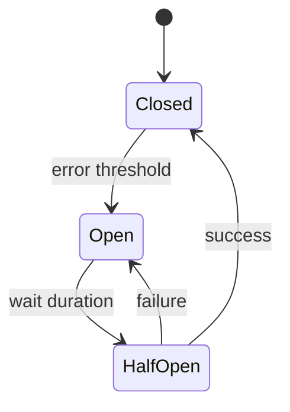

# Módulo 8 · Resiliencia y tolerancia a fallos

En sistemas distribuidos, las fallas son normales: latencia, timeouts, caídas parciales, dependencias lentas. La resiliencia no evita fallos; limita su impacto.

**Entorno de referencia verificado (2026-05-22):** JDK 27.0.1.0.2, Node.js v24.18.0.

## Aprende construyendo

### Tema 1: Resilience4j: Circuit Breaker, Retry, RateLimiter, Bulkhead, TimeLimiter · Avanzado · 240 min

Caso guía: dependencia externa intermitente.

#### Patrones de resiliencia

**Definición formal.** Circuit breaker corta llamadas ante fallos; retry reintenta transitorios; rate limiter limita tasa; bulkhead aísla recursos; time limiter acota espera.



**Ejemplo mínimo (ejecutable, circuit breaker simple).**

```bash
mkdir -p ms12-cb
cd ms12-cb
```

Crea el archivo `cb.mjs`:

```js
let failures = 0; let open = false;
function call(ok) {
  if (open) return 'OPEN';
  if (!ok) { failures++; if (failures >= 2) open = true; return 'ERR'; }
  failures = 0; return 'OK';
}
console.log(call(false));
console.log(call(false));
console.log(call(true));
```

```bash
node cb.mjs
```

**Error común.** Retry sin límite ni backoff. Corrección: max attempts, backoff, jitter, idempotencia.

**Verificación (Node 24.18.0, 2026-05-22).** `ERR`, `ERR`, `OPEN`.

### Tema 2: Timeouts en cascada y presupuesto de latencia · Avanzado · 120 min

Caso guía: A llama B llama C; cada uno espera 10s.

#### Presupuesto de latencia

**Definición formal.** Límite total de tiempo para una request, repartido entre saltos. Los timeouts deben decrecer aguas abajo.

**Error común.** Timeout por defecto o infinito. Corrección: timeout explícito por hop y total.

### Tema 3: Fallback strategies · Intermedio · 120 min

Caso guía: recomendador caído; mostrar catálogo base.

#### Fallback

**Definición formal.** Respuesta alternativa ante falla: caché, valor por defecto, degradación funcional.

**Error común.** Fallback que oculta fallo crítico. Corrección: degradar solo lo tolerable y emitir métrica/log.

### Tema 4: Chaos Engineering con Toxiproxy · Avanzado · 120 min

Caso guía: simular latencia y cortes de red.

#### Chaos/Toxiproxy

**Definición formal.** Toxiproxy es un proxy para simular condiciones de red adversas; chaos engineering valida hipótesis de resiliencia ante fallos controlados.

**Error común.** Probar resiliencia solo en happy path. Corrección: inyectar fallos en staging/controlado.

**Nota de verificación.** Requiere Toxiproxy/Docker; lab reproducible.

## Cierre

Resiliencia es diseño de fallos esperados. Timeouts, límites y degradación evitan que un fallo pequeño tumbe el sistema.

## Checklist

- Timeouts explícitos.
- Retries solo transitorios e idempotentes.
- Circuit breaker/bulkhead donde aplique.
- Fallbacks medidos.
- Pruebas de fallo con chaos controlado.
