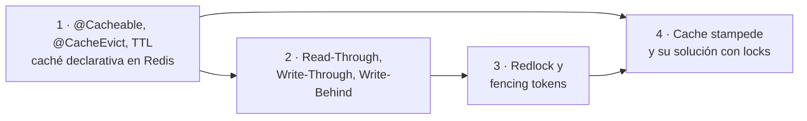
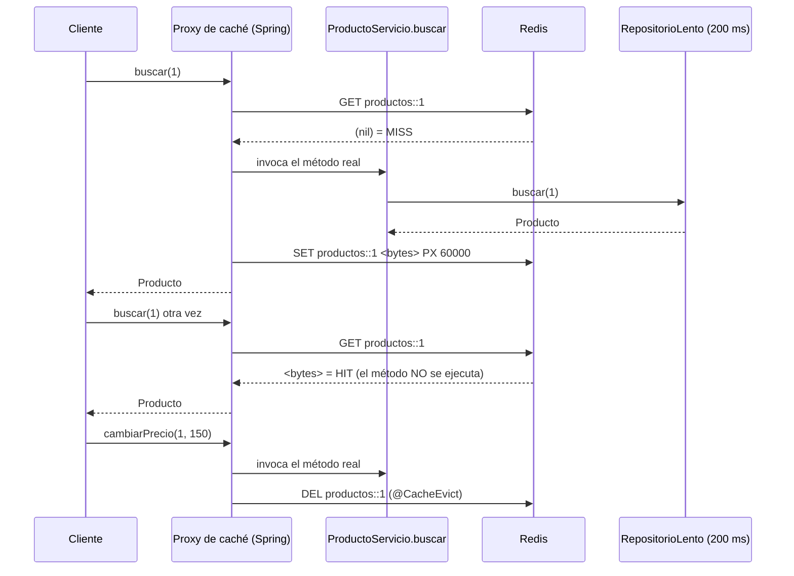
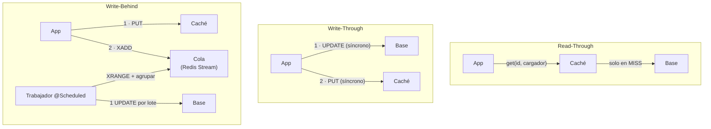
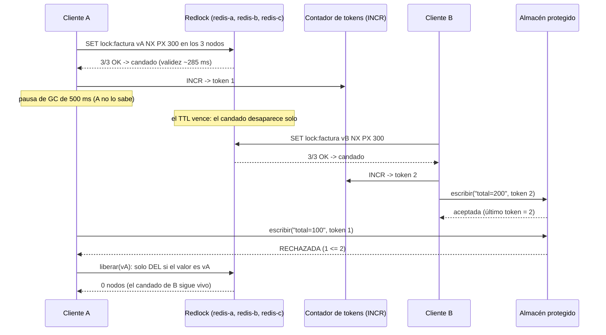
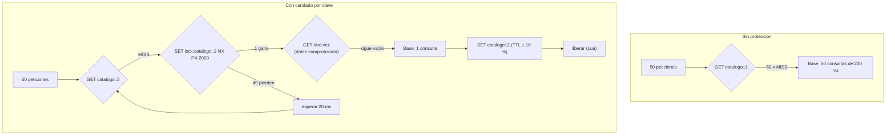

# Módulo 4 · Caching y rendimiento

**Fase 1 · Spring Boot de cero a experto** (segunda mitad de la semana 6 de 12). **Duración:** 10 h (4 temas de
2–3 h). **Dificultad:** 3 de 5 en los temas 1 y 2 y 4 de 5 en los temas 3 y 4. **Dependencias:** Módulo 2 (APIs
REST, JDBC y PostgreSQL) y Módulo 3 (tests con JUnit y `@SpringBootTest`). **Herramientas:**JDK 25 LTS**,
**Spring Boot 4.1.3** (Spring Data Redis 4.1.3 con el cliente Lettuce 7.5.2), **Redis 8.10.2** y **PostgreSQL 18.7**
en Docker Compose, y **Python 3.10+** (solo la biblioteca estándar) para los simuladores. 
de Gradle y los apaga).

Un microservicio rápido no es el que tiene el código más ingenioso, sino el que **no repite trabajo caro**. La caché
guarda resultados para no volver a calcularlos o pedirlos, pero trae tres preguntas difíciles: ¿cuándo deja de
valer un dato guardado?, ¿cómo escribo sin que caché y base se contradigan? y ¿qué pasa cuando muchas instancias
del servicio quieren hacer lo mismo a la vez? Este módulo responde las tres con Redis.



**Texto alternativo:** cuatro temas. El tema 1 (@Cacheable, @CacheEvict y TTL: caché declarativa en Redis) lleva al
tema 2 (patrones Read-Through, Write-Through y Write-Behind) y al tema 4 (cache stampede). El tema 2 lleva al tema 3
(Redlock y fencing tokens), y el tema 3 también lleva al tema 4, que usa un candado para resolver la estampida.

`docker-compose.yml` del módulo:

`docker-compose.yml`:

```yaml
# Módulo 4 (modulo-8) · Caching y rendimiento
# Arranca:   docker compose up -d --wait     (espera a que los 5 healthchecks estén "healthy")
# Detén:     docker compose down              (sin volúmenes: los datos se pierden, a propósito)
# Puertos:   6379 Redis principal (caché, colas, almacén con fencing) · 6380/6381/6382 nodos Redlock · 5432 PostgreSQL
services:
  redis:
    image: redis:8.10.2
    # sin persistencia (ni RDB ni AOF), a propósito: un reinicio borra todo (lo usa el laboratorio de write-behind)
    command: ["redis-server", "--save", "", "--appendonly", "no"]
    ports: ["6379:6379"]
    healthcheck: &redis-salud
      test: ["CMD", "redis-cli", "ping"]
      interval: 2s
      timeout: 3s
      retries: 30
  redis-a:            # tres nodos INDEPENDIENTES (sin réplica entre ellos): lo que pide Redlock
    image: redis:8.10.2
    command: ["redis-server", "--save", "", "--appendonly", "no"]
    ports: ["6380:6379"]
    healthcheck: *redis-salud
  redis-b:
    image: redis:8.10.2
    command: ["redis-server", "--save", "", "--appendonly", "no"]
    ports: ["6381:6379"]
    healthcheck: *redis-salud
  redis-c:
    image: redis:8.10.2
    command: ["redis-server", "--save", "", "--appendonly", "no"]
    ports: ["6382:6379"]
    healthcheck: *redis-salud
  postgres:
    image: postgres:18.7
    environment:
      POSTGRES_USER: tienda
      POSTGRES_PASSWORD: tienda
      POSTGRES_DB: tienda
    ports: ["5432:5432"]
    healthcheck:
      test: ["CMD-SHELL", "pg_isready -h 127.0.0.1 -U tienda -d tienda"]
      interval: 2s
      timeout: 3s
      retries: 30
```

El cliente Redis mínimo que usan los simuladores (`simuladores/resp.py`):

`simuladores/resp.py`:

```python
"""Cliente Redis mínimo (protocolo RESP2) solo con la biblioteca estándar de Python.

Módulo 4 (modulo-8) · Los simuladores hablan con un Redis REAL (el de docker-compose.yml) sin instalar
paquetes: así ves los comandos exactos (SET NX PX, EVAL, INCR...) que también usa el código Spring.
Requisitos: Python 3.10+ (probado con 3.13.18) y Redis 7.0+ (probado con 7.0.15; el laboratorio usa 8.10.2).
"""
import os
import socket

class RespError(Exception):
    """Error devuelto por Redis (respuesta que empieza con '-')."""

class Redis:
    def __init__(self, host: str = "localhost", port: int = 6379, timeout: float = 2.0):
        self.host, self.port = host, port
        self.sock = socket.create_connection((host, port), timeout=timeout)
        self.archivo = self.sock.makefile("rb")

    def ejecutar(self, *partes):
        """Envía un comando como arreglo RESP y devuelve la respuesta ya decodificada."""
        datos = [p if isinstance(p, bytes) else str(p).encode() for p in partes]
        trama = b"*%d\r\n" % len(datos) + b"".join(b"$%d\r\n%s\r\n" % (len(d), d) for d in datos)
        self.sock.sendall(trama)
        return self._leer()

    def _leer(self):
        linea = self.archivo.readline()
        if not linea:
            raise ConnectionError("Redis cerró la conexión")
        tipo, resto = linea[:1], linea[1:-2]
        if tipo == b"+":
            return resto.decode()
        if tipo == b"-":
            raise RespError(resto.decode())
        if tipo == b":":
            return int(resto)
        if tipo == b"$":
            n = int(resto)
            if n == -1:
                return None
            valor = self.archivo.read(n + 2)[:-2]
            return valor.decode()
        if tipo == b"*":
            n = int(resto)
            return None if n == -1 else [self._leer() for _ in range(n)]
        raise RespError(f"respuesta desconocida: {linea!r}")

    def cerrar(self):
        self.sock.close()

def conectar(variable: str = "REDIS_PORT", defecto: int = 6379) -> Redis:
    """Conecta a localhost:<puerto>; el puerto se puede cambiar con una variable de entorno."""
    return Redis(os.environ.get("REDIS_HOST", "localhost"), int(os.environ.get(variable, defecto)))
```

---


### Caching con Redis: @Cacheable, @CacheEvict, TTL

<details open>
<summary><strong>Capa 1 — Lectura</strong></summary>

#### ► DE QUÉ TRATA
Aplicar @Cacheable, @CacheEvict y TTL por caché con Redis en un servicio Spring Boot y medir su efecto; lo compruebas cuando los 3 tests de f037-cache-redis pasan: la segunda lectura no llega al repositorio, la clave productos::1 existe en Redis con un TTL de 60 s o menos, se bor…

#### ► LA IDEA EN UNA FRASE
**Aplicar @Cacheable, @CacheEvict y TTL por caché con Redis en un servicio Spring Boot y medir su efecto; lo compruebas cuando los 3 tests de f037-cache-redis pasan: la segunda lectura no llega al repositorio, la clave productos::1 existe en Redis con un TTL de 60 s o menos, se borra al cambiar el precio y la caché «ofertas» se recarga tras 2 s.**

#### ► POR QUÉ EXISTE ESTO
Pedir un dato a la base de datos cuesta tiempo. Si mil personas piden el mismo producto en un minuto, no tiene sentido preguntarle mil veces a la base: la primera respuesta se guarda en un sitio muy rápido (la caché) y las siguientes se sirven desde ahí.

#### ► LA ANALOGÍA
Piensa en caching con redis: @cacheable, @cacheevict, ttl como una herramienta de taller: útil cuando conoces su propósito y sus límites.
**Dónde se rompe la analogía:** en software, los efectos dependen del contexto, la escala y los trade-offs.

#### ► CÓMO FUNCIONA


1. **Redis** es un servidor que guarda datos en memoria: responde en microsegundos y lo comparten todas las
2. **`@Cacheable`**: «antes de ejecutar este método, mira si ya tengo el resultado guardado».
3. **`@CacheEvict`**: «este método cambia datos: borra la copia guardada».
4. **TTL** (*time to live*, tiempo de vida): cuánto tiempo vale una copia antes de borrarse sola. Es tu red de

#### ► LO QUE PUEDE SALIR MAL
| Síntoma | Causa probable | Arreglo |
|---|---|---|
| Caching con Redis: @Cacheable, @CacheEvict, TTL se aplica pero el resultado no mejora | Se usó sin medir el problema real | Mide antes y compara contra la alternativa simple |
| Aparece complejidad inesperada | Se adoptó la técnica sin comprender sus trade-offs | Vuelve a la sección de trade-offs y reduce el alcance |
| Falla en un caso límite | Se asumió un contexto que no se cumple | Prueba el caso límite y documenta cuándo NO usarlo |

#### ► TRADE-OFFS
| Opción | Cuándo usarla | Cuándo NO usarla |
|---|---|---|
| Usar Caching con Redis: @Cacheable, @CacheEvict, TTL | Cuando el problema coincide con su propósito y el beneficio es observable | Cuando agrega complejidad sin resolver un problema real |
| Alternativa más simple | Cuando el contexto es pequeño, estable o fácil de razonar | Cuando ya demostró no escalar o no cumplir el requisito |
| Postergar la decisión | Cuando falta evidencia del problema | Cuando el costo de esperar es mayor que el costo de probar |

#### ► CUÁNDO NO USAR ESTO
La caché sin TTL ni invalidación («caché eterna»).

#### ► DE VUELTA A LA ANALOGÍA
Volviendo a la analogía: caching con redis: @cacheable, @cacheevict, ttl funciona como el modelo inicial, pero recuerda dónde se rompe: en producción importan la evidencia, la escala y el costo de equivocarte.

#### ► LO QUE DEBES RECORDAR
- **Redis** es un servidor que guarda datos en memoria: responde en microsegundos y lo comparten todas las
- **`@Cacheable`**: «antes de ejecutar este método, mira si ya tengo el resultado guardado».
- **`@CacheEvict`**: «este método cambia datos: borra la copia guardada».
- **TTL** (*time to live*, tiempo de vida): cuánto tiempo vale una copia antes de borrarse sola. Es tu red de

#### ► PREGUNTAS PARA PENSAR
1. ¿Qué problema concreto resuelve caching con redis: @cacheable, @cacheevict, ttl en tu contexto?
2. ¿Cómo sabrías que caching con redis: @cacheable, @cacheevict, ttl no está funcionando bien?
3. ¿Qué alternativa más simple considerarías antes de usar caching con redis: @cacheable, @cacheevict, ttl?

</details>

<details>
<summary><strong>Capa 2 — Construcción</strong></summary>

#### Código de referencia / ejecutable
Versiones: **JDK 25**, **Spring Boot 4.1.3**, **Spring Data Redis 4.1.3**, **Lettuce 7.5.2** (gestionados por el
BOM), **Redis 8.10.2** (`docker-compose.yml` del módulo). Proyecto completo en
`f037-cache-redis`.

> **Build con Gradle (y su equivalencia en Maven).** Este laboratorio se construye con **Gradle 9.9.2** y Kotlin DSL
> mediante el wrapper `./gradlew` (no instalas Gradle). `settings.gradle.kts` lista los subproyectos (en Maven,
> `<modules>` del POM agregador), cada carpeta tiene su `build.gradle.kts` (su `pom.xml`) y
> `gradle/libs.versions.toml` es el **catálogo de versiones** (las `<properties>` y el `dependencyManagement`): por eso
> las dependencias se escriben `libs.…`. Equivalencias: `./mvnw test` → `./gradlew test` ·
> `./mvnw package -DskipTests` → `./gradlew bootJar` · `./mvnw spring-boot:run` → `./gradlew bootRun` ·
> `-Dtest=Clase` → `--tests Clase` · `target/` → `build/` (el jar queda en `build/libs/`). Gradle escribe una línea
> `PASSED` por test y termina con `BUILD SUCCESSFUL` (Maven: `Tests run: N` y `BUILD SUCCESS`).

`modulo-8/settings.gradle.kts`:

```kotlin
// Módulo 4 (modulo-8) · Build multi-proyecto: "./gradlew test" ejecuta los tests de las 4 fichas (F037–F040).
// Todas necesitan "docker compose up -d --wait" antes (Redis 8.10.2 x4 y PostgreSQL 18.7).
// Cada carpeta tiene su propio build.gradle.kts; las versiones viven en gradle/libs.versions.toml
// (catálogo "libs"). Equivale al POM agregador con <modules> de Maven.
pluginManagement {
    repositories {
        gradlePluginPortal()
        mavenCentral()
    }
}
// Sin esto, un alumno sin JDK 25 instalado ve el build morir en la configuración, antes de cualquier test.
plugins {
    id("org.gradle.toolchains.foojay-resolver-convention") version "1.0.0"
}

dependencyResolutionManagement {
    repositories {
        mavenCentral()
    }
}

rootProject.name = "modulo-8-laboratorios"

include(
    "f037-cache-redis",
    "f038-patrones-cache",
    "f039-redlock-fencing",
    "f040-cache-stampede",
)
```

`modulo-8/gradle/libs.versions.toml`:

```toml
# Módulo 4 (modulo-8)
# Catálogo de versiones del laboratorio: una sola fuente para plugins y librerías.
# Las librerías SIN versión las fija el BOM de Spring Boot (spring-boot-dependencies) o el BOM que importe el proyecto.

[versions]
spring-boot = "4.1.3"

[libraries]
spring-boot-starter-webmvc = { module = "org.springframework.boot:spring-boot-starter-webmvc" }
spring-boot-starter-cache = { module = "org.springframework.boot:spring-boot-starter-cache" }
spring-boot-starter-data-redis = { module = "org.springframework.boot:spring-boot-starter-data-redis" }
spring-boot-starter-test = { module = "org.springframework.boot:spring-boot-starter-test" }
junit-platform-launcher = { module = "org.junit.platform:junit-platform-launcher" }
spring-boot-starter-jdbc = { module = "org.springframework.boot:spring-boot-starter-jdbc" }
postgresql = { module = "org.postgresql:postgresql" }

[plugins]
spring-boot = { id = "org.springframework.boot", version.ref = "spring-boot" }
spring-dependency-management = { id = "io.spring.dependency-management", version = "1.1.7" }
```

`f037-cache-redis/build.gradle.kts`:

```kotlin
// F037 · Caching con Redis: @Cacheable, @CacheEvict, TTL (Spring Boot 4.1.3, JDK 25, Redis 8.10.2)
plugins {
    java
    alias(libs.plugins.spring.boot)
    alias(libs.plugins.spring.dependency.management)
}

group = "academia.microservicios"
version = "1.0.0"

java {
    toolchain {
        languageVersion = JavaLanguageVersion.of(25)
    }
}

dependencies {
    // API REST (Spring MVC 7, Tomcat 11)
    implementation(libs.spring.boot.starter.webmvc)
    // Abstracción de caché de Spring (@Cacheable, @CacheEvict...)
    implementation(libs.spring.boot.starter.cache)
    // Spring Data Redis 4.1.3 + Lettuce 7.5.2: con esto Boot crea un RedisCacheManager
    implementation(libs.spring.boot.starter.data.redis)
    // JUnit Jupiter 6.0.3, AssertJ 3.27.7, Mockito 5.23.0
    testImplementation(libs.spring.boot.starter.test)
    // Gradle 9 exige declarar el lanzador de JUnit Platform (ya no lo añade por su cuenta)
    testRuntimeOnly(libs.junit.platform.launcher)
}

tasks.withType<Test> {
    useJUnitPlatform()
    testLogging {
        events("passed", "skipped", "failed")   // una línea por test en la consola
        // el mensaje completo de cada fallo (valor esperado y obtenido), no solo el tipo de excepción
        exceptionFormat = org.gradle.api.tasks.testing.logging.TestExceptionFormat.FULL
    }
}
```

`f037-cache-redis/src/main/resources/application.properties`:

```properties
# F037 · Redis del docker-compose.yml del módulo
spring.data.redis.host=localhost
spring.data.redis.port=6379
# Proveedor de caché explícito: si Redis no está, el arranque falla en vez de caer en un mapa en memoria
spring.cache.type=redis
# TTL por defecto de TODAS las cachés Redis (la caché "ofertas" lo sobrescribe en CacheConfig)
spring.cache.redis.time-to-live=60s
```

`f037-cache-redis/src/main/java/academia/cache/CacheApp.java`:

```java
package academia.cache;

import org.springframework.boot.SpringApplication;
import org.springframework.boot.autoconfigure.SpringBootApplication;

/** F037 · Catálogo con caché en Redis. Arranca con: ../gradlew bootRun (con Redis en localhost:6379). */
@SpringBootApplication
public class CacheApp {
    public static void main(String[] args) {
        SpringApplication.run(CacheApp.class, args);
    }
}
```

`f037-cache-redis/src/main/java/academia/cache/CacheConfig.java`:

```java
package academia.cache;

import java.time.Duration;

import org.springframework.boot.cache.autoconfigure.RedisCacheManagerBuilderCustomizer;
import org.springframework.cache.annotation.EnableCaching;
import org.springframework.context.annotation.Bean;
import org.springframework.context.annotation.Configuration;
import org.springframework.data.redis.cache.RedisCacheConfiguration;
import org.springframework.data.redis.cache.RedisCacheWriter;
import org.springframework.data.redis.connection.RedisConnectionFactory;

/**
 * @EnableCaching activa el proxy que intercepta @Cacheable/@CacheEvict.
 * Va en una clase de configuración (no en la de main), como recomienda la guía de Spring Boot.
 */
@Configuration(proxyBeanMethods = false)
@EnableCaching
class CacheConfig {

    @Bean
    RedisCacheManagerBuilderCustomizer configuracionDeCaches(RedisConnectionFactory redis) {
        return builder -> builder
                // Spring Data Redis 4 con Lettuce escribe en la caché (put, evict, clear) de forma ASÍNCRONA
                // por defecto: justo después de @CacheEvict la clave puede seguir ahí. immediateWrites()
                // hace que cada escritura termine antes de que el método devuelva el control.
                .cacheWriter(RedisCacheWriter.create(redis, writer -> writer.immediateWrites()))
                // TTL por caché: "ofertas" cambia a diario en la vida real; aquí 2 s para verlo expirar en el test.
                .withCacheConfiguration("ofertas",
                        RedisCacheConfiguration.defaultCacheConfig().entryTtl(Duration.ofSeconds(2)));
    }
}
```

`f037-cache-redis/src/main/java/academia/cache/Producto.java`:

```java
package academia.cache;

import java.io.Serializable;

/**
 * Serializable porque el RedisCacheManager por defecto guarda los valores con serialización Java.
 * Sin "implements Serializable" el primer put falla con SerializationException (ver la ficha, punto 12).
 */
public record Producto(long id, String nombre, int precio) implements Serializable {
}
```

`f037-cache-redis/src/main/java/academia/cache/RepositorioLento.java`:

```java
package academia.cache;

import java.util.Map;
import java.util.concurrent.ConcurrentHashMap;
import java.util.concurrent.atomic.AtomicInteger;

import org.springframework.stereotype.Component;

/** Hace de base de datos: tarda 200 ms por consulta y cuenta cuántas veces la llamaron. */
@Component
public class RepositorioLento {

    private final Map<Long, Producto> filas = new ConcurrentHashMap<>(Map.of(
            1L, new Producto(1, "Teclado", 100),
            2L, new Producto(2, "Ratón", 50)));
    private final AtomicInteger consultas = new AtomicInteger();

    public Producto buscar(long id) {
        consultas.incrementAndGet();
        dormir(200);
        Producto p = filas.get(id);
        if (p == null) {
            throw new IllegalArgumentException("No existe el producto " + id);
        }
        return p;
    }

    public void guardar(Producto p) {
        filas.put(p.id(), p);
    }

    public int consultas() {
        return consultas.get();
    }

    public void reiniciarContador() {
        consultas.set(0);
    }

    private static void dormir(long ms) {
        try {
            Thread.sleep(ms);
        } catch (InterruptedException e) {
            Thread.currentThread().interrupt();
        }
    }
}
```

`f037-cache-redis/src/main/java/academia/cache/ProductoServicio.java`:

```java
package academia.cache;

import org.springframework.cache.annotation.CacheEvict;
import org.springframework.cache.annotation.Cacheable;
import org.springframework.stereotype.Service;

@Service
public class ProductoServicio {

    private final RepositorioLento repositorio;

    public ProductoServicio(RepositorioLento repositorio) {
        this.repositorio = repositorio;
    }

    /** 1.ª llamada: MISS -> va al repositorio y guarda en Redis la clave "productos::<id>". Siguientes: HIT. */
    @Cacheable(cacheNames = "productos", key = "#id")
    public Producto buscar(long id) {
        return repositorio.buscar(id);
    }

    /** Cambia el precio y BORRA la entrada: la próxima lectura recarga el valor nuevo. */
    @CacheEvict(cacheNames = "productos", key = "#id")
    public void cambiarPrecio(long id, int precio) {
        Producto actual = repositorio.buscar(id);
        repositorio.guardar(new Producto(id, actual.nombre(), precio));
    }

    /** Caché con TTL propio de 2 s (CacheConfig). La clave es "ofertas::SimpleKey []" (método sin parámetros). */
    @Cacheable(cacheNames = "ofertas")
    public Producto ofertaDelDia() {
        return repositorio.buscar(2);
    }
}
```

`f037-cache-redis/src/main/java/academia/cache/ProductoController.java`:

```java
package academia.cache;

import org.springframework.web.bind.annotation.GetMapping;
import org.springframework.web.bind.annotation.PathVariable;
import org.springframework.web.bind.annotation.PutMapping;
import org.springframework.web.bind.annotation.RequestParam;
import org.springframework.web.bind.annotation.RestController;

@RestController
class ProductoController {

    private final ProductoServicio servicio;

    ProductoController(ProductoServicio servicio) {
        this.servicio = servicio;
    }

    @GetMapping("/productos/{id}")
    Producto buscar(@PathVariable long id) {
        return servicio.buscar(id);
    }

    @PutMapping("/productos/{id}/precio")
    void cambiarPrecio(@PathVariable long id, @RequestParam int valor) {
        servicio.cambiarPrecio(id, valor);
    }

    @GetMapping("/ofertas/hoy")
    Producto oferta() {
        return servicio.ofertaDelDia();
    }
}
```

Test:

`f037-cache-redis/src/test/java/academia/cache/CacheRedisTest.java`:

```java
package academia.cache;

import static org.assertj.core.api.Assertions.assertThat;

import java.util.concurrent.TimeUnit;

import org.junit.jupiter.api.BeforeEach;
import org.junit.jupiter.api.Test;
import org.springframework.beans.factory.annotation.Autowired;
import org.springframework.boot.test.context.SpringBootTest;
import org.springframework.cache.CacheManager;
import org.springframework.data.redis.core.StringRedisTemplate;

/** Necesita el Redis del docker-compose.yml en localhost:6379 (docker compose up -d --wait). */
@SpringBootTest
class CacheRedisTest {

    @Autowired ProductoServicio servicio;
    @Autowired RepositorioLento repositorio;
    @Autowired CacheManager cacheManager;
    @Autowired StringRedisTemplate redis;

    @BeforeEach
    void limpiar() {
        cacheManager.getCache("productos").clear();
        cacheManager.getCache("ofertas").clear();
        repositorio.reiniciarContador();
    }

    @Test
    void laSegundaLecturaSaleDeRedisYLaClaveTieneTtl() {
        servicio.buscar(1);
        servicio.buscar(1);

        assertThat(repositorio.consultas()).isEqualTo(1);
        assertThat(redis.hasKey("productos::1")).isTrue();
        assertThat(redis.getExpire("productos::1", TimeUnit.SECONDS)).isBetween(1L, 60L);
    }

    @Test
    void cacheEvictBorraLaEntradaYLaSiguienteLecturaTraeElPrecioNuevo() {
        servicio.buscar(1);
        servicio.cambiarPrecio(1, 150);

        assertThat(redis.hasKey("productos::1")).isFalse();
        assertThat(servicio.buscar(1).precio()).isEqualTo(150);
        assertThat(repositorio.consultas()).isEqualTo(3); // buscar + cambiarPrecio (lee el nombre) + recarga
    }

    @Test
    void elTtlDeDosSegundosHaceQueLaOfertaSeRecargue() throws InterruptedException {
        servicio.ofertaDelDia();
        servicio.ofertaDelDia();
        assertThat(repositorio.consultas()).isEqualTo(1);

        Thread.sleep(2_500);
        servicio.ofertaDelDia();
        assertThat(repositorio.consultas()).isEqualTo(2);
    }
}
```

</details>

### Patrones: Read-Through, Write-Behind, Write-Through

<details open>
<summary><strong>Capa 1 — Lectura</strong></summary>

#### ► DE QUÉ TRATA
Implementar los patrones Read-Through, Write-Through y Write-Behind sobre Redis y PostgreSQL y comparar su consistencia, latencia y riesgo de pérdida de datos; lo compruebas cuando los 3 tests de f038-patrones-cache y los 3 de patrones de test_simuladores.py pasan, en particular…

#### ► LA IDEA EN UNA FRASE
**Implementar los patrones Read-Through, Write-Through y Write-Behind sobre Redis y PostgreSQL y comparar su consistencia, latencia y riesgo de pérdida de datos; lo compruebas cuando los 3 tests de f038-patrones-cache y los 3 de patrones de test_simuladores.py pasan, en particular cuando 100 cambios de precio llegan a la base en una escritura.**

#### ► POR QUÉ EXISTE ESTO
Hay dos sitios donde vive el mismo dato: la base de datos (lenta, pero segura: es la «verdad») y la caché (rápida, pero temporal). Los patrones responden a dos preguntas:

#### ► LA ANALOGÍA
Piensa en patrones: read-through, write-behind, write-through como una herramienta de taller: útil cuando conoces su propósito y sus límites.
**Dónde se rompe la analogía:** en software, los efectos dependen del contexto, la escala y los trade-offs.

#### ► CÓMO FUNCIONA


1. Hay dos sitios donde vive el mismo dato: la base de datos (lenta, pero segura: es la «verdad») y la caché (rápida, pero temporal).
2. Los patrones responden a dos preguntas:

#### ► LO QUE PUEDE SALIR MAL
| Síntoma | Causa probable | Arreglo |
|---|---|---|
| Patrones: Read-Through, Write-Behind, Write-Through se aplica pero el resultado no mejora | Se usó sin medir el problema real | Mide antes y compara contra la alternativa simple |
| Aparece complejidad inesperada | Se adoptó la técnica sin comprender sus trade-offs | Vuelve a la sección de trade-offs y reduce el alcance |
| Falla en un caso límite | Se asumió un contexto que no se cumple | Prueba el caso límite y documenta cuándo NO usarlo |

#### ► TRADE-OFFS
| Opción | Cuándo usarla | Cuándo NO usarla |
|---|---|---|
| Usar Patrones: Read-Through, Write-Behind, Write-Through | Cuando el problema coincide con su propósito y el beneficio es observable | Cuando agrega complejidad sin resolver un problema real |
| Alternativa más simple | Cuando el contexto es pequeño, estable o fácil de razonar | Cuando ya demostró no escalar o no cumplir el requisito |
| Postergar la decisión | Cuando falta evidencia del problema | Cuando el costo de esperar es mayor que el costo de probar |

#### ► CUÁNDO NO USAR ESTO
La caché como base de datos. Se ve así: el servicio escribe solo en Redis (write-behind sin cola, o con una cola en memoria) y la base «ya se actualizará»:

#### ► DE VUELTA A LA ANALOGÍA
Volviendo a la analogía: patrones: read-through, write-behind, write-through funciona como el modelo inicial, pero recuerda dónde se rompe: en producción importan la evidencia, la escala y el costo de equivocarte.

#### ► LO QUE DEBES RECORDAR
- Hay dos sitios donde vive el mismo dato: la base de datos (lenta, pero segura: es la «verdad») y la caché (rápida, pero temporal).
- Los patrones responden a dos preguntas:

#### ► PREGUNTAS PARA PENSAR
1. ¿Qué problema concreto resuelve patrones: read-through, write-behind, write-through en tu contexto?
2. ¿Cómo sabrías que patrones: read-through, write-behind, write-through no está funcionando bien?
3. ¿Qué alternativa más simple considerarías antes de usar patrones: read-through, write-behind, write-through?

</details>

<details>
<summary><strong>Capa 2 — Construcción</strong></summary>

#### Código de referencia / ejecutable
Versiones: **JDK 25**, **Spring Boot 4.1.3**, **Spring Data Redis 4.1.3**, **driver PostgreSQL 42.7.14**, imágenes
**`redis:8.10.2`** y **`postgres:18.7`**. Proyecto en el código de este tema.

`f038-patrones-cache/build.gradle.kts`:

```kotlin
// F038 · Patrones: Read-Through, Write-Behind, Write-Through (Spring Boot 4.1.3, JDK 25, Redis 8.10.2)
plugins {
    java
    alias(libs.plugins.spring.boot)
    alias(libs.plugins.spring.dependency.management)
}

group = "academia.microservicios"
version = "1.0.0"

java {
    toolchain {
        languageVersion = JavaLanguageVersion.of(25)
    }
}

dependencies {
    // JdbcClient + HikariCP para hablar con PostgreSQL
    implementation(libs.spring.boot.starter.jdbc)
    // Driver JDBC de PostgreSQL 42.7.14 (gestionado por Boot)
    runtimeOnly(libs.postgresql)
    // Abstracción de caché de Spring (@Cacheable, @CacheEvict...)
    implementation(libs.spring.boot.starter.cache)
    // Spring Data Redis 4.1.3 + Lettuce 7.5.2: con esto Boot crea un RedisCacheManager
    implementation(libs.spring.boot.starter.data.redis)
    // JUnit Jupiter 6.0.3, AssertJ 3.27.7, Mockito 5.23.0
    testImplementation(libs.spring.boot.starter.test)
    // Gradle 9 exige declarar el lanzador de JUnit Platform (ya no lo añade por su cuenta)
    testRuntimeOnly(libs.junit.platform.launcher)
}

tasks.withType<Test> {
    useJUnitPlatform()
    testLogging {
        events("passed", "skipped", "failed")   // una línea por test en la consola
        // el mensaje completo de cada fallo (valor esperado y obtenido), no solo el tipo de excepción
        exceptionFormat = org.gradle.api.tasks.testing.logging.TestExceptionFormat.FULL
    }
}
```

`f038-patrones-cache/src/main/resources/application.properties`:

```properties
# F038 · Redis y PostgreSQL del docker-compose.yml del módulo
spring.data.redis.host=localhost
spring.data.redis.port=6379
spring.datasource.url=jdbc:postgresql://localhost:5432/tienda
spring.datasource.username=tienda
spring.datasource.password=tienda
# Crea la tabla y los 2 productos en cada arranque (schema.sql)
spring.sql.init.mode=always
spring.cache.type=redis
spring.cache.redis.time-to-live=60s
# Cada cuánto vacía la cola el trabajador de write-behind
write-behind.intervalo-ms=1000
```

`f038-patrones-cache/src/main/resources/schema.sql`:

```sql
DROP TABLE IF EXISTS producto;
CREATE TABLE producto (id BIGINT PRIMARY KEY, nombre TEXT NOT NULL, precio INT NOT NULL);
INSERT INTO producto VALUES (1, 'Teclado', 100), (2, 'Ratón', 50);
```

`f038-patrones-cache/src/main/java/academia/patrones/PatronesApp.java`:

```java
package academia.patrones;

import org.springframework.boot.SpringApplication;
import org.springframework.boot.autoconfigure.SpringBootApplication;
import org.springframework.cache.annotation.EnableCaching;
import org.springframework.scheduling.annotation.EnableScheduling;

/** F038 · Los tres patrones de escritura/lectura de caché sobre Redis + PostgreSQL. */
@SpringBootApplication
@EnableCaching
@EnableScheduling
public class PatronesApp {
    public static void main(String[] args) {
        SpringApplication.run(PatronesApp.class, args);
    }
}
```

`f038-patrones-cache/src/main/java/academia/patrones/Producto.java`:

```java
package academia.patrones;

import java.io.Serializable;

public record Producto(long id, String nombre, int precio) implements Serializable {
}
```

`f038-patrones-cache/src/main/java/academia/patrones/CacheConfig.java`:

```java
package academia.patrones;

import org.springframework.boot.cache.autoconfigure.RedisCacheManagerBuilderCustomizer;
import org.springframework.context.annotation.Bean;
import org.springframework.context.annotation.Configuration;
import org.springframework.data.redis.cache.RedisCacheWriter;
import org.springframework.data.redis.connection.RedisConnectionFactory;

/**
 * Write-Through promete que, al volver de cambiarPrecio, la caché YA tiene el valor nuevo.
 * Con Lettuce, Spring Data Redis 4 hace put/evict/clear asíncronos por defecto; immediateWrites() lo garantiza.
 */
@Configuration(proxyBeanMethods = false)
class CacheConfig {

    @Bean
    RedisCacheManagerBuilderCustomizer escriturasInmediatas(RedisConnectionFactory redis) {
        return builder -> builder.cacheWriter(RedisCacheWriter.create(redis, writer -> writer.immediateWrites()));
    }
}
```

`f038-patrones-cache/src/main/java/academia/patrones/BaseDeDatos.java`:

```java
package academia.patrones;

import java.util.Map;
import java.util.concurrent.atomic.AtomicInteger;

import org.springframework.jdbc.core.simple.JdbcClient;
import org.springframework.stereotype.Component;
import org.springframework.transaction.support.TransactionTemplate;

/** La fuente de verdad: PostgreSQL. Cuenta lecturas y escrituras para que los tests vean cada patrón. */
@Component
public class BaseDeDatos {

    private final JdbcClient jdbc;
    private final TransactionTemplate tx;
    final AtomicInteger lecturas = new AtomicInteger();
    final AtomicInteger escrituras = new AtomicInteger();

    BaseDeDatos(JdbcClient jdbc, TransactionTemplate tx) {
        this.jdbc = jdbc;
        this.tx = tx;
    }

    public Producto leer(long id) {
        lecturas.incrementAndGet();
        return jdbc.sql("SELECT id, nombre, precio FROM producto WHERE id = ?").param(id)
                .query(Producto.class).single();
    }

    public void cambiarPrecio(long id, int precio) {
        escrituras.incrementAndGet();
        jdbc.sql("UPDATE producto SET precio = ? WHERE id = ?").params(precio, id).update();
    }

    /** Un lote = UNA transacción, por muchos cambios que traiga. */
    public void cambiarPrecios(Map<Long, Integer> cambios) {
        escrituras.incrementAndGet();
        tx.executeWithoutResult(estado -> cambios.forEach((id, precio) ->
                jdbc.sql("UPDATE producto SET precio = ? WHERE id = ?").params(precio, id).update()));
    }
}
```

`f038-patrones-cache/src/main/java/academia/patrones/ReadThrough.java`:

```java
package academia.patrones;

import org.springframework.cache.Cache;
import org.springframework.cache.CacheManager;
import org.springframework.stereotype.Component;

/**
 * READ-THROUGH: quien llama solo pide a la caché; la caché recibe el "cargador" y va a la base en un MISS.
 * Cache.get(clave, cargador) es la API de Spring para eso (es lo que usa @Cacheable(sync = true)).
 */
@Component
public class ReadThrough {

    private final Cache cache;
    private final BaseDeDatos bd;

    ReadThrough(CacheManager caches, BaseDeDatos bd) {
        this.cache = caches.getCache("productos");
        this.bd = bd;
    }

    public Producto obtener(long id) {
        return cache.get(id, () -> bd.leer(id));
    }
}
```

`f038-patrones-cache/src/main/java/academia/patrones/WriteThrough.java`:

```java
package academia.patrones;

import org.springframework.cache.Cache;
import org.springframework.cache.CacheManager;
import org.springframework.stereotype.Component;

/** WRITE-THROUGH: la escritura termina cuando la base Y la caché tienen el valor nuevo. */
@Component
public class WriteThrough {

    private final Cache cache;
    private final BaseDeDatos bd;

    WriteThrough(CacheManager caches, BaseDeDatos bd) {
        this.cache = caches.getCache("productos");
        this.bd = bd;
    }

    public void cambiarPrecio(long id, int precio) {
        bd.cambiarPrecio(id, precio);                   // 1. fuente de verdad primero
        Producto actual = bd.leer(id);
        cache.put(id, actual);                          // 2. caché sincronizada antes de responder
    }
}
```

`f038-patrones-cache/src/main/java/academia/patrones/WriteBehind.java`:

```java
package academia.patrones;

import java.util.LinkedHashMap;
import java.util.List;
import java.util.Map;

import org.springframework.cache.Cache;
import org.springframework.cache.CacheManager;
import org.springframework.data.domain.Range;
import org.springframework.data.redis.connection.stream.MapRecord;
import org.springframework.data.redis.connection.stream.RecordId;
import org.springframework.data.redis.core.StringRedisTemplate;
import org.springframework.scheduling.annotation.Scheduled;
import org.springframework.stereotype.Component;

/**
 * WRITE-BEHIND (write-back): la escritura va a la caché y a una cola (Redis Stream "cola:precios");
 * un trabajador programado vacía la cola en lotes hacia PostgreSQL.
 */
@Component
public class WriteBehind {

    static final String COLA = "cola:precios";
    private final Cache cache;
    private final BaseDeDatos bd;
    private final StringRedisTemplate redis;

    WriteBehind(CacheManager caches, BaseDeDatos bd, StringRedisTemplate redis) {
        this.cache = caches.getCache("productos");
        this.bd = bd;
        this.redis = redis;
    }

    public void cambiarPrecio(long id, String nombre, int precio) {
        cache.put(id, new Producto(id, nombre, precio));                       // el lector ya ve el valor nuevo
        redis.opsForStream().add(COLA, Map.of("id", String.valueOf(id), "precio", String.valueOf(precio)));
    }

    /** Lee toda la cola, se queda con el ÚLTIMO precio de cada producto y escribe un solo lote. */
    @Scheduled(fixedDelayString = "${write-behind.intervalo-ms}")
    public int vaciarCola() {
        List<MapRecord<String, Object, Object>> pendientes = redis.opsForStream().range(COLA, Range.unbounded());
        if (pendientes == null || pendientes.isEmpty()) {
            return 0;
        }
        Map<Long, Integer> ultimos = new LinkedHashMap<>();
        for (MapRecord<String, Object, Object> r : pendientes) {
            ultimos.put(Long.valueOf((String) r.getValue().get("id")), Integer.valueOf((String) r.getValue().get("precio")));
        }
        bd.cambiarPrecios(ultimos);                                              // si falla, la cola sigue intacta
        redis.opsForStream().delete(COLA, pendientes.stream().map(MapRecord::getId).toArray(RecordId[]::new));
        return pendientes.size();
    }
}
```

Test:

`f038-patrones-cache/src/test/java/academia/patrones/PatronesCacheTest.java`:

```java
package academia.patrones;

import static org.assertj.core.api.Assertions.assertThat;

import org.junit.jupiter.api.BeforeEach;
import org.junit.jupiter.api.Test;
import org.springframework.beans.factory.annotation.Autowired;
import org.springframework.boot.test.context.SpringBootTest;
import org.springframework.cache.CacheManager;
import org.springframework.data.redis.core.StringRedisTemplate;
import org.springframework.jdbc.core.simple.JdbcClient;

/** Necesita Redis (6379) y PostgreSQL (5432) del docker-compose.yml. El trabajador programado se "duerme" 10 min. */
@SpringBootTest(properties = "write-behind.intervalo-ms=600000")
class PatronesCacheTest {

    @Autowired ReadThrough readThrough;
    @Autowired WriteThrough writeThrough;
    @Autowired WriteBehind writeBehind;
    @Autowired BaseDeDatos bd;
    @Autowired CacheManager caches;
    @Autowired StringRedisTemplate redis;
    @Autowired JdbcClient jdbc;

    @BeforeEach
    void limpiar() {
        caches.getCache("productos").clear();
        redis.delete(WriteBehind.COLA);
        jdbc.sql("UPDATE producto SET precio = 100 WHERE id = 1").update();
        bd.lecturas.set(0);
        bd.escrituras.set(0);
    }

    private int precioEnBase() {
        return jdbc.sql("SELECT precio FROM producto WHERE id = 1").query(Integer.class).single();
    }

    @Test
    void readThroughConsultaLaBaseUnaSolaVez() {
        readThrough.obtener(1);
        readThrough.obtener(1);
        readThrough.obtener(1);
        assertThat(bd.lecturas.get()).isEqualTo(1);
    }

    @Test
    void writeThroughDejaBaseYCacheIguales() {
        writeThrough.cambiarPrecio(1, 120);
        assertThat(precioEnBase()).isEqualTo(120);
        assertThat(caches.getCache("productos").get(1L, Producto.class).precio()).isEqualTo(120);
    }

    @Test
    void writeBehindAgrupaCienCambiosEnUnaEscritura() {
        for (int precio = 101; precio <= 200; precio++) {
            writeBehind.cambiarPrecio(1, "Teclado", precio);
        }
        assertThat(caches.getCache("productos").get(1L, Producto.class).precio()).isEqualTo(200);
        assertThat(precioEnBase()).isEqualTo(100);                       // la base va por detrás
        assertThat(redis.opsForStream().size(WriteBehind.COLA)).isEqualTo(100L);

        assertThat(writeBehind.vaciarCola()).isEqualTo(100);
        assertThat(precioEnBase()).isEqualTo(200);
        assertThat(bd.escrituras.get()).isEqualTo(1);
        assertThat(redis.opsForStream().size(WriteBehind.COLA)).isZero();
    }
}
```

El mismo razonamiento, comando a comando, en Python (base SQLite con 20 ms de latencia artificial y Redis real):

`simuladores/patrones.py`:

```python
"""F038 · Read-Through, Write-Through y Write-Behind contra un Redis real y una base SQLite.

Uso:  python3 patrones.py          (necesita el Redis de docker-compose.yml en localhost:6379)
Requisitos: Python 3.10+ (solo biblioteca estándar) y Redis 7.0+.
La base es SQLite en memoria con 20 ms de latencia artificial por consulta: hace de PostgreSQL "lento".
"""
import sqlite3
import time

from resp import conectar

LATENCIA_BD = 0.02  # 20 ms por operación de base de datos

class BaseDeDatos:
    def __init__(self):
        self.con = sqlite3.connect(":memory:")
        self.con.execute("CREATE TABLE producto (id INTEGER PRIMARY KEY, nombre TEXT, precio INTEGER)")
        self.con.execute("INSERT INTO producto VALUES (1, 'Teclado', 100), (2, 'Ratón', 50)")
        self.lecturas = 0
        self.escrituras = 0

    def leer(self, id_):
        time.sleep(LATENCIA_BD)
        self.lecturas += 1
        fila = self.con.execute("SELECT nombre, precio FROM producto WHERE id = ?", (id_,)).fetchone()
        return None if fila is None else f"{fila[0]}|{fila[1]}"

    def escribir_precio(self, id_, precio):
        time.sleep(LATENCIA_BD)
        self.escrituras += 1
        self.con.execute("UPDATE producto SET precio = ? WHERE id = ?", (precio, id_))

    def escribir_lote(self, cambios: dict):
        """Una sola transacción para todo el lote (lo que hace rentable el write-behind)."""
        time.sleep(LATENCIA_BD)
        self.escrituras += 1
        with self.con:
            self.con.executemany("UPDATE producto SET precio = ? WHERE id = ?", [(p, i) for i, p in cambios.items()])

class CacheReadThrough:
    """La aplicación solo habla con la caché; la caché sabe cargar desde la base (el 'loader')."""

    def __init__(self, redis, bd, ttl_s=60):
        self.r, self.bd, self.ttl = redis, bd, ttl_s

    def obtener(self, id_):
        clave = f"producto::{id_}"
        valor = self.r.ejecutar("GET", clave)
        if valor is not None:
            return valor, "HIT"
        valor = self.bd.leer(id_)                      # el loader: solo en un MISS
        self.r.ejecutar("SET", clave, valor, "EX", self.ttl)
        return valor, "MISS"

class CacheWriteThrough(CacheReadThrough):
    """Cada escritura va a la base Y a la caché antes de responder: la caché nunca queda vieja."""

    def cambiar_precio(self, id_, precio):
        self.bd.escribir_precio(id_, precio)            # 1. base (fuente de verdad)
        nombre = self.bd.con.execute("SELECT nombre FROM producto WHERE id = ?", (id_,)).fetchone()[0]
        self.r.ejecutar("SET", f"producto::{id_}", f"{nombre}|{precio}", "EX", self.ttl)  # 2. caché

class CacheWriteBehind(CacheReadThrough):
    """La escritura va solo a la caché y a una cola (Redis Stream); un trabajador vacía la cola a la base."""

    COLA = "cola:precios"

    def cambiar_precio(self, id_, precio):
        nombre = self.bd.con.execute("SELECT nombre FROM producto WHERE id = ?", (id_,)).fetchone()[0]
        self.r.ejecutar("SET", f"producto::{id_}", f"{nombre}|{precio}", "EX", self.ttl)
        self.r.ejecutar("XADD", self.COLA, "*", "id", id_, "precio", precio)

    def vaciar_cola(self):
        """El trabajador: lee todo, conserva el ÚLTIMO precio por producto y escribe un solo lote."""
        entradas = self.r.ejecutar("XRANGE", self.COLA, "-", "+") or []
        if not entradas:
            return 0
        cambios = {}
        for _, campos in entradas:
            datos = dict(zip(campos[::2], campos[1::2]))
            cambios[int(datos["id"])] = int(datos["precio"])
        self.bd.escribir_lote(cambios)
        self.r.ejecutar("XDEL", self.COLA, *[e[0] for e in entradas])
        return len(entradas)

def demo_read_through(r):
    bd = BaseDeDatos()
    cache = CacheReadThrough(r, bd)
    r.ejecutar("DEL", "producto::1")
    estados = [cache.obtener(1)[1] for _ in range(3)]
    bd.con.close()
    return {"estados": estados, "lecturas_bd": bd.lecturas}

def demo_write_through(r):
    bd = BaseDeDatos()
    cache = CacheWriteThrough(r, bd)
    r.ejecutar("DEL", "producto::1")
    cache.obtener(1)
    cache.cambiar_precio(1, 120)
    valor, estado = cache.obtener(1)
    precio_bd = bd.leer(1)
    bd.con.close()
    return {"valor": valor, "estado": estado, "precio_bd": precio_bd, "escrituras_bd": bd.escrituras}

def demo_write_behind(r):
    bd = BaseDeDatos()
    cache = CacheWriteBehind(r, bd)
    r.ejecutar("DEL", "producto::1", "producto::2", CacheWriteBehind.COLA)
    inicio = time.perf_counter()
    for precio in range(101, 201):                      # 100 cambios de precio del producto 1
        cache.cambiar_precio(1, precio)
    cache.cambiar_precio(2, 55)
    ms_escribir = (time.perf_counter() - inicio) * 1000
    antes = {"cache": cache.obtener(1)[0], "bd": bd.leer(1), "pendientes": r.ejecutar("XLEN", CacheWriteBehind.COLA)}
    procesadas = cache.vaciar_cola()
    despues = {"bd": bd.leer(1), "pendientes": r.ejecutar("XLEN", CacheWriteBehind.COLA)}
    bd.con.close()
    return {"antes": antes, "procesadas": procesadas, "despues": despues,
            "escrituras_bd": bd.escrituras, "ms_101_escrituras": ms_escribir}

if __name__ == "__main__":
    r = conectar()
    rt = demo_read_through(r)
    print(f"READ-THROUGH   lecturas: {rt['estados']} -> la base se consultó {rt['lecturas_bd']} vez")
    wt = demo_write_through(r)
    print(f"WRITE-THROUGH  caché: {wt['valor']} ({wt['estado']}) | base: {wt['precio_bd']} | escrituras en base: {wt['escrituras_bd']}")
    wb = demo_write_behind(r)
    print(f"WRITE-BEHIND   antes de vaciar -> caché: {wb['antes']['cache']} | base: {wb['antes']['bd']} | pendientes en cola: {wb['antes']['pendientes']}")
    print(f"WRITE-BEHIND   después de vaciar -> base: {wb['despues']['bd']} | pendientes: {wb['despues']['pendientes']} | "
          f"{wb['procesadas']} cambios en {wb['escrituras_bd']} escritura de base")
    print(f"WRITE-BEHIND   101 escrituras de la aplicación tardaron {wb['ms_101_escrituras']:.0f} ms (sin esperar a la base)")
    r.cerrar()
```

</details>

### Distributed Locking con Redlock y Fencing Tokens

<details open>
<summary><strong>Capa 1 — Lectura</strong></summary>

#### ► DE QUÉ TRATA
Implementar un candado distribuido con el algoritmo Redlock sobre 3 nodos Redis y demostrar, con un cliente pausado más allá del TTL, por qué solo un *fencing token* comprobado por el recurso protegido evita la corrupción; lo compruebas cuando los 4 tests de f039-redlock-fencing…

#### ► LA IDEA EN UNA FRASE
**Implementar un candado distribuido con el algoritmo Redlock sobre 3 nodos Redis y demostrar, con un cliente pausado más allá del TTL, por qué solo un *fencing token* comprobado por el recurso protegido evita la corrupción; lo compruebas cuando los 4 tests de f039-redlock-fencing y los 3 de Redlock de test_simuladores.py pasan, y el escenario «SIN fencing» muestra la escritura de B perdida mientras el «CON fencing» la conserva.**

#### ► POR QUÉ EXISTE ESTO
Cuando tu servicio corre en varias copias (instancias), a veces solo una debe hacer algo a la vez: cerrar la factura del día, cobrar un pedido, generar un informe. Un candado distribuido es un «está ocupado» que todas las copias ven. Con Redis se hace con un comando: «guarda esta clave solo si no existe, y bórrala sola en 30 segundos».

#### ► LA ANALOGÍA
Piensa en distributed locking con redlock y fencing tokens como una herramienta de taller: útil cuando conoces su propósito y sus límites.
**Dónde se rompe la analogía:** en software, los efectos dependen del contexto, la escala y los trade-offs.

#### ► CÓMO FUNCIONA


1. Cuando tu servicio corre en varias copias (instancias), a veces solo una debe hacer algo a la vez: cerrar la factura del día, cobrar un pedido, generar un informe.
2. Un candado distribuido es un «está ocupado» que todas las copias ven.
3. Con Redis se hace con un comando: «guarda esta clave solo si no existe, y bórrala sola en 30 segundos».

#### ► LO QUE PUEDE SALIR MAL
| Síntoma | Causa probable | Arreglo |
|---|---|---|
| Distributed Locking con Redlock y Fencing Tokens se aplica pero el resultado no mejora | Se usó sin medir el problema real | Mide antes y compara contra la alternativa simple |
| Aparece complejidad inesperada | Se adoptó la técnica sin comprender sus trade-offs | Vuelve a la sección de trade-offs y reduce el alcance |
| Falla en un caso límite | Se asumió un contexto que no se cumple | Prueba el caso límite y documenta cuándo NO usarlo |

#### ► TRADE-OFFS
| Opción | Cuándo usarla | Cuándo NO usarla |
|---|---|---|
| Usar Distributed Locking con Redlock y Fencing Tokens | Cuando el problema coincide con su propósito y el beneficio es observable | Cuando agrega complejidad sin resolver un problema real |
| Alternativa más simple | Cuando el contexto es pequeño, estable o fácil de razonar | Cuando ya demostró no escalar o no cumplir el requisito |
| Postergar la decisión | Cuando falta evidencia del problema | Cuando el costo de esperar es mayor que el costo de probar |

#### ► CUÁNDO NO USAR ESTO
«Tengo el candado, luego puedo escribir». Código que confía ciegamente en el candado durante una operación larga:

#### ► DE VUELTA A LA ANALOGÍA
Volviendo a la analogía: distributed locking con redlock y fencing tokens funciona como el modelo inicial, pero recuerda dónde se rompe: en producción importan la evidencia, la escala y el costo de equivocarte.

#### ► LO QUE DEBES RECORDAR
- Cuando tu servicio corre en varias copias (instancias), a veces solo una debe hacer algo a la vez: cerrar la factura del día, cobrar un pedido, generar un informe.
- Un candado distribuido es un «está ocupado» que todas las copias ven.
- Con Redis se hace con un comando: «guarda esta clave solo si no existe, y bórrala sola en 30 segundos».

#### ► PREGUNTAS PARA PENSAR
1. ¿Qué problema concreto resuelve distributed locking con redlock y fencing tokens en tu contexto?
2. ¿Cómo sabrías que distributed locking con redlock y fencing tokens no está funcionando bien?
3. ¿Qué alternativa más simple considerarías antes de usar distributed locking con redlock y fencing tokens?

</details>

<details>
<summary><strong>Capa 2 — Construcción</strong></summary>

#### Código de referencia / ejecutable
Versiones: **JDK 25**, **Spring Boot 4.1.3**, **Spring Data Redis 4.1.3**, **Lettuce 7.5.2**, imágenes
**`redis:8.10.2`** (4 instancias). Sin librerías de candados: el algoritmo se ve entero. Proyecto en
`f039-redlock-fencing`.

`f039-redlock-fencing/build.gradle.kts`:

```kotlin
// F039 · Distributed Locking con Redlock y Fencing Tokens (Spring Boot 4.1.3, JDK 25, Redis 8.10.2)
plugins {
    java
    alias(libs.plugins.spring.boot)
    alias(libs.plugins.spring.dependency.management)
}

group = "academia.microservicios"
version = "1.0.0"

java {
    toolchain {
        languageVersion = JavaLanguageVersion.of(25)
    }
}

dependencies {
    // Spring Data Redis 4.1.3 + Lettuce 7.5.2 (sin librerías de candados: el algoritmo se ve entero)
    implementation(libs.spring.boot.starter.data.redis)
    // JUnit Jupiter 6.0.3, AssertJ 3.27.7, Mockito 5.23.0
    testImplementation(libs.spring.boot.starter.test)
    // Gradle 9 exige declarar el lanzador de JUnit Platform (ya no lo añade por su cuenta)
    testRuntimeOnly(libs.junit.platform.launcher)
}

tasks.withType<Test> {
    useJUnitPlatform()
    testLogging {
        events("passed", "skipped", "failed")   // una línea por test en la consola
        // el mensaje completo de cada fallo (valor esperado y obtenido), no solo el tipo de excepción
        exceptionFormat = org.gradle.api.tasks.testing.logging.TestExceptionFormat.FULL
    }
}
```

`f039-redlock-fencing/src/main/resources/application.properties`:

```properties
# F039 · Redis principal (contador de fencing tokens y almacén protegido) del docker-compose.yml
spring.data.redis.host=localhost
spring.data.redis.port=6379
# Tres nodos Redis INDEPENDIENTES para Redlock (redis-a, redis-b, redis-c)
redlock.nodos=localhost:6380,localhost:6381,localhost:6382
```

`f039-redlock-fencing/src/main/java/academia/redlock/RedlockApp.java`:

```java
package academia.redlock;

import java.util.List;

import org.springframework.beans.factory.annotation.Value;
import org.springframework.boot.SpringApplication;
import org.springframework.boot.autoconfigure.SpringBootApplication;
import org.springframework.context.annotation.Bean;

/** F039 · Redlock sobre 3 nodos + fencing tokens comprobados por el almacén. */
@SpringBootApplication
public class RedlockApp {

    public static void main(String[] args) {
        SpringApplication.run(RedlockApp.class, args);
    }

    /** destroyMethod "close": Spring cierra las 3 conexiones al apagar. */
    @Bean(destroyMethod = "close")
    Redlock redlock(@Value("${redlock.nodos}") List<String> nodos) {
        return new Redlock(nodos);
    }
}
```

`f039-redlock-fencing/src/main/java/academia/redlock/Redlock.java`:

```java
package academia.redlock;

import java.time.Duration;
import java.util.ArrayList;
import java.util.List;
import java.util.UUID;

import io.lettuce.core.ClientOptions;
import io.lettuce.core.SocketOptions;
import org.springframework.data.redis.connection.RedisStandaloneConfiguration;
import org.springframework.data.redis.connection.lettuce.LettuceClientConfiguration;
import org.springframework.data.redis.connection.lettuce.LettuceConnectionFactory;
import org.springframework.data.redis.core.RedisCallback;
import org.springframework.data.redis.core.StringRedisTemplate;
import org.springframework.data.redis.core.script.RedisScript;

/**
 * Redlock: el candado existe si se tomó en la MAYORÍA de N nodos Redis independientes
 * y aún queda tiempo de validez (algoritmo de https://redis.io/docs/latest/develop/clients/patterns/distributed-locks/).
 * NO da fencing tokens: para eso está FencingTokens + AlmacenProtegido.
 */
public class Redlock implements AutoCloseable {

    /** Solo borra si el valor sigue siendo el MÍO: nunca suelto el candado de otro. */
    private static final RedisScript<Long> LIBERAR = RedisScript.of(
            "if redis.call('GET', KEYS[1]) == ARGV[1] then return redis.call('DEL', KEYS[1]) else return 0 end",
            Long.class);
    private static final double FACTOR_DERIVA = 0.01;   // 1 % del TTL + 2 ms por deriva de relojes

    private final List<LettuceConnectionFactory> fabricas = new ArrayList<>();
    private final List<StringRedisTemplate> nodos = new ArrayList<>();

    public Redlock(List<String> hostsYPuertos) {
        // Tiempos cortos: un nodo caído no debe comerse la validez del candado.
        LettuceClientConfiguration cliente = LettuceClientConfiguration.builder()
                .commandTimeout(Duration.ofMillis(100))
                .clientOptions(ClientOptions.builder()
                        .socketOptions(SocketOptions.builder().connectTimeout(Duration.ofMillis(100)).build())
                        .build())
                .build();
        for (String hp : hostsYPuertos) {
            String[] partes = hp.trim().split(":");
            var fabrica = new LettuceConnectionFactory(
                    new RedisStandaloneConfiguration(partes[0], Integer.parseInt(partes[1])), cliente);
            fabrica.afterPropertiesSet();
            fabrica.start();
            fabricas.add(fabrica);
            StringRedisTemplate plantilla = new StringRedisTemplate(fabrica);
            try {
                plantilla.execute((RedisCallback<String>) conexion -> conexion.ping());   // abre la conexión ya
            } catch (RuntimeException nodoCaido) {
                // se reintentará en cada adquirir(); cuenta como "no"
            }
            nodos.add(plantilla);
        }
    }

    public int quorum() {
        return nodos.size() / 2 + 1;
    }

    /** Intenta tomar el candado. Devuelve un Candado con valor null si no lo consiguió. */
    public Candado adquirir(String recurso, Duration ttl) {
        String valor = UUID.randomUUID().toString();
        long inicio = System.nanoTime();
        int aciertos = 0;
        for (StringRedisTemplate nodo : nodos) {
            try {
                // SET recurso valor NX PX ttl
                if (Boolean.TRUE.equals(nodo.opsForValue().setIfAbsent(recurso, valor, ttl))) {
                    aciertos++;
                }
            } catch (RuntimeException nodoCaido) {
                // un nodo que no responde cuenta como "no": seguimos con los demás
            }
        }
        long transcurridoMs = (System.nanoTime() - inicio) / 1_000_000;
        long validezMs = ttl.toMillis() - transcurridoMs - (long) (ttl.toMillis() * FACTOR_DERIVA) - 2;
        if (aciertos >= quorum() && validezMs > 0) {
            return new Candado(recurso, valor, aciertos, validezMs);
        }
        liberar(recurso, valor);                            // sin mayoría: deshaz lo parcial
        return new Candado(recurso, null, aciertos, 0);
    }

    /** Devuelve en cuántos nodos se borró el candado (0 si ya no era mío). */
    public int liberar(String recurso, String valor) {
        int liberados = 0;
        for (StringRedisTemplate nodo : nodos) {
            try {
                Long r = nodo.execute(LIBERAR, List.of(recurso), valor);
                liberados += r == null ? 0 : r.intValue();
            } catch (RuntimeException nodoCaido) {
                // el TTL lo borrará solo
            }
        }
        return liberados;
    }

    @Override
    public void close() {
        fabricas.forEach(LettuceConnectionFactory::destroy);
    }

    public record Candado(String recurso, String valor, int nodos, long validezMs) {
        public boolean adquirido() {
            return valor != null;
        }
    }
}
```

`f039-redlock-fencing/src/main/java/academia/redlock/FencingTokens.java`:

```java
package academia.redlock;

import org.springframework.data.redis.core.StringRedisTemplate;
import org.springframework.stereotype.Component;

/**
 * Entrega un número que SIEMPRE crece (INCR es atómico). Quien obtiene el candado pide un token;
 * el almacén rechaza cualquier escritura con un token menor o igual al último que aceptó.
 * Aquí sale de un solo Redis por simplicidad; en producción conviene una fuente con consenso
 * (revisión de etcd, zxid de ZooKeeper o una secuencia de la propia base de datos).
 */
@Component
public class FencingTokens {

    private final StringRedisTemplate redis;

    FencingTokens(StringRedisTemplate redis) {
        this.redis = redis;
    }

    public long siguiente(String recurso) {
        return redis.opsForValue().increment("fencing:" + recurso);
    }
}
```

`f039-redlock-fencing/src/main/java/academia/redlock/AlmacenProtegido.java`:

```java
package academia.redlock;

import java.util.List;

import org.springframework.data.redis.core.StringRedisTemplate;
import org.springframework.data.redis.core.script.RedisScript;
import org.springframework.stereotype.Component;

/** El recurso compartido. Es ÉL quien comprueba el token: el cliente no puede saber que su candado caducó. */
@Component
public class AlmacenProtegido {

    private static final RedisScript<Long> ESCRIBIR = RedisScript.of("""
            local ultimo = tonumber(redis.call('GET', KEYS[2]) or '0')
            if tonumber(ARGV[1]) > ultimo then
              redis.call('SET', KEYS[2], ARGV[1])
              redis.call('SET', KEYS[1], ARGV[2])
              return 1
            end
            return 0
            """, Long.class);

    private final StringRedisTemplate redis;

    AlmacenProtegido(StringRedisTemplate redis) {
        this.redis = redis;
    }

    /** true si aceptó la escritura; false si el token es viejo. */
    public boolean escribir(String clave, String valor, long token) {
        Long r = redis.execute(ESCRIBIR, List.of(clave, clave + ":token"), String.valueOf(token), valor);
        return r != null && r == 1L;
    }

    /** Escritura SIN comprobación: lo que hace la mayoría del código que confía solo en el candado. */
    public void escribirSinFencing(String clave, String valor) {
        redis.opsForValue().set(clave, valor);
    }

    public String leer(String clave) {
        return redis.opsForValue().get(clave);
    }

    public void borrar(String clave) {
        redis.delete(List.of(clave, clave + ":token"));
    }
}
```

Test:

`f039-redlock-fencing/src/test/java/academia/redlock/RedlockFencingTest.java`:

```java
package academia.redlock;

import static org.assertj.core.api.Assertions.assertThat;

import java.time.Duration;
import java.util.List;

import org.junit.jupiter.api.BeforeEach;
import org.junit.jupiter.api.Test;
import org.springframework.beans.factory.annotation.Autowired;
import org.springframework.boot.test.context.SpringBootTest;
import org.springframework.data.redis.core.StringRedisTemplate;

/** Necesita redis (6379) y redis-a/b/c (6380-6382) del docker-compose.yml. */
@SpringBootTest
class RedlockFencingTest {

    static final String RECURSO = "lock:factura-7";

    @Autowired Redlock redlock;
    @Autowired FencingTokens tokens;
    @Autowired AlmacenProtegido almacen;
    @Autowired StringRedisTemplate redis;

    @BeforeEach
    void limpiar() {
        almacen.borrar("factura-7");
        redis.delete("fencing:" + RECURSO);
    }

    @Test
    void conLosTresNodosVivosElCandadoSeTomaYUnSegundoClienteNoPuede() {
        var a = redlock.adquirir(RECURSO, Duration.ofSeconds(1));
        var b = redlock.adquirir(RECURSO, Duration.ofSeconds(1));

        assertThat(a.adquirido()).isTrue();
        assertThat(a.nodos()).isEqualTo(3);
        assertThat(a.validezMs()).isBetween(800L, 988L);
        assertThat(b.adquirido()).isFalse();
        assertThat(redlock.liberar(RECURSO, a.valor())).isEqualTo(3);
    }

    @Test
    void conUnNodoCaidoHayMayoriaYConDosNo() {
        try (var unoCaido = new Redlock(List.of("localhost:6380", "localhost:6381", "localhost:6399"));
             var dosCaidos = new Redlock(List.of("localhost:6380", "localhost:6398", "localhost:6399"))) {
            var conDos = unoCaido.adquirir(RECURSO, Duration.ofSeconds(1));
            assertThat(conDos.adquirido()).isTrue();
            assertThat(conDos.nodos()).isEqualTo(2);
            unoCaido.liberar(RECURSO, conDos.valor());

            var conUno = dosCaidos.adquirir(RECURSO, Duration.ofSeconds(1));
            assertThat(conUno.adquirido()).isFalse();
            assertThat(conUno.nodos()).isEqualTo(1);
        }
    }

    @Test
    void elFencingTokenImpideQueUnClientePausadoPiseAlNuevoDueno() throws InterruptedException {
        var a = redlock.adquirir(RECURSO, Duration.ofMillis(300));
        long tokenA = tokens.siguiente(RECURSO);
        Thread.sleep(500);                                   // pausa de GC: el candado de A caduca

        var b = redlock.adquirir(RECURSO, Duration.ofMillis(300));
        long tokenB = tokens.siguiente(RECURSO);
        assertThat(b.adquirido()).isTrue();
        assertThat(tokenB).isGreaterThan(tokenA);

        assertThat(almacen.escribir("factura-7", "total=200 (B)", tokenB)).isTrue();
        assertThat(almacen.escribir("factura-7", "total=100 (A, tarde)", tokenA)).isFalse();
        assertThat(almacen.leer("factura-7")).isEqualTo("total=200 (B)");
        assertThat(redlock.liberar(RECURSO, a.valor())).isZero();      // A no borra el candado de B
        redlock.liberar(RECURSO, b.valor());
    }

    @Test
    void sinFencingLaEscrituraTardiaGana() throws InterruptedException {
        var a = redlock.adquirir(RECURSO, Duration.ofMillis(300));
        Thread.sleep(500);
        var b = redlock.adquirir(RECURSO, Duration.ofMillis(300));

        almacen.escribirSinFencing("factura-7", "total=200 (B)");
        almacen.escribirSinFencing("factura-7", "total=100 (A, tarde)");
        assertThat(almacen.leer("factura-7")).isEqualTo("total=100 (A, tarde)");   // se perdió lo de B
        redlock.liberar(RECURSO, a.valor());
        redlock.liberar(RECURSO, b.valor());
    }
}
```

Simulador en Python (mismos comandos, ejecutado aquí contra 4 Redis reales):

`simuladores/redlock_fencing.py`:

```python
"""F039 · Redlock (3 nodos Redis) y fencing tokens, contra Redis reales.

Uso:  python3 redlock_fencing.py   (necesita redis-a/b/c en 6380/6381/6382 y redis en 6379; ver docker-compose.yml)
Requisitos: Python 3.10+ (solo biblioteca estándar) y Redis 7.0+.

Reproduce el razonamiento del algoritmo publicado en https://redis.io/docs/latest/develop/clients/patterns/distributed-locks/
y la crítica de Martin Kleppmann (https://martin.kleppmann.com/2016/02/08/how-to-do-distributed-locking.html):
un cliente que se pausa más que el TTL del candado sigue creyendo que lo tiene; solo un fencing token
comprobado por el ALMACÉN evita que su escritura tardía pise la del nuevo dueño.
"""
import os
import secrets
import time

from resp import Redis, RespError

NODOS = [int(p) for p in os.environ.get("REDLOCK_PORTS", "6380,6381,6382").split(",")]
PUERTO_ALMACEN = int(os.environ.get("REDIS_PORT", 6379))
FACTOR_DERIVA = 0.01  # 1 % del TTL + 2 ms, como la implementación de referencia

LIBERAR = """
if redis.call('GET', KEYS[1]) == ARGV[1] then return redis.call('DEL', KEYS[1]) else return 0 end
"""
# El almacén solo acepta una escritura si su token es MAYOR que el último que vio.
ESCRIBIR_CON_FENCING = """
local ultimo = tonumber(redis.call('GET', KEYS[2]) or '0')
if tonumber(ARGV[1]) > ultimo then
  redis.call('SET', KEYS[2], ARGV[1]); redis.call('SET', KEYS[1], ARGV[2]); return 1
end
return 0
"""

def _nodo(puerto):
    try:
        return Redis("localhost", puerto, timeout=0.05)   # timeout corto: un nodo caído no frena al resto
    except OSError:
        return None

class Redlock:
    def __init__(self, puertos=NODOS):
        self.puertos = puertos
        self.quorum = len(puertos) // 2 + 1

    def adquirir(self, recurso, ttl_ms):
        valor = secrets.token_hex(16)                      # identifica a ESTE dueño
        inicio = time.monotonic()
        aciertos = 0
        for puerto in self.puertos:
            r = _nodo(puerto)
            if r is None:
                continue
            try:
                if r.ejecutar("SET", recurso, valor, "NX", "PX", ttl_ms) == "OK":
                    aciertos += 1
            except (OSError, RespError):
                pass
            finally:
                r.cerrar()
        transcurrido = (time.monotonic() - inicio) * 1000
        validez = ttl_ms - transcurrido - (ttl_ms * FACTOR_DERIVA + 2)
        if aciertos >= self.quorum and validez > 0:
            return {"valor": valor, "nodos": aciertos, "validez_ms": validez}
        self.liberar(recurso, valor)                       # no hubo mayoría: deshaz lo parcial
        return {"valor": None, "nodos": aciertos, "validez_ms": 0}

    def liberar(self, recurso, valor):
        liberados = 0
        for puerto in self.puertos:
            r = _nodo(puerto)
            if r is None:
                continue
            try:
                liberados += r.ejecutar("EVAL", LIBERAR, 1, recurso, valor)
            except (OSError, RespError):
                pass
            finally:
                r.cerrar()
        return liberados

def limpiar(recurso):
    for puerto in NODOS + [PUERTO_ALMACEN]:
        r = _nodo(puerto)
        if r:
            r.ejecutar("DEL", recurso, "almacen:factura", "almacen:factura:token", "fencing:" + recurso)
            r.cerrar()

def escenario_mayoria():
    lock = Redlock()
    caido = Redlock(NODOS[:2] + [6399])                      # 6399: un nodo que no responde
    dos_caidos = Redlock(NODOS[:1] + [6398, 6399])
    limpiar("lock:factura")
    a = lock.adquirir("lock:factura", 1000)
    lock.liberar("lock:factura", a["valor"])
    b = caido.adquirir("lock:factura", 1000)
    caido.liberar("lock:factura", b["valor"])
    c = dos_caidos.adquirir("lock:factura", 1000)
    return a, b, c

def escenario_pausa(con_fencing: bool):
    """A toma el candado, se pausa (GC, swap...) más que el TTL; B toma el candado y escribe; A despierta y escribe."""
    limpiar("lock:factura")
    lock = Redlock()
    almacen = Redis("localhost", PUERTO_ALMACEN)
    contador = Redis("localhost", NODOS[0])                 # fuente de tokens (ver la nota del curso)

    a = lock.adquirir("lock:factura", 300)
    token_a = contador.ejecutar("INCR", "fencing:lock:factura")
    time.sleep(0.5)                                          # pausa de 500 ms > TTL de 300 ms

    b = lock.adquirir("lock:factura", 300)
    token_b = contador.ejecutar("INCR", "fencing:lock:factura")

    def escribir(texto, token):
        if con_fencing:
            return almacen.ejecutar("EVAL", ESCRIBIR_CON_FENCING, 2, "almacen:factura", "almacen:factura:token", token, texto)
        almacen.ejecutar("SET", "almacen:factura", texto)
        return 1

    acepta_b = escribir("total=200 (B)", token_b)
    acepta_a = escribir("total=100 (A, tarde)", token_a)    # A no sabe que perdió el candado
    liberados_por_a = lock.liberar("lock:factura", a["valor"])  # A intenta soltar: no debe borrar el de B
    final = almacen.ejecutar("GET", "almacen:factura")
    lock.liberar("lock:factura", b["valor"])
    almacen.cerrar(); contador.cerrar()
    return {"a": a, "b": b, "token_a": token_a, "token_b": token_b, "acepta_b": acepta_b,
            "acepta_a": acepta_a, "liberados_por_a": liberados_por_a, "final": final}

if __name__ == "__main__":
    a, b, c = escenario_mayoria()
    print(f"3 nodos vivos      -> candado: {'SÍ' if a['valor'] else 'NO'} ({a['nodos']}/3 nodos, validez {a['validez_ms']:.0f} ms de 1000)")
    print(f"1 nodo caído       -> candado: {'SÍ' if b['valor'] else 'NO'} ({b['nodos']}/3 nodos, quorum 2)")
    print(f"2 nodos caídos     -> candado: {'SÍ' if c['valor'] else 'NO'} ({c['nodos']}/3 nodos, quorum 2)")
    s = escenario_pausa(con_fencing=False)
    print(f"SIN fencing token  -> A y B creyeron tener el candado; valor final: '{s['final']}'  <- se perdió la escritura de B")
    s = escenario_pausa(con_fencing=True)
    print(f"CON fencing token  -> token A={s['token_a']}, token B={s['token_b']}; almacén acepta B: {s['acepta_b']}, "
          f"acepta A: {s['acepta_a']}; valor final: '{s['final']}'")
    print(f"Liberación segura  -> A intentó soltar tras expirar: borró {s['liberados_por_a']} candados (el de B sigue vivo)")
```

</details>

### Cache stampede y solución con locks

<details open>
<summary><strong>Capa 1 — Lectura</strong></summary>

#### ► DE QUÉ TRATA
Reproducir una estampida de caché con 50 peticiones simultáneas sobre una clave fría y resolverla con un candado por clave en Redis y TTL con *jitter*; lo compruebas cuando el test muestra que, sin protección, más de la mitad de las peticiones van a la base y, con candado, exacta…

#### ► LA IDEA EN UNA FRASE
**Reproducir una estampida de caché con 50 peticiones simultáneas sobre una clave fría y resolverla con un candado por clave en Redis y TTL con *jitter*; lo compruebas cuando el test muestra que, sin protección, más de la mitad de las peticiones van a la base y, con candado, exactamente 1, y el simulador lo confirma con 50 frente a 1.**

#### ► POR QUÉ EXISTE ESTO
Una caché funciona muy bien… hasta el instante en que un dato muy pedido caduca (o el servicio arranca con la caché vacía). En ese instante, todas las peticiones que llegan juntas ven «no está» y todas van a la base a la vez. La base, que normalmente recibe pocas consultas gracias a la caché, recibe de golpe cientos: se pone lenta, las peticiones se acumulan y puede caerse. Eso es una estampida (*cache stampede* o *t…

#### ► LA ANALOGÍA
Piensa en cache stampede y solución con locks como una herramienta de taller: útil cuando conoces su propósito y sus límites.
**Dónde se rompe la analogía:** en software, los efectos dependen del contexto, la escala y los trade-offs.

#### ► CÓMO FUNCIONA


1. Una caché funciona muy bien… hasta el instante en que un dato muy pedido caduca (o el servicio arranca con la caché vacía).
2. En ese instante, todas las peticiones que llegan juntas ven «no está» y todas van a la base a la vez.
3. La base, que normalmente recibe pocas consultas gracias a la caché, recibe de golpe cientos: se pone lenta, las peticiones se acumulan y puede caerse.
4. Eso es una estampida (*cache stampede* o *thundering herd*).

#### ► LO QUE PUEDE SALIR MAL
| Síntoma | Causa probable | Arreglo |
|---|---|---|
| Cache stampede y solución con locks se aplica pero el resultado no mejora | Se usó sin medir el problema real | Mide antes y compara contra la alternativa simple |
| Aparece complejidad inesperada | Se adoptó la técnica sin comprender sus trade-offs | Vuelve a la sección de trade-offs y reduce el alcance |
| Falla en un caso límite | Se asumió un contexto que no se cumple | Prueba el caso límite y documenta cuándo NO usarlo |

#### ► TRADE-OFFS
| Opción | Cuándo usarla | Cuándo NO usarla |
|---|---|---|
| Usar Cache stampede y solución con locks | Cuando el problema coincide con su propósito y el beneficio es observable | Cuando agrega complejidad sin resolver un problema real |
| Alternativa más simple | Cuando el contexto es pequeño, estable o fácil de razonar | Cuando ya demostró no escalar o no cumplir el requisito |
| Postergar la decisión | Cuando falta evidencia del problema | Cuando el costo de esperar es mayor que el costo de probar |

#### ► CUÁNDO NO USAR ESTO
El candado global para «arreglar» la estampida.

#### ► DE VUELTA A LA ANALOGÍA
Volviendo a la analogía: cache stampede y solución con locks funciona como el modelo inicial, pero recuerda dónde se rompe: en producción importan la evidencia, la escala y el costo de equivocarte.

#### ► LO QUE DEBES RECORDAR
- Una caché funciona muy bien… hasta el instante en que un dato muy pedido caduca (o el servicio arranca con la caché vacía).
- En ese instante, todas las peticiones que llegan juntas ven «no está» y todas van a la base a la vez.
- La base, que normalmente recibe pocas consultas gracias a la caché, recibe de golpe cientos: se pone lenta, las peticiones se acumulan y puede caerse.
- Eso es una estampida (*cache stampede* o *thundering herd*).

#### ► PREGUNTAS PARA PENSAR
1. ¿Qué problema concreto resuelve cache stampede y solución con locks en tu contexto?
2. ¿Cómo sabrías que cache stampede y solución con locks no está funcionando bien?
3. ¿Qué alternativa más simple considerarías antes de usar cache stampede y solución con locks?

</details>

<details>
<summary><strong>Capa 2 — Construcción</strong></summary>

#### Código de referencia / ejecutable
Versiones: **JDK 25** (hilos virtuales en el test), **Spring Boot 4.1.3**, **Spring Data Redis 4.1.3**,
**Lettuce 7.5.2**, imagen **`redis:8.10.2`**. Proyecto en el código de este tema.

`f040-cache-stampede/build.gradle.kts`:

```kotlin
// F040 · Cache stampede y solución con locks (Spring Boot 4.1.3, JDK 25, Redis 8.10.2)
plugins {
    java
    alias(libs.plugins.spring.boot)
    alias(libs.plugins.spring.dependency.management)
}

group = "academia.microservicios"
version = "1.0.0"

java {
    toolchain {
        languageVersion = JavaLanguageVersion.of(25)
    }
}

dependencies {
    // Spring Data Redis 4.1.3 + Lettuce 7.5.2 (sin librerías de candados: el algoritmo se ve entero)
    implementation(libs.spring.boot.starter.data.redis)
    // JUnit Jupiter 6.0.3, AssertJ 3.27.7, Mockito 5.23.0
    testImplementation(libs.spring.boot.starter.test)
    // Gradle 9 exige declarar el lanzador de JUnit Platform (ya no lo añade por su cuenta)
    testRuntimeOnly(libs.junit.platform.launcher)
}

tasks.withType<Test> {
    useJUnitPlatform()
    testLogging {
        events("passed", "skipped", "failed")   // una línea por test en la consola
        // el mensaje completo de cada fallo (valor esperado y obtenido), no solo el tipo de excepción
        exceptionFormat = org.gradle.api.tasks.testing.logging.TestExceptionFormat.FULL
    }
}
```

`f040-cache-stampede/src/main/resources/application.properties`:

```properties
# F040 · Redis del docker-compose.yml del módulo
spring.data.redis.host=localhost
spring.data.redis.port=6379
```

`f040-cache-stampede/src/main/java/academia/stampede/StampedeApp.java`:

```java
package academia.stampede;

import org.springframework.boot.SpringApplication;
import org.springframework.boot.autoconfigure.SpringBootApplication;

/** F040 · Estampida de caché y su solución con un candado por clave en Redis. */
@SpringBootApplication
public class StampedeApp {
    public static void main(String[] args) {
        SpringApplication.run(StampedeApp.class, args);
    }
}
```

`f040-cache-stampede/src/main/java/academia/stampede/BaseLenta.java`:

```java
package academia.stampede;

import java.util.concurrent.atomic.AtomicInteger;

import org.springframework.stereotype.Component;

/** Consulta cara: 200 ms. Cuenta cuántas veces la llamaron. */
@Component
public class BaseLenta {

    final AtomicInteger consultas = new AtomicInteger();

    public String descripcion(long id) {
        consultas.incrementAndGet();
        try {
            Thread.sleep(200);
        } catch (InterruptedException e) {
            Thread.currentThread().interrupt();
        }
        return "producto-" + id;
    }
}
```

`f040-cache-stampede/src/main/java/academia/stampede/CargadorConCandado.java`:

```java
package academia.stampede;

import java.time.Duration;
import java.util.List;
import java.util.UUID;
import java.util.concurrent.ThreadLocalRandom;
import java.util.function.Supplier;

import org.springframework.data.redis.core.StringRedisTemplate;
import org.springframework.data.redis.core.script.RedisScript;
import org.springframework.stereotype.Component;

/**
 * Si la clave no está, SOLO quien gana el candado "lock:<clave>" va a la base;
 * los demás esperan unos milisegundos y vuelven a mirar la caché.
 */
@Component
public class CargadorConCandado {

    private static final RedisScript<Long> LIBERAR = RedisScript.of(
            "if redis.call('GET', KEYS[1]) == ARGV[1] then return redis.call('DEL', KEYS[1]) else return 0 end",
            Long.class);
    private static final Duration TTL_CANDADO = Duration.ofSeconds(2);   // > lo que tarda la carga, < paciencia del cliente
    private static final Duration ESPERA = Duration.ofMillis(20);
    private static final Duration PACIENCIA = Duration.ofSeconds(5);

    private final StringRedisTemplate redis;

    CargadorConCandado(StringRedisTemplate redis) {
        this.redis = redis;
    }

    public String obtener(String clave, Duration ttl, Supplier<String> cargar) {
        long limite = System.nanoTime() + PACIENCIA.toNanos();
        while (System.nanoTime() < limite) {
            String valor = redis.opsForValue().get(clave);
            if (valor != null) {
                return valor;                                           // HIT
            }
            String candado = "lock:" + clave;
            String yo = UUID.randomUUID().toString();
            if (Boolean.TRUE.equals(redis.opsForValue().setIfAbsent(candado, yo, TTL_CANDADO))) {
                try {
                    valor = redis.opsForValue().get(clave);             // doble comprobación
                    if (valor == null) {
                        valor = cargar.get();
                        redis.opsForValue().set(clave, valor, conJitter(ttl));
                    }
                    return valor;
                } finally {
                    redis.execute(LIBERAR, List.of(candado), yo);
                }
            }
            dormir(ESPERA);                                             // perdí: espero y vuelvo a mirar
        }
        throw new IllegalStateException("La clave " + clave + " no se llenó en " + PACIENCIA.toSeconds() + " s");
    }

    /** TTL ± 10 %: claves creadas juntas no caducan juntas (evita la estampida sincronizada). */
    static Duration conJitter(Duration ttl) {
        long ms = ttl.toMillis();
        long delta = ms / 10;
        return Duration.ofMillis(ms - delta + ThreadLocalRandom.current().nextLong(2 * delta + 1));
    }

    private static void dormir(Duration d) {
        try {
            Thread.sleep(d);
        } catch (InterruptedException e) {
            Thread.currentThread().interrupt();
            throw new IllegalStateException(e);
        }
    }
}
```

`f040-cache-stampede/src/main/java/academia/stampede/CatalogoServicio.java`:

```java
package academia.stampede;

import java.time.Duration;

import org.springframework.data.redis.core.StringRedisTemplate;
import org.springframework.stereotype.Service;

@Service
public class CatalogoServicio {

    private static final Duration TTL = Duration.ofMinutes(5);
    private final StringRedisTemplate redis;
    private final BaseLenta base;
    private final CargadorConCandado cargador;

    CatalogoServicio(StringRedisTemplate redis, BaseLenta base, CargadorConCandado cargador) {
        this.redis = redis;
        this.base = base;
        this.cargador = cargador;
    }

    /** Cache-aside ingenuo: con la clave fría, TODAS las peticiones simultáneas van a la base. */
    public String sinProteccion(long id) {
        String clave = "catalogo::" + id;
        String valor = redis.opsForValue().get(clave);
        if (valor == null) {
            valor = base.descripcion(id);
            redis.opsForValue().set(clave, valor, TTL);
        }
        return valor;
    }

    /** Igual, pero la recarga pasa por el candado: una sola consulta a la base. */
    public String conCandado(long id) {
        return cargador.obtener("catalogo::" + id, TTL, () -> base.descripcion(id));
    }
}
```

Test (50 hilos virtuales con un disparo de salida común):

`f040-cache-stampede/src/test/java/academia/stampede/StampedeTest.java`:

```java
package academia.stampede;

import static org.assertj.core.api.Assertions.assertThat;

import java.time.Duration;
import java.util.ArrayList;
import java.util.List;
import java.util.concurrent.CountDownLatch;
import java.util.concurrent.Executors;
import java.util.concurrent.Future;
import java.util.function.LongFunction;

import org.junit.jupiter.api.BeforeEach;
import org.junit.jupiter.api.RepeatedTest;
import org.junit.jupiter.api.Test;
import org.springframework.beans.factory.annotation.Autowired;
import org.springframework.boot.test.context.SpringBootTest;
import org.springframework.data.redis.core.StringRedisTemplate;

/** Necesita el Redis del docker-compose.yml en localhost:6379. 50 hilos virtuales piden la misma clave fría. */
@SpringBootTest
class StampedeTest {

    static final int HILOS = 50;

    @Autowired CatalogoServicio catalogo;
    @Autowired BaseLenta base;
    @Autowired StringRedisTemplate redis;

    @BeforeEach
    void limpiar() {
        redis.delete(List.of("catalogo::1", "catalogo::2", "lock:catalogo::2"));
        base.consultas.set(0);
    }

    private List<String> enEstampida(LongFunction<String> peticion, long id) throws Exception {
        var salida = new CountDownLatch(1);
        List<Future<String>> futuros = new ArrayList<>();
        try (var hilos = Executors.newVirtualThreadPerTaskExecutor()) {
            for (int i = 0; i < HILOS; i++) {
                futuros.add(hilos.submit(() -> {
                    salida.await();                         // todos esperan el disparo de salida
                    return peticion.apply(id);
                }));
            }
            salida.countDown();
        }
        List<String> respuestas = new ArrayList<>();
        for (Future<String> f : futuros) {
            respuestas.add(f.get());
        }
        return respuestas;
    }

    @Test
    void sinProteccionCasiTodasLasPeticionesVanALaBase() throws Exception {
        var respuestas = enEstampida(catalogo::sinProteccion, 1);
        System.out.println("SIN protección: " + base.consultas.get() + " consultas a la base");
        assertThat(respuestas).hasSize(HILOS).containsOnly("producto-1");
        assertThat(base.consultas.get()).isGreaterThan(HILOS / 2);
    }

    @Test
    void conCandadoSoloUnaPeticionVaALaBase() throws Exception {
        var respuestas = enEstampida(catalogo::conCandado, 2);
        System.out.println("CON candado: " + base.consultas.get() + " consulta a la base");
        assertThat(respuestas).hasSize(HILOS).containsOnly("producto-2");
        assertThat(base.consultas.get()).isEqualTo(1);
    }

    @RepeatedTest(20)
    void elJitterDejaElTtlEntreEl90YEl110PorCiento() {
        Duration ttl = CargadorConCandado.conJitter(Duration.ofSeconds(100));
        assertThat(ttl.toMillis()).isBetween(90_000L, 110_000L);
    }
}
```

Simulador en Python (50 hilos, base de 200 ms, Redis real):

`simuladores/stampede.py`:

```python
"""F040 · Cache stampede (estampida) y su solución con un candado por clave, contra un Redis real.

Uso:  python3 stampede.py      (necesita el Redis de docker-compose.yml en localhost:6379)
Requisitos: Python 3.10+ (solo biblioteca estándar) y Redis 7.0+.
50 hilos piden a la vez la misma clave fría; la "base de datos" tarda 200 ms por consulta.
"""
import secrets
import threading
import time

from resp import RespError, conectar

HILOS = 50
LATENCIA_BD = 0.2
LIBERAR = "if redis.call('GET', KEYS[1]) == ARGV[1] then return redis.call('DEL', KEYS[1]) else return 0 end"

class Base:
    def __init__(self):
        self.consultas = 0
        self._mutex = threading.Lock()

    def consultar(self, id_):
        with self._mutex:
            self.consultas += 1
        time.sleep(LATENCIA_BD)                            # consulta cara
        return f"producto-{id_}"

def sin_proteccion(r, base, id_):
    clave = f"producto::{id_}"
    valor = r.ejecutar("GET", clave)
    if valor is None:                                      # todos ven MISS a la vez...
        valor = base.consultar(id_)                        # ...y todos van a la base
        r.ejecutar("SET", clave, valor, "EX", 60)
    return valor

def con_candado(r, base, id_, primer_ganador_muere=None, ttl_candado_ms=2000):
    clave, candado = f"producto::{id_}", f"lock:producto::{id_}"
    limite = time.monotonic() + 5
    while time.monotonic() < limite:
        valor = r.ejecutar("GET", clave)
        if valor is not None:
            return valor
        token = secrets.token_hex(8)
        if r.ejecutar("SET", candado, token, "NX", "PX", ttl_candado_ms) == "OK":
            valor = r.ejecutar("GET", clave)               # doble comprobación: otro pudo llenarla
            if valor is None:
                valor = base.consultar(id_)
                if primer_ganador_muere is not None and not primer_ganador_muere.is_set():
                    primer_ganador_muere.set()
                    raise SystemExit                        # el ganador "muere": no escribe ni suelta
                r.ejecutar("SET", clave, valor, "EX", 60)
            r.ejecutar("EVAL", LIBERAR, 1, candado, token)
            return valor
        time.sleep(0.02)                                    # perdedores: esperan y vuelven a mirar la caché
    raise TimeoutError("la caché no se llenó a tiempo")

def carrera(estrategia, id_, **kw):
    r0 = conectar()
    r0.ejecutar("DEL", f"producto::{id_}", f"lock:producto::{id_}")
    r0.cerrar()
    base = Base()
    barrera = threading.Barrier(HILOS)
    resultados, errores = [], []

    def trabajador(n):
        r = conectar()
        barrera.wait()                                      # todos arrancan a la vez
        try:
            resultados.append(estrategia(r, base, id_, **kw))
        except SystemExit:
            errores.append("murió")
        except (TimeoutError, RespError) as e:
            errores.append(str(e))
        finally:
            r.cerrar()

    inicio = time.monotonic()
    hilos = [threading.Thread(target=trabajador, args=(n,)) for n in range(HILOS)]
    for h in hilos:
        h.start()
    for h in hilos:
        h.join()
    return {"consultas": base.consultas, "respuestas": len(resultados), "errores": errores,
            "ms": (time.monotonic() - inicio) * 1000}

if __name__ == "__main__":
    a = carrera(sin_proteccion, 1)
    print(f"SIN protección  -> {a['respuestas']} respuestas, {a['consultas']} consultas a la base")
    b = carrera(con_candado, 2)
    print(f"CON candado     -> {b['respuestas']} respuestas, {b['consultas']} consulta a la base")
    c = carrera(con_candado, 3, primer_ganador_muere=threading.Event(), ttl_candado_ms=500)
    print(f"Ganador muere   -> {c['respuestas']} respuestas, {len(c['errores'])} hilo muerto, {c['consultas']} consultas "
          f"a la base (el candado expiró a los 500 ms y otro hilo recargó) en {c['ms']:.0f} ms")
```

</details>
