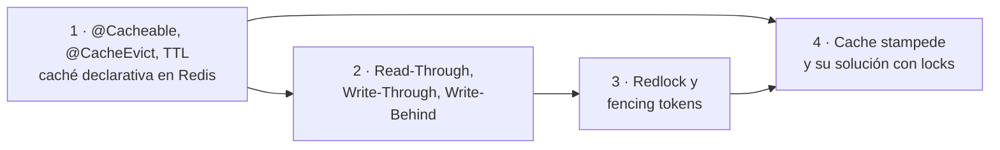
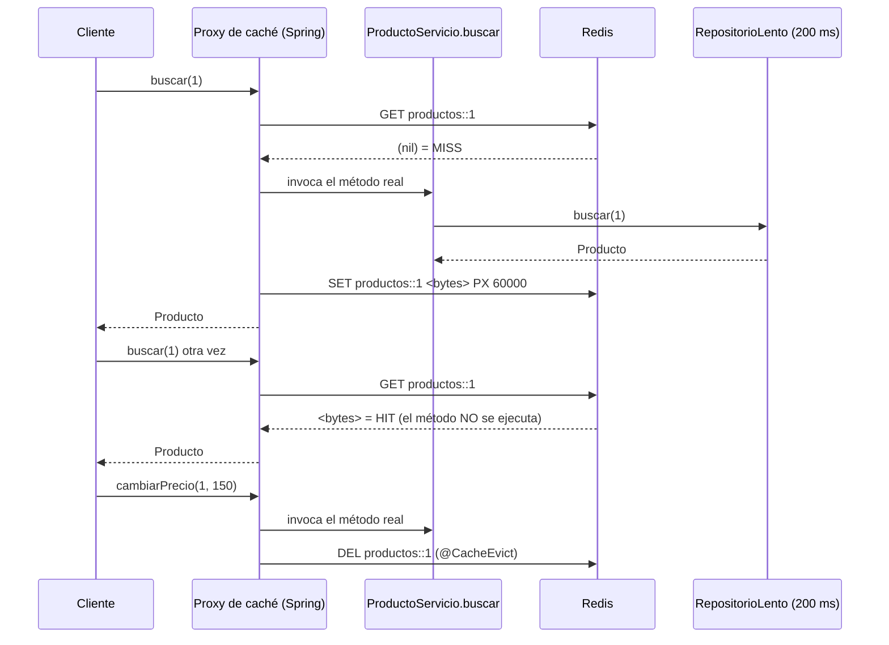
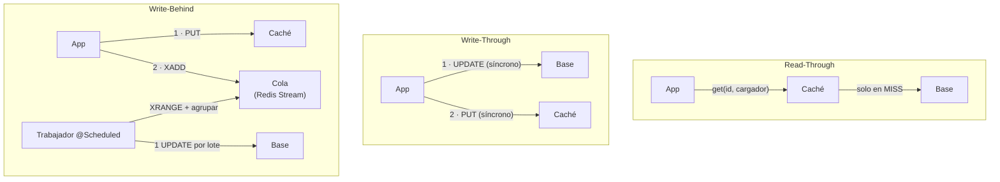
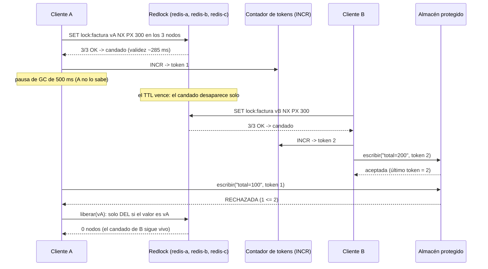
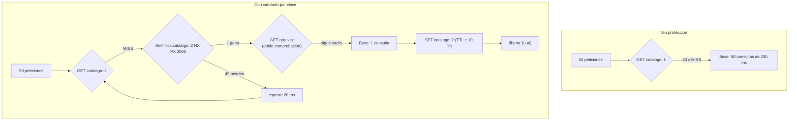

# Módulo 4 · Caching y rendimiento

**Fase 1 · Spring Boot de cero a experto** (segunda mitad de la semana 6 de 12). **Duración:** 10 h (4 temas de
2–3 h). **Dificultad:** 3 de 5 en los temas 1 y 2 y 4 de 5 en los temas 3 y 4. **Dependencias:** Módulo 2 (APIs
REST, JDBC y PostgreSQL) y Módulo 3 (tests con JUnit y `@SpringBootTest`). **Herramientas:** **JDK 25 LTS**,
**Spring Boot 4.1.3** (Spring Data Redis 4.1.3 con el cliente Lettuce 7.5.2), **Redis 8.10.2** y **PostgreSQL 18.7**
en Docker Compose, y **Python 3.10+** (solo la biblioteca estándar) para los simuladores. **Laboratorio:**
`examples/microservicios/modulo-8/` (`./verificar.sh` levanta los contenedores, ejecuta los simuladores y los tests
de Gradle y los apaga).

Un microservicio rápido no es el que tiene el código más ingenioso, sino el que **no repite trabajo caro**. La caché
guarda resultados para no volver a calcularlos o pedirlos, pero trae tres preguntas difíciles: ¿cuándo deja de
valer un dato guardado?, ¿cómo escribo sin que caché y base se contradigan? y ¿qué pasa cuando muchas instancias
del servicio quieren hacer lo mismo a la vez? Este módulo responde las tres con Redis.



**Texto alternativo:** cuatro temas. El tema 1 (@Cacheable, @CacheEvict y TTL: caché declarativa en Redis) lleva al
tema 2 (patrones Read-Through, Write-Through y Write-Behind) y al tema 4 (cache stampede). El tema 2 lleva al tema 3
(Redlock y fencing tokens), y el tema 3 también lleva al tema 4, que usa un candado para resolver la estampida.

**Cómo usar el laboratorio.** Entra en `examples/microservicios/modulo-8`, levanta la infraestructura con
`docker compose up -d --wait` (un Redis principal en 6379, tres Redis independientes en 6380–6382 para Redlock y
PostgreSQL en 5432) y trabaja cada tema en su carpeta con `../gradlew test`. La carpeta `simuladores/` contiene
programas en Python que hablan con **los mismos Redis** usando un cliente mínimo de menos de 60 líneas (`resp.py`), para que
veas cada comando (`SET NX PX`, `EVAL`, `INCR`, `XADD`…) sin capas intermedias. Las salidas de los simuladores de
esta lección son **reales** (se ejecutaron con Python 3.13.18 contra Redis 7.0.15, que tiene los mismos comandos que
8.10.2); las salidas de Gradle quedan pendientes de confirmar en el Mac del dueño
(`verificacion/microservicios/pendiente.md`), porque en el entorno donde se escribió no hay acceso a Maven Central.

`docker-compose.yml` del módulo:

`docker-compose.yml`:

```yaml
# Módulo 4 (modulo-8) · Caching y rendimiento
# Arranca:   docker compose up -d --wait     (espera a que los 5 healthchecks estén "healthy")
# Detén:     docker compose down              (sin volúmenes: los datos se pierden, a propósito)
# Puertos:   6379 Redis principal (caché, colas, almacén con fencing) · 6380/6381/6382 nodos Redlock · 5432 PostgreSQL
services:
  redis:
    image: redis:8.10.2
    # sin persistencia (ni RDB ni AOF), a propósito: un reinicio borra todo (lo usa el laboratorio de write-behind)
    command: ["redis-server", "--save", "", "--appendonly", "no"]
    ports: ["6379:6379"]
    healthcheck: &redis-salud
      test: ["CMD", "redis-cli", "ping"]
      interval: 2s
      timeout: 3s
      retries: 30
  redis-a:            # tres nodos INDEPENDIENTES (sin réplica entre ellos): lo que pide Redlock
    image: redis:8.10.2
    command: ["redis-server", "--save", "", "--appendonly", "no"]
    ports: ["6380:6379"]
    healthcheck: *redis-salud
  redis-b:
    image: redis:8.10.2
    command: ["redis-server", "--save", "", "--appendonly", "no"]
    ports: ["6381:6379"]
    healthcheck: *redis-salud
  redis-c:
    image: redis:8.10.2
    command: ["redis-server", "--save", "", "--appendonly", "no"]
    ports: ["6382:6379"]
    healthcheck: *redis-salud
  postgres:
    image: postgres:18.7
    environment:
      POSTGRES_USER: tienda
      POSTGRES_PASSWORD: tienda
      POSTGRES_DB: tienda
    ports: ["5432:5432"]
    healthcheck:
      test: ["CMD-SHELL", "pg_isready -h 127.0.0.1 -U tienda -d tienda"]
      interval: 2s
      timeout: 3s
      retries: 30
```

El cliente Redis mínimo que usan los simuladores (`simuladores/resp.py`):

`simuladores/resp.py`:

```python
"""Cliente Redis mínimo (protocolo RESP2) solo con la biblioteca estándar de Python.

Módulo 4 (modulo-8) · Los simuladores hablan con un Redis REAL (el de docker-compose.yml) sin instalar
paquetes: así ves los comandos exactos (SET NX PX, EVAL, INCR...) que también usa el código Spring.
Requisitos: Python 3.10+ (probado con 3.13.18) y Redis 7.0+ (probado con 7.0.15; el laboratorio usa 8.10.2).
"""
import os
import socket


class RespError(Exception):
    """Error devuelto por Redis (respuesta que empieza con '-')."""


class Redis:
    def __init__(self, host: str = "localhost", port: int = 6379, timeout: float = 2.0):
        self.host, self.port = host, port
        self.sock = socket.create_connection((host, port), timeout=timeout)
        self.archivo = self.sock.makefile("rb")

    def ejecutar(self, *partes):
        """Envía un comando como arreglo RESP y devuelve la respuesta ya decodificada."""
        datos = [p if isinstance(p, bytes) else str(p).encode() for p in partes]
        trama = b"*%d\r\n" % len(datos) + b"".join(b"$%d\r\n%s\r\n" % (len(d), d) for d in datos)
        self.sock.sendall(trama)
        return self._leer()

    def _leer(self):
        linea = self.archivo.readline()
        if not linea:
            raise ConnectionError("Redis cerró la conexión")
        tipo, resto = linea[:1], linea[1:-2]
        if tipo == b"+":
            return resto.decode()
        if tipo == b"-":
            raise RespError(resto.decode())
        if tipo == b":":
            return int(resto)
        if tipo == b"$":
            n = int(resto)
            if n == -1:
                return None
            valor = self.archivo.read(n + 2)[:-2]
            return valor.decode()
        if tipo == b"*":
            n = int(resto)
            return None if n == -1 else [self._leer() for _ in range(n)]
        raise RespError(f"respuesta desconocida: {linea!r}")

    def cerrar(self):
        self.sock.close()


def conectar(variable: str = "REDIS_PORT", defecto: int = 6379) -> Redis:
    """Conecta a localhost:<puerto>; el puerto se puede cambiar con una variable de entorno."""
    return Redis(os.environ.get("REDIS_HOST", "localhost"), int(os.environ.get(variable, defecto)))
```

---
### Caching con Redis: @Cacheable, @CacheEvict, TTL

#### 1. UBICACIÓN

Módulo 4, Lección 1 de 4 · Fase 1 · 3 h · Laboratorio `examples/microservicios/modulo-8/f037-cache-redis/`.

#### 2. PRERREQUISITOS

- Módulo 1: beans, `@Service`, `@Configuration` y la idea de **proxy** (Spring envuelve tus beans).
- Módulo 2: un `@RestController` con `@GetMapping` y `@PutMapping`.
- Módulo 3: `@SpringBootTest` y AssertJ.
- Docker Compose (Módulo 0.5) para el Redis del laboratorio.

#### 3. OBJETIVO DE APRENDIZAJE

**Aplicar** `@Cacheable`, `@CacheEvict` y TTL por caché con Redis en un servicio Spring Boot y **medir** su efecto;
lo compruebas cuando los 3 tests de `f037-cache-redis` pasan: la segunda lectura no llega al repositorio, la clave
`productos::1` existe en Redis con un TTL de 60 s o menos, se borra al cambiar el precio y la caché «ofertas» se
recarga tras 2 s.

#### 4. ANALOGÍA VISUAL

Dibuja una **biblioteca** con un **mostrador** y un **depósito** en el sótano. Cuando pides un libro por primera
vez, el bibliotecario baja al depósito (200 ms de escaleras: la base de datos) y, al volver, deja una **copia en el
estante del mostrador** con una **etiqueta de caducidad** pegada («vale hasta las 10:01»: el TTL). El siguiente que
pide el mismo libro lo recibe al instante del estante (un *hit*). Si llega una **nueva edición**, el bibliotecario
**retira la copia vieja** del estante (`@CacheEvict`) para que nadie se lleve la versión desactualizada. El estante
tiene compartimentos con nombre («productos», «ofertas») y el compartimento de ofertas tiene etiquetas que caducan
mucho antes.

#### 5. DIAGRAMA TÉCNICO



**Texto alternativo:** diagrama de secuencia. El cliente llama a buscar(1); el proxy de caché de Spring pide a Redis
la clave productos::1 y recibe nil (MISS); entonces ejecuta el método real, que consulta el repositorio lento, y
guarda el resultado en Redis con un TTL de 60 000 ms. En la segunda llamada, Redis devuelve el valor (HIT) y el
método no se ejecuta. Cuando el cliente llama a cambiarPrecio(1, 150), el proxy ejecuta el método y después borra
productos::1 de Redis.

#### 6. EXPLICACIÓN NIVEL 0

Pedir un dato a la base de datos cuesta tiempo. Si mil personas piden el mismo producto en un minuto, no tiene
sentido preguntarle mil veces a la base: la primera respuesta se **guarda** en un sitio muy rápido (la **caché**) y
las siguientes se sirven desde ahí.

- **Redis** es un servidor que guarda datos en memoria: responde en microsegundos y lo comparten todas las
  instancias de tu servicio.
- **`@Cacheable`**: «antes de ejecutar este método, mira si ya tengo el resultado guardado».
- **`@CacheEvict`**: «este método cambia datos: borra la copia guardada».
- **TTL** (*time to live*, tiempo de vida): cuánto tiempo vale una copia antes de borrarse sola. Es tu red de
  seguridad: aunque olvides borrar algo, como mucho estará desactualizado ese tiempo.

#### 7. EXPLICACIÓN INTERMEDIA

- **Activación.** `spring-boot-starter-cache` + `spring-boot-starter-data-redis` y `@EnableCaching` en una clase
  `@Configuration` (la guía de Spring Boot recomienda no ponerla en la clase de `main`). Con Redis en el classpath,
  Boot crea un `RedisCacheManager`; `spring.cache.type=redis` lo hace explícito.
- **Claves.** Cada caché tiene nombre; la clave en Redis es `nombre::clave` (prefijo por defecto de
  `RedisCacheConfiguration`), por ejemplo `productos::1`. `key = "#id"` es una expresión SpEL sobre los parámetros;
  sin `key`, Spring usa todos los parámetros (`SimpleKey`).
- **Valores.** El `RedisCacheManager` por defecto serializa con **serialización Java**: tus objetos deben
  implementar `Serializable` (un `record` también). En Redis verás bytes, no JSON. Para guardar JSON defines tu
  propio bean `RedisCacheConfiguration` con otro serializador.
- **TTL.** Global: `spring.cache.redis.time-to-live=60s`. Por caché: un bean `RedisCacheManagerBuilderCustomizer`
  con `withCacheConfiguration("ofertas", RedisCacheConfiguration.defaultCacheConfig().entryTtl(Duration.ofSeconds(2)))`.
  Redis guarda la clave con expiración (`PX`) y la borra él solo.
- **Escrituras inmediatas.** Desde Spring Data Redis 4.0, con Lettuce, el `RedisCacheWriter` por defecto hace
  `put`, `evict` y `clear` de forma **asíncrona**: el método anotado devuelve el control antes de que Redis haya
  aplicado el cambio (la interfaz `RedisCacheWriter.evict` lo documenta: «Actual eviction may be performed in an
  asynchronous or deferred fashion»). Si necesitas leer tu propia escritura justo después (un test, o un
  `@CacheEvict` seguido de una lectura), crea el writer con `RedisCacheWriter.create(factory, w -> w.immediateWrites())`
  y pásalo con `builder.cacheWriter(...)` en el `RedisCacheManagerBuilderCustomizer`, como hace `CacheConfig`.
- **Otras anotaciones.** `@CachePut` ejecuta siempre el método y guarda el resultado (refresca);
  `@CacheEvict(allEntries = true)` vacía la caché; `@Caching` combina varias; `unless = "#result == null"` evita
  guardar ciertos resultados.
- **El proxy.** Las anotaciones funcionan porque Spring envuelve el bean en un proxy. Una llamada desde **dentro** de
  la misma clase (`this.buscar(id)`) no pasa por el proxy y **no usa la caché**.

#### 8. EXPLICACIÓN MAESTRA

- **Invalidar es el problema difícil.** `@CacheEvict` después de escribir deja una ventana: otra petición puede leer
  el valor viejo de la base y volver a guardarlo justo después del borrado. Mitigaciones: TTL corto, borrar **antes
  y después** (*double delete*), o publicar eventos de cambio (Módulo 11) para que todas las instancias invaliden.
  Elige el TTL según **cuánto tiempo puede un usuario ver un dato viejo sin daño**, no según el rendimiento.
- **Caché local frente a distribuida.** (1) Caffeine en memoria del proceso: nanosegundos, cero red, pero cada
  instancia tiene su copia y se desincronizan. (2) Redis: una copia compartida, ~1 ms de red, un componente más que
  operar. (3) Dos niveles (Caffeine con TTL de segundos delante de Redis): lo mejor de ambos y el doble de
  invalidación. (4) Caché HTTP (`Cache-Control`, CDN): ni siquiera llega a tu servicio, solo para datos públicos.
- **Memoria y expulsión.** Redis sin `maxmemory` crece hasta quedarse sin RAM. En producción fija `maxmemory` y una
  política `maxmemory-policy` (por ejemplo `allkeys-lru`) para que expulse lo menos usado.
- **Cuándo NO cachear:** datos que deben ser exactos en cada lectura (saldo de una cuenta antes de un pago), datos
  que casi nunca se repiten (el *hit ratio* sería bajo y solo sumas latencia y complejidad) o respuestas
  personalizadas por usuario con claves que explotan en número. Mide antes: si la base ya responde en 2 ms con un
  índice, quizá lo que falta es el índice.

#### 9. CÓDIGO EJECUTABLE

Versiones: **JDK 25**, **Spring Boot 4.1.3**, **Spring Data Redis 4.1.3**, **Lettuce 7.5.2** (gestionados por el
BOM), **Redis 8.10.2** (`docker-compose.yml` del módulo). Proyecto completo en
`examples/microservicios/modulo-8/f037-cache-redis/`.

> **Build con Gradle (y su equivalencia en Maven).** Este laboratorio se construye con **Gradle 9.9.2** y Kotlin DSL
> mediante el wrapper `./gradlew` (no instalas Gradle). `settings.gradle.kts` lista los subproyectos (en Maven,
> `<modules>` del POM agregador), cada carpeta tiene su `build.gradle.kts` (su `pom.xml`) y
> `gradle/libs.versions.toml` es el **catálogo de versiones** (las `<properties>` y el `dependencyManagement`): por eso
> las dependencias se escriben `libs.…`. Equivalencias: `./mvnw test` → `./gradlew test` ·
> `./mvnw package -DskipTests` → `./gradlew bootJar` · `./mvnw spring-boot:run` → `./gradlew bootRun` ·
> `-Dtest=Clase` → `--tests Clase` · `target/` → `build/` (el jar queda en `build/libs/`). Gradle escribe una línea
> `PASSED` por test y termina con `BUILD SUCCESSFUL` (Maven: `Tests run: N` y `BUILD SUCCESS`).

`modulo-8/settings.gradle.kts`:

```kotlin
// Módulo 4 (modulo-8) · Build multi-proyecto: "./gradlew test" ejecuta los tests de las 4 fichas (F037–F040).
// Todas necesitan "docker compose up -d --wait" antes (Redis 8.10.2 x4 y PostgreSQL 18.7).
// Cada carpeta tiene su propio build.gradle.kts; las versiones viven en gradle/libs.versions.toml
// (catálogo "libs"). Equivale al POM agregador con <modules> de Maven.
pluginManagement {
    repositories {
        gradlePluginPortal()
        mavenCentral()
    }
}
// Sin esto, un alumno sin JDK 25 instalado ve el build morir en la configuración, antes de cualquier test.
plugins {
    id("org.gradle.toolchains.foojay-resolver-convention") version "1.0.0"
}


dependencyResolutionManagement {
    repositories {
        mavenCentral()
    }
}

rootProject.name = "modulo-8-laboratorios"

include(
    "f037-cache-redis",
    "f038-patrones-cache",
    "f039-redlock-fencing",
    "f040-cache-stampede",
)
```

`modulo-8/gradle/libs.versions.toml`:

```toml
# Módulo 4 (modulo-8)
# Catálogo de versiones del laboratorio: una sola fuente para plugins y librerías.
# Las librerías SIN versión las fija el BOM de Spring Boot (spring-boot-dependencies) o el BOM que importe el proyecto.

[versions]
spring-boot = "4.1.3"

[libraries]
spring-boot-starter-webmvc = { module = "org.springframework.boot:spring-boot-starter-webmvc" }
spring-boot-starter-cache = { module = "org.springframework.boot:spring-boot-starter-cache" }
spring-boot-starter-data-redis = { module = "org.springframework.boot:spring-boot-starter-data-redis" }
spring-boot-starter-test = { module = "org.springframework.boot:spring-boot-starter-test" }
junit-platform-launcher = { module = "org.junit.platform:junit-platform-launcher" }
spring-boot-starter-jdbc = { module = "org.springframework.boot:spring-boot-starter-jdbc" }
postgresql = { module = "org.postgresql:postgresql" }

[plugins]
spring-boot = { id = "org.springframework.boot", version.ref = "spring-boot" }
spring-dependency-management = { id = "io.spring.dependency-management", version = "1.1.7" }
```

`f037-cache-redis/build.gradle.kts`:

```kotlin
// F037 · Caching con Redis: @Cacheable, @CacheEvict, TTL (Spring Boot 4.1.3, JDK 25, Redis 8.10.2)
plugins {
    java
    alias(libs.plugins.spring.boot)
    alias(libs.plugins.spring.dependency.management)
}

group = "academia.microservicios"
version = "1.0.0"

java {
    toolchain {
        languageVersion = JavaLanguageVersion.of(25)
    }
}

dependencies {
    // API REST (Spring MVC 7, Tomcat 11)
    implementation(libs.spring.boot.starter.webmvc)
    // Abstracción de caché de Spring (@Cacheable, @CacheEvict...)
    implementation(libs.spring.boot.starter.cache)
    // Spring Data Redis 4.1.3 + Lettuce 7.5.2: con esto Boot crea un RedisCacheManager
    implementation(libs.spring.boot.starter.data.redis)
    // JUnit Jupiter 6.0.3, AssertJ 3.27.7, Mockito 5.23.0
    testImplementation(libs.spring.boot.starter.test)
    // Gradle 9 exige declarar el lanzador de JUnit Platform (ya no lo añade por su cuenta)
    testRuntimeOnly(libs.junit.platform.launcher)
}

tasks.withType<Test> {
    useJUnitPlatform()
    testLogging {
        events("passed", "skipped", "failed")   // una línea por test en la consola
        // el mensaje completo de cada fallo (valor esperado y obtenido), no solo el tipo de excepción
        exceptionFormat = org.gradle.api.tasks.testing.logging.TestExceptionFormat.FULL
    }
}
```

`f037-cache-redis/src/main/resources/application.properties`:

```properties
# F037 · Redis del docker-compose.yml del módulo
spring.data.redis.host=localhost
spring.data.redis.port=6379
# Proveedor de caché explícito: si Redis no está, el arranque falla en vez de caer en un mapa en memoria
spring.cache.type=redis
# TTL por defecto de TODAS las cachés Redis (la caché "ofertas" lo sobrescribe en CacheConfig)
spring.cache.redis.time-to-live=60s
```

`f037-cache-redis/src/main/java/academia/cache/CacheApp.java`:

```java
package academia.cache;

import org.springframework.boot.SpringApplication;
import org.springframework.boot.autoconfigure.SpringBootApplication;

/** F037 · Catálogo con caché en Redis. Arranca con: ../gradlew bootRun (con Redis en localhost:6379). */
@SpringBootApplication
public class CacheApp {
    public static void main(String[] args) {
        SpringApplication.run(CacheApp.class, args);
    }
}
```

`f037-cache-redis/src/main/java/academia/cache/CacheConfig.java`:

```java
package academia.cache;

import java.time.Duration;

import org.springframework.boot.cache.autoconfigure.RedisCacheManagerBuilderCustomizer;
import org.springframework.cache.annotation.EnableCaching;
import org.springframework.context.annotation.Bean;
import org.springframework.context.annotation.Configuration;
import org.springframework.data.redis.cache.RedisCacheConfiguration;
import org.springframework.data.redis.cache.RedisCacheWriter;
import org.springframework.data.redis.connection.RedisConnectionFactory;

/**
 * @EnableCaching activa el proxy que intercepta @Cacheable/@CacheEvict.
 * Va en una clase de configuración (no en la de main), como recomienda la guía de Spring Boot.
 */
@Configuration(proxyBeanMethods = false)
@EnableCaching
class CacheConfig {

    @Bean
    RedisCacheManagerBuilderCustomizer configuracionDeCaches(RedisConnectionFactory redis) {
        return builder -> builder
                // Spring Data Redis 4 con Lettuce escribe en la caché (put, evict, clear) de forma ASÍNCRONA
                // por defecto: justo después de @CacheEvict la clave puede seguir ahí. immediateWrites()
                // hace que cada escritura termine antes de que el método devuelva el control.
                .cacheWriter(RedisCacheWriter.create(redis, writer -> writer.immediateWrites()))
                // TTL por caché: "ofertas" cambia a diario en la vida real; aquí 2 s para verlo expirar en el test.
                .withCacheConfiguration("ofertas",
                        RedisCacheConfiguration.defaultCacheConfig().entryTtl(Duration.ofSeconds(2)));
    }
}
```

`f037-cache-redis/src/main/java/academia/cache/Producto.java`:

```java
package academia.cache;

import java.io.Serializable;

/**
 * Serializable porque el RedisCacheManager por defecto guarda los valores con serialización Java.
 * Sin "implements Serializable" el primer put falla con SerializationException (ver la ficha, punto 12).
 */
public record Producto(long id, String nombre, int precio) implements Serializable {
}
```

`f037-cache-redis/src/main/java/academia/cache/RepositorioLento.java`:

```java
package academia.cache;

import java.util.Map;
import java.util.concurrent.ConcurrentHashMap;
import java.util.concurrent.atomic.AtomicInteger;

import org.springframework.stereotype.Component;

/** Hace de base de datos: tarda 200 ms por consulta y cuenta cuántas veces la llamaron. */
@Component
public class RepositorioLento {

    private final Map<Long, Producto> filas = new ConcurrentHashMap<>(Map.of(
            1L, new Producto(1, "Teclado", 100),
            2L, new Producto(2, "Ratón", 50)));
    private final AtomicInteger consultas = new AtomicInteger();

    public Producto buscar(long id) {
        consultas.incrementAndGet();
        dormir(200);
        Producto p = filas.get(id);
        if (p == null) {
            throw new IllegalArgumentException("No existe el producto " + id);
        }
        return p;
    }

    public void guardar(Producto p) {
        filas.put(p.id(), p);
    }

    public int consultas() {
        return consultas.get();
    }

    public void reiniciarContador() {
        consultas.set(0);
    }

    private static void dormir(long ms) {
        try {
            Thread.sleep(ms);
        } catch (InterruptedException e) {
            Thread.currentThread().interrupt();
        }
    }
}
```

`f037-cache-redis/src/main/java/academia/cache/ProductoServicio.java`:

```java
package academia.cache;

import org.springframework.cache.annotation.CacheEvict;
import org.springframework.cache.annotation.Cacheable;
import org.springframework.stereotype.Service;

@Service
public class ProductoServicio {

    private final RepositorioLento repositorio;

    public ProductoServicio(RepositorioLento repositorio) {
        this.repositorio = repositorio;
    }

    /** 1.ª llamada: MISS -> va al repositorio y guarda en Redis la clave "productos::<id>". Siguientes: HIT. */
    @Cacheable(cacheNames = "productos", key = "#id")
    public Producto buscar(long id) {
        return repositorio.buscar(id);
    }

    /** Cambia el precio y BORRA la entrada: la próxima lectura recarga el valor nuevo. */
    @CacheEvict(cacheNames = "productos", key = "#id")
    public void cambiarPrecio(long id, int precio) {
        Producto actual = repositorio.buscar(id);
        repositorio.guardar(new Producto(id, actual.nombre(), precio));
    }

    /** Caché con TTL propio de 2 s (CacheConfig). La clave es "ofertas::SimpleKey []" (método sin parámetros). */
    @Cacheable(cacheNames = "ofertas")
    public Producto ofertaDelDia() {
        return repositorio.buscar(2);
    }
}
```

`f037-cache-redis/src/main/java/academia/cache/ProductoController.java`:

```java
package academia.cache;

import org.springframework.web.bind.annotation.GetMapping;
import org.springframework.web.bind.annotation.PathVariable;
import org.springframework.web.bind.annotation.PutMapping;
import org.springframework.web.bind.annotation.RequestParam;
import org.springframework.web.bind.annotation.RestController;

@RestController
class ProductoController {

    private final ProductoServicio servicio;

    ProductoController(ProductoServicio servicio) {
        this.servicio = servicio;
    }

    @GetMapping("/productos/{id}")
    Producto buscar(@PathVariable long id) {
        return servicio.buscar(id);
    }

    @PutMapping("/productos/{id}/precio")
    void cambiarPrecio(@PathVariable long id, @RequestParam int valor) {
        servicio.cambiarPrecio(id, valor);
    }

    @GetMapping("/ofertas/hoy")
    Producto oferta() {
        return servicio.ofertaDelDia();
    }
}
```

Test:

`f037-cache-redis/src/test/java/academia/cache/CacheRedisTest.java`:

```java
package academia.cache;

import static org.assertj.core.api.Assertions.assertThat;

import java.util.concurrent.TimeUnit;

import org.junit.jupiter.api.BeforeEach;
import org.junit.jupiter.api.Test;
import org.springframework.beans.factory.annotation.Autowired;
import org.springframework.boot.test.context.SpringBootTest;
import org.springframework.cache.CacheManager;
import org.springframework.data.redis.core.StringRedisTemplate;

/** Necesita el Redis del docker-compose.yml en localhost:6379 (docker compose up -d --wait). */
@SpringBootTest
class CacheRedisTest {

    @Autowired ProductoServicio servicio;
    @Autowired RepositorioLento repositorio;
    @Autowired CacheManager cacheManager;
    @Autowired StringRedisTemplate redis;

    @BeforeEach
    void limpiar() {
        cacheManager.getCache("productos").clear();
        cacheManager.getCache("ofertas").clear();
        repositorio.reiniciarContador();
    }

    @Test
    void laSegundaLecturaSaleDeRedisYLaClaveTieneTtl() {
        servicio.buscar(1);
        servicio.buscar(1);

        assertThat(repositorio.consultas()).isEqualTo(1);
        assertThat(redis.hasKey("productos::1")).isTrue();
        assertThat(redis.getExpire("productos::1", TimeUnit.SECONDS)).isBetween(1L, 60L);
    }

    @Test
    void cacheEvictBorraLaEntradaYLaSiguienteLecturaTraeElPrecioNuevo() {
        servicio.buscar(1);
        servicio.cambiarPrecio(1, 150);

        assertThat(redis.hasKey("productos::1")).isFalse();
        assertThat(servicio.buscar(1).precio()).isEqualTo(150);
        assertThat(repositorio.consultas()).isEqualTo(3); // buscar + cambiarPrecio (lee el nombre) + recarga
    }

    @Test
    void elTtlDeDosSegundosHaceQueLaOfertaSeRecargue() throws InterruptedException {
        servicio.ofertaDelDia();
        servicio.ofertaDelDia();
        assertThat(repositorio.consultas()).isEqualTo(1);

        Thread.sleep(2_500);
        servicio.ofertaDelDia();
        assertThat(repositorio.consultas()).isEqualTo(2);
    }
}
```

#### 10. MINI-LABORATORIO

1. Levanta Redis y arranca la app:

```bash
cd examples/microservicios/modulo-8
docker compose up -d --wait redis
cd f037-cache-redis && ../gradlew bootRun
```

2. En otra terminal, mide la primera y la segunda lectura:

```bash
curl -s -o /dev/null -w "%{time_total}\n" localhost:8080/productos/1
curl -s -o /dev/null -w "%{time_total}\n" localhost:8080/productos/1
```

   **Output esperado:** la primera tarda algo más de 0,2 s (el repositorio duerme 200 ms) y la segunda unos pocos
   milisegundos, por ejemplo `0.236117` y `0.004512` (los números exactos varían).

3. Mira la clave en Redis (desde `examples/microservicios/modulo-8`):

```bash
docker compose exec redis redis-cli --scan --pattern 'productos::*'
docker compose exec redis redis-cli TTL productos::1
```

   **Output esperado:**

```text
productos::1
(integer) 57
```

   **Captura comentada:** el TTL baja cada segundo desde 60. Si ejecutas `GET productos::1` verás bytes que empiezan
   por `\xac\xed\x00\x05`: la marca de la serialización Java, no JSON.

4. Cambia el precio y comprueba que la clave desaparece:

```bash
curl -s -X PUT "localhost:8080/productos/1/precio?valor=150"
docker compose exec redis redis-cli TTL productos::1
curl -s localhost:8080/productos/1; echo
```

   **Output esperado:**

```text
(integer) -2
{"id":1,"nombre":"Teclado","precio":150}
```

   `-2` significa que la clave no existe: `@CacheEvict` la borró, y la siguiente lectura trajo el precio nuevo.
   (`-1` significaría «existe pero sin TTL».)

5. Con el mismo cliente mínimo de los simuladores puedes ver la mecánica de TTL de Redis sin Spring. Desde
   `simuladores/`:

```bash
python3 -c "from resp import conectar; r=conectar(); print(r.ejecutar('SET','demo','x','EX',60), r.ejecutar('TTL','demo'), r.ejecutar('TTL','no-existe'))"
```

   **Output esperado** (real, ejecutado contra Redis 7.0.15): `OK 60 -2`.

#### 11. VERIFICACIÓN

Test que debe pasar (con `docker compose up -d --wait redis`):

```bash
cd examples/microservicios/modulo-8/f037-cache-redis
../gradlew test
```

**Output esperado:** 3 líneas `PASSED` (una por test) y `BUILD SUCCESSFUL` *(salida de Gradle pendiente de verificación en el Mac)*. El test del TTL tarda
unos 2,5 s a propósito.

**Pregunta de comprobación:** añades en `ProductoServicio` un método `buscarDos(long a, long b)` que hace
`return List.of(buscar(a), buscar(b));`. ¿Usa la caché?

<details>
<summary>Respuesta</summary>

No. `buscar(a)` dentro de la misma clase es una llamada a `this`, no al proxy que Spring puso alrededor del bean,
así que `@Cacheable` no se aplica y cada llamada va al repositorio. Solución: llamar a `buscar` desde otro bean
(por ejemplo, el controller) o mover la lógica a otra clase.
</details>

#### 12. ERROR COMÚN

**Síntoma:** quitas `implements Serializable` de `Producto` (o cacheas una clase que no lo implementa) y la primera
petición devuelve 500.

**Cómo se ve** (cadena de causas en el log):

```text
org.springframework.data.redis.serializer.SerializationException: Cannot serialize
Caused by: org.springframework.core.serializer.support.SerializationFailedException: Failed to serialize object using DefaultSerializer
Caused by: java.lang.IllegalArgumentException: DefaultSerializer requires a Serializable payload but received an object of type [academia.cache.Producto]
```

(textos de `JdkSerializationRedisSerializer` en Spring Data Redis y de `SerializingConverter` y `DefaultSerializer`
en Spring Framework).

**Diagnóstico visual:** lee la **última** `Caused by`: nombra la clase que no se pudo convertir en bytes. Dibuja el
camino del dato: método → proxy → serializador → Redis; el corte está en el serializador, no en Redis.

**Arreglo:** `implements Serializable`, o configura un `RedisCacheConfiguration` con un serializador JSON y guarda
DTOs pensados para la caché (no entidades JPA con relaciones perezosas).

**Otro clásico, sin mensaje de error:** la caché «no hace nada» porque llamas al método `@Cacheable` desde la misma
clase (pregunta de la sección 11). Se diagnostica con un contador como `RepositorioLento.consultas()` o con
`redis-cli MONITOR`: si no aparece ningún `GET productos::…`, el proxy no intervino.

**Tercer caso, propio de Spring Data Redis 4:** sin `immediateWrites()`, un test que comprueba la clave justo
después de `@CacheEvict` falla de vez en cuando:

```text
java.lang.AssertionError:
Expecting value to be false but was true
```

(salida real de `assertThat(redis.hasKey("productos::1")).isFalse()` en la primera versión de este laboratorio, en
el Mac del autor). La eviction no se perdió: llegó a Redis milisegundos después, porque el writer por defecto escribe
de forma asíncrona. Se diagnostica repitiendo la comprobación tras un `Thread.sleep(50)` (pasa) o con
`redis-cli MONITOR` (el `DEL` aparece después del `EXISTS` del test). Arreglo: `immediateWrites()` en el writer, como
en `CacheConfig`.

#### 13. PREGUNTA DE ENTREVISTA

«¿Cómo eliges el TTL de una caché y cómo invalidas cuando el dato cambia?»

**Respuesta modelo:** el TTL lo decide el negocio: cuánto tiempo es aceptable que un usuario vea un dato viejo
(segundos para stock, horas para un catálogo de categorías). Es la red de seguridad, no el mecanismo principal.
Para invalidar, si la escritura pasa por mi servicio uso `@CacheEvict` (o `@CachePut` si quiero refrescar) en la
misma operación; si el dato cambia en otro servicio, escucho un evento de cambio (Kafka o CDC con Debezium) y borro
la clave. Conozco la carrera entre leer-viejo y borrar, y la mitigo con TTL corto o borrado doble. Añado jitter al
TTL para que claves creadas juntas no caduquen juntas, fijo `maxmemory` y política de expulsión en Redis y mido el
*hit ratio* para saber si la caché merece la pena.

#### 14. ANTI-PATRÓN RELACIONADO

**La caché sin TTL ni invalidación («caché eterna»).**

```properties
# MAL: sin spring.cache.redis.time-to-live -> las entradas no caducan nunca
spring.cache.type=redis
```

```java
@Cacheable("productos")            // y ningún @CacheEvict en los métodos que modifican productos
public Producto buscar(long id) { ... }
```

Se ve en producción como «el cambio de precio no aparece hasta que reiniciamos Redis» y un Redis que no deja de
crecer. Toda caché necesita un TTL y una forma de invalidar.

---
### Patrones: Read-Through, Write-Behind, Write-Through

#### 1. UBICACIÓN

Módulo 4, Lección 2 de 4 · Fase 1 · 2,5 h · Laboratorio `examples/microservicios/modulo-8/f038-patrones-cache/` y
`examples/microservicios/modulo-8/simuladores/patrones.py`.

#### 2. PRERREQUISITOS

- Lección 1 de este módulo (Redis, TTL, `CacheManager` y claves `nombre::clave`).
- Módulo 2: SQL `SELECT`/`UPDATE` y transacciones con PostgreSQL.
- Saber qué es una cola (lista de tareas pendientes en orden de llegada).

#### 3. OBJETIVO DE APRENDIZAJE

**Implementar** los patrones Read-Through, Write-Through y Write-Behind sobre Redis y PostgreSQL y **comparar** su
consistencia, latencia y riesgo de pérdida de datos; lo compruebas cuando los 3 tests de `f038-patrones-cache` y
los 3 de patrones de `test_simuladores.py` pasan, en particular cuando 100 cambios de precio llegan a la base en
**una** escritura.

#### 4. ANALOGÍA VISUAL

Dibuja un **restaurante** con una **pizarra** en la entrada (la caché) y el **libro de cuentas** en la oficina (la
base de datos).

- **Read-Through:** el cliente solo mira la pizarra. Si el plato del día no está escrito, el **mesero** va a la
  cocina, pregunta y lo escribe él mismo en la pizarra antes de contestar. El cliente nunca entra en la cocina.
- **Write-Through:** cuando cambia un precio, el encargado lo anota **en el libro y en la pizarra** antes de decir
  «listo». Lento, pero las dos coinciden siempre.
- **Write-Behind:** el encargado cambia la pizarra al instante y deja un **papelito en una bandeja** («precio del
  teclado: 200»). Al final de cada hora, el contador vacía la bandeja y apunta solo el **último** papel de cada
  plato en el libro. Rapidísimo… y si alguien tira la bandeja a la basura antes de la hora, esos cambios se pierden.

#### 5. DIAGRAMA TÉCNICO



**Texto alternativo:** tres recuadros. Read-Through: la app pide a la caché con un cargador y solo en un MISS la
caché consulta la base. Write-Through: la app escribe primero en la base y después en la caché, ambas de forma
síncrona. Write-Behind: la app escribe en la caché y añade el cambio a una cola (Redis Stream); un trabajador
programado lee la cola, agrupa los cambios y escribe un lote en la base.

#### 6. EXPLICACIÓN NIVEL 0

Hay dos sitios donde vive el mismo dato: la **base de datos** (lenta, pero segura: es la «verdad») y la **caché**
(rápida, pero temporal). Los patrones responden a dos preguntas:

1. **Al leer**, ¿quién va a la base cuando la caché no tiene el dato? En **Read-Through**, la propia caché (tu código
   solo habla con la caché).
2. **Al escribir**, ¿cuándo se entera la base? En **Write-Through**, en el mismo momento (más lento, siempre
   coherente). En **Write-Behind**, un poco después, en grupo (muy rápido, pero la base va por detrás y puedes
   perder cambios si algo falla en medio).

#### 7. EXPLICACIÓN INTERMEDIA

- **Cache-aside frente a Read-Through.** En *cache-aside* tu código hace `GET`; si no está, consulta la base y hace
  `SET`. En *read-through* entregas a la caché un **cargador** y ella hace todo: en Spring, `Cache.get(clave,
  Callable)`. `@Cacheable` es cache-aside escrito por el framework; `@Cacheable(sync = true)` usa precisamente
  `Cache.get(clave, cargador)`.
- **Write-Through.** La operación termina cuando base **y** caché tienen el valor nuevo (`UPDATE` y luego
  `cache.put`). Ojo: en Spring Data Redis 4 con Lettuce, `cache.put` es asíncrono por defecto; para cumplir la
  promesa del patrón, `CacheConfig` configura el writer con `immediateWrites()` (Lección 1, sección 7). Lecturas posteriores son *hits* con el dato correcto. Coste: cada escritura paga la latencia de
  ambas. Si usas transacciones, pon la caché **después del commit**: Spring ofrece `TransactionAwareCacheDecorator`
  (o `transactionAware()` en el `RedisCacheManager`) para retrasar el `put` hasta que la transacción confirma.
- **Write-Behind (write-back).** La escritura actualiza la caché y deja el cambio en una **cola duradera**; aquí un
  **Redis Stream** (`XADD cola:precios * id 1 precio 200`). Un `@Scheduled` lee (`XRANGE`), **agrupa** (se queda con
  el último precio por producto), escribe **un lote en una transacción** y, solo si la base confirmó, borra lo
  procesado (`XDEL`). Si la base falla, la cola sigue intacta y se reintenta.
- **Medición.** En `simuladores/patrones.py`, 101 escrituras de la aplicación tardan unos 10 ms con write-behind
  (no esperan a la base) y llegan a la base en 1 sola escritura.

#### 8. EXPLICACIÓN MAESTRA

| Patrón | Latencia de escritura | Consistencia caché/base | Riesgo | Úsalo cuando |
|---|---|---|---|---|
| Cache-aside | — (solo lectura) | eventual (TTL/evict) | lecturas viejas tras escribir | por defecto; la mayoría de servicios |
| Read-Through | — | igual que cache-aside | el cargador oculta errores de la base | quieres centralizar la carga y protegerla (`sync`) |
| Write-Through | alta (base + caché) | fuerte tras cada escritura | escrituras más lentas; caché llena de datos que nadie lee | lees mucho lo que acabas de escribir |
| Write-Behind | mínima | la base va por detrás | **pérdida de datos** si la cola no es duradera; orden y duplicados | contadores, métricas, estados de alta frecuencia donde perder segundos es aceptable |

- **Durabilidad de la cola.** Con una cola en memoria del proceso, un reinicio pierde cambios. Con Redis Stream
  sobrevive al reinicio del servicio, pero no a la pérdida de Redis si no tiene persistencia (AOF con
  `appendfsync everysec` pierde como mucho ~1 s). Para datos de negocio que no pueden perderse, la alternativa
  correcta suele ser escribir en la base y propagar con **Outbox + CDC** (Módulo 25), no write-behind.
- **Varios trabajadores.** Con varias instancias, usa *consumer groups* de Redis Streams (`XREADGROUP`, `XACK`) para
  que cada entrada la procese una sola instancia, y diseña la escritura de forma **idempotente** (último valor gana,
  con versión o marca de tiempo).
- **Alternativas.** Además de los cuatro patrones de la tabla: (1) *Refresh-ahead*: recargar antes de que caduque
  (reduce *misses* en claves calientes). (2) Bases con caché integrada (por ejemplo, el *buffer pool* de PostgreSQL o
  réplicas de lectura): a veces basta con eso. (3) Proyecciones materializadas alimentadas por eventos (CQRS,
  Módulo 22).
- **Cuándo NO usar write-behind:** pagos, inventario que se reserva, cualquier dato con obligaciones legales o que
  otros servicios leen directamente de la base esperando verlo al instante.

#### 9. CÓDIGO EJECUTABLE

Versiones: **JDK 25**, **Spring Boot 4.1.3**, **Spring Data Redis 4.1.3**, **driver PostgreSQL 42.7.14**, imágenes
**`redis:8.10.2`** y **`postgres:18.7`**. Proyecto en `examples/microservicios/modulo-8/f038-patrones-cache/`.

`f038-patrones-cache/build.gradle.kts`:

```kotlin
// F038 · Patrones: Read-Through, Write-Behind, Write-Through (Spring Boot 4.1.3, JDK 25, Redis 8.10.2)
plugins {
    java
    alias(libs.plugins.spring.boot)
    alias(libs.plugins.spring.dependency.management)
}

group = "academia.microservicios"
version = "1.0.0"

java {
    toolchain {
        languageVersion = JavaLanguageVersion.of(25)
    }
}

dependencies {
    // JdbcClient + HikariCP para hablar con PostgreSQL
    implementation(libs.spring.boot.starter.jdbc)
    // Driver JDBC de PostgreSQL 42.7.14 (gestionado por Boot)
    runtimeOnly(libs.postgresql)
    // Abstracción de caché de Spring (@Cacheable, @CacheEvict...)
    implementation(libs.spring.boot.starter.cache)
    // Spring Data Redis 4.1.3 + Lettuce 7.5.2: con esto Boot crea un RedisCacheManager
    implementation(libs.spring.boot.starter.data.redis)
    // JUnit Jupiter 6.0.3, AssertJ 3.27.7, Mockito 5.23.0
    testImplementation(libs.spring.boot.starter.test)
    // Gradle 9 exige declarar el lanzador de JUnit Platform (ya no lo añade por su cuenta)
    testRuntimeOnly(libs.junit.platform.launcher)
}

tasks.withType<Test> {
    useJUnitPlatform()
    testLogging {
        events("passed", "skipped", "failed")   // una línea por test en la consola
        // el mensaje completo de cada fallo (valor esperado y obtenido), no solo el tipo de excepción
        exceptionFormat = org.gradle.api.tasks.testing.logging.TestExceptionFormat.FULL
    }
}
```

`f038-patrones-cache/src/main/resources/application.properties`:

```properties
# F038 · Redis y PostgreSQL del docker-compose.yml del módulo
spring.data.redis.host=localhost
spring.data.redis.port=6379
spring.datasource.url=jdbc:postgresql://localhost:5432/tienda
spring.datasource.username=tienda
spring.datasource.password=tienda
# Crea la tabla y los 2 productos en cada arranque (schema.sql)
spring.sql.init.mode=always
spring.cache.type=redis
spring.cache.redis.time-to-live=60s
# Cada cuánto vacía la cola el trabajador de write-behind
write-behind.intervalo-ms=1000
```

`f038-patrones-cache/src/main/resources/schema.sql`:

```sql
DROP TABLE IF EXISTS producto;
CREATE TABLE producto (id BIGINT PRIMARY KEY, nombre TEXT NOT NULL, precio INT NOT NULL);
INSERT INTO producto VALUES (1, 'Teclado', 100), (2, 'Ratón', 50);
```

`f038-patrones-cache/src/main/java/academia/patrones/PatronesApp.java`:

```java
package academia.patrones;

import org.springframework.boot.SpringApplication;
import org.springframework.boot.autoconfigure.SpringBootApplication;
import org.springframework.cache.annotation.EnableCaching;
import org.springframework.scheduling.annotation.EnableScheduling;

/** F038 · Los tres patrones de escritura/lectura de caché sobre Redis + PostgreSQL. */
@SpringBootApplication
@EnableCaching
@EnableScheduling
public class PatronesApp {
    public static void main(String[] args) {
        SpringApplication.run(PatronesApp.class, args);
    }
}
```

`f038-patrones-cache/src/main/java/academia/patrones/Producto.java`:

```java
package academia.patrones;

import java.io.Serializable;

public record Producto(long id, String nombre, int precio) implements Serializable {
}
```

`f038-patrones-cache/src/main/java/academia/patrones/CacheConfig.java`:

```java
package academia.patrones;

import org.springframework.boot.cache.autoconfigure.RedisCacheManagerBuilderCustomizer;
import org.springframework.context.annotation.Bean;
import org.springframework.context.annotation.Configuration;
import org.springframework.data.redis.cache.RedisCacheWriter;
import org.springframework.data.redis.connection.RedisConnectionFactory;

/**
 * Write-Through promete que, al volver de cambiarPrecio, la caché YA tiene el valor nuevo.
 * Con Lettuce, Spring Data Redis 4 hace put/evict/clear asíncronos por defecto; immediateWrites() lo garantiza.
 */
@Configuration(proxyBeanMethods = false)
class CacheConfig {

    @Bean
    RedisCacheManagerBuilderCustomizer escriturasInmediatas(RedisConnectionFactory redis) {
        return builder -> builder.cacheWriter(RedisCacheWriter.create(redis, writer -> writer.immediateWrites()));
    }
}
```

`f038-patrones-cache/src/main/java/academia/patrones/BaseDeDatos.java`:

```java
package academia.patrones;

import java.util.Map;
import java.util.concurrent.atomic.AtomicInteger;

import org.springframework.jdbc.core.simple.JdbcClient;
import org.springframework.stereotype.Component;
import org.springframework.transaction.support.TransactionTemplate;

/** La fuente de verdad: PostgreSQL. Cuenta lecturas y escrituras para que los tests vean cada patrón. */
@Component
public class BaseDeDatos {

    private final JdbcClient jdbc;
    private final TransactionTemplate tx;
    final AtomicInteger lecturas = new AtomicInteger();
    final AtomicInteger escrituras = new AtomicInteger();

    BaseDeDatos(JdbcClient jdbc, TransactionTemplate tx) {
        this.jdbc = jdbc;
        this.tx = tx;
    }

    public Producto leer(long id) {
        lecturas.incrementAndGet();
        return jdbc.sql("SELECT id, nombre, precio FROM producto WHERE id = ?").param(id)
                .query(Producto.class).single();
    }

    public void cambiarPrecio(long id, int precio) {
        escrituras.incrementAndGet();
        jdbc.sql("UPDATE producto SET precio = ? WHERE id = ?").params(precio, id).update();
    }

    /** Un lote = UNA transacción, por muchos cambios que traiga. */
    public void cambiarPrecios(Map<Long, Integer> cambios) {
        escrituras.incrementAndGet();
        tx.executeWithoutResult(estado -> cambios.forEach((id, precio) ->
                jdbc.sql("UPDATE producto SET precio = ? WHERE id = ?").params(precio, id).update()));
    }
}
```

`f038-patrones-cache/src/main/java/academia/patrones/ReadThrough.java`:

```java
package academia.patrones;

import org.springframework.cache.Cache;
import org.springframework.cache.CacheManager;
import org.springframework.stereotype.Component;

/**
 * READ-THROUGH: quien llama solo pide a la caché; la caché recibe el "cargador" y va a la base en un MISS.
 * Cache.get(clave, cargador) es la API de Spring para eso (es lo que usa @Cacheable(sync = true)).
 */
@Component
public class ReadThrough {

    private final Cache cache;
    private final BaseDeDatos bd;

    ReadThrough(CacheManager caches, BaseDeDatos bd) {
        this.cache = caches.getCache("productos");
        this.bd = bd;
    }

    public Producto obtener(long id) {
        return cache.get(id, () -> bd.leer(id));
    }
}
```

`f038-patrones-cache/src/main/java/academia/patrones/WriteThrough.java`:

```java
package academia.patrones;

import org.springframework.cache.Cache;
import org.springframework.cache.CacheManager;
import org.springframework.stereotype.Component;

/** WRITE-THROUGH: la escritura termina cuando la base Y la caché tienen el valor nuevo. */
@Component
public class WriteThrough {

    private final Cache cache;
    private final BaseDeDatos bd;

    WriteThrough(CacheManager caches, BaseDeDatos bd) {
        this.cache = caches.getCache("productos");
        this.bd = bd;
    }

    public void cambiarPrecio(long id, int precio) {
        bd.cambiarPrecio(id, precio);                   // 1. fuente de verdad primero
        Producto actual = bd.leer(id);
        cache.put(id, actual);                          // 2. caché sincronizada antes de responder
    }
}
```

`f038-patrones-cache/src/main/java/academia/patrones/WriteBehind.java`:

```java
package academia.patrones;

import java.util.LinkedHashMap;
import java.util.List;
import java.util.Map;

import org.springframework.cache.Cache;
import org.springframework.cache.CacheManager;
import org.springframework.data.domain.Range;
import org.springframework.data.redis.connection.stream.MapRecord;
import org.springframework.data.redis.connection.stream.RecordId;
import org.springframework.data.redis.core.StringRedisTemplate;
import org.springframework.scheduling.annotation.Scheduled;
import org.springframework.stereotype.Component;

/**
 * WRITE-BEHIND (write-back): la escritura va a la caché y a una cola (Redis Stream "cola:precios");
 * un trabajador programado vacía la cola en lotes hacia PostgreSQL.
 */
@Component
public class WriteBehind {

    static final String COLA = "cola:precios";
    private final Cache cache;
    private final BaseDeDatos bd;
    private final StringRedisTemplate redis;

    WriteBehind(CacheManager caches, BaseDeDatos bd, StringRedisTemplate redis) {
        this.cache = caches.getCache("productos");
        this.bd = bd;
        this.redis = redis;
    }

    public void cambiarPrecio(long id, String nombre, int precio) {
        cache.put(id, new Producto(id, nombre, precio));                       // el lector ya ve el valor nuevo
        redis.opsForStream().add(COLA, Map.of("id", String.valueOf(id), "precio", String.valueOf(precio)));
    }

    /** Lee toda la cola, se queda con el ÚLTIMO precio de cada producto y escribe un solo lote. */
    @Scheduled(fixedDelayString = "${write-behind.intervalo-ms}")
    public int vaciarCola() {
        List<MapRecord<String, Object, Object>> pendientes = redis.opsForStream().range(COLA, Range.unbounded());
        if (pendientes == null || pendientes.isEmpty()) {
            return 0;
        }
        Map<Long, Integer> ultimos = new LinkedHashMap<>();
        for (MapRecord<String, Object, Object> r : pendientes) {
            ultimos.put(Long.valueOf((String) r.getValue().get("id")), Integer.valueOf((String) r.getValue().get("precio")));
        }
        bd.cambiarPrecios(ultimos);                                              // si falla, la cola sigue intacta
        redis.opsForStream().delete(COLA, pendientes.stream().map(MapRecord::getId).toArray(RecordId[]::new));
        return pendientes.size();
    }
}
```

Test:

`f038-patrones-cache/src/test/java/academia/patrones/PatronesCacheTest.java`:

```java
package academia.patrones;

import static org.assertj.core.api.Assertions.assertThat;

import org.junit.jupiter.api.BeforeEach;
import org.junit.jupiter.api.Test;
import org.springframework.beans.factory.annotation.Autowired;
import org.springframework.boot.test.context.SpringBootTest;
import org.springframework.cache.CacheManager;
import org.springframework.data.redis.core.StringRedisTemplate;
import org.springframework.jdbc.core.simple.JdbcClient;

/** Necesita Redis (6379) y PostgreSQL (5432) del docker-compose.yml. El trabajador programado se "duerme" 10 min. */
@SpringBootTest(properties = "write-behind.intervalo-ms=600000")
class PatronesCacheTest {

    @Autowired ReadThrough readThrough;
    @Autowired WriteThrough writeThrough;
    @Autowired WriteBehind writeBehind;
    @Autowired BaseDeDatos bd;
    @Autowired CacheManager caches;
    @Autowired StringRedisTemplate redis;
    @Autowired JdbcClient jdbc;

    @BeforeEach
    void limpiar() {
        caches.getCache("productos").clear();
        redis.delete(WriteBehind.COLA);
        jdbc.sql("UPDATE producto SET precio = 100 WHERE id = 1").update();
        bd.lecturas.set(0);
        bd.escrituras.set(0);
    }

    private int precioEnBase() {
        return jdbc.sql("SELECT precio FROM producto WHERE id = 1").query(Integer.class).single();
    }

    @Test
    void readThroughConsultaLaBaseUnaSolaVez() {
        readThrough.obtener(1);
        readThrough.obtener(1);
        readThrough.obtener(1);
        assertThat(bd.lecturas.get()).isEqualTo(1);
    }

    @Test
    void writeThroughDejaBaseYCacheIguales() {
        writeThrough.cambiarPrecio(1, 120);
        assertThat(precioEnBase()).isEqualTo(120);
        assertThat(caches.getCache("productos").get(1L, Producto.class).precio()).isEqualTo(120);
    }

    @Test
    void writeBehindAgrupaCienCambiosEnUnaEscritura() {
        for (int precio = 101; precio <= 200; precio++) {
            writeBehind.cambiarPrecio(1, "Teclado", precio);
        }
        assertThat(caches.getCache("productos").get(1L, Producto.class).precio()).isEqualTo(200);
        assertThat(precioEnBase()).isEqualTo(100);                       // la base va por detrás
        assertThat(redis.opsForStream().size(WriteBehind.COLA)).isEqualTo(100L);

        assertThat(writeBehind.vaciarCola()).isEqualTo(100);
        assertThat(precioEnBase()).isEqualTo(200);
        assertThat(bd.escrituras.get()).isEqualTo(1);
        assertThat(redis.opsForStream().size(WriteBehind.COLA)).isZero();
    }
}
```

El mismo razonamiento, comando a comando, en Python (base SQLite con 20 ms de latencia artificial y Redis real):

`simuladores/patrones.py`:

```python
"""F038 · Read-Through, Write-Through y Write-Behind contra un Redis real y una base SQLite.

Uso:  python3 patrones.py          (necesita el Redis de docker-compose.yml en localhost:6379)
Requisitos: Python 3.10+ (solo biblioteca estándar) y Redis 7.0+.
La base es SQLite en memoria con 20 ms de latencia artificial por consulta: hace de PostgreSQL "lento".
"""
import sqlite3
import time

from resp import conectar

LATENCIA_BD = 0.02  # 20 ms por operación de base de datos


class BaseDeDatos:
    def __init__(self):
        self.con = sqlite3.connect(":memory:")
        self.con.execute("CREATE TABLE producto (id INTEGER PRIMARY KEY, nombre TEXT, precio INTEGER)")
        self.con.execute("INSERT INTO producto VALUES (1, 'Teclado', 100), (2, 'Ratón', 50)")
        self.lecturas = 0
        self.escrituras = 0

    def leer(self, id_):
        time.sleep(LATENCIA_BD)
        self.lecturas += 1
        fila = self.con.execute("SELECT nombre, precio FROM producto WHERE id = ?", (id_,)).fetchone()
        return None if fila is None else f"{fila[0]}|{fila[1]}"

    def escribir_precio(self, id_, precio):
        time.sleep(LATENCIA_BD)
        self.escrituras += 1
        self.con.execute("UPDATE producto SET precio = ? WHERE id = ?", (precio, id_))

    def escribir_lote(self, cambios: dict):
        """Una sola transacción para todo el lote (lo que hace rentable el write-behind)."""
        time.sleep(LATENCIA_BD)
        self.escrituras += 1
        with self.con:
            self.con.executemany("UPDATE producto SET precio = ? WHERE id = ?", [(p, i) for i, p in cambios.items()])


class CacheReadThrough:
    """La aplicación solo habla con la caché; la caché sabe cargar desde la base (el 'loader')."""

    def __init__(self, redis, bd, ttl_s=60):
        self.r, self.bd, self.ttl = redis, bd, ttl_s

    def obtener(self, id_):
        clave = f"producto::{id_}"
        valor = self.r.ejecutar("GET", clave)
        if valor is not None:
            return valor, "HIT"
        valor = self.bd.leer(id_)                      # el loader: solo en un MISS
        self.r.ejecutar("SET", clave, valor, "EX", self.ttl)
        return valor, "MISS"


class CacheWriteThrough(CacheReadThrough):
    """Cada escritura va a la base Y a la caché antes de responder: la caché nunca queda vieja."""

    def cambiar_precio(self, id_, precio):
        self.bd.escribir_precio(id_, precio)            # 1. base (fuente de verdad)
        nombre = self.bd.con.execute("SELECT nombre FROM producto WHERE id = ?", (id_,)).fetchone()[0]
        self.r.ejecutar("SET", f"producto::{id_}", f"{nombre}|{precio}", "EX", self.ttl)  # 2. caché


class CacheWriteBehind(CacheReadThrough):
    """La escritura va solo a la caché y a una cola (Redis Stream); un trabajador vacía la cola a la base."""

    COLA = "cola:precios"

    def cambiar_precio(self, id_, precio):
        nombre = self.bd.con.execute("SELECT nombre FROM producto WHERE id = ?", (id_,)).fetchone()[0]
        self.r.ejecutar("SET", f"producto::{id_}", f"{nombre}|{precio}", "EX", self.ttl)
        self.r.ejecutar("XADD", self.COLA, "*", "id", id_, "precio", precio)

    def vaciar_cola(self):
        """El trabajador: lee todo, conserva el ÚLTIMO precio por producto y escribe un solo lote."""
        entradas = self.r.ejecutar("XRANGE", self.COLA, "-", "+") or []
        if not entradas:
            return 0
        cambios = {}
        for _, campos in entradas:
            datos = dict(zip(campos[::2], campos[1::2]))
            cambios[int(datos["id"])] = int(datos["precio"])
        self.bd.escribir_lote(cambios)
        self.r.ejecutar("XDEL", self.COLA, *[e[0] for e in entradas])
        return len(entradas)


def demo_read_through(r):
    bd = BaseDeDatos()
    cache = CacheReadThrough(r, bd)
    r.ejecutar("DEL", "producto::1")
    estados = [cache.obtener(1)[1] for _ in range(3)]
    bd.con.close()
    return {"estados": estados, "lecturas_bd": bd.lecturas}


def demo_write_through(r):
    bd = BaseDeDatos()
    cache = CacheWriteThrough(r, bd)
    r.ejecutar("DEL", "producto::1")
    cache.obtener(1)
    cache.cambiar_precio(1, 120)
    valor, estado = cache.obtener(1)
    precio_bd = bd.leer(1)
    bd.con.close()
    return {"valor": valor, "estado": estado, "precio_bd": precio_bd, "escrituras_bd": bd.escrituras}


def demo_write_behind(r):
    bd = BaseDeDatos()
    cache = CacheWriteBehind(r, bd)
    r.ejecutar("DEL", "producto::1", "producto::2", CacheWriteBehind.COLA)
    inicio = time.perf_counter()
    for precio in range(101, 201):                      # 100 cambios de precio del producto 1
        cache.cambiar_precio(1, precio)
    cache.cambiar_precio(2, 55)
    ms_escribir = (time.perf_counter() - inicio) * 1000
    antes = {"cache": cache.obtener(1)[0], "bd": bd.leer(1), "pendientes": r.ejecutar("XLEN", CacheWriteBehind.COLA)}
    procesadas = cache.vaciar_cola()
    despues = {"bd": bd.leer(1), "pendientes": r.ejecutar("XLEN", CacheWriteBehind.COLA)}
    bd.con.close()
    return {"antes": antes, "procesadas": procesadas, "despues": despues,
            "escrituras_bd": bd.escrituras, "ms_101_escrituras": ms_escribir}


if __name__ == "__main__":
    r = conectar()
    rt = demo_read_through(r)
    print(f"READ-THROUGH   lecturas: {rt['estados']} -> la base se consultó {rt['lecturas_bd']} vez")
    wt = demo_write_through(r)
    print(f"WRITE-THROUGH  caché: {wt['valor']} ({wt['estado']}) | base: {wt['precio_bd']} | escrituras en base: {wt['escrituras_bd']}")
    wb = demo_write_behind(r)
    print(f"WRITE-BEHIND   antes de vaciar -> caché: {wb['antes']['cache']} | base: {wb['antes']['bd']} | pendientes en cola: {wb['antes']['pendientes']}")
    print(f"WRITE-BEHIND   después de vaciar -> base: {wb['despues']['bd']} | pendientes: {wb['despues']['pendientes']} | "
          f"{wb['procesadas']} cambios en {wb['escrituras_bd']} escritura de base")
    print(f"WRITE-BEHIND   101 escrituras de la aplicación tardaron {wb['ms_101_escrituras']:.0f} ms (sin esperar a la base)")
    r.cerrar()
```

#### 10. MINI-LABORATORIO

1. Levanta la infraestructura y ejecuta el simulador:

```bash
cd examples/microservicios/modulo-8
docker compose up -d --wait
cd simuladores && python3 patrones.py
```

   **Output esperado** (real; los milisegundos de la última línea varían):

```text
READ-THROUGH   lecturas: ['MISS', 'HIT', 'HIT'] -> la base se consultó 1 vez
WRITE-THROUGH  caché: Teclado|120 (HIT) | base: Teclado|120 | escrituras en base: 1
WRITE-BEHIND   antes de vaciar -> caché: Teclado|200 | base: Teclado|100 | pendientes en cola: 101
WRITE-BEHIND   después de vaciar -> base: Teclado|200 | pendientes: 0 | 101 cambios en 1 escritura de base
WRITE-BEHIND   101 escrituras de la aplicación tardaron 10 ms (sin esperar a la base)
```

   **Captura comentada:** la tercera línea es la esencia del write-behind: durante un tiempo la caché dice 200 y la
   base 100. Cualquier proceso que lea la base directamente (un informe, otro servicio) verá el valor viejo.

2. Mira la cola mientras tiene datos. En una terminal deja la app Spring corriendo con un intervalo largo:

```bash
cd ../f038-patrones-cache
../gradlew bootRun --args=--write-behind.intervalo-ms=60000
```

   y en otra, escribe directamente en el stream y míralo:

```bash
cd examples/microservicios/modulo-8
docker compose exec redis redis-cli XADD cola:precios '*' id 1 precio 175
docker compose exec redis redis-cli XLEN cola:precios
```

   **Output esperado:** un identificador del tipo `1763590000000-0` y `(integer) 1`. Cuando pase el intervalo,
   el trabajador vaciará la cola: `XLEN` vuelve a `(integer) 0` y en PostgreSQL
   (`docker compose exec postgres psql -U tienda -c "SELECT precio FROM producto WHERE id = 1"`) verás `175`.

3. **Simula la pérdida.** Repite el `XADD`, detén Redis antes de que pase el intervalo y vuelve a arrancarlo:

```bash
docker compose exec redis redis-cli XADD cola:precios '*' id 1 precio 999
docker compose restart redis
docker compose exec redis redis-cli XLEN cola:precios
```

   **Output esperado:** `(integer) 0`. El Redis del laboratorio no tiene persistencia: el cambio a 999 **nunca
   llegará a la base**. Esa es la ventana de pérdida del write-behind; con AOF activado se reduciría a ~1 s.

#### 11. VERIFICACIÓN

Tests que deben pasar (con `docker compose up -d --wait`):

```bash
cd examples/microservicios/modulo-8
(cd simuladores && python3 -m unittest -v test_simuladores.PatronesTest)
(cd f038-patrones-cache && ../gradlew test)
```

**Output esperado:** `Ran 3 tests … OK` (real, ejecutado aquí) y 3 líneas `PASSED` con `BUILD SUCCESSFUL` en Gradle *(salida de Gradle pendiente de verificación en el Mac)*.

`simuladores/test_simuladores.py`:

```python
"""Tests de los simuladores del Módulo 4 (necesitan los Redis de docker-compose.yml).

Uso:  python3 -m unittest -v test_simuladores      (desde esta carpeta)
"""
import threading
import unittest

import patrones
import redlock_fencing
import stampede
from resp import conectar


class PatronesTest(unittest.TestCase):
    def setUp(self):
        self.r = conectar()

    def tearDown(self):
        self.r.cerrar()

    def test_read_through_consulta_la_base_una_sola_vez(self):
        rt = patrones.demo_read_through(self.r)
        self.assertEqual(["MISS", "HIT", "HIT"], rt["estados"])
        self.assertEqual(1, rt["lecturas_bd"])

    def test_write_through_deja_cache_y_base_iguales(self):
        wt = patrones.demo_write_through(self.r)
        self.assertEqual(("Teclado|120", "HIT"), (wt["valor"], wt["estado"]))
        self.assertEqual("Teclado|120", wt["precio_bd"])

    def test_write_behind_agrupa_101_cambios_en_una_escritura(self):
        wb = patrones.demo_write_behind(self.r)
        self.assertEqual("Teclado|100", wb["antes"]["bd"])      # la base va por detrás
        self.assertEqual(101, wb["antes"]["pendientes"])
        self.assertEqual("Teclado|200", wb["despues"]["bd"])
        self.assertEqual(1, wb["escrituras_bd"])


class RedlockTest(unittest.TestCase):
    def test_quorum_de_dos_sobre_tres(self):
        a, b, c = redlock_fencing.escenario_mayoria()
        self.assertEqual((3, 2, 1), (a["nodos"], b["nodos"], c["nodos"]))
        self.assertIsNotNone(a["valor"]); self.assertIsNotNone(b["valor"]); self.assertIsNone(c["valor"])

    def test_sin_fencing_la_escritura_tardia_pisa_a_b(self):
        s = redlock_fencing.escenario_pausa(con_fencing=False)
        self.assertEqual("total=100 (A, tarde)", s["final"])

    def test_con_fencing_el_almacen_rechaza_el_token_viejo(self):
        s = redlock_fencing.escenario_pausa(con_fencing=True)
        self.assertLess(s["token_a"], s["token_b"])
        self.assertEqual((1, 0), (s["acepta_b"], s["acepta_a"]))
        self.assertEqual("total=200 (B)", s["final"])
        self.assertEqual(0, s["liberados_por_a"])


class StampedeTest(unittest.TestCase):
    def test_sin_proteccion_todos_van_a_la_base(self):
        self.assertEqual(stampede.HILOS, stampede.carrera(stampede.sin_proteccion, 11)["consultas"])

    def test_con_candado_solo_uno_va_a_la_base(self):
        res = stampede.carrera(stampede.con_candado, 12)
        self.assertEqual((1, stampede.HILOS), (res["consultas"], res["respuestas"]))

    def test_si_el_ganador_muere_el_ttl_del_candado_evita_el_bloqueo_eterno(self):
        res = stampede.carrera(stampede.con_candado, 13, primer_ganador_muere=threading.Event(), ttl_candado_ms=500)
        self.assertEqual((2, stampede.HILOS - 1), (res["consultas"], res["respuestas"]))


if __name__ == "__main__":
    unittest.main()
```

**Pregunta de comprobación:** en `WriteBehind.vaciarCola()`, ¿por qué se borra la cola **después** de
`bd.cambiarPrecios(...)` y no antes?

<details>
<summary>Respuesta</summary>

Porque si la base falla (caída, *timeout*), las entradas siguen en la cola y el siguiente ciclo las reintenta: se
garantiza «al menos una vez». Si se borraran antes, un fallo de la base perdería los cambios. El precio de este
orden es que, si el proceso muere entre el `UPDATE` y el `XDEL`, el lote se aplicará dos veces; por eso la escritura
debe ser idempotente (aquí lo es: «poner el precio en 200» dos veces da el mismo resultado).
</details>

#### 12. ERROR COMÚN

**Síntoma:** con Write-Through dentro de una transacción, la caché queda con un precio que **no existe** en la base.

**Cómo se ve:** no hay excepción. El `UPDATE` y el `cache.put(...)` se ejecutan dentro de un método
`@Transactional`; después del `put`, otra sentencia de la misma transacción falla (por ejemplo, una restricción
`CHECK`) y se hace *rollback*. La API responde 500, la base conserva `100` y Redis ya tiene `120`. Lo que verías (ilustración: este escenario no
forma parte del laboratorio, que no usa `@Transactional` en `WriteThrough`):

```text
$ docker compose exec postgres psql -U tienda -t -c "SELECT precio FROM producto WHERE id = 1"
     100
$ curl -s localhost:8080/productos/1     # servido desde la caché
{"id":1,"nombre":"Teclado","precio":120}
```

**Diagnóstico visual:** dibuja una línea de tiempo con dos carriles (base y caché): el `put` en el carril de la
caché ocurre **antes** del final de la transacción; el *rollback* solo deshace el carril de la base.

**Arreglo:** escribe en la caché **después del commit**: `RedisCacheManager.builder(...).transactionAware()`, un
`TransactionAwareCacheDecorator`, o `@TransactionalEventListener(phase = AFTER_COMMIT)`; o, más simple, invalida
(`@CacheEvict`) en lugar de escribir.

#### 13. PREGUNTA DE ENTREVISTA

«Explica la diferencia entre write-through y write-behind y cuándo usarías cada uno.»

**Respuesta modelo:** en write-through la escritura no termina hasta que la base y la caché tienen el valor, así
que las lecturas inmediatas son coherentes, a cambio de pagar la latencia de ambas en cada escritura. En
write-behind la aplicación escribe en la caché y en una cola, y un proceso vuelca a la base en lotes: escrituras muy
rápidas y menos carga en la base (se pueden agrupar cambios), pero la base va por detrás y hay una ventana de
pérdida si la cola no es duradera, además de problemas de orden y duplicados. Uso write-through cuando leo mucho lo
que acabo de escribir y necesito coherencia; write-behind para datos de alta frecuencia donde perder unos segundos
es aceptable (contadores, últimas posiciones). Para datos de negocio críticos prefiero escribir en la base y
propagar con outbox.

#### 14. ANTI-PATRÓN RELACIONADO

**La caché como base de datos.** Se ve así: el servicio escribe solo en Redis (write-behind sin cola, o con una cola
en memoria) y la base «ya se actualizará»:

```java
// MAL: la única copia del pedido vive en Redis hasta que alguien la persista
redis.opsForValue().set("pedido:" + id, json);       // sin TTL, sin cola duradera, sin AOF
pendientes.add(id);                                   // List en memoria del proceso
```

Un reinicio del pod o de Redis borra pedidos confirmados al cliente. La caché es una **copia** para leer rápido;
la fuente de verdad debe ser duradera.

---
### Distributed Locking con Redlock y Fencing Tokens

#### 1. UBICACIÓN

Módulo 4, Lección 3 de 4 · Fase 1 · 3 h · Laboratorio `examples/microservicios/modulo-8/f039-redlock-fencing/` y
`examples/microservicios/modulo-8/simuladores/redlock_fencing.py`.

#### 2. PRERREQUISITOS

- Lecciones 1 y 2 de este módulo (comandos `GET`, `SET`, TTL en Redis).
- Módulo 1: hilos virtuales y la idea de que dos cosas pueden ocurrir «a la vez».
- Saber que un programa puede **pausarse** sin avisar (recolector de basura, máquina sobrecargada, red lenta).

#### 3. OBJETIVO DE APRENDIZAJE

**Implementar** un candado distribuido con el algoritmo Redlock sobre 3 nodos Redis y **demostrar**, con un cliente
pausado más allá del TTL, por qué solo un *fencing token* comprobado por el recurso protegido evita la corrupción;
lo compruebas cuando los 4 tests de `f039-redlock-fencing` y los 3 de Redlock de `test_simuladores.py` pasan, y el
escenario «SIN fencing» muestra la escritura de B perdida mientras el «CON fencing» la conserva.

#### 4. ANALOGÍA VISUAL

Dibuja un **baño de un tren con una llave colgada de un bloque de madera** (el candado). Para que nadie se quede
con la llave para siempre, la llave **se autodestruye a los 5 minutos** (el TTL). La empresa, para no depender de un
solo bloque, cuelga **tres bloques en tres vagones** distintos: tienes el baño solo si consigues **al menos dos de
las tres llaves** (Redlock: mayoría).

Ahora la parte importante: un pasajero, A, toma las llaves… y **se queda dormido** de pie diez minutos. Sus llaves
se autodestruyen, B toma unas nuevas y entra. A despierta, **cree que aún tiene el turno** y abre la puerta. ¿Quién
lo detiene? Solo la **puerta**, si lleva un **contador de turnos**: cada llave lleva un número impreso que siempre
crece (33, 34…); la puerta recuerda el último número que dejó pasar (34) y **rechaza** cualquier llave con un número
menor (33). Ese número es el *fencing token*.

#### 5. DIAGRAMA TÉCNICO



**Texto alternativo:** diagrama de secuencia. El cliente A toma el candado en los tres nodos con SET NX PX de 300 ms
y obtiene el token 1 del contador. A sufre una pausa de 500 ms; mientras, el TTL vence y el candado desaparece. El
cliente B toma el candado y obtiene el token 2, escribe en el almacén con el token 2 y el almacén acepta. Cuando A
despierta y escribe con el token 1, el almacén la rechaza porque 1 no es mayor que 2. Al intentar liberar, A no
borra nada porque el valor guardado ya no es el suyo.

#### 6. EXPLICACIÓN NIVEL 0

Cuando tu servicio corre en varias copias (instancias), a veces solo **una** debe hacer algo a la vez: cerrar la
factura del día, cobrar un pedido, generar un informe. Un **candado distribuido** es un «está ocupado» que todas las
copias ven. Con Redis se hace con un comando: «guarda esta clave **solo si no existe**, y bórrala sola en 30
segundos».

Problema: una copia puede **quedarse congelada** un rato (el ordenador está ocupado, la red tarda) y, cuando
despierta, su candado ya caducó y otra copia está trabajando. Ella no lo sabe. Por eso, además del candado, cada
turno recibe un **número que siempre crece** (el *fencing token*), y el sistema que guarda los datos **rechaza** a
quien llegue con un número viejo.

#### 7. EXPLICACIÓN INTERMEDIA

- **Candado en un solo Redis.** `SET recurso <valor-aleatorio> NX PX 30000`: `NX` = solo si no existe, `PX` = TTL
  en milisegundos. El valor aleatorio identifica al dueño. Para liberar, un **script Lua** atómico:
  `if GET == mi_valor then DEL`. Un `DEL` a secas podría borrar el candado de **otro** si el tuyo ya caducó.
- **Redlock** (algoritmo publicado por Redis en https://redis.io/docs/latest/develop/clients/patterns/distributed-locks/):
  con N nodos **independientes** (sin réplica entre ellos; N = 5 recomendado, 3 en el laboratorio):
  1. anota la hora; 2. intenta `SET NX PX` en cada nodo con un *timeout* corto (100 ms aquí) para no atascarte en
  un nodo caído; 3. tienes el candado si lo conseguiste en la **mayoría** (N/2 + 1) y el tiempo transcurrido es menor
  que el TTL; 4. su **validez** es `TTL − transcurrido − deriva` (deriva = 1 % del TTL + 2 ms en la implementación
  de referencia); 5. si fallas, liberas en **todos** los nodos.
- **En Spring.** `StringRedisTemplate.opsForValue().setIfAbsent(clave, valor, Duration)` envía `SET … NX PX`;
  `execute(RedisScript, claves, args)` ejecuta el Lua. La clase `Redlock` del laboratorio crea un
  `LettuceConnectionFactory` por nodo con *timeouts* de 100 ms.
- **Fencing token.** Un número estrictamente creciente que obtienes **después** de tomar el candado (`INCR
  fencing:recurso`) y que envías con cada escritura. El **recurso** (la base, el almacén) guarda el último token
  aceptado y rechaza los menores o iguales, de forma atómica (aquí, otro Lua; en SQL,
  `UPDATE … SET token = :t WHERE id = :id AND token < :t`).

#### 8. EXPLICACIÓN MAESTRA

- **El debate Redlock.** Martin Kleppmann
  (https://martin.kleppmann.com/2016/02/08/how-to-do-distributed-locking.html) mostró que Redlock depende de
  supuestos de tiempo (pausas acotadas, relojes que no saltan) que un sistema real no garantiza, y que **no genera
  fencing tokens**: ningún candado basado en TTL puede impedir que un cliente pausado actúe tarde. Salvatore
  Sanfilippo respondió defendiendo su uso con relojes monotónicos y TTL generosos. Conclusión práctica: usa un
  candado por TTL para **eficiencia** (evitar trabajo duplicado, donde un duplicado ocasional es tolerable) y, si un
  duplicado sería **incorrecto**, añade fencing en el recurso o usa un sistema con consenso.
- **De dónde sale el token.** En el laboratorio, de un `INCR` en un Redis: si ese Redis pierde datos, el contador
  podría retroceder. En producción, sácalo de algo con consenso o duradero: la revisión de etcd, el `zxid` de
  ZooKeeper o una secuencia/columna de versión de la **propia** base que proteges (lo más simple y sólido).
- **Alternativas.** (1) Un solo Redis con `SET NX PX`: simple; si Redis cae o hace *failover* con réplica asíncrona,
  dos clientes pueden tener el candado. (2) Redlock: tolera la caída de una minoría de nodos; más piezas, mismos
  límites de tiempo. (3) etcd/ZooKeeper/Consul: consenso, *leases* y tokens nativos; más operación. (4) Candados de
  la base (`SELECT … FOR UPDATE`, `pg_advisory_lock`) o **concurrencia optimista** con columna de versión: si el
  recurso es una base, a menudo es lo correcto y no necesitas Redis. (5) Librerías: Redisson (incluye `RLock`; su
  `RedissonRedLock` está obsoleto) o `RedisLockRegistry` de Spring Integration (un solo Redis).
- **Cuándo NO:** si puedes diseñar la operación como **idempotente** (clave de idempotencia, `INSERT … ON CONFLICT`)
  o dejar que la base serialice con una restricción única, no necesitas candado distribuido. Y nunca para
  operaciones largas sin renovar el TTL (*watchdog*).

#### 9. CÓDIGO EJECUTABLE

Versiones: **JDK 25**, **Spring Boot 4.1.3**, **Spring Data Redis 4.1.3**, **Lettuce 7.5.2**, imágenes
**`redis:8.10.2`** (4 instancias). Sin librerías de candados: el algoritmo se ve entero. Proyecto en
`examples/microservicios/modulo-8/f039-redlock-fencing/`.

`f039-redlock-fencing/build.gradle.kts`:

```kotlin
// F039 · Distributed Locking con Redlock y Fencing Tokens (Spring Boot 4.1.3, JDK 25, Redis 8.10.2)
plugins {
    java
    alias(libs.plugins.spring.boot)
    alias(libs.plugins.spring.dependency.management)
}

group = "academia.microservicios"
version = "1.0.0"

java {
    toolchain {
        languageVersion = JavaLanguageVersion.of(25)
    }
}

dependencies {
    // Spring Data Redis 4.1.3 + Lettuce 7.5.2 (sin librerías de candados: el algoritmo se ve entero)
    implementation(libs.spring.boot.starter.data.redis)
    // JUnit Jupiter 6.0.3, AssertJ 3.27.7, Mockito 5.23.0
    testImplementation(libs.spring.boot.starter.test)
    // Gradle 9 exige declarar el lanzador de JUnit Platform (ya no lo añade por su cuenta)
    testRuntimeOnly(libs.junit.platform.launcher)
}

tasks.withType<Test> {
    useJUnitPlatform()
    testLogging {
        events("passed", "skipped", "failed")   // una línea por test en la consola
        // el mensaje completo de cada fallo (valor esperado y obtenido), no solo el tipo de excepción
        exceptionFormat = org.gradle.api.tasks.testing.logging.TestExceptionFormat.FULL
    }
}
```

`f039-redlock-fencing/src/main/resources/application.properties`:

```properties
# F039 · Redis principal (contador de fencing tokens y almacén protegido) del docker-compose.yml
spring.data.redis.host=localhost
spring.data.redis.port=6379
# Tres nodos Redis INDEPENDIENTES para Redlock (redis-a, redis-b, redis-c)
redlock.nodos=localhost:6380,localhost:6381,localhost:6382
```

`f039-redlock-fencing/src/main/java/academia/redlock/RedlockApp.java`:

```java
package academia.redlock;

import java.util.List;

import org.springframework.beans.factory.annotation.Value;
import org.springframework.boot.SpringApplication;
import org.springframework.boot.autoconfigure.SpringBootApplication;
import org.springframework.context.annotation.Bean;

/** F039 · Redlock sobre 3 nodos + fencing tokens comprobados por el almacén. */
@SpringBootApplication
public class RedlockApp {

    public static void main(String[] args) {
        SpringApplication.run(RedlockApp.class, args);
    }

    /** destroyMethod "close": Spring cierra las 3 conexiones al apagar. */
    @Bean(destroyMethod = "close")
    Redlock redlock(@Value("${redlock.nodos}") List<String> nodos) {
        return new Redlock(nodos);
    }
}
```

`f039-redlock-fencing/src/main/java/academia/redlock/Redlock.java`:

```java
package academia.redlock;

import java.time.Duration;
import java.util.ArrayList;
import java.util.List;
import java.util.UUID;

import io.lettuce.core.ClientOptions;
import io.lettuce.core.SocketOptions;
import org.springframework.data.redis.connection.RedisStandaloneConfiguration;
import org.springframework.data.redis.connection.lettuce.LettuceClientConfiguration;
import org.springframework.data.redis.connection.lettuce.LettuceConnectionFactory;
import org.springframework.data.redis.core.RedisCallback;
import org.springframework.data.redis.core.StringRedisTemplate;
import org.springframework.data.redis.core.script.RedisScript;

/**
 * Redlock: el candado existe si se tomó en la MAYORÍA de N nodos Redis independientes
 * y aún queda tiempo de validez (algoritmo de https://redis.io/docs/latest/develop/clients/patterns/distributed-locks/).
 * NO da fencing tokens: para eso está FencingTokens + AlmacenProtegido.
 */
public class Redlock implements AutoCloseable {

    /** Solo borra si el valor sigue siendo el MÍO: nunca suelto el candado de otro. */
    private static final RedisScript<Long> LIBERAR = RedisScript.of(
            "if redis.call('GET', KEYS[1]) == ARGV[1] then return redis.call('DEL', KEYS[1]) else return 0 end",
            Long.class);
    private static final double FACTOR_DERIVA = 0.01;   // 1 % del TTL + 2 ms por deriva de relojes

    private final List<LettuceConnectionFactory> fabricas = new ArrayList<>();
    private final List<StringRedisTemplate> nodos = new ArrayList<>();

    public Redlock(List<String> hostsYPuertos) {
        // Tiempos cortos: un nodo caído no debe comerse la validez del candado.
        LettuceClientConfiguration cliente = LettuceClientConfiguration.builder()
                .commandTimeout(Duration.ofMillis(100))
                .clientOptions(ClientOptions.builder()
                        .socketOptions(SocketOptions.builder().connectTimeout(Duration.ofMillis(100)).build())
                        .build())
                .build();
        for (String hp : hostsYPuertos) {
            String[] partes = hp.trim().split(":");
            var fabrica = new LettuceConnectionFactory(
                    new RedisStandaloneConfiguration(partes[0], Integer.parseInt(partes[1])), cliente);
            fabrica.afterPropertiesSet();
            fabrica.start();
            fabricas.add(fabrica);
            StringRedisTemplate plantilla = new StringRedisTemplate(fabrica);
            try {
                plantilla.execute((RedisCallback<String>) conexion -> conexion.ping());   // abre la conexión ya
            } catch (RuntimeException nodoCaido) {
                // se reintentará en cada adquirir(); cuenta como "no"
            }
            nodos.add(plantilla);
        }
    }

    public int quorum() {
        return nodos.size() / 2 + 1;
    }

    /** Intenta tomar el candado. Devuelve un Candado con valor null si no lo consiguió. */
    public Candado adquirir(String recurso, Duration ttl) {
        String valor = UUID.randomUUID().toString();
        long inicio = System.nanoTime();
        int aciertos = 0;
        for (StringRedisTemplate nodo : nodos) {
            try {
                // SET recurso valor NX PX ttl
                if (Boolean.TRUE.equals(nodo.opsForValue().setIfAbsent(recurso, valor, ttl))) {
                    aciertos++;
                }
            } catch (RuntimeException nodoCaido) {
                // un nodo que no responde cuenta como "no": seguimos con los demás
            }
        }
        long transcurridoMs = (System.nanoTime() - inicio) / 1_000_000;
        long validezMs = ttl.toMillis() - transcurridoMs - (long) (ttl.toMillis() * FACTOR_DERIVA) - 2;
        if (aciertos >= quorum() && validezMs > 0) {
            return new Candado(recurso, valor, aciertos, validezMs);
        }
        liberar(recurso, valor);                            // sin mayoría: deshaz lo parcial
        return new Candado(recurso, null, aciertos, 0);
    }

    /** Devuelve en cuántos nodos se borró el candado (0 si ya no era mío). */
    public int liberar(String recurso, String valor) {
        int liberados = 0;
        for (StringRedisTemplate nodo : nodos) {
            try {
                Long r = nodo.execute(LIBERAR, List.of(recurso), valor);
                liberados += r == null ? 0 : r.intValue();
            } catch (RuntimeException nodoCaido) {
                // el TTL lo borrará solo
            }
        }
        return liberados;
    }

    @Override
    public void close() {
        fabricas.forEach(LettuceConnectionFactory::destroy);
    }

    public record Candado(String recurso, String valor, int nodos, long validezMs) {
        public boolean adquirido() {
            return valor != null;
        }
    }
}
```

`f039-redlock-fencing/src/main/java/academia/redlock/FencingTokens.java`:

```java
package academia.redlock;

import org.springframework.data.redis.core.StringRedisTemplate;
import org.springframework.stereotype.Component;

/**
 * Entrega un número que SIEMPRE crece (INCR es atómico). Quien obtiene el candado pide un token;
 * el almacén rechaza cualquier escritura con un token menor o igual al último que aceptó.
 * Aquí sale de un solo Redis por simplicidad; en producción conviene una fuente con consenso
 * (revisión de etcd, zxid de ZooKeeper o una secuencia de la propia base de datos).
 */
@Component
public class FencingTokens {

    private final StringRedisTemplate redis;

    FencingTokens(StringRedisTemplate redis) {
        this.redis = redis;
    }

    public long siguiente(String recurso) {
        return redis.opsForValue().increment("fencing:" + recurso);
    }
}
```

`f039-redlock-fencing/src/main/java/academia/redlock/AlmacenProtegido.java`:

```java
package academia.redlock;

import java.util.List;

import org.springframework.data.redis.core.StringRedisTemplate;
import org.springframework.data.redis.core.script.RedisScript;
import org.springframework.stereotype.Component;

/** El recurso compartido. Es ÉL quien comprueba el token: el cliente no puede saber que su candado caducó. */
@Component
public class AlmacenProtegido {

    private static final RedisScript<Long> ESCRIBIR = RedisScript.of("""
            local ultimo = tonumber(redis.call('GET', KEYS[2]) or '0')
            if tonumber(ARGV[1]) > ultimo then
              redis.call('SET', KEYS[2], ARGV[1])
              redis.call('SET', KEYS[1], ARGV[2])
              return 1
            end
            return 0
            """, Long.class);

    private final StringRedisTemplate redis;

    AlmacenProtegido(StringRedisTemplate redis) {
        this.redis = redis;
    }

    /** true si aceptó la escritura; false si el token es viejo. */
    public boolean escribir(String clave, String valor, long token) {
        Long r = redis.execute(ESCRIBIR, List.of(clave, clave + ":token"), String.valueOf(token), valor);
        return r != null && r == 1L;
    }

    /** Escritura SIN comprobación: lo que hace la mayoría del código que confía solo en el candado. */
    public void escribirSinFencing(String clave, String valor) {
        redis.opsForValue().set(clave, valor);
    }

    public String leer(String clave) {
        return redis.opsForValue().get(clave);
    }

    public void borrar(String clave) {
        redis.delete(List.of(clave, clave + ":token"));
    }
}
```

Test:

`f039-redlock-fencing/src/test/java/academia/redlock/RedlockFencingTest.java`:

```java
package academia.redlock;

import static org.assertj.core.api.Assertions.assertThat;

import java.time.Duration;
import java.util.List;

import org.junit.jupiter.api.BeforeEach;
import org.junit.jupiter.api.Test;
import org.springframework.beans.factory.annotation.Autowired;
import org.springframework.boot.test.context.SpringBootTest;
import org.springframework.data.redis.core.StringRedisTemplate;

/** Necesita redis (6379) y redis-a/b/c (6380-6382) del docker-compose.yml. */
@SpringBootTest
class RedlockFencingTest {

    static final String RECURSO = "lock:factura-7";

    @Autowired Redlock redlock;
    @Autowired FencingTokens tokens;
    @Autowired AlmacenProtegido almacen;
    @Autowired StringRedisTemplate redis;

    @BeforeEach
    void limpiar() {
        almacen.borrar("factura-7");
        redis.delete("fencing:" + RECURSO);
    }

    @Test
    void conLosTresNodosVivosElCandadoSeTomaYUnSegundoClienteNoPuede() {
        var a = redlock.adquirir(RECURSO, Duration.ofSeconds(1));
        var b = redlock.adquirir(RECURSO, Duration.ofSeconds(1));

        assertThat(a.adquirido()).isTrue();
        assertThat(a.nodos()).isEqualTo(3);
        assertThat(a.validezMs()).isBetween(800L, 988L);
        assertThat(b.adquirido()).isFalse();
        assertThat(redlock.liberar(RECURSO, a.valor())).isEqualTo(3);
    }

    @Test
    void conUnNodoCaidoHayMayoriaYConDosNo() {
        try (var unoCaido = new Redlock(List.of("localhost:6380", "localhost:6381", "localhost:6399"));
             var dosCaidos = new Redlock(List.of("localhost:6380", "localhost:6398", "localhost:6399"))) {
            var conDos = unoCaido.adquirir(RECURSO, Duration.ofSeconds(1));
            assertThat(conDos.adquirido()).isTrue();
            assertThat(conDos.nodos()).isEqualTo(2);
            unoCaido.liberar(RECURSO, conDos.valor());

            var conUno = dosCaidos.adquirir(RECURSO, Duration.ofSeconds(1));
            assertThat(conUno.adquirido()).isFalse();
            assertThat(conUno.nodos()).isEqualTo(1);
        }
    }

    @Test
    void elFencingTokenImpideQueUnClientePausadoPiseAlNuevoDueno() throws InterruptedException {
        var a = redlock.adquirir(RECURSO, Duration.ofMillis(300));
        long tokenA = tokens.siguiente(RECURSO);
        Thread.sleep(500);                                   // pausa de GC: el candado de A caduca

        var b = redlock.adquirir(RECURSO, Duration.ofMillis(300));
        long tokenB = tokens.siguiente(RECURSO);
        assertThat(b.adquirido()).isTrue();
        assertThat(tokenB).isGreaterThan(tokenA);

        assertThat(almacen.escribir("factura-7", "total=200 (B)", tokenB)).isTrue();
        assertThat(almacen.escribir("factura-7", "total=100 (A, tarde)", tokenA)).isFalse();
        assertThat(almacen.leer("factura-7")).isEqualTo("total=200 (B)");
        assertThat(redlock.liberar(RECURSO, a.valor())).isZero();      // A no borra el candado de B
        redlock.liberar(RECURSO, b.valor());
    }

    @Test
    void sinFencingLaEscrituraTardiaGana() throws InterruptedException {
        var a = redlock.adquirir(RECURSO, Duration.ofMillis(300));
        Thread.sleep(500);
        var b = redlock.adquirir(RECURSO, Duration.ofMillis(300));

        almacen.escribirSinFencing("factura-7", "total=200 (B)");
        almacen.escribirSinFencing("factura-7", "total=100 (A, tarde)");
        assertThat(almacen.leer("factura-7")).isEqualTo("total=100 (A, tarde)");   // se perdió lo de B
        redlock.liberar(RECURSO, a.valor());
        redlock.liberar(RECURSO, b.valor());
    }
}
```

Simulador en Python (mismos comandos, ejecutado aquí contra 4 Redis reales):

`simuladores/redlock_fencing.py`:

```python
"""F039 · Redlock (3 nodos Redis) y fencing tokens, contra Redis reales.

Uso:  python3 redlock_fencing.py   (necesita redis-a/b/c en 6380/6381/6382 y redis en 6379; ver docker-compose.yml)
Requisitos: Python 3.10+ (solo biblioteca estándar) y Redis 7.0+.

Reproduce el razonamiento del algoritmo publicado en https://redis.io/docs/latest/develop/clients/patterns/distributed-locks/
y la crítica de Martin Kleppmann (https://martin.kleppmann.com/2016/02/08/how-to-do-distributed-locking.html):
un cliente que se pausa más que el TTL del candado sigue creyendo que lo tiene; solo un fencing token
comprobado por el ALMACÉN evita que su escritura tardía pise la del nuevo dueño.
"""
import os
import secrets
import time

from resp import Redis, RespError

NODOS = [int(p) for p in os.environ.get("REDLOCK_PORTS", "6380,6381,6382").split(",")]
PUERTO_ALMACEN = int(os.environ.get("REDIS_PORT", 6379))
FACTOR_DERIVA = 0.01  # 1 % del TTL + 2 ms, como la implementación de referencia

LIBERAR = """
if redis.call('GET', KEYS[1]) == ARGV[1] then return redis.call('DEL', KEYS[1]) else return 0 end
"""
# El almacén solo acepta una escritura si su token es MAYOR que el último que vio.
ESCRIBIR_CON_FENCING = """
local ultimo = tonumber(redis.call('GET', KEYS[2]) or '0')
if tonumber(ARGV[1]) > ultimo then
  redis.call('SET', KEYS[2], ARGV[1]); redis.call('SET', KEYS[1], ARGV[2]); return 1
end
return 0
"""


def _nodo(puerto):
    try:
        return Redis("localhost", puerto, timeout=0.05)   # timeout corto: un nodo caído no frena al resto
    except OSError:
        return None


class Redlock:
    def __init__(self, puertos=NODOS):
        self.puertos = puertos
        self.quorum = len(puertos) // 2 + 1

    def adquirir(self, recurso, ttl_ms):
        valor = secrets.token_hex(16)                      # identifica a ESTE dueño
        inicio = time.monotonic()
        aciertos = 0
        for puerto in self.puertos:
            r = _nodo(puerto)
            if r is None:
                continue
            try:
                if r.ejecutar("SET", recurso, valor, "NX", "PX", ttl_ms) == "OK":
                    aciertos += 1
            except (OSError, RespError):
                pass
            finally:
                r.cerrar()
        transcurrido = (time.monotonic() - inicio) * 1000
        validez = ttl_ms - transcurrido - (ttl_ms * FACTOR_DERIVA + 2)
        if aciertos >= self.quorum and validez > 0:
            return {"valor": valor, "nodos": aciertos, "validez_ms": validez}
        self.liberar(recurso, valor)                       # no hubo mayoría: deshaz lo parcial
        return {"valor": None, "nodos": aciertos, "validez_ms": 0}

    def liberar(self, recurso, valor):
        liberados = 0
        for puerto in self.puertos:
            r = _nodo(puerto)
            if r is None:
                continue
            try:
                liberados += r.ejecutar("EVAL", LIBERAR, 1, recurso, valor)
            except (OSError, RespError):
                pass
            finally:
                r.cerrar()
        return liberados


def limpiar(recurso):
    for puerto in NODOS + [PUERTO_ALMACEN]:
        r = _nodo(puerto)
        if r:
            r.ejecutar("DEL", recurso, "almacen:factura", "almacen:factura:token", "fencing:" + recurso)
            r.cerrar()


def escenario_mayoria():
    lock = Redlock()
    caido = Redlock(NODOS[:2] + [6399])                      # 6399: un nodo que no responde
    dos_caidos = Redlock(NODOS[:1] + [6398, 6399])
    limpiar("lock:factura")
    a = lock.adquirir("lock:factura", 1000)
    lock.liberar("lock:factura", a["valor"])
    b = caido.adquirir("lock:factura", 1000)
    caido.liberar("lock:factura", b["valor"])
    c = dos_caidos.adquirir("lock:factura", 1000)
    return a, b, c


def escenario_pausa(con_fencing: bool):
    """A toma el candado, se pausa (GC, swap...) más que el TTL; B toma el candado y escribe; A despierta y escribe."""
    limpiar("lock:factura")
    lock = Redlock()
    almacen = Redis("localhost", PUERTO_ALMACEN)
    contador = Redis("localhost", NODOS[0])                 # fuente de tokens (ver la nota del curso)

    a = lock.adquirir("lock:factura", 300)
    token_a = contador.ejecutar("INCR", "fencing:lock:factura")
    time.sleep(0.5)                                          # pausa de 500 ms > TTL de 300 ms

    b = lock.adquirir("lock:factura", 300)
    token_b = contador.ejecutar("INCR", "fencing:lock:factura")

    def escribir(texto, token):
        if con_fencing:
            return almacen.ejecutar("EVAL", ESCRIBIR_CON_FENCING, 2, "almacen:factura", "almacen:factura:token", token, texto)
        almacen.ejecutar("SET", "almacen:factura", texto)
        return 1

    acepta_b = escribir("total=200 (B)", token_b)
    acepta_a = escribir("total=100 (A, tarde)", token_a)    # A no sabe que perdió el candado
    liberados_por_a = lock.liberar("lock:factura", a["valor"])  # A intenta soltar: no debe borrar el de B
    final = almacen.ejecutar("GET", "almacen:factura")
    lock.liberar("lock:factura", b["valor"])
    almacen.cerrar(); contador.cerrar()
    return {"a": a, "b": b, "token_a": token_a, "token_b": token_b, "acepta_b": acepta_b,
            "acepta_a": acepta_a, "liberados_por_a": liberados_por_a, "final": final}


if __name__ == "__main__":
    a, b, c = escenario_mayoria()
    print(f"3 nodos vivos      -> candado: {'SÍ' if a['valor'] else 'NO'} ({a['nodos']}/3 nodos, validez {a['validez_ms']:.0f} ms de 1000)")
    print(f"1 nodo caído       -> candado: {'SÍ' if b['valor'] else 'NO'} ({b['nodos']}/3 nodos, quorum 2)")
    print(f"2 nodos caídos     -> candado: {'SÍ' if c['valor'] else 'NO'} ({c['nodos']}/3 nodos, quorum 2)")
    s = escenario_pausa(con_fencing=False)
    print(f"SIN fencing token  -> A y B creyeron tener el candado; valor final: '{s['final']}'  <- se perdió la escritura de B")
    s = escenario_pausa(con_fencing=True)
    print(f"CON fencing token  -> token A={s['token_a']}, token B={s['token_b']}; almacén acepta B: {s['acepta_b']}, "
          f"acepta A: {s['acepta_a']}; valor final: '{s['final']}'")
    print(f"Liberación segura  -> A intentó soltar tras expirar: borró {s['liberados_por_a']} candados (el de B sigue vivo)")
```

#### 10. MINI-LABORATORIO

1. Levanta los 4 Redis y ejecuta el simulador:

```bash
cd examples/microservicios/modulo-8
docker compose up -d --wait redis redis-a redis-b redis-c
cd simuladores && python3 redlock_fencing.py
```

   **Output esperado** (real; la validez puede variar en uno o dos milisegundos):

```text
3 nodos vivos      -> candado: SÍ (3/3 nodos, validez 987 ms de 1000)
1 nodo caído       -> candado: SÍ (2/3 nodos, quorum 2)
2 nodos caídos     -> candado: NO (1/3 nodos, quorum 2)
SIN fencing token  -> A y B creyeron tener el candado; valor final: 'total=100 (A, tarde)'  <- se perdió la escritura de B
CON fencing token  -> token A=1, token B=2; almacén acepta B: 1, acepta A: 0; valor final: 'total=200 (B)'
Liberación segura  -> A intentó soltar tras expirar: borró 0 candados (el de B sigue vivo)
```

   **Captura comentada:** la línea «SIN fencing token» es el fallo que el candado **no puede** evitar: A y B
   tuvieron el candado en momentos distintos, pero A actuó tarde. Solo el almacén, comparando tokens, lo detiene.
   La validez de 987 ms sale de 1000 − ~1 ms de red − 12 ms de deriva.

2. Mira el candado y su TTL a mano en un nodo:

```bash
cd ..
docker compose exec redis-a redis-cli SET lock:demo yo NX PX 30000
docker compose exec redis-a redis-cli SET lock:demo otro NX PX 30000
docker compose exec redis-a redis-cli PTTL lock:demo
```

   **Output esperado:** `OK`, después `(nil)` (el segundo cliente no lo obtiene) y un número cercano a `30000`.

3. **Rompe la mayoría.** Detén dos nodos y repite el simulador:

```bash
docker compose stop redis-b redis-c
cd simuladores && python3 -c "import redlock_fencing as r; print(r.Redlock().adquirir('lock:x', 1000))"
cd .. && docker compose start redis-b redis-c
```

   **Output esperado:** `{'valor': None, 'nodos': 1, 'validez_ms': 0}`: con 1 de 3 no hay candado. El servicio
   debe tratarlo como «no puedo trabajar ahora», no como permiso.

#### 11. VERIFICACIÓN

Tests que deben pasar (con los 4 Redis levantados):

```bash
cd examples/microservicios/modulo-8
(cd simuladores && python3 -m unittest -v test_simuladores.RedlockTest)
(cd f039-redlock-fencing && ../gradlew test)
```

**Output esperado:** `Ran 3 tests … OK` (real) y 4 líneas `PASSED` con `BUILD SUCCESSFUL` en Gradle *(salida de Gradle pendiente de verificación en el Mac)*.

**Pregunta de comprobación:** si el almacén comprobara `token >= último` en vez de `token > último`, ¿qué fallaría?

<details>
<summary>Respuesta</summary>

Dos escrituras con el **mismo** token serían aceptadas. Si un cliente reintenta tras un *timeout* de red, no pasa
nada grave (es el mismo dueño), pero si por un error el mismo token llegara a dos dueños, ambos escribirían. Con
`>` cada token habilita una sola «generación» de escrituras posteriores a la del token anterior; si necesitas
varias escrituras por turno, compara `>=` para el mismo dueño y registra también su identidad.
</details>

#### 12. ERROR COMÚN

**Síntoma:** a veces, un cliente borra el candado de **otro** y dos trabajadores procesan la misma factura.

**Cómo se ve** (salida real de `redis-cli MONITOR` en un nodo; cada línea es la hora, la base, el cliente y el
comando; los comentarios con `<-` se añadieron después):

```text
1795142566.226016 [0 127.0.0.1:42878] "SET" "lock:factura" "a1f3" "NX" "PX" "300"   <- A toma el candado
1795142566.634236 [0 127.0.0.1:42880] "SET" "lock:factura" "9c42" "NX" "PX" "300"   <- 400 ms después: B lo obtiene
1795142566.638350 [0 127.0.0.1:42894] "DEL" "lock:factura"                         <- A suelta con DEL a secas: borra el de B
1795142566.642626 [0 127.0.0.1:42902] "SET" "lock:factura" "77be" "NX" "PX" "300"   <- C entra mientras B sigue trabajando
```

**Diagnóstico visual:** dibuja la línea de tiempo de cada cliente con su candado como una barra: la barra de A se
corta por el TTL, la de B empieza, y el `DEL` de A corta la de B. Busca en el código un `delete(clave)` o `DEL`
sin comprobar el valor.

**Arreglo:** libera siempre con el script Lua que compara el valor (`if GET == ARGV[1] then DEL`), como
`Redlock.liberar`. Y que el TTL sea mayor que la duración normal de la tarea (o renuévalo), porque aun con la
liberación segura un TTL demasiado corto deja a dos clientes trabajando a la vez.

#### 13. PREGUNTA DE ENTREVISTA

«¿Es seguro Redlock para garantizar exclusión mutua? ¿Qué harías si un duplicado fuera inaceptable?»

**Respuesta modelo:** Redlock da exclusión mutua solo bajo supuestos de tiempo: que las pausas de los procesos y
los saltos de reloj sean mucho menores que el TTL. Un cliente que se pausa más que el TTL sigue creyendo que tiene
el candado, y Redlock no genera fencing tokens para que el recurso lo detecte. Por eso lo uso para eficiencia (no
repetir trabajo) donde un duplicado ocasional es tolerable. Si un duplicado es inaceptable, hago que el recurso
proteja su propia corrección: un fencing token creciente (de una secuencia de la base, etcd o ZooKeeper) que el
almacén compara atómicamente, o concurrencia optimista con columna de versión, o una restricción única que haga la
operación idempotente. Si necesito un candado con consenso, uso etcd o ZooKeeper.

#### 14. ANTI-PATRÓN RELACIONADO

**«Tengo el candado, luego puedo escribir».** Código que confía ciegamente en el candado durante una operación
larga:

```java
// MAL: nada impide que el candado caduque en mitad del trabajo
if (redlock.adquirir("lock:cierre", Duration.ofSeconds(10)).adquirido()) {
    var datos = calcularCierreDelDia();          // a veces tarda 40 s (GC, base lenta)
    baseDeDatos.guardarCierre(datos);            // sin token: puede pisar al siguiente dueño
}
```

En el diagrama se ve como dos barras de «trabajando» que se solapan en el tiempo. Pasa el token a la escritura, haz
la operación idempotente, o reduce lo que se hace bajo el candado.

---
### Cache stampede y solución con locks

#### 1. UBICACIÓN

Módulo 4, Lección 4 de 4 · Fase 1 · 2 h · Laboratorio `examples/microservicios/modulo-8/f040-cache-stampede/` y
`examples/microservicios/modulo-8/simuladores/stampede.py`.

#### 2. PRERREQUISITOS

- Lección 1 de este módulo (cache-aside, TTL).
- Lección 3 de este módulo (`SET NX PX` y liberación segura con Lua).
- Módulo 1: hilos virtuales (`Executors.newVirtualThreadPerTaskExecutor()`).

#### 3. OBJETIVO DE APRENDIZAJE

**Reproducir** una estampida de caché con 50 peticiones simultáneas sobre una clave fría y **resolverla** con un
candado por clave en Redis y TTL con *jitter*; lo compruebas cuando el test muestra que, sin protección, más de la
mitad de las peticiones van a la base y, con candado, exactamente **1**, y el simulador lo confirma con 50 frente a 1.

#### 4. ANALOGÍA VISUAL

Dibuja una **panadería a las 7:00**. En el mostrador hay una bandeja (la caché) que se vacía cuando el pan caduca.
Llegan **50 clientes a la vez** y la bandeja está vacía. Sin orden, **los 50 entran a la cocina** y cada uno pide al
panadero una hornada completa: la cocina colapsa (la estampida). Con orden, en la puerta de la cocina hay **una sola
ficha de «hornada en curso»** colgada de un gancho (el candado): el primero la toma y entra; los otros 49 ven el
gancho vacío y **esperan junto al mostrador**, mirando la bandeja cada pocos segundos. Sale una hornada, se llena la
bandeja y todos se sirven. Si el panadero se desmaya con la ficha en el bolsillo, la ficha **se evapora sola** a los
dos minutos (TTL del candado) y otro cliente puede entrar. Y para que mañana no se vacíen todas las bandejas a la
misma hora, cada bandeja caduca a una hora un poco distinta (*jitter*).

#### 5. DIAGRAMA TÉCNICO



**Texto alternativo:** dos recuadros. Sin protección: 50 peticiones hacen GET de la clave, las 50 reciben MISS y
las 50 consultan la base. Con candado: las 50 hacen GET y reciben MISS; intentan SET NX PX sobre la clave de
candado; una gana, vuelve a comprobar la caché, consulta la base una vez, guarda el valor con TTL con jitter y
libera el candado con Lua. Las 49 que pierden esperan 20 ms y vuelven al GET, donde encuentran el valor.

#### 6. EXPLICACIÓN NIVEL 0

Una caché funciona muy bien… hasta el instante en que un dato muy pedido **caduca** (o el servicio arranca con la
caché vacía). En ese instante, todas las peticiones que llegan juntas ven «no está» y **todas** van a la base a la
vez. La base, que normalmente recibe pocas consultas gracias a la caché, recibe de golpe cientos: se pone lenta, las
peticiones se acumulan y puede caerse. Eso es una **estampida** (*cache stampede* o *thundering herd*).

La solución: que **solo una** petición vaya a la base a rellenar la caché y las demás **esperen** un momento y lean
el resultado. Para que solo una vaya se usa un **candado** en Redis, como el de la lección anterior.

#### 7. EXPLICACIÓN INTERMEDIA

- **Candado por clave.** `lock:<clave>` con `SET NX PX`: la petición que lo obtiene carga; las demás esperan
  (`sleep` corto) y reintentan el `GET`. El candado es **por clave**: cargar el producto 2 no bloquea al 3.
- **Doble comprobación.** Tras ganar el candado, vuelve a hacer `GET`: otro hilo pudo rellenar la caché entre tu
  `MISS` y tu `SET NX`.
- **TTL del candado.** Mayor que lo que tarda la carga (si caduca durante la carga, entra un segundo cargador) y
  menor que la paciencia del cliente (si el cargador muere, los demás no deben esperar para siempre). Liberación con
  Lua, comparando el valor.
- **Límite de espera.** Los perdedores esperan como mucho `PACIENCIA` (5 s) y luego fallan con un error claro, en
  lugar de colgar la petición.
- **Jitter.** `conJitter(ttl)` devuelve el TTL ± 10 % al azar: claves creadas juntas (tras un despliegue o una
  carga masiva) no caducan en el mismo segundo.
- **¿Y `@Cacheable(sync = true)`?** Hace que Spring llame a `Cache.get(clave, cargador)`. Con Redis, la protección
  depende del `RedisCacheWriter`: en el código de Spring Data Redis, `DefaultRedisCacheWriter.get(nombre, clave,
  cargador, …)` solo bloquea si el *writer* se creó con bloqueo (`RedisCacheWriter.lockingRedisCacheWriter(...)`),
  y ese bloqueo es **por caché entera** (clave `<nombre>~lock`), no por entrada. Con el *writer* por defecto (sin
  bloqueo) no evita la estampida entre instancias. Por eso este laboratorio implementa el candado por clave a mano.

#### 8. EXPLICACIÓN MAESTRA

- **Alternativas.**
  1. **Candado por clave** (este laboratorio): 1 carga por clave en todo el clúster; añade latencia de espera a los
     perdedores y dependencia de Redis para el candado.
  2. **Expiración temprana probabilística** (*XFetch*, Vattani et al., 2015): cada lector decide al azar, con
     probabilidad creciente al acercarse el vencimiento, recalcular **antes** de que caduque; sin candados y sin
     esperas, pero puede haber unas pocas recargas duplicadas.
  3. **Servir lo viejo mientras se recarga** (*stale-while-revalidate*): guardas el valor con un «vence lógico» más
     corto que el TTL real; el primero que lo ve vencido recarga en segundo plano (con candado) y los demás reciben el
     valor viejo al instante. Cero esperas, a cambio de servir datos algo desactualizados.
  4. **Refresh-ahead / precalentamiento**: un proceso recarga las claves calientes antes de que venzan o al
  desplegar.
  5. **Coalescencia local** (*single-flight*): dentro de una instancia, un `ConcurrentHashMap<clave,
     CompletableFuture>` (o Caffeine `AsyncLoadingCache`) hace que los hilos esperen la misma carga; no coordina
     entre instancias, pero reduce N×hilos a N instancias, sin red.
- **Combínalas.** Lo habitual en producción: jitter siempre, single-flight local, y candado distribuido o
  stale-while-revalidate para las claves más calientes.
- **Protege también la base.** Aunque la caché falle, un *bulkhead* o un límite de conexiones (Módulo 8) evita que
  una estampida la tumbe.
- **Cuándo NO hace falta:** claves con poco tráfico concurrente (la estampida es de 2 o 3 peticiones), cargas
  baratas (milisegundos) o datos que precalientas siempre. Un candado distribuido en cada lectura añade latencia y
  un punto de fallo: úsalo donde la carga sea cara **y** la clave esté caliente.

#### 9. CÓDIGO EJECUTABLE

Versiones: **JDK 25** (hilos virtuales en el test), **Spring Boot 4.1.3**, **Spring Data Redis 4.1.3**,
**Lettuce 7.5.2**, imagen **`redis:8.10.2`**. Proyecto en `examples/microservicios/modulo-8/f040-cache-stampede/`.

`f040-cache-stampede/build.gradle.kts`:

```kotlin
// F040 · Cache stampede y solución con locks (Spring Boot 4.1.3, JDK 25, Redis 8.10.2)
plugins {
    java
    alias(libs.plugins.spring.boot)
    alias(libs.plugins.spring.dependency.management)
}

group = "academia.microservicios"
version = "1.0.0"

java {
    toolchain {
        languageVersion = JavaLanguageVersion.of(25)
    }
}

dependencies {
    // Spring Data Redis 4.1.3 + Lettuce 7.5.2 (sin librerías de candados: el algoritmo se ve entero)
    implementation(libs.spring.boot.starter.data.redis)
    // JUnit Jupiter 6.0.3, AssertJ 3.27.7, Mockito 5.23.0
    testImplementation(libs.spring.boot.starter.test)
    // Gradle 9 exige declarar el lanzador de JUnit Platform (ya no lo añade por su cuenta)
    testRuntimeOnly(libs.junit.platform.launcher)
}

tasks.withType<Test> {
    useJUnitPlatform()
    testLogging {
        events("passed", "skipped", "failed")   // una línea por test en la consola
        // el mensaje completo de cada fallo (valor esperado y obtenido), no solo el tipo de excepción
        exceptionFormat = org.gradle.api.tasks.testing.logging.TestExceptionFormat.FULL
    }
}
```

`f040-cache-stampede/src/main/resources/application.properties`:

```properties
# F040 · Redis del docker-compose.yml del módulo
spring.data.redis.host=localhost
spring.data.redis.port=6379
```

`f040-cache-stampede/src/main/java/academia/stampede/StampedeApp.java`:

```java
package academia.stampede;

import org.springframework.boot.SpringApplication;
import org.springframework.boot.autoconfigure.SpringBootApplication;

/** F040 · Estampida de caché y su solución con un candado por clave en Redis. */
@SpringBootApplication
public class StampedeApp {
    public static void main(String[] args) {
        SpringApplication.run(StampedeApp.class, args);
    }
}
```

`f040-cache-stampede/src/main/java/academia/stampede/BaseLenta.java`:

```java
package academia.stampede;

import java.util.concurrent.atomic.AtomicInteger;

import org.springframework.stereotype.Component;

/** Consulta cara: 200 ms. Cuenta cuántas veces la llamaron. */
@Component
public class BaseLenta {

    final AtomicInteger consultas = new AtomicInteger();

    public String descripcion(long id) {
        consultas.incrementAndGet();
        try {
            Thread.sleep(200);
        } catch (InterruptedException e) {
            Thread.currentThread().interrupt();
        }
        return "producto-" + id;
    }
}
```

`f040-cache-stampede/src/main/java/academia/stampede/CargadorConCandado.java`:

```java
package academia.stampede;

import java.time.Duration;
import java.util.List;
import java.util.UUID;
import java.util.concurrent.ThreadLocalRandom;
import java.util.function.Supplier;

import org.springframework.data.redis.core.StringRedisTemplate;
import org.springframework.data.redis.core.script.RedisScript;
import org.springframework.stereotype.Component;

/**
 * Si la clave no está, SOLO quien gana el candado "lock:<clave>" va a la base;
 * los demás esperan unos milisegundos y vuelven a mirar la caché.
 */
@Component
public class CargadorConCandado {

    private static final RedisScript<Long> LIBERAR = RedisScript.of(
            "if redis.call('GET', KEYS[1]) == ARGV[1] then return redis.call('DEL', KEYS[1]) else return 0 end",
            Long.class);
    private static final Duration TTL_CANDADO = Duration.ofSeconds(2);   // > lo que tarda la carga, < paciencia del cliente
    private static final Duration ESPERA = Duration.ofMillis(20);
    private static final Duration PACIENCIA = Duration.ofSeconds(5);

    private final StringRedisTemplate redis;

    CargadorConCandado(StringRedisTemplate redis) {
        this.redis = redis;
    }

    public String obtener(String clave, Duration ttl, Supplier<String> cargar) {
        long limite = System.nanoTime() + PACIENCIA.toNanos();
        while (System.nanoTime() < limite) {
            String valor = redis.opsForValue().get(clave);
            if (valor != null) {
                return valor;                                           // HIT
            }
            String candado = "lock:" + clave;
            String yo = UUID.randomUUID().toString();
            if (Boolean.TRUE.equals(redis.opsForValue().setIfAbsent(candado, yo, TTL_CANDADO))) {
                try {
                    valor = redis.opsForValue().get(clave);             // doble comprobación
                    if (valor == null) {
                        valor = cargar.get();
                        redis.opsForValue().set(clave, valor, conJitter(ttl));
                    }
                    return valor;
                } finally {
                    redis.execute(LIBERAR, List.of(candado), yo);
                }
            }
            dormir(ESPERA);                                             // perdí: espero y vuelvo a mirar
        }
        throw new IllegalStateException("La clave " + clave + " no se llenó en " + PACIENCIA.toSeconds() + " s");
    }

    /** TTL ± 10 %: claves creadas juntas no caducan juntas (evita la estampida sincronizada). */
    static Duration conJitter(Duration ttl) {
        long ms = ttl.toMillis();
        long delta = ms / 10;
        return Duration.ofMillis(ms - delta + ThreadLocalRandom.current().nextLong(2 * delta + 1));
    }

    private static void dormir(Duration d) {
        try {
            Thread.sleep(d);
        } catch (InterruptedException e) {
            Thread.currentThread().interrupt();
            throw new IllegalStateException(e);
        }
    }
}
```

`f040-cache-stampede/src/main/java/academia/stampede/CatalogoServicio.java`:

```java
package academia.stampede;

import java.time.Duration;

import org.springframework.data.redis.core.StringRedisTemplate;
import org.springframework.stereotype.Service;

@Service
public class CatalogoServicio {

    private static final Duration TTL = Duration.ofMinutes(5);
    private final StringRedisTemplate redis;
    private final BaseLenta base;
    private final CargadorConCandado cargador;

    CatalogoServicio(StringRedisTemplate redis, BaseLenta base, CargadorConCandado cargador) {
        this.redis = redis;
        this.base = base;
        this.cargador = cargador;
    }

    /** Cache-aside ingenuo: con la clave fría, TODAS las peticiones simultáneas van a la base. */
    public String sinProteccion(long id) {
        String clave = "catalogo::" + id;
        String valor = redis.opsForValue().get(clave);
        if (valor == null) {
            valor = base.descripcion(id);
            redis.opsForValue().set(clave, valor, TTL);
        }
        return valor;
    }

    /** Igual, pero la recarga pasa por el candado: una sola consulta a la base. */
    public String conCandado(long id) {
        return cargador.obtener("catalogo::" + id, TTL, () -> base.descripcion(id));
    }
}
```

Test (50 hilos virtuales con un disparo de salida común):

`f040-cache-stampede/src/test/java/academia/stampede/StampedeTest.java`:

```java
package academia.stampede;

import static org.assertj.core.api.Assertions.assertThat;

import java.time.Duration;
import java.util.ArrayList;
import java.util.List;
import java.util.concurrent.CountDownLatch;
import java.util.concurrent.Executors;
import java.util.concurrent.Future;
import java.util.function.LongFunction;

import org.junit.jupiter.api.BeforeEach;
import org.junit.jupiter.api.RepeatedTest;
import org.junit.jupiter.api.Test;
import org.springframework.beans.factory.annotation.Autowired;
import org.springframework.boot.test.context.SpringBootTest;
import org.springframework.data.redis.core.StringRedisTemplate;

/** Necesita el Redis del docker-compose.yml en localhost:6379. 50 hilos virtuales piden la misma clave fría. */
@SpringBootTest
class StampedeTest {

    static final int HILOS = 50;

    @Autowired CatalogoServicio catalogo;
    @Autowired BaseLenta base;
    @Autowired StringRedisTemplate redis;

    @BeforeEach
    void limpiar() {
        redis.delete(List.of("catalogo::1", "catalogo::2", "lock:catalogo::2"));
        base.consultas.set(0);
    }

    private List<String> enEstampida(LongFunction<String> peticion, long id) throws Exception {
        var salida = new CountDownLatch(1);
        List<Future<String>> futuros = new ArrayList<>();
        try (var hilos = Executors.newVirtualThreadPerTaskExecutor()) {
            for (int i = 0; i < HILOS; i++) {
                futuros.add(hilos.submit(() -> {
                    salida.await();                         // todos esperan el disparo de salida
                    return peticion.apply(id);
                }));
            }
            salida.countDown();
        }
        List<String> respuestas = new ArrayList<>();
        for (Future<String> f : futuros) {
            respuestas.add(f.get());
        }
        return respuestas;
    }

    @Test
    void sinProteccionCasiTodasLasPeticionesVanALaBase() throws Exception {
        var respuestas = enEstampida(catalogo::sinProteccion, 1);
        System.out.println("SIN protección: " + base.consultas.get() + " consultas a la base");
        assertThat(respuestas).hasSize(HILOS).containsOnly("producto-1");
        assertThat(base.consultas.get()).isGreaterThan(HILOS / 2);
    }

    @Test
    void conCandadoSoloUnaPeticionVaALaBase() throws Exception {
        var respuestas = enEstampida(catalogo::conCandado, 2);
        System.out.println("CON candado: " + base.consultas.get() + " consulta a la base");
        assertThat(respuestas).hasSize(HILOS).containsOnly("producto-2");
        assertThat(base.consultas.get()).isEqualTo(1);
    }

    @RepeatedTest(20)
    void elJitterDejaElTtlEntreEl90YEl110PorCiento() {
        Duration ttl = CargadorConCandado.conJitter(Duration.ofSeconds(100));
        assertThat(ttl.toMillis()).isBetween(90_000L, 110_000L);
    }
}
```

Simulador en Python (50 hilos, base de 200 ms, Redis real):

`simuladores/stampede.py`:

```python
"""F040 · Cache stampede (estampida) y su solución con un candado por clave, contra un Redis real.

Uso:  python3 stampede.py      (necesita el Redis de docker-compose.yml en localhost:6379)
Requisitos: Python 3.10+ (solo biblioteca estándar) y Redis 7.0+.
50 hilos piden a la vez la misma clave fría; la "base de datos" tarda 200 ms por consulta.
"""
import secrets
import threading
import time

from resp import RespError, conectar

HILOS = 50
LATENCIA_BD = 0.2
LIBERAR = "if redis.call('GET', KEYS[1]) == ARGV[1] then return redis.call('DEL', KEYS[1]) else return 0 end"


class Base:
    def __init__(self):
        self.consultas = 0
        self._mutex = threading.Lock()

    def consultar(self, id_):
        with self._mutex:
            self.consultas += 1
        time.sleep(LATENCIA_BD)                            # consulta cara
        return f"producto-{id_}"


def sin_proteccion(r, base, id_):
    clave = f"producto::{id_}"
    valor = r.ejecutar("GET", clave)
    if valor is None:                                      # todos ven MISS a la vez...
        valor = base.consultar(id_)                        # ...y todos van a la base
        r.ejecutar("SET", clave, valor, "EX", 60)
    return valor


def con_candado(r, base, id_, primer_ganador_muere=None, ttl_candado_ms=2000):
    clave, candado = f"producto::{id_}", f"lock:producto::{id_}"
    limite = time.monotonic() + 5
    while time.monotonic() < limite:
        valor = r.ejecutar("GET", clave)
        if valor is not None:
            return valor
        token = secrets.token_hex(8)
        if r.ejecutar("SET", candado, token, "NX", "PX", ttl_candado_ms) == "OK":
            valor = r.ejecutar("GET", clave)               # doble comprobación: otro pudo llenarla
            if valor is None:
                valor = base.consultar(id_)
                if primer_ganador_muere is not None and not primer_ganador_muere.is_set():
                    primer_ganador_muere.set()
                    raise SystemExit                        # el ganador "muere": no escribe ni suelta
                r.ejecutar("SET", clave, valor, "EX", 60)
            r.ejecutar("EVAL", LIBERAR, 1, candado, token)
            return valor
        time.sleep(0.02)                                    # perdedores: esperan y vuelven a mirar la caché
    raise TimeoutError("la caché no se llenó a tiempo")


def carrera(estrategia, id_, **kw):
    r0 = conectar()
    r0.ejecutar("DEL", f"producto::{id_}", f"lock:producto::{id_}")
    r0.cerrar()
    base = Base()
    barrera = threading.Barrier(HILOS)
    resultados, errores = [], []

    def trabajador(n):
        r = conectar()
        barrera.wait()                                      # todos arrancan a la vez
        try:
            resultados.append(estrategia(r, base, id_, **kw))
        except SystemExit:
            errores.append("murió")
        except (TimeoutError, RespError) as e:
            errores.append(str(e))
        finally:
            r.cerrar()

    inicio = time.monotonic()
    hilos = [threading.Thread(target=trabajador, args=(n,)) for n in range(HILOS)]
    for h in hilos:
        h.start()
    for h in hilos:
        h.join()
    return {"consultas": base.consultas, "respuestas": len(resultados), "errores": errores,
            "ms": (time.monotonic() - inicio) * 1000}


if __name__ == "__main__":
    a = carrera(sin_proteccion, 1)
    print(f"SIN protección  -> {a['respuestas']} respuestas, {a['consultas']} consultas a la base")
    b = carrera(con_candado, 2)
    print(f"CON candado     -> {b['respuestas']} respuestas, {b['consultas']} consulta a la base")
    c = carrera(con_candado, 3, primer_ganador_muere=threading.Event(), ttl_candado_ms=500)
    print(f"Ganador muere   -> {c['respuestas']} respuestas, {len(c['errores'])} hilo muerto, {c['consultas']} consultas "
          f"a la base (el candado expiró a los 500 ms y otro hilo recargó) en {c['ms']:.0f} ms")
```

#### 10. MINI-LABORATORIO

1. Ejecuta el simulador:

```bash
cd examples/microservicios/modulo-8
docker compose up -d --wait redis
cd simuladores && python3 stampede.py
```

   **Output esperado** (real; los milisegundos varían):

```text
SIN protección  -> 50 respuestas, 50 consultas a la base
CON candado     -> 50 respuestas, 1 consulta a la base
Ganador muere   -> 49 respuestas, 1 hilo muerto, 2 consultas a la base (el candado expiró a los 500 ms y otro hilo recargó) en 734 ms
```

   **Captura comentada:** la tercera línea prueba el TTL del candado: el primer ganador consultó la base y «murió» sin
   escribir ni soltar; los demás esperaron hasta que el candado caducó (500 ms), uno de ellos recargó (2.ª consulta)
   y los 49 restantes respondieron. Sin TTL en el candado, esos 49 hilos habrían esperado para siempre.

2. Ejecuta los tests de Spring y observa los contadores impresos:

```bash
cd ../f040-cache-stampede && ../gradlew test
```

   **Output esperado:** en la salida de los tests, `SIN protección: 50 consultas a la base` (puede salir algo menos
   en una máquina muy cargada; el test exige más de 25) y `CON candado: 1 consulta a la base`, y al final
   22 líneas `PASSED` (una por test) (2 tests más 20 repeticiones del test de jitter).

3. **Mira la estampida en Redis.** En otra terminal, antes del paso 2:

```bash
docker compose exec redis redis-cli MONITOR | grep -c '"lock:catalogo::2"'
```

   Pulsa Ctrl+C cuando terminen los tests. **Output esperado:** cientos de intentos `SET lock:catalogo::2 … NX PX
   2000` (uno por cada vuelta de espera de los 49 perdedores), pero un solo `SET catalogo::2` con valor.

#### 11. VERIFICACIÓN

Tests que deben pasar (con `docker compose up -d --wait redis`):

```bash
cd examples/microservicios/modulo-8
(cd simuladores && python3 -m unittest -v test_simuladores.StampedeTest)
(cd f040-cache-stampede && ../gradlew test)
```

**Output esperado:** `Ran 3 tests … OK` (real) y 22 líneas `PASSED` con `BUILD SUCCESSFUL` en Gradle *(salida de Gradle pendiente de verificación en el Mac)*.

**Pregunta de comprobación:** en `CargadorConCandado`, ¿qué pasaría si quitaras la segunda llamada a
`redis.opsForValue().get(clave)` (la doble comprobación) dentro del bloque del ganador?

<details>
<summary>Respuesta</summary>

Un hilo que vio `MISS` justo antes de que el primer ganador escribiera y soltara el candado podría ganar el
candado **después**, y volvería a consultar la base aunque el valor ya esté en la caché. El resultado seguiría
siendo correcto, pero la base recibiría consultas de más (2, 3…) en lugar de exactamente 1. La doble comprobación
cierra esa ventana.
</details>

#### 12. ERROR COMÚN

**Síntoma:** pones el candado, pero con un TTL **menor** que lo que tarda la carga (por ejemplo `PX 100` con una
consulta de 200 ms): sigues viendo varias consultas a la base y, con mala suerte, valores escritos dos veces.

**Cómo se ve** (simulador con el TTL del candado reducido a 100 ms; ejecuta desde `simuladores/`):

```bash
python3 -c "import stampede as s; print(s.carrera(s.con_candado, 7, ttl_candado_ms=100)['consultas'])"
```

```text
2
```

**Diagnóstico visual:** dibuja la barra del candado (100 ms) bajo la barra de la carga (200 ms): el candado se
evapora a mitad de la carga, otro hilo lo toma y entra en la cocina mientras el primero aún hornea. En
`redis-cli MONITOR` verás un segundo `SET lock:… NX PX 100` con respuesta OK antes del `SET` del valor.

**Arreglo:** TTL del candado = duración máxima esperada de la carga con margen (aquí 2 s para 200 ms), o renovarlo
mientras se carga; y mide la duración real de la carga (p99) antes de elegirlo.

#### 13. PREGUNTA DE ENTREVISTA

«Tu servicio cae cada vez que caduca la clave del catálogo de portada. ¿Qué está pasando y cómo lo resuelves?»

**Respuesta modelo:** es una estampida de caché: al caducar una clave muy caliente, todas las peticiones
concurrentes ven *miss* y van a la base a la vez, que se satura. Lo confirmo con métricas (picos de consultas y
latencia de la base alineados con el vencimiento del TTL). Lo resuelvo por capas: jitter en el TTL para que no
caduquen juntas; coalescencia local (single-flight) para que en cada instancia solo un hilo cargue; y, para esa clave,
un candado por clave en Redis con doble comprobación y TTL del candado mayor que la carga, o mejor aún
stale-while-revalidate para no hacer esperar a nadie, o refresco anticipado. Además protejo la base con un límite
de concurrencia para que una estampida no la tumbe.

#### 14. ANTI-PATRÓN RELACIONADO

**El candado global para «arreglar» la estampida.**

```java
// MAL: un único candado para TODA la caché, y sin TTL
synchronized (CatalogoServicio.class) {                     // o SET lock:catalogo sin PX
    String valor = redis.opsForValue().get(clave);
    if (valor == null) { valor = base.descripcion(id); redis.opsForValue().set(clave, valor); }
    return valor;
}
```

En una instancia serializa **todas** las claves (cargar el producto 2 bloquea las lecturas del 3, aunque estén en
caché); en el clúster, si el candado no tiene TTL, un proceso que muere lo deja tomado para siempre. Se ve como una
cola de hilos esperando en el *thread dump* y la latencia de todas las rutas subiendo a la vez. El candado debe ser
por clave, con TTL y solo en el camino del *miss*.

---
