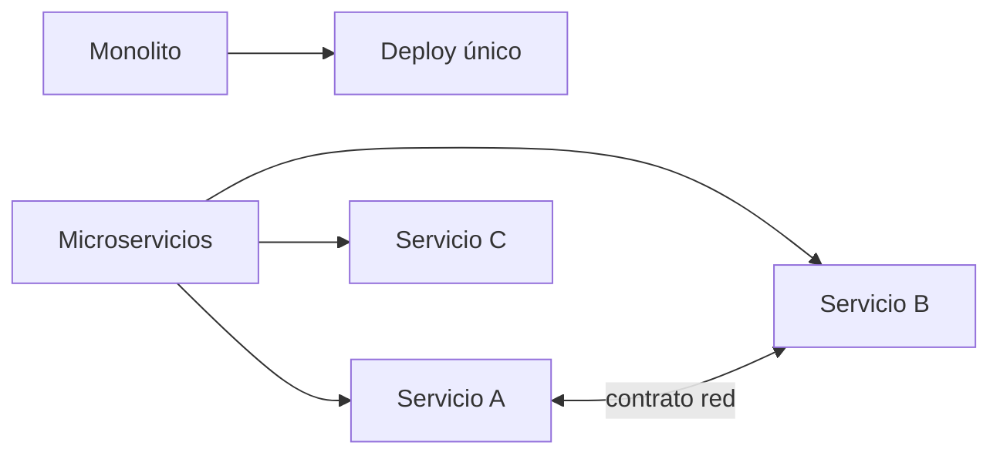
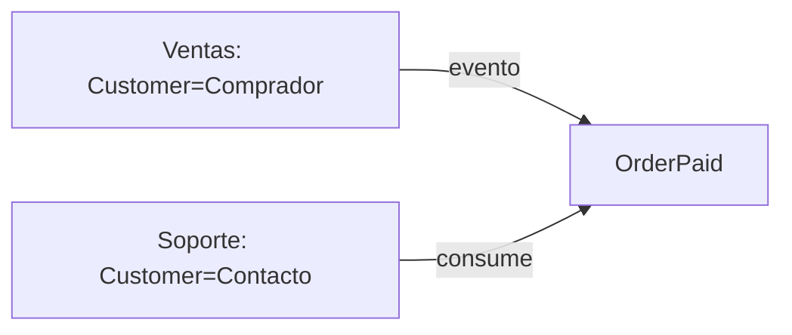
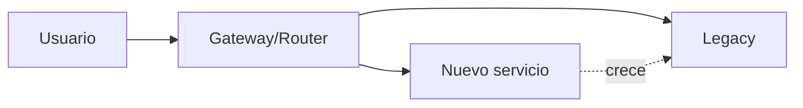

# Módulo 2.1 · Fundamentos de arquitectura de microservicios

Microservicios no son “muchos repos”. Son una forma de dividir un sistema por capacidades de negocio, con límites, datos y operación independientes. Este módulo da criterios para decidir cuándo usarlos y cómo evitar distribuir un monolito mal diseñado.

**Entorno de referencia verificado (2026-05-22):** JDK 27.0.1.0.2, Node.js v24.18.0. Conceptos de arquitectura se validan con ejemplos de modelado/contratos ejecutables pequeños y notas operativas.

## Aprende construyendo

### Tema 1: Monolito vs Microservicios vs SOA · Intermedio · 120 min

Caso guía: e-commerce crece de 2 a 20 desarrolladores y los deploys se vuelven riesgosos.

#### Monolito

**Definición formal.** Aplicación desplegada como una unidad con componentes internos acoplados por el mismo proceso/runtime.

**Cuándo usar.** Equipos pequeños, dominio aún incierto, necesidad de simplicidad operativa. No es “malo”; es la base razonable por defecto.

#### Microservicios

**Definición formal.** Conjunto de servicios desplegables independientemente, organizados alrededor de capacidades de negocio, con contratos explícitos y autonomía operativa.

**Costo.** Latencia de red, consistencia eventual, observabilidad, despliegue, versionado, testing distribuido.



**Ejemplo mínimo (modelo de decisión, ejecutable).**

```bash
mkdir -p ms9-decision
cd ms9-decision
```

Crea el archivo `decision.mjs`:

```js
function elegir({ equipo, dominiosClaros, cargaOperativa }) {
  if (equipo < 8 || !dominiosClaros) return 'monolito-modular';
  if (cargaOperativa) return 'microservicios-selectivos';
  return 'monolito-modular';
}
console.log(elegir({ equipo: 3, dominiosClaros: false, cargaOperativa: false }));
console.log(elegir({ equipo: 20, dominiosClaros: true, cargaOperativa: true }));
```

```bash
node decision.mjs
```

**Error común.** Empezar con microservicios sin límites claros. Corrección: monolito modular primero, extraer cuando duela de verdad.

**Verificación (Node 24.18.0, 2026-05-22).** `monolito-modular`, `microservicios-selectivos`.

### Tema 2: DDD: Bounded Contexts, Agregados, Eventos de Dominio · Avanzado · 180 min

Caso guía: “Cliente” significa cosas distintas en Ventas y Soporte.

#### Bounded Context

**Definición formal.** Límite donde un modelo de dominio y su lenguaje ubicuo son consistentes.

#### Agregado

**Definición formal.** Clúster de objetos de dominio tratado como unidad de consistencia, con una raíz aggregate.

#### Evento de dominio

**Definición formal.** Hecho significativo ocurrido en el dominio (`OrderPaid`, `GuideCreated`).



**Error común.** Un solo modelo “Customer” para toda la empresa. Corrección: bounded contexts.

### Tema 3: Spring Modulith · Intermedio · 120 min

Caso guía: quieres modularidad fuerte sin saltar aún a red.

#### Spring Modulith

**Definición formal.** Enfoque/herramientas para estructurar y verificar módulos en una app Spring Boot, con eventos internos y límites verificables.

**Cuándo usar.** Monolito modular con intención de evolución.

**Nota de verificación.** Requiere dependencia Spring Modulith y tests; lab en proyecto Boot.

### Tema 4: 12-Factor App · Intermedio · 120 min

Caso guía: app que funciona en laptop pero falla en prod por config hardcodeada.

#### 12-Factor

**Definición formal.** Conjunto de prácticas para apps cloud-native: config en env, procesos stateless, logs como streams, build/release/run separados, etc.

**Ejemplo mínimo (ejecutable).**

```bash
mkdir -p ms9-12f
cd ms9-12f
```

Crea el archivo `app.mjs`:

```js
const port = process.env.PORT;
if (!port) { console.error('missing PORT'); process.exit(1); }
console.log('port=' + port);
```

```bash
PORT=8080 node app.mjs; echo $?
node app.mjs; echo $?
```

**Error común.** Configurar por archivos locales no versionados o secretos en código. Corrección: env vars/secret manager.

**Verificación (Node 24.18.0, 2026-05-22).** `port=8080,0`, `missing PORT,1`.

### Tema 5: Strangler Fig Pattern · Avanzado · 120 min

Caso guía: migrar monolito legacy a servicios sin big bang.

#### Strangler Fig

**Definición formal.** Patrón de migración incremental: se enrutan capacidades nuevas o extraídas al nuevo sistema, reduciendo gradualmente el legacy.



**Error común.** Reescritura big bang. Corrección: extraer por capacidad, con routing y rollback.

### Tema 6: Database-per-service · Avanzado · 120 min

Caso guía: dos servicios escriben la misma tabla; acoplamiento oculto.

#### Database-per-service

**Definición formal.** Cada servicio posee su base de datos/esquema y expone datos por API/eventos, no por acceso directo a tablas ajenas.

**Trade-off.** Autonomía y escalado independiente; mayor complejidad en consultas cross-service y consistencia.

**Error común.** Microservicios con DB compartida. Corrección: ownership de datos, API/eventos, sagas.

## Cierre

La arquitectura de microservicios es sobre límites y propiedad. Empieza modular, distribuye solo cuando el costo se justifique.

## Checklist

- Sé cuándo no usar microservicios.
- Identifico bounded contexts y aggregates.
- Aplico 12-factor y config externa.
- Prefiero strangler fig sobre big bang.
- Respeto database-per-service.
