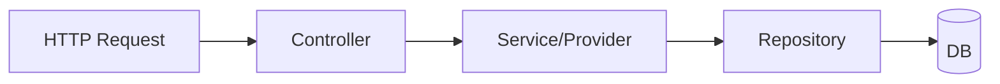
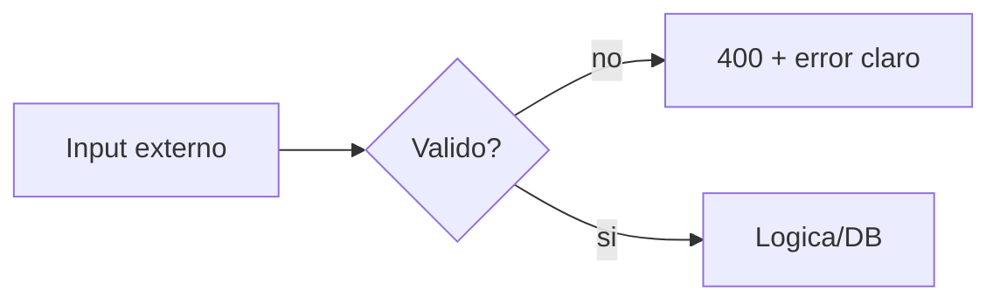

# Módulo 1 · Express/NestJS para microservicios

Un microservicio Node expone contratos HTTP: recibe input no confiable, valida, ejecuta reglas, llama dependencias y responde con códigos y cuerpos predecibles. Este módulo cubre dos estilos comunes: Express (minimalista y explícito) y NestJS (estructurado y opinado), más validación, DTOs y documentación OpenAPI.

**Entorno de referencia verificado (2026-05-22):** Node.js v24.18.0. Los ejemplos mínimos usan Node estándar para enseñar el contrato. Express, NestJS, Zod, class-validator y Swagger requieren dependencias; se marcan con **Nota de verificación** y comandos de instalación.

## Aprende construyendo

### Tema 1: Express: routing, middleware, error handling · Intermedio · 150 min

Caso guía: exponer `GET /health` y `POST /orders` con validación y manejo de errores consistente.

#### Routing

**Definición formal.** Routing es la asociación entre un método HTTP + ruta y un handler que produce una respuesta. En Express se declara con `app.get/post/put/delete(path, handler)`.

**Para qué sirve.** Definir la superficie pública del servicio con contratos claros.

**Cuándo usarlo / cuándo no.** Úsalo para endpoints HTTP. No metas reglas de negocio complejas directamente en el router; delega a servicios.

**Contrato mínimo.** Un handler recibe `(req, res, next)`. Debe responder una vez. Códigos deben reflejar semántica HTTP.

**Ejemplo mínimo enfocado (ejecutable, Node HTTP para contrato; nota Express).**

```bash
mkdir -p nm1-routing
cd nm1-routing
```

Crea el archivo `server.mjs`:

```js
import http from 'node:http';

const server = http.createServer((req, res) => {
  if (req.method === 'GET' && req.url === '/health') {
    res.writeHead(200, { 'content-type': 'application/json' });
    res.end(JSON.stringify({ ok: true }));
    return;
  }
  res.writeHead(404, { 'content-type': 'application/json' });
  res.end(JSON.stringify({ error: 'not_found' }));
});

server.listen(0, '127.0.0.1', async () => {
  const { port } = server.address();
  const r = await fetch(`http://127.0.0.1:${port}/health`);
  console.log(r.status);
  console.log(await r.text());
  server.close();
});
```

```bash
node server.mjs
```

**Caso de uso real.** Endpoint de health para readiness/liveness y endpoints de negocio versionados.

**Error común.** Responder dos veces. **Síntoma.** `ERR_HTTP_HEADERS_SENT`. **Causa.** handler llama `res.end()` y luego otro middleware también responde. **Corrección.** retornar tras responder; flujo de control único.

**Verificación (Node 24.18.0, 2026-05-22).** Salida: `200` y `{"ok":true}`. **Nota de verificación:** Express equivalente requiere `npm i express` y `app.get('/health', ...)`.

#### Middleware

**Definición formal.** Middleware es una función en la cadena de procesamiento que puede inspeccionar/modificar request/response, terminar la respuesta o delegar con `next()`.

**Para qué sirve.** Cross-cutting concerns: logging, auth, parsing, request id, rate limit.

**Cuándo usarlo / cuándo no.** Úsalo para concerns transversales. No ocultes lógica de negocio crítica en middleware opaco; evita orden frágil.

**Ejemplo mínimo enfocado (ejecutable).**

```bash
mkdir -p nm1-mw
cd nm1-mw
```

Crea el archivo `mw.mjs`:

```js
function withRequestId(req, _res, next) {
  req.requestId = 'req-1';
  next(req);
}

function handler(req) {
  return { requestId: req.requestId, ok: true };
}

const req = {};
withRequestId(req, {}, handler);
console.log(handler(req).requestId);
```

```bash
node mw.mjs
```

**Caso de uso real.** Inyectar `requestId` para correlación de logs y trazas.

**Error común.** Olvidar `next()`. **Síntoma.** request colgada hasta timeout. **Causa.** cadena interrumpida sin respuesta. **Corrección.** siempre responder o llamar `next()`; tests de timeout.

**Verificación (Node 24.18.0, 2026-05-22).** Salida: `req-1`.

#### Error handling

**Definición formal.** Manejo centralizado de errores: capturar excepciones/rechazos, mapearlos a respuestas HTTP seguras y registrar contexto.

**Para qué sirve.** Evitar 500 opacos, fugas de stack traces y respuestas inconsistentes.

**Cuándo usarlo / cuándo no.** Siempre en APIs. No expongas detalles internos al cliente; sí registra causa internamente.

**Ejemplo mínimo enfocado (ejecutable).**

```bash
mkdir -p nm1-err
cd nm1-err
```

Crea el archivo `err.mjs`:

```js
function toHttpError(err) {
  if (err.message === 'invalid') return { status: 400, body: { error: 'bad_request' } };
  return { status: 500, body: { error: 'internal' } };
}

console.log(toHttpError(new Error('invalid')).status);
console.log(toHttpError(new Error('db down')).status);
```

```bash
node err.mjs
```

**Caso de uso real.** Middleware de error Express con 4xx para validación y 5xx para fallos inesperados.

**Error común.** Enviar stack trace al cliente. **Síntoma.** fuga de rutas, versiones, SQL. **Causa.** serializar error crudo. **Corrección.** mapear a contrato seguro; log interno con correlation id.

**Verificación (Node 24.18.0, 2026-05-22).** Salida: `400`, `500`. **Nota:** en Express real se usa `app.use((err, req, res, next) => ...)`.

### Tema 2: NestJS: módulos, controllers, providers, interceptors, guards · Avanzado · 180 min

Caso guía: estructurar un servicio de órdenes con reglas transversales claras.

#### Módulos, controllers y providers

**Definición formal.** En NestJS, un módulo agrupa providers/controllers; un controller define rutas HTTP; un provider es una clase inyectable con lógica/reutilización. La DI resuelve dependencias por tokens.

**Para qué sirve.** Escalar estructura, testear con dobles y separar transporte de negocio.

**Cuándo usarlo / cuándo no.** Úsalo cuando el servicio crece, hay equipo o necesitas convenciones fuertes. No lo uses para scripts pequeños donde Express/simple handler basta.



**Ejemplo mínimo enfocado (contrato conceptual ejecutable con Node).**

```bash
mkdir -p nm1-di
cd nm1-di
```

Crea el archivo `di.mjs`:

```js
class OrdersRepo {
  save(order) { return { id: 1, ...order }; }
}
class OrdersService {
  constructor(repo) { this.repo = repo; }
  create(dto) { return this.repo.save(dto); }
}
class OrdersController {
  constructor(service) { this.service = service; }
  post(body) { return this.service.create(body); }
}

const controller = new OrdersController(new OrdersService(new OrdersRepo()));
console.log(controller.post({ sku: 'A1' }).id);
```

```bash
node di.mjs
```

**Caso de uso real.** `OrdersModule` con `OrdersController`, `OrdersService`, `OrdersRepository`.

**Error común.** Instanciar dependencias dentro del controller. **Síntoma.** tests difíciles, acoplamiento. **Causa.** sin DI. **Corrección.** inyectar providers.

**Verificación (Node 24.18.0, 2026-05-22).** Salida: `1`. **Nota de verificación:** NestJS real requiere `@nestjs/common`, `@nestjs/core`, decoradores y bootstrap; no se ejecuta aquí sin instalar dependencias.

#### Guards e interceptors

**Definición formal.** Un guard decide si una request puede continuar (autorización/autenticación). Un interceptor envuelve la ejecución del handler para transformar entrada/salida, medir tiempo o manejar cross-cutting behavior.

**Para qué sirve.** Separar autorización y observabilidad/transforms del handler.

**Cuándo usarlo / cuándo no.** Guards para permisos; interceptors para logging/timing/mapeo de respuesta. No pongas lógica de negocio central en interceptors ocultos.

**Ejemplo mínimo enfocado (ejecutable).**

```bash
mkdir -p nm1-guard
cd nm1-guard
```

Crea el archivo `guard.mjs`:

```js
function guard(req) { return req.headers.authorization === 'Bearer ok'; }
function handler() { return { status: 200 }; }

function run(req) {
  if (!guard(req)) return { status: 403 };
  return handler();
}

console.log(run({ headers: {} }).status);
console.log(run({ headers: { authorization: 'Bearer ok' } }).status);
```

```bash
node guard.mjs
```

**Caso de uso real.** Guard JWT + interceptor que añade `durationMs` en logs.

**Error común.** Autorizar solo en frontend. **Síntoma.** acceso no autorizado vía curl/API directa. **Causa.** falta control backend. **Corrección.** guard/policy en backend.

**Verificación (Node 24.18.0, 2026-05-22).** Salida: `403`, `200`.

### Tema 3: Validación con Zod o class-validator · Intermedio · 120 min

Caso guía: rechazar un `POST /orders` con `qty` negativa antes de tocar la DB.

#### Validación de input

**Definición formal.** Validación es verificar que datos externos cumplen forma, tipo, rangos y reglas antes de usarlos. Zod es schema-first runtime; class-validator usa decoradores sobre clases DTO.

**Para qué sirve.** Proteger invariantes y dar errores 400 claros.

**Cuándo usarlo / cuándo no.** Siempre en bordes externos. No confíes en TypeScript para runtime; TS se borra al compilar.



**Ejemplo mínimo enfocado (ejecutable con Zod vía npx).**

```bash
mkdir -p nm1-zod
cd nm1-zod
npm init -y >/dev/null
npm i zod >/dev/null
```

Crea el archivo `validate.mjs`:

```js
import { z } from 'zod';

const Order = z.object({
  sku: z.string().min(1),
  qty: z.number().int().positive()
});

const bad = Order.safeParse({ sku: '', qty: -1 });
console.log(bad.success);
console.log(Order.safeParse({ sku: 'A1', qty: 2 }).success);
```

```bash
node validate.mjs
```

**Caso de uso real.** Validar body, query params y headers antes de service layer.

**Error común.** Validar solo en cliente. **Síntoma.** datos corruptos ingresan por API. **Causa.** cliente no confiable. **Corrección.** validar en backend; devolver 400 con campos.

**Verificación (Node 24.18.0, zod instalado por npm, 2026-05-22).** Salida: `false`, `true`. **Nota de verificación:** si no hay red para instalar zod, la validación manual equivalente es `typeof sku === 'string' && qty > 0`.

#### class-validator

**Definición formal.** Librería que valida instancias de clases mediante decoradores (`@IsInt()`, `@Min()`, etc.), común en NestJS.

**Cuándo usarlo.** En proyectos NestJS con DTOs class-based y ValidationPipe.

**Nota de verificación.** Requiere `class-validator` y `class-transformer`; en NestJS se integra con `ValidationPipe`. No se ejecuta aquí sin dependencias.

### Tema 4: DTOs · Básico · 60 min

Caso guía: separar el JSON que entra por HTTP de la entidad interna.

#### Data Transfer Object

**Definición formal.** Un DTO es un objeto diseñado para transportar datos entre capas/procesos. Define forma, tipos y validaciones del contrato de entrada/salida.

**Para qué sirve.** Evitar acoplar API a entidades de persistencia, controlar exposición de campos y versionar contratos.

**Cuándo usarlo / cuándo no.** Úsalo en bordes HTTP/mensajería. No expongas entidades ORM directamente; no metas lógica de negocio compleja en DTOs.

**Ejemplo mínimo enfocado (ejecutable).**

```bash
mkdir -p nm1-dto
cd nm1-dto
```

Crea el archivo `dto.mjs`:

```js
function toCreateOrderDto(body) {
  return { sku: String(body.sku), qty: Number(body.qty) };
}

function toOrderResponse(entity) {
  return { id: entity.id, sku: entity.sku }; // no expone campos internos
}

console.log(toCreateOrderDto({ sku: 'A1', qty: '2' }).qty);
console.log(toOrderResponse({ id: 1, sku: 'A1', dbVersion: 7 }).dbVersion === undefined);
```

```bash
node dto.mjs
```

**Caso de uso real.** `CreateOrderRequest`, `OrderResponse`, `OrderEntity` separados.

**Error común.** Devolver entidad con campos internos/sensibles. **Síntoma.** fuga de `passwordHash`, `internalNotes`, versión DB. **Causa.** serializar entidad directamente. **Corrección.** DTO de salida explícito.

**Verificación (Node 24.18.0, 2026-05-22).** Salida: `2`, `true`.

### Tema 5: OpenAPI/Swagger · Intermedio · 90 min

Caso guía: publicar el contrato de `POST /orders` para frontend y consumidores.

#### OpenAPI

**Definición formal.** OpenAPI es una especificación estándar para describir APIs HTTP: rutas, parámetros, cuerpos, respuestas, esquemas y seguridad.

**Para qué sirve.** Documentar contrato, generar clientes/servidores, validar requests/responses y habilitar revisiones de compatibilidad.

**Cuándo usarlo / cuándo no.** Úsalo en APIs mantenidas o consumidas por otros equipos. No lo dejes desactualizado; peor que no tenerlo es tenerlo mentiroso.

**Ejemplo mínimo enfocado (ejecutable: generar spec JSON).**

```bash
mkdir -p nm1-openapi
cd nm1-openapi
```

Crea el archivo `spec.mjs`:

```js
const spec = {
  openapi: '3.0.3',
  info: { title: 'Orders API', version: '1.0.0' },
  paths: {
    '/orders': {
      post: {
        responses: { '201': { description: 'Created' }, '400': { description: 'Bad request' } }
      }
    }
  }
};
console.log(spec.paths['/orders'].post.responses['201'].description);
```

```bash
node spec.mjs
```

**Caso de uso real.** Swagger UI en `/docs`, validación de contrato en CI, generación de cliente TypeScript.

**Error común.** Documentar una respuesta que el código no produce. **Síntoma.** consumidor confía en 422 pero API devuelve 400. **Causa.** spec manual desalineada. **Corrección.** generar spec desde código/anotaciones o validar spec contra tests.

**Verificación (Node 24.18.0, 2026-05-22).** Salida: `Created`. **Nota de verificación:** Swagger UI con Express/NestJS requiere `swagger-ui-express` o `@nestjs/swagger`.

## Cierre

Express te da control explícito; NestJS te da estructura y DI. En ambos, el contrato sano es el mismo: routing claro, middleware/guards con responsabilidad acotada, validación runtime en el borde, DTOs para separar capas y OpenAPI como contrato visible.

## Checklist

- Puedo explicar routing, middleware y error handler.
- Distingo controller/provider/guard/interceptor en NestJS.
- Valido input en runtime, no solo con TypeScript.
- Uso DTOs para no exponer entidades.
- Mantengo OpenAPI alineado con comportamiento real.
