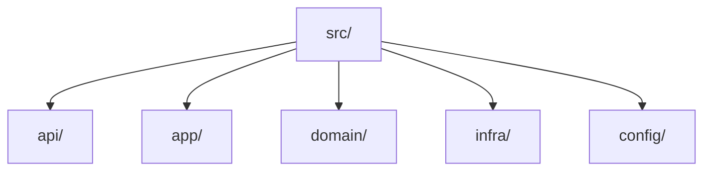
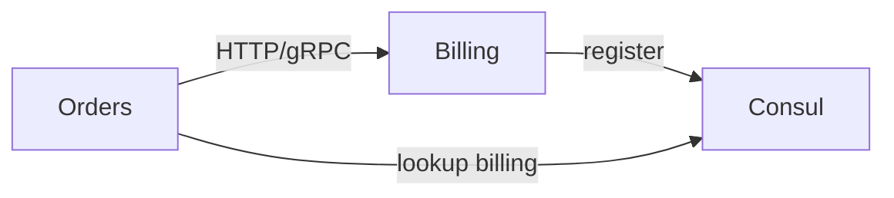

# Módulo 12 · Config y service discovery en Node

Un microservicio Node debe poder cambiar de entorno sin cambiar código: puertos, URLs, credenciales y flags salen de configuración. Además, en sistemas dinámicos, los servicios necesitan descubrirse sin IPs hardcodeadas. Este módulo cubre estructura, dotenv, Consul y configuración centralizada.

**Entorno de referencia verificado (2026-05-22):** Node.js v24.18.0. dotenv se puede ejecutar si se instala; Consul/config server requieren infraestructura externa, con **Nota de verificación** honesta.

## Aprende construyendo

### Tema 1: Estructura de carpetas escalable · Intermedio · 90 min

Caso guía: evitar que `index.js` crezca con rutas, DB, reglas y config mezcladas.

#### Separación por responsabilidades

**Definición formal.** Una estructura escalable organiza código por límites de responsabilidad (transporte, aplicación, dominio, infraestructura, config) para reducir acoplamiento y facilitar tests.

**Para qué sirve.** Mantener cambios localizados y onboarding simple.

**Cuándo usarlo / cuándo no.** Úsalo desde que el servicio tiene más de un endpoint/regla. No sobre-diseñes con docenas de carpetas vacías en un PoC.



**Ejemplo mínimo enfocado (ejecutable).**

```bash
mkdir -p nm4-structure/src/{api,app,domain,infra,config}
cd nm4-structure
find src -maxdepth 2 -type d | sort
```

**Caso de uso real.** `api` valida HTTP, `app` orquesta casos de uso, `domain` reglas, `infra` DB/clientes.

**Error común.** “Carpetas por tipo técnico” sin límites de dominio en sistemas grandes. **Síntoma.** cambios cruzan muchas carpetas. **Causa.** acoplamiento. **Corrección.** combinar por módulo/dominio cuando crece.

**Verificación (Node 24.18.0/entorno shell, 2026-05-22).** Salida lista directorios `src/api`, `src/app`, etc.

### Tema 2: dotenv · Básico · 60 min

Caso guía: configurar puerto y URL de DB sin hardcodear.

#### Variables de entorno y `.env`

**Definición formal.** `dotenv` carga pares clave/valor desde un archivo `.env` a `process.env` (normalmente en desarrollo).

**Para qué sirve.** Facilitar configuración local sin commitear secretos.

**Cuándo usarlo / cuándo no.** Úsalo en dev/local. No dependas de `.env` como mecanismo de secretos en producción; usa secret manager/plataforma. No commitees `.env`.

**Ejemplo mínimo enfocado (ejecutable).**

```bash
mkdir -p nm4-dotenv
cd nm4-dotenv
npm init -y >/dev/null
npm i dotenv >/dev/null
```

Crea el archivo `.env`:

```env
PORT=3001
```

Crea el archivo `app.mjs`:

```js
import 'dotenv/config';
console.log(process.env.PORT);
```

```bash
node app.mjs
```

**Caso de uso real.** `DATABASE_URL`, `LOG_LEVEL`, `OTEL_EXPORTER_OTLP_ENDPOINT`.

**Error común.** Commitear `.env` con secretos. **Síntoma.** credenciales filtradas. **Causa.** mala higiene de repo. **Corrección.** `.gitignore`, `.env.example`, secret manager.

**Verificación (Node 24.18.0, dotenv instalado, 2026-05-22).** Salida: `3001`.

### Tema 3: Service Discovery con Consul · Intermedio · 90 min

Caso guía: `orders` necesita llamar `billing` sin saber IP fija.

#### Descubrimiento de servicios

**Definición formal.** Service discovery es el mecanismo por el cual servicios registran su ubicación y otros los consultan dinámicamente. Consul es una herramienta que provee catálogo, health checks y KV.

**Para qué sirve.** Evitar IPs hardcodeadas en entornos dinámicos (contenedores, autoscaling).

**Cuándo usarlo / cuándo no.** Úsalo cuando hay instancias efímeras o múltiples servicios. No lo necesitas en un monolito o dos servicios fijos en dev simple.



**Ejemplo mínimo enfocado (ejecutable: lógica de lookup).**

```bash
mkdir -p nm4-discovery
cd nm4-discovery
```

Crea el archivo `lookup.mjs`:

```js
const catalog = { billing: ['http://10.0.0.2:3000', 'http://10.0.0.3:3000'] };
function pick(name) { return catalog[name][0]; }
console.log(pick('billing'));
```

```bash
node lookup.mjs
```

**Caso de uso real.** Consul DNS/API o Kubernetes Service discovery.

**Error común.** Cachear ubicación para siempre. **Síntoma.** llamadas a instancias muertas. **Causa.** no refrescar catálogo/health. **Corrección.** TTL, health checks, DNS SRV o client-side balancing.

**Verificación (Node 24.18.0, 2026-05-22).** Salida: `http://10.0.0.2:3000`. **Nota de verificación:** Consul real requiere agente/server Consul y registro con health check.

### Tema 4: Configuración centralizada · Intermedio · 90 min

Caso guía: cambiar un timeout en 20 instancias sin redeploy manual archivo por archivo.

#### Config server / config centralizada

**Definición formal.** Configuración centralizada es un sistema donde la configuración se gestiona en un servicio/fuente común y los servicios la leen dinámicamente o al iniciar, con control de versiones y auditoría.

**Para qué sirve.** Consistencia, auditoría, cambios controlados y reducción de drift.

**Cuándo usarlo / cuándo no.** Úsalo en flotas medianas/grandes. No centralices secretos inseguros; no hagas hot-reload de config crítica sin validación.

**Ejemplo mínimo enfocado (ejecutable).**

```bash
mkdir -p nm4-config
cd nm4-config
```

Crea el archivo `config.mjs`:

```js
const central = { timeoutMs: 5000, featureX: true };
function readConfig() { return { ...central }; }
console.log(readConfig().timeoutMs);
```

```bash
node config.mjs
```

**Caso de uso real.** Spring Cloud Config, Consul KV, AWS AppConfig, Parameter Store.

**Error común.** Cambiar config en caliente sin validar. **Síntoma.** outage masivo por typo. **Causa.** falta validación/rollout. **Corrección.** schema de config, canary, auditoría, rollback.

**Verificación (Node 24.18.0, 2026-05-22).** Salida: `5000`. **Nota de verificación:** herramientas reales requieren infraestructura y credenciales; validar con entorno de staging.

## Cierre

La configuración y el discovery son parte del contrato operativo del microservicio. Código limpio sin config portable ni discovery se vuelve frágil al escalar.

## Checklist

- Separo config por entorno y no hardcodeo secretos.
- Tengo estructura de carpetas con responsabilidades claras.
- Entiendo cuándo usar dotenv vs secret manager/config central.
- Puedo explicar service discovery y sus riesgos de stale cache.
