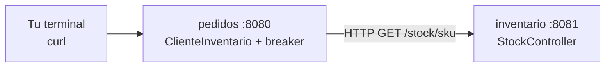
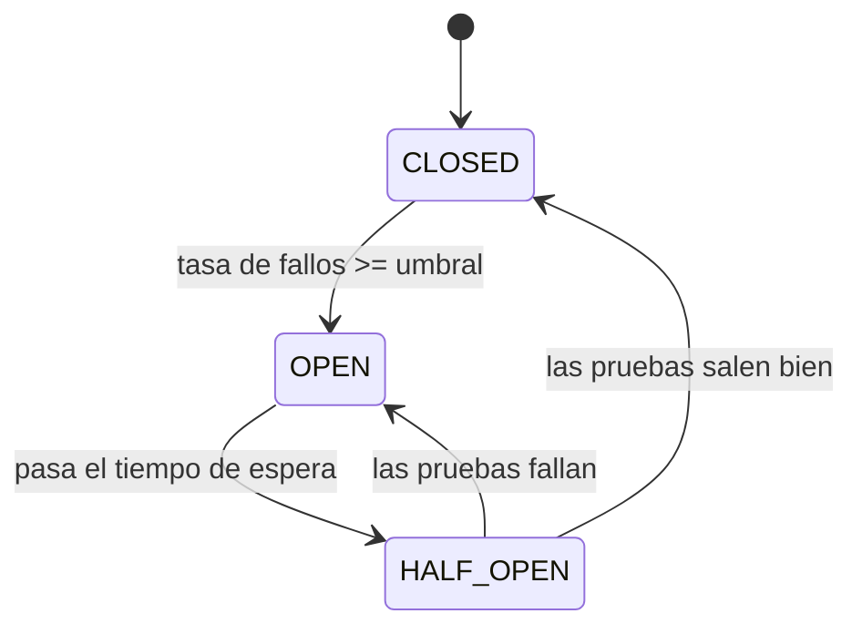

# Módulo 14 · Resiliencia y tolerancia a fallos en Tienda Aurora

En distribución, el fallo parcial es normal: un servicio lento, una red inestable o una dependencia caída no son excepciones raras. Resiliencia significa diseñar degradación controlada, no asumir disponibilidad perfecta. Este módulo cubre Resilience4j, timeouts, bulkheads, fallbacks y chaos engineering con criterio operativo, usando Tienda Aurora como proyecto integrador.

**Cómo se verificó este módulo:** el Tema 1 se compiló, probó y ejecutó completo el 2026-11-24 con JDK 21, Spring Boot 3.3.13 y Resilience4j 2.2.0; sus salidas de terminal son reales. Los temas 2 a 4 están pendientes de pasar por la misma verificación.

### Tema 1: Circuit breaker — dos microservicios conectados y protegidos · Intermedio · 180 min

Este tema es un taller para hacer en tu computador. Vas a crear desde cero el servicio de inventario y el de pedidos, unirlos por HTTP, ver cómo la caída de uno tumba al otro y arreglarlo con un circuit breaker. Cada paso termina con algo que ejecutas y compruebas.



Al final tendrás dos programas Java independientes, cada uno en su puerto, hablándose por HTTP. Todo el código de este tema está completo en la página y fue compilado, probado y ejecutado con Spring Boot 3.3.13, Resilience4j 2.2.0 y JDK 21. Las salidas de terminal que verás son reales.

## Paso 0. Prepara tu máquina

Necesitas JDK 21 o superior, un editor (IntelliJ IDEA Community o VS Code) y `curl`, que ya viene en Windows 10/11, macOS y Linux. No necesitas instalar Maven: cada proyecto generado trae su propio *Maven Wrapper* (`mvnw`), un script que descarga la versión correcta de Maven la primera vez.

```text
$ java -version
openjdk version "21...      ← debe ser 21 o superior
$ curl --version
curl 8...                    ← cualquier versión sirve
```

Crea una carpeta vacía llamada `tienda-aurora`. Ahí vivirán los dos servicios, uno al lado del otro.

> **Sin internet.** Esta página funciona sin conexión, pero Maven necesita descargar las librerías de Spring la primera vez que compilas. Hazlo una vez con conexión; después quedan guardadas en la carpeta `.m2` de tu usuario y puedes compilar sin internet. Si no puedes usar start.spring.io, al final del tema tienes los dos `pom.xml` completos para crear los proyectos a mano.

## Paso 1. Crea el proyecto de inventario

Entra en start.spring.io, el generador oficial de proyectos Spring Boot, y rellena así:

| Campo | Valor |
|---|---|
| Project | Maven |
| Language | Java |
| Spring Boot | la versión 3.x más reciente (no la 4.x) |
| Group | `com.aurora` |
| Artifact | `inventario` |
| Packaging | Jar |
| Java | 21 |
| Dependencies | Spring Web |

Pulsa **Generate**, descomprime el zip dentro de `tienda-aurora` y ábrelo en el editor. La estructura que te interesa:

```text
inventario/
├── mvnw, mvnw.cmd          ← Maven Wrapper
├── pom.xml                 ← dependencias y versión de Java
└── src/
    ├── main/java/com/aurora/inventario/
    │   └── InventarioApplication.java   ← ya viene hecho
    ├── main/resources/application.properties
    └── test/java/com/aurora/inventario/
```

`pom.xml` es el archivo de Maven: dice qué librerías usa el proyecto y con qué versión de Java se compila. `InventarioApplication` tiene el método `main`, que arranca un servidor web embebido (Tomcat) dentro del propio programa. No hay que instalar ningún servidor aparte.

## Paso 2. Escribe el endpoint de stock

Un **endpoint** es una URL a la que otro programa puede llamar. Inventario expone una sola: `GET /stock/{sku}`, que devuelve cuántas unidades hay de un producto. Crea este archivo junto a `InventarioApplication.java`:

**Archivo:** `inventario/src/main/java/com/aurora/inventario/StockController.java`

```java
package com.aurora.inventario;

import java.util.Map;

import org.springframework.http.ResponseEntity;
import org.springframework.web.bind.annotation.GetMapping;
import org.springframework.web.bind.annotation.PathVariable;
import org.springframework.web.bind.annotation.RestController;

@RestController
public class StockController {

    record Stock(String sku, int unidades) {}

    private final Map<String, Integer> stock = Map.of(
            "TEC-1042", 15,
            "HOG-2210", 4);

    @GetMapping("/stock/{sku}")
    public ResponseEntity<Stock> consultar(@PathVariable String sku) {
        Integer unidades = stock.get(sku);
        if (unidades == null) {
            return ResponseEntity.notFound().build();
        }
        return ResponseEntity.ok(new Stock(sku, unidades));
    }
}
```

| Elemento | Qué hace |
|---|---|
| `@RestController` | Marca la clase como atendedora de peticiones HTTP; lo que devuelven sus métodos se convierte a JSON. |
| `@GetMapping("/stock/{sku}")` | El método responde a `GET` en esa ruta. `{sku}` es una parte variable de la URL. |
| `@PathVariable` | Copia el valor de `{sku}` al parámetro del método. |
| `ResponseEntity` | Permite elegir el código HTTP: 200 con el dato, o 404 si el SKU no existe. |
| `record Stock` | Un tipo de dato inmutable; Spring lo convierte en `{"sku":…,"unidades":…}`. |

Los datos están en un `Map` en memoria para no distraer: el tema trata de cómo se comunican los servicios, no de bases de datos.

Inventario usará el puerto 8081 para no chocar con pedidos, que usará el 8080. Cámbialo en la configuración:

**Archivo:** `inventario/src/main/resources/application.properties`

```properties
server.port=8081
```

## Paso 3. Arráncalo y pruébalo

Abre una terminal en la carpeta `inventario` y arráncalo. En Windows escribe `mvnw.cmd` en lugar de `./mvnw`. La primera vez tarda unos minutos porque descarga las librerías.

```text
$ ./mvnw spring-boot:run
...
Tomcat started on port 8081 (http) with context path '/'
Started InventarioApplication in 5.378 seconds
```

Deja esa terminal abierta: el servicio vive mientras ella siga abierta. En otra terminal, llama al endpoint:

```text
$ curl localhost:8081/stock/TEC-1042
{"sku":"TEC-1042","unidades":15}
```

> **Punto de control.** Si ves ese JSON, tu primer microservicio funciona. Prueba también `curl -i localhost:8081/stock/XXX-0000`: la opción `-i` muestra las cabeceras y la primera línea debe decir `404`.

## Paso 4. Protégelo con una prueba automática

Una prueba deja escrito lo que el servicio debe hacer, para que un cambio futuro no lo rompa sin que te enteres. `@WebMvcTest` levanta solo la capa web, sin arrancar Tomcat, y `MockMvc` simula las peticiones HTTP.

**Archivo:** `inventario/src/test/java/com/aurora/inventario/StockControllerTest.java`

```java
package com.aurora.inventario;

import static org.springframework.test.web.servlet.request.MockMvcRequestBuilders.get;
import static org.springframework.test.web.servlet.result.MockMvcResultMatchers.jsonPath;
import static org.springframework.test.web.servlet.result.MockMvcResultMatchers.status;

import org.junit.jupiter.api.Test;
import org.springframework.beans.factory.annotation.Autowired;
import org.springframework.boot.test.autoconfigure.web.servlet.WebMvcTest;
import org.springframework.test.web.servlet.MockMvc;

@WebMvcTest(StockController.class)
class StockControllerTest {

    @Autowired
    MockMvc mvc;

    @Test
    void devuelveElStockDeUnSkuConocido() throws Exception {
        mvc.perform(get("/stock/TEC-1042"))
           .andExpect(status().isOk())
           .andExpect(jsonPath("$.unidades").value(15));
    }

    @Test
    void responde404ParaUnSkuQueNoExiste() throws Exception {
        mvc.perform(get("/stock/XXX-0000"))
           .andExpect(status().isNotFound());
    }
}
```
```text
$ ./mvnw test
...
Tests run: 2, Failures: 0, Errors: 0, Skipped: 0
BUILD SUCCESS
```

## Paso 5. Crea el proyecto de pedidos

Vuelve a start.spring.io con los mismos valores, pero con **Artifact** `pedidos` y dos dependencias: **Spring Web** y **Spring Boot Actuator**. Descomprímelo también dentro de `tienda-aurora`. Ahora tienes dos proyectos hermanos: dos programas que se compilan, arrancan y fallan por separado. Eso es lo que los hace *micro*servicios.

```text
tienda-aurora/
├── inventario/   ← puerto 8081
└── pedidos/      ← puerto 8080
```

## Paso 6. Une pedidos con inventario

Los microservicios se hablan por HTTP, igual que tu `curl`. Pedidos necesita tres piezas: el tipo de dato que devuelve, un cliente que llama a inventario y un endpoint propio.

**Archivo:** `pedidos/src/main/java/com/aurora/pedidos/Stock.java`

```java
package com.aurora.pedidos;

public record Stock(String sku, Integer unidades, String origen) {}
```

El campo `origen` dirá de dónde salió el dato. Ahora parece innecesario; en el paso 10 será clave.

**Archivo:** `pedidos/src/main/java/com/aurora/pedidos/ClienteInventario.java (primera versión, sin protección)`

```java
package com.aurora.pedidos;

import java.time.Duration;

import org.springframework.beans.factory.annotation.Value;
import org.springframework.http.client.SimpleClientHttpRequestFactory;
import org.springframework.stereotype.Service;
import org.springframework.web.client.RestClient;

@Service
public class ClienteInventario {

    record RespuestaInventario(String sku, int unidades) {}

    private final RestClient http;

    public ClienteInventario(RestClient.Builder builder,
                             @Value("${inventario.url}") String url) {
        var tiempos = new SimpleClientHttpRequestFactory();
        tiempos.setConnectTimeout(Duration.ofSeconds(1));
        tiempos.setReadTimeout(Duration.ofSeconds(2));
        this.http = builder.baseUrl(url).requestFactory(tiempos).build();
    }
    public Stock consultar(String sku) {
        RespuestaInventario r = http.get()
                .uri("/stock/{sku}", sku)
                .retrieve()
                .body(RespuestaInventario.class);
        return new Stock(r.sku(), r.unidades(), "inventario");
    }
}
```

| Elemento | Qué hace |
|---|---|
| `RestClient` | El cliente HTTP de Spring: hace la petición y convierte el JSON de respuesta en un objeto Java. |
| `@Value("${inventario.url}")` | Lee la dirección de inventario de la configuración. Es la **unión** entre los servicios: si inventario cambia de máquina, solo cambias este valor. |
| `setConnectTimeout` / `setReadTimeout` | Tiempo máximo para conectar (1 s) y para recibir la respuesta (2 s). Sin ellos, una llamada lenta podría esperar indefinidamente. |
| `RespuestaInventario` | Copia la forma del JSON de inventario. Pedidos no comparte código con inventario: solo conoce su contrato HTTP. |

**Archivo:** `pedidos/src/main/java/com/aurora/pedidos/PedidosController.java`

```java
package com.aurora.pedidos;

import org.springframework.web.bind.annotation.GetMapping;
import org.springframework.web.bind.annotation.PathVariable;
import org.springframework.web.bind.annotation.RestController;

@RestController
public class PedidosController {

    private final ClienteInventario inventario;

    public PedidosController(ClienteInventario inventario) {
        this.inventario = inventario;
    }

    @GetMapping("/pedidos/stock/{sku}")
    public Stock stock(@PathVariable String sku) {
        return inventario.consultar(sku);
    }
}
```

Borra `application.properties` de pedidos y crea en su lugar `application.yml`:

**Archivo:** `pedidos/src/main/resources/application.yml`

```yaml
server:
  port: 8080

inventario:
  url: ${INVENTARIO_URL:http://localhost:8081}

```

`${INVENTARIO_URL:http://localhost:8081}` significa: usa la variable de entorno `INVENTARIO_URL` si existe y, si no, `http://localhost:8081`. En tu computador vale el valor por defecto; cuando los servicios corran en contenedores, se cambia sin tocar el código.

## Paso 7. Prueba la unión

Necesitas dos terminales abiertas a la vez, una por servicio:

```text
# terminal 1, en inventario/
$ ./mvnw spring-boot:run

# terminal 2, en pedidos/
$ ./mvnw spring-boot:run
Tomcat started on port 8080 (http) with context path '/'
```

En una tercera terminal llama a pedidos, que a su vez llama a inventario:

```text
$ curl localhost:8080/pedidos/stock/TEC-1042
{"sku":"TEC-1042","unidades":15,"origen":"inventario"}
```

> **Punto de control.** `"origen":"inventario"` confirma que la respuesta viajó por los dos servicios.

## Paso 8. Rómpelo: apaga inventario

Ve a la terminal 1 y detén inventario con `Ctrl+C`. Repite la llamada:

```text
$ curl localhost:8080/pedidos/stock/TEC-1042
{"timestamp":"2026-11-24T20:31:30.346+00:00","status":500,"error":"Internal Server Error","path":"/pedidos/stock/TEC-1042"}
```

En la terminal 2, el log de pedidos muestra la causa:

```text
ResourceAccessException: I/O error on GET request for "http://localhost:8081/stock/TEC-1042": Connection refused (connect failed)
```

Pedidos estaba sano, pero respondió 500 porque dependía de inventario. Aquí el fallo es instantáneo porque inventario está apagado. Si estuviera **lento**, cada petición quedaría esperando hasta el timeout, los hilos de pedidos se irían ocupando y al final pedidos dejaría de responder a todos, incluso a quien no necesitaba stock. Así un servicio tumba a otro: es la **falla en cascada**.

## Paso 9. Añade el circuit breaker

Un **circuit breaker** (interruptor automático) se coloca entre pedidos e inventario y lleva la cuenta de las últimas llamadas en una **ventana deslizante**. Tiene tres estados:

- **Cerrado** (`CLOSED`): las llamadas pasan con normalidad y se cuentan.
- **Abierto** (`OPEN`): demasiadas fallaron. Deja de llamar a inventario y responde al instante con un **respaldo** (*fallback*).
- **Semiabierto** (`HALF_OPEN`): pasado un tiempo, deja pasar unas pocas llamadas de prueba. Si salen bien vuelve a cerrado; si fallan, vuelve a abierto.



La idea clave: **fallar rápido es mejor que fallar lento**. Un rechazo inmediato libera el hilo; una espera larga lo secuestra.

Primero, las dependencias. Añádelas dentro de `<dependencies>` en `pedidos/pom.xml`. La de AOP es necesaria porque la anotación funciona interceptando la llamada al método:

**Archivo:** `pedidos/pom.xml (añadir)`

```xml
<dependency>
    <groupId>org.springframework.boot</groupId>
    <artifactId>spring-boot-starter-aop</artifactId>
</dependency>
<dependency>
    <groupId>io.github.resilience4j</groupId>
    <artifactId>resilience4j-spring-boot3</artifactId>
    <version>2.2.0</version>
</dependency>
```

Después, la anotación y el método de respaldo. Este es el archivo completo y final:

**Archivo:** `pedidos/src/main/java/com/aurora/pedidos/ClienteInventario.java`

```java
package com.aurora.pedidos;

import java.time.Duration;

import org.springframework.beans.factory.annotation.Value;
import org.springframework.http.client.SimpleClientHttpRequestFactory;
import org.springframework.stereotype.Service;
import org.springframework.web.client.RestClient;

import io.github.resilience4j.circuitbreaker.annotation.CircuitBreaker;

@Service
public class ClienteInventario {

    record RespuestaInventario(String sku, int unidades) {}

    private final RestClient http;

    public ClienteInventario(RestClient.Builder builder,
                             @Value("${inventario.url}") String url) {
        var tiempos = new SimpleClientHttpRequestFactory();
        tiempos.setConnectTimeout(Duration.ofSeconds(1));
        tiempos.setReadTimeout(Duration.ofSeconds(2));
        this.http = builder.baseUrl(url).requestFactory(tiempos).build();
    }

    @CircuitBreaker(name = "inventario", fallbackMethod = "stockDesconocido")
    public Stock consultar(String sku) {
        RespuestaInventario r = http.get()
                .uri("/stock/{sku}", sku)
                .retrieve()
                .body(RespuestaInventario.class);
        return new Stock(r.sku(), r.unidades(), "inventario");
    }

    public Stock stockDesconocido(String sku, Throwable causa) {
        return new Stock(sku, null, "respaldo");
    }
}
```

El método de respaldo debe tener los mismos parámetros que el original más uno de tipo `Throwable`, que recibe la causa del fallo. Con el breaker abierto esa causa es `CallNotPermittedException`: la llamada ni siquiera se intentó.

Por último, la configuración, al final del `application.yml`:

**Archivo:** `pedidos/src/main/resources/application.yml (añadir)`

```yaml
resilience4j:
  circuitbreaker:
    instances:
      inventario:
        sliding-window-size: 10
        minimum-number-of-calls: 5
        failure-rate-threshold: 50
        wait-duration-in-open-state: 10s
        permitted-number-of-calls-in-half-open-state: 3

management:
  endpoints:
    web:
      exposure:
        include: health,circuitbreakers
```

| Propiedad | Significado |
|---|---|
| `sliding-window-size: 10` | Recuerda las últimas 10 llamadas. |
| `minimum-number-of-calls: 5` | No decide nada hasta tener al menos 5. |
| `failure-rate-threshold: 50` | Se abre si el 50 % o más de la ventana falló. |
| `wait-duration-in-open-state: 10s` | Tiempo que permanece abierto antes de probar de nuevo. |
| `permitted-number-of-calls-in-half-open-state: 3` | Número de llamadas de prueba en semiabierto. |
| `include: health,circuitbreakers` | Publica el estado del breaker en `/actuator/circuitbreakers` para que puedas verlo. |

## Paso 10. Repite el experimento

Con inventario encendido, reinicia pedidos (`Ctrl+C` y otra vez `./mvnw spring-boot:run`) y haz 5 llamadas normales. Luego apaga inventario y llama 7 veces más. Esta es la salida real; el tiempo entre paréntesis lo añade la opción `-w ' (%{time_total} s)'` de `curl`:

```text
$ curl localhost:8080/pedidos/stock/TEC-1042   # intento 1
{"sku":"TEC-1042","unidades":null,"origen":"respaldo"}   (0.008165 s)
$ curl localhost:8080/pedidos/stock/TEC-1042   # intento 2
{"sku":"TEC-1042","unidades":null,"origen":"respaldo"}   (0.003957 s)
...
$ curl localhost:8080/pedidos/stock/TEC-1042   # intento 7
{"sku":"TEC-1042","unidades":null,"origen":"respaldo"}   (0.003036 s)

$ curl localhost:8080/actuator/circuitbreakers
{"circuitBreakers":{"inventario":{"failureRate":"50.0%", ... ,"bufferedCalls":10,
  "failedCalls":5, ... ,"notPermittedCalls":2,"state":"OPEN"}}}
```

Lee el JSON con calma, porque cuenta la historia completa:

- `bufferedCalls: 10`: la ventana está llena con las 5 llamadas buenas del principio y 5 fallidas.
- `failureRate: 50.0%`: con la quinta falla la tasa llegó al umbral y el breaker se abrió (`OPEN`).
- `notPermittedCalls: 2`: los intentos 6 y 7 ya no salieron hacia inventario; el breaker los respondió directamente.

Ya no hay error 500. Pedidos responde siempre, en milisegundos, y avisa con `"origen":"respaldo"` de que ese dato no es fiable.

Ahora enciende inventario, espera más de 10 segundos y llama 4 veces, mirando el estado después de cada llamada:

```text
intento 1 → {"sku":"TEC-1042","unidades":15,"origen":"inventario"}   estado: HALF_OPEN
intento 2 → {"sku":"TEC-1042","unidades":15,"origen":"inventario"}   estado: HALF_OPEN
intento 3 → {"sku":"TEC-1042","unidades":15,"origen":"inventario"}   estado: CLOSED
intento 4 → {"sku":"TEC-1042","unidades":15,"origen":"inventario"}   estado: CLOSED
```

> **Punto de control.** Las 3 llamadas de prueba salieron bien y el breaker volvió a `CLOSED` solo, sin reiniciar nada. Un detalle: por defecto, Resilience4j no pasa a `HALF_OPEN` en el instante en que se cumplen los 10 segundos, sino cuando llega la siguiente petición.

> **Advertencia.** El respaldo devuelve `unidades: null`, que significa «no sé», y no `0`. Un respaldo que inventa datos es peor que un error: con 0 cancelarías ventas que sí podían hacerse, y con un número alto venderías lo que no hay.

## Paso 11. Prueba automática del breaker

Lo que acabas de comprobar a mano queda fijado en una prueba. La propiedad `inventario.url=http://localhost:1` apunta a un puerto donde no hay nadie, así que todas las llamadas fallan:

**Archivo:** `pedidos/src/test/java/com/aurora/pedidos/BreakerTest.java`

```java
package com.aurora.pedidos;

import static org.junit.jupiter.api.Assertions.assertEquals;
import static org.junit.jupiter.api.Assertions.assertNull;

import org.junit.jupiter.api.Test;
import org.springframework.beans.factory.annotation.Autowired;
import org.springframework.boot.test.context.SpringBootTest;

import io.github.resilience4j.circuitbreaker.CircuitBreaker;
import io.github.resilience4j.circuitbreaker.CircuitBreakerRegistry;

// Inventario apunta a un puerto donde no hay nadie: todas las llamadas fallan.
@SpringBootTest(properties = "inventario.url=http://localhost:1")
class BreakerTest {

    @Autowired ClienteInventario cliente;
    @Autowired CircuitBreakerRegistry registro;

    @Test
    void conInventarioCaidoUsaElRespaldo() {
        Stock s = cliente.consultar("TEC-1042");
        assertEquals("respaldo", s.origen());
        assertNull(s.unidades());
    }

    @Test
    void cincoFallosSeguidosAbrenElBreaker() {
        CircuitBreaker breaker = registro.circuitBreaker("inventario");
        breaker.reset();
        for (int i = 0; i < 5; i++) {
            cliente.consultar("TEC-1042");
        }
        assertEquals(CircuitBreaker.State.OPEN, breaker.getState());
    }
}
```
```text
$ ./mvnw test
...
Tests run: 2, Failures: 0, Errors: 0, Skipped: 0
BUILD SUCCESS
```

## Reglas y casos límite

- **La anotación solo actúa desde otro bean.** Spring envuelve `ClienteInventario` en un *proxy* que intercepta las llamadas que llegan de fuera. Si un método de la misma clase llama a `consultar` con `this.consultar(...)`, se salta el breaker sin avisar.
- **Sin timeout no hay breaker útil.** Si el cliente HTTP espera indefinidamente, una llamada lenta nunca termina en fallo y el breaker nunca se entera.
- **Sin AOP la anotación se ignora.** Si falta `spring-boot-starter-aop`, todo compila y arranca, pero el breaker no existe.
- **El respaldo se ejecuta ante cualquier excepción.** En este taller, un SKU inexistente (404) también acaba en respaldo y cuenta como fallo. En un sistema real se excluyen los errores del cliente con la propiedad `ignore-exceptions`.

## Si algo falla

| Mensaje o síntoma | Tipo | Qué revisar |
|---|---|---|
| `Web server failed to start. Port 8080 was already in use.` | Entorno | Otro programa, o una ejecución anterior que no cerraste, ocupa el puerto. Ciérralo o cambia `server.port`. |
| Pedidos responde 500 aunque inventario está encendido | Tema | Mira el log de pedidos. Si dice `Connection refused`, revisa `inventario.url` y que inventario esté en el 8081. |
| El breaker nunca se abre | Tema | ¿Hiciste al menos 5 llamadas? ¿Añadiste `spring-boot-starter-aop`? |
| `release version 21 not supported` | Entorno | Compilas con un JDK anterior al 21. Revisa `java -version` (paso 0). |

## Ejercicios

| # | Tipo | Enunciado |
|---|---|---|
| A1 | Mecánico | Repite los pasos 1 a 4 con un tercer servicio, `precios`, en el puerto 8082, sin mirar el taller. |
| A2 | Mecánico | Escribe de memoria la configuración del breaker para un servicio `pagos` con ventana de 20 y umbral del 30 %. |
| B1 | Aplicación | Haz que pedidos consulte también a `precios` con su propio breaker. Apaga solo precios: ¿qué sigue funcionando? |
| B2 | Aplicación | Cambia `sliding-window-size` a 20 y repite el paso 10 con 10 llamadas buenas antes de apagar inventario. Predice cuántos fallos harán falta para abrirlo y compruébalo con `/actuator/circuitbreakers`. |
| C1 | Rómpelo | Quita `spring-boot-starter-aop` del pom y repite el paso 10. Anota qué cambia y explica por qué. |
| C2 | Rómpelo | Llama a `consultar` desde otro método de la misma clase `ClienteInventario`. ¿Se abre el breaker? Explícalo con la regla del proxy. |
| D1 | Problema | Decide qué debe hacer el checkout cuando el stock llega como «respaldo»: bloquear, reservar con riesgo o pedir confirmación. Justifícalo y escribe la prueba. |

## Anexo: archivos completos del taller

Si no pudiste usar start.spring.io, crea estos dos archivos a mano junto con las carpetas `src/` de los pasos anteriores. Sin Maven Wrapper necesitas Maven instalado (`mvn spring-boot:run` en lugar de `./mvnw spring-boot:run`). Añade también una clase `PedidosApplication` igual a `InventarioApplication`, con su propio nombre y paquete.

**Archivo:** `inventario/pom.xml`

```xml
<?xml version="1.0" encoding="UTF-8"?>
<project xmlns="http://maven.apache.org/POM/4.0.0"
         xmlns:xsi="http://www.w3.org/2001/XMLSchema-instance"
         xsi:schemaLocation="http://maven.apache.org/POM/4.0.0 https://maven.apache.org/xsd/maven-4.0.0.xsd">
    <modelVersion>4.0.0</modelVersion>

    <parent>
        <groupId>org.springframework.boot</groupId>
        <artifactId>spring-boot-starter-parent</artifactId>
        <version>3.3.13</version>
        <relativePath/>
    </parent>

    <groupId>com.aurora</groupId>
    <artifactId>inventario</artifactId>
    <version>1.0.0</version>

    <properties>
        <java.version>21</java.version>
    </properties>

    <dependencies>
        <dependency>
            <groupId>org.springframework.boot</groupId>
            <artifactId>spring-boot-starter-web</artifactId>
        </dependency>
        <dependency>
            <groupId>org.springframework.boot</groupId>
            <artifactId>spring-boot-starter-test</artifactId>
            <scope>test</scope>
        </dependency>
    </dependencies>

    <build>
        <plugins>
            <plugin>
                <groupId>org.springframework.boot</groupId>
                <artifactId>spring-boot-maven-plugin</artifactId>
            </plugin>
        </plugins>
    </build>
</project>
```

**Archivo:** `pedidos/pom.xml`

```xml
<?xml version="1.0" encoding="UTF-8"?>
<project xmlns="http://maven.apache.org/POM/4.0.0"
         xmlns:xsi="http://www.w3.org/2001/XMLSchema-instance"
         xsi:schemaLocation="http://maven.apache.org/POM/4.0.0 https://maven.apache.org/xsd/maven-4.0.0.xsd">
    <modelVersion>4.0.0</modelVersion>

    <parent>
        <groupId>org.springframework.boot</groupId>
        <artifactId>spring-boot-starter-parent</artifactId>
        <version>3.3.13</version>
        <relativePath/>
    </parent>

    <groupId>com.aurora</groupId>
    <artifactId>pedidos</artifactId>
    <version>1.0.0</version>

    <properties>
        <java.version>21</java.version>
    </properties>

    <dependencies>
        <dependency>
            <groupId>org.springframework.boot</groupId>
            <artifactId>spring-boot-starter-web</artifactId>
        </dependency>
        <dependency>
            <groupId>org.springframework.boot</groupId>
            <artifactId>spring-boot-starter-actuator</artifactId>
        </dependency>
        <dependency>
            <groupId>org.springframework.boot</groupId>
            <artifactId>spring-boot-starter-aop</artifactId>
        </dependency>
        <dependency>
            <groupId>io.github.resilience4j</groupId>
            <artifactId>resilience4j-spring-boot3</artifactId>
            <version>2.2.0</version>
        </dependency>
        <dependency>
            <groupId>org.springframework.boot</groupId>
            <artifactId>spring-boot-starter-test</artifactId>
            <scope>test</scope>
        </dependency>
    </dependencies>

    <build>
        <plugins>
            <plugin>
                <groupId>org.springframework.boot</groupId>
                <artifactId>spring-boot-maven-plugin</artifactId>
            </plugin>
        </plugins>
    </build>
</project>
```

**Archivo:** `inventario/src/main/java/com/aurora/inventario/InventarioApplication.java`

```java
package com.aurora.inventario;

import org.springframework.boot.SpringApplication;
import org.springframework.boot.autoconfigure.SpringBootApplication;

@SpringBootApplication
public class InventarioApplication {
    public static void main(String[] args) {
        SpringApplication.run(InventarioApplication.class, args);
    }
}
```


### Tema 2: Timeouts en cascada · Avanzado · 120 min

## Timeouts en cascada

`checkout-service` llama a `order-service`, que llama a `payment-service`. `payment-service` tarda 10 segundos. El cliente ya canceló a los 2 segundos, pero los servicios internos siguen ocupados esperando. El sistema hace trabajo inútil y agota hilos.

Un timeout budget reparte el tiempo total entre saltos: cada servicio recibe un límite y lo respeta. Si el cliente tiene 2s, checkout recibe 1.8s, order 1.2s, payment 800ms. Si payment excede 800ms, se corta y se devuelve error controlado.

```java
public class TimeoutBudgetExample {
    static boolean withinBudget(int totalMs, int a, int b, int c) {
        return (a + b + c) <= totalMs;
    }

    public static void main(String[] args) {
        System.out.println("budget-ok=" + withinBudget(2000, 200, 800, 800));
        System.out.println("budget-exceeded=" + withinBudget(2000, 500, 800, 800));
    }
}
```

```bash
javac TimeoutBudgetExample.java
java TimeoutBudgetExample
```

Salida esperada:

```text
budget-ok=true
budget-exceeded=false
```

El error más común es timeout mayor que el del cliente. El síntoma es trabajo inútil tras cancelación. La causa son budgets desalineados. La corrección es propagar deadline/budget y configurar connect/read/request timeout.

### Tema 3: Fallback strategies · Intermedio · 120 min

## Fallback strategies

El servicio de recomendaciones cae. El usuario intenta comprar café en Tienda Aurora y el checkout falla completo, aunque las recomendaciones no son necesarias para pagar. Una dependencia opcional tumbó un flujo crítico.

Un fallback es como el cajero que, cuando el sommelier no está disponible, te cobra el café y omite la recomendación. Preserva lo esencial. Un fallback bueno preserva la experiencia crítica y hace visible la degradación. Un fallback malo oculta fallos y viola reglas de negocio.

```java
import java.util.*;

public class FallbackExample {
    static List<String> recommend(boolean fail) {
        if (fail) return List.of(); // fallback: lista vacía
        return List.of("cafe", "taza");
    }

    public static void main(String[] args) {
        System.out.println("fallback-size=" + recommend(true).size());
        System.out.println("normal-size=" + recommend(false).size());
    }
}
```

```bash
javac FallbackExample.java
java FallbackExample
```

Salida esperada:

```text
fallback-size=0
normal-size=2
```

Si recomendaciones falla, checkout muestra catálogo sin personalización. Si pagos falla, checkout devuelve error controlado y no confirma el pedido. El error más común es fallback que viola negocio: aprobar un pago, confirmar stock inexistente o autorizar acceso.

### Tema 4: Chaos engineering · Avanzado · 120 min

## Chaos engineering

Tienes circuit breakers, timeouts y fallbacks configurados. Nadie sabe si funcionan. El primer incidente real ocurre en Black Friday, y descubres que el fallback no estaba conectado.

Chaos engineering es como un simulacro de incendio. No enciendes el edificio; pruebas que la alarma suena, las rutas de salida funcionan y la gente sabe actuar. Inyectas fallos controlados para validar hipótesis.

```java
public class ChaosExample {
    static String outcome(boolean timeoutInjected, boolean fallback) {
        if (timeoutInjected && fallback) return "degraded";
        if (timeoutInjected) return "error";
        return "ok";
    }

    public static void main(String[] args) {
        System.out.println("with-fallback=" + outcome(true, true));
        System.out.println("without-fallback=" + outcome(true, false));
    }
}
```

```bash
javac ChaosExample.java
java ChaosExample
```

Salida esperada:

```text
with-fallback=degraded
without-fallback=error
```

El primer caso es la resiliencia funcionando: degradación controlada. El segundo es la deuda de resiliencia: sin fallback, el fallo se propaga. Chaos engineering convierte la resiliencia en evidencia.

## Cierre

La resiliencia no es un decorador: es un presupuesto de fallos. Timeouts, breakers, retries, bulkheads y fallbacks deben configurarse con métricas, probarse con caos controlado y revisarse cuando cambia el sistema. La ficha rápida del capítulo anterior protegía lecturas; aquí aprendiste a proteger la cadena de llamadas cuando el mundo real falla.

## Checklist

- Timeout en toda llamada remota.
- Retry solo en fallos transitorios idempotentes.
- Fallback seguro y observable.
- Bulkhead/rate limit donde hay saturación.
- Experimentos de chaos con hipótesis y abort conditions.
- Nota de verificación honesta cuando falta infra.
