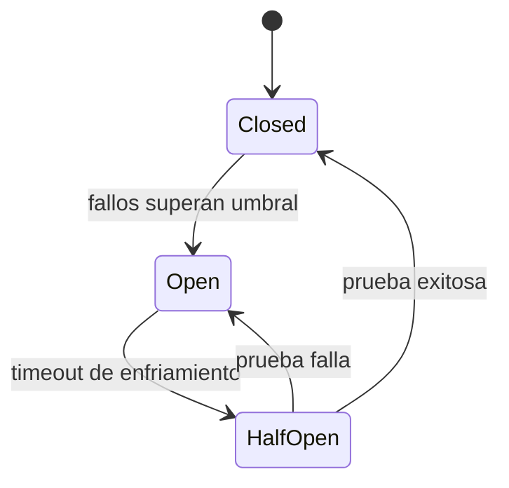

# Módulo 15 · Resiliencia en Node.js

En sistemas distribuidos los fallos parciales son normales: latencia, timeouts, errores 5xx, saturación o dependencias caídas. La resiliencia no evita fallos; evita que un fallo local se convierta en caída total. Este módulo implementa patrones de resiliencia en Node con foco en contratos, riesgos y verificación.

**Entorno de referencia verificado (2026-05-22):** Node.js v24.18.0. Los patrones se demuestran con Node ejecutable; opossum/cockatiel/rate-limiter-flexible/Redis requieren dependencias/infra, con **Nota de verificación**.

## Aprende construyendo

### Tema 1: Circuit Breaker con opossum o cockatiel · Avanzado · 120 min

Caso guía: el servicio de inventario falla repetidamente y orders no debe seguir golpeándolo.

#### Circuit breaker

**Definición formal.** Circuit breaker envuelve llamadas a una dependencia y cambia de estado (closed, open, half-open) según tasas de fallo/latencia, cortando llamadas cuando la dependencia es inestable.

**Para qué sirve.** Fallar rápido, proteger recursos propios y dar tiempo de recuperación a la dependencia.

**Cuándo usarlo / cuándo no.** Úsalo ante dependencias remotas/inestables. No lo uses para errores de validación local; no lo configures con umbrales arbitrarios sin métricas.



**Ejemplo mínimo enfocado (ejecutable).**

```bash
mkdir -p nm6-cb
cd nm6-cb
```

Crea el archivo `cb.mjs`:

```js
class CircuitBreaker {
  constructor({ threshold = 2, cooldownMs = 1000 } = {}) {
    this.state = 'CLOSED'; this.failures = 0; this.threshold = threshold; this.cooldownMs = cooldownMs; this.openedAt = 0;
  }
  async call(fn) {
    if (this.state === 'OPEN' && Date.now() - this.openedAt < this.cooldownMs) throw new Error('circuit_open');
    if (this.state === 'OPEN') this.state = 'HALF_OPEN';
    try {
      const r = await fn();
      this.failures = 0; this.state = 'CLOSED'; return r;
    } catch (e) {
      this.failures++;
      if (this.failures >= this.threshold) { this.state = 'OPEN'; this.openedAt = Date.now(); }
      throw e;
    }
  }
}
const cb = new CircuitBreaker({ threshold: 2, cooldownMs: 10000 });
const fail = async () => { throw new Error('down'); };
for (let i=0;i<2;i++) { try { await cb.call(fail); } catch {} }
try { await cb.call(async () => 'ok'); } catch (e) { console.log(e.message); }
console.log(cb.state);
```

```bash
node cb.mjs
```

**Caso de uso real.** Opossum/cockatiel envolviendo llamadas HTTP a inventory.

**Error común.** Abrir circuito y no tener fallback.

**Síntoma.** errores rápidos masivos al usuario. **Causa.** se corta la dependencia pero no hay respuesta degradada. **Corrección.** fallback, cache stale-safe, mensaje funcional. **Señal observable.** métricas `circuit_open` altas sin degradación útil.

**Verificación (Node 24.18.0, 2026-05-22).** Salida: `circuit_open`, `OPEN`. **Nota de verificación:** opossum real `npm i opossum`; cockatiel `npm i cockatiel`.

### Tema 2: Retry con jitter · Avanzado · 120 min

Caso guía: un timeout transitorio de red puede recuperarse, pero reintentar masivamente puede tumbar el servicio.

#### Retry y backoff con jitter

**Definición formal.** Retry reejecuta una operación fallida bajo política limitada. Backoff incrementa espera entre intentos; jitter agrega aleatoriedad para evitar tormentas sincronizadas.

**Para qué sirve.** Recuperar fallos transitorios sin amplificar incidentes.

**Cuándo usarlo / cuándo no.** Úsalo solo en fallos transitorios e idempotentes (o con idempotency key). No reintentes 400, errores de negocio, ni operaciones no idempotentes sin protección.

**Ejemplo mínimo enfocado (ejecutable).**

```bash
mkdir -p nm6-retry
cd nm6-retry
```

Crea el archivo `retry.mjs`:

```js
function backoffMs(attempt, base = 100, max = 1000) {
  const exp = Math.min(max, base * 2 ** attempt);
  const jitter = Math.floor(Math.random() * exp);
  return jitter;
}
let calls = 0;
async function flaky() { calls++; if (calls < 3) throw new Error('transient'); return 'ok'; }
async function retry(fn, attempts = 5) {
  let err;
  for (let i=0;i<attempts;i++) {
    try { return await fn(); } catch (e) { err = e; }
  }
  throw err;
}
console.log(await retry(flaky));
console.log(calls);
console.log(backoffMs(3, 100, 1000) < 1000);
```

```bash
node retry.mjs
```

**Caso de uso real.** Reintentar GET a servicio externo o POST con idempotency key.

**Error común.** Retry sin límite ni jitter.

**Síntoma.** tormenta de reintentos, dependencia no se recupera. **Causa.** muchos clientes reintentan al mismo tiempo. **Corrección.** max attempts, exponential backoff + jitter, timeout por intento, presupuesto total. **Señal observable.** picos periódicos de tráfico tras fallo.

**Verificación (Node 24.18.0, 2026-05-22).** Salida: `ok`, `3`, `true`.

### Tema 3: Rate Limiting con Redis · Intermedio · 120 min

Caso guía: proteger `/login` y APIs costosas de abuso.

#### Rate limiting

**Definición formal.** Rate limiting restringe la cantidad de requests permitidas en una ventana por clave (IP, usuario, token, ruta).

**Para qué sirve.** Proteger disponibilidad, costo y seguridad ante abuso o picos.

**Cuándo usarlo / cuándo no.** Úsalo en bordes y endpoints sensibles. No uses solo memoria local si hay múltiples instancias; no apliques límites iguales a todos los endpoints sin contexto.

**Ejemplo mínimo enfocado (ejecutable, algoritmo fijo en memoria).**

```bash
mkdir -p nm6-rate
cd nm6-rate
```

Crea el archivo `rate.mjs`:

```js
class FixedWindow {
  constructor(limit, windowMs) { this.limit = limit; this.windowMs = windowMs; this.buckets = new Map(); }
  allow(key, now = Date.now()) {
    const bucket = Math.floor(now / this.windowMs);
    const k = `${key}:${bucket}`;
    const count = (this.buckets.get(k) || 0) + 1;
    this.buckets.set(k, count);
    return count <= this.limit;
  }
}
const rl = new FixedWindow(2, 1000);
console.log(rl.allow('ip1', 0));
console.log(rl.allow('ip1', 1));
console.log(rl.allow('ip1', 2));
```

```bash
node rate.mjs
```

**Caso de uso real.** Redis con `INCR`+`EXPIRE` o `rate-limiter-flexible` en múltiples instancias.

**Error común.** Rate limit solo en una instancia.

**Síntoma.** atacante escala pasando por varias réplicas. **Causa.** contador local no compartido. **Corrección.** store compartido (Redis), límites por identidad y ruta. **Señal observable.** 429 bajos en cada instancia pero abuso global.

**Verificación (Node 24.18.0, 2026-05-22).** Salida: `true`, `true`, `false`. **Nota de verificación:** Redis real requiere servicio Redis y cliente/librería.

### Tema 4: Timeouts · Intermedio · 90 min

Caso guía: una llamada a pagos tarda demasiado y bloquea workers.

#### Timeout

**Definición formal.** Timeout es un límite máximo de espera para una operación. Al vencer, la operación se considera fallida para el flujo actual.

**Para qué sirve.** Evitar esperas indefinidas y liberar recursos.

**Cuándo usarlo / cuándo no.** Úsalo en toda llamada remota. No uses timeouts gigantes por defecto; no confundas timeout de cliente con cancelación real del trabajo remoto.

**Ejemplo mínimo enfocado (ejecutable).**

```bash
mkdir -p nm6-timeout
cd nm6-timeout
```

Crea el archivo `timeout.mjs`:

```js
async function withTimeout(promise, ms) {
  return Promise.race([
    promise,
    new Promise((_, rej) => setTimeout(() => rej(new Error('timeout')), ms))
  ]);
}
const slow = new Promise(r => setTimeout(() => r('ok'), 50));
try { await withTimeout(slow, 10); } catch (e) { console.log(e.message); }
```

```bash
node timeout.mjs
```

**Caso de uso real.** `fetch` con `AbortSignal.timeout`, timeout de DB, timeout total de request.

**Error común.** No definir timeout.

**Síntoma.** requests colgadas, pool agotado, cascada. **Causa.** dependencia lenta y espera ilimitada. **Corrección.** timeout por hop y presupuesto end-to-end. **Señal observable.** aumento de conexiones abiertas y latencia p99.

**Verificación (Node 24.18.0, 2026-05-22).** Salida: `timeout`.

### Tema 5: Fallback strategies · Intermedio · 90 min

Caso guía: si recomendaciones falla, la página debe seguir mostrando el producto.

#### Fallback

**Definición formal.** Fallback es una respuesta alternativa segura cuando la dependencia principal falla o excede su presupuesto.

**Para qué sirve.** Degradar funcionalidad sin tumbar todo el flujo.

**Cuándo usarlo / cuándo no.** Úsalo cuando existe respuesta aceptable: cache, default, funcionalidad parcial. No lo uses para ocultar fallos críticos de negocio (pago confirmado, saldo).

**Ejemplo mínimo enfocado (ejecutable).**

```bash
mkdir -p nm6-fallback
cd nm6-fallback
```

Crea el archivo `fallback.mjs`:

```js
async function getRecommendations() { throw new Error('down'); }
async function safeRecommendations() {
  try { return await getRecommendations(); }
  catch { return { items: [], degraded: true }; }
}
console.log((await safeRecommendations()).degraded);
```

```bash
node fallback.mjs
```

**Caso de uso real.** Devolver recomendaciones vacías, precio cacheado con marca de staleness, o feature deshabilitada.

**Error común.** Fallback que viola negocio.

**Síntoma.** datos incorrectos aceptados como válidos. **Causa.** fallback elegido sin analizar criticidad. **Corrección.** clasificar dependencias críticas/no críticas; degradar solo lo seguro. **Señal observable.** respuestas “ok” con datos stale/incorrectos.

**Verificación (Node 24.18.0, 2026-05-22).** Salida: `true`.

## Cierre

Resiliencia es diseño de fallos esperados: timeout acota espera, retry recupera transitorios, circuit breaker corta dependencias enfermas, rate limiting protege capacidad y fallback degrada con criterio. Sin observabilidad, estos patrones son conjeturas.

## Checklist

- Toda llamada remota tiene timeout.
- Retry solo en transitorios/idempotentes con backoff+jitter.
- Circuit breaker tiene fallback y métricas.
- Rate limit considera múltiples instancias.
- Fallback no viola invariantes de negocio.
