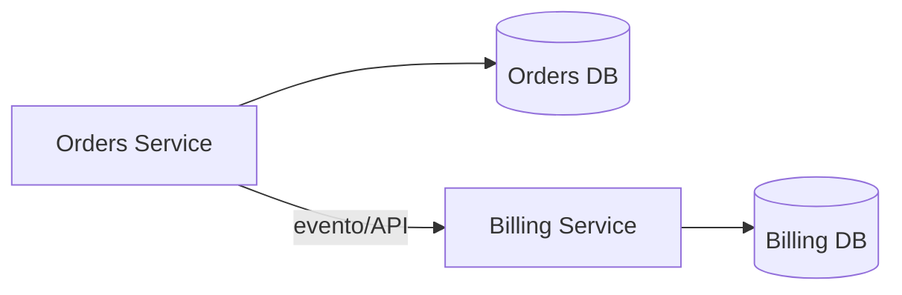

# Módulo 2 · Persistencia en Node.js

La persistencia en microservicios no es solo “conectar una DB”: define ownership de datos, consistencia, latencia, pooling y comportamiento ante fallos. Este módulo cubre MongoDB/Mongoose, PostgreSQL con Prisma/Sequelize, database-per-service, pooling y transacciones, con foco en decisiones verificables.

**Entorno de referencia verificado (2026-05-22):** Node.js v24.18.0. Ejemplos de lógica/contratos se ejecutan con Node. MongoDB, PostgreSQL, Mongoose, Prisma y Sequelize requieren servicios/dependencias; se incluyen comandos y **Nota de verificación** honesta.

## Aprende construyendo

### Tema 1: MongoDB + Mongoose · Intermedio · 150 min

Caso guía: guardar pedidos con esquema flexible, pero sin perder validación.

#### Documento, colección y esquema

**Definición formal.** MongoDB es una base documental; almacena documentos BSON en colecciones. Mongoose es un ODM para Node.js que define schemas, modelos, validación y middleware sobre MongoDB.

**Para qué sirve.** Iterar rápido con documentos y obtener validación/abstracción en aplicación.

**Cuándo usarlo / cuándo no.** Úsalo cuando el modelo es naturalmente documental o evoluciona rápido. No lo uses como excusa para no validar; no metas datos de otros servicios en la misma DB si rompe database-per-service.

**Ejemplo mínimo enfocado (ejecutable: validación de forma sin Mongo).**

```bash
mkdir -p nm2-mongo-shape
cd nm2-mongo-shape
```

Crea el archivo `shape.mjs`:

```js
function validateOrder(doc) {
  return typeof doc.sku === 'string' && Number.isInteger(doc.qty) && doc.qty > 0;
}
console.log(validateOrder({ sku: 'A1', qty: 2 }));
console.log(validateOrder({ sku: 'A1', qty: 0 }));
```

```bash
node shape.mjs
```

**Caso de uso real.** Catálogo con atributos variables por tipo de producto.

**Error común.** Confiar en “schemaless” y aceptar cualquier documento. **Síntoma.** lecturas fallan por campos faltantes/tipos inesperados. **Causa.** ausencia de validación. **Corrección.** schema Mongoose + validación en borde.

**Verificación (Node 24.18.0, 2026-05-22).** Salida: `true`, `false`. **Nota de verificación:** Mongoose real requiere `npm i mongoose` y MongoDB en ejecución; ejemplo típico: `mongoose.connect(process.env.MONGO_URL)`.

### Tema 2: PostgreSQL + Prisma/Sequelize · Intermedio · 150 min

Caso guía: persistir pedidos con integridad relacional y transacciones.

#### ORM/Query builder y modelo relacional

**Definición formal.** PostgreSQL es una base relacional ACID. Prisma es un ORM moderno con schema declarativo y cliente tipado; Sequelize es un ORM tradicional para Node.js basado en modelos.

**Para qué sirve.** Modelar relaciones, constraints, transacciones y consultas SQL con productividad.

**Cuándo usarlo / cuándo no.** Úsalo para datos relacionales, integridad y reporting. No ignores el SQL generado; no uses ORM como caja negra ante consultas lentas.

**Ejemplo mínimo enfocado (ejecutable: SQL de contrato).**

```bash
mkdir -p nm2-sql
cd nm2-sql
```

Crea el archivo `sql.mjs`:

```js
const sql = 'INSERT INTO orders(sku, qty) VALUES ($1, $2) RETURNING id';
const params = ['A1', 2];
console.log(sql.includes('RETURNING id'));
console.log(params.length);
```

```bash
node sql.mjs
```

**Caso de uso real.** Órdenes con FK a clientes y transacción de pago/inventario.

**Error común.** N+1 queries por lazy loading inadvertido. **Síntoma.** latencia crece con cantidad de filas. **Causa.** consulta por relación en bucle. **Corrección.** `include/join`, batch, medir queries.

**Verificación (Node 24.18.0, 2026-05-22).** Salida: `true`, `2`. **Nota de verificación:** Prisma requiere `npm i prisma @prisma/client`, `prisma init`, DB Postgres; Sequelize requiere `npm i sequelize pg`.

### Tema 3: Database-per-service · Intermedio · 90 min

Caso guía: `orders-service` y `billing-service` necesitan evolucionar sin acoplar esquemas.

#### Ownership de datos

**Definición formal.** Database-per-service es el patrón donde cada microservicio posee su almacenamiento y expone datos a otros solo por API/eventos/contratos.

**Para qué sirve.** Reducir acoplamiento, permitir evolución independiente y escalar por dominio.

**Cuándo usarlo / cuándo no.** Úsalo por defecto en microservicios. No compartas tablas entre servicios; si hay consulta cross-service, usa API composition, réplica read-model o eventos.



**Ejemplo mínimo enfocado (ejecutable).**

```bash
mkdir -p nm2-ownership
cd nm2-ownership
```

Crea el archivo `ownership.mjs`:

```js
const dbOwners = { orders: 'orders-service', billing: 'billing-service' };
function canWrite(service, table) { return dbOwners[table] === service; }
console.log(canWrite('orders-service', 'orders'));
console.log(canWrite('billing-service', 'orders'));
```

```bash
node ownership.mjs
```

**Caso de uso real.** Billing consume evento `OrderCreated`; no hace `SELECT` directo a tabla de Orders.

**Error común.** Compartir DB “por rapidez”. **Síntoma.** un cambio de esquema rompe otro servicio. **Causa.** acoplamiento oculto. **Corrección.** contratos explícitos y ownership.

**Verificación (Node 24.18.0, 2026-05-22).** Salida: `true`, `false`.

### Tema 4: Connection pooling y transacciones · Avanzado · 120 min

Caso guía: un pico de tráfico agota conexiones o deja datos a medias.

#### Connection pooling

**Definición formal.** Pool de conexiones es un conjunto de conexiones DB reutilizables administradas por el cliente/driver para evitar costo de crear/cerrar conexiones por request.

**Para qué sirve.** Controlar latencia y uso de recursos en DB.

**Cuándo usarlo / cuándo no.** Siempre en servicios. No configures pool ilimitado; respeta límites de DB y réplicas.

**Ejemplo mínimo enfocado (ejecutable).**

```bash
mkdir -p nm2-pool
cd nm2-pool
```

Crea el archivo `pool.mjs`:

```js
class Pool {
  constructor(max) { this.max = max; this.used = 0; }
  acquire() { if (this.used >= this.max) return null; this.used++; return { release: () => this.used-- }; }
}
const p = new Pool(1);
const a = p.acquire();
const b = p.acquire();
console.log(Boolean(a));
console.log(b === null);
a.release();
console.log(Boolean(p.acquire()));
```

```bash
node pool.mjs
```

**Caso de uso real.** `max: 10` por instancia y cálculo total `instancias * max <= conexiones DB`.

**Error común.** No liberar conexión. **Síntoma.** pool agotado, requests colgadas. **Causa.** falta `finally/release`. **Corrección.** `try/finally`, timeouts, métricas de pool.

**Verificación (Node 24.18.0, 2026-05-22).** Salida: `true`, `true`, `true`.

#### Transacciones

**Definición formal.** Una transacción agrupa operaciones que deben cumplirse como unidad atómica según el nivel de aislamiento configurado.

**Para qué sirve.** Mantener invariantes locales (débito/crédito, stock/reserva).

**Cuándo usarlo / cuándo no.** Úsalo para invariantes dentro de la misma DB. No intentes transacción distribuida entre microservicios con 2PC ligero; usa saga/outbox.

**Ejemplo mínimo enfocado (ejecutable).**

```bash
mkdir -p nm2-tx
cd nm2-tx
```

Crea el archivo `tx.mjs`:

```js
function transfer(from, to, amount) {
  const snapshot = { ...from, to: { ...to } };
  try {
    if (from.balance < amount) throw new Error('insufficient');
    from.balance -= amount;
    to.balance += amount;
    return 'commit';
  } catch (e) {
    from.balance = snapshot.balance;
    to.balance = snapshot.to.balance;
    return 'rollback';
  }
}
const a = { balance: 10 }; const b = { balance: 0 };
console.log(transfer(a, b, 20));
console.log(a.balance, b.balance);
```

```bash
node tx.mjs
```

**Caso de uso real.** Crear orden y reservar stock en misma DB con transacción.

**Error común.** Asumir atomicidad entre dos DBs. **Síntoma.** datos inconsistentes tras fallo parcial. **Causa.** no hay transacción distribuida real. **Corrección.** outbox/saga, idempotencia.

**Verificación (Node 24.18.0, 2026-05-22).** Salida: `rollback`, `10 0`.

## Cierre

Persistencia en Node requiere elegir modelo de datos, respetar ownership, dimensionar pools y usar transacciones donde la DB puede garantizarlas. Entre servicios, la consistencia se logra con contratos y patrones distribuidos, no con joins cross-service.

## Checklist

- Puedo elegir Mongo/Mongoose vs PostgreSQL/Prisma/Sequelize con criterio.
- Respeto database-per-service.
- Configuro pool y libero conexiones.
- Uso transacciones para invariantes locales y saga/outbox para distribuidas.
