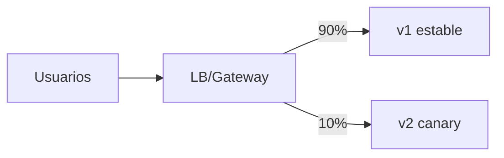

# Módulo 24 · Docker, Kubernetes y CI/CD para Node

Un microservicio no termina en `npm start`. Debe empaquetarse, configurarse, desplegarse, escalarse y revertirse de forma segura. Este módulo cubre el camino de entrega Node a producción: Docker multi-stage, Kubernetes, HPA, GitHub Actions, despliegues progresivos y GitOps.

**Entorno de referencia verificado (2026-05-22):** Node.js v24.18.0, Docker 29.9.3 disponibles en el entorno. No se asume cluster Kubernetes, ArgoCD ni runner de GitHub Actions; los manifiestos/workflows se validan como archivos y con checks ejecutables donde aplica, con **Nota de verificación**.

## Aprende construyendo

### Tema 1: Dockerfile multi-stage · Intermedio · 120 min

Caso guía: empaquetar una API Node/TS con imagen pequeña y sin toolchain de build en runtime.

#### Multi-stage build

**Definición formal.** Un Dockerfile multi-stage usa varias etapas `FROM`; etapas intermedias compilan/instalan y la etapa final copia solo artefactos necesarios. Reduce tamaño y superficie de ataque.

**Para qué sirve.** Separar build-time de runtime, mejorar cacheo y seguridad.

**Cuándo usarlo / cuándo no.** Úsalo en servicios TS/Node con build. No copies `node_modules` completo ciegamente si puedes hacer install de producción; no ejecutes como root si no es necesario.

**Contrato mínimo.** Base image pinneada, `WORKDIR`, deps por capa, build, usuario no root, `CMD/ENTRYPOINT`, `.dockerignore`.

**Ejemplo mínimo enfocado (ejecutable: validación de estructura).**

```bash
mkdir -p nm10-docker
cd nm10-docker
```

Crea el archivo `Dockerfile`:

```dockerfile
FROM node:24-alpine AS build
WORKDIR /app
COPY package*.json ./
RUN npm ci
COPY . .
RUN npm run build

FROM node:24-alpine AS runtime
WORKDIR /app
ENV NODE_ENV=production
COPY --from=build /app/dist ./dist
COPY --from=build /app/package*.json ./
RUN npm ci --omit=dev
USER node
CMD ["node", "dist/server.js"]
```

```bash
node -e "const fs=require('fs'); const d=fs.readFileSync('Dockerfile','utf8'); console.log(d.includes('AS build')); console.log(d.includes('USER node')); console.log(d.includes('--omit=dev'))"
```

**Caso de uso real.** CI construye imagen, escanea vulnerabilidades y publica a registry.

**Error común.** Imagen final con devDependencies y root.

**Síntoma.** imagen grande, CVEs innecesarios, mayor superficie de ataque. **Causa.** copiar todo el contexto/build stage. **Corrección.** multi-stage, `.dockerignore`, usuario no root, deps de prod. **Señal observable.** `docker image ls` muestra tamaño excesivo; scanner reporta paquetes dev.

**Verificación (Node 24.18.0, Docker 29.9.3, 2026-05-22).** Salida: `true`, `true`, `true`. **Nota de verificación:** no se construyó imagen porque requiere app Node completa; el Dockerfile es plantilla válida estructuralmente.

### Tema 2: Kubernetes · Avanzado · 150 min

Caso guía: desplegar el servicio con configuración, secretos y red estable.

#### Objetos base

**Definición formal.** Kubernetes orquesta contenedores. Deployment gestiona réplicas y rollout; Service expone red estable; ConfigMap y Secret externalizan configuración.

**Para qué sirve.** Ejecutar, escalar y actualizar servicios declarativamente.

**Cuándo usarlo / cuándo no.** Úsalo cuando necesitas orquestación, self-healing y despliegues declarativos. No lo uses para un solo servicio simple sin necesidad operativa.

**Contrato mínimo.** Imagen, puertos, env/config, requests/limits, probes, labels/selectors.

**Ejemplo mínimo enfocado (ejecutable: validación YAML textual).**

```bash
mkdir -p nm10-k8s
cd nm10-k8s
```

Crea el archivo `deployment.yaml`:

```yaml
apiVersion: apps/v1
kind: Deployment
metadata:
  name: orders-api
spec:
  replicas: 2
  selector:
    matchLabels:
      app: orders-api
  template:
    metadata:
      labels:
        app: orders-api
    spec:
      containers:
        - name: api
          image: ghcr.io/acme/orders-api:1.0.0
          ports:
            - containerPort: 3000
          readinessProbe:
            httpGet: { path: /health/ready, port: 3000 }
          livenessProbe:
            httpGet: { path: /health/live, port: 3000 }
```

```bash
node -e "const fs=require('fs'); const y=fs.readFileSync('deployment.yaml','utf8'); console.log(y.includes('readinessProbe')); console.log(y.includes('livenessProbe')); console.log(y.includes('replicas: 2'))"
```

**Caso de uso real.** GitOps aplica manifiestos; K8s recrea pods caídos.

**Error común.** No definir probes o requests/limits.

**Síntoma.** pods reciben tráfico antes de estar listos o son OOMKilled. **Causa.** ausencia de readiness/liveness/resources. **Corrección.** probes, requests/limits, rollout gradual. **Señal observable.** reinicios, 503 en deploy, eventos OOMKilled.

**Verificación (Node 24.18.0, 2026-05-22).** Salida: `true`, `true`, `true`. **Nota de verificación:** no se aplicó a cluster; requiere `kubectl` y cluster/kind.

### Tema 3: HPA · Intermedio · 90 min

Caso guía: escalar por CPU o métricas cuando sube el tráfico.

#### Horizontal Pod Autoscaler

**Definición formal.** HPA ajusta automáticamente el número de réplicas de un workload según métricas observadas (CPU, memoria, métricas custom).

**Para qué sirve.** Absorber picos sin sobreaprovisionar permanentemente.

**Cuándo usarlo / cuándo no.** Úsalo en cargas variables con pods stateless. No lo uses si el bottleneck es la DB o si la app no soporta réplicas.

**Contrato mínimo.** min/max replicas, métrica objetivo, requests de CPU definidos.

**Ejemplo mínimo enfocado (ejecutable).**

```bash
mkdir -p nm10-hpa
cd nm10-hpa
```

Crea el archivo `hpa.yaml`:

```yaml
apiVersion: autoscaling/v2
kind: HorizontalPodAutoscaler
metadata:
  name: orders-api
spec:
  scaleTargetRef:
    apiVersion: apps/v1
    kind: Deployment
    name: orders-api
  minReplicas: 2
  maxReplicas: 10
  metrics:
    - type: Resource
      resource:
        name: cpu
        target:
          type: Utilization
          averageUtilization: 70
```

```bash
node -e "const fs=require('fs'); const y=fs.readFileSync('hpa.yaml','utf8'); console.log(/minReplicas: 2/.test(y)); console.log(/maxReplicas: 10/.test(y)); console.log(/averageUtilization: 70/.test(y))"
```

**Caso de uso real.** API stateless escala en Black Friday.

**Error común.** HPA sin requests/limits.

**Síntoma.** escalado errático o inefectivo. **Causa.** métricas de utilización dependen de requests. **Corrección.** definir requests y probar carga. **Señal observable.** HPA muestra `<unknown>` o escala tarde.

**Verificación (Node 24.18.0, 2026-05-22).** Salida: `true`, `true`, `true`.

### Tema 4: GitHub Actions · Intermedio · 120 min

Caso guía: ejecutar tests, build y publicar imagen en cada cambio.

#### CI pipeline

**Definición formal.** GitHub Actions ejecuta workflows YAML ante eventos (push, PR). Un pipeline CI valida calidad; CD entrega artefactos.

**Para qué sirve.** Automatizar feedback y evitar regresiones.

**Cuándo usarlo / cuándo no.** Úsalo en todo repo con entregas frecuentes. No saltes tests por velocidad; no guardes secretos en YAML.

**Contrato mínimo.** Trigger, permisos mínimos, cache, pasos deterministas, artefactos/imágenes, secrets manejados por GitHub Secrets.

**Ejemplo mínimo enfocado (ejecutable: validación de workflow).**

```bash
mkdir -p nm10-ci
cd nm10-ci
```

Crea el archivo `ci.yml`:

```yaml
name: ci
on: [push, pull_request]
jobs:
  test:
    runs-on: ubuntu-latest
    steps:
      - uses: actions/checkout@v4
      - uses: actions/setup-node@v4
        with: { node-version: 24 }
      - run: npm ci
      - run: npm test
```

```bash
node -e "const fs=require('fs'); const y=fs.readFileSync('ci.yml','utf8'); console.log(y.includes('npm ci')); console.log(y.includes('npm test')); console.log(y.includes('setup-node'))"
```

**Caso de uso real.** PR bloqueado si tests/lint/typecheck fallan.

**Error común.** Pipeline verde pero no reproduce producción.

**Síntoma.** falla en deploy. **Causa.** diferencias de env, deps o pasos faltantes. **Corrección.** build de imagen, smoke tests, ambientes reproducibles. **Señal observable.** “works in CI, fails in prod”.

**Verificación (Node 24.18.0, 2026-05-22).** Salida: `true`, `true`, `true`. **Nota de verificación:** workflow no ejecutado en GitHub Actions aquí.

### Tema 5: Blue-Green y Canary · Avanzado · 120 min

Caso guía: desplegar nueva versión sin downtime y con rollback rápido.

#### Despliegues progresivos

**Definición formal.** Blue-green mantiene dos entornos (actual y nuevo) y conmuta tráfico. Canary libera gradualmente a un porcentaje de usuarios.

**Para qué sirve.** Reducir riesgo de release.

**Cuándo usarlo / cuándo no.** Úsalo cuando el costo de fallo es alto. No hagas canary sin métricas/rollback; no uses blue-green si el costo de duplicar entorno es prohibitivo.



**Ejemplo mínimo enfocado (ejecutable).**

```bash
mkdir -p nm10-rollout
cd nm10-rollout
```

Crea el archivo `rollout.mjs`:

```js
function route(percentCanary, r = Math.random() * 100) {
  return r < percentCanary ? 'canary' : 'stable';
}
console.log(route(10, 5));
console.log(route(10, 50));
console.log(route(0, 5));
```

```bash
node rollout.mjs
```

**Caso de uso real.** Argo Rollouts/Flagger/K8s gateway con pesos.

**Error común.** Canary sin criterios de promoción.

**Síntoma.** versión mala recibe más tráfico. **Causa.** no definir métricas de error/latencia y rollback automático. **Corrección.** SLO gates, análisis automático, rollback. **Señal observable.** aumento de 5xx en canary ignorado.

**Verificación (Node 24.18.0, 2026-05-22).** Salida: `canary`, `stable`, `stable`.

### Tema 6: GitOps con ArgoCD · Avanzado · 120 min

Caso guía: el estado deseado del cluster vive en Git.

#### GitOps

**Definición formal.** GitOps usa Git como fuente de verdad declarativa; un controlador (ArgoCD) reconcilia el estado real del cluster con el deseado en Git.

**Para qué sirve.** Auditoría, reproducibilidad, rollback por Git y menos cambios manuales en cluster.

**Cuándo usarlo / cuándo no.** Úsalo con equipos/plataformas maduras. No lo uses si no hay disciplina de manifests/review; no edites cluster manualmente sin reconciliar.

**Ejemplo mínimo enfocado (ejecutable).**

```bash
mkdir -p nm10-gitops
cd nm10-gitops
```

Crea el archivo `desired.json`:

```json
{ "app": "orders-api", "image": "ghcr.io/acme/orders-api:1.0.0", "replicas": 2 }
```

Crea el archivo `reconcile.mjs`:

```js
import fs from 'node:fs';
const desired = JSON.parse(fs.readFileSync('desired.json', 'utf8'));
const actual = { app: 'orders-api', image: 'ghcr.io/acme/orders-api:0.9.0', replicas: 2 };
const drift = Object.keys(desired).filter(k => desired[k] !== actual[k]);
console.log(drift.length);
console.log(drift[0]);
```

```bash
node reconcile.mjs
```

**Caso de uso real.** ArgoCD detecta drift y sincroniza o alerta.

**Error común.** Cambios manuales en cluster.

**Síntoma.** drift entre Git y runtime. **Causa.** hotfix directo con kubectl. **Corrección.** todo cambio por PR; reconciliación continua. **Señal observable.** ArgoCD marca OutOfSync.

**Verificación (Node 24.18.0, 2026-05-22).** Salida: `1`, `image`. **Nota de verificación:** ArgoCD/K8s no ejecutados aquí.

## Cierre

Entregar Node a producción es un contrato operativo: imagen reproducible, manifiestos declarativos, probes, autoscaling, CI y despliegue progresivo. El objetivo no es “desplegar”, sino poder cambiar con seguridad.

## Checklist

- Dockerfile multi-stage, no root, deps prod.
- Manifiestos con probes y resources.
- HPA con métricas y requests definidos.
- CI ejecuta tests antes de publicar.
- Canary/blue-green con métricas y rollback.
- GitOps evita drift.
