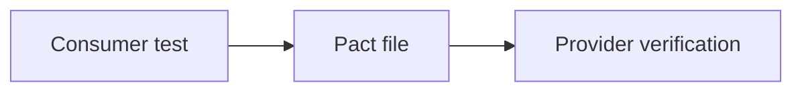

# Módulo 4 · Testing en Node.js

Testing en microservicios Node no es solo “tener Jest”: es elegir el nivel correcto para cada riesgo. Unit tests dan velocidad, Supertest verifica el contrato HTTP, Pact verifica contratos entre servicios y Testcontainers acerca la integración a una dependencia real.

**Entorno de referencia verificado (2026-05-22):** Node.js v24.18.0. Ejemplos ejecutan con Node estándar. Jest, Supertest, Pact y Testcontainers requieren dependencias; se incluyen comandos y **Nota de verificación**.

## Aprende construyendo

### Tema 1: Jest · Intermedio · 120 min

Caso guía: probar una regla de cálculo sin levantar servidor ni DB.

#### Test runner y aserciones

**Definición formal.** Jest es un framework de testing para JavaScript/TypeScript con runner, aserciones, mocks y cobertura.

**Para qué sirve.** Feedback rápido en lógica pura y unidades aisladas.

**Cuándo usarlo / cuándo no.** Úsalo para reglas de negocio, utilidades y adaptadores con dobles. No lo uses como único nivel para APIs o integración DB.

**Ejemplo mínimo enfocado (ejecutable con Node como test simple).**

```bash
mkdir -p nm3-jest-like
cd nm3-jest-like
```

Crea el archivo `calc.mjs`:

```js
export function total(qty, price) {
  if (qty <= 0) throw new Error('qty');
  return qty * price;
}
```

Crea el archivo `calc.test.mjs`:

```js
import assert from 'node:assert/strict';
import { total } from './calc.mjs';

assert.equal(total(2, 10), 20);
assert.throws(() => total(0, 10), /qty/);
console.log('ok');
```

```bash
node calc.test.mjs
```

**Caso de uso real.** Cálculo de impuestos, reglas de elegibilidad, mapeo DTO.

**Error común.** Mockear todo. **Síntoma.** tests verdes, producción rota. **Causa.** no se prueba integración real. **Corrección.** pirámide balanceada.

**Verificación (Node 24.18.0, 2026-05-22).** Salida: `ok`. **Nota:** Jest real: `npm i -D jest` y `npx jest`.

### Tema 2: Supertest · Intermedio · 90 min

Caso guía: probar `GET /health` sin abrir puerto manualmente en el test.

#### Test HTTP de integración de capa web

**Definición formal.** Supertest es una librería para probar servidores HTTP Node (especialmente Express) haciendo requests y aserciones sobre status/body/headers.

**Para qué sirve.** Verificar contrato HTTP, middleware, validación y códigos de error.

**Cuándo usarlo / cuándo no.** Úsalo para capa web/API. No lo uses para probar lógica pura que no necesita HTTP.

**Ejemplo mínimo enfocado (ejecutable con Node fetch).**

```bash
mkdir -p nm3-http
cd nm3-http
```

Crea el archivo `app.mjs`:

```js
import http from 'node:http';
export function createServer() {
  return http.createServer((req, res) => {
    if (req.url === '/health') {
      res.writeHead(200, { 'content-type': 'application/json' });
      res.end(JSON.stringify({ ok: true }));
      return;
    }
    res.writeHead(404).end();
  });
}
```

Crea el archivo `app.test.mjs`:

```js
import assert from 'node:assert/strict';
import { createServer } from './app.mjs';

const server = createServer();
server.listen(0, '127.0.0.1', async () => {
  const { port } = server.address();
  const r = await fetch(`http://127.0.0.1:${port}/health`);
  assert.equal(r.status, 200);
  const body = await r.json();
  assert.equal(body.ok, true);
  console.log('ok');
  server.close();
});
```

```bash
node app.test.mjs
```

**Caso de uso real.** Verificar 400 ante payload inválido y 201 ante creación.

**Error común.** No cerrar servidor. **Síntoma.** test cuelga, CI timeout. **Causa.** handles abiertos. **Corrección.** `close()`/`afterAll`.

**Verificación (Node 24.18.0, 2026-05-22).** Salida: `ok`. **Nota:** Supertest real: `npm i -D supertest`.

### Tema 3: Contract Testing con Pact · Avanzado · 120 min

Caso guía: frontend espera `id` string, backend cambia a number.

#### Contrato consumer-driven

**Definición formal.** Contract testing verifica que provider y consumer cumplen un contrato compartido. En Pact, el consumer genera expectativas y el provider las verifica.

**Para qué sirve.** Detectar rupturas de integración antes de desplegar.

**Cuándo usarlo / cuándo no.** Úsalo entre servicios/equipos con despliegue independiente. No reemplaza tests unitarios ni e2e selectivos.



**Ejemplo mínimo enfocado (ejecutable: contrato JSON).**

```bash
mkdir -p nm3-pact
cd nm3-pact
```

Crea el archivo `contract.mjs`:

```js
const contract = { request: { path: '/orders/1' }, response: { status: 200, body: { id: '1' } } };
const actual = { id: '1' };
console.log(typeof actual.id === typeof contract.response.body.id);
```

```bash
node contract.mjs
```

**Caso de uso real.** Consumer publica pact; provider CI falla si rompe campo requerido.

**Error común.** Usar Pact como E2E completo. **Síntoma.** suite lenta y frágil. **Causa.** mal nivel de test. **Corrección.** contracts para forma/semántica, pocos E2E.

**Verificación (Node 24.18.0, 2026-05-22).** Salida: `true`. **Nota:** Pact real requiere `@pact-foundation/pact`.

### Tema 4: Testcontainers para Node · Avanzado · 120 min

Caso guía: probar repositorio contra Postgres real, no contra mock.

#### Dependencias efímeras reales

**Definición formal.** Testcontainers levanta contenedores Docker efímeros para tests de integración, proporcionando dependencias reales aisladas.

**Para qué sirve.** Aumentar confianza en queries, migraciones, drivers y configuración.

**Cuándo usarlo / cuándo no.** Úsalo para integración DB/broker. No lo uses para cada unit test; es más lento.

**Ejemplo mínimo enfocado (ejecutable: decisión de nivel).**

```bash
mkdir -p nm3-tc
cd nm3-tc
```

Crea el archivo `level.mjs`:

```js
function testLevel(needsRealDb) { return needsRealDb ? 'testcontainers' : 'unit'; }
console.log(testLevel(true));
console.log(testLevel(false));
```

```bash
node level.mjs
```

**Caso de uso real.** Test de migración Flyway/Prisma contra Postgres real en CI.

**Error común.** Hacer integración sin limpiar estado. **Síntoma.** tests flaky. **Causa.** datos compartidos. **Corrección.** contenedor efímero, transacción/cleanup.

**Verificación (Node 24.18.0, 2026-05-22).** Salida: `testcontainers`, `unit`. **Nota de verificación:** Testcontainers real requiere Docker daemon y `npm i -D testcontainers @testcontainers/postgresql`.

## Cierre

La pirámide de testing en Node equilibra velocidad y confianza: unit para reglas, HTTP para contrato web, Pact para contratos entre servicios y Testcontainers para integración realista.

## Checklist

- Elijo nivel de test por riesgo.
- Pruebo errores y no solo happy path.
- Cierro recursos en tests HTTP.
- Uso contratos para evitar rupturas entre equipos.
- Uso dependencias reales efímeras cuando el mock miente.
