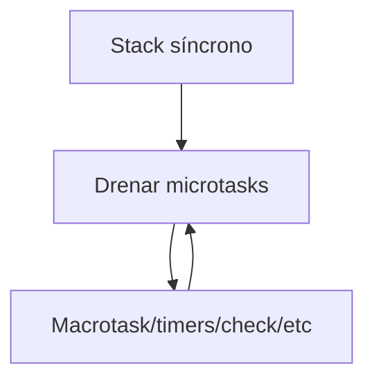
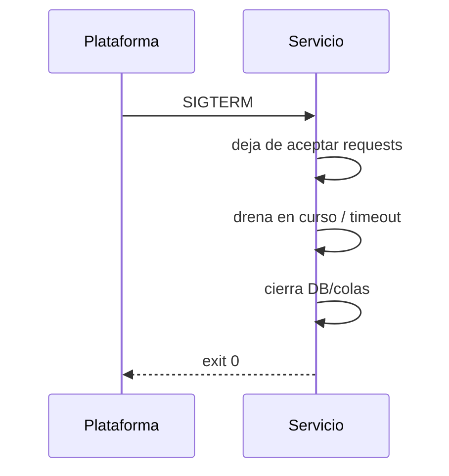

# Módulo 0 · Node.js moderno para microservicios

Un microservicio Node.js no falla solo por “bugs de negocio”; falla por promesas no esperadas, event loop bloqueado, cierres abruptos, streams sin backpressure o tipos mal modelados. Este módulo consolida la base moderna de Node.js/TypeScript que necesitas antes de poner HTTP, colas o bases de datos encima.

**Entorno de referencia verificado (2026-05-22):** Node.js v24.18.0, npm 12.0.2, TypeScript verificado con `npx -p typescript tsc` cuando aplica. Los ejemplos son Node puros salvo donde se indica TS.

## Aprende construyendo

### Tema 1: ES6+: async/await, Promises, destructuring, modules · Intermedio · 120 min

Caso guía: un servicio consulta un usuario y construye una respuesta sin bloquear el proceso.

#### Promises y `async/await`

**Definición formal.** Una `Promise` es un objeto que representa la terminación o fallo eventual de una operación asíncrona. `async/await` es sintaxis sobre Promises: una función `async` retorna una Promise y `await` suspende esa función hasta que la Promise se resuelve o rechaza.

**Para qué sirve.** Modelar I/O no bloqueante (red, disco, timers) con flujo legible y manejo de errores estructurado.

**Cuándo usarlo / cuándo no.** Úsalo para I/O y composición asíncrona. No lo uses para CPU intensiva en el hilo principal; no mezcles `await` y `.then()` sin necesidad; no ignores rechazos.

**Contrato mínimo.** `await` solo pausa la función `async` actual, no el event loop. Un rechazo sin `catch`/handler produce `unhandledRejection`.

**Ejemplo mínimo enfocado (ejecutable).**

```bash
mkdir -p nm0-async
cd nm0-async
```

Crea el archivo `async.mjs`:

```js
async function cargarUsuario(id) {
  if (id <= 0) throw new Error('id invalido');
  return { id, nombre: 'Ada' };
}

try {
  const u = await cargarUsuario(1);
  console.log(u.nombre);
  await cargarUsuario(0);
} catch (e) {
  console.log('error:' + e.message);
}
```

```bash
node async.mjs
```

**Caso de uso real.** Un handler HTTP consulta DB y servicio externo; si uno falla, responde 5xx controlado y registra el error con contexto.

**Error común.** Olvidar `await`.

```js
const u = cargarUsuario(1); // Promise, no usuario
console.log(u.nombre); // undefined
```

**Síntoma.** `undefined`, `Cannot read properties of undefined`, o lógica que continúa antes de tiempo. **Causa.** Se usó la Promise como valor. **Corrección.** `await` o `.then()` y manejo de rechazo. **Señal observable.** `console.log(u)` muestra `Promise { ... }`.

**Verificación (Node 24.18.0, 2026-05-22).** Salida: `Ada`, `error:id invalido`.

#### Destructuring, defaults y módulos ES

**Definición formal.** Destructuring extrae propiedades/elementos a variables. Los módulos ES (`import`/`export`) definen dependencias explícitas entre archivos con alcance de módulo.

**Para qué sirve.** Reducir ruido al leer objetos de configuración/respuesta y separar responsabilidades por archivo.

**Cuándo usarlo / cuándo no.** Úsalo cuando mejora claridad. No destructures objetos posiblemente `undefined` sin default; no uses ESM y CommonJS mezclados sin configurar interoperabilidad.

**Ejemplo mínimo enfocado (ejecutable).**

```bash
mkdir -p nm0-mod
cd nm0-mod
```

Crea el archivo `config.mjs`:

```js
export function puerto({ PORT = 3000 } = {}) {
  return Number(PORT);
}
```

Crea el archivo `main.mjs`:

```js
import { puerto } from './config.mjs';
console.log(puerto({ PORT: '8080' }));
console.log(puerto());
```

```bash
node main.mjs
```

**Caso de uso real.** Leer configuración con defaults seguros y separar utilidades puras de bootstrap.

**Error común.** Destructurar `undefined`. **Síntoma.** `Cannot destructure property 'PORT' of 'undefined'`. **Causa.** No se pasó objeto. **Corrección.** Default de parámetro `= {}` y defaults por campo.

**Verificación (Node 24.18.0, 2026-05-22).** Salida: `8080`, `3000`.

### Tema 2: TypeScript: tipos, interfaces, generics, strict mode · Intermedio · 120 min

Caso guía: definir el contrato de entrada de un endpoint antes de ejecutar lógica.

#### Tipado estático, interfaces y `strict`

**Definición formal.** TypeScript es un superset de JavaScript con tipos estáticos borrados en compilación. `strict` habilita un conjunto de chequeos más seguros (`strictNullChecks`, `noImplicitAny`, etc.).

**Para qué sirve.** Detectar incompatibilidades antes de runtime y documentar contratos en el código.

**Cuándo usarlo / cuándo no.** Úsalo en servicios mantenibles y equipos. No uses `any` como atajo habitual; no asumas que el tipo TS valida datos externos en runtime.

**Ejemplo mínimo enfocado (ejecutable con TypeScript).**

```bash
mkdir -p nm0-ts
cd nm0-ts
```

Crea el archivo `user.ts`:

```ts
interface User {
  id: number;
  name: string;
}

function greet(u: User): string {
  return `hi ${u.name}`;
}

console.log(greet({ id: 1, name: 'Ada' }));
```

```bash
npx -p typescript tsc --strict --target es2022 --module nodenext --moduleResolution nodenext --types node user.ts
node user.js
```

**Caso de uso real.** DTOs internos, contratos de repositorio, respuestas tipadas.

**Error común.** Usar `any` en la frontera. **Síntoma.** bug llega a producción con `undefined is not a function`. **Causa.** El compilador no pudo verificar. **Corrección.** `unknown` + validación/runtime schema, tipos explícitos.

**Verificación (tsc 5.9.x vía npx, Node 24.18.0, 2026-05-22).** Salida: `hi Ada`.

#### Generics

**Definición formal.** Un generic parametriza tipos, permitiendo funciones/estructuras reutilizables sin perder información de tipo.

**Para qué sirve.** Modelar wrappers como `Result<T>`, repositorios, respuestas paginadas.

**Cuándo usarlo / cuándo no.** Úsalo cuando el mismo comportamiento aplica a varios tipos. No introduzcas generics por anticipación si un tipo concreto basta.

**Ejemplo mínimo enfocado (ejecutable).**

```bash
mkdir -p nm0-generic
cd nm0-generic
```

Crea el archivo `box.ts`:

```ts
function box<T>(value: T): { value: T } {
  return { value };
}

const n = box(7);
const s = box('ok');
console.log(n.value, s.value);
```

```bash
npx -p typescript tsc --strict --target es2022 --module nodenext --moduleResolution nodenext --types node box.ts
node box.js
```

**Caso de uso real.** `ApiResponse<T>` o `Result<T, E>`.

**Error común.** Generic innecesariamente complejo. **Síntoma.** tipos ilegibles y errores de compilación difíciles. **Causa.** abstracción prematura. **Corrección.** empezar concreto, extraer generic cuando hay patrón real.

**Verificación (2026-05-22).** Salida: `7 ok`.

### Tema 3: Event Loop: fases, microtasks, macrotasks · Avanzado · 120 min

Caso guía: depurar por qué un log aparece antes que un callback de timer.

#### Event loop, microtasks y macrotasks

**Definición formal.** El event loop de Node.js procesa trabajo en fases. Las microtasks (callbacks de Promises, `queueMicrotask`) se drenan al finalizar la operación actual, antes de continuar con la siguiente fase/tarea macrotask como `setTimeout`.

**Para qué sirve.** Predecir orden de ejecución y evitar bloqueo del hilo principal.

**Cuándo usarlo / cuándo no.** Conoce el modelo para toda I/O Node. No ejecutes CPU pesada en el loop; no asumas que `setTimeout(fn,0)` corre antes que una microtask.



**Ejemplo mínimo enfocado (ejecutable).**

```bash
mkdir -p nm0-loop
cd nm0-loop
```

Crea el archivo `loop.mjs`:

```js
setTimeout(() => console.log('timeout'), 0);
Promise.resolve().then(() => console.log('micro'));
console.log('sync');
```

```bash
node loop.mjs
```

**Caso de uso real.** Razonar por qué una métrica/log se emite en cierto orden; detectar starvation por microtasks recursivas.

**Error común.** Bloquear el event loop con CPU. **Síntoma.** requests HTTP dejan de responder, health checks fallan. **Causa.** cálculo largo en hilo principal. **Corrección.** worker thread, particionar trabajo o mover a servicio/job.

**Verificación (Node 24.18.0, 2026-05-22).** Salida: `sync`, `micro`, `timeout`.

### Tema 4: perf_hooks y clinic.js · Avanzado · 90 min

Caso guía: medir si una función es lenta antes de “optimizar”.

#### `perf_hooks`

**Definición formal.** `node:perf_hooks` expone APIs de medición de rendimiento, incluyendo `performance.now()` y `PerformanceObserver`.

**Para qué sirve.** Medir latencia de operaciones y crear instrumentación ligera.

**Cuándo usarlo / cuándo no.** Úsalo para medir antes de optimizar. No uses microbenchmarks artificiales como única verdad; mide bajo carga realista.

**Ejemplo mínimo enfocado (ejecutable).**

```bash
mkdir -p nm0-perf
cd nm0-perf
```

Crea el archivo `perf.mjs`:

```js
import { performance } from 'node:perf_hooks';

const t0 = performance.now();
for (let i = 0; i < 1_000_00; i++) {}
const dt = performance.now() - t0;
console.log(dt >= 0);
```

```bash
node perf.mjs
```

**Caso de uso real.** Medir tiempo de serialización, consulta o transformación crítica.

**Error común.** Optimizar sin medir. **Síntoma.** código más complejo con misma latencia. **Causa.** intuición equivocada. **Corrección.** medir antes/después, usar profiler.

**Verificación (Node 24.18.0, 2026-05-22).** Salida: `true`.

#### `clinic.js`

**Definición formal.** Suite de herramientas de diagnóstico para Node.js (doctor/flame/bubbleprof) que analiza CPU, event loop y async.

**Cuándo usarlo.** Cuando hay latencia alta, bloqueo o problemas async difíciles de ver con logs.

**Nota de verificación.** `clinic.js` requiere instalación de herramienta (`npm i -g clinic` o `npx clinic`). No se finge una salida de profiling aquí; el comando típico es `clinic doctor -- node app.mjs`.

### Tema 5: Worker Threads vs Child Processes · Avanzado · 120 min

Caso guía: calcular hash/CPU sin bloquear peticiones HTTP.

#### Worker Threads

**Definición formal.** `worker_threads` permite ejecutar JavaScript en hilos dentro del mismo proceso Node.js, con comunicación por mensajes y memoria aislada por defecto.

**Para qué sirve.** CPU-bound o tareas paralelas que no deben bloquear el event loop.

**Cuándo usarlo / cuándo no.** Úsalo para CPU intensiva. No lo uses para I/O normal; para I/O, el modelo async ya es suficiente.

**Ejemplo mínimo enfocado (ejecutable).**

```bash
mkdir -p nm0-worker
cd nm0-worker
```

Crea el archivo `worker.mjs`:

```js
import { Worker, isMainThread, parentPort } from 'node:worker_threads';

if (isMainThread) {
  const w = new Worker(new URL('./worker.mjs', import.meta.url));
  w.on('message', (m) => console.log(m));
} else {
  let total = 0;
  for (let i = 0; i < 1000; i++) total += i;
  parentPort.postMessage(total);
}
```

```bash
node worker.mjs
```

**Caso de uso real.** Comprimir, procesar imagen, calcular score pesado.

**Error común.** Usar workers para todo. **Síntoma.** complejidad y overhead innecesario. **Causa.** confundir I/O-bound con CPU-bound. **Corrección.** perfilar primero.

**Verificación (Node 24.18.0, 2026-05-22).** Salida: `499500`.

#### Child Processes

**Definición formal.** `child_process` crea procesos separados del sistema operativo. Tienen memoria aislada y mayor overhead que un worker, pero aíslan fallos y permiten ejecutar binarios externos.

**Cuándo usarlo.** Ejecutar CLI externo, aislar código riesgoso, trabajo que puede crashear.

**Ejemplo mínimo enfocado (ejecutable).**

```bash
mkdir -p nm0-child
cd nm0-child
```

Crea el archivo `child.mjs`:

```js
import { execFileSync } from 'node:child_process';
const out = execFileSync('node', ['-e', "process.stdout.write('ok')"], { encoding: 'utf8' });
console.log(out);
```

```bash
node child.mjs
```

**Error común.** Usar `exec` con input no confiable. **Síntoma.** inyección de comandos. **Causa.** shell interpreta string. **Corrección.** `execFile/spawn` con args array.

**Verificación (Node 24.18.0, 2026-05-22).** Salida: `ok`.

**Regla práctica.** Si el trabajo pesado es JavaScript puro (hash, cálculo), usa Worker Threads: menor overhead, memoria compartible por mensajes. Si necesitas ejecutar un binario externo o aislar código que puede crashear sin tumbar el proceso principal, usa Child Processes — y siempre con `execFile`/`spawn` y argumentos en array, nunca `exec` con un string construido a partir de input externo.

### Tema 6: Backpressure en Streams · Avanzado · 90 min

Caso guía: copiar un archivo grande sin cargarlo en memoria.

#### Backpressure

**Definición formal.** En streams Node.js, backpressure ocurre cuando el destino no consume tan rápido como produce la fuente. `write()` devuelve `false` cuando el buffer interno está lleno; se debe esperar `drain`.

**Para qué sirve.** Evitar uso ilimitado de memoria y controlar flujo.

**Cuándo usarlo / cuándo no.** Siempre en pipelines de streams grandes o red. No uses `stream.write()` en bucle ignorando el retorno.


**Ejemplo mínimo enfocado (ejecutable).**

```bash
mkdir -p nm0-stream
cd nm0-stream
```

Crea el archivo `stream.mjs`:

```js
import { Readable, Writable } from 'node:stream';

let i = 0;
const r = new Readable({
  read() { this.push(i < 3 ? String(i++) : null); }
});
const chunks = [];
const w = new Writable({
  write(chunk, _enc, cb) { chunks.push(chunk.toString()); cb(); }
});

w.on('finish', () => console.log(chunks.join(',')));
r.pipe(w);
```

```bash
node stream.mjs
```

**Caso de uso real.** Proxy HTTP, upload/download, procesamiento de CSV grande.

**Error común.** Ignorar `false` de `write()`. **Síntoma.** crecimiento de memoria, OOM. **Causa.** productor más rápido que consumidor. **Corrección.** `pipeline()` o respetar `drain`.

**Verificación (Node 24.18.0, 2026-05-22).** Salida: `0,1,2`.

### Tema 7: Graceful shutdown · Intermedio · 90 min

Caso guía: un despliegue envía SIGTERM mientras hay requests en vuelo.

#### Graceful shutdown

**Definición formal.** Secuencia de apagado controlado: dejar de aceptar trabajo nuevo, completar o acotar trabajo en curso, cerrar conexiones/recursos y salir con código apropiado.

**Para qué sirve.** Evitar perder requests, corromper trabajos o dejar conexiones colgadas durante deploys/escalado.

**Cuándo usarlo / cuándo no.** Siempre en servicios long-running. No hagas `process.exit(0)` inmediato al recibir SIGTERM si hay trabajo crítico en curso.



**Ejemplo mínimo enfocado (ejecutable).**

```bash
mkdir -p nm0-shutdown
cd nm0-shutdown
```

Crea el archivo `shutdown.mjs`:

```js
import http from 'node:http';

const server = http.createServer((_req, res) => res.end('ok'));
server.listen(0, '127.0.0.1', async () => {
  process.on('SIGTERM', () => {
    console.log('closing');
    server.close(() => {
      console.log('closed');
      process.exit(0);
    });
  });
  process.kill(process.pid, 'SIGTERM');
});
```

```bash
node shutdown.mjs
```

**Caso de uso real.** Kubernetes envía SIGTERM; el pod debe salir del endpoint de readiness, drenar requests y cerrar pool DB.

**Error común.** No cerrar servidor ni DB. **Síntoma.** conexiones cortadas, deploys con errores intermitentes. **Causa.** salida abrupta. **Corrección.** manejar SIGTERM/SIGINT, `server.close()`, timeout de cierre forzado.

**Verificación (Node 24.18.0, 2026-05-22).** Salida incluye `closing` y `closed`.

## Cierre

Node.js moderno para microservicios es dominio del runtime: async correcto, tipos en bordes internos, event loop, medición, concurrencia CPU, streams con backpressure y shutdown controlado. Con esta base, HTTP y mensajería se vuelven mucho más predecibles.

## Checklist

- Sé cuándo usar `await` y cómo manejar rechazos.
- Uso TypeScript con `strict` y no confío en tipos para input externo.
- Distingo microtask/macrotask y evito bloquear el event loop.
- Mido con `perf_hooks` antes de optimizar.
- Elijo worker thread vs child process por aislamiento/costo.
- Aplico backpressure y graceful shutdown.
