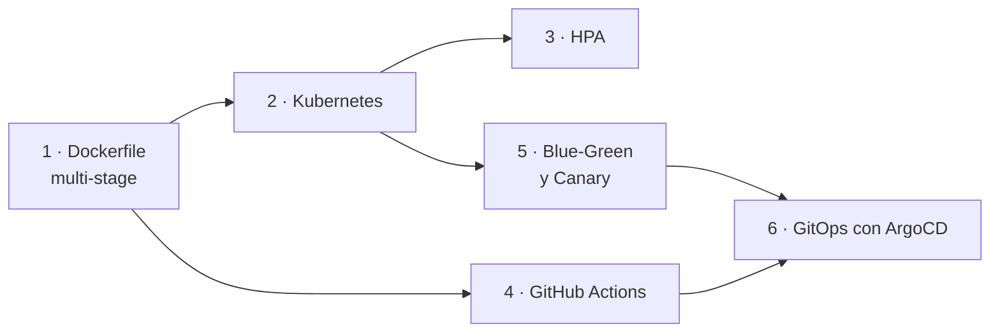
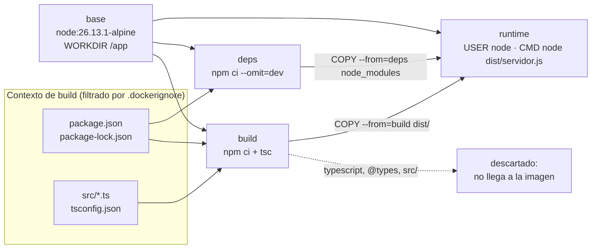
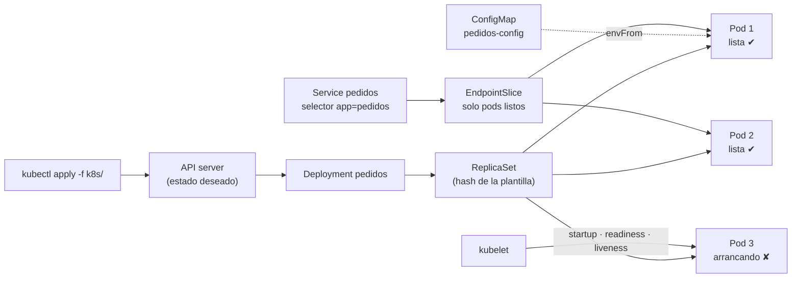
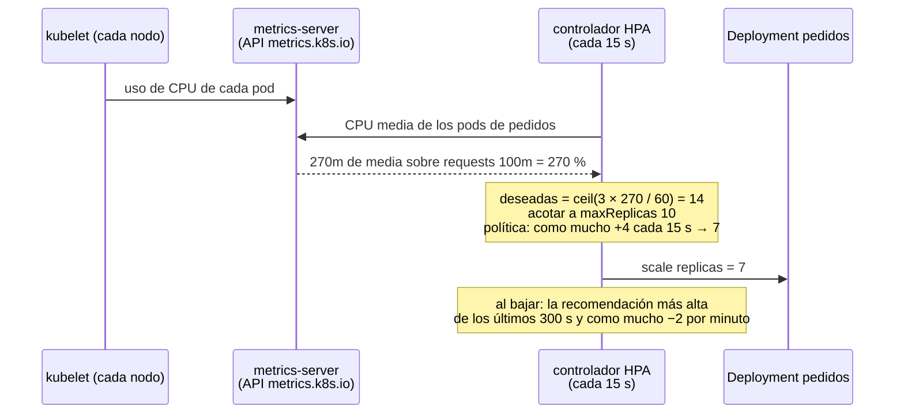
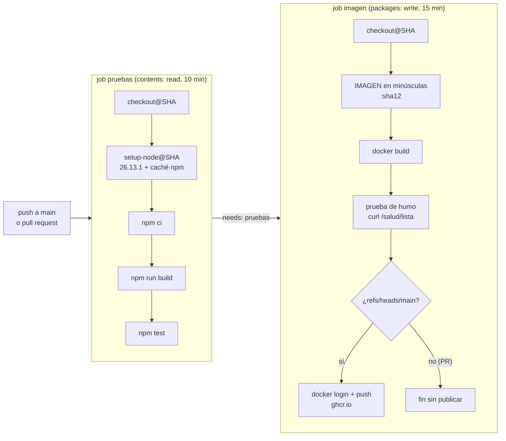
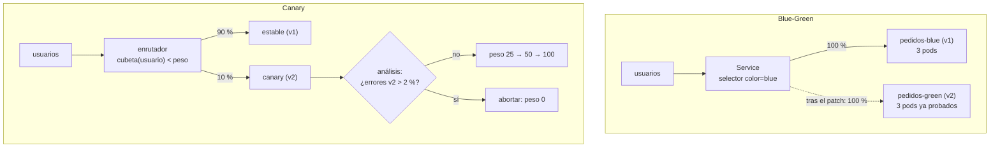
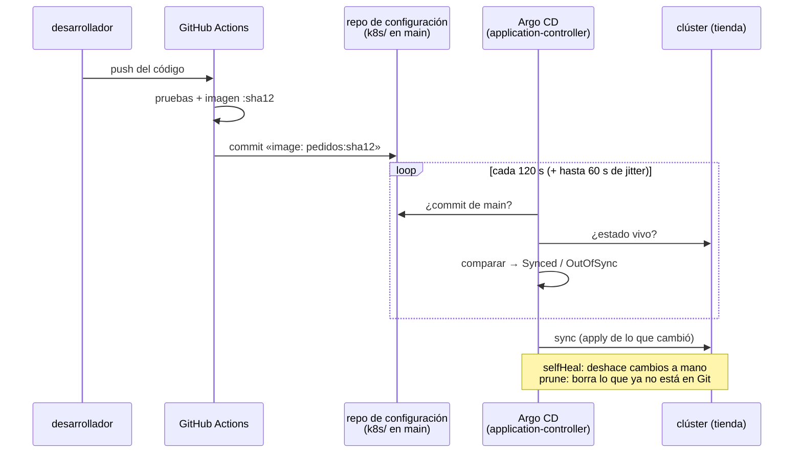

# Módulo 10 · Docker, Kubernetes y CI/CD

**Fase 2 · Node.js de cero a experto** (una semana de 12). **Duración:** 12 h (6 temas de unos 100 min y 2 h de
laboratorio integrador). **Dificultad:** 4 de 5. **Dependencias:** Módulo 0.5 (primer Dockerfile y Docker Compose) y
Módulo 21 (observabilidad: las métricas que miran el HPA y el canary); ayuda haber hecho el Módulo 13 (graceful
shutdown) y el Módulo 19 (timeouts). **Herramientas:**Node.js 26.13.1 LTS**, **TypeScript 6.0.3**, **express
5.3.0**, **yaml 2.9.1**, imagen **`node:26.13.1-alpine`**, **Docker Engine 29.10.0** con **Compose v5.6.1** o
posterior, **Kubernetes 1.37** en **kind v0.33.0**, **metrics-server v0.9.1**, **GitHub Actions** (`actions/checkout`
v7.0.1 y `actions/setup-node` v7.1.0 fijadas por SHA), **Argo Rollouts v1.10.1** y **Argo CD v3.5.6**.

fichas sin Docker; los comandos de verificación indicados construye la imagen y, si tienes kind y kubectl, despliega en un clúster
local y comprueba el HPA).

Hasta aquí tu servicio corría con `node servidor.js` en tu portátil. En producción nadie hace eso: el código se
**empaqueta** en una imagen pequeña y segura, un **orquestador** la arranca muchas veces, la reinicia si se cuelga y
añade copias cuando sube la carga, y una **cadena automática** prueba, construye y despliega cada cambio sin que nadie
copie archivos a mano. En este módulo llevas el servicio «pedidos» por ese camino completo: Dockerfile de varias etapas,
manifiestos de Kubernetes con probes, autoescalado con el HPA, pipeline de GitHub Actions, despliegues Blue-Green y
Canary que limitan el daño de una versión rota y GitOps, donde Git es la única fuente de verdad del clúster.



**Texto alternativo:** mapa del módulo. El tema 1 (Dockerfile multi-stage) produce la imagen que usan el tema 2
(Kubernetes) y el tema 4 (GitHub Actions). Kubernetes lleva al tema 3 (HPA) y al tema 5 (Blue-Green y Canary). GitHub
Actions y Blue-Green/Canary desembocan en el tema 6 (GitOps con ArgoCD), que une la cadena: el pipeline escribe en Git
y Argo CD despliega lo que hay en Git.

**Qué se ejecutó aquí y qué falta.** Todo el código Node.js, los 29 tests y los scripts de las fichas se ejecutaron con
Node 26.13.1 en Linux, y sus salidas están pegadas tal cual. La imagen de F142 se construyó aquí con Docker 29.10.0
sobre un **sustituto local** de `node:26.13.1-alpine` (este entorno no llega a Docker Hub), así que el tamaño final y
la parte de Alpine se verifican en tu Mac. **kind, kubectl, metrics-server, Argo Rollouts, Argo CD y la ejecución en
GitHub no se pudieron ejecutar aquí:** sus pasos están completos y marcados como «pendiente de verificar en el Mac»
en `verificacion/microservicios/pendiente.md`; donde no hay salida real se describe qué debes ver, sin inventar
números.

**Cómo usar el laboratorio.** Con Node 26 (y Docker para `--compose`):

```bash
npm ci && npm run build
  # 29 tests + scripts de las 6 fichas → «RESULTADO: OK»
los comandos de verificación indicados    # además imagen con Docker/Compose y, con kind y kubectl, el clúster «curso»
```

run build`. Lee el `README.md` para el mapa de
carpetas.

`package.json` del laboratorio (con `package-lock.json` que fija el árbol completo):

```json
{
  "name": "modulo-23-docker-kubernetes-cicd",
  "version": "1.0.0",
  "private": true,
  "description": "Módulo 23 (Fase 2): Docker, Kubernetes y CI/CD para un servicio Node.js (Dockerfile multi-stage, Kubernetes, HPA, GitHub Actions, Blue-Green y Canary, GitOps con Argo CD).",
  "type": "module",
  "engines": {
    "node": ">=26.13.1"
  },
  "scripts": {
    "build": "tsc -p tsconfig.json",
    "start": "node dist/servidor.js",
    "test": "node --test --test-concurrency=1 'f1*/*.test.js'"
  },
  "dependencies": {
    "express": "5.3.0"
  },
  "devDependencies": {
    "@types/express": "5.0.6",
    "@types/node": "26.6.6",
    "typescript": "6.0.3",
    "yaml": "2.9.1"
  }
}
```

El servicio que empaquetas y despliegas en todo el módulo, `src/app.ts`:

```typescript
// Módulo 23 · Servicio «pedidos» que el módulo empaqueta, despliega y escala.
// Requisitos: Node.js 26.13.1 LTS, express 5.3.0, TypeScript 6.0.3 (npm run build compila a dist/).
import express from 'express';
import { createHash } from 'node:crypto';

export interface Estado {
  listo: boolean;        // false mientras arranca o cuando recibe SIGTERM: Kubernetes deja de enviarle tráfico
  version: string;       // la etiqueta de la imagen (v1, v2…): Blue-Green y Canary la usan para distinguir versiones
  tasaError: number;     // 0..1 · solo para el laboratorio: fracción de pedidos que fallan en una versión defectuosa (F146)
}

export function crearApp(estado: Estado) {
  const app = express();
  app.disable('x-powered-by');

  // Liveness: «el proceso responde». Si falla, el kubelet reinicia el contenedor. No consulta dependencias.
  app.get('/salud/viva', (_req, res) => { res.json({ estado: 'viva' }); });

  // Readiness: «puedo atender tráfico». Si falla, el pod sale de los Endpoints del Service, sin reiniciarse.
  app.get('/salud/lista', (_req, res) => {
    if (estado.listo) res.json({ estado: 'lista' });
    else res.status(503).json({ estado: 'no lista' });
  });

  app.get('/version', (_req, res) => { res.json({ version: estado.version, pod: process.env.HOSTNAME ?? 'local' }); });

  app.get('/pedidos/:id', (req, res) => {
    // Fallo DETERMINISTA: el mismo id falla siempre en una versión defectuosa (así la simulación es repetible).
    const cubeta = Number.parseInt(createHash('sha256').update(req.params.id).digest('hex').slice(0, 8), 16) % 100;
    if (cubeta < estado.tasaError * 100) { res.status(500).json({ error: 'fallo simulado', version: estado.version }); return; }
    res.json({ id: req.params.id, estado: 'pagado', version: estado.version });
  });

  // Trabajo de CPU para que el HPA tenga algo que medir (F144): ?ms=50 quema unos 50 ms de CPU.
  app.get('/trabajo', (req, res) => {
    const ms = Math.min(Number(req.query.ms ?? 50), 1000);
    const fin = performance.now() + ms;
    let h = 'x';
    while (performance.now() < fin) h = createHash('sha256').update(h).digest('hex');
    res.json({ ms, version: estado.version });
  });
  return app;
}
```

`src/servidor.ts` (arranque y apagado ordenado):

```typescript
// Módulo 23 · Arranque y apagado ordenado del servicio «pedidos».
// En Kubernetes, al borrar un pod llega SIGTERM; el pod tiene terminationGracePeriodSeconds (30 s por defecto)
// antes de SIGKILL. Aquí: (1) dejamos de estar «listos», (2) esperamos a que el Service nos saque de sus Endpoints,
// (3) cerramos el servidor dejando terminar las peticiones en curso y (4) salimos con código 0.
import { crearApp, type Estado } from './app.js';

const puerto = Number(process.env.PORT ?? 8080);
const esperaDrenadoMs = Number(process.env.ESPERA_DRENADO_MS ?? 5000);
const estado: Estado = {
  listo: false,
  version: process.env.VERSION ?? 'dev',
  tasaError: Number(process.env.TASA_ERROR ?? 0),
};

const servidor = crearApp(estado).listen(puerto, () => {
  estado.listo = true;
  console.log(JSON.stringify({ msg: 'escuchando', puerto, version: estado.version, pid: process.pid }));
});

process.on('SIGTERM', () => {
  console.log(JSON.stringify({ msg: 'SIGTERM: dejo de estar lista y drenando', esperaDrenadoMs }));
  estado.listo = false;
  setTimeout(() => {
    servidor.close(() => {
      console.log(JSON.stringify({ msg: 'cerrado limpio', codigo: 0 }));
      process.exit(0);
    });
    servidor.closeIdleConnections();
  }, esperaDrenadoMs);
});
```

`tsconfig.json`:

```jsonc
{
  // Módulo 23 · TypeScript 6.0.3 COMPILA src/ a dist/ (npm run build). La etapa «build» del Dockerfile hace lo mismo.
  "compilerOptions": {
    "target": "es2024",
    "module": "nodenext",
    "moduleResolution": "nodenext",
    "rootDir": "src",
    "outDir": "dist",
    "strict": true,
    "verbatimModuleSyntax": true,
    "types": ["node"],
    "skipLibCheck": true
  },
  "include": ["src"]
}
```

---


### Dockerfile multi-stage

<details open>
<summary><strong>Capa 1 — Lectura</strong></summary>

#### ► DE QUÉ TRATA
Construir una imagen de producción con un Dockerfile de tres etapas (dependencias, compilación y ejecución), justificar cada instrucción por tamaño, caché, seguridad y señales, y demostrar que la imagen final no lleva compilador ni corre como root. Lo compruebas cuando node --tes…

#### ► LA IDEA EN UNA FRASE
**Construir una imagen de producción con un Dockerfile de tres etapas (dependencias, compilación y ejecución), justificar cada instrucción por tamaño, caché, seguridad y señales, y demostrar que la imagen final no lleva compilador ni corre como root.**

#### ► POR QUÉ EXISTE ESTO
Resuelve un problema real de diseño o implementación y evita decisiones a ciegas.

#### ► LA ANALOGÍA
Piensa en dockerfile multi-stage como una herramienta de taller: útil cuando conoces su propósito y sus límites.
**Dónde se rompe la analogía:** en software, los efectos dependen del contexto, la escala y los trade-offs.

#### ► CÓMO FUNCIONA


1. Una **imagen** es una caja con todo lo que tu programa necesita para arrancar: el sistema mínimo, Node.js, tu código y
2. Para **preparar** el programa necesitas herramientas (el compilador de TypeScript, por ejemplo) que **no** necesitas
3. Un Dockerfile **multi-stage** tiene varias recetas seguidas (etapas). Las primeras preparan; la última copia **solo
4. Además, la última etapa usa un **usuario sin permisos de administrador**: si alguien entra en el programa, no puede

#### ► LO QUE PUEDE SALIR MAL
| Síntoma | Causa probable | Arreglo |
|---|---|---|
| Dockerfile multi-stage se aplica pero el resultado no mejora | Se usó sin medir el problema real | Mide antes y compara contra la alternativa simple |
| Aparece complejidad inesperada | Se adoptó la técnica sin comprender sus trade-offs | Vuelve a la sección de trade-offs y reduce el alcance |
| Falla en un caso límite | Se asumió un contexto que no se cumple | Prueba el caso límite y documenta cuándo NO usarlo |

#### ► TRADE-OFFS
| Opción | Cuándo usarla | Cuándo NO usarla |
|---|---|---|
| Usar Dockerfile multi-stage | Cuando el problema coincide con su propósito y el beneficio es observable | Cuando agrega complejidad sin resolver un problema real |
| Alternativa más simple | Cuando el contexto es pequeño, estable o fácil de razonar | Cuando ya demostró no escalar o no cumplir el requisito |
| Postergar la decisión | Cuando falta evidencia del problema | Cuando el costo de esperar es mayor que el costo de probar |

#### ► CUÁNDO NO USAR ESTO
El «Dockerfile de portátil»: una sola etapa, COPY.. y npm start. Evita copiar todo el contexto antes de instalar, instalar con npm install y arrancar con npm como root:

#### ► DE VUELTA A LA ANALOGÍA
Volviendo a la analogía: dockerfile multi-stage funciona como el modelo inicial, pero recuerda dónde se rompe: en producción importan la evidencia, la escala y el costo de equivocarte.

#### ► LO QUE DEBES RECORDAR
- Una **imagen** es una caja con todo lo que tu programa necesita para arrancar: el sistema mínimo, Node.js, tu código y
- Para **preparar** el programa necesitas herramientas (el compilador de TypeScript, por ejemplo) que **no** necesitas
- Un Dockerfile **multi-stage** tiene varias recetas seguidas (etapas). Las primeras preparan; la última copia **solo
- Además, la última etapa usa un **usuario sin permisos de administrador**: si alguien entra en el programa, no puede

#### ► PREGUNTAS PARA PENSAR
1. ¿Qué problema concreto resuelve dockerfile multi-stage en tu contexto?
2. ¿Cómo sabrías que dockerfile multi-stage no está funcionando bien?
3. ¿Qué alternativa más simple considerarías antes de usar dockerfile multi-stage?

</details>

<details>
<summary><strong>Capa 2 — Construcción</strong></summary>

#### Construcción guiada
1. Revisa los dos Dockerfiles con el revisor:

```bash
node f142-dockerfile/revisar.js f142-dockerfile/Dockerfile.antes f142-dockerfile/Dockerfile
```

   **Output esperado:**

```text
== f142-dockerfile/Dockerfile.antes
   ✘ varias etapas (multi-stage)
   ✔ imagen base con versión exacta (nada de :latest ni sin etiqueta)
   ✘ la imagen final no corre como root (USER)
   ✘ instala con npm ci (respeta el lockfile)
   ✘ la etapa final no instala devDependencies
   ✘ no copia todo el contexto con «COPY . .»
   ✘ CMD en forma exec y con node (no npm)
== f142-dockerfile/Dockerfile
   ✔ varias etapas (multi-stage)
   ✔ imagen base con versión exacta (nada de :latest ni sin etiqueta)
   ✔ la imagen final no corre como root (USER)
   ✔ instala con npm ci (respeta el lockfile)
   ✔ la etapa final no instala devDependencies
   ✔ no copia todo el contexto con «COPY . .»
   ✔ CMD en forma exec y con node (no npm)
reglas incumplidas: 6
```

2. Mide lo que ahorra separar etapas **sin Docker**: `f142-dockerfile/etapas.js` ejecuta en dos carpetas temporales el
   mismo `npm ci` de las etapas `build` y `deps`:

```javascript
// Módulo 23 · F142 · Reproduce SIN Docker lo que hacen las etapas «deps» y «build» y mide lo que ahorra separarlas.
// Copia package.json y package-lock.json a dos carpetas temporales y ejecuta en cada una el mismo npm ci del Dockerfile.
// Requisitos: Node.js 26.13.1 LTS y npm. Ejecuta: node f142-dockerfile/etapas.js
import { execFileSync } from 'node:child_process';
import { cpSync, mkdtempSync, readdirSync, rmSync, statSync } from 'node:fs';
import { tmpdir } from 'node:os';
import { join } from 'node:path';

function tamano(ruta) { // bytes de una carpeta, recorriéndola entera
  let total = 0;
  for (const e of readdirSync(ruta, { withFileTypes: true })) {
    const p = join(ruta, e.name);
    total += e.isDirectory() ? tamano(p) : statSync(p).size;
  }
  return total;
}
const mb = (b) => `${(b / 1024 / 1024).toFixed(1)} MB`;
const paquetes = (nm) => readdirSync(nm).flatMap((n) => (n.startsWith('@') ? readdirSync(join(nm, n)) : n.startsWith('.') ? [] : [n])).length;

function etapa(nombre, argumentos) {
  const dir = mkdtempSync(join(tmpdir(), `etapa-${nombre}-`));
  for (const f of ['package.json', 'package-lock.json']) cpSync(f, join(dir, f));
  execFileSync('npm', ['ci', ...argumentos, '--no-audit', '--no-fund', '--prefer-offline', '--silent'], { cwd: dir, stdio: 'inherit' });
  const nm = join(dir, 'node_modules');
  const res = { nombre, bytes: tamano(nm), paquetes: paquetes(nm), typescript: readdirSync(nm).includes('typescript') };
  rmSync(dir, { recursive: true, force: true });
  return res;
}

const build = etapa('build', []);
const deps = etapa('deps', ['--omit=dev']);
for (const e of [build, deps]) {
  console.log(`etapa ${e.nombre.padEnd(5)} node_modules: ${mb(e.bytes).padStart(8)} · ${String(e.paquetes).padStart(2)} paquetes · typescript dentro: ${e.typescript ? 'sí' : 'no'}`);
}
console.log(`la imagen final copia solo «deps»: ${mb(build.bytes - deps.bytes)} menos (${Math.round(100 * (1 - deps.bytes / build.bytes))} %)`);
```

```bash
node f142-dockerfile/etapas.js
```

   **Output esperado** (ejecutado en Linux con npm 10.9; los MB pueden variar unas décimas con otra versión de npm):

```text
etapa build node_modules:  28.8 MB · 78 paquetes · typescript dentro: sí
etapa deps  node_modules:   2.2 MB · 65 paquetes · typescript dentro: no
la imagen final copia solo «deps»: 26.6 MB menos (92 %)
```

3. Construye y arranca la imagen con Docker Compose (`docker-compose.yml` del laboratorio):

```yaml
# Módulo 23 (modulo-27) · Construye la imagen multi-stage de F142 y la arranca como la arrancaría un orquestador.
#   docker compose up -d --build --wait     -> espera a que el HEALTHCHECK de la imagen diga «healthy»
#   curl localhost:18080/version
#   docker compose down                     -> SIGTERM, drenado de 5 s y salida limpia (mira docker compose logs)
services:
  pedidos:
    build:
      context: .
      dockerfile: f142-dockerfile/Dockerfile
    image: pedidos:1.0.0
    environment:
      VERSION: v1
      ESPERA_DRENADO_MS: "5000"
    ports: ["18080:8080"]
    read_only: true            # como readOnlyRootFilesystem en Kubernetes
    stop_grace_period: 30s     # como terminationGracePeriodSeconds
```

```bash
docker compose up -d --build --wait
curl -s localhost:18080/version; echo
docker image inspect pedidos:1.0.0 --format '{{.Config.User}}'
docker run --rm pedidos:1.0.0 ls
docker run --rm pedidos:1.0.0 sh -c 'ls node_modules/typescript || echo "sin typescript"; touch dist/x'
time docker compose stop
docker compose logs pedidos
docker image ls pedidos:1.0.0
docker compose down
```

   **Output esperado** (ejecutado aquí sobre el sustituto local de la base; el id del contenedor cambia):

```text
 Container modulo-27-pedidos-1 Healthy
{"version":"v1","pod":"2fb2ecab9af3"}
node
dist
node_modules
package.json
sin typescript
ls: cannot access 'node_modules/typescript': No such file or directory
touch: cannot touch 'dist/x': Permission denied
real	0m5.249s
pedidos-1  | {"msg":"escuchando","puerto":8080,"version":"v1","pid":1}
pedidos-1  | {"msg":"SIGTERM: dejo de estar lista y drenando","esperaDrenadoMs":5000}
pedidos-1  | {"msg":"cerrado limpio","codigo":0}
IMAGE           ID             DISK USAGE   CONTENT SIZE   EXTRA
pedidos:1.0.0   8fab381522e5        377MB         95.6MB   U
```

   **Captura comentada:** `--wait` no vuelve hasta que el `HEALTHCHECK` de la imagen dice *healthy*. El usuario es
   `node` y la imagen solo contiene `dist`, `node_modules` y `package.json`: ni `src/` ni TypeScript. El proceso no
   puede escribir en su propio código (los archivos son de root). `docker compose stop` tarda unos 5 s: es el drenado de
   `ESPERA_DRENADO_MS`, y Node, que es el PID 1, recibe `SIGTERM` y sale con código 0 en lugar de morir por `SIGKILL`
   a los 30 s. **Tamaño:** aquí la imagen midió 377 MB porque el sustituto es Ubuntu con el binario de Node; con la
   base Alpine real debe quedar muy por debajo: la base comprimida pesa unos 63 MB y tu código y dependencias añaden unos
   2 MB. Anota tu cifra: `docker image ls` en el Mac es la referencia (pendiente de verificar). La salida de `ls` y el
   mensaje de error salen por canales distintos, así que su orden puede variar.

</details>

### Kubernetes

<details open>
<summary><strong>Capa 1 — Lectura</strong></summary>

#### ► DE QUÉ TRATA
Desplegar el servicio en Kubernetes con un Deployment, un Service y un ConfigMap; configurar startup, readiness y liveness probes, requests y límites, y un usuario sin root; y explicar qué hace el clúster cuando un pod no está listo, se cuelga o recibe SIGTERM. Lo compruebas cuan…

#### ► LA IDEA EN UNA FRASE
**Desplegar el servicio en Kubernetes con un Deployment, un Service y un ConfigMap; configurar startup, readiness y liveness probes, requests y límites, y un usuario sin root; y explicar qué hace el clúster cuando un pod no está listo, se cuelga o recibe SIGTERM.**

#### ► POR QUÉ EXISTE ESTO
Resuelve un problema real de diseño o implementación y evita decisiones a ciegas.

#### ► LA ANALOGÍA
Piensa en kubernetes como una herramienta de taller: útil cuando conoces su propósito y sus límites.
**Dónde se rompe la analogía:** en software, los efectos dependen del contexto, la escala y los trade-offs.

#### ► CÓMO FUNCIONA


1. **Kubernetes** es un programa que administra muchos contenedores en muchas máquinas. Tú no le dices «arranca este
2. Un **pod** es la unidad que arranca: uno o pocos contenedores que viven y mueren juntos.
3. Un **Deployment** es la orden «quiero N pods iguales con esta imagen»; si uno muere, crea otro.
4. Un **Service** es un nombre fijo (`pedidos`) que reparte el tráfico entre los pods que están **listos**, aunque los
5. Las **probes** son preguntas que Kubernetes le hace a tu servicio: «¿ya arrancaste?», «¿puedes atender?», «¿sigues

#### ► LO QUE PUEDE SALIR MAL
| Síntoma | Causa probable | Arreglo |
|---|---|---|
| Kubernetes se aplica pero el resultado no mejora | Se usó sin medir el problema real | Mide antes y compara contra la alternativa simple |
| Aparece complejidad inesperada | Se adoptó la técnica sin comprender sus trade-offs | Vuelve a la sección de trade-offs y reduce el alcance |
| Falla en un caso límite | Se asumió un contexto que no se cumple | Prueba el caso límite y documenta cuándo NO usarlo |

#### ► TRADE-OFFS
| Opción | Cuándo usarla | Cuándo NO usarla |
|---|---|---|
| Usar Kubernetes | Cuando el problema coincide con su propósito y el beneficio es observable | Cuando agrega complejidad sin resolver un problema real |
| Alternativa más simple | Cuando el contexto es pequeño, estable o fácil de razonar | Cuando ya demostró no escalar o no cumplir el requisito |
| Postergar la decisión | Cuando falta evidencia del problema | Cuando el costo de esperar es mayor que el costo de probar |

#### ► CUÁNDO NO USAR ESTO
Pods sin probes ni requests (y con :latest). Evita desplegar un contenedor «a pelo»:

#### ► DE VUELTA A LA ANALOGÍA
Volviendo a la analogía: kubernetes funciona como el modelo inicial, pero recuerda dónde se rompe: en producción importan la evidencia, la escala y el costo de equivocarte.

#### ► LO QUE DEBES RECORDAR
- **Kubernetes** es un programa que administra muchos contenedores en muchas máquinas. Tú no le dices «arranca este
- Un **pod** es la unidad que arranca: uno o pocos contenedores que viven y mueren juntos.
- Un **Deployment** es la orden «quiero N pods iguales con esta imagen»; si uno muere, crea otro.
- Un **Service** es un nombre fijo (`pedidos`) que reparte el tráfico entre los pods que están **listos**, aunque los

#### ► PREGUNTAS PARA PENSAR
1. ¿Qué problema concreto resuelve kubernetes en tu contexto?
2. ¿Cómo sabrías que kubernetes no está funcionando bien?
3. ¿Qué alternativa más simple considerarías antes de usar kubernetes?

</details>

<details>
<summary><strong>Capa 2 — Construcción</strong></summary>

#### Construcción guiada
1. Valida los manifiestos sin clúster:

```bash
node f143-kubernetes/validar.js k8s/
```

   **Output esperado:**

```text
objetos: Namespace/tienda, ConfigMap/pedidos-config, Deployment/pedidos, Service/pedidos, HorizontalPodAutoscaler/pedidos
✔ sin problemas
```

2. Comprueba el ciclo de vida que Kubernetes espera, con el proceso real: arranca `dist/servidor.js`, mándale `SIGTERM`
   y mira la readiness durante el drenado.

```bash
PORT=18143 ESPERA_DRENADO_MS=3000 node dist/servidor.js & PID=$!
sleep 1; curl -s -w ' [%{http_code}]\n' localhost:18143/salud/lista
kill -TERM $PID; sleep 0.5
curl -s -w ' [%{http_code}]\n' localhost:18143/salud/lista
curl -s -w ' [%{http_code}]\n' localhost:18143/salud/viva
wait $PID; echo "código de salida: $?"
```

   **Output esperado** (el pid cambia):

```text
{"msg":"escuchando","puerto":18143,"version":"dev","pid":12560}
{"estado":"lista"} [200]
{"msg":"SIGTERM: dejo de estar lista y drenando","esperaDrenadoMs":3000}
{"estado":"no lista"} [503]
{"estado":"viva"} [200]
{"msg":"cerrado limpio","codigo":0}
código de salida: 0
```

3. **En tu Mac, con kind** (Docker Desktop, `brew install kind kubectl`; pendiente de verificar en el Mac). kind v0.33.0
   usa por defecto `kindest/node:v1.37.0`:

```bash
kind create cluster --name curso
kind load docker-image pedidos:1.0.0 --name curso       # la imagen local entra en el nodo de kind
kubectl apply -f k8s/
kubectl -n tienda rollout status deployment/pedidos
kubectl -n tienda get pods,svc,endpointslices -o wide
kubectl -n tienda port-forward svc/pedidos 18081:80 &
curl -s localhost:18081/version; echo
```

   **Output esperado** (descrito: aquí no hay kind): `kubectl apply` imprime una línea `… created` por objeto
   (`namespace/tienda`, `configmap/pedidos-config`, `deployment.apps/pedidos`, `service/pedidos`,
   `horizontalpodautoscaler.autoscaling/pedidos`); `rollout status` termina con `deployment "pedidos" successfully
   rolled out`; `get pods` muestra los pods `pedidos-<hash>-<id>` con `READY 1/1` y `STATUS Running` (empieza con 1 pod y
   sube a 3 cuando el HPA lee métricas; sin metrics-server, la ficha 3 explica qué ves); la EndpointSlice lista las IP
   de los pods listos; y `curl` devuelve `{"version":"v1","pod":"pedidos-…"}` con el nombre de un pod.

4. Provoca un rolling update y míralo: `kubectl -n tienda set env deployment/pedidos VERSION=v2` y, en otra terminal,
   `kubectl -n tienda get pods -w`. Debes ver aparecer **un** pod nuevo, pasar a `1/1` y solo entonces terminar uno
   viejo (`maxSurge: 1`, `maxUnavailable: 0`). `kubectl -n tienda rollout undo deployment/pedidos` vuelve a `v1`.

#### Código de referencia / ejecutable
Versiones: **Kubernetes 1.37** (API `apps/v1`, `v1`), imagen **`pedidos:1.0.0`** de la ficha 1, **Node.js 26.13.1 LTS**
y **yaml 2.9.1** para el validador.

`k8s/00-namespace.yaml`, `k8s/10-configmap.yaml`:

```yaml
# Módulo 23 · F143 · Espacio de nombres del laboratorio. kubectl apply -f k8s/
apiVersion: v1
kind: Namespace
metadata:
  name: tienda
---
# Módulo 23 · F143 · Configuración NO secreta del servicio (los secretos van en un Secret o un gestor, Módulo 20).
apiVersion: v1
kind: ConfigMap
metadata:
  name: pedidos-config
  namespace: tienda
data:
  PORT: "8080"
  ESPERA_DRENADO_MS: "5000"
```

`k8s/20-deployment.yaml`:

```yaml
# Módulo 23 · F143 · Deployment del servicio «pedidos» (Kubernetes 1.37). La imagen sale de f142-dockerfile/Dockerfile
# y se carga en kind con: kind load docker-image pedidos:1.0.0 --name curso
apiVersion: apps/v1
kind: Deployment
metadata:
  name: pedidos
  namespace: tienda
  labels: { app: pedidos }
spec:
  # Sin «replicas»: las decide el HPA (40-hpa.yaml, mínimo 3). Si las fijaras aquí, cada kubectl apply o cada sync de
  # Argo CD las devolvería a ese número y pelearía con el HPA (F147). Sin HPA, escribe replicas: 3.
  revisionHistoryLimit: 5
  selector:
    matchLabels: { app: pedidos }
  strategy:
    type: RollingUpdate
    rollingUpdate:
      maxUnavailable: 0        # nunca baja del número de pods listos durante un despliegue
      maxSurge: 1              # crea de uno en uno el pod nuevo antes de borrar uno viejo
  template:
    metadata:
      labels: { app: pedidos, version: v1 }
    spec:
      terminationGracePeriodSeconds: 30
      securityContext:
        runAsNonRoot: true
        runAsUser: 1000        # el usuario «node» de la imagen
        seccompProfile: { type: RuntimeDefault }
      containers:
        - name: pedidos
          image: pedidos:1.0.0
          imagePullPolicy: IfNotPresent
          ports:
            - { name: http, containerPort: 8080 }
          envFrom:
            - configMapRef: { name: pedidos-config }
          env:
            - { name: VERSION, value: v1 }
          resources:
            requests: { cpu: 100m, memory: 96Mi }   # el scheduler reserva esto; el HPA mide contra cpu.requests
            limits: { memory: 192Mi }               # si pasa de aquí: OOMKilled
          startupProbe:
            httpGet: { path: /salud/viva, port: http }
            periodSeconds: 2
            failureThreshold: 15     # hasta 30 s para arrancar antes de que cuente la liveness
          readinessProbe:
            httpGet: { path: /salud/lista, port: http }
            periodSeconds: 5
            failureThreshold: 2      # 10 s sin estar lista -> sale de los Endpoints del Service
          livenessProbe:
            httpGet: { path: /salud/viva, port: http }
            periodSeconds: 10
            failureThreshold: 3      # 30 s sin responder -> el kubelet reinicia el contenedor
          securityContext:
            allowPrivilegeEscalation: false
            readOnlyRootFilesystem: true
            capabilities: { drop: ["ALL"] }
```

`k8s/30-service.yaml`:

```yaml
# Módulo 23 · F143 · Service: un nombre DNS estable (pedidos.tienda.svc.cluster.local) delante de los pods listos.
apiVersion: v1
kind: Service
metadata:
  name: pedidos
  namespace: tienda
spec:
  type: ClusterIP
  selector: { app: pedidos }
  ports:
    - { name: http, port: 80, targetPort: http }
```

`f143-kubernetes/validar.js`, que comprueba sin clúster lo que suele romper un despliegue:

```javascript
// Módulo 23 · F143 · Validador de manifiestos SIN clúster: lee los YAML y comprueba lo que suele romper un despliegue.
// Requisitos: Node.js 26.13.1 LTS y yaml 2.9.1. Uso: node f143-kubernetes/validar.js k8s/ [otro.yaml…]
import { readdirSync, readFileSync, statSync } from 'node:fs';
import { join } from 'node:path';
import { parseAllDocuments } from 'yaml';

export function cargar(rutas) {
  const archivos = rutas.flatMap((r) => (statSync(r).isDirectory() ? readdirSync(r).filter((f) => /\.ya?ml$/.test(f)).sort().map((f) => join(r, f)) : [r]));
  return archivos.flatMap((a) => parseAllDocuments(readFileSync(a, 'utf8')).map((d) => d.toJS()).filter(Boolean));
}

const coincide = (selector, etiquetas) => Object.entries(selector ?? {}).every(([k, v]) => etiquetas?.[k] === v);

export function validar(objetos) {
  const problemas = [];
  const deployments = objetos.filter((o) => o.kind === 'Deployment');
  for (const d of deployments) {
    const id = `Deployment ${d.metadata.namespace}/${d.metadata.name}`;
    const plantilla = d.spec.template;
    if (!coincide(d.spec.selector?.matchLabels, plantilla.metadata?.labels)) problemas.push(`${id}: spec.selector no coincide con las etiquetas del pod`);
    if (d.spec.strategy?.rollingUpdate?.maxUnavailable !== 0) problemas.push(`${id}: maxUnavailable debería ser 0 para no perder capacidad al desplegar`);
    if (plantilla.spec.securityContext?.runAsNonRoot !== true) problemas.push(`${id}: falta runAsNonRoot: true`);
    for (const c of plantilla.spec.containers) {
      const cid = `${id} contenedor ${c.name}`;
      if (!/:[^:]+$/.test(c.image) || c.image.endsWith(':latest')) problemas.push(`${cid}: imagen sin versión fija (${c.image})`);
      if (!c.readinessProbe) problemas.push(`${cid}: sin readinessProbe (recibe tráfico antes de estar listo)`);
      if (!c.livenessProbe) problemas.push(`${cid}: sin livenessProbe (un proceso colgado nunca se reinicia)`);
      if (!c.resources?.requests?.cpu || !c.resources?.requests?.memory) problemas.push(`${cid}: sin requests de cpu y memoria (el HPA no puede calcular el uso)`);
      if (!c.resources?.limits?.memory) problemas.push(`${cid}: sin limits.memory`);
      if (c.livenessProbe && c.readinessProbe && c.livenessProbe.httpGet?.path === c.readinessProbe.httpGet?.path) {
        problemas.push(`${cid}: liveness y readiness usan la misma ruta (si una dependencia cae, reinicia todos los pods)`);
      }
    }
  }
  for (const s of objetos.filter((o) => o.kind === 'Service')) {
    const id = `Service ${s.metadata.namespace}/${s.metadata.name}`;
    const destino = deployments.find((d) => d.metadata.namespace === s.metadata.namespace && coincide(s.spec.selector, d.spec.template.metadata.labels));
    if (!destino) { problemas.push(`${id}: el selector ${JSON.stringify(s.spec.selector)} no elige ningún pod (Endpoints vacíos)`); continue; }
    const puertos = destino.spec.template.spec.containers.flatMap((c) => c.ports ?? []);
    for (const p of s.spec.ports) {
      const ok = typeof p.targetPort === 'number' ? puertos.some((x) => x.containerPort === p.targetPort) : puertos.some((x) => x.name === p.targetPort);
      if (!ok) problemas.push(`${id}: targetPort ${p.targetPort} no existe en el contenedor`);
    }
  }
  return problemas;
}

if (import.meta.main) {
  const objetos = cargar(process.argv.slice(2));
  console.log(`objetos: ${objetos.map((o) => `${o.kind}/${o.metadata.name}`).join(', ')}`);
  const problemas = validar(objetos);
  for (const p of problemas) console.log(`✘ ${p}`);
  console.log(problemas.length ? `${problemas.length} problemas` : '✔ sin problemas');
  process.exitCode = problemas.length ? 1 : 0;
}
```

</details>

### HPA

<details open>
<summary><strong>Capa 1 — Lectura</strong></summary>

#### ► DE QUÉ TRATA
Configurar un HorizontalPodAutoscaler autoscaling/v2 por uso de CPU con políticas de subida y bajada, calcular a mano cuántas réplicas pedirá con la fórmula del controlador y predecir cuándo bajará gracias a la ventana de estabilización. Lo compruebas cuando node --test f144-hpa/…

#### ► LA IDEA EN UNA FRASE
**Configurar un HorizontalPodAutoscaler autoscaling/v2 por uso de CPU con políticas de subida y bajada, calcular a mano cuántas réplicas pedirá con la fórmula del controlador y predecir cuándo bajará gracias a la ventana de estabilización.**

#### ► POR QUÉ EXISTE ESTO
Resuelve un problema real de diseño o implementación y evita decisiones a ciegas.

#### ► LA ANALOGÍA
Piensa en hpa como una herramienta de taller: útil cuando conoces su propósito y sus límites.
**Dónde se rompe la analogía:** en software, los efectos dependen del contexto, la escala y los trade-offs.

#### ► CÓMO FUNCIONA


1. Cuando muchos usuarios llegan a la vez, una sola copia de tu servicio no da abasto. **Escalar horizontalmente** es
2. El **HPA** (Horizontal Pod Autoscaler) es un vigilante automático que mira cuánto trabajan tus copias y decide
3. Tú le das un **objetivo**, por ejemplo «que cada copia use el 60 % de la CPU que reservé». Si están más ocupadas,

#### ► LO QUE PUEDE SALIR MAL
| Síntoma | Causa probable | Arreglo |
|---|---|---|
| HPA se aplica pero el resultado no mejora | Se usó sin medir el problema real | Mide antes y compara contra la alternativa simple |
| Aparece complejidad inesperada | Se adoptó la técnica sin comprender sus trade-offs | Vuelve a la sección de trade-offs y reduce el alcance |
| Falla en un caso límite | Se asumió un contexto que no se cumple | Prueba el caso límite y documenta cuándo NO usarlo |

#### ► TRADE-OFFS
| Opción | Cuándo usarla | Cuándo NO usarla |
|---|---|---|
| Usar HPA | Cuando el problema coincide con su propósito y el beneficio es observable | Cuando agrega complejidad sin resolver un problema real |
| Alternativa más simple | Cuando el contexto es pequeño, estable o fácil de razonar | Cuando ya demostró no escalar o no cumplir el requisito |
| Postergar la decisión | Cuando falta evidencia del problema | Cuando el costo de esperar es mayor que el costo de probar |

#### ► CUÁNDO NO USAR ESTO
Escalar dos veces la misma cosa: HPA y VPA por CPU sobre el mismo Deployment (o un HPA sobre un servicio con estado en memoria). El HPA añade pods porque la CPU está alta mientras el VPA sube las requests porque la CPU está alta; el % de utilización cambia de base a cada momento y los dos se persiguen.

#### ► DE VUELTA A LA ANALOGÍA
Volviendo a la analogía: hpa funciona como el modelo inicial, pero recuerda dónde se rompe: en producción importan la evidencia, la escala y el costo de equivocarte.

#### ► LO QUE DEBES RECORDAR
- Cuando muchos usuarios llegan a la vez, una sola copia de tu servicio no da abasto. **Escalar horizontalmente** es
- El **HPA** (Horizontal Pod Autoscaler) es un vigilante automático que mira cuánto trabajan tus copias y decide
- Tú le das un **objetivo**, por ejemplo «que cada copia use el 60 % de la CPU que reservé». Si están más ocupadas,

#### ► PREGUNTAS PARA PENSAR
1. ¿Qué problema concreto resuelve hpa en tu contexto?
2. ¿Cómo sabrías que hpa no está funcionando bien?
3. ¿Qué alternativa más simple considerarías antes de usar hpa?

</details>

<details>
<summary><strong>Capa 2 — Construcción</strong></summary>

#### Objetivo observable
**Configurar** un HorizontalPodAutoscaler `autoscaling/v2` por uso de CPU con políticas de subida y bajada,
**calcular** a mano cuántas réplicas pedirá con la fórmula del controlador y **predecir** cuándo bajará gracias a la
ventana de estabilización. Lo compruebas cuando `node --test f144-hpa/hpa.test.js` pasa 6 de 6.

#### Construcción guiada
1. Ejecuta el simulador con un pico de 4 minutos:

```bash
node f144-hpa/simulador.js
```

   **Output esperado:**

```text
   t   demanda  uso/pod  réplicas
   0s    150m     50 %   3 -> 3
 120s    900m    300 %   3 -> 7
 135s    900m    129 %   7 -> 10
 240s    900m     90 %   10 -> 10
 360s    150m     15 %   10 -> 10
 480s    150m     15 %   10 -> 10
 600s    150m     15 %   10 -> 10
 645s    150m     15 %   10 -> 8
 705s    150m     19 %   8 -> 6
 720s    150m     25 %   6 -> 6
 765s    150m     25 %   6 -> 4
 825s    150m     38 %   4 -> 3
 840s    150m     50 %   3 -> 3
```

   **Captura comentada:** a los 120 s la carga se multiplica por 6; la fórmula pide `ceil(3 × 300 / 60) = 15` (acotado a
   10), pero la política solo deja **+4**: 7 pods. Quince segundos después llega a 10. La carga baja a los 360 s y el
   HPA **no baja** hasta los 645 s: la recomendación «10» de los 345 s sigue dentro de la ventana de 300 s. Después
   baja **2 pods por minuto** hasta `minReplicas`. Cambia `stabilizationWindowSeconds` a 0 en una copia del YAML y
   verás bajar a 3 en cuanto cae la carga.

2. **En tu Mac, con el clúster de la ficha 2** (pendiente de verificar en el Mac). Instala metrics-server v0.9.1; en
   kind el kubelet usa un certificado que metrics-server no puede validar, así que solo **para kind** se añade
   `--kubelet-insecure-tls`:

```bash
kubectl apply -f https://github.com/kubernetes-sigs/metrics-server/releases/download/v0.9.1/components.yaml
kubectl -n kube-system patch deployment metrics-server --type=json \
  -p '[{"op":"add","path":"/spec/template/spec/containers/0/args/-","value":"--kubelet-insecure-tls"}]'
kubectl -n kube-system rollout status deployment/metrics-server
kubectl -n tienda get hpa pedidos -w        # en otra terminal, déjalo mirando
kubectl -n tienda run carga --image=pedidos:1.0.0 --image-pull-policy=IfNotPresent --restart=Never --command -- \
  node -e "const fin=Date.now()+90000;const go=async()=>{while(Date.now()<fin){try{await fetch('http://pedidos/trabajo?ms=50')}catch{}}};Promise.all(Array.from({length:30},go))"
```

   **Output esperado** (descrito: aquí no hay clúster): la columna `TARGETS` de `get hpa` pasa de `<unknown>/60%` a un
   porcentaje real cuando metrics-server publica datos; durante la carga sube por encima del 60 % y `REPLICAS` crece de
   3 hacia 10 en saltos de hasta 4; unos 5 minutos después de terminar la carga, `REPLICAS` baja de 2 en 2.
   `kubectl -n tienda describe hpa pedidos` muestra en `Events` eventos `SuccessfulRescale` con el tamaño nuevo y el
   motivo (la utilización de CPU por encima del objetivo). los comandos de verificación indicados hace lo mismo y comprueba
   que las réplicas pasan de 3.

#### Código de referencia / ejecutable
Versiones: **Kubernetes 1.37** (API `autoscaling/v2`), **metrics-server v0.9.1**, **Node.js 26.13.1 LTS** y **yaml
2.9.1** para el simulador.

`k8s/40-hpa.yaml`:

```yaml
# Módulo 23 · F144 · HorizontalPodAutoscaler (autoscaling/v2): entre 3 y 10 pods para mantener la CPU media en el 60 %
# de cpu.requests (100m). Necesita metrics-server en el clúster.
apiVersion: autoscaling/v2
kind: HorizontalPodAutoscaler
metadata:
  name: pedidos
  namespace: tienda
spec:
  scaleTargetRef:
    apiVersion: apps/v1
    kind: Deployment
    name: pedidos
  minReplicas: 3
  maxReplicas: 10
  metrics:
    - type: Resource
      resource:
        name: cpu
        target:
          type: Utilization
          averageUtilization: 60
  behavior:
    scaleUp:
      stabilizationWindowSeconds: 0
      policies:
        - { type: Pods, value: 4, periodSeconds: 15 }   # como mucho 4 pods nuevos cada 15 s
    scaleDown:
      stabilizationWindowSeconds: 300                   # usa la recomendación más alta de los últimos 5 min
      policies:
        - { type: Pods, value: 2, periodSeconds: 60 }   # como mucho 2 pods menos por minuto
```

`f144-hpa/simulador.js` reproduce la fórmula, la tolerancia, la ventana de estabilización y las políticas de tipo `Pods`
leyendo el mismo YAML:

```javascript
// Módulo 23 · F144 · Simulador del algoritmo del HorizontalPodAutoscaler (autoscaling/v2) para métricas de CPU.
// Reproduce lo que documenta kubernetes.io (Horizontal Pod Autoscaling, consultado el 2026-11-20):
//   deseadas = ceil(actuales × usoActual / usoObjetivo), sin cambios si el cociente está a menos de la tolerancia (0.1)
//   de 1.0; acotado a [minReplicas, maxReplicas]; para bajar usa la recomendación MÁS ALTA de la ventana de
//   estabilización; y las políticas limitan cuántos pods cambian por periodo. Simplificaciones: solo políticas de tipo
//   Pods y sin pods «no listos» ni métricas ausentes. Requisitos: Node.js 26.13.1 LTS y yaml 2.9.1.
// Ejecuta: node f144-hpa/simulador.js
import { readFileSync } from 'node:fs';
import { parse } from 'yaml';

/** Recomendación «cruda» del algoritmo (sin ventanas ni políticas). utilizacion = % medio de cpu.requests. */
export function recomendar(actuales, utilizacion, objetivo, tolerancia = 0.1) {
  if (utilizacion == null) return actuales;              // sin requests o sin métricas: el HPA no actúa
  const cociente = utilizacion / objetivo;
  if (Math.abs(cociente - 1) <= tolerancia) return actuales;
  return Math.ceil(actuales * cociente);
}

export class Hpa {
  constructor(spec, replicas) {
    this.spec = spec;
    this.replicas = replicas;
    this.historial = [{ t: 0, replicas }];   // réplicas aplicadas, para las políticas por periodo
    this.recomendaciones = [];               // {t, deseadas}, para la ventana de estabilización
  }

  paso(t, utilizacion) {
    const { minReplicas, maxReplicas, behavior } = this.spec;
    const objetivo = this.spec.metrics[0].resource.target.averageUtilization;
    let deseadas = Math.min(maxReplicas, Math.max(minReplicas, recomendar(this.replicas, utilizacion, objetivo)));
    this.recomendaciones.push({ t, deseadas });
    const enVentana = (seg) => this.recomendaciones.filter((r) => r.t > t - seg || r.t === t).map((r) => r.deseadas);
    if (deseadas < this.replicas) deseadas = Math.max(...enVentana(behavior.scaleDown.stabilizationWindowSeconds ?? 300));
    else if (deseadas > this.replicas) deseadas = Math.min(...enVentana(behavior.scaleUp.stabilizationWindowSeconds ?? 0));
    const base = (seg) => [...this.historial].reverse().find((h) => h.t <= t - seg)?.replicas ?? this.historial[0].replicas;
    if (deseadas > this.replicas) {
      const p = behavior.scaleUp.policies.find((x) => x.type === 'Pods');
      if (p) deseadas = Math.min(deseadas, base(p.periodSeconds) + p.value);
    } else if (deseadas < this.replicas) {
      const p = behavior.scaleDown.policies.find((x) => x.type === 'Pods');
      if (p) deseadas = Math.max(deseadas, base(p.periodSeconds) - p.value);
    }
    if (deseadas !== this.replicas) this.historial.push({ t, replicas: deseadas });
    this.replicas = deseadas;
    return deseadas;
  }
}

export function cargarSpec(ruta = 'k8s/40-hpa.yaml') {
  return parse(readFileSync(ruta, 'utf8')).spec;
}

if (import.meta.main) {
  // Demanda total de CPU en milicores: tranquila, un pico de 4 minutos y otra vez tranquila. Cada pod pide 100m.
  const demanda = (t) => (t >= 120 && t < 360 ? 900 : 150);
  const hpa = new Hpa(cargarSpec(), 3);
  console.log('   t   demanda  uso/pod  réplicas');
  for (let t = 0; t <= 900; t += 15) {          // el controlador evalúa cada 15 s
    const uso = Math.round(demanda(t) / (hpa.replicas * 100) * 100);
    const antes = hpa.replicas;
    const despues = hpa.paso(t, uso);
    if (despues !== antes || t % 120 === 0) console.log(`${String(t).padStart(4)}s ${String(demanda(t)).padStart(6)}m ${String(uso).padStart(6)} %   ${antes} -> ${despues}`);
  }
}
```

`f144-hpa/carga.js` (para el clúster real):

```javascript
// Módulo 23 · F144 · Generador de carga para ver escalar al HPA: N peticiones concurrentes a /trabajo durante S segundos.
// Requisitos: Node.js 26.13.1 LTS. Uso: node f144-hpa/carga.js http://127.0.0.1:8080 [concurrencia=20] [segundos=120]
const [base = 'http://127.0.0.1:8080', concurrencia = '20', segundos = '120'] = process.argv.slice(2);
const fin = Date.now() + Number(segundos) * 1000;
let ok = 0, errores = 0;
const versiones = new Map();

async function trabajador() {
  while (Date.now() < fin) {
    try {
      const r = await fetch(`${base}/trabajo?ms=50`, { signal: AbortSignal.timeout(5000) });
      const { version } = await r.json();
      r.ok ? ok++ : errores++;
      versiones.set(version, (versiones.get(version) ?? 0) + 1);
    } catch { errores++; }
  }
}
const reloj = setInterval(() => console.log(`${new Date().toISOString().slice(11, 19)} ok=${ok} errores=${errores}`), 10_000);
await Promise.all(Array.from({ length: Number(concurrencia) }, trabajador));
clearInterval(reloj);
console.log(`total ok=${ok} errores=${errores} versiones=${JSON.stringify(Object.fromEntries(versiones))}`);
```

</details>

### GitHub Actions

<details open>
<summary><strong>Capa 1 — Lectura</strong></summary>

#### ► DE QUÉ TRATA
Escribir un workflow de GitHub Actions que prueba cada *pull request* y, en main, construye, prueba de humo y publica la imagen; aplicar mínimo privilegio, acciones fijadas por SHA, timeout-minutes y concurrency; y evitar la inyección de scripts. Lo compruebas cuando node --test…

#### ► LA IDEA EN UNA FRASE
**Escribir un workflow de GitHub Actions que prueba cada *pull request* y, en main, construye, prueba de humo y publica la imagen; aplicar mínimo privilegio, acciones fijadas por SHA, timeout-minutes y concurrency; y evitar la inyección de scripts.**

#### ► POR QUÉ EXISTE ESTO
Resuelve un problema real de diseño o implementación y evita decisiones a ciegas.

#### ► LA ANALOGÍA
Piensa en github actions como una herramienta de taller: útil cuando conoces su propósito y sus límites.
**Dónde se rompe la analogía:** en software, los efectos dependen del contexto, la escala y los trade-offs.

#### ► CÓMO FUNCIONA


1. **CI** (integración continua) significa que, cada vez que alguien sube un cambio, una máquina lo **prueba sola**:
2. **CD** (entrega o despliegue continuo) da un paso más: si todo pasa, la máquina **empaqueta y publica** la versión.
3. **GitHub Actions** es el servicio de GitHub que hace eso. Le describes los pasos en un archivo YAML dentro de
4. La regla de oro: el robot debe hacer **exactamente** lo mismo que haces tú en tu máquina (`npm ci`, `npm run build`,

#### ► LO QUE PUEDE SALIR MAL
| Síntoma | Causa probable | Arreglo |
|---|---|---|
| GitHub Actions se aplica pero el resultado no mejora | Se usó sin medir el problema real | Mide antes y compara contra la alternativa simple |
| Aparece complejidad inesperada | Se adoptó la técnica sin comprender sus trade-offs | Vuelve a la sección de trade-offs y reduce el alcance |
| Falla en un caso límite | Se asumió un contexto que no se cumple | Prueba el caso límite y documenta cuándo NO usarlo |

#### ► TRADE-OFFS
| Opción | Cuándo usarla | Cuándo NO usarla |
|---|---|---|
| Usar GitHub Actions | Cuando el problema coincide con su propósito y el beneficio es observable | Cuando agrega complejidad sin resolver un problema real |
| Alternativa más simple | Cuando el contexto es pequeño, estable o fácil de razonar | Cuando ya demostró no escalar o no cumplir el requisito |
| Postergar la decisión | Cuando falta evidencia del problema | Cuando el costo de esperar es mayor que el costo de probar |

#### ► CUÁNDO NO USAR ESTO
El secreto interpolado en el script (y el PR de un desconocido que lo lee):

#### ► DE VUELTA A LA ANALOGÍA
Volviendo a la analogía: github actions funciona como el modelo inicial, pero recuerda dónde se rompe: en producción importan la evidencia, la escala y el costo de equivocarte.

#### ► LO QUE DEBES RECORDAR
- **CI** (integración continua) significa que, cada vez que alguien sube un cambio, una máquina lo **prueba sola**:
- **CD** (entrega o despliegue continuo) da un paso más: si todo pasa, la máquina **empaqueta y publica** la versión.
- **GitHub Actions** es el servicio de GitHub que hace eso. Le describes los pasos en un archivo YAML dentro de
- La regla de oro: el robot debe hacer **exactamente** lo mismo que haces tú en tu máquina (`npm ci`, `npm run build`,

#### ► PREGUNTAS PARA PENSAR
1. ¿Qué problema concreto resuelve github actions en tu contexto?
2. ¿Cómo sabrías que github actions no está funcionando bien?
3. ¿Qué alternativa más simple considerarías antes de usar github actions?

</details>

<details>
<summary><strong>Capa 2 — Construcción</strong></summary>

#### Código y verificación


```yaml
# Módulo 23 · F145 · Pipeline de CI/CD del servicio «pedidos» con GitHub Actions.
# Cópialo a .github/workflows/ci.yml de un repositorio cuya raíz sea este laboratorio (package.json, src/, f142-dockerfile/).
# Acciones fijadas por SHA de commit (consultado el 2026-11-20): actions/checkout v7.0.1 y actions/setup-node v7.1.0.
name: ci-pedidos

on:
  pull_request:
  push:
    branches: [main]

# Mínimo privilegio: el GITHUB_TOKEN solo puede leer el código, salvo donde un job pida más.
permissions:
  contents: read

# Un push nuevo a la misma rama cancela la ejecución anterior que sigue en marcha.
concurrency:
  group: ci-${{ github.ref }}
  cancel-in-progress: true

jobs:
  pruebas:
    runs-on: ubuntu-24.04
    timeout-minutes: 10
    steps:
      - uses: actions/checkout@3d3c42e5aac5ba805825da76410c181273ba90b1 # v7.0.1
      - uses: actions/setup-node@949feb2413d6458794dcd2491c4babbbce0c15c1 # v7.1.0
        with:
          node-version: 26.13.1
          cache: npm
      - run: npm ci
      - run: npm run build
      - run: npm test

  imagen:
    needs: pruebas
    runs-on: ubuntu-24.04
    timeout-minutes: 15
    permissions:
      contents: read
      packages: write   # solo este job puede publicar en ghcr.io
    steps:
      - uses: actions/checkout@3d3c42e5aac5ba805825da76410c181273ba90b1 # v7.0.1
      - name: Nombre de la imagen (en minúsculas, etiquetada con el commit)
        run: echo "IMAGEN=ghcr.io/$(echo "$GITHUB_REPOSITORY" | tr '[:upper:]' '[:lower:]')/pedidos:${GITHUB_SHA:0:12}" >> "$GITHUB_ENV"
      - name: Construir
        run: docker build -f f142-dockerfile/Dockerfile -t "$IMAGEN" .
      - name: Prueba de humo
        run: |
          docker run -d --name humo -p 8080:8080 "$IMAGEN"
          for i in $(seq 1 20); do curl -fs localhost:8080/salud/lista && break; sleep 1; done
          curl -fs localhost:8080/version
      - name: Publicar (solo en main)
        if: github.ref == 'refs/heads/main'
        env:
          TOKEN: ${{ secrets.GITHUB_TOKEN }}   # entra como variable de entorno, nunca interpolado en el script
        run: |
          echo "$TOKEN" | docker login ghcr.io -u "$GITHUB_ACTOR" --password-stdin
          docker push "$IMAGEN"
```

```javascript
// Módulo 23 · F145 · Revisa un workflow de GitHub Actions contra 6 reglas de seguridad y reproducibilidad.
// Requisitos: Node.js 26.13.1 LTS y yaml 2.9.1. Uso: node f145-github-actions/validar.js f145-github-actions/ci.yml
import { readFileSync } from 'node:fs';
import { parse } from 'yaml';

export function validar(texto) {
  const wf = parse(texto);
  const jobs = Object.entries(wf.jobs ?? {});
  const pasos = jobs.flatMap(([, j]) => j.steps ?? []);
  const reglas = [
    ['acciones fijadas por SHA de 40 caracteres', pasos.filter((p) => p.uses).every((p) => /@[0-9a-f]{40}$/.test(p.uses))],
    ['permissions explícitos (contents: read por defecto)', wf.permissions?.contents === 'read'],
    ['timeout-minutes en cada job', jobs.every(([, j]) => Number.isInteger(j['timeout-minutes']))],
    ['concurrency para cancelar ejecuciones viejas', Boolean(wf.concurrency?.group)],
    ['versión de Node exacta (no latest ni solo la mayor)', pasos.filter((p) => p.with?.['node-version'] != null).every((p) => /^\d+\.\d+\.\d+$/.test(String(p.with['node-version'])))],
    ['sin ${{ secrets.* }} ni ${{ github.* }} dentro de run: (inyección)', pasos.every((p) => !/\$\{\{\s*(secrets|github)\./.test(p.run ?? ''))],
  ];
  return reglas.map(([regla, ok]) => ({ regla, ok }));
}

if (import.meta.main) {
  for (const archivo of process.argv.slice(2)) {
    const r = validar(readFileSync(archivo, 'utf8'));
    console.log(`== ${archivo}`);
    for (const { regla, ok } of r) console.log(`   ${ok ? '✔' : '✘'} ${regla}`);
  }
}
```

```yaml
# Módulo 23 · F145 · ANTES: un workflow que funciona pero NO debes copiar (mira validar.js para los 6 problemas).
name: ci
on: [push, pull_request]
jobs:
  todo:
    runs-on: ubuntu-latest
    steps:
      - uses: actions/checkout@main
      - uses: actions/setup-node@v7
        with:
          node-version: latest
      - run: npm install && npm run build && npm test
      - run: |
          docker build -t ghcr.io/${{ github.repository }}/pedidos:latest -f f142-dockerfile/Dockerfile .
          echo "${{ secrets.GITHUB_TOKEN }}" | docker login ghcr.io -u ${{ github.actor }} --password-stdin
          docker push ghcr.io/${{ github.repository }}/pedidos:latest
```

```bash
node f145-github-actions/validar.js f145-github-actions/ci.antes.yml f145-github-actions/ci.yml
```

```text
== f145-github-actions/ci.antes.yml
   ✘ acciones fijadas por SHA de 40 caracteres
   ✘ permissions explícitos (contents: read por defecto)
   ✘ timeout-minutes en cada job
   ✘ concurrency para cancelar ejecuciones viejas
   ✘ versión de Node exacta (no latest ni solo la mayor)
   ✘ sin ${{ secrets.* }} ni ${{ github.* }} dentro de run: (inyección)
== f145-github-actions/ci.yml
   ✔ acciones fijadas por SHA de 40 caracteres
   ✔ permissions explícitos (contents: read por defecto)
   ✔ timeout-minutes en cada job
   ✔ concurrency para cancelar ejecuciones viejas
   ✔ versión de Node exacta (no latest ni solo la mayor)
   ✔ sin ${{ secrets.* }} ni ${{ github.* }} dentro de run: (inyección)
```

</details>

### Blue-Green y Canary

<details open>
<summary><strong>Capa 1 — Lectura</strong></summary>

#### ► DE QUÉ TRATA
Comparar rolling update, Blue-Green y Canary por riesgo, coste y velocidad de vuelta atrás; implementar un canary por usuario con análisis automático que aborta si la versión nueva falla más; y aplicar Blue-Green con un Service de Kubernetes y Canary con Argo Rollouts. Lo comprue…

#### ► LA IDEA EN UNA FRASE
**Comparar rolling update, Blue-Green y Canary por riesgo, coste y velocidad de vuelta atrás; implementar un canary por usuario con análisis automático que aborta si la versión nueva falla más; y aplicar Blue-Green con un Service de Kubernetes y Canary con Argo Rollouts.**

#### ► POR QUÉ EXISTE ESTO
Resuelve un problema real de diseño o implementación y evita decisiones a ciegas.

#### ► LA ANALOGÍA
Piensa en blue-green y canary como una herramienta de taller: útil cuando conoces su propósito y sus límites.
**Dónde se rompe la analogía:** en software, los efectos dependen del contexto, la escala y los trade-offs.

#### ► CÓMO FUNCIONA


1. Desplegar una versión nueva siempre tiene riesgo: puede traer un error que los tests no vieron.
2. **Blue-Green:** tienes **dos copias completas** del sistema. Los usuarios usan una (azul) mientras preparas y pruebas
3. **Canary:** en lugar de cambiar a todos, mandas a la versión nueva **un poquito de gente** (el 10 %) y **miras** si les

#### ► LO QUE PUEDE SALIR MAL
| Síntoma | Causa probable | Arreglo |
|---|---|---|
| Blue-Green y Canary se aplica pero el resultado no mejora | Se usó sin medir el problema real | Mide antes y compara contra la alternativa simple |
| Aparece complejidad inesperada | Se adoptó la técnica sin comprender sus trade-offs | Vuelve a la sección de trade-offs y reduce el alcance |
| Falla en un caso límite | Se asumió un contexto que no se cumple | Prueba el caso límite y documenta cuándo NO usarlo |

#### ► TRADE-OFFS
| Opción | Cuándo usarla | Cuándo NO usarla |
|---|---|---|
| Usar Blue-Green y Canary | Cuando el problema coincide con su propósito y el beneficio es observable | Cuando agrega complejidad sin resolver un problema real |
| Alternativa más simple | Cuando el contexto es pequeño, estable o fácil de razonar | Cuando ya demostró no escalar o no cumplir el requisito |
| Postergar la decisión | Cuando falta evidencia del problema | Cuando el costo de esperar es mayor que el costo de probar |

#### ► CUÁNDO NO USAR ESTO
El canary sin análisis («lo dejamos un rato al 10 % y si nadie se queja, al 100 %»). Sin un criterio medible, el canary solo retrasa el desastre:

#### ► DE VUELTA A LA ANALOGÍA
Volviendo a la analogía: blue-green y canary funciona como el modelo inicial, pero recuerda dónde se rompe: en producción importan la evidencia, la escala y el costo de equivocarte.

#### ► LO QUE DEBES RECORDAR
- Desplegar una versión nueva siempre tiene riesgo: puede traer un error que los tests no vieron.
- **Blue-Green:** tienes **dos copias completas** del sistema. Los usuarios usan una (azul) mientras preparas y pruebas
- **Canary:** en lugar de cambiar a todos, mandas a la versión nueva **un poquito de gente** (el 10 %) y **miras** si les

#### ► PREGUNTAS PARA PENSAR
1. ¿Qué problema concreto resuelve blue-green y canary en tu contexto?
2. ¿Cómo sabrías que blue-green y canary no está funcionando bien?
3. ¿Qué alternativa más simple considerarías antes de usar blue-green y canary?

</details>

<details>
<summary><strong>Capa 2 — Construcción</strong></summary>

#### Código y verificación


```javascript
// Módulo 23 · F146 · Lógica de Blue-Green y Canary, sin dependencias: a qué versión va cada usuario y cuándo abortar.
// Requisitos: Node.js 26.13.1 LTS.
import { createHash } from 'node:crypto';

/** Cubeta estable 0..99 por usuario: el mismo usuario cae siempre en la misma versión (sesiones coherentes). */
export function cubeta(usuario) {
  return Number.parseInt(createHash('sha256').update(String(usuario)).digest('hex').slice(0, 8), 16) % 100;
}

/** Blue-Green: TODO el tráfico va al color activo; cambiar es un solo paso atómico (y volver atrás, también). */
export class BlueGreen {
  constructor(activo = 'blue') { this.activo = activo; }
  elegir() { return this.activo; }
  cambiar() { this.activo = this.activo === 'blue' ? 'green' : 'blue'; return this.activo; }
}

/** Canary: un porcentaje del tráfico (por usuario) va a la versión nueva. */
export class Canary {
  constructor(peso = 0) { this.peso = peso; }
  elegir(usuario) { return cubeta(usuario) < this.peso ? 'canary' : 'estable'; }
}

/**
 * Análisis del canary: compara la tasa de error de la versión nueva con la estable.
 * Devuelve 'esperar' si aún no hay datos suficientes, 'abortar' si la nueva es peor que el umbral, o 'continuar'.
 */
export function analizar({ estable, canary }, { minPeticiones = 20, maxTasaError = 0.02, maxDiferencia = 0.01 } = {}) {
  if (canary.total < minPeticiones) return 'esperar';
  const tasa = canary.errores / canary.total;
  const base = estable.total ? estable.errores / estable.total : 0;
  return tasa > maxTasaError || tasa - base > maxDiferencia ? 'abortar' : 'continuar';
}
```

```javascript
// Módulo 23 · F146 · Simulación de despliegue Canary y Blue-Green con procesos reales del servicio «pedidos».
// Arranca v1 (estable) y v2 (nueva) con dist/servidor.js, pone delante un enrutador HTTP y envía tráfico de 400 usuarios.
// Requisitos: Node.js 26.13.1 LTS y npm run build. Uso: node f146-blue-green-canary/simulacion.js [tasaErrorV2=0.2]
import { spawn } from 'node:child_process';
import { createServer } from 'node:http';
import { once } from 'node:events';
import { BlueGreen, Canary, analizar } from './despliegue.js';

const tasaErrorV2 = process.argv[2] ?? '0.2';
const PASOS = [10, 25, 50, 100];

async function arrancar(version, puerto, tasaError) {
  const p = spawn(process.execPath, ['dist/servidor.js'], { env: { ...process.env, PORT: String(puerto), VERSION: version, TASA_ERROR: tasaError, ESPERA_DRENADO_MS: '0' }, stdio: ['ignore', 'pipe', 'inherit'] });
  await new Promise((ok) => p.stdout.on('data', (t) => String(t).includes('escuchando') && ok()));
  return p;
}
const v1 = await arrancar('v1', 18461, '0');
const v2 = await arrancar('v2', 18462, tasaErrorV2);
const destinos = { estable: 18461, canary: 18462, blue: 18461, green: 18462 };

let politica = new Canary(0);
const metricas = { estable: { total: 0, errores: 0 }, canary: { total: 0, errores: 0 } };
const enrutador = createServer(async (req, res) => {
  const destino = politica.elegir(req.headers['x-usuario']);
  const r = await fetch(`http://127.0.0.1:${destinos[destino]}${req.url}`);
  if (metricas[destino]) { metricas[destino].total++; if (r.status >= 500) metricas[destino].errores++; }
  res.writeHead(r.status, { 'content-type': 'application/json' }).end(await r.text());
}).listen(0);
await once(enrutador, 'listening');
const base = `http://127.0.0.1:${enrutador.address().port}`;

async function trafico(n, desde = 0) { // n peticiones de usuarios distintos; devuelve {v1: x, v2: y, errores: z}
  const cuenta = { v1: 0, v2: 0, errores: 0 };
  for (let i = desde; i < desde + n; i++) {
    const r = await fetch(`${base}/pedidos/p${i}`, { headers: { 'x-usuario': `u${i % 400}` } });
    const { version } = await r.json();
    cuenta[version]++;
    if (r.status >= 500) cuenta.errores++;
  }
  return cuenta;
}

console.log(`== CANARY: v2 con tasa de error ${tasaErrorV2}`);
let resultado = 'promovida';
for (const peso of PASOS) {
  politica.peso = peso;
  metricas.estable = { total: 0, errores: 0 }; metricas.canary = { total: 0, errores: 0 };
  const c = await trafico(200, peso * 1000);
  const decision = peso === 100 ? (analizar(metricas) === 'abortar' ? 'abortar' : 'fin') : analizar(metricas);
  console.log(`   peso ${String(peso).padStart(3)} % -> v1=${String(c.v1).padStart(3)} v2=${String(c.v2).padStart(3)} errores v2=${metricas.canary.errores}/${metricas.canary.total} -> ${decision}`);
  if (decision === 'abortar') { politica.peso = 0; resultado = 'abortada: todo el tráfico vuelve a v1'; break; }
}
console.log(`   resultado: ${resultado}`);
const tras = await trafico(100, 90_000);
console.log(`   después: v1=${tras.v1} v2=${tras.v2} errores=${tras.errores}`);

console.log('== BLUE-GREEN: blue=v1 activo, green=v2 desplegado y probado aparte');
politica = new BlueGreen('blue');
const antes = await trafico(100, 95_000);
politica.cambiar();
const despues = await trafico(100, 96_000);
politica.cambiar();
const vuelta = await trafico(100, 97_000);
console.log(`   blue activo  -> v1=${antes.v1} v2=${antes.v2}`);
console.log(`   cambio a green -> v1=${despues.v1} v2=${despues.v2} errores=${despues.errores}`);
console.log(`   rollback a blue -> v1=${vuelta.v1} v2=${vuelta.v2}`);

enrutador.close(); v1.kill(); v2.kill();
```

```yaml
# Módulo 23 · F146 · Blue-Green en Kubernetes «a mano»: dos Deployments completos y un Service que apunta a UNO.
# Cambiar de color = cambiar el selector del Service (un solo objeto, efecto inmediato):
#   kubectl -n tienda patch service pedidos -p '{"spec":{"selector":{"app":"pedidos","color":"green"}}}'
# Volver atrás = el mismo patch con "blue". El color inactivo se queda arriba hasta que confíes en el nuevo.
apiVersion: apps/v1
kind: Deployment
metadata: { name: pedidos-blue, namespace: tienda }
spec:
  replicas: 3
  selector: { matchLabels: { app: pedidos, color: blue } }
  strategy: { type: RollingUpdate, rollingUpdate: { maxUnavailable: 0, maxSurge: 1 } }
  template:
    metadata: { labels: { app: pedidos, color: blue } }
    spec:
      securityContext: { runAsNonRoot: true, runAsUser: 1000 }
      containers:
        - name: pedidos
          image: pedidos:1.0.0
          imagePullPolicy: IfNotPresent
          env: [{ name: VERSION, value: v1 }]
          ports: [{ name: http, containerPort: 8080 }]
          resources: { requests: { cpu: 100m, memory: 96Mi }, limits: { memory: 192Mi } }
          readinessProbe: { httpGet: { path: /salud/lista, port: http }, periodSeconds: 5 }
          livenessProbe: { httpGet: { path: /salud/viva, port: http }, periodSeconds: 10 }
---
apiVersion: apps/v1
kind: Deployment
metadata: { name: pedidos-green, namespace: tienda }
spec:
  replicas: 3
  selector: { matchLabels: { app: pedidos, color: green } }
  strategy: { type: RollingUpdate, rollingUpdate: { maxUnavailable: 0, maxSurge: 1 } }
  template:
    metadata: { labels: { app: pedidos, color: green } }
    spec:
      securityContext: { runAsNonRoot: true, runAsUser: 1000 }
      containers:
        - name: pedidos
          image: pedidos:1.0.0
          imagePullPolicy: IfNotPresent
          env: [{ name: VERSION, value: v2 }]
          ports: [{ name: http, containerPort: 8080 }]
          resources: { requests: { cpu: 100m, memory: 96Mi }, limits: { memory: 192Mi } }
          readinessProbe: { httpGet: { path: /salud/lista, port: http }, periodSeconds: 5 }
          livenessProbe: { httpGet: { path: /salud/viva, port: http }, periodSeconds: 10 }
---
apiVersion: v1
kind: Service
metadata: { name: pedidos, namespace: tienda }
spec:
  selector: { app: pedidos, color: blue }
  ports: [{ name: http, port: 80, targetPort: http }]
```

```yaml
# Módulo 23 · F146 · Canary con Argo Rollouts v1.10.1 (CRD argoproj.io/v1alpha1). Sustituye al Deployment «pedidos».
# Sin un router de tráfico (Istio, NGINX…), Argo Rollouts aproxima el peso con réplicas: con 10 réplicas,
# setWeight 10 = 1 pod nuevo y 9 viejos. Avanza solo tras cada pausa; «kubectl argo rollouts abort pedidos -n tienda»
# vuelve al 100 % estable y «promote» se salta la pausa actual.
apiVersion: argoproj.io/v1alpha1
kind: Rollout
metadata: { name: pedidos, namespace: tienda }
spec:
  replicas: 10
  selector: { matchLabels: { app: pedidos } }
  template:
    metadata: { labels: { app: pedidos } }
    spec:
      securityContext: { runAsNonRoot: true, runAsUser: 1000 }
      containers:
        - name: pedidos
          image: pedidos:1.0.0
          imagePullPolicy: IfNotPresent
          env: [{ name: VERSION, value: v1 }]
          ports: [{ name: http, containerPort: 8080 }]
          resources: { requests: { cpu: 100m, memory: 96Mi }, limits: { memory: 192Mi } }
          readinessProbe: { httpGet: { path: /salud/lista, port: http }, periodSeconds: 5 }
          livenessProbe: { httpGet: { path: /salud/viva, port: http }, periodSeconds: 10 }
  strategy:
    canary:
      steps:
        - setWeight: 10
        - pause: { duration: 2m }
        - setWeight: 25
        - pause: { duration: 2m }
        - setWeight: 50
        - pause: {}            # se queda aquí hasta «kubectl argo rollouts promote pedidos -n tienda»
```

```bash
node f146-blue-green-canary/simulacion.js 0.2
```

</details>

### GitOps con ArgoCD

<details open>
<summary><strong>Capa 1 — Lectura</strong></summary>

#### ► DE QUÉ TRATA
Explicar el bucle de reconciliación GitOps (deseado en Git, vivo en el clúster, diferencia, sincronización), configurar una Application de Argo CD con sincronización automática, prune y selfHeal, y predecir qué pasa con un cambio hecho a mano, un archivo borrado de Git y un git r…

#### ► LA IDEA EN UNA FRASE
**Explicar el bucle de reconciliación GitOps (deseado en Git, vivo en el clúster, diferencia, sincronización), configurar una Application de Argo CD con sincronización automática, prune y selfHeal, y predecir qué pasa con un cambio hecho a mano, un archivo borrado de Git y un git revert.**

#### ► POR QUÉ EXISTE ESTO
Resuelve un problema real de diseño o implementación y evita decisiones a ciegas.

#### ► LA ANALOGÍA
Piensa en gitops con argocd como una herramienta de taller: útil cuando conoces su propósito y sus límites.
**Dónde se rompe la analogía:** en software, los efectos dependen del contexto, la escala y los trade-offs.

#### ► CÓMO FUNCIONA


1. En lugar de que una persona (o un script) entre al clúster a cambiar cosas, **todo lo que debe haber en el clúster
2. Un programa (**Argo CD**) vive dentro del clúster y compara, cada pocos minutos, lo que dice Git con lo que hay. Si
3. Para desplegar haces un commit. Para saber quién cambió qué y cuándo, miras el historial de Git. Para volver atrás,

#### ► LO QUE PUEDE SALIR MAL
| Síntoma | Causa probable | Arreglo |
|---|---|---|
| GitOps con ArgoCD se aplica pero el resultado no mejora | Se usó sin medir el problema real | Mide antes y compara contra la alternativa simple |
| Aparece complejidad inesperada | Se adoptó la técnica sin comprender sus trade-offs | Vuelve a la sección de trade-offs y reduce el alcance |
| Falla en un caso límite | Se asumió un contexto que no se cumple | Prueba el caso límite y documenta cuándo NO usarlo |

#### ► TRADE-OFFS
| Opción | Cuándo usarla | Cuándo NO usarla |
|---|---|---|
| Usar GitOps con ArgoCD | Cuando el problema coincide con su propósito y el beneficio es observable | Cuando agrega complejidad sin resolver un problema real |
| Alternativa más simple | Cuando el contexto es pequeño, estable o fácil de razonar | Cuando ya demostró no escalar o no cumplir el requisito |
| Postergar la decisión | Cuando falta evidencia del problema | Cuando el costo de esperar es mayor que el costo de probar |

#### ► CUÁNDO NO USAR ESTO
«GitOps» con kubectl a mano «solo esta vez». Evita mezclar cambios manuales en el clúster con un repositorio GitOps sin selfHeal: el clúster deja de parecerse a Git, la próxima sincronización pisa el parche (o no, según qué campo) y nadie sabe cuál es la verdad.

#### ► DE VUELTA A LA ANALOGÍA
Volviendo a la analogía: gitops con argocd funciona como el modelo inicial, pero recuerda dónde se rompe: en producción importan la evidencia, la escala y el costo de equivocarte.

#### ► LO QUE DEBES RECORDAR
- En lugar de que una persona (o un script) entre al clúster a cambiar cosas, **todo lo que debe haber en el clúster
- Un programa (**Argo CD**) vive dentro del clúster y compara, cada pocos minutos, lo que dice Git con lo que hay. Si
- Para desplegar haces un commit. Para saber quién cambió qué y cuándo, miras el historial de Git. Para volver atrás,

#### ► PREGUNTAS PARA PENSAR
1. ¿Qué problema concreto resuelve gitops con argocd en tu contexto?
2. ¿Cómo sabrías que gitops con argocd no está funcionando bien?
3. ¿Qué alternativa más simple considerarías antes de usar gitops con argocd?

</details>

<details>
<summary><strong>Capa 2 — Construcción</strong></summary>

#### Código de referencia / ejecutable
Versiones: **Argo CD v3.5.6** (`argoproj.io/v1alpha1`), **Kubernetes 1.37**, **Node.js 26.13.1 LTS**, **git** y **yaml
2.9.1** para el reconciliador.

`f147-gitops-argocd/application.yaml`:

```yaml
# Módulo 23 · F147 · Application de Argo CD v3.5.6: «lo que hay en la carpeta k8s/ de la rama main ES el clúster».
# Cambia repoURL por TU repositorio de configuración (público, o registrado en Argo CD con credenciales).
#   kubectl apply -n argocd -f f147-gitops-argocd/application.yaml
apiVersion: argoproj.io/v1alpha1
kind: Application
metadata:
  name: pedidos
  namespace: argocd
spec:
  project: default
  source:
    repoURL: https://github.com/tu-usuario/tienda-gitops.git
    targetRevision: main
    path: k8s
  destination:
    server: https://kubernetes.default.svc   # el mismo clúster donde corre Argo CD
    namespace: tienda
  syncPolicy:
    automated:
      prune: true      # borra del clúster lo que ya no está en Git (por defecto NO lo hace)
      selfHeal: true   # deshace los cambios hechos a mano en el clúster (por defecto NO lo hace)
    syncOptions:
      - CreateNamespace=true
```

`f147-gitops-argocd/reconciliador.js`, el mismo bucle que Argo CD en miniatura (Git real, clúster en memoria):

```javascript
// Módulo 23 · F147 · Un reconciliador GitOps en miniatura: el mismo bucle que Argo CD, sin Kubernetes.
// «Deseado» = los YAML de una carpeta en un commit de Git. «Vivo» = un mapa en memoria que hace de clúster.
// Reglas copiadas de la documentación de Argo CD (Automated Sync Policy, consultada el 2026-11-20):
//  - solo sincroniza si la aplicación está OutOfSync;
//  - un intento automático por commit; con selfHeal también corrige la deriva del clúster en el mismo commit;
//  - sin prune, lo que desaparece de Git se queda en el clúster (y la app sigue OutOfSync).
// Como Argo CD, solo compara los campos que están en Git: lo que el clúster añade (p. ej. replicas que gestiona un
// HPA y no están en Git) no cuenta como diferencia. Aplicar = fusionar lo de Git sobre lo vivo (como kubectl apply).
// Requisitos: Node.js 26.13.1 LTS, git y yaml 2.9.1.
import { execFileSync } from 'node:child_process';
import { parseAllDocuments } from 'yaml';

const git = (repo, ...args) => execFileSync('git', ['-C', repo, ...args], { encoding: 'utf8' }).trim();
export const clave = (o) => `${o.kind}/${o.metadata.namespace ?? '-'}/${o.metadata.name}`;

/** Lee los objetos de `ruta` en la revisión `rev` del repositorio (como hace el repo-server de Argo CD). */
export function deseado(repo, rev, ruta) {
  const sha = git(repo, 'rev-parse', rev);
  const archivos = git(repo, 'ls-tree', '--name-only', `${sha}:${ruta}`).split('\n').filter((f) => /\.ya?ml$/.test(f));
  const objetos = new Map();
  for (const f of archivos) {
    for (const d of parseAllDocuments(git(repo, 'show', `${sha}:${ruta}/${f}`))) {
      const o = d.toJS();
      if (o) objetos.set(clave(o), o);
    }
  }
  return { sha, objetos };
}

/** ¿Todo lo que dice Git está igual en el objeto vivo? (los campos extra del vivo se ignoran) */
export function contiene(deseado, vivo) {
  if (Array.isArray(deseado)) return Array.isArray(vivo) && deseado.length === vivo.length && deseado.every((d, i) => contiene(d, vivo[i]));
  if (deseado && typeof deseado === 'object') return Boolean(vivo) && typeof vivo === 'object' && Object.keys(deseado).every((k) => contiene(deseado[k], vivo[k]));
  return deseado === vivo;
}

/** Fusiona lo deseado sobre lo vivo: los objetos se mezclan, las listas y los valores se reemplazan. */
export function aplicar(deseado, vivo) {
  if (!deseado || typeof deseado !== 'object' || Array.isArray(deseado) || !vivo || typeof vivo !== 'object') return structuredClone(deseado);
  const res = { ...vivo };
  for (const k of Object.keys(deseado)) res[k] = aplicar(deseado[k], vivo[k]);
  return res;
}

export function comparar(deseados, vivo) {
  const crear = [], cambiar = [], sobrantes = [];
  for (const [k, o] of deseados) {
    if (!vivo.has(k)) crear.push(k);
    else if (!contiene(o, vivo.get(k))) cambiar.push(k);
  }
  for (const k of vivo.keys()) if (!deseados.has(k)) sobrantes.push(k);
  return { crear, cambiar, sobrantes };
}

export class Aplicacion {
  constructor({ repo, rama = 'main', ruta = 'k8s', prune = false, selfHeal = false }) {
    Object.assign(this, { repo, rama, ruta, prune, selfHeal });
    this.vivo = new Map();          // el «clúster»
    this.ultimoIntento = null;      // commit del último sync automático
  }

  /** Un ciclo de reconciliación: compara, decide y (si toca) sincroniza. Devuelve lo que pasó. */
  reconciliar() {
    const { sha, objetos } = deseado(this.repo, this.rama, this.ruta);
    const dif = comparar(objetos, this.vivo);
    const pendientes = dif.crear.length + dif.cambiar.length + dif.sobrantes.length;
    if (pendientes === 0) return { sha, estado: 'Synced', accion: 'nada' };
    const commitNuevo = this.ultimoIntento !== sha;
    if (!commitNuevo && !this.selfHeal) return { sha, estado: 'OutOfSync', accion: 'espera (mismo commit, sin selfHeal)', dif };
    for (const k of [...dif.crear, ...dif.cambiar]) this.vivo.set(k, aplicar(objetos.get(k), this.vivo.get(k)));
    if (this.prune) for (const k of dif.sobrantes) this.vivo.delete(k);
    this.ultimoIntento = sha;
    const quedan = comparar(objetos, this.vivo);
    const estado = quedan.crear.length + quedan.cambiar.length + quedan.sobrantes.length ? 'OutOfSync' : 'Synced';
    return { sha, estado, accion: 'sync', dif };
  }
}
```

`f147-gitops-argocd/demo.js`:

```javascript
// Módulo 23 · F147 · Demostración del bucle GitOps: commit -> sync, cambio a mano -> selfHeal, borrar -> prune,
// git revert -> rollback. Crea un repositorio Git temporal con una copia de k8s/. Ejecuta: node f147-gitops-argocd/demo.js
import { execFileSync } from 'node:child_process';
import { cpSync, mkdtempSync, readFileSync, rmSync, writeFileSync } from 'node:fs';
import { tmpdir } from 'node:os';
import { join } from 'node:path';
import { Aplicacion } from './reconciliador.js';

const repo = mkdtempSync(join(tmpdir(), 'tienda-gitops-'));
const git = (...a) => execFileSync('git', ['-C', repo, '-c', 'user.name=Estudiante', '-c', 'user.email=estudiante@ejemplo.dev', ...a], { encoding: 'utf8' }).trim();
git('init', '-q', '-b', 'main');
cpSync('k8s', join(repo, 'k8s'), { recursive: true });
git('add', '.'); git('commit', '-q', '-m', 'pedidos 1.0.0');

const app = new Aplicacion({ repo, prune: true, selfHeal: true });
const ver = (titulo) => {
  const r = app.reconciliar();
  const d = r.dif ? ` crear=${r.dif.crear.length} cambiar=${r.dif.cambiar.length} sobrantes=${r.dif.sobrantes.length}` : '';
  console.log(`${titulo.padEnd(44)} commit ${r.sha.slice(0, 7)} -> ${r.accion}${d} -> ${r.estado}`);
};
const imagen = () => app.vivo.get('Deployment/tienda/pedidos').spec.template.spec.containers[0].image;

ver('1. primer ciclo (clúster vacío)');
ver('2. siguiente ciclo, sin cambios');
app.vivo.get('Deployment/tienda/pedidos').spec.template.spec.containers[0].image = 'pedidos:parche-urgente';
console.log(`   (a mano: kubectl set image -> imagen viva = ${imagen()})`);
ver('3. ciclo tras el cambio a mano');
console.log(`   imagen viva = ${imagen()} (selfHeal devolvió lo que dice Git)`);

const dep = join(repo, 'k8s/20-deployment.yaml');
writeFileSync(dep, readFileSync(dep, 'utf8').replace('image: pedidos:1.0.0', 'image: pedidos:1.1.0'));
git('commit', '-q', '-am', 'pedidos 1.1.0');
ver('4. commit «pedidos 1.1.0»');
console.log(`   imagen viva = ${imagen()}`);

git('rm', '-q', 'k8s/40-hpa.yaml'); git('commit', '-q', '-m', 'quito el HPA');
ver('5. commit que borra el HPA (prune: true)');
console.log(`   ¿HPA en el clúster? ${app.vivo.has('HorizontalPodAutoscaler/tienda/pedidos') ? 'sí' : 'no'}`);

git('revert', '--no-edit', 'HEAD~1');
ver('6. git revert del commit 1.1.0 (rollback)');
console.log(`   imagen viva = ${imagen()} · historial: ${git('log', '--format=%s', '-4').split('\n').join(' | ')}`);
rmSync(repo, { recursive: true, force: true });
```

#### Verificación
Test que debes ejecutar (`f147-gitops-argocd/gitops.test.js`):

```javascript
// Módulo 23 · F147 · Tests del reconciliador GitOps y de la Application de Argo CD.
// Requisitos: git. Ejecuta: node --test f147-gitops-argocd/gitops.test.js
import { test } from 'node:test';
import assert from 'node:assert/strict';
import { execFileSync } from 'node:child_process';
import { cpSync, mkdtempSync, readFileSync, rmSync } from 'node:fs';
import { tmpdir } from 'node:os';
import { join } from 'node:path';
import { parse } from 'yaml';
import { Aplicacion, contiene } from './reconciliador.js';

function repoTemporal() {
  const repo = mkdtempSync(join(tmpdir(), 'gitops-test-'));
  const git = (...a) => execFileSync('git', ['-C', repo, '-c', 'user.name=T', '-c', 'user.email=t@ejemplo.dev', ...a], { encoding: 'utf8' });
  git('init', '-q', '-b', 'main');
  cpSync('k8s', join(repo, 'k8s'), { recursive: true });
  git('add', '.'); git('commit', '-q', '-m', 'inicial');
  return { repo, git, fin: () => rmSync(repo, { recursive: true, force: true }) };
}
const IMAGEN = (app) => app.vivo.get('Deployment/tienda/pedidos').spec.template.spec.containers[0];

test('contiene() ignora los campos que solo existen en el clúster', () => {
  assert.equal(contiene({ a: 1 }, { a: 1, status: { listo: true } }), true);
  assert.equal(contiene({ a: 1 }, { a: 2 }), false);
});

test('sin selfHeal, un cambio a mano se queda (OutOfSync); con selfHeal se corrige', () => {
  const { repo, fin } = repoTemporal();
  for (const selfHeal of [false, true]) {
    const app = new Aplicacion({ repo, selfHeal });
    app.reconciliar();
    IMAGEN(app).image = 'pedidos:a-mano';
    const r = app.reconciliar();
    assert.equal(r.estado, selfHeal ? 'Synced' : 'OutOfSync');
    assert.equal(IMAGEN(app).image, selfHeal ? 'pedidos:1.0.0' : 'pedidos:a-mano');
  }
  fin();
});

test('sin prune, lo borrado de Git sigue en el clúster; con prune desaparece', () => {
  const { repo, git, fin } = repoTemporal();
  const apps = [new Aplicacion({ repo, prune: false }), new Aplicacion({ repo, prune: true })];
  apps.forEach((a) => a.reconciliar());
  git('rm', '-q', 'k8s/40-hpa.yaml'); git('commit', '-q', '-m', 'sin hpa');
  const [sinPrune, conPrune] = apps.map((a) => a.reconciliar());
  assert.equal(sinPrune.estado, 'OutOfSync');
  assert.equal(apps[0].vivo.has('HorizontalPodAutoscaler/tienda/pedidos'), true);
  assert.equal(conPrune.estado, 'Synced');
  assert.equal(apps[1].vivo.has('HorizontalPodAutoscaler/tienda/pedidos'), false);
  fin();
});

test('un commit nuevo se despliega en el siguiente ciclo', () => {
  const { repo, git, fin } = repoTemporal();
  const app = new Aplicacion({ repo });
  app.reconciliar();
  execFileSync('sed', ['-i.bak', 's/pedidos:1.0.0/pedidos:1.1.0/', join(repo, 'k8s/20-deployment.yaml')]);
  rmSync(join(repo, 'k8s/20-deployment.yaml.bak'));
  git('commit', '-q', '-am', '1.1.0');
  assert.equal(app.reconciliar().accion, 'sync');
  assert.equal(IMAGEN(app).image, 'pedidos:1.1.0');
  fin();
});

test('la Application de Argo CD sigue main/k8s con prune y selfHeal', () => {
  const a = parse(readFileSync(new URL('./application.yaml', import.meta.url), 'utf8'));
  assert.equal(a.kind, 'Application');
  assert.deepEqual([a.spec.source.targetRevision, a.spec.source.path], ['main', 'k8s']);
  assert.deepEqual(a.spec.syncPolicy.automated, { prune: true, selfHeal: true });
});
```

```bash
node --test f147-gitops-argocd/gitops.test.js
```

Resultado esperado:

```text
✔ contiene() ignora los campos que solo existen en el clúster
✔ sin selfHeal, un cambio a mano se queda (OutOfSync); con selfHeal se corrige
✔ sin prune, lo borrado de Git sigue en el clúster; con prune desaparece
✔ un commit nuevo se despliega en el siguiente ciclo
✔ la Application de Argo CD sigue main/k8s con prune y selfHeal
ℹ tests 5
ℹ pass 5
ℹ fail 0
```

**Pregunta de comprobación:** activas `automated` sin `prune` y borras `40-hpa.yaml` de Git. ¿Qué pasa con el HPA del
clúster? *(Sigue ahí y la aplicación queda OutOfSync hasta que actives `prune` o lo borres con una sincronización
manual con poda.)*

</details>
