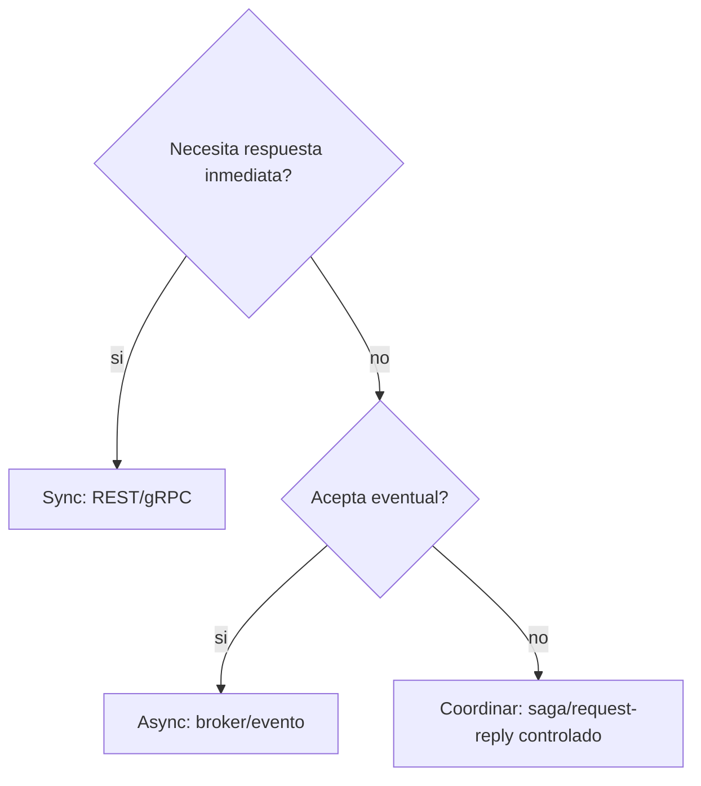

# Módulo 5 · Comunicación entre microservicios con Node

Los microservicios Node se comunican por contratos: HTTP/REST, gRPC, GraphQL o mensajería asíncrona. La elección no es estética; define acoplamiento temporal, latencia, compatibilidad, observabilidad y modos de fallo. Este módulo cubre opciones comunes en Node y un criterio práctico para elegir sync vs async.

**Entorno de referencia verificado (2026-05-22):** Node.js v24.18.0. Los ejemplos de contrato/decisión se ejecutan con Node. Axios, gRPC, Apollo, KafkaJS, amqplib y NATS requieren dependencias/brokers; se incluyen comandos y **Nota de verificación**.

## Aprende construyendo

### Tema 1: REST con Axios/Fetch · Intermedio · 120 min

Caso guía: `orders` consulta disponibilidad en `inventory` por HTTP.

#### REST cliente/servidor

**Definición formal.** REST sobre HTTP expone recursos mediante métodos (`GET`, `POST`, `PUT`, `DELETE`), códigos de estado y representaciones, normalmente JSON. `fetch` es la API nativa de Node; Axios es un cliente HTTP con conveniencias como timeout, interceptores y transformación JSON.

**Para qué sirve.** Integración simple, interoperable y fácil de depurar entre servicios.

**Cuándo usarlo / cuándo no.** Úsalo para CRUD/request-response público o interno simple. No lo uses para streams bidireccionales de baja latencia, fan-out masivo o cuando el acoplamiento temporal sea inaceptable.

**Contrato mínimo.** URL, método, headers, body, status esperado, timeout, manejo de errores y id de correlación.

**Ejemplo mínimo enfocado (ejecutable con Node nativo).**

```bash
mkdir -p nm5-rest
cd nm5-rest
```

Crea el archivo `server.mjs`:

```js
import http from 'node:http';
const srv = http.createServer((req, res) => {
  if (req.method === 'GET' && req.url === '/stock/A1') {
    res.writeHead(200, {'content-type':'application/json'});
    res.end(JSON.stringify({sku:'A1',qty:2}));
    return;
  }
  res.writeHead(404, {'content-type':'application/json'});
  res.end(JSON.stringify({error:'not_found'}));
});
srv.listen(0,'127.0.0.1', async () => {
  const {port}=srv.address();
  const r = await fetch(`http://127.0.0.1:${port}/stock/A1`, { signal: AbortSignal.timeout(500) });
  console.log(r.status);
  console.log((await r.json()).qty);
  srv.close();
});
```

```bash
node server.mjs
```

**Caso de uso real.** Consulta sincrónica de catálogo/precio/disponibilidad desde un servicio de pedidos.

**Error común.** Llamar sin timeout ni clasificación de errores.

**Síntoma.** handlers colgados, agotamiento de recursos, cascada de fallos cuando inventory se degrada. **Causa.** dependencia lenta y cliente sin límite de espera. **Corrección.** `AbortSignal.timeout`, retries solo en operaciones idempotentes, circuit breaker y presupuesto de latencia. **Señal observable.** aumento de p99, conexiones abiertas, métricas de timeout.

**Verificación (Node 24.18.0, 2026-05-22).** Salida: `200`, `2`. **Nota de verificación:** Axios real: `npm i axios`; ejemplo `await axios.get(url, { timeout: 500 })`.

### Tema 2: gRPC con @grpc/grpc-js · Avanzado · 120 min

Caso guía: llamada interna de baja latencia con contrato fuerte.

#### gRPC y Protobuf

**Definición formal.** gRPC es un framework RPC sobre HTTP/2 que usa Protobuf para definir contratos tipados y generar clientes/servidores. Protobuf define mensajes y servicios con campos numerados.

**Para qué sirve.** Contratos fuertes, payloads compactos, streaming y buen rendimiento service-to-service.

**Cuándo usarlo / cuándo no.** Úsalo en comunicación interna de alto volumen o baja latencia. No lo uses como API pública browser-first sin gateway; no si el equipo no puede operar tooling Protobuf/HTTP2.

**Contrato mínimo.** Archivo `.proto`, compatibilidad de campos, deadlines, códigos gRPC, manejo de errores y observabilidad.

**Ejemplo mínimo enfocado (ejecutable: contrato Protobuf).**

```bash
mkdir -p nm5-grpc
cd nm5-grpc
```

Crea el archivo `inventory.proto`:

```proto
syntax = "proto3";
package inventory;
service Inventory {
  rpc GetStock (StockRequest) returns (StockResponse);
}
message StockRequest { string sku = 1; }
message StockResponse { string sku = 1; int32 qty = 2; }
```

```bash
node -e "const fs=require('fs'); const p=fs.readFileSync('inventory.proto','utf8'); console.log(p.includes('rpc GetStock')); console.log(p.includes('sku = 1'))"
```

**Caso de uso real.** Servicio interno de pricing/stock con baja latencia y streaming de actualizaciones.

**Error común.** Romper compatibilidad de Protobuf.

**Síntoma.** errores de deserialización, campos vacíos o comportamiento inesperado entre versiones. **Causa.** reutilizar números de campo, cambiar tipos o renombrar semántica incompatible. **Corrección.** no reusar tags, agregar campos nuevos con números nuevos, mantener compatibilidad backward/forward. **Señal observable.** errores gRPC `INVALID_ARGUMENT`/`INTERNAL` tras despliegue, consumidores fallando.

**Verificación (Node 24.18.0, 2026-05-22).** Salida: `true`, `true`. **Nota de verificación:** ejecución gRPC real requiere `npm i @grpc/grpc-js @grpc/proto-loader` y servidor/cliente; no se finge ejecución sin dependencia.

### Tema 3: GraphQL con Apollo Server · Avanzado · 120 min

Caso guía: un BFF agrega datos de varios servicios para una pantalla.

#### GraphQL

**Definición formal.** GraphQL es un lenguaje de consulta y runtime donde el cliente solicita campos específicos sobre un schema tipado; el servidor resuelve campos mediante resolvers.

**Para qué sirve.** Evitar over/under-fetching en clientes UI y agregar múltiples fuentes detrás de un BFF.

**Cuándo usarlo / cuándo no.** Úsalo en BFF/frontend-driven APIs. No lo uses como reemplazo automático de todo REST interno; cuida N+1, complejidad de queries y autorización por campo.

**Contrato mínimo.** Schema, tipos, queries/mutations, validación, límites de profundidad/costo, auth en resolvers.

**Ejemplo mínimo enfocado (ejecutable).**

```bash
mkdir -p nm5-graphql
cd nm5-graphql
```

Crea el archivo `schema.mjs`:

```js
const schema = `
  type Order { id: ID!, sku: String! }
  type Query { order(id: ID!): Order }
`;
function parseFields(query) {
  return query.includes('sku') ? ['sku'] : [];
}
console.log(schema.includes('type Query'));
console.log(parseFields('{ order(id: "1") { sku } }').includes('sku'));
```

```bash
node schema.mjs
```

**Caso de uso real.** BFF móvil que necesita solo `id`, `status` y `total`, sin traer el pedido completo.

**Error común.** N+1 en resolvers.

**Síntoma.** latencia alta y muchas llamadas a DB/servicios al consultar listas. **Causa.** resolver por item sin batching. **Corrección.** DataLoader/batching, límites de profundidad/costo, caching por request. **Señal observable.** trazas con cientos de spans por query.

**Verificación (Node 24.18.0, 2026-05-22).** Salida: `true`, `true`. **Nota de verificación:** Apollo Server real requiere `npm i @apollo/server graphql`.

### Tema 4: KafkaJS, amqplib · Avanzado · 150 min

Caso guía: publicar `OrderCreated` sin bloquear al usuario en consumers lentos.

#### Mensajería asíncrona con Kafka/RabbitMQ

**Definición formal.** En mensajería async, un productor emite un mensaje a un broker; consumidores lo procesan después. KafkaJS es cliente Node para Kafka (log distribuido); amqplib es cliente AMQP para RabbitMQ (broker de colas/routing).

**Para qué sirve.** Desacoplar temporalmente, absorber picos y propagar eventos/integraciones.

**Cuándo usarlo / cuándo no.** Úsalo para eventos, trabajos diferidos e integración desacoplada. No lo uses cuando necesitas respuesta inmediata simple y fuerte consistencia sin diseñar compensaciones/idempotencia.

**Contrato mínimo.** Nombre/topic/queue, esquema, clave de partición/routing key, semántica de entrega, ack, retry/DLQ, idempotencia.

**Ejemplo mínimo enfocado (ejecutable: shape de evento e idempotencia).**

```bash
mkdir -p nm5-msg
cd nm5-msg
```

Crea el archivo `event.mjs`:

```js
const event = { type: 'OrderCreated', id: 'evt-1', orderId: 'o-1', occurredAt: '2026-05-22T00:00:00Z' };
const processed = new Set();
function consume(evt) {
  if (processed.has(evt.id)) return 'duplicate';
  processed.add(evt.id);
  return 'processed';
}
console.log(consume(event));
console.log(consume(event));
```

```bash
node event.mjs
```

**Caso de uso real.** Order emite evento; Billing y Notifications consumen a su ritmo.

**Error común.** Asumir entrega exactly-once end-to-end.

**Síntoma.** cobros o emails duplicados tras retry/redelivery. **Causa.** at-least-once y consumidores no idempotentes. **Corrección.** idempotency key, dedup, outbox, DLQ. **Señal observable.** misma `event.id` procesada dos veces en logs.

**Verificación (Node 24.18.0, 2026-05-22).** Salida: `processed`, `duplicate`. **Nota de verificación:** Kafka/RabbitMQ reales requieren broker + `npm i kafkajs` o `npm i amqplib`.

### Tema 5: NATS · Intermedio · 90 min

Caso guía: mensajería ligera entre servicios con baja latencia.

#### NATS y subjects

**Definición formal.** NATS es un sistema de mensajería ligero de publish/subscribe y request/reply. Los mensajes se publican a subjects; JetStream agrega persistencia/streaming cuando se necesita.

**Para qué sirve.** Comunicación rápida y simple, control-plane, eventos ligeros.

**Cuándo usarlo / cuándo no.** Úsalo cuando valoras simplicidad/baja latencia. No lo uses para log duradero complejo sin evaluar JetStream y requisitos de replay/retención.

**Contrato mínimo.** Subject naming, payload, QoS (core vs JetStream), ack policy, retención.

**Ejemplo mínimo enfocado (ejecutable).**

```bash
mkdir -p nm5-nats
cd nm5-nats
```

Crea el archivo `subject.mjs`:

```js
const subject = 'orders.created.v1';
const [domain, event, version] = subject.split('.');
console.log(domain);
console.log(version);
```

```bash
node subject.mjs
```

**Caso de uso real.** Notificaciones internas o request/reply ligero entre servicios.

**Error común.** Confundir NATS core con persistencia.

**Síntoma.** mensajes perdidos si no hay consumidor conectado. **Causa.** pub/sub efímero sin JetStream. **Corrección.** usar JetStream/durable consumers cuando se requiere entrega persistente. **Señal observable.** productor publica OK pero consumer caído no procesa al volver.

**Verificación (Node 24.18.0, 2026-05-22).** Salida: `orders`, `v1`. **Nota de verificación:** NATS real requiere servidor y `npm i nats`.

### Tema 6: Sync vs async · Avanzado · 120 min

Caso guía: ¿el cobro debe ser request-response o evento?

#### Criterio de elección

**Definición formal.** Comunicación síncrona bloquea al emisor hasta respuesta o timeout; asíncrona delega por mensaje/evento y continúa, aceptando consistencia eventual o coordinación adicional.

**Para qué sirve.** Elegir el acoplamiento correcto por caso de uso.

**Cuándo usarlo / cuándo no.** Sync para consultas/comandos que necesitan respuesta inmediata. Async para fan-out, workflows largos, picos y desacoplamiento. No hagas todo async por moda ni todo sync por comodidad.



**Ejemplo mínimo enfocado (ejecutable).**

```bash
mkdir -p nm5-decision
cd nm5-decision
```

Crea el archivo `decision.mjs`:

```js
function choose({ needsImmediate, canBeEventual }) {
  if (needsImmediate) return 'sync';
  if (canBeEventual) return 'async';
  return 'coordinate';
}
console.log(choose({ needsImmediate: true, canBeEventual: true }));
console.log(choose({ needsImmediate: false, canBeEventual: true }));
console.log(choose({ needsImmediate: false, canBeEventual: false }));
```

```bash
node decision.mjs
```

**Caso de uso real.** Validar tarjeta puede ser sync; enviar email es async; reserva+confirmación puede requerir coordinación.

**Error común.** Cadena síncrona larga entre servicios.

**Síntoma.** latencia p99 alta y cascada de fallos. **Causa.** acoplamiento temporal y propagación de degradación. **Corrección.** async donde aplique, timeout, bulkhead, cache, fallback. **Señal observable.** waterfall de trazas con muchos hops secuenciales.

**Verificación (Node 24.18.0, 2026-05-22).** Salida: `sync`, `async`, `coordinate`.

**Regla práctica.** Si el llamador necesita el resultado antes de continuar, es sync; si puede continuar sin esperarlo y tolera consistencia eventual, es async; si no puede esperar pero tampoco tolera eventual, el problema real no es sync-vs-async, es que necesitas una saga o un request-reply coordinado.

## Cierre

El protocolo es un detalle secundario frente al contrato y al modo de fallo. REST, gRPC, GraphQL y mensajería resuelven problemas distintos; la habilidad clave es elegir por latencia, acoplamiento, consistencia y operación.

## Checklist

- Distingo REST, gRPC, GraphQL y mensajería por caso de uso.
- Diseño contratos y compatibilidad.
- Aplico timeout/reintento/idempotencia según el canal.
- Sé cuándo sync es necesario y cuándo async reduce acoplamiento.
