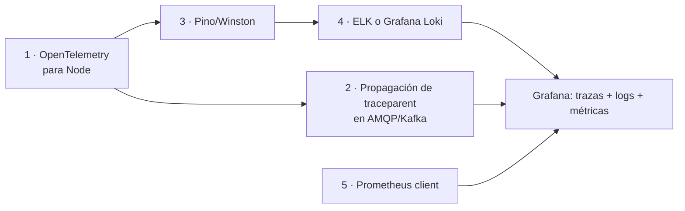
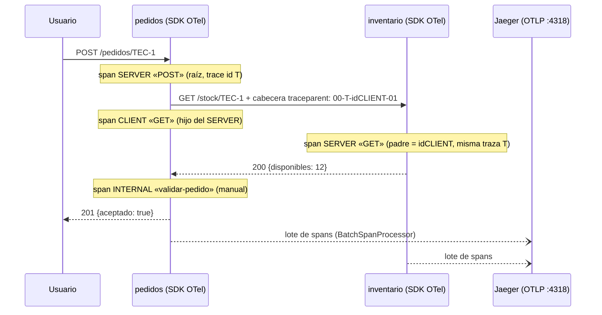
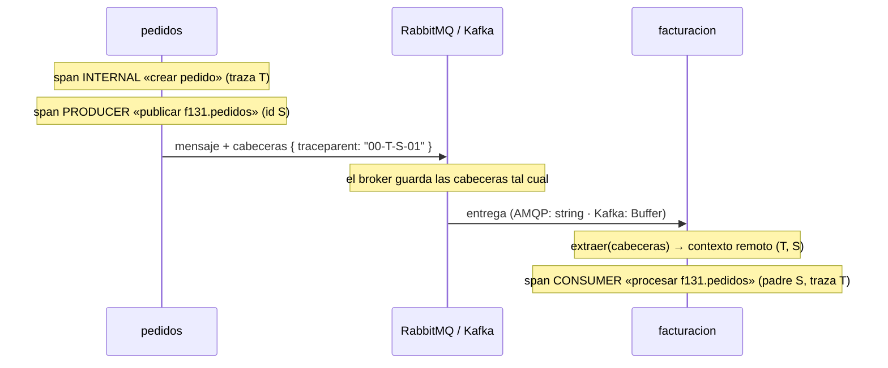
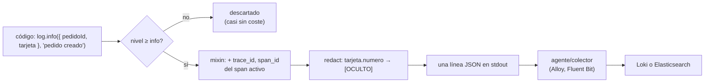
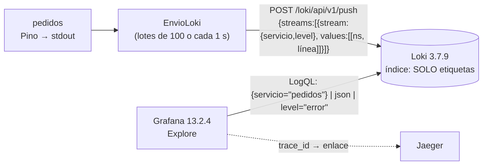
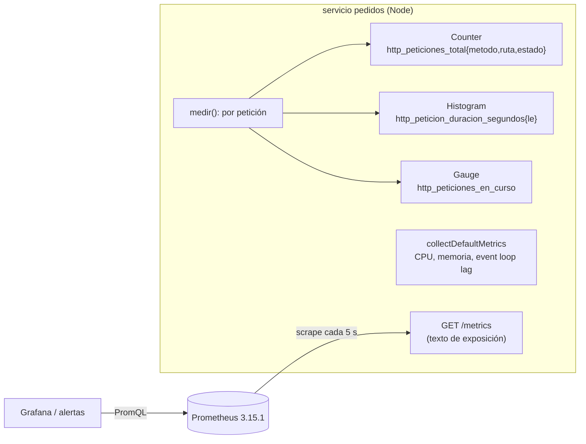

# Módulo 8 · Observabilidad

**Fase 2 · Node.js de cero a experto** (una semana de 12). **Duración:** 10 h (5 temas de unos 100 min y 1 h 40 min
de laboratorio integrador). **Dificultad:** 4 de 5. **Dependencias:** Módulo 13 (Event Loop, `async/await`, graceful
shutdown), Módulo 14 (servidores HTTP y middleware), Módulo 18 (REST y mensajería con RabbitMQ y Kafka) y Módulo 19
(timeouts). **Herramientas:**Node.js 26.13.1 LTS**, **@opentelemetry/api 1.10.0**, **@opentelemetry/sdk-node
0.301.2**, **@opentelemetry/sdk-trace 3.1.1**, **@opentelemetry/auto-instrumentations-node 0.83.1**,
**@opentelemetry/exporter-trace-otlp-http 0.301.2**, **import-in-the-middle 3.6.0**, **amqplib 2.4.0**, **kafkajs
2.2.4**, **pino 10.4.0**, **winston 3.19.0**, **@prometheus-io/client 0.16.1** (el sucesor oficial de `prom-client`),
**Jaeger 2.22.0**, **RabbitMQ 4.4.1**, **Kafka 4.4.0**, **Grafana Loki 3.7.9**, **Prometheus 3.15.1** y **Grafana
13.2.4**. 
errores comunes sin infraestructura; los comandos de verificación indicados levanta Jaeger, RabbitMQ, Kafka, Loki, Prometheus y
Grafana y comprueba que cada señal llega a su destino).

Un monolito que falla se investiga con un solo log. Diez microservicios que fallan juntos, no: una petición del
usuario cruza cinco procesos, dos colas y tres bases de datos, y cada uno guarda su pedacito de la historia.
**Observabilidad** es poder contestar «¿qué le pasó a esta petición?» y «¿está sano el sistema?» **sin desplegar
código nuevo**, a partir de tres señales: **trazas** (el recorrido de una petición), **logs** (lo que cada servicio
cuenta) y **métricas** (números agregados en el tiempo). En este módulo instrumentas dos servicios Node con
OpenTelemetry, haces que la traza sobreviva a RabbitMQ y Kafka, escribes logs JSON con Pino y Winston que llevan el
`trace_id`, los envías a Grafana Loki y expones métricas para Prometheus.



**Texto alternativo:** mapa del módulo. El tema 1 (OpenTelemetry para Node) es la base del tema 2 (propagación de
traceparent en AMQP y Kafka) y del tema 3 (Pino/Winston, que pega el identificador de traza en cada log). El tema 3 lleva
al tema 4 (ELK o Grafana Loki, adonde van los logs). El tema 5 (Prometheus client) es independiente. Las tres señales
terminan en Grafana.

**Cómo usar el laboratorio.** Con Node 26 (y Docker para la parte de infraestructura):

```bash
npm ci
  # 19 tests + demos + errores comunes, sin Docker → «RESULTADO: OK»
docker compose up -d --wait      # Jaeger :16686, RabbitMQ :5672, Kafka :9092, Loki :3100, Prometheus :9090, Grafana :3000
los comandos de verificación indicados         # además: trazas en Jaeger, traceparent por RabbitMQ y Kafka, logs en Loki, PromQL
docker compose down -v
```

en tu máquina; Jaeger, los brokers, Loki, Prometheus y Grafana, en Docker.

`package.json` del laboratorio (con `package-lock.json` que fija el árbol completo):

```json
{
  "name": "modulo-21-observabilidad-node",
  "version": "1.0.0",
  "private": true,
  "description": "Módulo 21 (Fase 2): Observabilidad en Node.js con OpenTelemetry, traceparent en AMQP/Kafka, Pino/Winston, Grafana Loki y prom-client.",
  "type": "module",
  "engines": {
    "node": ">=26.13.1"
  },
  "scripts": {
    "test": "node --test --test-concurrency=1 'f13*/*.test.js'",
    "test:infra": "node --test --test-concurrency=1 'f13*/*.infra.js'"
  },
  "dependencies": {
    "@opentelemetry/api": "1.10.0",
    "@opentelemetry/auto-instrumentations-node": "0.83.1",
    "@opentelemetry/exporter-trace-otlp-http": "0.301.2",
    "@opentelemetry/sdk-node": "0.301.2",
    "@opentelemetry/sdk-trace": "3.1.1",
    "@prometheus-io/client": "0.16.1",
    "amqplib": "2.4.0",
    "import-in-the-middle": "3.6.0",
    "kafkajs": "2.2.4",
    "pino": "10.4.0",
    "winston": "3.19.0"
  }
}
```

`docker-compose.yml`:

```yaml
# Módulo 21 (modulo-25) · Observabilidad en Node.js
# Arranca:  docker compose up -d --wait   (espera a los healthchecks de RabbitMQ, Kafka y Prometheus)
#   Jaeger UI :16686 + OTLP/HTTP :4318 (F130) · RabbitMQ :5672 (consola :15672, academia/academia) y Kafka :9092 (F131)
#   Loki :3100 (F133) · Prometheus :9090, raspa f134 en host.docker.internal:9464 (F134) · Grafana :3000 (admin / admin-solo-dev)
# Detén:    docker compose down -v        (sin volúmenes persistentes: trazas, logs y métricas se borran)
name: modulo-25
services:
  jaeger:
    image: jaegertracing/jaeger:2.22.0
    ports: ["16686:16686", "4318:4318"]
  rabbitmq:
    image: rabbitmq:4.4.1-management
    environment:
      RABBITMQ_DEFAULT_USER: academia
      RABBITMQ_DEFAULT_PASS: academia
    ports: ["5672:5672", "15672:15672"]
    healthcheck:
      test: ["CMD", "rabbitmq-diagnostics", "-q", "ping"]
      interval: 5s
      timeout: 10s
      retries: 30
  kafka:
    image: apache/kafka:4.4.0      # sin variables: un nodo KRaft anunciado en localhost:9092
    ports: ["9092:9092"]
    healthcheck:
      test: ["CMD-SHELL", "/opt/kafka/bin/kafka-topics.sh --bootstrap-server localhost:9092 --list >/dev/null"]
      interval: 5s
      timeout: 15s
      retries: 30
  loki:
    image: grafana/loki:3.7.9      # configuración por defecto de la imagen: un solo proceso, almacenamiento en disco local
    ports: ["3100:3100"]
  prometheus:
    image: prom/prometheus:v3.15.1
    command: ["--config.file=/etc/prometheus/prometheus.yml"]
    ports: ["9090:9090"]
    volumes: ["./prometheus/prometheus.yml:/etc/prometheus/prometheus.yml:ro"]
    extra_hosts: ["host.docker.internal:host-gateway"]   # en Linux; Docker Desktop (Mac) ya lo resuelve
    healthcheck:
      test: ["CMD", "wget", "-qO-", "http://localhost:9090/-/ready"]
      interval: 2s
      timeout: 3s
      retries: 30
  grafana:
    image: grafana/grafana:13.2.4
    environment:
      GF_SECURITY_ADMIN_PASSWORD: admin-solo-dev
      GF_AUTH_ANONYMOUS_ENABLED: "true"
      GF_AUTH_ANONYMOUS_ORG_ROLE: Viewer
    ports: ["3000:3000"]
    volumes: ["./grafana/provisioning:/etc/grafana/provisioning:ro"]
    depends_on: [loki, prometheus, jaeger]
```

---


### OpenTelemetry para Node

<details open>
<summary><strong>Capa 1 — Lectura</strong></summary>

#### ► DE QUÉ TRATA
Instrumentar dos servicios Node con el SDK de OpenTelemetry sin tocar su código de negocio, añadir un span manual y demostrar que una petición produce una sola traza que cruza los dos procesos (el span del servidor de inventario cuelga del span cliente de pedidos). Lo compruebas…

#### ► LA IDEA EN UNA FRASE
**Instrumentar dos servicios Node con el SDK de OpenTelemetry sin tocar su código de negocio, añadir un span manual y demostrar que una petición produce una sola traza que cruza los dos procesos (el span del servidor de inventario cuelga del span cliente de pedidos).**

#### ► POR QUÉ EXISTE ESTO
Resuelve un problema real de diseño o implementación y evita decisiones a ciegas.

#### ► LA ANALOGÍA
Piensa en opentelemetry para node como una herramienta de taller: útil cuando conoces su propósito y sus límites.
**Dónde se rompe la analogía:** en software, los efectos dependen del contexto, la escala y los trade-offs.

#### ► CÓMO FUNCIONA


1. Cuando un usuario hace clic en «Comprar», su petición pasa por varios programas. Si tarda 8 segundos, ¿en cuál se
2. **OpenTelemetry** (OTel) es una librería que cada programa carga al arrancar. Mide cada trabajo (un **span**: «atendí
3. Todos los spans de un mismo clic comparten un número, el **trace id**. Para que el número pase de un programa a otro,
4. Al final, cada programa envía sus spans a un visor (**Jaeger**), que los junta por trace id y te dibuja la línea de

#### ► LO QUE PUEDE SALIR MAL
| Síntoma | Causa probable | Arreglo |
|---|---|---|
| OpenTelemetry para Node se aplica pero el resultado no mejora | Se usó sin medir el problema real | Mide antes y compara contra la alternativa simple |
| Aparece complejidad inesperada | Se adoptó la técnica sin comprender sus trade-offs | Vuelve a la sección de trade-offs y reduce el alcance |
| Falla en un caso límite | Se asumió un contexto que no se cumple | Prueba el caso límite y documenta cuándo NO usarlo |

#### ► TRADE-OFFS
| Opción | Cuándo usarla | Cuándo NO usarla |
|---|---|---|
| Usar OpenTelemetry para Node | Cuando el problema coincide con su propósito y el beneficio es observable | Cuando agrega complejidad sin resolver un problema real |
| Alternativa más simple | Cuando el contexto es pequeño, estable o fácil de razonar | Cuando ya demostró no escalar o no cumplir el requisito |
| Postergar la decisión | Cuando falta evidencia del problema | Cuando el costo de esperar es mayor que el costo de probar |

#### ► CUÁNDO NO USAR ESTO
Inventar tu propio id de correlación a mano en cada servicio. Evita el x-request-id que cada equipo genera, copia (o no) y loguea con un nombre distinto: no tiene jerarquía padre-hijo, no tiene tiempos y no lo entiende ninguna herramienta.

#### ► DE VUELTA A LA ANALOGÍA
Volviendo a la analogía: opentelemetry para node funciona como el modelo inicial, pero recuerda dónde se rompe: en producción importan la evidencia, la escala y el costo de equivocarte.

#### ► LO QUE DEBES RECORDAR
- Cuando un usuario hace clic en «Comprar», su petición pasa por varios programas. Si tarda 8 segundos, ¿en cuál se
- **OpenTelemetry** (OTel) es una librería que cada programa carga al arrancar. Mide cada trabajo (un **span**: «atendí
- Todos los spans de un mismo clic comparten un número, el **trace id**. Para que el número pase de un programa a otro,
- Al final, cada programa envía sus spans a un visor (**Jaeger**), que los junta por trace id y te dibuja la línea de

#### ► PREGUNTAS PARA PENSAR
1. ¿Qué problema concreto resuelve opentelemetry para node en tu contexto?
2. ¿Cómo sabrías que opentelemetry para node no está funcionando bien?
3. ¿Qué alternativa más simple considerarías antes de usar opentelemetry para node?

</details>

<details>
<summary><strong>Capa 2 — Construcción</strong></summary>

#### Código de referencia / ejecutable
Versiones: **Node.js 26.13.1 LTS**, **@opentelemetry/sdk-node 0.301.2**, **@opentelemetry/sdk-trace 3.1.1**,
**@opentelemetry/auto-instrumentations-node 0.83.1**, **@opentelemetry/exporter-trace-otlp-http 0.301.2** e
**import-in-the-middle 3.6.0** (dependencias del `package.json` del laboratorio).

`f130-opentelemetry/telemetria.js` (el arranque del SDK; se carga con `--import`):

```javascript
// Módulo 21 · F130 · OpenTelemetry para Node: arranque del SDK. Se carga ANTES que la aplicación:
//   node --import ./f130-opentelemetry/telemetria.js f130-opentelemetry/pedidos.js
// Requisitos: Node.js 26.13.1 LTS, @opentelemetry/sdk-node 0.301.2, @opentelemetry/sdk-trace 3.1.1,
// @opentelemetry/auto-instrumentations-node 0.83.1, @opentelemetry/exporter-trace-otlp-http 0.301.2, import-in-the-middle 3.6.0.
// Variables: OTEL_SERVICE_NAME (nombre del servicio en Jaeger), TRAZAS=resumen|otlp (adónde van los spans).
import { register } from 'import-in-the-middle/register-hooks.mjs';
import { NodeSDK } from '@opentelemetry/sdk-node';
import { OTLPTraceExporter } from '@opentelemetry/exporter-trace-otlp-http';
import { BatchSpanProcessor, SimpleSpanProcessor } from '@opentelemetry/sdk-trace';
import { getNodeAutoInstrumentations } from '@opentelemetry/auto-instrumentations-node';
import { ExportadorResumen } from './exportador-resumen.js';

// ESM: sin este hook, los `import` de tu aplicación (node:http, amqplib…) NO se parchean y solo verías los spans
// de fetch (que se instrumenta por diagnostics_channel). Con CommonJS (require) no hace falta.
// import-in-the-middle 3.6.0 usa module.registerHooks() (síncrono, Node 26); el antiguo
// module.register('@opentelemetry/instrumentation/hook.mjs') también funciona, pero Node 26 avisa DEP0205.
register();

const destino = process.env.TRAZAS ?? 'resumen';
// sdk-trace 3.x: los procesadores reciben un OBJETO de opciones { exporter } (en 2.x era el exportador suelto).
const procesador = destino === 'otlp'
  // OTLP por HTTP al colector (o directo a Jaeger): por defecto http://localhost:4318/v1/traces.
  // Batch: agrupa spans y los envía cada pocos segundos, sin bloquear las peticiones.
  ? new BatchSpanProcessor({ exporter: new OTLPTraceExporter() })
  // Resumen en consola, una línea por span, al terminar cada span (solo para aprender: es síncrono).
  : new SimpleSpanProcessor({ exporter: new ExportadorResumen() });

// Este módulo solo exporta TRAZAS: las métricas van con el cliente de Prometheus (F134) y los logs con Pino (F132).
// Sin estas dos líneas el SDK intenta enviar métricas y logs por OTLP a localhost:4318 y, si no hay colector, falla al salir.
process.env.OTEL_METRICS_EXPORTER ??= 'none';
process.env.OTEL_LOGS_EXPORTER ??= 'none';

const sdk = new NodeSDK({
  spanProcessors: [procesador],
  instrumentations: [
    getNodeAutoInstrumentations({
      // fs genera un span por cada lectura de disco: ruido. Lo apagamos como se hace en producción.
      '@opentelemetry/instrumentation-fs': { enabled: false },
    }),
  ],
});
sdk.start(); // desde aquí, http, fetch (undici), amqplib, kafkajs, pino… quedan instrumentados

// Graceful shutdown: vacía el buffer de spans antes de salir (si no, se pierden los últimos).
for (const senal of ['SIGTERM', 'SIGINT']) {
  process.once(senal, () => sdk.shutdown().finally(() => process.exit(0)));
}
```

`f130-opentelemetry/exportador-resumen.js` (un exportador didáctico: una línea por span en la consola):

```javascript
// Módulo 21 · F130 · Exportador didáctico: imprime UNA línea por span con lo que importa para entender una traza.
// Implementa la interfaz SpanExporter de @opentelemetry/sdk-trace 3.1.1: export(spans, callback) y shutdown().
import { SpanKind } from '@opentelemetry/api';

const TIPOS = { [SpanKind.INTERNAL]: 'INTERNAL', [SpanKind.SERVER]: 'SERVER', [SpanKind.CLIENT]: 'CLIENT',
  [SpanKind.PRODUCER]: 'PRODUCER', [SpanKind.CONSUMER]: 'CONSUMER' };

export function resumir(span) {
  const servicio = span.resource.attributes['service.name'];
  const padre = span.parentSpanContext?.spanId ?? '(raíz)';
  const ms = (span.duration[0] * 1e3 + span.duration[1] / 1e6).toFixed(1);
  return `[${servicio}] ${TIPOS[span.kind].padEnd(8)} ${span.name.padEnd(28)} traza=${span.spanContext().traceId} span=${span.spanContext().spanId} padre=${padre} ${ms} ms`;
}

export class ExportadorResumen {
  export(spans, alTerminar) {
    for (const span of spans) console.log(resumir(span));
    alTerminar({ code: 0 }); // 0 = ExportResultCode.SUCCESS
  }
  shutdown() { return Promise.resolve(); }
}
```

`f130-opentelemetry/pedidos.js` (sin una línea de OTel salvo el span manual):

```javascript
// Módulo 21 · F130 · Servicio «pedidos»: POST /pedidos/:sku consulta el stock en inventario y responde.
// Las llamadas HTTP entrantes y el fetch saliente los instrumenta telemetria.js; el span «validar-pedido» es MANUAL.
// Ejecuta: OTEL_SERVICE_NAME=pedidos node --import ./f130-opentelemetry/telemetria.js f130-opentelemetry/pedidos.js
import http from 'node:http';
import { trace, SpanStatusCode } from '@opentelemetry/api';

const tracer = trace.getTracer('pedidos', '1.0.0'); // nombre y versión de TU código (instrumentation scope)
const puerto = Number(process.env.PORT ?? 3130);
const INVENTARIO = process.env.INVENTARIO_URL ?? 'http://localhost:3131';

// Span manual: un trozo de lógica de negocio que quieres ver como un bloque propio en la traza.
function validarPedido(sku, disponibles) {
  return tracer.startActiveSpan('validar-pedido', (span) => {
    span.setAttribute('pedido.sku', sku);
    span.setAttribute('inventario.disponibles', disponibles);
    const ok = disponibles > 0;
    if (!ok) span.setStatus({ code: SpanStatusCode.ERROR, message: 'sin stock' });
    span.end(); // un span sin end() nunca se exporta
    return ok;
  });
}

http.createServer(async (req, res) => {
  const sku = req.url.split('/')[2];
  // fetch está instrumentado (undici): crea un span CLIENT e inyecta la cabecera traceparent.
  const r = await fetch(`${INVENTARIO}/stock/${sku}`);
  const datos = await r.json();
  const ok = r.ok && validarPedido(sku, datos.disponibles);
  res.writeHead(ok ? 201 : 409, { 'content-type': 'application/json' });
  res.end(JSON.stringify({ sku, aceptado: ok }));
}).listen(puerto, () => console.log(`pedidos escuchando en ${puerto}`));
```

`f130-opentelemetry/inventario.js`:

```javascript
// Módulo 21 · F130 · Servicio «inventario»: GET /stock/:sku. Ni una línea de OpenTelemetry: lo instrumenta telemetria.js.
// Ejecuta: OTEL_SERVICE_NAME=inventario node --import ./f130-opentelemetry/telemetria.js f130-opentelemetry/inventario.js
import http from 'node:http';

const STOCK = { 'TEC-1': 12, 'MOU-1': 0 };
const puerto = Number(process.env.PORT ?? 3131);

http.createServer((req, res) => {
  const sku = req.url.split('/')[2];
  const cuerpo = sku in STOCK ? { sku, disponibles: STOCK[sku] } : { error: 'no existe' };
  res.writeHead(sku in STOCK ? 200 : 404, { 'content-type': 'application/json' });
  res.end(JSON.stringify(cuerpo));
}).listen(puerto, () => console.log(`inventario escuchando en ${puerto}`));
```

</details>

### Propagación de traceparent en AMQP/Kafka

<details open>
<summary><strong>Capa 1 — Lectura</strong></summary>

#### ► DE QUÉ TRATA
Propagar el contexto de traza a través de RabbitMQ y Kafka inyectando traceparent en las cabeceras del mensaje y extrayéndolo en el consumidor, y demostrar que cada span CONSUMER es hijo de su span PRODUCER aunque los separe un broker. Lo compruebas cuando propagacion.test.js pas…

#### ► LA IDEA EN UNA FRASE
**Propagar el contexto de traza a través de RabbitMQ y Kafka inyectando traceparent en las cabeceras del mensaje y extrayéndolo en el consumidor, y demostrar que cada span CONSUMER es hijo de su span PRODUCER aunque los separe un broker.**

#### ► POR QUÉ EXISTE ESTO
Resuelve un problema real de diseño o implementación y evita decisiones a ciegas.

#### ► LA ANALOGÍA
Piensa en propagación de traceparent en amqp/kafka como una herramienta de taller: útil cuando conoces su propósito y sus límites.
**Dónde se rompe la analogía:** en software, los efectos dependen del contexto, la escala y los trade-offs.

#### ► CÓMO FUNCIONA


1. En la ficha 1, el número de la traza viajaba en una cabecera HTTP y OpenTelemetry la copiaba solo.
2. Con una cola, el servicio que envía y el que recibe **no hablan entre ellos**: dejan y recogen mensajes. Si nadie
3. La solución es la misma idea: el mensaje también tiene **cabeceras** (datos al lado del contenido). El que envía

#### ► LO QUE PUEDE SALIR MAL
| Síntoma | Causa probable | Arreglo |
|---|---|---|
| Propagación de traceparent en AMQP/Kafka se aplica pero el resultado no mejora | Se usó sin medir el problema real | Mide antes y compara contra la alternativa simple |
| Aparece complejidad inesperada | Se adoptó la técnica sin comprender sus trade-offs | Vuelve a la sección de trade-offs y reduce el alcance |
| Falla en un caso límite | Se asumió un contexto que no se cumple | Prueba el caso límite y documenta cuándo NO usarlo |

#### ► TRADE-OFFS
| Opción | Cuándo usarla | Cuándo NO usarla |
|---|---|---|
| Usar Propagación de traceparent en AMQP/Kafka | Cuando el problema coincide con su propósito y el beneficio es observable | Cuando agrega complejidad sin resolver un problema real |
| Alternativa más simple | Cuando el contexto es pequeño, estable o fácil de razonar | Cuando ya demostró no escalar o no cumplir el requisito |
| Postergar la decisión | Cuando falta evidencia del problema | Cuando el costo de esperar es mayor que el costo de probar |

#### ► CUÁNDO NO USAR ESTO
Meter el contexto dentro del cuerpo del mensaje. Evita mezclar la telemetría con los datos de negocio: obliga a cambiar el esquema del evento (Módulo 26, Schema Registry), la ven todos los consumidores como un campo más y ninguna instrumentación la encuentra.

#### ► DE VUELTA A LA ANALOGÍA
Volviendo a la analogía: propagación de traceparent en amqp/kafka funciona como el modelo inicial, pero recuerda dónde se rompe: en producción importan la evidencia, la escala y el costo de equivocarte.

#### ► LO QUE DEBES RECORDAR
- En la ficha 1, el número de la traza viajaba en una cabecera HTTP y OpenTelemetry la copiaba solo.
- Con una cola, el servicio que envía y el que recibe **no hablan entre ellos**: dejan y recogen mensajes. Si nadie
- La solución es la misma idea: el mensaje también tiene **cabeceras** (datos al lado del contenido). El que envía

#### ► PREGUNTAS PARA PENSAR
1. ¿Qué problema concreto resuelve propagación de traceparent en amqp/kafka en tu contexto?
2. ¿Cómo sabrías que propagación de traceparent en amqp/kafka no está funcionando bien?
3. ¿Qué alternativa más simple considerarías antes de usar propagación de traceparent en amqp/kafka?

</details>

<details>
<summary><strong>Capa 2 — Construcción</strong></summary>

#### Código de referencia / ejecutable
Versiones: **Node.js 26.13.1 LTS**, **@opentelemetry/api 1.10.0**, **@opentelemetry/sdk-node 0.301.2**,
**@opentelemetry/sdk-trace 3.1.1**, **amqplib 2.4.0** con **RabbitMQ 4.4.1** y **kafkajs 2.2.4** con **Kafka 4.4.0**.

`f131-traceparent/propagacion.js` (todo lo que importa del tema):

```javascript
// Módulo 21 · F131 · Propagación de traceparent en mensajes AMQP (RabbitMQ) y Kafka.
// Requisitos: Node.js 26.13.1 LTS, @opentelemetry/api 1.10.0 (usa el propagador global que registra el SDK).
import { context, propagation, trace, ROOT_CONTEXT, SpanKind } from '@opentelemetry/api';

const tracer = trace.getTracer('f131-mensajeria', '1.0.0');

// PRODUCTOR: copia el contexto activo (la traza en curso) a un objeto de cabeceras del mensaje.
// Resultado: { traceparent: '00-<trace-id 32 hex>-<span-id 16 hex>-01' } (+ tracestate y baggage si los hay).
export function inyectar(cabeceras = {}) {
  propagation.inject(context.active(), cabeceras);
  return cabeceras;
}

// CONSUMIDOR AMQP: amqplib entrega las cabeceras como strings en msg.properties.headers.
export function extraerAmqp(mensaje) {
  return propagation.extract(ROOT_CONTEXT, mensaje.properties.headers ?? {});
}

// CONSUMIDOR Kafka: kafkajs entrega cada cabecera como Buffer (o arreglo de Buffers). El getter por defecto
// del propagador espera strings: hay que convertir, o la traza se corta en silencio (ver error-comun.js).
export const getterKafka = {
  keys: (cabeceras) => Object.keys(cabeceras),
  get: (cabeceras, clave) => {
    const valor = cabeceras[clave];
    if (valor === undefined) return undefined;
    return Array.isArray(valor) ? valor.map((v) => v.toString()) : valor.toString();
  },
};
export function extraerKafka(mensaje) {
  return propagation.extract(ROOT_CONTEXT, mensaje.headers ?? {}, getterKafka);
}

// Envuelve el envío en un span PRODUCER e inyecta SU contexto: el consumidor quedará colgado de este span.
export function conSpanProductor(destino, enviar) {
  return tracer.startActiveSpan(`publicar ${destino}`, { kind: SpanKind.PRODUCER,
    attributes: { 'messaging.destination.name': destino } }, async (span) => {
    try { return await enviar(inyectar({})); } finally { span.end(); }
  });
}

// Procesa un mensaje dentro de un span CONSUMER cuyo padre es el contexto que vino en las cabeceras.
export function conSpanConsumidor(destino, contextoPadre, procesar) {
  return tracer.startActiveSpan(`procesar ${destino}`, { kind: SpanKind.CONSUMER,
    attributes: { 'messaging.destination.name': destino } }, contextoPadre, async (span) => {
    try { return await procesar(span); } finally { span.end(); }
  });
}
```

`f131-traceparent/trazas.js` (SDK sin instrumentaciones automáticas, con el exportador de consola de la ficha 1):

```javascript
// Módulo 21 · F131 · Arranque mínimo de OpenTelemetry SIN instrumentaciones automáticas: aquí la propagación
// por mensajería la haces TÚ, a mano, para ver qué viaja. (En producción, instrumentation-amqplib y
// instrumentation-kafkajs hacen lo mismo por ti; ver la explicación intermedia.)
// Uso: node --import ./f131-traceparent/trazas.js f131-traceparent/consumidor-rabbit.js
// Requisitos: Node.js 26.13.1 LTS, @opentelemetry/sdk-node 0.301.2, @opentelemetry/sdk-trace 3.1.1.
import { NodeSDK } from '@opentelemetry/sdk-node';
import { SimpleSpanProcessor } from '@opentelemetry/sdk-trace';
import { ExportadorResumen } from '../f130-opentelemetry/exportador-resumen.js';

process.env.OTEL_METRICS_EXPORTER ??= 'none';
process.env.OTEL_LOGS_EXPORTER ??= 'none';
// Propagador por defecto del SDK: W3C Trace Context (cabecera traceparent/tracestate) + W3C Baggage.
const sdk = new NodeSDK({ spanProcessors: [new SimpleSpanProcessor({ exporter: new ExportadorResumen() })] });
sdk.start();
export const apagarTrazas = () => sdk.shutdown();
```

`f131-traceparent/productor-rabbit.js` y `f131-traceparent/consumidor-rabbit.js`:

```javascript
// Módulo 21 · F131 · Servicio «pedidos»: publica N eventos en RabbitMQ con traceparent en las cabeceras AMQP.
// Ejecuta: OTEL_SERVICE_NAME=pedidos node --import ./f131-traceparent/trazas.js f131-traceparent/productor-rabbit.js 2
import amqplib from 'amqplib';
import { trace } from '@opentelemetry/api';
import { AMQP_URL } from '../comun/config.js';
import { conSpanProductor } from './propagacion.js';
import { apagarTrazas } from './trazas.js';

const COLA = 'f131.pedidos';
const total = Number(process.argv[2] ?? 1);
const conexion = await amqplib.connect(AMQP_URL);
const canal = await conexion.createConfirmChannel();
// RabbitMQ 4.x rechaza colas no exclusivas y no durables («transient_nonexcl_queues» está retirada): durable.
await canal.assertQueue(COLA, { durable: true });

for (let i = 1; i <= total; i++) {
  // Span raíz «crear pedido»: simula la petición HTTP que origina el evento.
  await trace.getTracer('pedidos').startActiveSpan('crear pedido', async (raiz) => {
    await conSpanProductor(COLA, async (cabeceras) => {
      console.log(`pedidos publica P-${i} con traceparent=${cabeceras.traceparent}`);
      canal.sendToQueue(COLA, Buffer.from(JSON.stringify({ id: `P-${i}` })), { headers: cabeceras });
      await canal.waitForConfirms();
    });
    raiz.end();
  });
}
await canal.close(); await conexion.close(); await apagarTrazas();
```

```javascript
// Módulo 21 · F131 · Servicio «facturacion»: consume de RabbitMQ y CONTINÚA la traza que vino en el mensaje.
// Ejecuta: OTEL_SERVICE_NAME=facturacion node --import ./f131-traceparent/trazas.js f131-traceparent/consumidor-rabbit.js 2
import amqplib from 'amqplib';
import { AMQP_URL } from '../comun/config.js';
import { extraerAmqp, conSpanConsumidor } from './propagacion.js';
import { apagarTrazas } from './trazas.js';

const COLA = 'f131.pedidos';
const esperados = Number(process.argv[2] ?? 1);
let procesados = 0;
const conexion = await amqplib.connect(AMQP_URL);
const canal = await conexion.createChannel();
// RabbitMQ 4.x rechaza colas no exclusivas y no durables («transient_nonexcl_queues» está retirada): durable.
await canal.assertQueue(COLA, { durable: true });
console.log('facturacion esperando mensajes');

await canal.consume(COLA, async (mensaje) => {
  const padre = extraerAmqp(mensaje); // contexto remoto: trace-id y span-id del PRODUCER
  await conSpanConsumidor(COLA, padre, async (span) => {
    const { id } = JSON.parse(mensaje.content);
    console.log(`facturacion procesa ${id} en la traza ${span.spanContext().traceId}`);
  });
  canal.ack(mensaje);
  if (++procesados === esperados) { await canal.close(); await conexion.close(); await apagarTrazas(); }
});
```

`f131-traceparent/consumidor-kafka.js` (el productor de Kafka, `productor-kafka.js`, es igual al de RabbitMQ con
`productor.send({ topic, messages: [{ key, value, headers }] })`):

```javascript
// Módulo 21 · F131 · Servicio «facturacion»: consume de Kafka y continúa la traza (cabeceras Buffer → string).
// Ejecuta: OTEL_SERVICE_NAME=facturacion node --import ./f131-traceparent/trazas.js f131-traceparent/consumidor-kafka.js 2
import { Kafka, logLevel } from 'kafkajs';
import { KAFKA_BROKERS } from '../comun/config.js';
import { extraerKafka, conSpanConsumidor } from './propagacion.js';
import { apagarTrazas } from './trazas.js';

const TOPIC = 'f131.pedidos';
const esperados = Number(process.argv[2] ?? 1);
let procesados = 0;
const kafka = new Kafka({ clientId: 'facturacion', brokers: KAFKA_BROKERS, logLevel: logLevel.ERROR });
// Crear el topic antes de suscribirse: si no existe, el broker responde UNKNOWN_TOPIC_OR_PARTITION
// («This server does not host this topic-partition») y el consumidor se cae al arrancar.
const admin = kafka.admin();
await admin.connect();
await admin.createTopics({ topics: [{ topic: TOPIC, numPartitions: 1 }], waitForLeaders: true });
await admin.disconnect();
const consumidor = kafka.consumer({ groupId: 'f131-facturacion' });
await consumidor.connect();
await consumidor.subscribe({ topic: TOPIC, fromBeginning: true });
console.log('facturacion esperando mensajes');

await consumidor.run({
  eachMessage: async ({ message }) => {
    const padre = extraerKafka(message); // getterKafka convierte los Buffer a string
    await conSpanConsumidor(TOPIC, padre, async (span) => {
      const { id } = JSON.parse(message.value);
      console.log(`facturacion procesa ${id} en la traza ${span.spanContext().traceId}`);
    });
    if (++procesados === esperados) setImmediate(async () => { await consumidor.disconnect(); await apagarTrazas(); });
  },
});
```

</details>

### Pino/Winston

<details open>
<summary><strong>Capa 1 — Lectura</strong></summary>

#### ► DE QUÉ TRATA
Configurar un logger JSON estructurado con Pino y su equivalente con Winston que incluya en cada línea el servicio, el nivel en texto, el trace_id del span activo y oculte los datos sensibles, y explicar cuándo elegir cada uno. Lo compruebas cuando loggers.test.js pasa 5 de 5.

#### ► LA IDEA EN UNA FRASE
**Configurar un logger JSON estructurado con Pino y su equivalente con Winston que incluya en cada línea el servicio, el nivel en texto, el trace_id del span activo y oculte los datos sensibles, y explicar cuándo elegir cada uno.**

#### ► POR QUÉ EXISTE ESTO
Resuelve un problema real de diseño o implementación y evita decisiones a ciegas.

#### ► LA ANALOGÍA
Piensa en pino/winston como una herramienta de taller: útil cuando conoces su propósito y sus límites.
**Dónde se rompe la analogía:** en software, los efectos dependen del contexto, la escala y los trade-offs.

#### ► CÓMO FUNCIONA


1. Un **log** es una frase que el programa escribe para contar lo que hace: «pedido creado», «cobro rechazado».
2. Con `console.log` escribes texto libre. Funciona en tu computador, pero con 20 servicios y millones de líneas nadie
3. Un **logger** como Pino o Winston escribe cada línea como **JSON**: campos con nombre (`level`, `msg`, `pedidoId`,
4. También tiene **niveles** (debug, info, warn, error): en producción apagas los de detalle sin tocar el código, solo

#### ► LO QUE PUEDE SALIR MAL
| Síntoma | Causa probable | Arreglo |
|---|---|---|
| Pino/Winston se aplica pero el resultado no mejora | Se usó sin medir el problema real | Mide antes y compara contra la alternativa simple |
| Aparece complejidad inesperada | Se adoptó la técnica sin comprender sus trade-offs | Vuelve a la sección de trade-offs y reduce el alcance |
| Falla en un caso límite | Se asumió un contexto que no se cumple | Prueba el caso límite y documenta cuándo NO usarlo |

#### ► TRADE-OFFS
| Opción | Cuándo usarla | Cuándo NO usarla |
|---|---|---|
| Usar Pino/Winston | Cuando el problema coincide con su propósito y el beneficio es observable | Cuando agrega complejidad sin resolver un problema real |
| Alternativa más simple | Cuando el contexto es pequeño, estable o fácil de razonar | Cuando ya demostró no escalar o no cumplir el requisito |
| Postergar la decisión | Cuando falta evidencia del problema | Cuando el costo de esperar es mayor que el costo de probar |

#### ► CUÁNDO NO USAR ESTO
Concatenar el contexto en el mensaje. Evita meter los datos en el texto: cada línea es distinta, no se puede agrupar ni filtrar por campo, y los datos sensibles se cuelan sin que redact los vea.

#### ► DE VUELTA A LA ANALOGÍA
Volviendo a la analogía: pino/winston funciona como el modelo inicial, pero recuerda dónde se rompe: en producción importan la evidencia, la escala y el costo de equivocarte.

#### ► LO QUE DEBES RECORDAR
- Un **log** es una frase que el programa escribe para contar lo que hace: «pedido creado», «cobro rechazado».
- Con `console.log` escribes texto libre. Funciona en tu computador, pero con 20 servicios y millones de líneas nadie
- Un **logger** como Pino o Winston escribe cada línea como **JSON**: campos con nombre (`level`, `msg`, `pedidoId`,
- También tiene **niveles** (debug, info, warn, error): en producción apagas los de detalle sin tocar el código, solo

#### ► PREGUNTAS PARA PENSAR
1. ¿Qué problema concreto resuelve pino/winston en tu contexto?
2. ¿Cómo sabrías que pino/winston no está funcionando bien?
3. ¿Qué alternativa más simple considerarías antes de usar pino/winston?

</details>

<details>
<summary><strong>Capa 2 — Construcción</strong></summary>

#### Código y verificación


```javascript
// Módulo 21 · F132 · Lee el span activo de OpenTelemetry para pegar trace_id y span_id en cada línea de log.
// Así, desde una línea de log saltas a su traza en Jaeger (y al revés). Requiere @opentelemetry/api 1.10.0.
import { trace } from '@opentelemetry/api';

export function camposDeTraza() {
  const span = trace.getActiveSpan();
  if (!span) return {}; // fuera de una petición (arranque, tareas programadas): no hay traza
  const { traceId, spanId } = span.spanContext();
  return { trace_id: traceId, span_id: spanId };
}
```

```javascript
// Módulo 21 · F132 · Logger JSON con Pino 10.4.0: una línea JSON por evento, lista para Loki o Elasticsearch.
// Requisitos: Node.js 26.13.1 LTS, pino 10.4.0, @opentelemetry/api 1.10.0.
import pino from 'pino';
import { camposDeTraza } from './correlacion.js';

export function crearLoggerPino({ servicio, nivel = process.env.LOG_LEVEL ?? 'info', destino } = {}) {
  return pino({
    level: nivel,                                   // trace < debug < info < warn < error < fatal
    base: { servicio },                             // campos fijos en TODAS las líneas (sin pid ni hostname)
    timestamp: pino.stdTimeFunctions.isoTime,       // "time":"2026-11-19T…Z" en lugar de milisegundos
    formatters: { level: (etiqueta) => ({ level: etiqueta }) }, // "level":"info" en vez de 30
    mixin: camposDeTraza,                           // se llama en cada línea: añade trace_id y span_id
    // Datos sensibles: se reemplazan ANTES de serializar. Rutas con comodín y corchetes para cabeceras.
    redact: { paths: ['req.headers.authorization', 'tarjeta.numero', '*.password'], censor: '[OCULTO]' },
  }, destino); // destino: por defecto stdout (pino.destination(1)); en los tests, un stream en memoria
}
```

```javascript
// Módulo 21 · F132 · El mismo logger con Winston 3.19.0: formatos encadenables y varios transportes.
// Requisitos: Node.js 26.13.1 LTS, winston 3.19.0, @opentelemetry/api 1.10.0.
import winston from 'winston';
import { camposDeTraza } from './correlacion.js';

const { combine, timestamp, json, errors } = winston.format;

// Un «format» de Winston es una función que recibe la línea (info) y la devuelve transformada.
const conTraza = winston.format((info) => Object.assign(info, camposDeTraza()));
const ocultar = winston.format((info) => {
  if (info.tarjeta?.numero) info.tarjeta = { ...info.tarjeta, numero: '[OCULTO]' };
  return info;
});

export function crearLoggerWinston({ servicio, nivel = process.env.LOG_LEVEL ?? 'info', transporte } = {}) {
  return winston.createLogger({
    level: nivel,
    defaultMeta: { servicio },
    format: combine(errors({ stack: true }), conTraza(), ocultar(), timestamp(), json()),
    transports: [transporte ?? new winston.transports.Console()],
  });
}
```

```javascript
// Módulo 21 · F132 · Las mismas tres líneas con Pino y con Winston, dentro de un span de OpenTelemetry.
// Ejecuta: OTEL_SERVICE_NAME=pedidos node --import ./f131-traceparent/trazas.js f132-pino-winston/demo.js
import { trace } from '@opentelemetry/api';
import pino from 'pino';
import { crearLoggerPino } from './logger-pino.js';
import { crearLoggerWinston } from './logger-winston.js';

// sync: true solo para que en la demo las líneas salgan en orden con las de Winston (en producción, asíncrono).
const pinoLog = crearLoggerPino({ servicio: 'pedidos', destino: pino.destination({ dest: 1, sync: true }) });
const winstonLog = crearLoggerWinston({ servicio: 'pedidos' });

pinoLog.info('servicio arrancado'); // fuera de un span: sin trace_id

trace.getTracer('demo').startActiveSpan('POST /pedidos', (span) => {
  // Pino: el OBJETO va PRIMERO y el mensaje después. Un logger hijo fija campos para todo el pedido.
  const log = pinoLog.child({ pedidoId: 'P-7' });
  log.info({ total: 240000, tarjeta: { numero: '4111111111111111', marca: 'visa' } }, 'pedido creado');
  log.debug('esto no sale: el nivel es info');
  log.warn({ intento: 2 }, 'reintentando cobro');

  // Winston: el mensaje va PRIMERO y el objeto después (orden contrario a Pino).
  winstonLog.child({ pedidoId: 'P-7' }).info('pedido creado', { total: 240000, tarjeta: { numero: '4111111111111111', marca: 'visa' } });
  span.end();
});
```

```bash
OTEL_SERVICE_NAME=pedidos node --import ./f131-traceparent/trazas.js f132-pino-winston/demo.js
```

</details>

### ELK o Grafana Loki

<details open>
<summary><strong>Capa 1 — Lectura</strong></summary>

#### ► DE QUÉ TRATA
Enviar los logs JSON de un servicio a Grafana Loki con su API de push, elegir etiquetas de baja cardinalidad, consultar con LogQL ({servicio="pedidos"} | json | level="error") y comparar Loki con ELK para decidir cuál usar. Lo compruebas cuando loki.test.js pasa 3 de 3 y, con Doc…

#### ► LA IDEA EN UNA FRASE
**Enviar los logs JSON de un servicio a Grafana Loki con su API de push, elegir etiquetas de baja cardinalidad, consultar con LogQL ({servicio="pedidos"} | json | level="error") y comparar Loki con ELK para decidir cuál usar.**

#### ► POR QUÉ EXISTE ESTO
Resuelve un problema real de diseño o implementación y evita decisiones a ciegas.

#### ► LA ANALOGÍA
Piensa en elk o grafana loki como una herramienta de taller: útil cuando conoces su propósito y sus límites.
**Dónde se rompe la analogía:** en software, los efectos dependen del contexto, la escala y los trade-offs.

#### ► CÓMO FUNCIONA


1. Cada servicio escribe sus logs en su propia consola. Con 20 servicios y 3 copias de cada uno, son 60 consolas: no
2. Se necesita un **lugar central** que guarde todos los logs y te deje buscar: «dame los errores de pedidos de la
3. **ELK** (Elasticsearch, Logstash, Kibana) y **Grafana Loki** son dos de esos lugares. ELK indexa cada palabra (busca
4. En este laboratorio usas Loki y lo miras con **Grafana**, la misma pantalla donde verás métricas (ficha 5) y trazas.

#### ► LO QUE PUEDE SALIR MAL
| Síntoma | Causa probable | Arreglo |
|---|---|---|
| ELK o Grafana Loki se aplica pero el resultado no mejora | Se usó sin medir el problema real | Mide antes y compara contra la alternativa simple |
| Aparece complejidad inesperada | Se adoptó la técnica sin comprender sus trade-offs | Vuelve a la sección de trade-offs y reduce el alcance |
| Falla en un caso límite | Se asumió un contexto que no se cumple | Prueba el caso límite y documenta cuándo NO usarlo |

#### ► TRADE-OFFS
| Opción | Cuándo usarla | Cuándo NO usarla |
|---|---|---|
| Usar ELK o Grafana Loki | Cuando el problema coincide con su propósito y el beneficio es observable | Cuando agrega complejidad sin resolver un problema real |
| Alternativa más simple | Cuando el contexto es pequeño, estable o fácil de razonar | Cuando ya demostró no escalar o no cumplir el requisito |
| Postergar la decisión | Cuando falta evidencia del problema | Cuando el costo de esperar es mayor que el costo de probar |

#### ► CUÁNDO NO USAR ESTO
Logs como único sistema de monitorización. Evita montar alertas que cuentan líneas de log (count_over_time de «ERROR») como fuente principal de salud: es caro, depende de que alguien escriba el log con el texto exacto y se rompe al cambiar un mensaje.

#### ► DE VUELTA A LA ANALOGÍA
Volviendo a la analogía: elk o grafana loki funciona como el modelo inicial, pero recuerda dónde se rompe: en producción importan la evidencia, la escala y el costo de equivocarte.

#### ► LO QUE DEBES RECORDAR
- Cada servicio escribe sus logs en su propia consola. Con 20 servicios y 3 copias de cada uno, son 60 consolas: no
- Se necesita un **lugar central** que guarde todos los logs y te deje buscar: «dame los errores de pedidos de la
- **ELK** (Elasticsearch, Logstash, Kibana) y **Grafana Loki** son dos de esos lugares. ELK indexa cada palabra (busca
- En este laboratorio usas Loki y lo miras con **Grafana**, la misma pantalla donde verás métricas (ficha 5) y trazas.

#### ► PREGUNTAS PARA PENSAR
1. ¿Qué problema concreto resuelve elk o grafana loki en tu contexto?
2. ¿Cómo sabrías que elk o grafana loki no está funcionando bien?
3. ¿Qué alternativa más simple considerarías antes de usar elk o grafana loki?

</details>

<details>
<summary><strong>Capa 2 — Construcción</strong></summary>

#### Código y verificación


```javascript
// Módulo 21 · F133 · Envía los logs JSON de Pino a Grafana Loki por su API HTTP de push (POST /loki/api/v1/push).
// Loki indexa SOLO las etiquetas (labels) de cada stream; el resto de la línea se guarda tal cual y se filtra al consultar.
// Requisitos: Node.js 26.13.1 LTS (fetch nativo), pino 10.4.0, Grafana Loki 3.7.9.
import { Writable } from 'node:stream';

// Etiquetas permitidas: pocas y con pocos valores posibles (baja cardinalidad). NUNCA ids de pedido o de usuario.
const ETIQUETAS = ['servicio', 'level'];

// Agrupa las entradas por conjunto de etiquetas: cada conjunto distinto es un «stream» en Loki.
export function aPayloadLoki(entradas, etiquetasFijas = {}) {
  const streams = new Map();
  for (const { linea, ns } of entradas) {
    const datos = JSON.parse(linea);
    const etiquetas = { ...etiquetasFijas };
    for (const e of ETIQUETAS) if (datos[e] !== undefined) etiquetas[e] = String(datos[e]);
    const clave = JSON.stringify(etiquetas);
    if (!streams.has(clave)) streams.set(clave, { stream: etiquetas, values: [] });
    // Marca de tiempo en NANOSEGUNDOS desde 1970, como STRING (no cabe en un número de JavaScript sin perder precisión).
    streams.get(clave).values.push([ns, linea]);
  }
  return { streams: [...streams.values()] };
}

// Stream de escritura para usar como destino de Pino: acumula líneas y las envía en lotes.
export class EnvioLoki extends Writable {
  constructor({ url, etiquetasFijas = { entorno: 'lab' }, lote = 100, cadaMs = 1000 }) {
    super();
    Object.assign(this, { url, etiquetasFijas, lote, pendientes: [], enviados: 0, fallidos: 0 });
    this.reloj = setInterval(() => this.vaciar(), cadaMs).unref(); // envía aunque el lote no esté lleno
  }
  _write(trozo, _codificacion, listo) {
    // process.hrtime.bigint() no es la hora del reloj; se combina Date.now() (ms) con un contador para no repetir.
    const ns = (BigInt(Date.now()) * 1_000_000n + BigInt(this.pendientes.length)).toString();
    for (const linea of trozo.toString().split('\n').filter(Boolean)) this.pendientes.push({ linea, ns });
    if (this.pendientes.length >= this.lote) this.vaciar().then(() => listo(), listo); else listo();
  }
  async vaciar() {
    if (this.pendientes.length === 0) return;
    const entradas = this.pendientes.splice(0); // vacía el buffer ANTES de enviar: lo nuevo va al siguiente lote
    try {
      const r = await fetch(`${this.url}/loki/api/v1/push`, {
        method: 'POST', headers: { 'content-type': 'application/json' },
        body: JSON.stringify(aPayloadLoki(entradas, this.etiquetasFijas)),
        signal: AbortSignal.timeout(3000),
      });
      if (!r.ok) throw new Error(`Loki respondió ${r.status}: ${await r.text()}`);
      this.enviados += entradas.length;
    } catch (error) {
      // Los logs NUNCA deben tumbar el servicio: se cuentan y se avisa por stderr.
      this.fallidos += entradas.length;
      process.stderr.write(`[envio-loki] ${entradas.length} líneas perdidas: ${error.message}\n`);
    }
  }
  _final(listo) { clearInterval(this.reloj); this.vaciar().then(() => listo(), listo); }
}
```

```javascript
// Módulo 21 · F133 · Pino escribe a la vez en la consola y en Loki (pino.multistream).
// Ejecuta (con docker compose up -d --wait):  node f133-loki/demo.js
// Después, en Grafana (http://localhost:3000 → Explore → Loki):  {servicio="pedidos"} | json | level="error"
import pino from 'pino';
import { LOKI_URL } from '../comun/config.js';
import { crearLoggerPino } from '../f132-pino-winston/logger-pino.js';
import { EnvioLoki } from './envio-loki.js';

const loki = new EnvioLoki({ url: LOKI_URL });
const log = crearLoggerPino({ servicio: 'pedidos', destino: pino.multistream([{ stream: process.stdout }, { stream: loki }]) });

for (let i = 1; i <= 5; i++) log.info({ pedidoId: `P-${i}`, total: i * 1000 }, 'pedido creado');
log.error({ pedidoId: 'P-3' }, 'cobro rechazado');
log.warn({ pedidoId: 'P-4', intento: 2 }, 'reintentando cobro');

await new Promise((r) => loki.end(r)); // _final: envía lo pendiente antes de salir
console.error(`enviadas a Loki: ${loki.enviados} · perdidas: ${loki.fallidos}`);
```

```yaml
# Módulo 21 · Grafana 13.2.4: las tres fuentes del módulo, ya configuradas al arrancar (Explore → elige la fuente).
apiVersion: 1
datasources:
  - name: Loki
    type: loki
    uid: loki
    access: proxy
    url: http://loki:3100
    jsonData:
      derivedFields:                       # en cada línea con trace_id, un enlace que abre la traza en Jaeger
        - name: trace_id
          matcherRegex: '"trace_id":"(\w+)"'
          datasourceUid: jaeger
          url: '$${__value.raw}'
  - name: Prometheus
    type: prometheus
    uid: prometheus
    access: proxy
    url: http://prometheus:9090
    isDefault: true
  - name: Jaeger
    type: jaeger
    uid: jaeger
    access: proxy
    url: http://jaeger:16686
```

```text
{"level":"info","time":"…","servicio":"pedidos","pedidoId":"P-1","total":1000,"msg":"pedido creado"}
… (5 líneas «pedido creado», 1 «cobro rechazado» y 1 «reintentando cobro»)
enviadas a Loki: 7 · perdidas: 0
```

```bash
curl -s -G localhost:3100/loki/api/v1/query_range \
  --data-urlencode 'query={servicio="pedidos"} | json | level="error"' --data-urlencode 'limit=10'
```

</details>

### Prometheus client

<details open>
<summary><strong>Capa 1 — Lectura</strong></summary>

#### ► DE QUÉ TRATA
Exponer métricas RED (tasa, errores y duración) de un servicio Node en /metrics con el cliente oficial de Prometheus, elegir el tipo correcto (contador, histograma, gauge) y consultar en PromQL la tasa de peticiones y el p95. Lo compruebas cuando metricas.test.js pasa 4 de 4 y, c…

#### ► LA IDEA EN UNA FRASE
**Exponer métricas RED (tasa, errores y duración) de un servicio Node en /metrics con el cliente oficial de Prometheus, elegir el tipo correcto (contador, histograma, gauge) y consultar en PromQL la tasa de peticiones y el p95.**

#### ► POR QUÉ EXISTE ESTO
Resuelve un problema real de diseño o implementación y evita decisiones a ciegas.

#### ► LA ANALOGÍA
Piensa en prometheus client como una herramienta de taller: útil cuando conoces su propósito y sus límites.
**Dónde se rompe la analogía:** en software, los efectos dependen del contexto, la escala y los trade-offs.

#### ► CÓMO FUNCIONA


1. Una **métrica** es un número con nombre que cambia en el tiempo: «peticiones atendidas», «memoria usada».
2. Tu servicio guarda esos números en memoria y los muestra en una página, `/metrics`.
3. **Prometheus** es un programa que visita esa página cada pocos segundos (eso se llama *scrape*, «raspar») y guarda
4. Con esos números se dibujan gráficas en Grafana y se crean **alertas**: «avísame si más del 5 % de las peticiones

#### ► LO QUE PUEDE SALIR MAL
| Síntoma | Causa probable | Arreglo |
|---|---|---|
| Prometheus client se aplica pero el resultado no mejora | Se usó sin medir el problema real | Mide antes y compara contra la alternativa simple |
| Aparece complejidad inesperada | Se adoptó la técnica sin comprender sus trade-offs | Vuelve a la sección de trade-offs y reduce el alcance |
| Falla en un caso límite | Se asumió un contexto que no se cumple | Prueba el caso límite y documenta cuándo NO usarlo |

#### ► TRADE-OFFS
| Opción | Cuándo usarla | Cuándo NO usarla |
|---|---|---|
| Usar Prometheus client | Cuando el problema coincide con su propósito y el beneficio es observable | Cuando agrega complejidad sin resolver un problema real |
| Alternativa más simple | Cuando el contexto es pequeño, estable o fácil de razonar | Cuando ya demostró no escalar o no cumplir el requisito |
| Postergar la decisión | Cuando falta evidencia del problema | Cuando el costo de esperar es mayor que el costo de probar |

#### ► CUÁNDO NO USAR ESTO
Medir la duración en milisegundos con buckets por defecto. Evita mezclar unidades: los buckets por defecto del cliente están en segundos (0.005 … 10); si observas milisegundos, todas las peticiones caen en +Inf y el p95 sale siempre igual al bucket más alto.

#### ► DE VUELTA A LA ANALOGÍA
Volviendo a la analogía: prometheus client funciona como el modelo inicial, pero recuerda dónde se rompe: en producción importan la evidencia, la escala y el costo de equivocarte.

#### ► LO QUE DEBES RECORDAR
- Una **métrica** es un número con nombre que cambia en el tiempo: «peticiones atendidas», «memoria usada».
- Tu servicio guarda esos números en memoria y los muestra en una página, `/metrics`.
- **Prometheus** es un programa que visita esa página cada pocos segundos (eso se llama *scrape*, «raspar») y guarda
- Con esos números se dibujan gráficas en Grafana y se crean **alertas**: «avísame si más del 5 % de las peticiones

#### ► PREGUNTAS PARA PENSAR
1. ¿Qué problema concreto resuelve prometheus client en tu contexto?
2. ¿Cómo sabrías que prometheus client no está funcionando bien?
3. ¿Qué alternativa más simple considerarías antes de usar prometheus client?

</details>

<details>
<summary><strong>Capa 2 — Construcción</strong></summary>

#### Código de referencia / ejecutable
Versiones: **Node.js 26.13.1 LTS**, **@prometheus-io/client 0.16.1** y **Prometheus 3.15.1** (imagen del
`docker-compose.yml`).

`f134-prometheus/metricas.js`:

```javascript
// Módulo 21 · F134 · Métricas RED (Rate, Errors, Duration) de un servicio HTTP con el cliente oficial de Prometheus.
// Requisitos: Node.js 26.13.1 LTS, @prometheus-io/client 0.16.1 (antes publicado como prom-client, hoy deprecado).
import client from '@prometheus-io/client';

export function crearMetricas({ servicio = 'pedidos' } = {}) {
  // Un Registry propio (no el global): en los tests puedes crear varios sin el error de «ya registrada».
  const registro = new client.Registry();
  registro.setDefaultLabels({ servicio });
  // CPU, memoria, event loop lag, GC, handles activos… con prefijo para distinguirlas de las tuyas.
  client.collectDefaultMetrics({ register: registro, prefix: 'node_' });

  const peticiones = new client.Counter({
    name: 'http_peticiones_total', help: 'Peticiones HTTP atendidas',
    labelNames: ['metodo', 'ruta', 'estado'], registers: [registro],
  });
  const duracion = new client.Histogram({
    name: 'http_peticion_duracion_segundos', help: 'Duración de las peticiones HTTP en segundos',
    labelNames: ['metodo', 'ruta'],
    buckets: [0.005, 0.01, 0.025, 0.05, 0.1, 0.25, 0.5, 1, 2.5], // en SEGUNDOS: la unidad base de Prometheus
    registers: [registro],
  });
  const enCurso = new client.Gauge({
    name: 'http_peticiones_en_curso', help: 'Peticiones que se están atendiendo ahora', registers: [registro],
  });
  return { registro, peticiones, duracion, enCurso };
}

// Envuelve un manejador HTTP y mide cada petición. «ruta» es la PLANTILLA (/pedidos/:id), nunca la URL real.
export function medir(metricas, ruta, manejador) {
  return async (req, res) => {
    metricas.enCurso.inc();
    const fin = metricas.duracion.startTimer({ metodo: req.method, ruta }); // devuelve una función que observa
    res.on('finish', () => {
      fin();
      metricas.peticiones.inc({ metodo: req.method, ruta, estado: String(res.statusCode) });
      metricas.enCurso.dec();
    });
    await manejador(req, res);
  };
}
```

`f134-prometheus/servidor.js`:

```javascript
// Módulo 21 · F134 · Servicio «pedidos» que expone /metrics para que Prometheus lo raspe (scrape).
// Ejecuta: node f134-prometheus/servidor.js   →   curl localhost:9464/metrics
import http from 'node:http';
import { crearMetricas, medir } from './metricas.js';

export function crearServidor(metricas = crearMetricas()) {
  const verPedido = medir(metricas, '/pedidos/:id', async (req, res) => {
    const id = req.url.split('/')[2];
    await new Promise((r) => setTimeout(r, Number(id) % 2 ? 30 : 5)); // impares «lentos» para ver el histograma
    res.writeHead(id === '404' ? 404 : 200, { 'content-type': 'application/json' }).end(JSON.stringify({ id }));
  });
  return http.createServer(async (req, res) => {
    if (req.url === '/metrics') {
      res.writeHead(200, { 'content-type': metricas.registro.contentType });
      res.end(await metricas.registro.metrics()); // texto en el formato de exposición de Prometheus
    } else if (req.url.startsWith('/pedidos/')) {
      await verPedido(req, res);
    } else {
      res.writeHead(404).end();
    }
  });
}

if (import.meta.main) { // solo al ejecutarlo directamente (Node 26), no al importarlo desde el test
  const puerto = Number(process.env.PORT ?? 9464);
  crearServidor().listen(puerto, () => console.log(`pedidos con /metrics en http://localhost:${puerto}/metrics`));
}
```

`prometheus/prometheus.yml`:

```yaml
# Módulo 21 · F134 · Prometheus v3.15.1 raspa el servicio f134 (en tu máquina, puerto 9464) cada 5 s.
global:
  scrape_interval: 5s
scrape_configs:
  - job_name: f134-pedidos
    static_configs:
      - targets: ["host.docker.internal:9464"]   # metrics_path por defecto: /metrics
```

</details>
