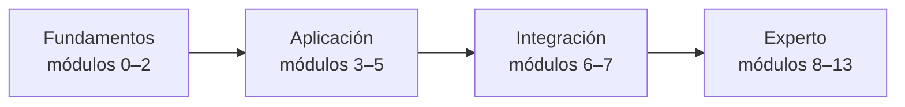
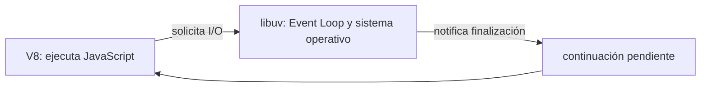
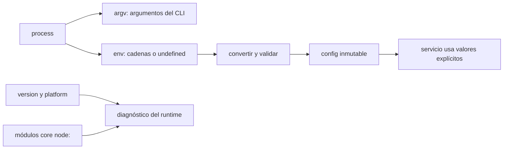
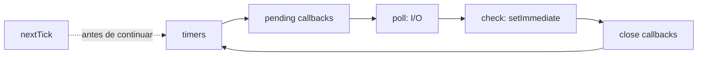
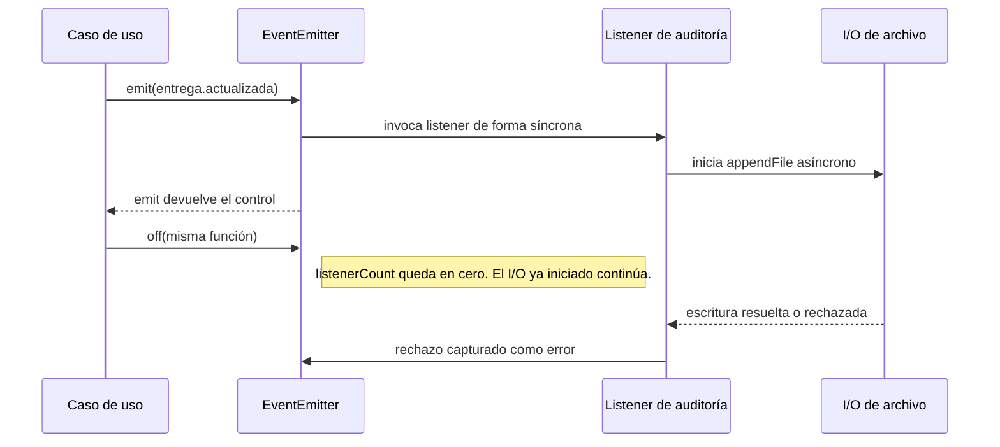

# Módulo 0: El runtime de Node — V8, libuv y el Event Loop

## Antes de comenzar:

1. Instala la versión **LTS vigente** desde [nodejs.org](https://nodejs.org/). En Windows usa el instalador `.msi`; en macOS o Linux puedes usar el instalador oficial o un administrador de versiones. Cierra y vuelve a abrir la terminal después de instalar.
2. Instala Git desde [git-scm.com](https://git-scm.com/downloads) y un editor, por ejemplo [Visual Studio Code](https://code.visualstudio.com/).
3. Abre una terminal nueva y verifica cada herramienta:

```bash
node --version
npm --version
git --version
```

En Windows puedes usar PowerShell; los tres comandos son iguales. Debes ver una versión de Node con prefijo `v`, una versión de npm y una versión de Git. Si un comando no se reconoce, confirma que el instalador terminó y vuelve a abrir la terminal; no continúes hasta que `node` y `npm` respondan.

## Mapa de la ruta

«Node.js: fundamentos de backend» tiene 14 módulos en 4 etapas. Cada etapa se apoya en la anterior; usa la tabla para saltar a un módulo concreto.



| Módulo | Etapa | Qué aprendes |
|---|---|---|
| 0 | Fundamentos | [El runtime de Node: V8, libuv y el Event Loop](/curso/node/0) |
| 1 | Fundamentos | [Módulos, npm/pnpm y gestión de dependencias](/curso/node/1) |
| 2 | Fundamentos | [Sistema de archivos y streams](/curso/node/2) |
| 3 | Aplicación | [Servidores HTTP nativos](/curso/node/3) |
| 4 | Aplicación | [Express/Fastify: routing y middleware](/curso/node/4) |
| 5 | Aplicación | [Bases de datos: drivers y ORMs](/curso/node/5) |
| 6 | Integración | [Autenticación y autorización](/curso/node/6) |
| 7 | Integración | [Testing e integración continua](/curso/node/7) |
| 8 | Experto | [Patrones asíncronos avanzados](/curso/node/8) |
| 9 | Experto | [Observabilidad y manejo de errores en producción](/curso/node/9) |
| 10 | Experto | [Seguridad en Node](/curso/node/10) |
| 11 | Experto | [Despliegue y contenedores](/curso/node/11) |
| 12 | Experto | [Proyecto integrador: API productiva](/curso/node/12) |
| 13 | Experto | [TypeScript, contratos e integraciones confiables](/curso/node/13) |

## Aprende construyendo

Instala una versión **LTS** de Node.js, Git y Visual Studio Code. Un administrador de versiones permite cambiar de Node entre proyectos: `nvm-windows` en Windows y `nvm` en macOS/Linux. Comprueba `node --version`, `npm --version` y `git --version` antes de empezar.

Cada tema es un proyecto independiente que comienza en una carpeta vacía. Escribe manualmente todos los archivos indicados; no necesitas copiar código del repositorio de la academia ni reutilizar archivos de otro tema. `npm init -y` crea el `package.json` de cada proyecto. Nunca copies `node_modules` ni lo subas a Git: se reconstruye con `npm install`. Si npm muestra `EACCES`, no uses `sudo`; corrige la instalación de Node mediante el administrador de versiones.


### Tema 1: Node no es "JavaScript en el servidor" sin más · Básico · 45 min

<details open>
<summary><strong>Capa 1 — Lectura</strong></summary>

#### ► CÓMO FUNCIONA


</details>

<details>
<summary><strong>Capa 2 — Construcción</strong></summary>

#### Código y verificación

```bash
mkdir ejemplo-node-io
cd ejemplo-node-io
npm init -y
mkdir -p src/runtime
```

```js
import { readFile } from "node:fs/promises";
import { performance } from "node:perf_hooks";

const inicio = performance.now();
const lecturaPendiente = readFile(
  new URL("../../package.json", import.meta.url),
  "utf8",
);

console.log("1. V8 sigue disponible mientras libuv coordina la lectura");

const contenido = await lecturaPendiente;
const duracion = performance.now() - inicio;

console.log(`2. Lectura terminada: ${Buffer.byteLength(contenido)} bytes`);
console.log(`3. Duración aproximada: ${duracion.toFixed(2)} ms`);
```

```bash
node src/runtime/io.js
```

```bash
node src/runtime/lecturas.js
```

</details>

### Tema 2: process, global y módulos core · Básico · 45 min

<details open>
<summary><strong>Capa 1 — Lectura</strong></summary>

#### ► CÓMO FUNCIONA


</details>

<details>
<summary><strong>Capa 2 — Construcción</strong></summary>

#### Código y verificación


```bash
mkdir ejemplo-config-node
cd ejemplo-config-node
npm init -y
mkdir -p src/config src/cli
```

```js
const MODOS_VALIDOS = new Set(["development", "test", "production"]);

function leerPuerto(valor) {
  const puerto = Number(valor ?? 3000);
  if (!Number.isInteger(puerto) || puerto < 1 || puerto > 65_535) {
    throw new Error("PORT debe ser un entero entre 1 y 65535");
  }
  return puerto;
}

function leerModo(valor) {
  const modo = valor ?? "development";
  if (!MODOS_VALIDOS.has(modo)) {
    throw new Error(`NODE_ENV inválido: ${modo}`);
  }
  return modo;
}

export const config = Object.freeze({
  port: leerPuerto(process.env.PORT),
  environment: leerModo(process.env.NODE_ENV),
});
```

```js
import os from "node:os";
import path from "node:path";
import { config } from "../config/entorno.js";

const region = process.argv.find((arg) => arg.startsWith("--region="))
  ?.split("=")[1] ?? "sin-definir";

console.log({
  node: process.version,
  platform: process.platform,
  cpus: os.availableParallelism(),
  project: path.basename(process.cwd()),
  port: config.port,
  environment: config.environment,
  region,
});
```

```bash
PORT=4000 NODE_ENV=development node src/cli/diagnostico.js --region=co
```

```powershell
$env:PORT=4000; $env:NODE_ENV="development"; node src/cli/diagnostico.js --region=co
```

</details>

### Tema 3: Fases del Event Loop de Node · Básico · 45 min

<details open>
<summary><strong>Capa 1 — Lectura</strong></summary>

#### ► CÓMO FUNCIONA


</details>

<details>
<summary><strong>Capa 2 — Construcción</strong></summary>

#### Código y verificación


```bash
mkdir ejemplo-event-loop
cd ejemplo-event-loop
npm init -y
mkdir -p src/runtime
```

```js
import { readFile } from "node:fs";

console.log("1. síncrono");

setTimeout(() => console.log("4/5. timer de nivel superior"), 0);
setImmediate(() => console.log("4/5. immediate de nivel superior"));
Promise.resolve().then(() => console.log("3. microtarea Promise"));
process.nextTick(() => console.log("2. cola nextTick"));

readFile(new URL("../../package.json", import.meta.url), () => {
  console.log("6. callback de I/O (fase poll)");
  process.nextTick(() => console.log("7. nextTick dentro de I/O"));
  Promise.resolve().then(() => console.log("8. Promise dentro de I/O"));
  setImmediate(() => console.log("9. immediate después de I/O"));
  setTimeout(() => console.log("10. timer después de I/O"), 0);
});
```

```bash
node src/runtime/fases.js
```

</details>

### Tema 4: Event-driven architecture y non-blocking I/O · Básico · 45 min

<details open>
<summary><strong>Capa 1 — Lectura</strong></summary>

#### ► CÓMO FUNCIONA


</details>

<details>
<summary><strong>Capa 2 — Construcción</strong></summary>

#### Código y verificación
```js
import { EventEmitter } from "node:events";
const emisor = new EventEmitter();
emisor.on("dato", (valor) => console.log("recibido:", valor));
emisor.emit("dato", 42);
```


```bash
mkdir ejemplo-event-emitter
cd ejemplo-event-emitter
npm init -y
mkdir -p src/eventos
```

```js
import { EventEmitter } from "node:events";
import { appendFile } from "node:fs/promises";

export function crearBusEntregas() {
  const bus = new EventEmitter({ captureRejections: true });
  bus.on("error", (error) => {
    console.error("Fallo controlado en listener:", error.message);
  });
  return bus;
}

export function conectarAuditoria(bus) {
  const auditar = ({ guia, estado }) => {
    return appendFile("auditoria.log", `${guia},${estado}\n`, "utf8");
  };

  bus.on("entrega.actualizada", auditar);
  return () => bus.off("entrega.actualizada", auditar);
}

const bus = crearBusEntregas();
const desconectar = conectarAuditoria(bus);

console.log("1. antes de emitir");
bus.emit("entrega.actualizada", { guia: "RF-100", estado: "en-ruta" });
console.log("2. emit terminó; la escritura puede seguir pendiente");

desconectar();
console.log("3. listeners activos:", bus.listenerCount("entrega.actualizada"));
```

```bash
node src/eventos/bus-entregas.js
```

```bash
mkdir runtime-entregas
cd runtime-entregas
npm init -y
npm pkg set type=module
mkdir -p src/runtime src/config src/cli src/eventos
```

</details>

### Proyecto 0: runtime observable de entregas

<details open>
<summary><strong>Capa 1 — Lectura</strong></summary>

</details>

<details>
<summary><strong>Capa 2 — Construcción</strong></summary>

#### Nota de construcción
Este tema es principalmente conceptual en esta versión. La verificación se realiza con las preguntas de comprensión y el criterio de cuándo NO usar proyecto 0: runtime observable de entregas.

</details>
