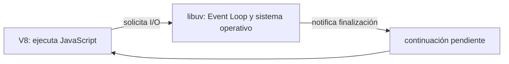
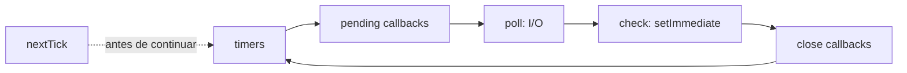
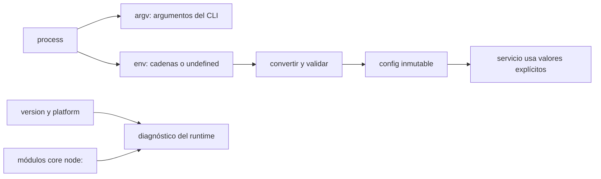
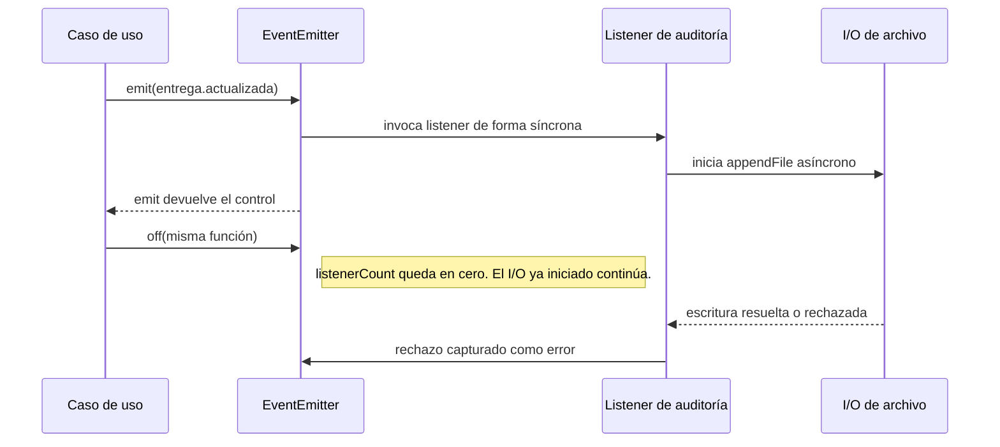

# Módulo 0: El runtime de Node — V8, libuv y el Event Loop

## Antes de comenzar:

1. Instala la versión **LTS vigente** desde [nodejs.org](https://nodejs.org/). En Windows usa el instalador `.msi`; en macOS o Linux puedes usar el instalador oficial o un administrador de versiones. Cierra y vuelve a abrir la terminal después de instalar.
2. Instala Git desde [git-scm.com](https://git-scm.com/downloads) y un editor, por ejemplo [Visual Studio Code](https://code.visualstudio.com/).
3. Abre una terminal nueva y verifica cada herramienta:

```bash
node --version
npm --version
git --version
```

En Windows puedes usar PowerShell; los tres comandos son iguales. Debes ver una versión de Node con prefijo `v`, una versión de npm y una versión de Git. Si un comando no se reconoce, confirma que el instalador terminó y vuelve a abrir la terminal; no continúes hasta que `node` y `npm` respondan.

## Aprende construyendo

Instala una versión **LTS** de Node.js, Git y Visual Studio Code. Un administrador de versiones permite cambiar de Node entre proyectos: `nvm-windows` en Windows y `nvm` en macOS/Linux. Comprueba `node --version`, `npm --version` y `git --version` antes de empezar.

Cada tema es un proyecto independiente que comienza en una carpeta vacía. Escribe manualmente todos los archivos indicados; no necesitas copiar código del repositorio de la academia ni reutilizar archivos de otro tema. `npm init -y` crea el `package.json` de cada proyecto. Nunca copies `node_modules` ni lo subas a Git: se reconstruye con `npm install`. Si npm muestra `EACCES`, no uses `sudo`; corrige la instalación de Node mediante el administrador de versiones.

### Tema 1: Node no es "JavaScript en el servidor" sin más · Básico · 75 min

#### Aprende

**Prerrequisitos:** Node.js LTS, terminal, archivos JavaScript básicos, `const`, `import` y promesas elementales.

**Al terminar podrás:** explicar las responsabilidades de V8 y libuv, demostrar con código que una operación de I/O no bloquea el hilo de JavaScript y distinguir esa concurrencia de un cálculo intensivo de CPU.

**Por qué importa:** una API de entregas espera archivos, bases de datos y servicios externos sin dejar de atender otras solicitudes. Si confundes espera de I/O con trabajo de CPU, puedes bloquear todo el proceso con una sola operación mal elegida.

Node.js combina dos componentes con responsabilidades distintas. **V8** compila y ejecuta JavaScript. **libuv** proporciona el Event Loop y el acceso a operaciones de I/O no bloqueantes del sistema operativo: archivos, red y DNS. V8 no incorpora por sí solo esas capacidades de servidor.

Cuando JavaScript solicita I/O, Node delega el trabajo a libuv y el hilo de JavaScript continúa. Al terminar, la continuación queda pendiente de ejecutarse. Algunas operaciones usan mecanismos asíncronos del sistema operativo y otras el pool de hilos interno de libuv; eso no crea hilos JavaScript adicionales ni vuelve paralelo tu código.

Este modelo resulta eficiente para servicios dominados por esperas de I/O porque evita mantener un hilo de aplicación por conexión. No elimina el coste del cómputo: un bucle intensivo ocupa el único hilo JavaScript y retrasa timers, callbacks y respuestas. Para CPU sostenida se requiere otra estrategia, como Worker Threads, que estudiarás en el Módulo 8.

**Analogía:** V8 es un mesero y libuv la coordinación con cocina. El mesero entrega el pedido y atiende otra mesa en vez de quedarse inmóvil hasta que el plato esté listo. Si el mesero se pone a contar manualmente miles de monedas, toda la sala espera aunque la cocina siga libre.



#### Practica

Desde una carpeta vacía crea el proyecto:

```bash
mkdir ejemplo-node-io
cd ejemplo-node-io
npm init -y
mkdir -p src/runtime
```

En PowerShell, si `mkdir -p` falla, usa `New-Item -ItemType Directory -Force src/runtime`. Añade `"type": "module"` al nivel raíz de `package.json` para usar ESM en archivos `.js`.

Crea manualmente `src/runtime/io.js`:

```js
import { readFile } from "node:fs/promises";
import { performance } from "node:perf_hooks";

const inicio = performance.now();
const lecturaPendiente = readFile(
  new URL("../../package.json", import.meta.url),
  "utf8",
);

console.log("1. V8 sigue disponible mientras libuv coordina la lectura");

const contenido = await lecturaPendiente;
const duracion = performance.now() - inicio;

console.log(`2. Lectura terminada: ${Buffer.byteLength(contenido)} bytes`);
console.log(`3. Duración aproximada: ${duracion.toFixed(2)} ms`);
```

`readFile` devuelve una promesa y comienza el I/O; `await` suspende esta función, no todo el proceso. `import.meta.url` permite resolver la ruta desde el archivo actual y `Buffer.byteLength` mide bytes, no caracteres.

Ejecuta desde la raíz del proyecto:

```bash
node src/runtime/io.js
```

**Resultado esperado:** `1. V8 sigue disponible...` aparece antes de `2. Lectura terminada`. Los bytes y milisegundos dependen de tu equipo.

**Fallo deliberado y corrección:** sustituye la lectura por `readFileSync` de `node:fs`, elimina la promesa y el `await`, y coloca el primer `console.log` después de la llamada síncrona. El mensaje no puede aparecer hasta que la lectura termina: el hilo JavaScript está bloqueado. Restaura `readFile` y la promesa, y verifica nuevamente el orden original.

**Práctica guiada:** crea `src/runtime/lecturas.js` que inicie tres lecturas del mismo archivo, imprima `lecturas iniciadas` y resuelva el arreglo con `await Promise.all(promesas)`. Debe imprimir una sola lista con tres resultados, después del aviso.

```bash
node src/runtime/lecturas.js
```

**Ejercicio independiente:** crea `src/runtime/cpu.js` con un `setTimeout(..., 0)` programado antes de un bucle grande. Mide la duración del bucle y explica por qué el timer espera aunque no exista I/O. Reduce el tamaño del bucle si impide usar tu equipo; no ejecutes cargas sin límite.

#### Aplica

En el **[Proyecto integrador: runtime observable de entregas](#proyecto-0-runtime-observable-de-entregas)**, lee una evidencia mediante I/O asíncrono y compara esa ruta con una variante bloqueante controlada. Registra qué sucede con una segunda operación mientras la primera espera.

**Checklist de salida**

- [ ] Creaste el proyecto manualmente desde una carpeta vacía.
- [ ] La primera traza demuestra que JavaScript continúa mientras el I/O está pendiente.
- [ ] `await` se explica como suspensión de la función, no como bloqueo global.
- [ ] El ejemplo síncrono se reconoce como bloqueo y se corrige.
- [ ] El ejercicio de CPU muestra por qué un timer no se ejecuta durante el bucle.
- [ ] Puedes justificar cuándo Node necesita Worker Threads en lugar de más I/O asíncrono.

**Límites y decisión de uso:** las APIs `Sync` pueden ser razonables durante una inicialización breve de un script, pero no en el camino de peticiones activas. No atribuyas cada operación a otro hilo JavaScript ni compares rendimiento con una sola medición.

**Fuentes oficiales:** [Node.js: Event Loop](https://nodejs.org/en/learn/asynchronous-work/event-loop-timers-and-nexttick) y [`fs/promises`](https://nodejs.org/api/fs.html#promises-api).

### Tema 2: Fases del Event Loop de Node · Intermedio · 75 min

#### Aprende

**Prerrequisitos:** callbacks, promesas y la distinción entre I/O y CPU del Tema 1. Este proyecto no reutiliza sus archivos.

**Al terminar podrás:** predecir y verificar el orden entre código síncrono, `nextTick`, promesas, timers, I/O y `setImmediate`, separando garantías del runtime de órdenes accidentales.

**Por qué importa:** un servidor combina reintentos, respuestas de base de datos y mensajes de red. Una suposición falsa sobre el orden produce errores intermitentes; una recursión de `nextTick` puede dejar el proceso activo pero incapaz de atender I/O.

El Event Loop repite fases con responsabilidades concretas: **timers** ejecuta callbacks de `setTimeout` y `setInterval` vencidos; **pending callbacks** procesa ciertos callbacks del sistema diferidos; **poll** recupera eventos de I/O y ejecuta sus callbacks; **check** ejecuta `setImmediate`; y **close callbacks** gestiona cierres, como los de sockets.

`process.nextTick` no es una fase. Su cola se vacía al terminar la operación actual, antes de continuar el Event Loop; después se procesan las microtareas de promesas. Una cadena recursiva de `nextTick` puede monopolizar el proceso y provocar inanición de I/O.

Entre `setTimeout(fn, 0)` y `setImmediate(fn)` programados en el nivel superior no existe un ganador portable: influye la temporización de inicio. Dentro de un callback de I/O en `poll`, `setImmediate` se ejecuta antes del siguiente timer porque `check` sigue inmediatamente a esa fase.

**Analogía:** las fases son estaciones de una ronda de inspección. `nextTick` es un aviso urgente atendido al terminar la tarea actual, antes de avanzar a la siguiente estación. Si los avisos urgentes generan otros avisos sin fin, la ronda nunca continúa.



#### Practica

Desde una carpeta vacía:

```bash
mkdir ejemplo-event-loop
cd ejemplo-event-loop
npm init -y
mkdir -p src/runtime
```

En PowerShell usa `New-Item -ItemType Directory -Force src/runtime`. Añade `"type": "module"` a `package.json` y crea `src/runtime/fases.js`:

```js
import { readFile } from "node:fs";

console.log("1. síncrono");

setTimeout(() => console.log("4/5. timer de nivel superior"), 0);
setImmediate(() => console.log("4/5. immediate de nivel superior"));
Promise.resolve().then(() => console.log("3. microtarea Promise"));
process.nextTick(() => console.log("2. cola nextTick"));

readFile(new URL("../../package.json", import.meta.url), () => {
  console.log("6. callback de I/O (fase poll)");
  process.nextTick(() => console.log("7. nextTick dentro de I/O"));
  Promise.resolve().then(() => console.log("8. Promise dentro de I/O"));
  setImmediate(() => console.log("9. immediate después de I/O"));
  setTimeout(() => console.log("10. timer después de I/O"), 0);
});
```

Ejecuta:

```bash
node src/runtime/fases.js
```

**Resultado esperado:** `1`, `2` y `3` aparecen en ese orden. Las líneas `4/5` pueden intercambiarse. Después de `6`, aparecen `7`, `8`, `9` y `10` en ese orden.

**Fallo deliberado y corrección:** añade temporalmente `const saturar = () => process.nextTick(saturar); saturar();`. El proceso no llega al I/O; deténlo con `Ctrl+C`. El diagnóstico es inanición del Event Loop, no lentitud del disco. Elimina esas líneas y verifica otra vez la traza completa.

**Práctica guiada:** crea `src/runtime/tabla.js` con la misma instrumentación y una salida tabulada con columnas `mensaje`, `cola o fase` y `garantizado`. Clasifica `nextTick` y promesas aparte de `timers`, `poll` y `check`; no marques `4/5` como orden garantizado.

**Ejercicio independiente:** crea manualmente `datos/a.txt` y `datos/b.txt`, y un programa `src/runtime/dos-lecturas.js` que lea ambos y registre sus callbacks. Ejecuta cinco veces. Explica qué orden observado puede variar y cuál está garantizado por el contexto.

#### Aplica

En el **[Proyecto integrador: traza de confirmación](#proyecto-0-runtime-observable-de-entregas)**, instrumenta una confirmación sin asumir orden entre timers independientes. Conserva una traza y separa las garantías del flujo de las coincidencias observadas.

**Checklist de salida**

- [ ] El proyecto fue escrito desde cero en una carpeta independiente.
- [ ] La traza distingue código síncrono, `nextTick`, microtareas y fases.
- [ ] No presentas como fijo el orden entre timer e immediate de nivel superior.
- [ ] Dentro de I/O verificaste `nextTick`, promesa, immediate y timer en el orden documentado.
- [ ] Detuviste y corregiste la recursión que producía inanición.
- [ ] Tus conclusiones separan observación empírica de contrato del runtime.

**Errores comunes:** asumir que `setTimeout(0)` significa ejecución inmediata, confundir microtareas con fases, bloquear un callback de I/O y enseñar un orden accidental como regla universal.

**Cuándo asumir un orden:** dentro de una fase y en los casos documentados puedes apoyarte en el contrato de Node; el orden entre un timer y `setImmediate` creado desde el nivel superior puede variar. Si la corrección del programa depende de ese orden, coordina con una promesa explícita o una señal de I/O y prueba el contrato que realmente necesitas.

**Fuentes oficiales:** [Event Loop, timers y `nextTick`](https://nodejs.org/en/learn/asynchronous-work/event-loop-timers-and-nexttick) y [`process.nextTick`](https://nodejs.org/api/process.html#processnexttickcallback-args).

### Tema 3: process, global y módulos core · Básico · 75 min

#### Aprende

**Prerrequisitos:** imports ESM y distinción entre texto y números. No necesitas archivos de otros temas.

**Al terminar podrás:** construir una configuración validada con `process.env`, leer argumentos, diagnosticar el runtime y usar módulos core con el prefijo `node:` sin instalar paquetes.

**Por qué importa:** el mismo servicio se ejecuta en desarrollo, pruebas y producción con puertos, regiones y credenciales distintos. Una configuración inválida o un secreto impreso puede impedir el arranque o comprometer el entorno antes de atender la primera solicitud.

`process` expone el proceso actual: `argv` contiene argumentos, `env` contiene variables externas como cadenas o `undefined`, `version` y `platform` describen el runtime, y `exit(codigo)` termina con un estado explícito. La salida debe quedar en la frontera del programa, no en la lógica de dominio.

`global` es el objeto global de Node, análogo conceptual a `window` en el navegador. Compartir estado allí oculta dependencias; los módulos explícitos hacen visible quién usa cada dato.

Los módulos core están incluidos en Node: `os` informa sobre el sistema, `buffer` trabaja con binarios, `crypto` ofrece primitivas criptográficas, `util` incluye utilidades como `promisify`, `child_process` administra procesos y `cluster` permite aprovechar varios núcleos. El prefijo `node:` distingue estos módulos de paquetes npm con nombres parecidos.

**Analogía:** `process` es el tablero del vehículo y los módulos core su kit de fábrica. Leer un indicador no basta: antes de conducir hay que comprobar que sus valores están en un rango seguro.

**Flujo de configuración:** los valores externos se convierten y validan al arrancar; el resto de la aplicación recibe una configuración segura, no el objeto global `process`.



#### Practica

Desde una carpeta vacía:

```bash
mkdir ejemplo-config-node
cd ejemplo-config-node
npm init -y
mkdir -p src/config src/cli
```

En PowerShell crea las carpetas con `New-Item -ItemType Directory -Force src/config,src/cli`. Añade `"type": "module"` a `package.json`.

Crea `src/config/entorno.js`:

```js
const MODOS_VALIDOS = new Set(["development", "test", "production"]);

function leerPuerto(valor) {
  const puerto = Number(valor ?? 3000);
  if (!Number.isInteger(puerto) || puerto < 1 || puerto > 65_535) {
    throw new Error("PORT debe ser un entero entre 1 y 65535");
  }
  return puerto;
}

function leerModo(valor) {
  const modo = valor ?? "development";
  if (!MODOS_VALIDOS.has(modo)) {
    throw new Error(`NODE_ENV inválido: ${modo}`);
  }
  return modo;
}

export const config = Object.freeze({
  port: leerPuerto(process.env.PORT),
  environment: leerModo(process.env.NODE_ENV),
});
```

Crea `src/cli/diagnostico.js`:

```js
import os from "node:os";
import path from "node:path";
import { config } from "../config/entorno.js";

const region = process.argv.find((arg) => arg.startsWith("--region="))
  ?.split("=")[1] ?? "sin-definir";

console.log({
  node: process.version,
  platform: process.platform,
  cpus: os.availableParallelism(),
  project: path.basename(process.cwd()),
  port: config.port,
  environment: config.environment,
  region,
});
```

En macOS o Linux ejecuta:

```bash
PORT=4000 NODE_ENV=development node src/cli/diagnostico.js --region=co
```

En PowerShell:

```powershell
$env:PORT=4000; $env:NODE_ENV="development"; node src/cli/diagnostico.js --region=co
```

**Resultado esperado:** el objeto contiene `port: 4000`, `environment: 'development'` y `region: 'co'`. La versión, plataforma y cantidad de CPU dependen de tu máquina.

**Fallo deliberado y corrección:** ejecuta con `PORT=texto` o `$env:PORT="texto"`. Debes ver `PORT debe ser un entero entre 1 y 65535` y un código de salida distinto de cero. No ocultes el error con un valor silencioso; restaura `PORT=4000` y verifica el arranque válido.

**Práctica guiada:** añade `LOG_LEVEL` con valores `debug`, `info`, `warn` y `error`, usando un `Set` y un valor predeterminado explícito. Imprime solo ese nivel, prueba un valor válido y otro inválido.

**Ejercicio independiente:** añade una clave obligatoria `DATABASE_URL` sin imprimir su contenido. Produce una ejecución sin la variable que falle con un mensaje claro y otra válida que solo muestre `databaseConfigured: true`.

#### Aplica

Lleva esta frontera al **[Proyecto integrador: configuración de la API operativa](#proyecto-0-runtime-observable-de-entregas)**. La lógica recibe `config.port`, `config.environment` y una indicación booleana de credenciales; nunca lee secretos directamente ni imprime todo `process.env`.

**Checklist de salida**

- [ ] Creaste los archivos y el `package.json` en un proyecto nuevo.
- [ ] El puerto se convierte y valida antes de usarse.
- [ ] Un modo o puerto inválido impide el arranque con un diagnóstico claro.
- [ ] Los argumentos propios se distinguen de las banderas de Node.
- [ ] Las importaciones core usan `node:` y no instalan paquetes innecesarios.
- [ ] Ninguna salida revela `DATABASE_URL` ni el contenido completo de `process.env`.

**Cuándo no usarlo:** para configuración anidada o con muchos campos, una biblioteca dedicada como `zod`, `convict` o `envalid` puede comunicar mejor el esquema. Leer `process.env` sin validación solo es aceptable en scripts descartables, no en un servicio desplegado.

**Fuentes oficiales:** [`process`](https://nodejs.org/api/process.html), [`os`](https://nodejs.org/api/os.html) y [`path`](https://nodejs.org/api/path.html).

### Tema 4: Event-driven architecture y non-blocking I/O · Intermedio · 75 min

#### Aprende

**Prerrequisitos:** funciones, módulos y el modelo básico del Event Loop. El ejemplo comienza en otra carpeta vacía.

**Al terminar podrás:** publicar y consumir un evento interno, controlar sus errores, limpiar listeners y decidir cuándo una llamada directa comunica mejor el contrato.

**Por qué importa:** al confirmar una entrega pueden ser necesarios auditoría, notificaciones y métricas. Un bus interno evita que el caso de uso importe cada efecto, pero un listener duplicado o un `error` sin manejar puede repetir efectos o terminar el proceso.

Gran parte de la API de Node —streams, servidores HTTP y procesos hijo— se construye sobre `EventEmitter`. Un objeto emite hechos con nombre y otros registran listeners. Es publicación/suscripción **dentro del proceso**, no una cola durable entre servicios.

`emit()` llama a los listeners de forma síncrona y en orden de registro; no vuelve asíncrono el código por sí mismo. Un listener con CPU pesada bloquea a los demás. El I/O asíncrono que inicie sí puede continuar después de que `emit` devuelva el control.

La convención de Node es I/O asíncrono por defecto y síncrono solo como excepción deliberada. El evento `error` tiene un contrato especial: emitirlo sin listener termina el proceso. Registrar y retirar listeners también forma parte del ciclo de vida del objeto.

**Analogía:** es el tablero de notificaciones de una oficina. Cada persona se suscribe a los hechos que le interesan, pero recibir una notificación no significa que el trabajo ya haya terminado. Si nadie atiende el aviso de emergencia, el fallo escala.

```js
import { EventEmitter } from "node:events";
const emisor = new EventEmitter();
emisor.on("dato", (valor) => console.log("recibido:", valor));
emisor.emit("dato", 42);
```

**Secuencia del ejemplo:** `emit` llama al listener en el mismo flujo; la escritura iniciada puede terminar después. `off` quita el listener para eventos futuros, pero no cancela ese I/O; `captureRejections` envía sus rechazos al listener de `error`.



#### Practica

Desde una carpeta vacía:

```bash
mkdir ejemplo-event-emitter
cd ejemplo-event-emitter
npm init -y
mkdir -p src/eventos
```

En PowerShell usa `New-Item -ItemType Directory -Force src/eventos`. Añade `"type": "module"` a `package.json` y crea `src/eventos/bus-entregas.js`:

```js
import { EventEmitter } from "node:events";
import { appendFile } from "node:fs/promises";

export function crearBusEntregas() {
  const bus = new EventEmitter({ captureRejections: true });
  bus.on("error", (error) => {
    console.error("Fallo controlado en listener:", error.message);
  });
  return bus;
}

export function conectarAuditoria(bus) {
  const auditar = ({ guia, estado }) => {
    return appendFile("auditoria.log", `${guia},${estado}\n`, "utf8");
  };

  bus.on("entrega.actualizada", auditar);
  return () => bus.off("entrega.actualizada", auditar);
}

const bus = crearBusEntregas();
const desconectar = conectarAuditoria(bus);

console.log("1. antes de emitir");
bus.emit("entrega.actualizada", { guia: "RF-100", estado: "en-ruta" });
console.log("2. emit terminó; la escritura puede seguir pendiente");

desconectar();
console.log("3. listeners activos:", bus.listenerCount("entrega.actualizada"));
```

`captureRejections` dirige promesas rechazadas por listeners al evento `error`; `off` necesita la misma referencia registrada; `listenerCount` hace observable la limpieza.

Ejecuta:

```bash
node src/eventos/bus-entregas.js
```

**Resultado esperado:** aparecen `1`, `2` y `3`; el último informa `0` listeners. Se crea `auditoria.log` con `RF-100,en-ruta`. El segundo mensaje puede aparecer antes de terminar la escritura.

**Fallo deliberado y corrección:** comenta `bus.on("error", ...)` y añade `bus.emit("error", new Error("prueba controlada"))` antes de desconectar. Node termina con `Unhandled 'error' event`. Restaura el listener y elimina la emisión de prueba; el programa vuelve a cerrar con cero listeners activos.

**Práctica guiada:** añade un listener `once("sistema.iniciado", ...)`, emite ese evento dos veces y verifica con un contador que se ejecuta exactamente una vez.

**Ejercicio independiente:** crea `src/eventos/notificaciones.js` con un listener de notificación. Ejecuta una actualización, retíralo y ejecuta otra. Entrega el conteo de listeners y explica por qué registrarlo dentro de cada petición produciría duplicados y fugas de memoria.

#### Aplica

En el **[Proyecto integrador: eventos internos de entrega](#proyecto-0-runtime-observable-de-entregas)**, publica un hecho después de validar una entrega, prueba un consumidor que falla y no anuncies una operación persistida antes de que su escritura termine.

**Checklist de salida**

- [ ] Escribiste el bus y sus archivos en un proyecto independiente.
- [ ] La traza demuestra que `emit` no espera el I/O iniciado por el listener.
- [ ] El evento `error` tiene un manejador explícito.
- [ ] `off` retira exactamente la función registrada.
- [ ] `once` se verifica con dos emisiones y un contador.
- [ ] Puedes explicar por qué este bus no sustituye mensajería durable.

**Errores comunes:** suponer que `emit` es asíncrono, registrar listeners por petición, emitir `error` sin listener y usar eventos cuando una llamada directa expresa mejor una operación obligatoria.

**Fuentes oficiales:** [`EventEmitter`](https://nodejs.org/api/events.html) y [no bloquear el Event Loop](https://nodejs.org/en/learn/asynchronous-work/dont-block-the-event-loop).

## Ruta de proyecto progresivo desde carpeta vacía

Después de completar los cuatro ejercicios independientes, integra sus mecanismos en un proyecto nuevo. No copies carpetas ni `node_modules` de los laboratorios; vuelve a escribir la implementación mínima a partir de lo que ya comprobaste.

```bash
mkdir runtime-entregas
cd runtime-entregas
npm init -y
npm pkg set type=module
mkdir -p src/runtime src/config src/cli src/eventos
```

En PowerShell, crea las carpetas con `New-Item -ItemType Directory -Force src/runtime,src/config,src/cli,src/eventos`. Conserva estos archivos en el mismo proyecto:

| Archivo | Qué integras | Comprobación |
|---|---|---|
| `src/runtime/io.js` | Lectura asíncrona de una evidencia local | `node src/runtime/io.js`; el aviso previo aparece antes de terminar el I/O |
| `src/runtime/fases.js` | Traza de código síncrono, colas, timer, I/O e immediate | `node src/runtime/fases.js`; distingue garantías de órdenes no deterministas |
| `src/config/entorno.js` y `src/cli/diagnostico.js` | Validación de `PORT`, modo y argumentos sin imprimir secretos | `PORT=4000 NODE_ENV=development node src/cli/diagnostico.js --region=co` |
| `src/eventos/bus-entregas.js` | Evento interno, persistencia de auditoría y retirada de listeners | `node src/eventos/bus-entregas.js`; al final quedan cero listeners |

En PowerShell, establece las variables y ejecuta el diagnóstico con `$env:PORT=4000; $env:NODE_ENV="development"; node src/cli/diagnostico.js --region=co`. Ejecuta los otros tres archivos desde la raíz con los comandos de la tabla. Si una comprobación falla, corrige el archivo responsable antes de continuar; registra en `README.md` la salida que observaste y qué parte depende de tu sistema.

## Laboratorio práctico

### Proyecto 0: runtime observable de entregas

Desde una carpeta vacía crea `runtime-entregas/` y ejecuta `npm init -y`. Escribe manualmente un proyecto ESM con cuatro programas separados: lectura asíncrona de una evidencia, traza del Event Loop, configuración validada y bus interno de entrega. No copies fuentes de los temas: implementa aquí las variantes mínimas necesarias y conserva cada experimento en su propio archivo.

**Entregable:** un proyecto de runtime para entregas que lea una evidencia sin bloquear, explique el orden de sus callbacks, valide puerto y entorno sin revelar secretos y publique un evento interno con manejo de errores y limpieza.

**Criterios de aceptación observables:**

1. La lectura asíncrona permite que una segunda traza aparezca antes de completarse; la variante `Sync` queda identificada como bloqueante.
2. La tabla del Event Loop no afirma un orden fijo entre timer e immediate de nivel superior y sí verifica el orden dentro del callback de I/O.
3. Un puerto inválido termina con diagnóstico y una credencial válida solo produce `databaseConfigured: true`.
4. Después de desconectar la auditoría, el contador de listeners es cero y una segunda actualización no la ejecuta.
5. El README que escribas indica versión de Node, comandos, resultados observados y límites de cada experimento.

La ejecución de estos criterios en tu proyecto es la evidencia del módulo; una marca de finalización no sustituye las trazas ni la explicación.
