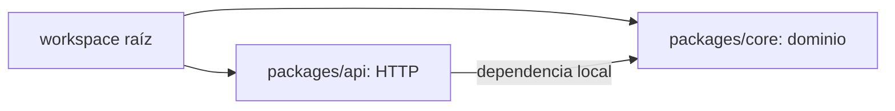
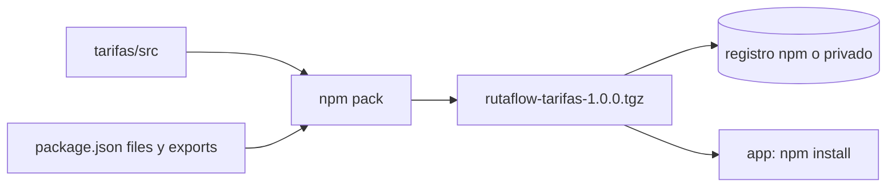
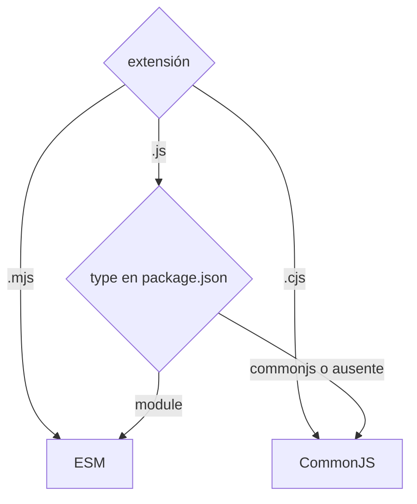

# Módulo 1: Módulos, npm/pnpm y gestión de dependencias


## Aprende construyendo

### Tema 1: package.json y semver · Básico · 50 min

**Prerrequisito:** Node LTS y npm. Comprueba `node --version` y `npm --version`; no necesitas archivos de otros temas.

**Al terminar podrás:** clasificar dependencias, interpretar rangos semver y justificar qué actualizaciones acepta un servicio Node.

#### Aprende

Un servicio necesita Express al ejecutar y Vitest solo al desarrollar. `package.json` funciona como contrato operativo: nombre, versión, runtime, comandos, dependencias y política de actualización quedan visibles para personas, CI y contenedores.

**Por qué importa:** entender semver y los rangos de versión permite decidir cuánta actualización automática aceptar, equilibrando la comodidad de recibir correcciones contra el riesgo de que una actualización inesperada rompa el servicio. Una dependencia de producción ausente impide arrancar; una herramienta de desarrollo omitida en producción es normal.

El versionado semántico estructura los números como `MAYOR.MENOR.PARCHE`. Un incremento de versión mayor señala cambios incompatibles; uno menor, funcionalidad nueva compatible hacia atrás; uno de parche, correcciones compatibles. La convención depende de que cada autor la respete: el número comunica intención, pero ninguna verificación automática garantiza compatibilidad o calidad.

Los prefijos controlan qué actualizaciones admite la instalación. `^4.19.0` acepta versiones menores y de parche dentro de la mayor `4`, como `4.20.0`, pero no `5.0.0`; `~4.19.0` limita los candidatos a parches `4.19.x`, por lo que tampoco admite `4.20.0`; `4.19.0`, sin prefijo, fija esa versión exacta. En versiones con componentes iniciales iguales a cero, caret conserva el primer componente distinto de cero. El rango decide candidatos; el lockfile fija la versión realmente instalada.

`dependencies` lista paquetes necesarios en producción; `devDependencies` reúne herramientas de desarrollo, prueba o construcción. Esta clasificación tiene un efecto directo al preparar un despliegue: `npm ci --omit=dev` excluye las dependencias de desarrollo y reduce las dependencias innecesarias presentes en producción. No borres sus declaraciones del manifiesto: solo se omite su instalación.

**Analogía:** semver es un semáforo de intenciones. Verde (parche) anuncia una corrección compatible; amarillo (menor), funcionalidad nueva sin romper lo existente; rojo (mayor), una posible incompatibilidad que exige detenerse y revisar. El semáforo orienta, pero no sustituye pruebas ni revisión.

**Conceptos clave:** versionado semántico, rangos de versión, `dependencies` frente a `devDependencies`, `engines` y scripts.

**Cuándo no usarlo:** no uses `latest` ni actualizaciones automáticas como sustituto de una política de versiones. Una actualización declarada compatible solo se acepta con lockfile, pruebas y revisión.

#### Practica

**Desde cero:** crea una carpeta vacía y deja que npm genere el manifiesto y el lockfile de este proyecto nuevo; no copies ejemplos del repositorio:

```bash
mkdir ejemplo-package-json
cd ejemplo-package-json
npm init -y
npm install express
npm install --save-dev vitest
npm pkg set type=module engines.node=">=20" scripts.start="node src/main.js" scripts.test="vitest run"
mkdir src
```

`--save-dev` instala el paquete como dependencia de desarrollo. **Crea** `src/main.js` para que el arranque compruebe una dependencia de runtime sin levantar un servidor:

```js
import express from "express";

console.log(`Express disponible: ${typeof express === "function"}`);
```

Revisa `package.json`. Su forma relevante será similar a esta, aunque las versiones concretas pueden ser más nuevas:

```json
{
  "type": "module",
  "engines": { "node": ">=20" },
  "scripts": {
    "start": "node src/main.js",
    "test": "vitest run"
  },
  "dependencies": { "express": "^5.0.0" },
  "devDependencies": { "vitest": "^3.0.0" }
}
```

JSON no admite comentarios; por eso las explicaciones están fuera del archivo. Inspecciona lo guardado y ejecuta el arranque:

```bash
npm pkg get engines scripts dependencies devDependencies
npm outdated
npm start
```

**Resultado esperado:** Express aparece únicamente en `dependencies`, Vitest en `devDependencies`, cada script es una cadena y el arranque imprime `Express disponible: true`. `npm outdated` puede no mostrar nada si todo está actualizado.

**Fallo deliberado:** mueve temporalmente Express a desarrollo y haz una instalación de producción:

```bash
npm uninstall express
npm install --save-dev express
npm ci --omit=dev
npm start
```

**Diagnóstico y corrección:** `npm start` falla con `ERR_MODULE_NOT_FOUND` porque una dependencia de runtime fue omitida. Restaura su clasificación y comprueba de nuevo:

```bash
npm uninstall express
npm install express
npm ci
npm start
```

**Resultado esperado:** vuelve a aparecer `Express disponible: true`; no resuelvas el fallo instalando Express manualmente dentro de `node_modules`.

**Práctica guiada.** Antes de cambiar nada, predice si `^4.19.0` admite `4.20.0` y `5.0.0`, y si `~4.19.0` admite `4.20.0`. Después documenta el resultado junto al manifiesto. **Pista:** `^` conserva el primer componente distinto de cero; `~` conserva mayor y menor. La conclusión esperada es sí, no y no, respectivamente.

**Si falla.** Si el error de arranque aparece antes del experimento, comprueba que `src/main.js` exista y que el import diga `express`. Si `npm outdated` muestra versiones nuevas, no las actualices para completar este ejercicio: el objetivo es leer la política actual, no perseguir la versión más reciente.

#### Aplica

Añade un script `check:runtime` que imprima la versión de Node:

```bash
npm pkg set scripts.check:runtime="node --version"
npm run check:runtime
```

**Crea** `.nvmrc` con la mayor LTS elegida, una por línea; por ejemplo, si eliges Node 22:

```text
22
```

Entrega la salida de `npm pkg get scripts engines` y explica en un comentario de tu evidencia por qué `engines` comunica el requisito, pero el gestor puede necesitar configuración adicional para imponerlo. Como reto independiente, cambia una dependencia de un rango caret a tilde, predice el efecto antes de instalar y restaura el rango original después de comparar el manifiesto y el lockfile.

**Checklist de salida.**

- [ ] `package.json` declara `type`, `engines`, `start` y `test` con JSON válido y sin comentarios.
- [ ] Express está en `dependencies` y Vitest en `devDependencies`.
- [ ] El arranque correcto imprime `Express disponible: true`.
- [ ] La instalación con Express mal clasificado reproduce `ERR_MODULE_NOT_FOUND` y la corrección restaura el arranque.
- [ ] La comparación de rangos distingue correctamente `4.20.0` de `5.0.0`.
- [ ] `check:runtime` y `.nvmrc` declaran y muestran el runtime elegido.

**Si falla.** Si `npm start` no encuentra `src/main.js`, revisa la ruta del script antes de tocar dependencias. Si `engines` no bloquea una versión incompatible, no lo confundas con una garantía: usa la configuración de imposición del gestor o una comprobación explícita cuando el proyecto la requiera.

**Errores comunes:** escribir comentarios en JSON; usar `latest` sin control; confundir rango con versión instalada; clasificar una librería de runtime como desarrollo; asumir que semver garantiza calidad.

**Fuentes oficiales:** [`package.json`](https://docs.npmjs.com/cli/configuring-npm/package-json), [semver de npm](https://docs.npmjs.com/about-semantic-versioning) y [`npm install`](https://docs.npmjs.com/cli/commands/npm-install).

**Transferencia al proyecto integrador «API operativa de entregas»:** declara versión del runtime, scripts y dependencias de la API. Instala en una carpeta limpia y verifica que la versión declarada soporta las APIs realmente utilizadas en arranque y pruebas.

---

### Tema 2: Lockfiles e instalación reproducible · Básico · 50 min

**Prerrequisito:** Node, npm y comprensión de rangos, dependencias directas y transitivas. El ejercicio vuelve a empezar en una carpeta vacía.

**Al terminar podrás:** reproducir exactamente una instalación y diagnosticar una desincronización entre manifiesto y lockfile.

#### Aprende

Un servicio debe usar en el portátil, CI y producción el mismo árbol que fue probado. Un lockfile (`package-lock.json` para npm, `pnpm-lock.yaml` para pnpm) congela el árbol completo: dependencias directas y transitivas, versiones, relaciones e integridad. Sin él, dos instalaciones del mismo `package.json` pueden resolver un rango como `^4.19.0` hacia versiones específicas distintas si se publicó una versión compatible entre ambas instalaciones.

**Por qué importa:** el lockfile es la garantía de reproducibilidad entre desarrollo, CI y producción. `npm ci` hace cumplir esa garantía estrictamente y falla ante una desincronización, en vez de resolverla silenciosamente y construir un artefacto distinto del revisado.

`npm install` respeta un lockfile compatible, pero puede actualizarlo cuando debe resolver cambios del manifiesto. `npm ci` instala exactamente lo registrado, limpia la instalación existente y no modifica el lockfile; si `package.json` y `package-lock.json` no coinciden, termina con error. Por eso es la opción apropiada para CI y producción: evita diferencias de dependencias transitivas que explican el clásico «funciona en mi máquina» y suele omitir parte del trabajo de resolución al confiar en el árbol ya calculado.

El lockfile debe versionarse, nunca añadirse a `.gitignore` ni editarse a mano. No sustituye la receta general del manifiesto: registra los ingredientes concretos que reprodujeron el resultado. Mezclar lockfiles de gestores diferentes rompe esa única fuente de verdad.

**Analogía:** `package.json` es la receta con rangos; el lockfile es la lista exacta de ingredientes, marcas y lotes usados por un restaurante. Con solo la receta general, otro cocinero puede obtener un resultado distinto cuando cambian los proveedores.

**Conceptos clave:** `package-lock.json`, dependencias transitivas, integridad y `npm ci` frente a `npm install`.

**Cuándo no usarlo:** no uses `npm ci` para calcular una dependencia nueva que todavía no está en el lockfile; primero actualiza de forma controlada con `npm install`, revisa ambos archivos y después verifica con `npm ci`.

#### Practica

**Desde cero:** crea un proyecto independiente con dependencias de runtime y desarrollo:

```bash
mkdir ejemplo-lockfile
cd ejemplo-lockfile
npm init -y
npm install express
npm install --save-dev vitest
npm install
npm ls --depth=0
```

Guarda una referencia del lockfile generado y repite la instalación con el modo estricto:

```bash
cp package-lock.json package-lock.referencia.json
npm ci
npm ls --depth=0
diff -u package-lock.referencia.json package-lock.json
```

`npm ci` limpia la instalación anterior, valida la sincronización y materializa exactamente el lockfile. `--depth=0` limita `npm ls` a las dependencias directas. **Resultado esperado:** el árbol directo coincide antes y después, `diff` no muestra cambios y puedes retirar la referencia auxiliar con `rm package-lock.referencia.json`.

**Fallo deliberado:** agrega a mano `"nanoid": "^5.0.0"` dentro de `dependencies` de `package.json`, sin tocar el lockfile, y ejecuta:

```bash
npm ci
```

**Diagnóstico y corrección:** npm informa que ambos archivos no están sincronizados. Corrige dejando que npm actualice el árbol, nunca editando el lockfile manualmente:

```bash
npm install nanoid
npm ci
```

**Resultado esperado:** la segunda instalación estricta termina correctamente. Si Nanoid era solo el experimento, ejecuta `npm uninstall nanoid` y repite `npm ci` para conservar un estado coherente.

**Práctica guiada.** Compara el árbol completo antes y después de una instalación estricta:

```bash
npm ls --all > arbol-antes.txt
npm ci
npm ls --all > arbol-despues.txt
diff -u arbol-antes.txt arbol-despues.txt
```

**Pista:** localiza en `package-lock.json` una dependencia transitiva que no hayas declarado directamente. La comparación del árbol no debe revelar una versión distinta; las diferencias de presentación deben explicarse, no ignorarse.

**Si falla.** Si `npm ci` cambia el lockfile, detente: ese comando no debe reparar la desincronización. Revisa que estés usando el mismo `package.json` con el que se generó el lockfile y que no haya lockfiles de otro gestor en la carpeta.

#### Aplica

Demuestra el efecto de omitir desarrollo en una copia temporal, sin alterar la instalación principal:

```bash
mkdir ../ejemplo-lockfile-produccion
cp package.json package-lock.json ../ejemplo-lockfile-produccion/
cd ../ejemplo-lockfile-produccion
npm ci --omit=dev
npm ls express --depth=0
npm ls vitest --depth=0
```

**Resultado esperado:** Express sigue instalado y Vitest aparece vacío o ausente. Entrega comandos, salidas y una explicación de por qué omitir desarrollo no elimina `vitest` de `devDependencies`. Como reto independiente, repite la comparación del árbol completo en esta copia y señala una dependencia transitiva de Express presente en el lockfile.

**Checklist de salida.**

- [ ] `package-lock.json` está presente y se conserva como archivo versionable.
- [ ] El árbol directo coincide antes y después de `npm ci`.
- [ ] La comparación del lockfile no muestra cambios tras una instalación estricta.
- [ ] La dependencia añadida solo al manifiesto hace fallar `npm ci`.
- [ ] `npm install nanoid` sincroniza manifiesto y lockfile antes de repetir `npm ci`.
- [ ] La copia con `--omit=dev` conserva Express y omite Vitest sin borrar su declaración.

**Si falla.** Si una instalación de producción necesita Vitest para ejecutar pruebas, hazlo en una etapa anterior de CI y omite desarrollo al preparar el runtime. Si el árbol cambia entre máquinas, compara lockfile, versión del gestor y comandos; no borres el lockfile para forzar una resolución nueva.

**Errores comunes:** ignorar o editar manualmente el lockfile; usar `npm install` en CI; confundir omitir desarrollo con borrar su declaración; mezclar lockfiles de gestores diferentes.

**Fuentes oficiales:** [`npm ci`](https://docs.npmjs.com/cli/commands/npm-ci) y [formato de `package-lock.json`](https://docs.npmjs.com/cli/configuring-npm/package-lock-json).

**Transferencia al proyecto integrador «API operativa de entregas»:** versiona el lockfile y ejecuta una instalación reproducible en CI. Cambia una dependencia sin actualizarlo y comprueba que el proceso falla antes de construir una imagen diferente de la revisada.

---

### Tema 3: Workspaces — monorepos con npm/pnpm · Intermedio · 60 min

**Prerrequisito:** Node, npm, imports ESM y conocimiento de `package.json` e instalación reproducible. No reutilizarás proyectos de temas anteriores.

**Al terminar podrás:** crear dos paquetes locales enlazados y decidir cuándo un monorepo reduce o aumenta el acoplamiento organizacional.

#### Aprende

Un producto puede separar reglas de negocio (`core`) de la entrada HTTP (`api`) sin publicarlas todavía en npm. Un monorepo organiza esos paquetes relacionados dentro de un único repositorio, frente a un modelo polyrepo con repositorios independientes. Los workspaces de npm y pnpm declaran desde el manifiesto raíz qué directorios contienen paquetes, normalmente con `"workspaces": ["packages/*"]`, y automatizan sus enlaces internos.

**Por qué importa:** cuando varios paquetes evolucionan juntos, los workspaces eliminan la fricción de publicar y reinstalar código interno en cada cambio. Cuando los paquetes tienen equipos y ciclos de vida realmente independientes, ese mismo acoplamiento de repositorio puede aumentar la coordinación en lugar de reducirla.

Si `packages/api` declara una dependencia compatible hacia el nombre de `packages/core`, el gestor crea un enlace local en lugar de descargar ese nombre del registro. Un cambio en `core` queda disponible para `api` sin publicación intermedia. La instalación se coordina una vez desde la raíz y puede deduplicar dependencias externas compartidas, en lugar de mantener copias redundantes por paquete.

El manifiesto raíz administra el espacio común, pero cada paquete conserva nombre, scripts y dependencias propias. El enlace no elimina fronteras: `api` puede depender de `core`; `core` no debe importar infraestructura de `api`. El hoisting tampoco sustituye declarar cada dependencia en el paquete que la usa.

**Analogía:** un monorepo es un campus con facultades bajo una administración compartida. Biblioteca y cafetería se comparten, y un cambio común llega sin trámites de publicación entre facultades; aun así, cada facultad conserva responsabilidades y límites.



**Conceptos clave:** monorepo, enlace local de paquetes, workspaces, deduplicación y dirección de dependencias.

**Cuándo no usarlo:** si una sola aplicación no comparte código o si varios equipos necesitan desplegar y versionar productos independientes, no adoptes un monorepo solo por conveniencia de carpetas.

#### Practica

**Desde cero:** crea el proyecto nuevo y sus directorios:

```bash
mkdir ejemplo-workspaces
cd ejemplo-workspaces
npm init -y
mkdir -p packages/core/src packages/api/src
```

En PowerShell puedes crear los directorios con `New-Item -ItemType Directory -Force packages/core/src,packages/api/src`.

Edita el `package.json` raíz para incluir:

```json
{
  "private": true,
  "workspaces": ["packages/*"]
}
```

**Crea** `packages/core/package.json`:

```json
{
  "name": "@academia/core",
  "version": "1.0.0",
  "type": "module",
  "exports": "./src/index.js"
}
```

**Crea** `packages/core/src/index.js`:

```js
export function crearGuia(numero) {
  const guia = String(numero).trim().toUpperCase();
  if (!/^RF-\d{3,}$/.test(guia)) {
    throw new Error("La guía debe tener formato RF- seguido de al menos 3 dígitos");
  }
  return Object.freeze({ numero: guia, estado: "creada" });
}
```

**Crea** `packages/api/package.json`:

```json
{
  "name": "@academia/api",
  "version": "1.0.0",
  "type": "module",
  "scripts": { "start": "node src/main.js" },
  "dependencies": { "@academia/core": "1.0.0" }
}
```

**Crea** `packages/api/src/main.js`:

```js
import { crearGuia } from "@academia/core";

const guia = crearGuia("rf-100");
console.log("Guía creada desde workspace:", guia);
```

Instala desde la raíz y ejecuta el paquete API:

```bash
npm install
npm run start --workspace @academia/api
```

`--workspace` fija en qué paquete correr el script, en vez de hacerlo en la raíz. **Resultado esperado:** se imprime `{ numero: 'RF-100', estado: 'creada' }` sin publicar `@academia/core`; npm enlazó el nombre y la versión local compatible.

**Fallo deliberado:** cambia el import de `packages/api/src/main.js` a `@academia/dominio` y ejecuta de nuevo el script.

**Diagnóstico y corrección:** `ERR_MODULE_NOT_FOUND` indica que el nombre solicitado no coincide con ningún workspace o dependencia declarada. Restaura `import { crearGuia } from "@academia/core";`; no copies archivos ni uses rutas privadas del otro paquete para ocultar el error.

**Práctica guiada.** añade a `core` el script `"check": "node --check src/index.js"` y a `api` el script `"check": "node --check src/main.js"`, conservando `start`. Desde la raíz ejecuta:

```bash
npm run check --workspaces
```

**Pista:** cada paquete debe declarar el mismo nombre de script; la raíz coordina, no inventa scripts inexistentes. **Resultado esperado:** ambos archivos pasan la comprobación de sintaxis sin errores.

**Si falla.** Si npm no enlaza un workspace recién creado, ejecuta `npm install` otra vez desde la raíz y compara `name`, versión solicitada y patrón `workspaces`. No instales por separado dentro de cada paquete para resolverlo.

#### Aplica

Crea `packages/tracking` con su propio manifiesto y una función pura que valide coordenadas: latitud entre `-90` y `90`, longitud entre `-180` y `180`. Impórtala desde `api` mediante el nombre del workspace, añade una coordenada válida y otra inválida a la demostración y vuelve a instalar desde la raíz para registrar el paquete nuevo.

**Crea** también `README.md` en la raíz con el árbol de carpetas, el comando de ejecución, el enlace local y la dirección de dependencias elegida. `core` y `tracking` no deben importar desde `api`.

**Checklist de salida.**

- [ ] La raíz es privada y declara `packages/*` como workspaces.
- [ ] `api` importa `@academia/core` por nombre, no por una ruta interna.
- [ ] La ejecución verde muestra la guía `RF-100` sin publicar paquetes.
- [ ] El nombre inexistente produce `ERR_MODULE_NOT_FOUND` y se corrige restaurando el import.
- [ ] `npm run check --workspaces` ejecuta un script existente en cada paquete.
- [ ] `tracking` valida ambos límites de coordenadas y la dirección de dependencias queda documentada.

**Si falla.** Si una dependencia externa funciona solo porque quedó elevada a la raíz, declárala en el workspace que la importa. Si aparece una dependencia circular, extrae el contrato compartido a un paquete de menor nivel en lugar de mantener imports en ambas direcciones.

**Errores comunes:** ejecutar la instalación dentro de cada paquete; crear dependencias circulares; confundir hoisting con declaración; omitir `private` en la raíz; adoptar un monorepo sin necesidad organizacional.

**Fuentes oficiales:** [npm workspaces](https://docs.npmjs.com/cli/using-npm/workspaces) y [campo `workspaces`](https://docs.npmjs.com/cli/configuring-npm/package-json#workspaces).

**Transferencia al proyecto integrador «API operativa de entregas»:** separa contratos compartidos y API como paquetes del workspace. Prueba una modificación del contrato y verifica que ambas partes se construyen sin resolver imports mediante rutas privadas del otro paquete.

---

### Tema 4: Scripts de ciclo de vida · Intermedio · 50 min

**Prerrequisito:** Node, npm y conocimiento de scripts, lockfiles y paquetes. La demostración es independiente y parte de una carpeta vacía.

**Al terminar podrás:** ubicar una tarea en el hook correcto y auditar el riesgo de ejecutar scripts propios o transitivos automáticamente.

#### Aprende

Un paquete puede necesitar verificar Node antes de instalar y preparar artefactos reproducibles, pero nunca migrar producción ni descargar ejecutables de forma oculta. npm reconoce nombres de scripts que se ejecutan automáticamente en momentos concretos, sin invocarlos con `npm run`.

**Por qué importa:** los hooks automatizan configuración necesaria y también son un vector de cadena de suministro. Un `postinstall` de una dependencia transitiva puede ejecutarse con los permisos del usuario sin una confirmación específica; instalar un paquete implica revisar qué código automático se autoriza.

`preinstall` se ejecuta antes de instalar dependencias y sirve para precondiciones. `postinstall` ocurre inmediatamente después y puede compilar código nativo o generar un cliente. `prepare` se ejecuta tras `npm install` en desarrollo y antes de empaquetar un paquete para distribución, por lo que puede preparar artefactos que deben existir en ambos flujos. Los nombres especiales no son una ubicación genérica para cualquier tarea.

Algunos equipos deshabilitan scripts en CI o producción con `--ignore-scripts`. Eso reduce ejecución automática, pero también omite tareas legítimas: cualquier generación necesaria debe convertirse en un comando explícito y documentado. Las migraciones destructivas, publicaciones y operaciones sobre infraestructura pertenecen a despliegues deliberados, no a una instalación.

**Analogía:** los hooks son instrucciones de ensamblaje que llegan dentro de un paquete y se ejecutan al recibirlo. Son convenientes cuando el remitente es confiable; antes de autorizarlas hay que revisar qué hacen, igual que no montarías un mecanismo desconocido sin leer sus instrucciones.

**Conceptos clave:** `preinstall`, `postinstall`, `prepare`, `--foreground-scripts`, `--ignore-scripts` y permisos de ejecución.

**Cuándo no usarlo:** evita hooks para descargas no fijadas, migraciones, publicaciones o cambios externos irreversibles. Conserva automatizaciones pequeñas, deterministas y auditables.

#### Practica

**Desde cero:** crea el proyecto independiente:

```bash
mkdir ejemplo-hooks-npm
cd ejemplo-hooks-npm
npm init -y
mkdir scripts
```

**Crea** `scripts/verificar-node.js`:

```js
const major = Number(process.versions.node.split(".")[0]);

if (major < 20) {
  console.error(`Node ${process.version} no es compatible; usa Node 20 o superior`);
  process.exitCode = 1;
} else {
  console.log(`Node compatible: ${process.version}`);
}
```

En el `package.json` raíz añade scripts sin red ni cambios irreversibles:

```json
{
  "scripts": {
    "preinstall": "node scripts/verificar-node.js",
    "generate": "node -e \"console.log('Artefactos reproducibles generados')\"",
    "prepare": "npm run generate"
  }
}
```

Ejecuta mostrando la salida de hooks:

```bash
npm install --foreground-scripts
```

`--foreground-scripts` imprime en vivo la salida de los scripts de ciclo de vida en lugar de ocultarla por defecto. **Resultado esperado:** aparece primero la verificación compatible y después el mensaje de generación durante `prepare`; no se modifica infraestructura externa.

**Fallo deliberado:** cambia temporalmente `major < 20` por `major < 99` en `scripts/verificar-node.js` y repite `npm install --foreground-scripts`.

**Diagnóstico y corrección:** la instalación termina con código distinto de cero y explica la versión requerida. Es un fallo de precondición intencional, no un problema de npm. Restaura `major < 20` y repite el comando para volver al estado verde.

**Práctica guiada.** en una copia temporal ejecuta la instalación sin hooks y después la generación explícita:

```bash
mkdir ../ejemplo-hooks-sin-scripts
cp package.json package-lock.json ../ejemplo-hooks-sin-scripts/
cp -R scripts ../ejemplo-hooks-sin-scripts/
cd ../ejemplo-hooks-sin-scripts
npm ci --ignore-scripts
npm run generate
cd ../ejemplo-hooks-npm
```

**Pista:** durante `npm ci --ignore-scripts` desaparecen la verificación y la generación automática; el último comando demuestra que la tarea legítima todavía puede ejecutarse de forma explícita.

**Si falla.** Si no ves los mensajes, conserva `--foreground-scripts` y ejecuta los comandos por separado para distinguir la salida del hook de la de npm. Si una copia no tiene `package-lock.json`, vuelve al proyecto y genera ese archivo con `npm install` antes de usar `npm ci`.

#### Aplica

Mueve la generación no indispensable fuera de `prepare`: elimina ese hook del `package.json` principal y conserva `generate` como tarea explícita. **Crea** `COMANDOS.md` y documenta cuándo ejecutar `npm run generate`, qué salidas aparecen con y sin `--ignore-scripts`, y por qué una migración destructiva no pertenece a `postinstall`.

Como reto independiente, compara una instalación normal con otra usando `--ignore-scripts` y escribe qué tarea legítima tendrías que reponer manualmente antes de empaquetar.

**Checklist de salida.**

- [ ] `preinstall` ejecuta una verificación local y determinista de Node.
- [ ] La instalación normal muestra la verificación y la generación en el orden esperado.
- [ ] El umbral `99` provoca un código de salida distinto de cero y `20` restaura el estado verde.
- [ ] `--ignore-scripts` suprime los hooks sin impedir `npm run generate` explícito.
- [ ] La generación no indispensable queda fuera de `prepare` y su ejecución está documentada.
- [ ] Ningún script publica, migra, descarga ejecutables ni modifica servicios externos.

**Si falla.** Si el proyecto necesita un artefacto y la instalación con hooks deshabilitados lo omite, no vuelvas a ocultar la tarea en otro hook: añade el comando explícito al proceso documentado. Si una dependencia transitiva ejecuta código inesperado, detén la instalación y revisa su procedencia y scripts antes de autorizarla.

**Errores comunes:** ejecutar descargas en `postinstall`; ocultar migraciones; ignorar scripts transitivos; asumir que `--ignore-scripts` no tiene consecuencias; usar hooks distintos entre local y CI sin documentarlo.

**Fuentes oficiales:** [scripts npm](https://docs.npmjs.com/cli/using-npm/scripts), [`ignore-scripts`](https://docs.npmjs.com/cli/using-npm/config#ignore-scripts) y [seguridad de dependencias npm](https://docs.npmjs.com/auditing-package-dependencies-for-security-vulnerabilities).

**Transferencia al proyecto integrador «API operativa de entregas»:** revisa qué scripts se ejecutan durante instalación y empaquetado. Instala la API en un entorno sin credenciales de despliegue y confirma que preparar dependencias no publica ni modifica servicios externos.

---

### Tema 5: Publicar y versionar un paquete npm (público o privado) · Intermedio · 60 min

**Prerrequisito:** Node 20 o superior, npm y conocimiento de `package.json`, semver y lockfiles. Este tema no consume archivos creados en otros temas.

**Al terminar podrás:** preparar un paquete con `exports`, `files` y `engines`, revisar su tarball, instalarlo localmente y distinguir la publicación pública de un registro privado.

#### Aprende

Varios servicios que calculan tarifas pueden terminar manteniendo copias divergentes del mismo código. Una librería compartida y versionada permite distribuir una sola implementación, ya sea en npm o en un registro privado como Azure Artifacts, GitHub Packages o Verdaccio.

**Por qué importa:** compartir código mediante paquetes versionados es una operación habitual, y un `files` mal configurado puede publicar secretos, notas internas o pruebas. Revisar el tarball antes de publicar convierte el contenido del paquete en una decisión verificable, no en una sorpresa.

`npm publish` sube un tarball. El campo `files` es una lista blanca de lo que entra; `exports` define las rutas públicas que los consumidores pueden importar y mantiene privadas las demás. `npm pack --dry-run` muestra el contenido sin crear el archivo; `npm pack` crea el `.tgz` que puedes instalar como si viniera del registro. Además de lo incluido por `files`, npm incorpora `package.json` y archivos especiales como README o LICENSE si existen.

Las versiones siguen semver: `npm version patch|minor|major` actualiza el número y, cuando el proyecto está en Git, crea el commit y la etiqueta correspondientes. Una función nueva compatible es un cambio minor; una corrección compatible, patch; una ruptura, major. Para un registro privado se configura el scope en `.npmrc` (`@rutaflow:registry=https://...`) y el token permanece fuera del repositorio.

**Analogía:** el tarball es una caja sellada. `files` decide qué metes en la caja y `exports` decide qué puertas tiene; lo que no tiene puerta no puede tocarse desde fuera.



**Conceptos clave:** tarball, `files`, `exports`, `npm pack --dry-run`, semver, `npm version`, scope, `.npmrc` y registro privado.

**Cuándo no usarlo:** si el código solo lo usa un servicio, publicarlo añade versionado y distribución sin beneficio. Si varios paquetes viven en el mismo repositorio y cambian juntos, los workspaces evitan publicar en cada cambio.

#### Practica

**Desde cero:** crea una carpeta vacía con dos proyectos locales, la librería y su consumidor:

```bash
mkdir paquete-npm
cd paquete-npm
mkdir -p tarifas/src app
```

**Crea** `tarifas/package.json`:

```json
{
  "name": "@rutaflow/tarifas",
  "version": "1.0.0",
  "description": "Cálculo de tarifas de envío de RutaFlow",
  "type": "module",
  "exports": {
    ".": "./src/index.js"
  },
  "files": ["src"],
  "engines": { "node": ">=20" },
  "license": "MIT"
}
```

**Crea** `tarifas/src/index.js`:

```javascript
const BASE = { Bogotá: 5000, Medellín: 7000 };

export function cotizar(ciudad, kilos) {
  if (!(ciudad in BASE)) throw new Error(`Sin cobertura en ${ciudad}`);
  if (kilos <= 0) throw new RangeError('kilos debe ser positivo');
  return BASE[ciudad] + Math.ceil(kilos) * 1200;
}
```

**Crea** `app/package.json`:

```json
{
  "name": "app-cotizador",
  "version": "0.0.0",
  "private": true,
  "type": "module",
  "dependencies": {
    "@rutaflow/tarifas": "file:../tarifas/rutaflow-tarifas-1.0.0.tgz"
  }
}
```

**Crea** `app/index.js`:

```javascript
import { cotizar } from '@rutaflow/tarifas';

console.log('Bogotá 2.5 kg =', cotizar('Bogotá', 2.5));
console.log('Medellín 1 kg =', cotizar('Medellín', 1));
```

Revisa, empaqueta e instala el archivo local:

```bash
cd tarifas
npm pack --dry-run
npm pack
cd ../app
npm install ../tarifas/rutaflow-tarifas-1.0.0.tgz
node index.js
```

**Resultado esperado:** la revisión enumera `package.json` y `src/index.js`; `npm pack` crea `rutaflow-tarifas-1.0.0.tgz`, npm añade un paquete al consumidor y la salida es:

```text
Bogotá 2.5 kg = 8600
Medellín 1 kg = 8200
```

Vuelve a la raíz del ejercicio con `cd ..` y **crea** `tarifas/NOTAS-PRIVADAS.md` con una nota de prueba. Entra en `tarifas`, repite `npm pack --dry-run` y comprueba que ese archivo no aparece. El tamaño y el hash del paquete pueden variar; lo relevante es la lista de contenido.

Para publicar de verdad se usa `npm publish --access public`, o el registro privado configurado en `.npmrc`; `npm publish --dry-run` hace un ensayo sin subir nada. No ejecutes una publicación pública para completar esta demostración local.

**Fallo deliberado:** en `app/index.js` cambia el import por `import { cotizar } from '@rutaflow/tarifas/src/index.js';` y ejecuta `node index.js`.

**Diagnóstico y corrección:** Node responde `Error [ERR_PACKAGE_PATH_NOT_EXPORTED]` porque `./src/index.js` no está definido como subruta en `exports`. Restaura el import público `@rutaflow/tarifas`; no elimines `exports` para permitir el acceso interno.

**Práctica guiada.** publica localmente la versión `1.1.0` como tarball con una función nueva `cotizarExpress`, sin cambiar el comportamiento de `cotizar`. **Pista:** agrega la función, ejecuta `npm version minor` dentro de `tarifas`, vuelve a empaquetar e instala `rutaflow-tarifas-1.1.0.tgz` en `app`. Una función nueva compatible es un cambio minor. Comprueba que las dos salidas originales permanecen iguales y añade una llamada a la función nueva.

**Si falla.** Si el consumidor sigue cargando la versión anterior, compara el nombre del `.tgz` con la versión del manifiesto y vuelve a instalar el archivo nuevo. Si una nota privada aparece en el dry-run, detén el empaquetado y corrige `files` antes de publicar.

#### Aplica

Monta un registro local con Verdaccio en una terminal:

```bash
npx verdaccio
```

En otra terminal, **crea** `tarifas/.npmrc` únicamente con la asociación del scope, sin credenciales:

```ini
@rutaflow:registry=http://localhost:4873
```

Registra un usuario local siguiendo las indicaciones de npm y publica en ese registro:

```bash
cd tarifas
npm adduser --registry=http://localhost:4873
npm publish
```

Documenta la ruta que informa `npm config get userconfig` y explica por qué el token almacenado en la configuración de usuario no debe copiarse al `.npmrc` del proyecto ni a Git. Como reto independiente, instala el paquete desde Verdaccio en un consumidor nuevo y vacío, y verifica tanto la importación pública como el rechazo de la ruta interna.

**Checklist de salida.**

- [ ] `files` limita el tarball a `src` y los archivos obligatorios de npm.
- [ ] `NOTAS-PRIVADAS.md` no aparece en `npm pack --dry-run`.
- [ ] El consumidor local imprime `8600` y `8200` mediante la entrada pública.
- [ ] La ruta interna provoca `ERR_PACKAGE_PATH_NOT_EXPORTED` y se corrige usando `exports`.
- [ ] `npm version minor` produce `1.1.0` sin romper las llamadas de `1.0.0`.
- [ ] La publicación de prueba usa Verdaccio y ningún token queda en archivos del proyecto.

**Si falla.** Si Verdaccio no recibe la publicación, comprueba que siga ejecutándose y que el scope del paquete coincida con `@rutaflow` en `.npmrc`. Si npm solicita autenticación, completa el alta local; nunca pegues el token en el manifiesto, el código o la evidencia entregada.

**Errores comunes:** importar una ruta interna en vez de la declarada en `exports`; olvidar `files` y publicar notas o pruebas; cambiar la versión sin reconstruir el tarball; guardar credenciales en el repositorio.

**Fuentes oficiales:** [npm Docs: Creating and publishing scoped public packages](https://docs.npmjs.com/creating-and-publishing-scoped-public-packages) y [Node.js: Package entry points (exports)](https://nodejs.org/api/packages.html#package-entry-points).

**Transferencia al proyecto integrador «API operativa de entregas»:** extrae a un paquete `@rutaflow/contratos` los esquemas de validación que comparten la API y los consumidores; revisa su tarball y publica solo la entrada que forma parte del contrato.

---

### Tema 6: ESM y CommonJS en el mismo proyecto · Intermedio · 60 min

**Prerrequisito:** Node 22.12 o superior para el ejemplo de `require()` de ESM y un editor. Comprueba `node --version`; no necesitas archivos de otros temas.

**Al terminar podrás:** decidir si un archivo es ESM o CommonJS, interoperar entre ambos, cargar ESM desde CommonJS y reemplazar `__dirname`.

#### Aprende

Una API puede migrar a ESM y conservar módulos CommonJS antiguos o librerías que solo usan `module.exports`. Mezclar ambos sistemas sin conocer sus reglas produce errores como `require is not defined` o `__dirname is not defined`, capaces de bloquear un despliegue.

**Por qué importa:** muchos proyectos Node reales permanecen en transición entre los dos sistemas. Saber qué sistema corresponde a cada archivo permite migrar de forma gradual sin copiar módulos ni cambiar extensiones al azar.

Node decide por archivo: `.mjs` siempre es ESM; `.cjs`, CommonJS; `.js` depende del campo `"type"` del `package.json` más cercano. ESM usa `import`/`export`, carga asíncrona y no define `require`, `module` ni `__dirname`. Desde ESM, un módulo CommonJS se importa y su `module.exports` llega como `default`. `createRequire(import.meta.url)` crea un `require` cuando hace falta, por ejemplo para cargar JSON. Desde Node 22.12, CommonJS puede hacer `require()` de un módulo ESM síncrono; un ESM con top-level await no cumple ese supuesto.

Para reconstruir `__dirname` en ESM puedes usar `path.dirname(fileURLToPath(import.meta.url))`; desde Node 20.11 también está disponible `import.meta.dirname`. En CommonJS, `__dirname` sigue existiendo con su comportamiento habitual.

**Analogía:** son dos enchufes distintos en la misma casa. `.mjs` y `.cjs` traen la clavija marcada; para `.js`, decide el cuadro eléctrico (`"type"`). Cambiar la etiqueta sin adaptar el cableado provoca el fallo.



**Conceptos clave:** ESM, CommonJS, campo `type`, `.mjs`, `.cjs`, `createRequire`, `import.meta.url`, `require(esm)` y exports condicionales.

**Cuándo no usarlo:** en un proyecto nuevo no mezcles sistemas sin necesidad: usa solo ESM. La interoperabilidad es una herramienta de migración y compatibilidad, no un diseño objetivo.

#### Practica

**Desde cero:** crea una carpeta vacía:

```bash
mkdir esm-y-cjs
cd esm-y-cjs
```

**Crea** `package.json`:

```json
{ "name": "mezcla-modulos", "version": "1.0.0", "type": "module" }
```

**Crea** `legado.cjs`:

```javascript
// Módulo CommonJS antiguo: usa require y module.exports
const path = require('node:path');

function nombreReporte(fecha) {
  return path.join(__dirname, `reporte-${fecha}.csv`);
}

module.exports = { nombreReporte, version: '1.4.0' };
```

**Crea** `moderno.mjs`:

```javascript
// Módulo ESM moderno: usa export
export const zonas = ['Norte', 'Sur', 'Centro'];
export default function saludo(nombre) {
  return `Hola ${nombre}, tienes ${zonas.length} zonas`;
}
```

**Crea** `config.json`:

```json
{ "ciudad": "Bogotá" }
```

**Crea** `desde-cjs.cjs`:

```javascript
// CommonJS cargando un módulo ESM síncrono en Node 22.12+
const moderno = require('./moderno.mjs');
console.log('ESM desde CJS:', moderno.default('Beto'), moderno.zonas.length);
```

**Crea** `main.js`:

```javascript
// package.json tiene "type": "module", así que este .js es ESM
import { createRequire } from 'node:module';
import { fileURLToPath } from 'node:url';
import path from 'node:path';
import legado from './legado.cjs';
import saludo, { zonas } from './moderno.mjs';

const require = createRequire(import.meta.url);
const config = require('./config.json');

const __dirname = path.dirname(fileURLToPath(import.meta.url));

console.log('CJS desde ESM:', legado.version, path.basename(legado.nombreReporte('2026-10-28')));
console.log('ESM:', saludo('Ana'), zonas);
console.log('JSON con createRequire:', config.ciudad);
console.log('Carpeta actual:', path.basename(__dirname));
```

Ejecuta ambos puntos de entrada:

```bash
node main.js
node desde-cjs.cjs
```

**Resultado esperado:**

```text
CJS desde ESM: 1.4.0 reporte-2026-10-28.csv
ESM: Hola Ana, tienes 3 zonas [ 'Norte', 'Sur', 'Centro' ]
JSON con createRequire: Bogotá
Carpeta actual: esm-y-cjs
ESM desde CJS: Hola Beto, tienes 3 zonas 3
```

`legado.cjs` conserva `__dirname`; `main.js` lo reconstruye con `import.meta.url`. El módulo exportado por CommonJS llega como `default` al importarlo desde ESM.

**Fallo deliberado:** borra de `main.js` la línea `const __dirname = path.dirname(fileURLToPath(import.meta.url));` y ejecuta `node main.js`.

**Diagnóstico y corrección:** aparece `ReferenceError: __dirname is not defined in ES module scope`, porque ESM no crea esa variable. Restaura la línea o sustitúyela por `const __dirname = import.meta.dirname;` en una versión compatible de Node y ejecuta de nuevo.

**Práctica guiada.** renombra `legado.cjs` a `legado.js`, actualiza el import de `main.js` a `./legado.js` sin cambiar el código del módulo y ejecuta. Después restaura el nombre `.cjs` y el import. **Pista:** con `"type": "module"`, el archivo renombrado pasa a ser ESM; `require` y `module.exports` dejan de existir. El error confirma que la extensión y `type` cambian la interpretación, no solo el nombre.

**Si falla.** Si `require('./moderno.mjs')` no funciona, comprueba que Node sea 22.12 o superior y que `moderno.mjs` no use top-level await. Si `main.js` no encuentra un archivo, revisa primero que el import coincida con la extensión actual antes de diagnosticar el sistema de módulos.

#### Aplica

Crea dentro de esta misma carpeta un paquete `dual` que exponga una versión ESM y otra CommonJS de una función pura. Debe contener sus propios `package.json`, `index.mjs` e `index.cjs`; añade un consumidor ESM y otro CommonJS que lo importen mediante las condiciones `"import"` y `"require"` de `exports`.

**Pista de configuración:** la entrada `"."` puede apuntar a `"./index.mjs"` bajo `"import"` y a `"./index.cjs"` bajo `"require"`. La implementación de la función y los dos consumidores son el reto independiente. Verifica que ambos producen el mismo resultado y que ningún archivo `.js` depende accidentalmente del `type` equivocado.

**Checklist de salida.**

- [ ] `package.json` declara `"type": "module"` y los archivos `.cjs` conservan CommonJS.
- [ ] `main.js` importa CommonJS como `default` y carga JSON con `createRequire`.
- [ ] `desde-cjs.cjs` carga el ESM síncrono en Node 22.12 o superior.
- [ ] La eliminación de `__dirname` reproduce el `ReferenceError` y la corrección restaura la salida.
- [ ] El renombrado a `.js` demuestra el efecto de `type` y después se revierte.
- [ ] El paquete dual resuelve las condiciones `import` y `require` con resultados equivalentes.

**Si falla.** Si al mezclar formatos aparece `module is not defined`, comprueba si ese archivo está siendo tratado como ESM. Si aparece `require is not defined`, decide entre conservar `.cjs`, migrar a `import` o crear deliberadamente un `createRequire`; no declares variables ficticias para ocultar el problema.

**Errores comunes:** usar `__dirname` o `require` directamente dentro de ESM; renombrar `.cjs` a `.js` sin revisar `type`; olvidar actualizar los imports al cambiar extensiones; intentar `require()` de un ESM con top-level await.

**Fuentes oficiales:** [Node.js: Modules: ECMAScript modules](https://nodejs.org/api/esm.html) y [Node.js: Loading ECMAScript modules using require()](https://nodejs.org/api/modules.html#loading-ecmascript-modules-using-require).

**Transferencia al proyecto integrador «API operativa de entregas»:** migra un módulo CommonJS de la API a ESM y deja el anterior funcionando hasta retirarlo; verifica ambos consumidores antes de cambiar la entrada pública.

---

## Proyecto integrador del módulo: monorepo para una API operativa de entregas

**Objetivo del laboratorio:** construir desde cero un monorepo mínimo con dos paquetes propios enlazados mediante workspaces, y comprobar semver, lockfiles y scripts de ciclo de vida en un mismo proyecto verificable.

**Requisitos previos:** Node 22.12 o superior, npm y un editor. Este cierre es independiente: empieza en una carpeta vacía y no reutilices archivos de los seis temas ni de otros módulos.

### 1. Inicializa el workspace y sus hooks

```bash
mkdir proyecto-modulo-1
cd proyecto-modulo-1
mkdir -p packages/core/src packages/api/src scripts
npm init -y
```

**Crea** `scripts/verificar-node.js`:

```js
const major = Number(process.versions.node.split(".")[0]);

if (major < 22) {
  console.error(`Node ${process.version} no es compatible; usa Node 22 o superior`);
  process.exitCode = 1;
} else {
  console.log(`Node compatible: ${process.version}`);
}
```

Edita `package.json` raíz para reunir la configuración esencial:

```json
{
  "name": "api-operativa-entregas",
  "version": "1.0.0",
  "private": true,
  "workspaces": ["packages/*"],
  "engines": { "node": ">=22.12" },
  "scripts": {
    "preinstall": "node scripts/verificar-node.js",
    "postinstall": "node -e \"console.log('Dependencias listas')\"",
    "generate": "node -e \"console.log('Artefactos reproducibles generados')\"",
    "prepare": "npm run generate",
    "check": "npm run check --workspaces"
  }
}
```

Los dos hooks solo imprimen mensajes locales: la instalación no publica, migra ni modifica servicios externos.

### 2. Crea el dominio compartido

**Crea** `packages/core/package.json`:

```json
{
  "name": "@academia/core",
  "version": "1.0.0",
  "type": "module",
  "exports": "./src/index.js",
  "scripts": {
    "check": "node --check src/index.js"
  }
}
```

**Crea** `packages/core/src/index.js`:

```js
export function crearGuia(numero) {
  const guia = String(numero).trim().toUpperCase();
  if (!/^RF-\d{3,}$/.test(guia)) {
    throw new Error("La guía debe tener formato RF- seguido de al menos 3 dígitos");
  }
  return Object.freeze({ numero: guia, estado: "creada" });
}
```

### 3. Crea la API consumidora y clasifica dependencias

**Crea** `packages/api/package.json`:

```json
{
  "name": "@academia/api",
  "version": "1.0.0",
  "type": "module",
  "scripts": {
    "start": "node src/main.js",
    "check": "node --check src/main.js"
  },
  "dependencies": {
    "@academia/core": "1.0.0"
  }
}
```

**Crea** `packages/api/src/main.js`:

```js
import { crearGuia } from "@academia/core";

console.log("Guía creada desde workspace:", crearGuia("rf-100"));
```

Instala una dependencia de runtime y otra de desarrollo en el workspace correcto, y observa los hooks:

```bash
npm install express --workspace @academia/api --foreground-scripts
npm install --save-dev vitest --workspace @academia/api --foreground-scripts
npm pkg get dependencies devDependencies --workspace @academia/api
```

**Resultado esperado:** Express y `@academia/core` aparecen en `dependencies`; Vitest, en `devDependencies`; la instalación muestra la verificación de Node, `Dependencias listas` y la generación de `prepare`.

### 4. Comprueba el enlace y modifica un rango

```bash
npm run check
npm run start --workspace @academia/api
```

**Resultado esperado:** ambos archivos pasan la comprobación de sintaxis y la salida contiene `{ numero: 'RF-100', estado: 'creada' }`, sin publicar `@academia/core`.

En `packages/api/package.json`, cambia manualmente el prefijo `^` de Express por `~` y ejecuta `npm install` desde la raíz. Observa qué versión y qué entradas del lockfile cambian. Después restaura un rango controlado con:

```bash
npm install express --workspace @academia/api
```

La conclusión debe distinguir el rango declarado de la versión concreta registrada en `package-lock.json`.

### 5. Verifica la instalación reproducible

Guarda una referencia, reinstala con `npm ci` y compara:

```bash
cp package-lock.json package-lock.referencia.json
npm ci
diff -u package-lock.referencia.json package-lock.json
```

**Resultado esperado:** `diff` no muestra cambios. Retira la referencia auxiliar con `rm package-lock.referencia.json`.

**Fallo deliberado del proyecto:** añade manualmente `"nanoid": "^5.0.0"` a `dependencies` del manifiesto raíz sin actualizar el lockfile y ejecuta `npm ci`. Debe fallar por desincronización. Corrige con `npm install nanoid`, repite `npm ci` y, si el paquete era solo experimental, ejecuta `npm uninstall nanoid` seguido de otra verificación con `npm ci`.

### 6. Comprueba el límite de los scripts automáticos

Ejecuta una instalación sin hooks y después la generación explícita:

```bash
npm ci --ignore-scripts
npm run generate
npm run start --workspace @academia/api
```

**Resultado esperado:** durante `npm ci --ignore-scripts` no aparecen los mensajes de los hooks; `npm run generate` sí imprime `Artefactos reproducibles generados`, y el enlace del workspace sigue funcionando.

### Verificación y entrega

Entrega el árbol del proyecto, los tres manifiestos, `scripts/verificar-node.js`, los dos archivos fuente y `package-lock.json`, junto con las salidas de arranque, comparación del lockfile, fallo deliberado y corrección.

El laboratorio es exitoso si cumple todos estos criterios:

- [ ] `packages/api` importa y ejecuta código de `packages/core` sin publicarlo ni usar rutas privadas.
- [ ] Express está clasificado como runtime y Vitest como desarrollo en `@academia/api`.
- [ ] La modificación de `^` a `~` se explica en términos de candidatos semver y no de versiones ya instaladas.
- [ ] `npm ci` reproduce el lockfile sin cambios y falla cuando el manifiesto se desincroniza.
- [ ] Los hooks son deterministas y `--ignore-scripts` demuestra qué tareas automáticas se omiten.
- [ ] La generación omitida puede ejecutarse explícitamente y el proyecto vuelve a arrancar.

**Errores comunes y soluciones**

- **Añadir `package-lock.json` a `.gitignore`.** Versiona el lockfile para reproducir el mismo árbol entre entornos.
- **Usar `npm install` en CI en vez de `npm ci`.** Reserva `npm install` para cambios controlados y verifica el resultado con `npm ci`.
- **Instalar dentro de cada workspace.** Ejecuta la instalación desde la raíz y declara cada dependencia en el paquete que la usa.
- **Esperar que un paquete nuevo se enlace sin actualizar la instalación.** Después de añadir un workspace o cambiar su estructura, ejecuta `npm install` desde la raíz.
- **Ocultar efectos en `postinstall`.** Mantén los hooks pequeños y auditables; las operaciones externas deben ser comandos explícitos.
