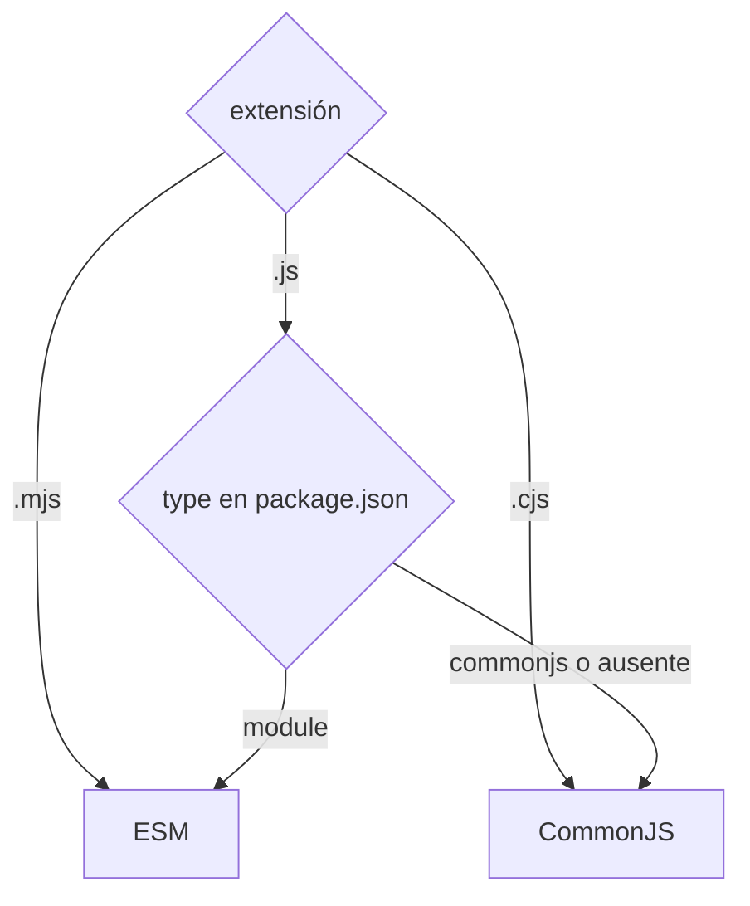
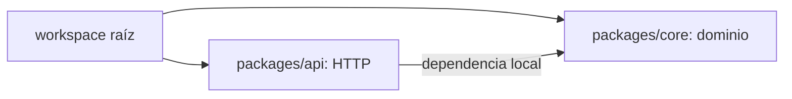
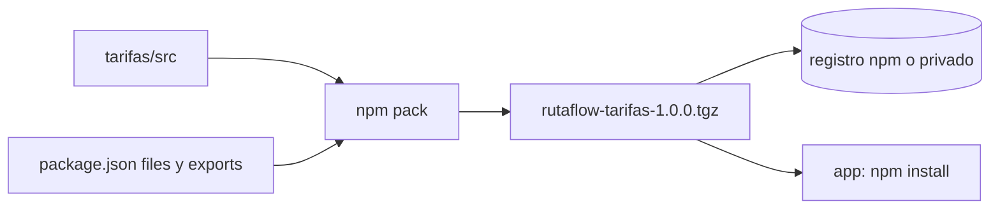

# Módulo 1: Módulos, npm/pnpm y gestión de dependencias


## Aprende construyendo


### Tema 1: package.json y semver · Básico · 45 min

<details open>
<summary><strong>Capa 1 — Lectura</strong></summary>

#### ► DE QUÉ TRATA
Este tema te guía por package.json y semver con foco en comprensión antes de implementación.

#### ► LA IDEA EN UNA FRASE
**Entender package.json y semver te permite tomar mejores decisiones técnicas.**

#### ► POR QUÉ EXISTE ESTO
Resuelve un problema real de diseño o implementación y evita decisiones a ciegas.

#### ► LA ANALOGÍA
Piensa en package.json y semver como una herramienta de taller: útil cuando conoces su propósito y sus límites.
**Dónde se rompe la analogía:** en software, los efectos dependen del contexto, la escala y los trade-offs.

#### ► CÓMO FUNCIONA
1. Identifica el problema que package.json y semver resuelve.
2. Observa sus componentes y relaciones.
3. Aplica la opción más simple que funcione.
4. Verifica el resultado y los límites.

#### ► LO QUE PUEDE SALIR MAL
| Síntoma | Causa probable | Arreglo |
|---|---|---|
| package.json y semver se aplica pero el resultado no mejora | Se usó sin medir el problema real | Mide antes y compara contra la alternativa simple |
| Aparece complejidad inesperada | Se adoptó la técnica sin comprender sus trade-offs | Vuelve a la sección de trade-offs y reduce el alcance |
| Falla en un caso límite | Se asumió un contexto que no se cumple | Prueba el caso límite y documenta cuándo NO usarlo |

#### ► TRADE-OFFS
| Opción | Cuándo usarla | Cuándo NO usarla |
|---|---|---|
| Usar package.json y semver | Cuando el problema coincide con su propósito y el beneficio es observable | Cuando agrega complejidad sin resolver un problema real |
| Alternativa más simple | Cuando el contexto es pequeño, estable o fácil de razonar | Cuando ya demostró no escalar o no cumplir el requisito |
| Postergar la decisión | Cuando falta evidencia del problema | Cuando el costo de esperar es mayor que el costo de probar |

#### ► CUÁNDO NO USAR ESTO
No uses package.json y semver por defecto. Aplícalo cuando el problema lo justifique y puedas verificar el beneficio; si una alternativa más simple resuelve igual, prefiérela.

#### ► DE VUELTA A LA ANALOGÍA
Volviendo a la analogía: package.json y semver funciona como el modelo inicial, pero recuerda dónde se rompe: en producción importan la evidencia, la escala y el costo de equivocarte.

#### ► LO QUE DEBES RECORDAR
- package.json y semver existe para resolver un problema específico.
- Mide antes de adoptar complejidad.
- Conoce el caso donde NO usarlo.
- Verifica con evidencia observable.

#### ► PREGUNTAS PARA PENSAR
1. ¿Qué problema concreto resuelve package.json y semver en tu contexto?
2. ¿Cómo sabrías que package.json y semver no está funcionando bien?
3. ¿Qué alternativa más simple considerarías antes de usar package.json y semver?

</details>

<details>
<summary><strong>Capa 2 — Construcción</strong></summary>

#### Código y verificación
```bash
mkdir ejemplo-package-json
cd ejemplo-package-json
npm init -y
npm install express
npm install --save-dev vitest
npm pkg set type=module engines.node=">=20" scripts.start="node src/main.js" scripts.test="vitest run"
mkdir src
```

```js
import express from "express";

console.log(`Express disponible: ${typeof express === "function"}`);
```

```json
{
  "type": "module",
  "engines": { "node": ">=22" },
  "scripts": {
    "start": "node src/main.js",
    "test": "vitest run"
  },
  "dependencies": { "express": "^5.0.0" },
  "devDependencies": { "vitest": "^3.0.0" }
}
```

```bash
npm pkg get engines scripts dependencies devDependencies
npm outdated
npm start
```

```bash
npm uninstall express
npm install --save-dev express
npm ci --omit=dev
npm start
```

```bash
npm uninstall express
npm install express
npm ci
npm start
```

</details>

### Tema 2: Lockfiles e instalación reproducible · Básico · 45 min

<details open>
<summary><strong>Capa 1 — Lectura</strong></summary>

#### ► DE QUÉ TRATA
Este tema te guía por lockfiles e instalación reproducible con foco en comprensión antes de implementación.

#### ► LA IDEA EN UNA FRASE
**Entender lockfiles e instalación reproducible te permite tomar mejores decisiones técnicas.**

#### ► POR QUÉ EXISTE ESTO
Resuelve un problema real de diseño o implementación y evita decisiones a ciegas.

#### ► LA ANALOGÍA
Piensa en lockfiles e instalación reproducible como una herramienta de taller: útil cuando conoces su propósito y sus límites.
**Dónde se rompe la analogía:** en software, los efectos dependen del contexto, la escala y los trade-offs.

#### ► CÓMO FUNCIONA
1. Identifica el problema que lockfiles e instalación reproducible resuelve.
2. Observa sus componentes y relaciones.
3. Aplica la opción más simple que funcione.
4. Verifica el resultado y los límites.

#### ► LO QUE PUEDE SALIR MAL
| Síntoma | Causa probable | Arreglo |
|---|---|---|
| Lockfiles e instalación reproducible se aplica pero el resultado no mejora | Se usó sin medir el problema real | Mide antes y compara contra la alternativa simple |
| Aparece complejidad inesperada | Se adoptó la técnica sin comprender sus trade-offs | Vuelve a la sección de trade-offs y reduce el alcance |
| Falla en un caso límite | Se asumió un contexto que no se cumple | Prueba el caso límite y documenta cuándo NO usarlo |

#### ► TRADE-OFFS
| Opción | Cuándo usarla | Cuándo NO usarla |
|---|---|---|
| Usar Lockfiles e instalación reproducible | Cuando el problema coincide con su propósito y el beneficio es observable | Cuando agrega complejidad sin resolver un problema real |
| Alternativa más simple | Cuando el contexto es pequeño, estable o fácil de razonar | Cuando ya demostró no escalar o no cumplir el requisito |
| Postergar la decisión | Cuando falta evidencia del problema | Cuando el costo de esperar es mayor que el costo de probar |

#### ► CUÁNDO NO USAR ESTO
No uses lockfiles e instalación reproducible por defecto. Aplícalo cuando el problema lo justifique y puedas verificar el beneficio; si una alternativa más simple resuelve igual, prefiérela.

#### ► DE VUELTA A LA ANALOGÍA
Volviendo a la analogía: lockfiles e instalación reproducible funciona como el modelo inicial, pero recuerda dónde se rompe: en producción importan la evidencia, la escala y el costo de equivocarte.

#### ► LO QUE DEBES RECORDAR
- Lockfiles e instalación reproducible existe para resolver un problema específico.
- Mide antes de adoptar complejidad.
- Conoce el caso donde NO usarlo.
- Verifica con evidencia observable.

#### ► PREGUNTAS PARA PENSAR
1. ¿Qué problema concreto resuelve lockfiles e instalación reproducible en tu contexto?
2. ¿Cómo sabrías que lockfiles e instalación reproducible no está funcionando bien?
3. ¿Qué alternativa más simple considerarías antes de usar lockfiles e instalación reproducible?

</details>

<details>
<summary><strong>Capa 2 — Construcción</strong></summary>

#### Código y verificación
```bash
mkdir ejemplo-lockfile
cd ejemplo-lockfile
npm init -y
npm install express
npm install --save-dev vitest
npm install
npm ls --depth=0
```

```bash
cp package-lock.json package-lock.referencia.json
npm ci
npm ls --depth=0
diff -u package-lock.referencia.json package-lock.json
```

```bash
npm ci
```

```bash
npm install nanoid
npm ci
```

```bash
npm ls --all > arbol-antes.txt
npm ci
npm ls --all > arbol-despues.txt
diff -u arbol-antes.txt arbol-despues.txt
```

```bash
mkdir ../ejemplo-lockfile-produccion
cp package.json package-lock.json ../ejemplo-lockfile-produccion/
cd ../ejemplo-lockfile-produccion
npm ci --omit=dev
npm ls express --depth=0
npm ls vitest --depth=0
```

</details>

### Tema 3: ESM y CommonJS en el mismo proyecto · Básico · 45 min

<details open>
<summary><strong>Capa 1 — Lectura</strong></summary>

#### ► DE QUÉ TRATA
Este tema te guía por esm y commonjs en el mismo proyecto con foco en comprensión antes de implementación.

#### ► LA IDEA EN UNA FRASE
**Entender esm y commonjs en el mismo proyecto te permite tomar mejores decisiones técnicas.**

#### ► POR QUÉ EXISTE ESTO
Resuelve un problema real de diseño o implementación y evita decisiones a ciegas.

#### ► LA ANALOGÍA
Piensa en esm y commonjs en el mismo proyecto como una herramienta de taller: útil cuando conoces su propósito y sus límites.
**Dónde se rompe la analogía:** en software, los efectos dependen del contexto, la escala y los trade-offs.

#### ► CÓMO FUNCIONA


#### ► LO QUE PUEDE SALIR MAL
| Síntoma | Causa probable | Arreglo |
|---|---|---|
| ESM y CommonJS en el mismo proyecto se aplica pero el resultado no mejora | Se usó sin medir el problema real | Mide antes y compara contra la alternativa simple |
| Aparece complejidad inesperada | Se adoptó la técnica sin comprender sus trade-offs | Vuelve a la sección de trade-offs y reduce el alcance |
| Falla en un caso límite | Se asumió un contexto que no se cumple | Prueba el caso límite y documenta cuándo NO usarlo |

#### ► TRADE-OFFS
| Opción | Cuándo usarla | Cuándo NO usarla |
|---|---|---|
| Usar ESM y CommonJS en el mismo proyecto | Cuando el problema coincide con su propósito y el beneficio es observable | Cuando agrega complejidad sin resolver un problema real |
| Alternativa más simple | Cuando el contexto es pequeño, estable o fácil de razonar | Cuando ya demostró no escalar o no cumplir el requisito |
| Postergar la decisión | Cuando falta evidencia del problema | Cuando el costo de esperar es mayor que el costo de probar |

#### ► CUÁNDO NO USAR ESTO
No uses esm y commonjs en el mismo proyecto por defecto. Aplícalo cuando el problema lo justifique y puedas verificar el beneficio; si una alternativa más simple resuelve igual, prefiérela.

#### ► DE VUELTA A LA ANALOGÍA
Volviendo a la analogía: esm y commonjs en el mismo proyecto funciona como el modelo inicial, pero recuerda dónde se rompe: en producción importan la evidencia, la escala y el costo de equivocarte.

#### ► LO QUE DEBES RECORDAR
- ESM y CommonJS en el mismo proyecto existe para resolver un problema específico.
- Mide antes de adoptar complejidad.
- Conoce el caso donde NO usarlo.
- Verifica con evidencia observable.

#### ► PREGUNTAS PARA PENSAR
1. ¿Qué problema concreto resuelve esm y commonjs en el mismo proyecto en tu contexto?
2. ¿Cómo sabrías que esm y commonjs en el mismo proyecto no está funcionando bien?
3. ¿Qué alternativa más simple considerarías antes de usar esm y commonjs en el mismo proyecto?

</details>

<details>
<summary><strong>Capa 2 — Construcción</strong></summary>

#### Código y verificación


```bash
mkdir esm-y-cjs
cd esm-y-cjs
```

```json
{ "name": "mezcla-modulos", "version": "1.0.0", "type": "module" }
```

```javascript
// Módulo CommonJS antiguo: usa require y module.exports
const path = require('node:path');

function nombreReporte(fecha) {
  return path.join(__dirname, `reporte-${fecha}.csv`);
}

module.exports = { nombreReporte, version: '1.4.0' };
```

```javascript
// Módulo ESM moderno: usa export
export const zonas = ['Norte', 'Sur', 'Centro'];
export default function saludo(nombre) {
  return `Hola ${nombre}, tienes ${zonas.length} zonas`;
}
```

```json
{ "ciudad": "Bogotá" }
```

</details>

### Tema 4: Scripts de ciclo de vida · Básico · 45 min

<details open>
<summary><strong>Capa 1 — Lectura</strong></summary>

#### ► DE QUÉ TRATA
Este tema te guía por scripts de ciclo de vida con foco en comprensión antes de implementación.

#### ► LA IDEA EN UNA FRASE
**Entender scripts de ciclo de vida te permite tomar mejores decisiones técnicas.**

#### ► POR QUÉ EXISTE ESTO
Resuelve un problema real de diseño o implementación y evita decisiones a ciegas.

#### ► LA ANALOGÍA
Piensa en scripts de ciclo de vida como una herramienta de taller: útil cuando conoces su propósito y sus límites.
**Dónde se rompe la analogía:** en software, los efectos dependen del contexto, la escala y los trade-offs.

#### ► CÓMO FUNCIONA
1. Identifica el problema que scripts de ciclo de vida resuelve.
2. Observa sus componentes y relaciones.
3. Aplica la opción más simple que funcione.
4. Verifica el resultado y los límites.

#### ► LO QUE PUEDE SALIR MAL
| Síntoma | Causa probable | Arreglo |
|---|---|---|
| Scripts de ciclo de vida se aplica pero el resultado no mejora | Se usó sin medir el problema real | Mide antes y compara contra la alternativa simple |
| Aparece complejidad inesperada | Se adoptó la técnica sin comprender sus trade-offs | Vuelve a la sección de trade-offs y reduce el alcance |
| Falla en un caso límite | Se asumió un contexto que no se cumple | Prueba el caso límite y documenta cuándo NO usarlo |

#### ► TRADE-OFFS
| Opción | Cuándo usarla | Cuándo NO usarla |
|---|---|---|
| Usar Scripts de ciclo de vida | Cuando el problema coincide con su propósito y el beneficio es observable | Cuando agrega complejidad sin resolver un problema real |
| Alternativa más simple | Cuando el contexto es pequeño, estable o fácil de razonar | Cuando ya demostró no escalar o no cumplir el requisito |
| Postergar la decisión | Cuando falta evidencia del problema | Cuando el costo de esperar es mayor que el costo de probar |

#### ► CUÁNDO NO USAR ESTO
No uses scripts de ciclo de vida por defecto. Aplícalo cuando el problema lo justifique y puedas verificar el beneficio; si una alternativa más simple resuelve igual, prefiérela.

#### ► DE VUELTA A LA ANALOGÍA
Volviendo a la analogía: scripts de ciclo de vida funciona como el modelo inicial, pero recuerda dónde se rompe: en producción importan la evidencia, la escala y el costo de equivocarte.

#### ► LO QUE DEBES RECORDAR
- Scripts de ciclo de vida existe para resolver un problema específico.
- Mide antes de adoptar complejidad.
- Conoce el caso donde NO usarlo.
- Verifica con evidencia observable.

#### ► PREGUNTAS PARA PENSAR
1. ¿Qué problema concreto resuelve scripts de ciclo de vida en tu contexto?
2. ¿Cómo sabrías que scripts de ciclo de vida no está funcionando bien?
3. ¿Qué alternativa más simple considerarías antes de usar scripts de ciclo de vida?

</details>

<details>
<summary><strong>Capa 2 — Construcción</strong></summary>

#### Código y verificación
```bash
mkdir ejemplo-hooks-npm
cd ejemplo-hooks-npm
npm init -y
mkdir scripts
```

```js
const major = Number(process.versions.node.split(".")[0]);

if (major < 20) {
  console.error(`Node ${process.version} no es compatible; usa Node 22 o superior`);
  process.exitCode = 1;
} else {
  console.log(`Node compatible: ${process.version}`);
}
```

```json
{
  "scripts": {
    "preinstall": "node scripts/verificar-node.js",
    "generate": "node -e \"console.log('Artefactos reproducibles generados')\"",
    "prepare": "npm run generate"
  }
}
```

```bash
npm install --foreground-scripts
```

```bash
mkdir ../ejemplo-hooks-sin-scripts
cp package.json package-lock.json ../ejemplo-hooks-sin-scripts/
cp -R scripts ../ejemplo-hooks-sin-scripts/
cd ../ejemplo-hooks-sin-scripts
npm ci --ignore-scripts
npm run generate
cd ../ejemplo-hooks-npm
```

</details>

### Tema 5: Workspaces — monorepos con npm/pnpm · Básico · 45 min

<details open>
<summary><strong>Capa 1 — Lectura</strong></summary>

#### ► DE QUÉ TRATA
Este tema te guía por workspaces — monorepos con npm/pnpm con foco en comprensión antes de implementación.

#### ► LA IDEA EN UNA FRASE
**Entender workspaces — monorepos con npm/pnpm te permite tomar mejores decisiones técnicas.**

#### ► POR QUÉ EXISTE ESTO
Resuelve un problema real de diseño o implementación y evita decisiones a ciegas.

#### ► LA ANALOGÍA
Piensa en workspaces — monorepos con npm/pnpm como una herramienta de taller: útil cuando conoces su propósito y sus límites.
**Dónde se rompe la analogía:** en software, los efectos dependen del contexto, la escala y los trade-offs.

#### ► CÓMO FUNCIONA


#### ► LO QUE PUEDE SALIR MAL
| Síntoma | Causa probable | Arreglo |
|---|---|---|
| Workspaces — monorepos con npm/pnpm se aplica pero el resultado no mejora | Se usó sin medir el problema real | Mide antes y compara contra la alternativa simple |
| Aparece complejidad inesperada | Se adoptó la técnica sin comprender sus trade-offs | Vuelve a la sección de trade-offs y reduce el alcance |
| Falla en un caso límite | Se asumió un contexto que no se cumple | Prueba el caso límite y documenta cuándo NO usarlo |

#### ► TRADE-OFFS
| Opción | Cuándo usarla | Cuándo NO usarla |
|---|---|---|
| Usar Workspaces — monorepos con npm/pnpm | Cuando el problema coincide con su propósito y el beneficio es observable | Cuando agrega complejidad sin resolver un problema real |
| Alternativa más simple | Cuando el contexto es pequeño, estable o fácil de razonar | Cuando ya demostró no escalar o no cumplir el requisito |
| Postergar la decisión | Cuando falta evidencia del problema | Cuando el costo de esperar es mayor que el costo de probar |

#### ► CUÁNDO NO USAR ESTO
No uses workspaces — monorepos con npm/pnpm por defecto. Aplícalo cuando el problema lo justifique y puedas verificar el beneficio; si una alternativa más simple resuelve igual, prefiérela.

#### ► DE VUELTA A LA ANALOGÍA
Volviendo a la analogía: workspaces — monorepos con npm/pnpm funciona como el modelo inicial, pero recuerda dónde se rompe: en producción importan la evidencia, la escala y el costo de equivocarte.

#### ► LO QUE DEBES RECORDAR
- Workspaces — monorepos con npm/pnpm existe para resolver un problema específico.
- Mide antes de adoptar complejidad.
- Conoce el caso donde NO usarlo.
- Verifica con evidencia observable.

#### ► PREGUNTAS PARA PENSAR
1. ¿Qué problema concreto resuelve workspaces — monorepos con npm/pnpm en tu contexto?
2. ¿Cómo sabrías que workspaces — monorepos con npm/pnpm no está funcionando bien?
3. ¿Qué alternativa más simple considerarías antes de usar workspaces — monorepos con npm/pnpm?

</details>

<details>
<summary><strong>Capa 2 — Construcción</strong></summary>

#### Código y verificación


```bash
mkdir ejemplo-workspaces
cd ejemplo-workspaces
npm init -y
mkdir -p packages/core/src packages/api/src
```

```json
{
  "private": true,
  "workspaces": ["packages/*"]
}
```

```json
{
  "name": "@academia/core",
  "version": "1.0.0",
  "type": "module",
  "exports": "./src/index.js"
}
```

```js
export function crearGuia(numero) {
  const guia = String(numero).trim().toUpperCase();
  if (!/^RF-\d{3,}$/.test(guia)) {
    throw new Error("La guía debe tener formato RF- seguido de al menos 3 dígitos");
  }
  return Object.freeze({ numero: guia, estado: "creada" });
}
```

```json
{
  "name": "@academia/api",
  "version": "1.0.0",
  "type": "module",
  "scripts": { "start": "node src/main.js" },
  "dependencies": { "@academia/core": "1.0.0" }
}
```

</details>

### Tema 6: Publicar y versionar un paquete npm (público o privado) · Básico · 45 min

<details open>
<summary><strong>Capa 1 — Lectura</strong></summary>

#### ► DE QUÉ TRATA
Este tema te guía por publicar y versionar un paquete npm (público o privado) con foco en comprensión antes de implementación.

#### ► LA IDEA EN UNA FRASE
**Entender publicar y versionar un paquete npm (público o privado) te permite tomar mejores decisiones técnicas.**

#### ► POR QUÉ EXISTE ESTO
Resuelve un problema real de diseño o implementación y evita decisiones a ciegas.

#### ► LA ANALOGÍA
Piensa en publicar y versionar un paquete npm (público o privado) como una herramienta de taller: útil cuando conoces su propósito y sus límites.
**Dónde se rompe la analogía:** en software, los efectos dependen del contexto, la escala y los trade-offs.

#### ► CÓMO FUNCIONA


#### ► LO QUE PUEDE SALIR MAL
| Síntoma | Causa probable | Arreglo |
|---|---|---|
| Publicar y versionar un paquete npm (público o privado) se aplica pero el resultado no mejora | Se usó sin medir el problema real | Mide antes y compara contra la alternativa simple |
| Aparece complejidad inesperada | Se adoptó la técnica sin comprender sus trade-offs | Vuelve a la sección de trade-offs y reduce el alcance |
| Falla en un caso límite | Se asumió un contexto que no se cumple | Prueba el caso límite y documenta cuándo NO usarlo |

#### ► TRADE-OFFS
| Opción | Cuándo usarla | Cuándo NO usarla |
|---|---|---|
| Usar Publicar y versionar un paquete npm (público o privado) | Cuando el problema coincide con su propósito y el beneficio es observable | Cuando agrega complejidad sin resolver un problema real |
| Alternativa más simple | Cuando el contexto es pequeño, estable o fácil de razonar | Cuando ya demostró no escalar o no cumplir el requisito |
| Postergar la decisión | Cuando falta evidencia del problema | Cuando el costo de esperar es mayor que el costo de probar |

#### ► CUÁNDO NO USAR ESTO
No uses publicar y versionar un paquete npm (público o privado) por defecto. Aplícalo cuando el problema lo justifique y puedas verificar el beneficio; si una alternativa más simple resuelve igual, prefiérela.

#### ► DE VUELTA A LA ANALOGÍA
Volviendo a la analogía: publicar y versionar un paquete npm (público o privado) funciona como el modelo inicial, pero recuerda dónde se rompe: en producción importan la evidencia, la escala y el costo de equivocarte.

#### ► LO QUE DEBES RECORDAR
- Publicar y versionar un paquete npm (público o privado) existe para resolver un problema específico.
- Mide antes de adoptar complejidad.
- Conoce el caso donde NO usarlo.
- Verifica con evidencia observable.

#### ► PREGUNTAS PARA PENSAR
1. ¿Qué problema concreto resuelve publicar y versionar un paquete npm (público o privado) en tu contexto?
2. ¿Cómo sabrías que publicar y versionar un paquete npm (público o privado) no está funcionando bien?
3. ¿Qué alternativa más simple considerarías antes de usar publicar y versionar un paquete npm (público o privado)?

</details>

<details>
<summary><strong>Capa 2 — Construcción</strong></summary>

#### Código y verificación


```bash
mkdir paquete-npm
cd paquete-npm
mkdir -p tarifas/src app
```

```json
{
  "name": "@rutaflow/tarifas",
  "version": "1.0.0",
  "description": "Cálculo de tarifas de envío de RutaFlow",
  "type": "module",
  "exports": {
    ".": "./src/index.js"
  },
  "files": ["src"],
  "engines": { "node": ">=22" },
  "license": "MIT"
}
```

```javascript
const BASE = { Bogotá: 5000, Medellín: 7000 };

export function cotizar(ciudad, kilos) {
  if (!(ciudad in BASE)) throw new Error(`Sin cobertura en ${ciudad}`);
  if (kilos <= 0) throw new RangeError('kilos debe ser positivo');
  return BASE[ciudad] + Math.ceil(kilos) * 1200;
}
```

```json
{
  "name": "app-cotizador",
  "version": "0.0.0",
  "private": true,
  "type": "module",
  "dependencies": {
    "@rutaflow/tarifas": "file:../tarifas/rutaflow-tarifas-1.0.0.tgz"
  }
}
```

```javascript
import { cotizar } from '@rutaflow/tarifas';

console.log('Bogotá 2.5 kg =', cotizar('Bogotá', 2.5));
console.log('Medellín 1 kg =', cotizar('Medellín', 1));
```

</details>

### 1. Inicializa el workspace y sus hooks

<details open>
<summary><strong>Capa 1 — Lectura</strong></summary>

#### ► DE QUÉ TRATA
Este tema te guía por 1. inicializa el workspace y sus hooks con foco en comprensión antes de implementación.

#### ► LA IDEA EN UNA FRASE
**Entender 1. inicializa el workspace y sus hooks te permite tomar mejores decisiones técnicas.**

#### ► POR QUÉ EXISTE ESTO
Resuelve un problema real de diseño o implementación y evita decisiones a ciegas.

#### ► LA ANALOGÍA
Piensa en 1. inicializa el workspace y sus hooks como una herramienta de taller: útil cuando conoces su propósito y sus límites.
**Dónde se rompe la analogía:** en software, los efectos dependen del contexto, la escala y los trade-offs.

#### ► CÓMO FUNCIONA
1. Identifica el problema que 1. inicializa el workspace y sus hooks resuelve.
2. Observa sus componentes y relaciones.
3. Aplica la opción más simple que funcione.
4. Verifica el resultado y los límites.

#### ► LO QUE PUEDE SALIR MAL
| Síntoma | Causa probable | Arreglo |
|---|---|---|
| 1. Inicializa el workspace y sus hooks se aplica pero el resultado no mejora | Se usó sin medir el problema real | Mide antes y compara contra la alternativa simple |
| Aparece complejidad inesperada | Se adoptó la técnica sin comprender sus trade-offs | Vuelve a la sección de trade-offs y reduce el alcance |
| Falla en un caso límite | Se asumió un contexto que no se cumple | Prueba el caso límite y documenta cuándo NO usarlo |

#### ► TRADE-OFFS
| Opción | Cuándo usarla | Cuándo NO usarla |
|---|---|---|
| Usar 1. Inicializa el workspace y sus hooks | Cuando el problema coincide con su propósito y el beneficio es observable | Cuando agrega complejidad sin resolver un problema real |
| Alternativa más simple | Cuando el contexto es pequeño, estable o fácil de razonar | Cuando ya demostró no escalar o no cumplir el requisito |
| Postergar la decisión | Cuando falta evidencia del problema | Cuando el costo de esperar es mayor que el costo de probar |

#### ► CUÁNDO NO USAR ESTO
No uses 1. inicializa el workspace y sus hooks por defecto. Aplícalo cuando el problema lo justifique y puedas verificar el beneficio; si una alternativa más simple resuelve igual, prefiérela.

#### ► DE VUELTA A LA ANALOGÍA
Volviendo a la analogía: 1. inicializa el workspace y sus hooks funciona como el modelo inicial, pero recuerda dónde se rompe: en producción importan la evidencia, la escala y el costo de equivocarte.

#### ► LO QUE DEBES RECORDAR
- 1. Inicializa el workspace y sus hooks existe para resolver un problema específico.
- Mide antes de adoptar complejidad.
- Conoce el caso donde NO usarlo.
- Verifica con evidencia observable.

#### ► PREGUNTAS PARA PENSAR
1. ¿Qué problema concreto resuelve 1. inicializa el workspace y sus hooks en tu contexto?
2. ¿Cómo sabrías que 1. inicializa el workspace y sus hooks no está funcionando bien?
3. ¿Qué alternativa más simple considerarías antes de usar 1. inicializa el workspace y sus hooks?

</details>

<details>
<summary><strong>Capa 2 — Construcción</strong></summary>

#### Código y verificación
```bash
mkdir proyecto-modulo-1
cd proyecto-modulo-1
mkdir -p packages/core/src packages/api/src scripts
npm init -y
```

```js
const major = Number(process.versions.node.split(".")[0]);

if (major < 22) {
  console.error(`Node ${process.version} no es compatible; usa Node 22 o superior`);
  process.exitCode = 1;
} else {
  console.log(`Node compatible: ${process.version}`);
}
```

```json
{
  "name": "api-operativa-entregas",
  "version": "1.0.0",
  "private": true,
  "workspaces": ["packages/*"],
  "engines": { "node": ">=22.12" },
  "scripts": {
    "preinstall": "node scripts/verificar-node.js",
    "postinstall": "node -e \"console.log('Dependencias listas')\"",
    "generate": "node -e \"console.log('Artefactos reproducibles generados')\"",
    "prepare": "npm run generate",
    "check": "npm run check --workspaces"
  }
}
```

</details>

### 2. Crea el dominio compartido

<details open>
<summary><strong>Capa 1 — Lectura</strong></summary>

#### ► DE QUÉ TRATA
Este tema te guía por 2. crea el dominio compartido con foco en comprensión antes de implementación.

#### ► LA IDEA EN UNA FRASE
**Entender 2. crea el dominio compartido te permite tomar mejores decisiones técnicas.**

#### ► POR QUÉ EXISTE ESTO
Resuelve un problema real de diseño o implementación y evita decisiones a ciegas.

#### ► LA ANALOGÍA
Piensa en 2. crea el dominio compartido como una herramienta de taller: útil cuando conoces su propósito y sus límites.
**Dónde se rompe la analogía:** en software, los efectos dependen del contexto, la escala y los trade-offs.

#### ► CÓMO FUNCIONA
1. Identifica el problema que 2. crea el dominio compartido resuelve.
2. Observa sus componentes y relaciones.
3. Aplica la opción más simple que funcione.
4. Verifica el resultado y los límites.

#### ► LO QUE PUEDE SALIR MAL
| Síntoma | Causa probable | Arreglo |
|---|---|---|
| 2. Crea el dominio compartido se aplica pero el resultado no mejora | Se usó sin medir el problema real | Mide antes y compara contra la alternativa simple |
| Aparece complejidad inesperada | Se adoptó la técnica sin comprender sus trade-offs | Vuelve a la sección de trade-offs y reduce el alcance |
| Falla en un caso límite | Se asumió un contexto que no se cumple | Prueba el caso límite y documenta cuándo NO usarlo |

#### ► TRADE-OFFS
| Opción | Cuándo usarla | Cuándo NO usarla |
|---|---|---|
| Usar 2. Crea el dominio compartido | Cuando el problema coincide con su propósito y el beneficio es observable | Cuando agrega complejidad sin resolver un problema real |
| Alternativa más simple | Cuando el contexto es pequeño, estable o fácil de razonar | Cuando ya demostró no escalar o no cumplir el requisito |
| Postergar la decisión | Cuando falta evidencia del problema | Cuando el costo de esperar es mayor que el costo de probar |

#### ► CUÁNDO NO USAR ESTO
No uses 2. crea el dominio compartido por defecto. Aplícalo cuando el problema lo justifique y puedas verificar el beneficio; si una alternativa más simple resuelve igual, prefiérela.

#### ► DE VUELTA A LA ANALOGÍA
Volviendo a la analogía: 2. crea el dominio compartido funciona como el modelo inicial, pero recuerda dónde se rompe: en producción importan la evidencia, la escala y el costo de equivocarte.

#### ► LO QUE DEBES RECORDAR
- 2. Crea el dominio compartido existe para resolver un problema específico.
- Mide antes de adoptar complejidad.
- Conoce el caso donde NO usarlo.
- Verifica con evidencia observable.

#### ► PREGUNTAS PARA PENSAR
1. ¿Qué problema concreto resuelve 2. crea el dominio compartido en tu contexto?
2. ¿Cómo sabrías que 2. crea el dominio compartido no está funcionando bien?
3. ¿Qué alternativa más simple considerarías antes de usar 2. crea el dominio compartido?

</details>

<details>
<summary><strong>Capa 2 — Construcción</strong></summary>

#### Código y verificación
```json
{
  "name": "@academia/core",
  "version": "1.0.0",
  "type": "module",
  "exports": "./src/index.js",
  "scripts": {
    "check": "node --check src/index.js"
  }
}
```

```js
export function crearGuia(numero) {
  const guia = String(numero).trim().toUpperCase();
  if (!/^RF-\d{3,}$/.test(guia)) {
    throw new Error("La guía debe tener formato RF- seguido de al menos 3 dígitos");
  }
  return Object.freeze({ numero: guia, estado: "creada" });
}
```

</details>

### 3. Crea la API consumidora y clasifica dependencias

<details open>
<summary><strong>Capa 1 — Lectura</strong></summary>

#### ► DE QUÉ TRATA
Este tema te guía por 3. crea la api consumidora y clasifica dependencias con foco en comprensión antes de implementación.

#### ► LA IDEA EN UNA FRASE
**Entender 3. crea la api consumidora y clasifica dependencias te permite tomar mejores decisiones técnicas.**

#### ► POR QUÉ EXISTE ESTO
Resuelve un problema real de diseño o implementación y evita decisiones a ciegas.

#### ► LA ANALOGÍA
Piensa en 3. crea la api consumidora y clasifica dependencias como una herramienta de taller: útil cuando conoces su propósito y sus límites.
**Dónde se rompe la analogía:** en software, los efectos dependen del contexto, la escala y los trade-offs.

#### ► CÓMO FUNCIONA
1. Identifica el problema que 3. crea la api consumidora y clasifica dependencias resuelve.
2. Observa sus componentes y relaciones.
3. Aplica la opción más simple que funcione.
4. Verifica el resultado y los límites.

#### ► LO QUE PUEDE SALIR MAL
| Síntoma | Causa probable | Arreglo |
|---|---|---|
| 3. Crea la API consumidora y clasifica dependencias se aplica pero el resultado no mejora | Se usó sin medir el problema real | Mide antes y compara contra la alternativa simple |
| Aparece complejidad inesperada | Se adoptó la técnica sin comprender sus trade-offs | Vuelve a la sección de trade-offs y reduce el alcance |
| Falla en un caso límite | Se asumió un contexto que no se cumple | Prueba el caso límite y documenta cuándo NO usarlo |

#### ► TRADE-OFFS
| Opción | Cuándo usarla | Cuándo NO usarla |
|---|---|---|
| Usar 3. Crea la API consumidora y clasifica dependencias | Cuando el problema coincide con su propósito y el beneficio es observable | Cuando agrega complejidad sin resolver un problema real |
| Alternativa más simple | Cuando el contexto es pequeño, estable o fácil de razonar | Cuando ya demostró no escalar o no cumplir el requisito |
| Postergar la decisión | Cuando falta evidencia del problema | Cuando el costo de esperar es mayor que el costo de probar |

#### ► CUÁNDO NO USAR ESTO
No uses 3. crea la api consumidora y clasifica dependencias por defecto. Aplícalo cuando el problema lo justifique y puedas verificar el beneficio; si una alternativa más simple resuelve igual, prefiérela.

#### ► DE VUELTA A LA ANALOGÍA
Volviendo a la analogía: 3. crea la api consumidora y clasifica dependencias funciona como el modelo inicial, pero recuerda dónde se rompe: en producción importan la evidencia, la escala y el costo de equivocarte.

#### ► LO QUE DEBES RECORDAR
- 3. Crea la API consumidora y clasifica dependencias existe para resolver un problema específico.
- Mide antes de adoptar complejidad.
- Conoce el caso donde NO usarlo.
- Verifica con evidencia observable.

#### ► PREGUNTAS PARA PENSAR
1. ¿Qué problema concreto resuelve 3. crea la api consumidora y clasifica dependencias en tu contexto?
2. ¿Cómo sabrías que 3. crea la api consumidora y clasifica dependencias no está funcionando bien?
3. ¿Qué alternativa más simple considerarías antes de usar 3. crea la api consumidora y clasifica dependencias?

</details>

<details>
<summary><strong>Capa 2 — Construcción</strong></summary>

#### Código y verificación
```json
{
  "name": "@academia/api",
  "version": "1.0.0",
  "type": "module",
  "scripts": {
    "start": "node src/main.js",
    "check": "node --check src/main.js"
  },
  "dependencies": {
    "@academia/core": "1.0.0"
  }
}
```

```js
import { crearGuia } from "@academia/core";

console.log("Guía creada desde workspace:", crearGuia("rf-100"));
```

```bash
npm install express --workspace @academia/api --foreground-scripts
npm install --save-dev vitest --workspace @academia/api --foreground-scripts
npm pkg get dependencies devDependencies --workspace @academia/api
```

</details>

### 4. Comprueba el enlace y modifica un rango

<details open>
<summary><strong>Capa 1 — Lectura</strong></summary>

#### ► DE QUÉ TRATA
Este tema te guía por 4. comprueba el enlace y modifica un rango con foco en comprensión antes de implementación.

#### ► LA IDEA EN UNA FRASE
**Entender 4. comprueba el enlace y modifica un rango te permite tomar mejores decisiones técnicas.**

#### ► POR QUÉ EXISTE ESTO
Resuelve un problema real de diseño o implementación y evita decisiones a ciegas.

#### ► LA ANALOGÍA
Piensa en 4. comprueba el enlace y modifica un rango como una herramienta de taller: útil cuando conoces su propósito y sus límites.
**Dónde se rompe la analogía:** en software, los efectos dependen del contexto, la escala y los trade-offs.

#### ► CÓMO FUNCIONA
1. Identifica el problema que 4. comprueba el enlace y modifica un rango resuelve.
2. Observa sus componentes y relaciones.
3. Aplica la opción más simple que funcione.
4. Verifica el resultado y los límites.

#### ► LO QUE PUEDE SALIR MAL
| Síntoma | Causa probable | Arreglo |
|---|---|---|
| 4. Comprueba el enlace y modifica un rango se aplica pero el resultado no mejora | Se usó sin medir el problema real | Mide antes y compara contra la alternativa simple |
| Aparece complejidad inesperada | Se adoptó la técnica sin comprender sus trade-offs | Vuelve a la sección de trade-offs y reduce el alcance |
| Falla en un caso límite | Se asumió un contexto que no se cumple | Prueba el caso límite y documenta cuándo NO usarlo |

#### ► TRADE-OFFS
| Opción | Cuándo usarla | Cuándo NO usarla |
|---|---|---|
| Usar 4. Comprueba el enlace y modifica un rango | Cuando el problema coincide con su propósito y el beneficio es observable | Cuando agrega complejidad sin resolver un problema real |
| Alternativa más simple | Cuando el contexto es pequeño, estable o fácil de razonar | Cuando ya demostró no escalar o no cumplir el requisito |
| Postergar la decisión | Cuando falta evidencia del problema | Cuando el costo de esperar es mayor que el costo de probar |

#### ► CUÁNDO NO USAR ESTO
No uses 4. comprueba el enlace y modifica un rango por defecto. Aplícalo cuando el problema lo justifique y puedas verificar el beneficio; si una alternativa más simple resuelve igual, prefiérela.

#### ► DE VUELTA A LA ANALOGÍA
Volviendo a la analogía: 4. comprueba el enlace y modifica un rango funciona como el modelo inicial, pero recuerda dónde se rompe: en producción importan la evidencia, la escala y el costo de equivocarte.

#### ► LO QUE DEBES RECORDAR
- 4. Comprueba el enlace y modifica un rango existe para resolver un problema específico.
- Mide antes de adoptar complejidad.
- Conoce el caso donde NO usarlo.
- Verifica con evidencia observable.

#### ► PREGUNTAS PARA PENSAR
1. ¿Qué problema concreto resuelve 4. comprueba el enlace y modifica un rango en tu contexto?
2. ¿Cómo sabrías que 4. comprueba el enlace y modifica un rango no está funcionando bien?
3. ¿Qué alternativa más simple considerarías antes de usar 4. comprueba el enlace y modifica un rango?

</details>

<details>
<summary><strong>Capa 2 — Construcción</strong></summary>

#### Código y verificación
```bash
npm run check
npm run start --workspace @academia/api
```

```bash
npm install express --workspace @academia/api
```

</details>

### 5. Verifica la instalación reproducible

<details open>
<summary><strong>Capa 1 — Lectura</strong></summary>

#### ► DE QUÉ TRATA
Este tema te guía por 5. verifica la instalación reproducible con foco en comprensión antes de implementación.

#### ► LA IDEA EN UNA FRASE
**Entender 5. verifica la instalación reproducible te permite tomar mejores decisiones técnicas.**

#### ► POR QUÉ EXISTE ESTO
Resuelve un problema real de diseño o implementación y evita decisiones a ciegas.

#### ► LA ANALOGÍA
Piensa en 5. verifica la instalación reproducible como una herramienta de taller: útil cuando conoces su propósito y sus límites.
**Dónde se rompe la analogía:** en software, los efectos dependen del contexto, la escala y los trade-offs.

#### ► CÓMO FUNCIONA
1. Identifica el problema que 5. verifica la instalación reproducible resuelve.
2. Observa sus componentes y relaciones.
3. Aplica la opción más simple que funcione.
4. Verifica el resultado y los límites.

#### ► LO QUE PUEDE SALIR MAL
| Síntoma | Causa probable | Arreglo |
|---|---|---|
| 5. Verifica la instalación reproducible se aplica pero el resultado no mejora | Se usó sin medir el problema real | Mide antes y compara contra la alternativa simple |
| Aparece complejidad inesperada | Se adoptó la técnica sin comprender sus trade-offs | Vuelve a la sección de trade-offs y reduce el alcance |
| Falla en un caso límite | Se asumió un contexto que no se cumple | Prueba el caso límite y documenta cuándo NO usarlo |

#### ► TRADE-OFFS
| Opción | Cuándo usarla | Cuándo NO usarla |
|---|---|---|
| Usar 5. Verifica la instalación reproducible | Cuando el problema coincide con su propósito y el beneficio es observable | Cuando agrega complejidad sin resolver un problema real |
| Alternativa más simple | Cuando el contexto es pequeño, estable o fácil de razonar | Cuando ya demostró no escalar o no cumplir el requisito |
| Postergar la decisión | Cuando falta evidencia del problema | Cuando el costo de esperar es mayor que el costo de probar |

#### ► CUÁNDO NO USAR ESTO
No uses 5. verifica la instalación reproducible por defecto. Aplícalo cuando el problema lo justifique y puedas verificar el beneficio; si una alternativa más simple resuelve igual, prefiérela.

#### ► DE VUELTA A LA ANALOGÍA
Volviendo a la analogía: 5. verifica la instalación reproducible funciona como el modelo inicial, pero recuerda dónde se rompe: en producción importan la evidencia, la escala y el costo de equivocarte.

#### ► LO QUE DEBES RECORDAR
- 5. Verifica la instalación reproducible existe para resolver un problema específico.
- Mide antes de adoptar complejidad.
- Conoce el caso donde NO usarlo.
- Verifica con evidencia observable.

#### ► PREGUNTAS PARA PENSAR
1. ¿Qué problema concreto resuelve 5. verifica la instalación reproducible en tu contexto?
2. ¿Cómo sabrías que 5. verifica la instalación reproducible no está funcionando bien?
3. ¿Qué alternativa más simple considerarías antes de usar 5. verifica la instalación reproducible?

</details>

<details>
<summary><strong>Capa 2 — Construcción</strong></summary>

#### Código y verificación
```bash
cp package-lock.json package-lock.referencia.json
npm ci
diff -u package-lock.referencia.json package-lock.json
```

</details>

### 6. Comprueba el límite de los scripts automáticos

<details open>
<summary><strong>Capa 1 — Lectura</strong></summary>

#### ► DE QUÉ TRATA
Este tema te guía por 6. comprueba el límite de los scripts automáticos con foco en comprensión antes de implementación.

#### ► LA IDEA EN UNA FRASE
**Entender 6. comprueba el límite de los scripts automáticos te permite tomar mejores decisiones técnicas.**

#### ► POR QUÉ EXISTE ESTO
Resuelve un problema real de diseño o implementación y evita decisiones a ciegas.

#### ► LA ANALOGÍA
Piensa en 6. comprueba el límite de los scripts automáticos como una herramienta de taller: útil cuando conoces su propósito y sus límites.
**Dónde se rompe la analogía:** en software, los efectos dependen del contexto, la escala y los trade-offs.

#### ► CÓMO FUNCIONA
1. Identifica el problema que 6. comprueba el límite de los scripts automáticos resuelve.
2. Observa sus componentes y relaciones.
3. Aplica la opción más simple que funcione.
4. Verifica el resultado y los límites.

#### ► LO QUE PUEDE SALIR MAL
| Síntoma | Causa probable | Arreglo |
|---|---|---|
| 6. Comprueba el límite de los scripts automáticos se aplica pero el resultado no mejora | Se usó sin medir el problema real | Mide antes y compara contra la alternativa simple |
| Aparece complejidad inesperada | Se adoptó la técnica sin comprender sus trade-offs | Vuelve a la sección de trade-offs y reduce el alcance |
| Falla en un caso límite | Se asumió un contexto que no se cumple | Prueba el caso límite y documenta cuándo NO usarlo |

#### ► TRADE-OFFS
| Opción | Cuándo usarla | Cuándo NO usarla |
|---|---|---|
| Usar 6. Comprueba el límite de los scripts automáticos | Cuando el problema coincide con su propósito y el beneficio es observable | Cuando agrega complejidad sin resolver un problema real |
| Alternativa más simple | Cuando el contexto es pequeño, estable o fácil de razonar | Cuando ya demostró no escalar o no cumplir el requisito |
| Postergar la decisión | Cuando falta evidencia del problema | Cuando el costo de esperar es mayor que el costo de probar |

#### ► CUÁNDO NO USAR ESTO
No uses 6. comprueba el límite de los scripts automáticos por defecto. Aplícalo cuando el problema lo justifique y puedas verificar el beneficio; si una alternativa más simple resuelve igual, prefiérela.

#### ► DE VUELTA A LA ANALOGÍA
Volviendo a la analogía: 6. comprueba el límite de los scripts automáticos funciona como el modelo inicial, pero recuerda dónde se rompe: en producción importan la evidencia, la escala y el costo de equivocarte.

#### ► LO QUE DEBES RECORDAR
- 6. Comprueba el límite de los scripts automáticos existe para resolver un problema específico.
- Mide antes de adoptar complejidad.
- Conoce el caso donde NO usarlo.
- Verifica con evidencia observable.

#### ► PREGUNTAS PARA PENSAR
1. ¿Qué problema concreto resuelve 6. comprueba el límite de los scripts automáticos en tu contexto?
2. ¿Cómo sabrías que 6. comprueba el límite de los scripts automáticos no está funcionando bien?
3. ¿Qué alternativa más simple considerarías antes de usar 6. comprueba el límite de los scripts automáticos?

</details>

<details>
<summary><strong>Capa 2 — Construcción</strong></summary>

#### Código y verificación
```bash
npm ci --ignore-scripts
npm run generate
npm run start --workspace @academia/api
```

</details>

### Verificación y entrega

<details open>
<summary><strong>Capa 1 — Lectura</strong></summary>

#### ► DE QUÉ TRATA
Este tema te guía por verificación y entrega con foco en comprensión antes de implementación.

#### ► LA IDEA EN UNA FRASE
**Entender verificación y entrega te permite tomar mejores decisiones técnicas.**

#### ► POR QUÉ EXISTE ESTO
Resuelve un problema real de diseño o implementación y evita decisiones a ciegas.

#### ► LA ANALOGÍA
Piensa en verificación y entrega como una herramienta de taller: útil cuando conoces su propósito y sus límites.
**Dónde se rompe la analogía:** en software, los efectos dependen del contexto, la escala y los trade-offs.

#### ► CÓMO FUNCIONA
1. Identifica el problema que verificación y entrega resuelve.
2. Observa sus componentes y relaciones.
3. Aplica la opción más simple que funcione.
4. Verifica el resultado y los límites.

#### ► LO QUE PUEDE SALIR MAL
| Síntoma | Causa probable | Arreglo |
|---|---|---|
| Verificación y entrega se aplica pero el resultado no mejora | Se usó sin medir el problema real | Mide antes y compara contra la alternativa simple |
| Aparece complejidad inesperada | Se adoptó la técnica sin comprender sus trade-offs | Vuelve a la sección de trade-offs y reduce el alcance |
| Falla en un caso límite | Se asumió un contexto que no se cumple | Prueba el caso límite y documenta cuándo NO usarlo |

#### ► TRADE-OFFS
| Opción | Cuándo usarla | Cuándo NO usarla |
|---|---|---|
| Usar Verificación y entrega | Cuando el problema coincide con su propósito y el beneficio es observable | Cuando agrega complejidad sin resolver un problema real |
| Alternativa más simple | Cuando el contexto es pequeño, estable o fácil de razonar | Cuando ya demostró no escalar o no cumplir el requisito |
| Postergar la decisión | Cuando falta evidencia del problema | Cuando el costo de esperar es mayor que el costo de probar |

#### ► CUÁNDO NO USAR ESTO
No uses verificación y entrega por defecto. Aplícalo cuando el problema lo justifique y puedas verificar el beneficio; si una alternativa más simple resuelve igual, prefiérela.

#### ► DE VUELTA A LA ANALOGÍA
Volviendo a la analogía: verificación y entrega funciona como el modelo inicial, pero recuerda dónde se rompe: en producción importan la evidencia, la escala y el costo de equivocarte.

#### ► LO QUE DEBES RECORDAR
- Verificación y entrega existe para resolver un problema específico.
- Mide antes de adoptar complejidad.
- Conoce el caso donde NO usarlo.
- Verifica con evidencia observable.

#### ► PREGUNTAS PARA PENSAR
1. ¿Qué problema concreto resuelve verificación y entrega en tu contexto?
2. ¿Cómo sabrías que verificación y entrega no está funcionando bien?
3. ¿Qué alternativa más simple considerarías antes de usar verificación y entrega?

</details>

<details>
<summary><strong>Capa 2 — Construcción</strong></summary>

#### Nota de construcción
Este tema es principalmente conceptual en esta versión. La verificación se realiza con las preguntas de comprensión y el criterio de cuándo NO usar verificación y entrega.

</details>
