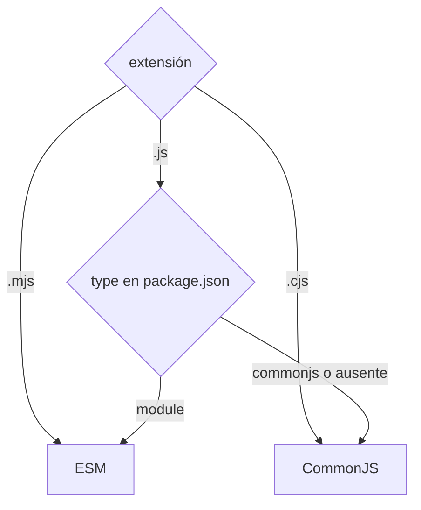
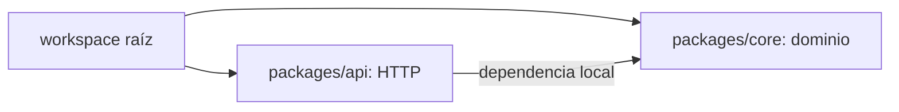
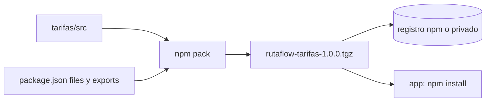

# Módulo 1: Módulos, npm/pnpm y gestión de dependencias


## Aprende construyendo


### Tema 1: package.json y semver · Básico · 45 min

<details open>
<summary><strong>Capa 1 — Lectura</strong></summary>

</details>

<details>
<summary><strong>Capa 2 — Construcción</strong></summary>

#### Código y verificación
```bash
mkdir ejemplo-package-json
cd ejemplo-package-json
npm init -y
npm install express
npm install --save-dev vitest
npm pkg set type=module engines.node=">=20" scripts.start="node src/main.js" scripts.test="vitest run"
mkdir src
```

```js
import express from "express";

console.log(`Express disponible: ${typeof express === "function"}`);
```

```json
{
  "type": "module",
  "engines": { "node": ">=22" },
  "scripts": {
    "start": "node src/main.js",
    "test": "vitest run"
  },
  "dependencies": { "express": "^5.0.0" },
  "devDependencies": { "vitest": "^3.0.0" }
}
```

```bash
npm pkg get engines scripts dependencies devDependencies
npm outdated
npm start
```

```bash
npm uninstall express
npm install --save-dev express
npm ci --omit=dev
npm start
```

```bash
npm uninstall express
npm install express
npm ci
npm start
```

</details>

### Tema 2: Lockfiles e instalación reproducible · Básico · 45 min

<details open>
<summary><strong>Capa 1 — Lectura</strong></summary>

</details>

<details>
<summary><strong>Capa 2 — Construcción</strong></summary>

#### Código y verificación
```bash
mkdir ejemplo-lockfile
cd ejemplo-lockfile
npm init -y
npm install express
npm install --save-dev vitest
npm install
npm ls --depth=0
```

```bash
cp package-lock.json package-lock.referencia.json
npm ci
npm ls --depth=0
diff -u package-lock.referencia.json package-lock.json
```

```bash
npm ci
```

```bash
npm install nanoid
npm ci
```

```bash
npm ls --all > arbol-antes.txt
npm ci
npm ls --all > arbol-despues.txt
diff -u arbol-antes.txt arbol-despues.txt
```

```bash
mkdir ../ejemplo-lockfile-produccion
cp package.json package-lock.json ../ejemplo-lockfile-produccion/
cd ../ejemplo-lockfile-produccion
npm ci --omit=dev
npm ls express --depth=0
npm ls vitest --depth=0
```

</details>

### Tema 3: ESM y CommonJS en el mismo proyecto · Básico · 45 min

<details open>
<summary><strong>Capa 1 — Lectura</strong></summary>

#### ► CÓMO FUNCIONA


</details>

<details>
<summary><strong>Capa 2 — Construcción</strong></summary>

#### Código y verificación


```bash
mkdir esm-y-cjs
cd esm-y-cjs
```

```json
{ "name": "mezcla-modulos", "version": "1.0.0", "type": "module" }
```

```javascript
// Módulo CommonJS antiguo: usa require y module.exports
const path = require('node:path');

function nombreReporte(fecha) {
  return path.join(__dirname, `reporte-${fecha}.csv`);
}

module.exports = { nombreReporte, version: '1.4.0' };
```

```javascript
// Módulo ESM moderno: usa export
export const zonas = ['Norte', 'Sur', 'Centro'];
export default function saludo(nombre) {
  return `Hola ${nombre}, tienes ${zonas.length} zonas`;
}
```

```json
{ "ciudad": "Bogotá" }
```

</details>

### Tema 4: Scripts de ciclo de vida · Básico · 45 min

<details open>
<summary><strong>Capa 1 — Lectura</strong></summary>

</details>

<details>
<summary><strong>Capa 2 — Construcción</strong></summary>

#### Código y verificación
```bash
mkdir ejemplo-hooks-npm
cd ejemplo-hooks-npm
npm init -y
mkdir scripts
```

```js
const major = Number(process.versions.node.split(".")[0]);

if (major < 20) {
  console.error(`Node ${process.version} no es compatible; usa Node 22 o superior`);
  process.exitCode = 1;
} else {
  console.log(`Node compatible: ${process.version}`);
}
```

```json
{
  "scripts": {
    "preinstall": "node scripts/verificar-node.js",
    "generate": "node -e \"console.log('Artefactos reproducibles generados')\"",
    "prepare": "npm run generate"
  }
}
```

```bash
npm install --foreground-scripts
```

```bash
mkdir ../ejemplo-hooks-sin-scripts
cp package.json package-lock.json ../ejemplo-hooks-sin-scripts/
cp -R scripts ../ejemplo-hooks-sin-scripts/
cd ../ejemplo-hooks-sin-scripts
npm ci --ignore-scripts
npm run generate
cd ../ejemplo-hooks-npm
```

</details>

### Tema 5: Workspaces — monorepos con npm/pnpm · Básico · 45 min

<details open>
<summary><strong>Capa 1 — Lectura</strong></summary>

#### ► CÓMO FUNCIONA


</details>

<details>
<summary><strong>Capa 2 — Construcción</strong></summary>

#### Código y verificación


```bash
mkdir ejemplo-workspaces
cd ejemplo-workspaces
npm init -y
mkdir -p packages/core/src packages/api/src
```

```json
{
  "private": true,
  "workspaces": ["packages/*"]
}
```

```json
{
  "name": "@academia/core",
  "version": "1.0.0",
  "type": "module",
  "exports": "./src/index.js"
}
```

```js
export function crearGuia(numero) {
  const guia = String(numero).trim().toUpperCase();
  if (!/^RF-\d{3,}$/.test(guia)) {
    throw new Error("La guía debe tener formato RF- seguido de al menos 3 dígitos");
  }
  return Object.freeze({ numero: guia, estado: "creada" });
}
```

```json
{
  "name": "@academia/api",
  "version": "1.0.0",
  "type": "module",
  "scripts": { "start": "node src/main.js" },
  "dependencies": { "@academia/core": "1.0.0" }
}
```

</details>

### Tema 6: Publicar y versionar un paquete npm (público o privado) · Básico · 45 min

<details open>
<summary><strong>Capa 1 — Lectura</strong></summary>

#### ► CÓMO FUNCIONA


</details>

<details>
<summary><strong>Capa 2 — Construcción</strong></summary>

#### Código y verificación


```bash
mkdir paquete-npm
cd paquete-npm
mkdir -p tarifas/src app
```

```json
{
  "name": "@rutaflow/tarifas",
  "version": "1.0.0",
  "description": "Cálculo de tarifas de envío de RutaFlow",
  "type": "module",
  "exports": {
    ".": "./src/index.js"
  },
  "files": ["src"],
  "engines": { "node": ">=22" },
  "license": "MIT"
}
```

```javascript
const BASE = { Bogotá: 5000, Medellín: 7000 };

export function cotizar(ciudad, kilos) {
  if (!(ciudad in BASE)) throw new Error(`Sin cobertura en ${ciudad}`);
  if (kilos <= 0) throw new RangeError('kilos debe ser positivo');
  return BASE[ciudad] + Math.ceil(kilos) * 1200;
}
```

```json
{
  "name": "app-cotizador",
  "version": "0.0.0",
  "private": true,
  "type": "module",
  "dependencies": {
    "@rutaflow/tarifas": "file:../tarifas/rutaflow-tarifas-1.0.0.tgz"
  }
}
```

```javascript
import { cotizar } from '@rutaflow/tarifas';

console.log('Bogotá 2.5 kg =', cotizar('Bogotá', 2.5));
console.log('Medellín 1 kg =', cotizar('Medellín', 1));
```

</details>

### 1. Inicializa el workspace y sus hooks

<details open>
<summary><strong>Capa 1 — Lectura</strong></summary>

</details>

<details>
<summary><strong>Capa 2 — Construcción</strong></summary>

#### Código y verificación
```bash
mkdir proyecto-modulo-1
cd proyecto-modulo-1
mkdir -p packages/core/src packages/api/src scripts
npm init -y
```

```js
const major = Number(process.versions.node.split(".")[0]);

if (major < 22) {
  console.error(`Node ${process.version} no es compatible; usa Node 22 o superior`);
  process.exitCode = 1;
} else {
  console.log(`Node compatible: ${process.version}`);
}
```

```json
{
  "name": "api-operativa-entregas",
  "version": "1.0.0",
  "private": true,
  "workspaces": ["packages/*"],
  "engines": { "node": ">=22.12" },
  "scripts": {
    "preinstall": "node scripts/verificar-node.js",
    "postinstall": "node -e \"console.log('Dependencias listas')\"",
    "generate": "node -e \"console.log('Artefactos reproducibles generados')\"",
    "prepare": "npm run generate",
    "check": "npm run check --workspaces"
  }
}
```

</details>

### 2. Crea el dominio compartido

<details open>
<summary><strong>Capa 1 — Lectura</strong></summary>

</details>

<details>
<summary><strong>Capa 2 — Construcción</strong></summary>

#### Código y verificación
```json
{
  "name": "@academia/core",
  "version": "1.0.0",
  "type": "module",
  "exports": "./src/index.js",
  "scripts": {
    "check": "node --check src/index.js"
  }
}
```

```js
export function crearGuia(numero) {
  const guia = String(numero).trim().toUpperCase();
  if (!/^RF-\d{3,}$/.test(guia)) {
    throw new Error("La guía debe tener formato RF- seguido de al menos 3 dígitos");
  }
  return Object.freeze({ numero: guia, estado: "creada" });
}
```

</details>

### 3. Crea la API consumidora y clasifica dependencias

<details open>
<summary><strong>Capa 1 — Lectura</strong></summary>

</details>

<details>
<summary><strong>Capa 2 — Construcción</strong></summary>

#### Código y verificación
```json
{
  "name": "@academia/api",
  "version": "1.0.0",
  "type": "module",
  "scripts": {
    "start": "node src/main.js",
    "check": "node --check src/main.js"
  },
  "dependencies": {
    "@academia/core": "1.0.0"
  }
}
```

```js
import { crearGuia } from "@academia/core";

console.log("Guía creada desde workspace:", crearGuia("rf-100"));
```

```bash
npm install express --workspace @academia/api --foreground-scripts
npm install --save-dev vitest --workspace @academia/api --foreground-scripts
npm pkg get dependencies devDependencies --workspace @academia/api
```

</details>

### 4. Comprueba el enlace y modifica un rango

<details open>
<summary><strong>Capa 1 — Lectura</strong></summary>

</details>

<details>
<summary><strong>Capa 2 — Construcción</strong></summary>

#### Código y verificación
```bash
npm run check
npm run start --workspace @academia/api
```

```bash
npm install express --workspace @academia/api
```

</details>

### 5. Verifica la instalación reproducible

<details open>
<summary><strong>Capa 1 — Lectura</strong></summary>

</details>

<details>
<summary><strong>Capa 2 — Construcción</strong></summary>

#### Código y verificación
```bash
cp package-lock.json package-lock.referencia.json
npm ci
diff -u package-lock.referencia.json package-lock.json
```

</details>

### 6. Comprueba el límite de los scripts automáticos

<details open>
<summary><strong>Capa 1 — Lectura</strong></summary>

</details>

<details>
<summary><strong>Capa 2 — Construcción</strong></summary>

#### Código y verificación
```bash
npm ci --ignore-scripts
npm run generate
npm run start --workspace @academia/api
```

</details>

### Verificación y entrega

<details open>
<summary><strong>Capa 1 — Lectura</strong></summary>

</details>

<details>
<summary><strong>Capa 2 — Construcción</strong></summary>

#### Nota de construcción
Este tema es principalmente conceptual en esta versión. La verificación se realiza con las preguntas de comprensión y el criterio de cuándo NO usar verificación y entrega.

</details>
