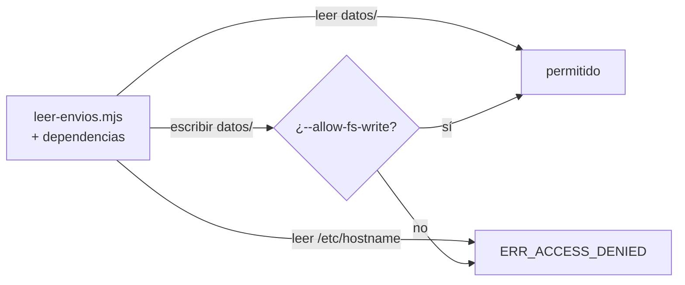

# Módulo 10: Seguridad en Node

## Aprende construyendo


### Tema 1: Cabeceras seguras con helmet · Avanzado · 45 min

<details open>
<summary><strong>Capa 1 — Lectura</strong></summary>

</details>

<details>
<summary><strong>Capa 2 — Construcción</strong></summary>

#### Código y verificación
```bash
mkdir practica-cabeceras
cd practica-cabeceras
npm init -y
npm install express helmet
npm pkg set type=module scripts.start="node src/server.js"
mkdir src
```

```js
import express from "express";
import helmet from "helmet";

const app = express();
app.use(helmet());

app.get("/", (_req, res) => {
  res.json({ estado: "disponible" });
});

app.listen(3000, () => {
  console.log("API de cabeceras en http://127.0.0.1:3000");
});
```

```bash
curl -i http://127.0.0.1:3000/
```

```js
app.use(helmet({
  contentSecurityPolicy: {
    directives: {
      defaultSrc: ["'self'"],
      scriptSrc: ["'none'"],
      objectSrc: ["'none'"]
    }
  }
}));
```

</details>

### Tema 2: Rate limiting · Avanzado · 45 min

<details open>
<summary><strong>Capa 1 — Lectura</strong></summary>

</details>

<details>
<summary><strong>Capa 2 — Construcción</strong></summary>

#### Código y verificación
```bash
mkdir practica-limite
cd practica-limite
npm init -y
npm install express express-rate-limit
npm pkg set type=module scripts.start="node src/server.js"
mkdir src
```

```js
import express from "express";
import rateLimit from "express-rate-limit";

const app = express();
const limiteAcceso = rateLimit({
  windowMs: 30_000,
  limit: 3,
  standardHeaders: true,
  legacyHeaders: false
});

app.post("/acceso", limiteAcceso, (_req, res) => {
  res.sendStatus(204);
});

app.get("/publico", (_req, res) => {
  res.json({ estado: "sin limite de esta ruta" });
});

app.listen(3000, () => {
  console.log("API con limite en http://127.0.0.1:3000");
});
```

```bash
curl -i -X POST http://127.0.0.1:3000/acceso
curl -i -X POST http://127.0.0.1:3000/acceso
curl -i -X POST http://127.0.0.1:3000/acceso
curl -i -X POST http://127.0.0.1:3000/acceso
```

</details>

### Tema 3: Inyección SQL y sanitización contra XSS · Avanzado · 45 min

<details open>
<summary><strong>Capa 1 — Lectura</strong></summary>

</details>

<details>
<summary><strong>Capa 2 — Construcción</strong></summary>

#### Código y verificación
```bash
mkdir practica-datos-salida
cd practica-datos-salida
npm init -y
npm install pg escape-html
npm pkg set type=module scripts.start="node src/main.js"
mkdir src
```

```js
export async function buscarPorCodigo(pool, codigo) {
  if (typeof codigo !== "string" || !/^RF-\d+$/.test(codigo)) {
    throw new Error("El codigo debe tener el formato RF-<numero>");
  }

  return pool.query(
    "SELECT id, codigo FROM paquetes WHERE codigo = $1",
    [codigo]
  );
}
```

```js
import escapeHtml from "escape-html";

export function paraTextoHtml(texto) {
  return escapeHtml(texto);
}
```

```js
import { buscarPorCodigo } from "./consultas.js";
import { paraTextoHtml } from "./salida.js";

const poolDePrueba = {
  async query(text, values) {
    console.log(JSON.stringify({ text, values }));
    return { rows: [] };
  }
};

await buscarPorCodigo(poolDePrueba, "RF-42");
console.log(paraTextoHtml(''));

try {
  await buscarPorCodigo(poolDePrueba, "RF-x");
} catch (error) {
  console.log(`Entrada rechazada: ${error.message}`);
}
```

</details>

### Tema 4: OWASP API Security Top 10 y auditoría de dependencias · Avanzado · 45 min

<details open>
<summary><strong>Capa 1 — Lectura</strong></summary>

</details>

<details>
<summary><strong>Capa 2 — Construcción</strong></summary>

#### Código y verificación
```bash
mkdir practica-owasp-auditoria
cd practica-owasp-auditoria
npm init -y
npm install express
npm pkg set type=module scripts.test="node --test"
mkdir src test
```

```js
export function puedeConsultar(actor, entrega) {
  return Boolean(
    actor && entrega && actor.id === entrega.propietarioId
  );
}
```

```js
import test from "node:test";
import assert from "node:assert/strict";
import { puedeConsultar } from "../src/autorizacion.js";

const entrega = { id: "E-1", propietarioId: "cliente-1" };

test("permite al propietario", () => {
  assert.equal(puedeConsultar({ id: "cliente-1" }, entrega), true);
});

test("deniega a otra identidad", () => {
  assert.equal(puedeConsultar({ id: "cliente-2" }, entrega), false);
});

test("deniega cuando falta el actor", () => {
  assert.equal(puedeConsultar(null, entrega), false);
});
```

```md
# Revisión OWASP de una API de entregas

| Categoría | Pregunta concreta | Evidencia | Control o pendiente |
| --- | --- | --- | --- |
| API1 BOLA | ¿Otra identidad puede consultar E-1? | Prueba negativa de propietario | Comparar actor y propietario en cada consulta |
| API3 Propiedades de objeto | ¿La respuesta incluye campos internos? | Enumerar campos de una respuesta real | Definir un DTO de salida |
| API4 Consumo de recursos | ¿Existen límites de tasa, tamaño y tiempo? | Registrar configuración y prueba acotada | Completar límites ausentes |
| API7 SSRF | ¿El servidor obtiene URL aportadas por clientes? | Revisar llamadas salientes | Lista permitida y controles de red si aplica |
```

```bash
npm audit
npm audit --json > audit.json
codigo=$?
printf 'npm audit terminó con código %s\n' "$codigo"
```

```js
export function vistaEntrega(entrega) {
  return { id: entrega.id, codigo: entrega.codigo };
}
```

</details>

### Tema 5: CVE, CWE y npm audit en el pipeline · Avanzado · 45 min

<details open>
<summary><strong>Capa 1 — Lectura</strong></summary>

</details>

<details>
<summary><strong>Capa 2 — Construcción</strong></summary>

#### Código y verificación
```bash
mkdir auditoria-pipeline
cd auditoria-pipeline
npm init -y
npm install lodash@4.17.20
```

```js
const { spawnSync } = require("node:child_process");

const NIVELES = ["low", "moderate", "high", "critical"];
const minimo = process.env.AUDIT_MIN_SEVERITY ?? "high";

if (!NIVELES.includes(minimo)) {
  console.error(`Umbral inválido: ${minimo}`);
  process.exit(2);
}

const UMBRAL = NIVELES.slice(NIVELES.indexOf(minimo));
const ejecutable = process.platform === "win32" ? "npm.cmd" : "npm";
const resultado = spawnSync(ejecutable, ["audit", "--json"], {
  encoding: "utf8",
  maxBuffer: 10 * 1024 * 1024
});

if (resultado.error) {
  console.error(`No se pudo ejecutar npm audit: ${resultado.error.message}`);
  process.exit(2);
}

if (resultado.status === null || ![0, 1].includes(resultado.status)) {
  console.error(`npm audit terminó con estado ${resultado.status}`);
  console.error(resultado.stderr || "Sin detalle adicional");
  process.exit(2);
}

const salida = resultado.stdout?.trim();
if (!salida) {
  console.error("npm audit no devolvió JSON");
  console.error(resultado.stderr || "Sin detalle adicional");
  process.exit(2);
}

let reporte;
try {
  reporte = JSON.parse(salida);
} catch (error) {
  console.error(`JSON inválido de npm audit: ${error.message}`);
  process.exit(2);
}

if (!reporte || typeof reporte !== "object" || Array.isArray(reporte)) {
  console.error("El reporte no es un objeto JSON");
  process.exit(2);
}

if (reporte.error) {
  console.error(`npm audit reportó un error: ${reporte.error.summary ?? "sin resumen"}`);
  process.exit(2);
}

const lista = reporte.vulnerabilities ?? {};
if (typeof lista !== "object" || Array.isArray(lista)) {
  console.error("vulnerabilities no tiene la forma esperada");
  process.exit(2);
}

const entradas = Object.entries(lista);
const filas = [];

for (const [paquete, info] of entradas) {
  const via = Array.isArray(info?.via) ? info.via : [];
  for (const aviso of via) {
    if (!aviso || typeof aviso !== "object") continue;
    filas.push({
      paquete,
      severidad: aviso.severity ?? info?.severity ?? "desconocida",
      cwe: Array.isArray(aviso.cwe) ? aviso.cwe.join(", ") : "no indicado",
      aviso: typeof aviso.url === "string"
        ? aviso.url.split("/").pop()
        : String(aviso.source ?? "sin identificador")
    });
  }
}

console.table(filas);
const graves = entradas
  .filter(([, info]) => UMBRAL.includes(info?.severity))
  .map(([paquete]) => paquete);

console.log(`Estado de npm audit: ${resultado.status}`);
console.log(`Umbral del pipeline: ${minimo}`);
console.log(`Paquetes en o sobre el umbral: ${graves.join(", ") || "ninguno"}`);
process.exitCode = graves.length > 0 ? 1 : 0;
```

```bash
node auditar.js
codigo=$?
printf 'código del pipeline local: %s\n' "$codigo"
```

```yaml
name: auditoria-dependencias
on: push
permissions:
  contents: read
jobs:
  audit:
    runs-on: ubuntu-latest
    env:
      AUDIT_MIN_SEVERITY: ${{ github.ref == 'refs/heads/main' && 'high' || 'critical' }}
    steps:
      - uses: actions/checkout@v4
      - uses: actions/setup-node@v4
        with:
          node-version: 22
          cache: npm
      - run: npm ci
      - run: node auditar.js
```

</details>

### Tema 6: Modelo de permisos de Node: limitar archivos, procesos y workers · Avanzado · 35 min

<details open>
<summary><strong>Capa 1 — Lectura</strong></summary>

#### ► CÓMO FUNCIONA


</details>

<details>
<summary><strong>Capa 2 — Construcción</strong></summary>

#### Código y verificación

```js
import { readFile, writeFile } from 'node:fs/promises';

const contenido = await readFile('datos/envios.csv', 'utf8');
console.log(`leído: ${contenido.trim()}`);

try {
  await readFile('/etc/hostname', 'utf8');
  console.log('leyó /etc/hostname');
} catch (error) {
  console.log(`lectura fuera de datos/: ${error.code}`);
}

try {
  await writeFile('datos/reporte.txt', 'listo');
  console.log('escribió el reporte');
} catch (error) {
  console.log(`escritura: ${error.code}`);
}

console.log(`¿puede usar child_process?: ${process.permission.has('child')}`);
```

```bash
cd academia-labs/node/permisos
# 1) solo lectura de datos/ y del script
node --permission --allow-fs-read=./datos/ --allow-fs-read=./leer-envios.mjs leer-envios.mjs
# 2) además, escritura en datos/
node --permission --allow-fs-read=./datos/ --allow-fs-read=./leer-envios.mjs --allow-fs-write=./datos/ leer-envios.mjs
```

```text
leído: ENV-1,EN_RUTA
lectura fuera de datos/: ERR_ACCESS_DENIED
escritura: ERR_ACCESS_DENIED
¿puede usar child_process?: false
leído: ENV-1,EN_RUTA
lectura fuera de datos/: ERR_ACCESS_DENIED
escribió el reporte
¿puede usar child_process?: false
```

```text
Error: Access to this API has been restricted. Use --allow-fs-read to manage permissions.
  code: 'ERR_ACCESS_DENIED',
  permission: 'FileSystemRead',
  resource: 'datos/envios.csv'
```

```bash
mkdir laboratorio-seguridad-node
cd laboratorio-seguridad-node
npm init -y
npm install express helmet express-rate-limit escape-html
npm pkg set type=module scripts.start="node src/server.js"
mkdir src
```

</details>
