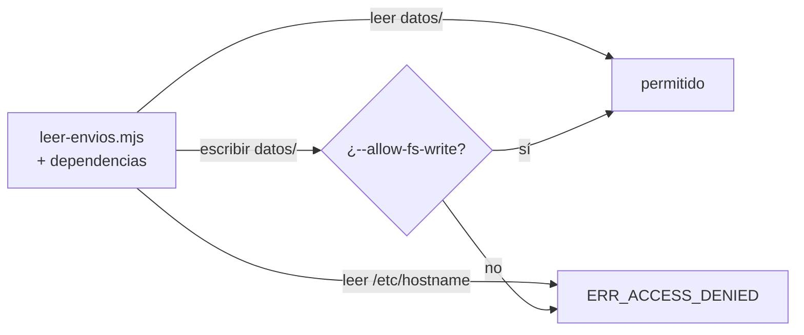

# Módulo 10: Seguridad en Node

## Aprende construyendo


### Tema 1: Cabeceras seguras con helmet · Avanzado · 45 min

<details open>
<summary><strong>Capa 1 — Lectura</strong></summary>

#### ► DE QUÉ TRATA
Este tema te guía por cabeceras seguras con helmet con foco en comprensión antes de implementación.

#### ► LA IDEA EN UNA FRASE
**Entender cabeceras seguras con helmet te permite tomar mejores decisiones técnicas.**

#### ► POR QUÉ EXISTE ESTO
Resuelve un problema real de diseño o implementación y evita decisiones a ciegas.

#### ► LA ANALOGÍA
Piensa en cabeceras seguras con helmet como una herramienta de taller: útil cuando conoces su propósito y sus límites.
**Dónde se rompe la analogía:** en software, los efectos dependen del contexto, la escala y los trade-offs.

#### ► CÓMO FUNCIONA
1. Identifica el problema que cabeceras seguras con helmet resuelve.
2. Observa sus componentes y relaciones.
3. Aplica la opción más simple que funcione.
4. Verifica el resultado y los límites.

#### ► LO QUE PUEDE SALIR MAL
| Síntoma | Causa probable | Arreglo |
|---|---|---|
| Cabeceras seguras con helmet se aplica pero el resultado no mejora | Se usó sin medir el problema real | Mide antes y compara contra la alternativa simple |
| Aparece complejidad inesperada | Se adoptó la técnica sin comprender sus trade-offs | Vuelve a la sección de trade-offs y reduce el alcance |
| Falla en un caso límite | Se asumió un contexto que no se cumple | Prueba el caso límite y documenta cuándo NO usarlo |

#### ► TRADE-OFFS
| Opción | Cuándo usarla | Cuándo NO usarla |
|---|---|---|
| Usar Cabeceras seguras con helmet | Cuando el problema coincide con su propósito y el beneficio es observable | Cuando agrega complejidad sin resolver un problema real |
| Alternativa más simple | Cuando el contexto es pequeño, estable o fácil de razonar | Cuando ya demostró no escalar o no cumplir el requisito |
| Postergar la decisión | Cuando falta evidencia del problema | Cuando el costo de esperar es mayor que el costo de probar |

#### ► CUÁNDO NO USAR ESTO
No uses cabeceras seguras con helmet por defecto. Aplícalo cuando el problema lo justifique y puedas verificar el beneficio; si una alternativa más simple resuelve igual, prefiérela.

#### ► DE VUELTA A LA ANALOGÍA
Volviendo a la analogía: cabeceras seguras con helmet funciona como el modelo inicial, pero recuerda dónde se rompe: en producción importan la evidencia, la escala y el costo de equivocarte.

#### ► LO QUE DEBES RECORDAR
- Cabeceras seguras con helmet existe para resolver un problema específico.
- Mide antes de adoptar complejidad.
- Conoce el caso donde NO usarlo.
- Verifica con evidencia observable.

#### ► PREGUNTAS PARA PENSAR
1. ¿Qué problema concreto resuelve cabeceras seguras con helmet en tu contexto?
2. ¿Cómo sabrías que cabeceras seguras con helmet no está funcionando bien?
3. ¿Qué alternativa más simple considerarías antes de usar cabeceras seguras con helmet?

</details>

<details>
<summary><strong>Capa 2 — Construcción</strong></summary>

#### Código y verificación
```bash
mkdir practica-cabeceras
cd practica-cabeceras
npm init -y
npm install express helmet
npm pkg set type=module scripts.start="node src/server.js"
mkdir src
```

```js
import express from "express";
import helmet from "helmet";

const app = express();
app.use(helmet());

app.get("/", (_req, res) => {
  res.json({ estado: "disponible" });
});

app.listen(3000, () => {
  console.log("API de cabeceras en http://127.0.0.1:3000");
});
```

```bash
curl -i http://127.0.0.1:3000/
```

```js
app.use(helmet({
  contentSecurityPolicy: {
    directives: {
      defaultSrc: ["'self'"],
      scriptSrc: ["'none'"],
      objectSrc: ["'none'"]
    }
  }
}));
```

</details>

### Tema 2: Rate limiting · Avanzado · 45 min

<details open>
<summary><strong>Capa 1 — Lectura</strong></summary>

#### ► DE QUÉ TRATA
Este tema te guía por rate limiting con foco en comprensión antes de implementación.

#### ► LA IDEA EN UNA FRASE
**Entender rate limiting te permite tomar mejores decisiones técnicas.**

#### ► POR QUÉ EXISTE ESTO
Resuelve un problema real de diseño o implementación y evita decisiones a ciegas.

#### ► LA ANALOGÍA
Piensa en rate limiting como una herramienta de taller: útil cuando conoces su propósito y sus límites.
**Dónde se rompe la analogía:** en software, los efectos dependen del contexto, la escala y los trade-offs.

#### ► CÓMO FUNCIONA
1. Identifica el problema que rate limiting resuelve.
2. Observa sus componentes y relaciones.
3. Aplica la opción más simple que funcione.
4. Verifica el resultado y los límites.

#### ► LO QUE PUEDE SALIR MAL
| Síntoma | Causa probable | Arreglo |
|---|---|---|
| Rate limiting se aplica pero el resultado no mejora | Se usó sin medir el problema real | Mide antes y compara contra la alternativa simple |
| Aparece complejidad inesperada | Se adoptó la técnica sin comprender sus trade-offs | Vuelve a la sección de trade-offs y reduce el alcance |
| Falla en un caso límite | Se asumió un contexto que no se cumple | Prueba el caso límite y documenta cuándo NO usarlo |

#### ► TRADE-OFFS
| Opción | Cuándo usarla | Cuándo NO usarla |
|---|---|---|
| Usar Rate limiting | Cuando el problema coincide con su propósito y el beneficio es observable | Cuando agrega complejidad sin resolver un problema real |
| Alternativa más simple | Cuando el contexto es pequeño, estable o fácil de razonar | Cuando ya demostró no escalar o no cumplir el requisito |
| Postergar la decisión | Cuando falta evidencia del problema | Cuando el costo de esperar es mayor que el costo de probar |

#### ► CUÁNDO NO USAR ESTO
No uses rate limiting por defecto. Aplícalo cuando el problema lo justifique y puedas verificar el beneficio; si una alternativa más simple resuelve igual, prefiérela.

#### ► DE VUELTA A LA ANALOGÍA
Volviendo a la analogía: rate limiting funciona como el modelo inicial, pero recuerda dónde se rompe: en producción importan la evidencia, la escala y el costo de equivocarte.

#### ► LO QUE DEBES RECORDAR
- Rate limiting existe para resolver un problema específico.
- Mide antes de adoptar complejidad.
- Conoce el caso donde NO usarlo.
- Verifica con evidencia observable.

#### ► PREGUNTAS PARA PENSAR
1. ¿Qué problema concreto resuelve rate limiting en tu contexto?
2. ¿Cómo sabrías que rate limiting no está funcionando bien?
3. ¿Qué alternativa más simple considerarías antes de usar rate limiting?

</details>

<details>
<summary><strong>Capa 2 — Construcción</strong></summary>

#### Código y verificación
```bash
mkdir practica-limite
cd practica-limite
npm init -y
npm install express express-rate-limit
npm pkg set type=module scripts.start="node src/server.js"
mkdir src
```

```js
import express from "express";
import rateLimit from "express-rate-limit";

const app = express();
const limiteAcceso = rateLimit({
  windowMs: 30_000,
  limit: 3,
  standardHeaders: true,
  legacyHeaders: false
});

app.post("/acceso", limiteAcceso, (_req, res) => {
  res.sendStatus(204);
});

app.get("/publico", (_req, res) => {
  res.json({ estado: "sin limite de esta ruta" });
});

app.listen(3000, () => {
  console.log("API con limite en http://127.0.0.1:3000");
});
```

```bash
curl -i -X POST http://127.0.0.1:3000/acceso
curl -i -X POST http://127.0.0.1:3000/acceso
curl -i -X POST http://127.0.0.1:3000/acceso
curl -i -X POST http://127.0.0.1:3000/acceso
```

</details>

### Tema 3: Inyección SQL y sanitización contra XSS · Avanzado · 45 min

<details open>
<summary><strong>Capa 1 — Lectura</strong></summary>

#### ► DE QUÉ TRATA
Este tema te guía por inyección sql y sanitización contra xss con foco en comprensión antes de implementación.

#### ► LA IDEA EN UNA FRASE
**Entender inyección sql y sanitización contra xss te permite tomar mejores decisiones técnicas.**

#### ► POR QUÉ EXISTE ESTO
Resuelve un problema real de diseño o implementación y evita decisiones a ciegas.

#### ► LA ANALOGÍA
Piensa en inyección sql y sanitización contra xss como una herramienta de taller: útil cuando conoces su propósito y sus límites.
**Dónde se rompe la analogía:** en software, los efectos dependen del contexto, la escala y los trade-offs.

#### ► CÓMO FUNCIONA
1. Identifica el problema que inyección sql y sanitización contra xss resuelve.
2. Observa sus componentes y relaciones.
3. Aplica la opción más simple que funcione.
4. Verifica el resultado y los límites.

#### ► LO QUE PUEDE SALIR MAL
| Síntoma | Causa probable | Arreglo |
|---|---|---|
| Inyección SQL y sanitización contra XSS se aplica pero el resultado no mejora | Se usó sin medir el problema real | Mide antes y compara contra la alternativa simple |
| Aparece complejidad inesperada | Se adoptó la técnica sin comprender sus trade-offs | Vuelve a la sección de trade-offs y reduce el alcance |
| Falla en un caso límite | Se asumió un contexto que no se cumple | Prueba el caso límite y documenta cuándo NO usarlo |

#### ► TRADE-OFFS
| Opción | Cuándo usarla | Cuándo NO usarla |
|---|---|---|
| Usar Inyección SQL y sanitización contra XSS | Cuando el problema coincide con su propósito y el beneficio es observable | Cuando agrega complejidad sin resolver un problema real |
| Alternativa más simple | Cuando el contexto es pequeño, estable o fácil de razonar | Cuando ya demostró no escalar o no cumplir el requisito |
| Postergar la decisión | Cuando falta evidencia del problema | Cuando el costo de esperar es mayor que el costo de probar |

#### ► CUÁNDO NO USAR ESTO
No uses inyección sql y sanitización contra xss por defecto. Aplícalo cuando el problema lo justifique y puedas verificar el beneficio; si una alternativa más simple resuelve igual, prefiérela.

#### ► DE VUELTA A LA ANALOGÍA
Volviendo a la analogía: inyección sql y sanitización contra xss funciona como el modelo inicial, pero recuerda dónde se rompe: en producción importan la evidencia, la escala y el costo de equivocarte.

#### ► LO QUE DEBES RECORDAR
- Inyección SQL y sanitización contra XSS existe para resolver un problema específico.
- Mide antes de adoptar complejidad.
- Conoce el caso donde NO usarlo.
- Verifica con evidencia observable.

#### ► PREGUNTAS PARA PENSAR
1. ¿Qué problema concreto resuelve inyección sql y sanitización contra xss en tu contexto?
2. ¿Cómo sabrías que inyección sql y sanitización contra xss no está funcionando bien?
3. ¿Qué alternativa más simple considerarías antes de usar inyección sql y sanitización contra xss?

</details>

<details>
<summary><strong>Capa 2 — Construcción</strong></summary>

#### Código y verificación
```bash
mkdir practica-datos-salida
cd practica-datos-salida
npm init -y
npm install pg escape-html
npm pkg set type=module scripts.start="node src/main.js"
mkdir src
```

```js
export async function buscarPorCodigo(pool, codigo) {
  if (typeof codigo !== "string" || !/^RF-\d+$/.test(codigo)) {
    throw new Error("El codigo debe tener el formato RF-<numero>");
  }

  return pool.query(
    "SELECT id, codigo FROM paquetes WHERE codigo = $1",
    [codigo]
  );
}
```

```js
import escapeHtml from "escape-html";

export function paraTextoHtml(texto) {
  return escapeHtml(texto);
}
```

```js
import { buscarPorCodigo } from "./consultas.js";
import { paraTextoHtml } from "./salida.js";

const poolDePrueba = {
  async query(text, values) {
    console.log(JSON.stringify({ text, values }));
    return { rows: [] };
  }
};

await buscarPorCodigo(poolDePrueba, "RF-42");
console.log(paraTextoHtml(''));

try {
  await buscarPorCodigo(poolDePrueba, "RF-x");
} catch (error) {
  console.log(`Entrada rechazada: ${error.message}`);
}
```

</details>

### Tema 4: OWASP API Security Top 10 y auditoría de dependencias · Avanzado · 45 min

<details open>
<summary><strong>Capa 1 — Lectura</strong></summary>

#### ► DE QUÉ TRATA
Este tema te guía por owasp api security top 10 y auditoría de dependencias con foco en comprensión antes de implementación.

#### ► LA IDEA EN UNA FRASE
**Entender owasp api security top 10 y auditoría de dependencias te permite tomar mejores decisiones técnicas.**

#### ► POR QUÉ EXISTE ESTO
Resuelve un problema real de diseño o implementación y evita decisiones a ciegas.

#### ► LA ANALOGÍA
Piensa en owasp api security top 10 y auditoría de dependencias como una herramienta de taller: útil cuando conoces su propósito y sus límites.
**Dónde se rompe la analogía:** en software, los efectos dependen del contexto, la escala y los trade-offs.

#### ► CÓMO FUNCIONA
1. Identifica el problema que owasp api security top 10 y auditoría de dependencias resuelve.
2. Observa sus componentes y relaciones.
3. Aplica la opción más simple que funcione.
4. Verifica el resultado y los límites.

#### ► LO QUE PUEDE SALIR MAL
| Síntoma | Causa probable | Arreglo |
|---|---|---|
| OWASP API Security Top 10 y auditoría de dependencias se aplica pero el resultado no mejora | Se usó sin medir el problema real | Mide antes y compara contra la alternativa simple |
| Aparece complejidad inesperada | Se adoptó la técnica sin comprender sus trade-offs | Vuelve a la sección de trade-offs y reduce el alcance |
| Falla en un caso límite | Se asumió un contexto que no se cumple | Prueba el caso límite y documenta cuándo NO usarlo |

#### ► TRADE-OFFS
| Opción | Cuándo usarla | Cuándo NO usarla |
|---|---|---|
| Usar OWASP API Security Top 10 y auditoría de dependencias | Cuando el problema coincide con su propósito y el beneficio es observable | Cuando agrega complejidad sin resolver un problema real |
| Alternativa más simple | Cuando el contexto es pequeño, estable o fácil de razonar | Cuando ya demostró no escalar o no cumplir el requisito |
| Postergar la decisión | Cuando falta evidencia del problema | Cuando el costo de esperar es mayor que el costo de probar |

#### ► CUÁNDO NO USAR ESTO
No uses owasp api security top 10 y auditoría de dependencias por defecto. Aplícalo cuando el problema lo justifique y puedas verificar el beneficio; si una alternativa más simple resuelve igual, prefiérela.

#### ► DE VUELTA A LA ANALOGÍA
Volviendo a la analogía: owasp api security top 10 y auditoría de dependencias funciona como el modelo inicial, pero recuerda dónde se rompe: en producción importan la evidencia, la escala y el costo de equivocarte.

#### ► LO QUE DEBES RECORDAR
- OWASP API Security Top 10 y auditoría de dependencias existe para resolver un problema específico.
- Mide antes de adoptar complejidad.
- Conoce el caso donde NO usarlo.
- Verifica con evidencia observable.

#### ► PREGUNTAS PARA PENSAR
1. ¿Qué problema concreto resuelve owasp api security top 10 y auditoría de dependencias en tu contexto?
2. ¿Cómo sabrías que owasp api security top 10 y auditoría de dependencias no está funcionando bien?
3. ¿Qué alternativa más simple considerarías antes de usar owasp api security top 10 y auditoría de dependencias?

</details>

<details>
<summary><strong>Capa 2 — Construcción</strong></summary>

#### Código y verificación
```bash
mkdir practica-owasp-auditoria
cd practica-owasp-auditoria
npm init -y
npm install express
npm pkg set type=module scripts.test="node --test"
mkdir src test
```

```js
export function puedeConsultar(actor, entrega) {
  return Boolean(
    actor && entrega && actor.id === entrega.propietarioId
  );
}
```

```js
import test from "node:test";
import assert from "node:assert/strict";
import { puedeConsultar } from "../src/autorizacion.js";

const entrega = { id: "E-1", propietarioId: "cliente-1" };

test("permite al propietario", () => {
  assert.equal(puedeConsultar({ id: "cliente-1" }, entrega), true);
});

test("deniega a otra identidad", () => {
  assert.equal(puedeConsultar({ id: "cliente-2" }, entrega), false);
});

test("deniega cuando falta el actor", () => {
  assert.equal(puedeConsultar(null, entrega), false);
});
```

```md
# Revisión OWASP de una API de entregas

| Categoría | Pregunta concreta | Evidencia | Control o pendiente |
| --- | --- | --- | --- |
| API1 BOLA | ¿Otra identidad puede consultar E-1? | Prueba negativa de propietario | Comparar actor y propietario en cada consulta |
| API3 Propiedades de objeto | ¿La respuesta incluye campos internos? | Enumerar campos de una respuesta real | Definir un DTO de salida |
| API4 Consumo de recursos | ¿Existen límites de tasa, tamaño y tiempo? | Registrar configuración y prueba acotada | Completar límites ausentes |
| API7 SSRF | ¿El servidor obtiene URL aportadas por clientes? | Revisar llamadas salientes | Lista permitida y controles de red si aplica |
```

```bash
npm audit
npm audit --json > audit.json
codigo=$?
printf 'npm audit terminó con código %s\n' "$codigo"
```

```js
export function vistaEntrega(entrega) {
  return { id: entrega.id, codigo: entrega.codigo };
}
```

</details>

### Tema 5: CVE, CWE y npm audit en el pipeline · Avanzado · 45 min

<details open>
<summary><strong>Capa 1 — Lectura</strong></summary>

#### ► DE QUÉ TRATA
Este tema te guía por cve, cwe y npm audit en el pipeline con foco en comprensión antes de implementación.

#### ► LA IDEA EN UNA FRASE
**Entender cve, cwe y npm audit en el pipeline te permite tomar mejores decisiones técnicas.**

#### ► POR QUÉ EXISTE ESTO
Resuelve un problema real de diseño o implementación y evita decisiones a ciegas.

#### ► LA ANALOGÍA
Piensa en cve, cwe y npm audit en el pipeline como una herramienta de taller: útil cuando conoces su propósito y sus límites.
**Dónde se rompe la analogía:** en software, los efectos dependen del contexto, la escala y los trade-offs.

#### ► CÓMO FUNCIONA
1. Identifica el problema que cve, cwe y npm audit en el pipeline resuelve.
2. Observa sus componentes y relaciones.
3. Aplica la opción más simple que funcione.
4. Verifica el resultado y los límites.

#### ► LO QUE PUEDE SALIR MAL
| Síntoma | Causa probable | Arreglo |
|---|---|---|
| CVE, CWE y npm audit en el pipeline se aplica pero el resultado no mejora | Se usó sin medir el problema real | Mide antes y compara contra la alternativa simple |
| Aparece complejidad inesperada | Se adoptó la técnica sin comprender sus trade-offs | Vuelve a la sección de trade-offs y reduce el alcance |
| Falla en un caso límite | Se asumió un contexto que no se cumple | Prueba el caso límite y documenta cuándo NO usarlo |

#### ► TRADE-OFFS
| Opción | Cuándo usarla | Cuándo NO usarla |
|---|---|---|
| Usar CVE, CWE y npm audit en el pipeline | Cuando el problema coincide con su propósito y el beneficio es observable | Cuando agrega complejidad sin resolver un problema real |
| Alternativa más simple | Cuando el contexto es pequeño, estable o fácil de razonar | Cuando ya demostró no escalar o no cumplir el requisito |
| Postergar la decisión | Cuando falta evidencia del problema | Cuando el costo de esperar es mayor que el costo de probar |

#### ► CUÁNDO NO USAR ESTO
No uses cve, cwe y npm audit en el pipeline por defecto. Aplícalo cuando el problema lo justifique y puedas verificar el beneficio; si una alternativa más simple resuelve igual, prefiérela.

#### ► DE VUELTA A LA ANALOGÍA
Volviendo a la analogía: cve, cwe y npm audit en el pipeline funciona como el modelo inicial, pero recuerda dónde se rompe: en producción importan la evidencia, la escala y el costo de equivocarte.

#### ► LO QUE DEBES RECORDAR
- CVE, CWE y npm audit en el pipeline existe para resolver un problema específico.
- Mide antes de adoptar complejidad.
- Conoce el caso donde NO usarlo.
- Verifica con evidencia observable.

#### ► PREGUNTAS PARA PENSAR
1. ¿Qué problema concreto resuelve cve, cwe y npm audit en el pipeline en tu contexto?
2. ¿Cómo sabrías que cve, cwe y npm audit en el pipeline no está funcionando bien?
3. ¿Qué alternativa más simple considerarías antes de usar cve, cwe y npm audit en el pipeline?

</details>

<details>
<summary><strong>Capa 2 — Construcción</strong></summary>

#### Código y verificación
```bash
mkdir auditoria-pipeline
cd auditoria-pipeline
npm init -y
npm install lodash@4.17.20
```

```js
const { spawnSync } = require("node:child_process");

const NIVELES = ["low", "moderate", "high", "critical"];
const minimo = process.env.AUDIT_MIN_SEVERITY ?? "high";

if (!NIVELES.includes(minimo)) {
  console.error(`Umbral inválido: ${minimo}`);
  process.exit(2);
}

const UMBRAL = NIVELES.slice(NIVELES.indexOf(minimo));
const ejecutable = process.platform === "win32" ? "npm.cmd" : "npm";
const resultado = spawnSync(ejecutable, ["audit", "--json"], {
  encoding: "utf8",
  maxBuffer: 10 * 1024 * 1024
});

if (resultado.error) {
  console.error(`No se pudo ejecutar npm audit: ${resultado.error.message}`);
  process.exit(2);
}

if (resultado.status === null || ![0, 1].includes(resultado.status)) {
  console.error(`npm audit terminó con estado ${resultado.status}`);
  console.error(resultado.stderr || "Sin detalle adicional");
  process.exit(2);
}

const salida = resultado.stdout?.trim();
if (!salida) {
  console.error("npm audit no devolvió JSON");
  console.error(resultado.stderr || "Sin detalle adicional");
  process.exit(2);
}

let reporte;
try {
  reporte = JSON.parse(salida);
} catch (error) {
  console.error(`JSON inválido de npm audit: ${error.message}`);
  process.exit(2);
}

if (!reporte || typeof reporte !== "object" || Array.isArray(reporte)) {
  console.error("El reporte no es un objeto JSON");
  process.exit(2);
}

if (reporte.error) {
  console.error(`npm audit reportó un error: ${reporte.error.summary ?? "sin resumen"}`);
  process.exit(2);
}

const lista = reporte.vulnerabilities ?? {};
if (typeof lista !== "object" || Array.isArray(lista)) {
  console.error("vulnerabilities no tiene la forma esperada");
  process.exit(2);
}

const entradas = Object.entries(lista);
const filas = [];

for (const [paquete, info] of entradas) {
  const via = Array.isArray(info?.via) ? info.via : [];
  for (const aviso of via) {
    if (!aviso || typeof aviso !== "object") continue;
    filas.push({
      paquete,
      severidad: aviso.severity ?? info?.severity ?? "desconocida",
      cwe: Array.isArray(aviso.cwe) ? aviso.cwe.join(", ") : "no indicado",
      aviso: typeof aviso.url === "string"
        ? aviso.url.split("/").pop()
        : String(aviso.source ?? "sin identificador")
    });
  }
}

console.table(filas);
const graves = entradas
  .filter(([, info]) => UMBRAL.includes(info?.severity))
  .map(([paquete]) => paquete);

console.log(`Estado de npm audit: ${resultado.status}`);
console.log(`Umbral del pipeline: ${minimo}`);
console.log(`Paquetes en o sobre el umbral: ${graves.join(", ") || "ninguno"}`);
process.exitCode = graves.length > 0 ? 1 : 0;
```

```bash
node auditar.js
codigo=$?
printf 'código del pipeline local: %s\n' "$codigo"
```

```yaml
name: auditoria-dependencias
on: push
permissions:
  contents: read
jobs:
  audit:
    runs-on: ubuntu-latest
    env:
      AUDIT_MIN_SEVERITY: ${{ github.ref == 'refs/heads/main' && 'high' || 'critical' }}
    steps:
      - uses: actions/checkout@v4
      - uses: actions/setup-node@v4
        with:
          node-version: 22
          cache: npm
      - run: npm ci
      - run: node auditar.js
```

</details>

### Tema 6: Modelo de permisos de Node: limitar archivos, procesos y workers · Avanzado · 35 min

<details open>
<summary><strong>Capa 1 — Lectura</strong></summary>

#### ► DE QUÉ TRATA
Este tema te guía por modelo de permisos de node: limitar archivos, procesos y workers con foco en comprensión antes de implementación.

#### ► LA IDEA EN UNA FRASE
**Entender modelo de permisos de node: limitar archivos, procesos y workers te permite tomar mejores decisiones técnicas.**

#### ► POR QUÉ EXISTE ESTO
Resuelve un problema real de diseño o implementación y evita decisiones a ciegas.

#### ► LA ANALOGÍA
Piensa en modelo de permisos de node: limitar archivos, procesos y workers como una herramienta de taller: útil cuando conoces su propósito y sus límites.
**Dónde se rompe la analogía:** en software, los efectos dependen del contexto, la escala y los trade-offs.

#### ► CÓMO FUNCIONA


#### ► LO QUE PUEDE SALIR MAL
| Síntoma | Causa probable | Arreglo |
|---|---|---|
| Modelo de permisos de Node: limitar archivos, procesos y workers se aplica pero el resultado no mejora | Se usó sin medir el problema real | Mide antes y compara contra la alternativa simple |
| Aparece complejidad inesperada | Se adoptó la técnica sin comprender sus trade-offs | Vuelve a la sección de trade-offs y reduce el alcance |
| Falla en un caso límite | Se asumió un contexto que no se cumple | Prueba el caso límite y documenta cuándo NO usarlo |

#### ► TRADE-OFFS
| Opción | Cuándo usarla | Cuándo NO usarla |
|---|---|---|
| Usar Modelo de permisos de Node: limitar archivos, procesos y workers | Cuando el problema coincide con su propósito y el beneficio es observable | Cuando agrega complejidad sin resolver un problema real |
| Alternativa más simple | Cuando el contexto es pequeño, estable o fácil de razonar | Cuando ya demostró no escalar o no cumplir el requisito |
| Postergar la decisión | Cuando falta evidencia del problema | Cuando el costo de esperar es mayor que el costo de probar |

#### ► CUÁNDO NO USAR ESTO
No uses modelo de permisos de node: limitar archivos, procesos y workers por defecto. Aplícalo cuando el problema lo justifique y puedas verificar el beneficio; si una alternativa más simple resuelve igual, prefiérela.

#### ► DE VUELTA A LA ANALOGÍA
Volviendo a la analogía: modelo de permisos de node: limitar archivos, procesos y workers funciona como el modelo inicial, pero recuerda dónde se rompe: en producción importan la evidencia, la escala y el costo de equivocarte.

#### ► LO QUE DEBES RECORDAR
- Modelo de permisos de Node: limitar archivos, procesos y workers existe para resolver un problema específico.
- Mide antes de adoptar complejidad.
- Conoce el caso donde NO usarlo.
- Verifica con evidencia observable.

#### ► PREGUNTAS PARA PENSAR
1. ¿Qué problema concreto resuelve modelo de permisos de node: limitar archivos, procesos y workers en tu contexto?
2. ¿Cómo sabrías que modelo de permisos de node: limitar archivos, procesos y workers no está funcionando bien?
3. ¿Qué alternativa más simple considerarías antes de usar modelo de permisos de node: limitar archivos, procesos y workers?

</details>

<details>
<summary><strong>Capa 2 — Construcción</strong></summary>

#### Código y verificación


```js
import { readFile, writeFile } from 'node:fs/promises';

const contenido = await readFile('datos/envios.csv', 'utf8');
console.log(`leído: ${contenido.trim()}`);

try {
  await readFile('/etc/hostname', 'utf8');
  console.log('leyó /etc/hostname');
} catch (error) {
  console.log(`lectura fuera de datos/: ${error.code}`);
}

try {
  await writeFile('datos/reporte.txt', 'listo');
  console.log('escribió el reporte');
} catch (error) {
  console.log(`escritura: ${error.code}`);
}

console.log(`¿puede usar child_process?: ${process.permission.has('child')}`);
```

```bash
cd academia-labs/node/permisos
# 1) solo lectura de datos/ y del script
node --permission --allow-fs-read=./datos/ --allow-fs-read=./leer-envios.mjs leer-envios.mjs
# 2) además, escritura en datos/
node --permission --allow-fs-read=./datos/ --allow-fs-read=./leer-envios.mjs --allow-fs-write=./datos/ leer-envios.mjs
```

```text
leído: ENV-1,EN_RUTA
lectura fuera de datos/: ERR_ACCESS_DENIED
escritura: ERR_ACCESS_DENIED
¿puede usar child_process?: false
leído: ENV-1,EN_RUTA
lectura fuera de datos/: ERR_ACCESS_DENIED
escribió el reporte
¿puede usar child_process?: false
```

```text
Error: Access to this API has been restricted. Use --allow-fs-read to manage permissions.
  code: 'ERR_ACCESS_DENIED',
  permission: 'FileSystemRead',
  resource: 'datos/envios.csv'
```

```bash
mkdir laboratorio-seguridad-node
cd laboratorio-seguridad-node
npm init -y
npm install express helmet express-rate-limit escape-html
npm pkg set type=module scripts.start="node src/server.js"
mkdir src
```

</details>
