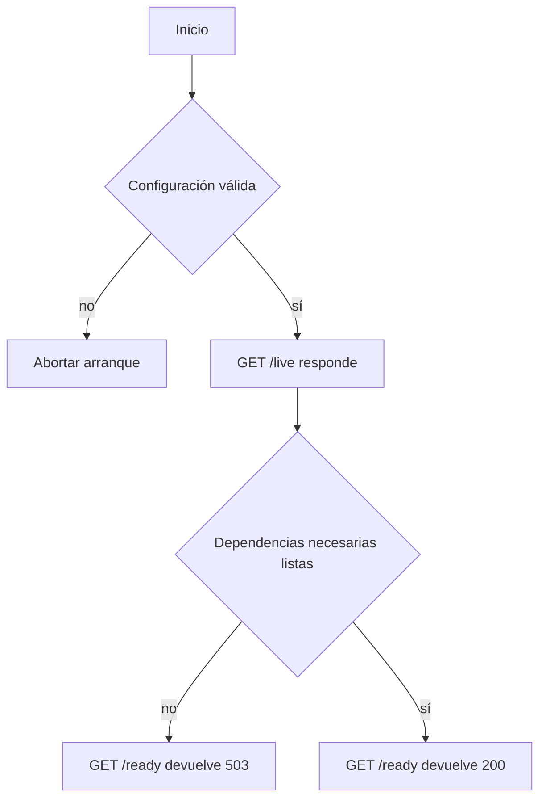

# Módulo 11: Despliegue y contenedores

## Aprende construyendo


### Tema 1: Dockerfile multi-stage para Node · Avanzado · 45 min

<details open>
<summary><strong>Capa 1 — Lectura</strong></summary>

</details>

<details>
<summary><strong>Capa 2 — Construcción</strong></summary>

#### Código y verificación
```bash
mkdir api-multistage
cd api-multistage
mkdir src
```

```json
{
  "name": "api-multistage",
  "version": "1.0.0",
  "private": true,
  "type": "module",
  "scripts": {
    "build": "tsc -p tsconfig.json",
    "start": "node dist/server.js"
  }
}
```

```bash
npm install --save-dev typescript @types/node
```

```json
{
  "compilerOptions": {
    "target": "ES2023",
    "module": "NodeNext",
    "moduleResolution": "NodeNext",
    "rootDir": "src",
    "outDir": "dist",
    "strict": true,
    "skipLibCheck": true
  },
  "include": ["src/**/*.ts"]
}
```

```ts
import { createServer } from "node:http";

const server = createServer((_req, res) => {
  res.writeHead(200, { "content-type": "application/json" });
  res.end(JSON.stringify({ service: "entregas", status: "ok" }));
});

server.listen(3000, "0.0.0.0", () => {
  console.log("API escuchando en 3000");
});
```

```dockerfile
FROM node:24-alpine AS build
WORKDIR /app
COPY package.json package-lock.json ./
RUN npm ci
COPY tsconfig.json ./
COPY src ./src
RUN npm run build

FROM node:24-alpine AS production
ENV NODE_ENV=production
WORKDIR /app
COPY package.json package-lock.json ./
RUN npm ci --omit=dev && npm cache clean --force
COPY --from=build /app/dist ./dist
USER node
EXPOSE 3000
CMD ["node", "dist/server.js"]
```

</details>

### Tema 2: Variables de entorno por ambiente y healthchecks · Avanzado · 45 min

<details open>
<summary><strong>Capa 1 — Lectura</strong></summary>

#### ► CÓMO FUNCIONA


</details>

<details>
<summary><strong>Capa 2 — Construcción</strong></summary>

#### Código y verificación
```bash
mkdir configuracion-salud
cd configuracion-salud
mkdir src
```

```json
{
  "name": "configuracion-salud",
  "version": "1.0.0",
  "private": true,
  "type": "module",
  "scripts": {
    "start": "node src/server.js"
  }
}
```

```bash
npm install --package-lock-only
```

```js
import { createServer } from "node:http";

const port = Number(process.env.PORT ?? "3000");
const startupDelayMs = Number(process.env.STARTUP_DELAY_MS ?? "1000");
if (!Number.isInteger(port) || port < 1 || port > 65535) {
  throw new Error("PORT debe ser un entero entre 1 y 65535");
}
if (!Number.isInteger(startupDelayMs) || startupDelayMs < 0) {
  throw new Error("STARTUP_DELAY_MS debe ser un entero no negativo");
}
if (!process.env.DATABASE_URL) {
  throw new Error("DATABASE_URL es obligatoria");
}

let ready = false;
setTimeout(() => {
  ready = process.env.DEPENDENCY_STATE === "up";
}, startupDelayMs);

const server = createServer((req, res) => {
  if (req.url === "/live") {
    res.writeHead(200, { "content-type": "application/json" });
    res.end(JSON.stringify({ status: "live" }));
    return;
  }
  if (req.url === "/ready") {
    res.writeHead(ready ? 200 : 503, { "content-type": "application/json" });
    res.end(JSON.stringify({ status: ready ? "ready" : "not-ready" }));
    return;
  }
  res.writeHead(404, { "content-type": "application/json" });
  res.end(JSON.stringify({ error: "not-found" }));
});

server.listen(port, "0.0.0.0", () => {
  console.log(`Servidor escuchando en ${port}`);
});
```

```dotenv
PORT=3000
LOG_LEVEL=debug
DATABASE_URL=postgres://localhost/entregas_local
DEPENDENCY_STATE=up
STARTUP_DELAY_MS=1500
```

```dockerfile
FROM node:24-alpine
ENV NODE_ENV=production
WORKDIR /app
COPY package.json package-lock.json ./
RUN npm ci --omit=dev
COPY src ./src
USER node
EXPOSE 3000
HEALTHCHECK --interval=5s --timeout=2s --start-period=5s --retries=3 CMD node -e "fetch('http://127.0.0.1:'+(process.env.PORT||3000)+'/live').then(r=>process.exit(r.ok?0:1)).catch(()=>process.exit(1))"
CMD ["node", "src/server.js"]
```

</details>

### Tema 3: PM2, contenedores y zero-downtime deploys · Avanzado · 45 min

<details open>
<summary><strong>Capa 1 — Lectura</strong></summary>

</details>

<details>
<summary><strong>Capa 2 — Construcción</strong></summary>

#### Código y verificación
```bash
mkdir procesos-despliegue
cd procesos-despliegue
mkdir src scripts
npm init -y
npm install --save-dev pm2
```

```json
{
  "name": "procesos-despliegue",
  "private": true,
  "type": "module",
  "scripts": {
    "start": "node src/server.js"
  }
}
```

```js
import { createServer } from "node:http";

const port = Number(process.env.PORT ?? "3000");
const version = process.env.VERSION ?? "v1";
const failReadiness = process.env.FAIL_READINESS === "true";

const server = createServer((req, res) => {
  if (req.url === "/ready") {
    res.writeHead(failReadiness ? 503 : 200, { "content-type": "text/plain" });
    res.end(failReadiness ? "not-ready" : "ready");
    return;
  }
  if (req.url === "/") {
    res.writeHead(200, { "content-type": "text/plain" });
    res.end(version);
    return;
  }
  res.writeHead(404);
  res.end();
});

server.listen(port, "0.0.0.0", () => {
  if (process.send) process.send("ready");
  console.log(`${version} escuchando en ${port}`);
});

process.on("SIGTERM", () => {
  server.close(() => process.exit(0));
  setTimeout(() => process.exit(1), 4000).unref();
});
```

```js
module.exports = {
  apps: [
    {
      name: "entregas-local",
      script: "./src/server.js",
      instances: 2,
      exec_mode: "cluster",
      wait_ready: true,
      listen_timeout: 5000,
      kill_timeout: 5000,
      env: {
        PORT: 3000,
        VERSION: "v1",
        FAIL_READINESS: "false"
      }
    }
  ]
};
```

```js
import { setTimeout as delay } from "node:timers/promises";

const deadline = Date.now() + 15000;
const counts = new Map();

while (Date.now() < deadline) {
  let key;
  try {
    const response = await fetch("http://127.0.0.1:3000/", {
      signal: AbortSignal.timeout(1000)
    });
    key = `${response.status}:${await response.text()}`;
  } catch (error) {
    key = `error:${error.name}`;
  }
  counts.set(key, (counts.get(key) ?? 0) + 1);
  await delay(100);
}

console.log(Object.fromEntries(counts));
```

```bash
npx pm2 start ecosystem.config.cjs
curl http://127.0.0.1:3000/
curl -i http://127.0.0.1:3000/ready
```

</details>

### Tema 4: Nginx como reverse proxy y serverless · Avanzado · 45 min

<details open>
<summary><strong>Capa 1 — Lectura</strong></summary>

</details>

<details>
<summary><strong>Capa 2 — Construcción</strong></summary>

#### Código y verificación
```bash
mkdir proxy-y-funcion
cd proxy-y-funcion
mkdir app function
```

```json
{
  "name": "proxy-y-funcion",
  "version": "1.0.0",
  "private": true,
  "type": "module"
}
```

```js
import { createServer } from "node:http";

const instance = process.env.INSTANCE ?? "desconocida";
const server = createServer((req, res) => {
  res.writeHead(200, { "content-type": "application/json" });
  res.end(JSON.stringify({
    instance,
    requestId: req.headers["x-request-id"] ?? null,
    clientAddress: req.headers["x-forwarded-for"] ?? null
  }));
});

server.listen(3000, "0.0.0.0");
```

```nginx
events {}

http {
  upstream node_backends {
    server backend-a:3000;
    server backend-b:3000;
  }

  server {
    listen 8080;

    location / {
      proxy_pass http://node_backends;
      proxy_http_version 1.1;
      proxy_set_header Host $host;
      proxy_set_header X-Forwarded-For $remote_addr;
      proxy_set_header X-Forwarded-Proto $scheme;
      proxy_set_header X-Request-ID $request_id;
      proxy_connect_timeout 2s;
      proxy_read_timeout 5s;
    }
  }
}
```

```bash
docker network create proxy-lab
docker run -d --name backend-a --network proxy-lab --user node -e INSTANCE=A -v "$PWD/app:/app:ro" -w /app node:24-alpine node server.js
docker run -d --name backend-b --network proxy-lab --user node -e INSTANCE=B -v "$PWD/app:/app:ro" -w /app node:24-alpine node server.js
```

```bash
docker run --rm --name proxy --network proxy-lab -p 8080:8080 -v "$PWD/nginx.conf:/etc/nginx/nginx.conf:ro" nginx:alpine
```

</details>
