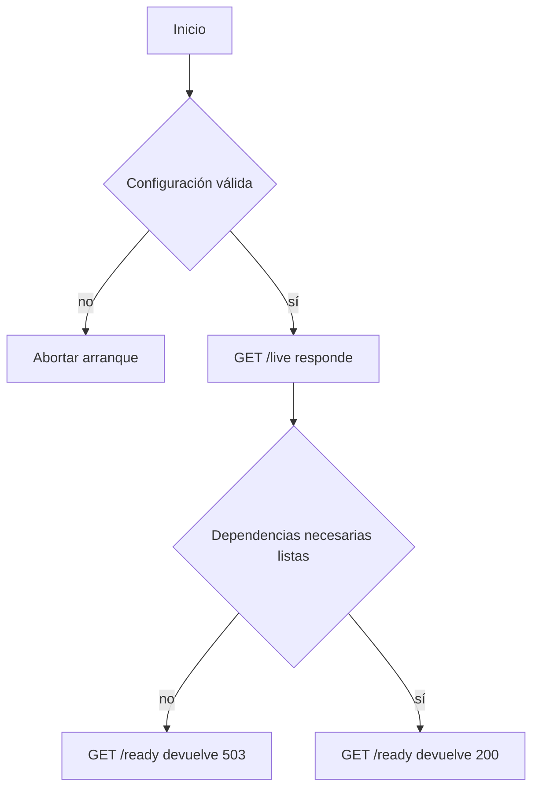

# Módulo 11: Despliegue y contenedores

## Aprende construyendo

### Tema 1: Dockerfile multi-stage para Node · Intermedio · 75 min

**Prerrequisito:** Node.js LTS, npm y Docker instalados; conocimientos básicos de terminal y de la diferencia entre `dependencies` y `devDependencies`.

**Al terminar podrás:** construir una imagen de producción que compile TypeScript en una etapa, ejecute solo el artefacto generado en otra, use un usuario no root y reproduzca dependencias mediante un lockfile.

#### Aprende

**Por qué importa:** la etapa de ejecución no necesita el compilador, las pruebas ni las dependencias de desarrollo. Separar construcción y ejecución reduce la superficie de ataque y evita que el contenedor dependa de archivos del workspace.

Un Dockerfile multi-stage crea etapas con responsabilidades distintas. La etapa `build` instala todas las dependencias con `npm ci`, compila y genera `dist/`; la etapa `production` vuelve a instalar únicamente dependencias de producción y copia `dist/` con `COPY --from=build`. `npm ci` exige un `package-lock.json` coherente con `package.json`: si falta el lockfile o no coincide, la construcción debe fallar en vez de resolver versiones imprevistas.

La imagen final ejecuta `node dist/server.js` como el usuario `node`, no como root. `.dockerignore` evita enviar `node_modules`, artefactos locales, credenciales y archivos `.env` al contexto de build. Una base Alpine puede reducir contenido innecesario, pero sus dependencias nativas deben ser compatibles con musl; si el proyecto exige glibc, corresponde elegir otra base y justificarlo. El tamaño no se presupone: se mide en cada build.

**Analogía:** es como fabricar un mueble en un taller y entregar únicamente el mueble terminado; las herramientas permanecen en el taller y no viajan dentro del paquete.

**Conceptos clave:** etapas de build y producción, artefacto `dist/`, lockfile reproducible, exclusión de `devDependencies`, contexto de build, usuario no root y compatibilidad de la imagen base.

#### Practica

Crea un proyecto nuevo, sin copiar archivos de otros temas:

```bash
mkdir api-multistage
cd api-multistage
mkdir src
```

Crea `package.json` con este contenido:

```json
{
  "name": "api-multistage",
  "version": "1.0.0",
  "private": true,
  "type": "module",
  "scripts": {
    "build": "tsc -p tsconfig.json",
    "start": "node dist/server.js"
  }
}
```

Instala las herramientas de compilación para actualizar `package.json` y generar `package-lock.json`:

```bash
npm install --save-dev typescript @types/node
```

Crea `tsconfig.json`:

```json
{
  "compilerOptions": {
    "target": "ES2023",
    "module": "NodeNext",
    "moduleResolution": "NodeNext",
    "rootDir": "src",
    "outDir": "dist",
    "strict": true,
    "skipLibCheck": true
  },
  "include": ["src/**/*.ts"]
}
```

Crea `src/server.ts`:

```ts
import { createServer } from "node:http";

const server = createServer((_req, res) => {
  res.writeHead(200, { "content-type": "application/json" });
  res.end(JSON.stringify({ service: "entregas", status: "ok" }));
});

server.listen(3000, "0.0.0.0", () => {
  console.log("API escuchando en 3000");
});
```

Crea `Dockerfile`:

```dockerfile
FROM node:24-alpine AS build
WORKDIR /app
COPY package.json package-lock.json ./
RUN npm ci
COPY tsconfig.json ./
COPY src ./src
RUN npm run build

FROM node:24-alpine AS production
ENV NODE_ENV=production
WORKDIR /app
COPY package.json package-lock.json ./
RUN npm ci --omit=dev && npm cache clean --force
COPY --from=build /app/dist ./dist
USER node
EXPOSE 3000
CMD ["node", "dist/server.js"]
```

Crea `.dockerignore`:

```dockerignore
node_modules
dist
.git
.env*
*.log
```

Construye y ejecuta:

```bash
docker build -t api-multistage:1.0 .
docker run --rm --name api-multistage -p 3000:3000 api-multistage:1.0
```

Desde otra terminal:

```bash
curl http://127.0.0.1:3000/
docker inspect --format '{{.Config.User}}' api-multistage
docker image inspect --format '{{.Size}}' api-multistage:1.0
```

**Resultado esperado:** la petición devuelve `{"service":"entregas","status":"ok"}`, el usuario configurado es `node` y el tamaño mostrado es el observado en tu equipo, sin asumir una cifra predeterminada. La imagen contiene `dist/` y no necesita `src/` ni TypeScript para arrancar.

**Fallo deliberado y corrección:** cambia temporalmente en ambas etapas `COPY package.json package-lock.json ./` por `COPY package.json ./` y vuelve a construir. `npm ci` falla porque no encuentra el lockfile. Restaura las dos instrucciones originales; no lo sustituyas por `npm install` dentro del Dockerfile. Comprueba también que `.env*` permanece excluido y que ningún secreto forma parte de la imagen.

#### Aplica

**Práctica guiada:** añade a `src/server.ts` una ruta `/version` que devuelva `{"version":"1.0.0"}` y mantén la respuesta actual en las demás rutas. Reconstruye con la etiqueta `api-multistage:1.1`, ejecuta esa etiqueta y verifica la nueva ruta. Detén el contenedor anterior antes de reutilizar el puerto.

**Práctica independiente:** crea otra etiqueta cuyo contenedor confirme que TypeScript no está instalado en producción. Usa `docker run --rm --entrypoint sh api-multistage:1.1 -c 'test ! -d node_modules/typescript'`; el comando debe terminar con código 0. Documenta qué archivos copiaste de `build`, cuál es el comando de arranque y qué evidencia demuestra que el proceso no usa root.

**Checklist de salida:**

- [ ] `package-lock.json` existe y ambas etapas copian `package.json` y el lockfile antes de `npm ci`.
- [ ] La etapa final copia `dist/` desde `build` y no copia `src/`.
- [ ] `docker inspect` muestra `node` como usuario y `curl` obtiene la respuesta esperada.
- [ ] `.dockerignore` excluye dependencias locales, artefactos, logs y archivos de entorno.
- [ ] El tamaño registrado procede de `docker image inspect`, sin afirmar una reducción no medida.

**Errores comunes:** copiar secretos al contexto; usar `latest` como supuesta garantía de reproducibilidad; ejecutar como root; copiar `node_modules` local; invocar `npm ci` sin lockfile; afirmar compatibilidad de dependencias nativas con Alpine sin probarla.

**Fuentes oficiales:** [Docker multi-stage](https://docs.docker.com/build/building/multi-stage/), [Node Docker](https://github.com/nodejs/docker-node) y [Dockerfile reference](https://docs.docker.com/reference/dockerfile/).

**Transferencia al proyecto integrador «API operativa de entregas»:** empaqueta una versión de la API que arranque únicamente desde sus artefactos de producción. Ejecuta una prueba de humo contra esa imagen y conserva la evidencia de usuario no root, lockfile y ausencia de herramientas de desarrollo.

### Tema 2: Variables de entorno por ambiente y healthchecks · Intermedio · 70 min

**Prerrequisito:** Node.js LTS, npm y Docker; comprensión básica de HTTP y de códigos de estado.

**Al terminar podrás:** ejecutar una misma imagen con configuraciones distintas y demostrar que `/live` permanece disponible mientras `/ready` devuelve 503 cuando la aplicación no está lista.

#### Aprende

**Por qué importa:** desarrollo, staging y producción cambian puertos, niveles de log y dependencias, pero deberían probar la misma imagen. Además, un proceso que sigue vivo no necesariamente puede atender tráfico.

Las variables de entorno se inyectan al arrancar; no se hornean en la imagen. La aplicación valida tipos y valores obligatorios antes de escuchar y nunca imprime todo `process.env`. Los archivos de ambiente con datos no sensibles pueden vivir fuera de la imagen para una práctica local; los secretos reales se suministran mediante el mecanismo seguro de la plataforma.

Liveness responde si el proceso puede seguir funcionando y no debe depender de la base de datos. Readiness decide si una instancia puede recibir tráfico: si aún inicializa una dependencia o esta no está disponible, responde **503**, no 200. Un `HEALTHCHECK` de Docker puede consultar `/live` y modificar el estado de salud que informa Docker, pero esa instrucción **no crea automáticamente sondas de Kubernetes**. Kubernetes necesita sus propias sondas `livenessProbe` y `readinessProbe`, con objetivos distintos.

**Analogía:** en una clínica, respirar equivale a liveness; estar despierto, con historia clínica y equipamiento disponibles equivale a readiness. Una persona puede estar viva y aun así no estar lista para atender pacientes.

**Conceptos clave:** configuración externalizada, validación al arranque, misma imagen por ambiente, liveness independiente, readiness con 503, estado de salud de Docker y sondas específicas del orquestador.

#### Practica

Crea otro proyecto vacío:

```bash
mkdir configuracion-salud
cd configuracion-salud
mkdir src
```

Crea `package.json`:

```json
{
  "name": "configuracion-salud",
  "version": "1.0.0",
  "private": true,
  "type": "module",
  "scripts": {
    "start": "node src/server.js"
  }
}
```

Genera el lockfile sin añadir dependencias externas:

```bash
npm install --package-lock-only
```

Crea `src/server.js`. La variable `DEPENDENCY_STATE` simula una dependencia local para poder provocar sus estados sin necesitar una base real:

```js
import { createServer } from "node:http";

const port = Number(process.env.PORT ?? "3000");
const startupDelayMs = Number(process.env.STARTUP_DELAY_MS ?? "1000");
if (!Number.isInteger(port) || port < 1 || port > 65535) {
  throw new Error("PORT debe ser un entero entre 1 y 65535");
}
if (!Number.isInteger(startupDelayMs) || startupDelayMs < 0) {
  throw new Error("STARTUP_DELAY_MS debe ser un entero no negativo");
}
if (!process.env.DATABASE_URL) {
  throw new Error("DATABASE_URL es obligatoria");
}

let ready = false;
setTimeout(() => {
  ready = process.env.DEPENDENCY_STATE === "up";
}, startupDelayMs);

const server = createServer((req, res) => {
  if (req.url === "/live") {
    res.writeHead(200, { "content-type": "application/json" });
    res.end(JSON.stringify({ status: "live" }));
    return;
  }
  if (req.url === "/ready") {
    res.writeHead(ready ? 200 : 503, { "content-type": "application/json" });
    res.end(JSON.stringify({ status: ready ? "ready" : "not-ready" }));
    return;
  }
  res.writeHead(404, { "content-type": "application/json" });
  res.end(JSON.stringify({ error: "not-found" }));
});

server.listen(port, "0.0.0.0", () => {
  console.log(`Servidor escuchando en ${port}`);
});
```

Crea `.env.development` solo con valores locales no sensibles:

```dotenv
PORT=3000
LOG_LEVEL=debug
DATABASE_URL=postgres://localhost/entregas_local
DEPENDENCY_STATE=up
STARTUP_DELAY_MS=1500
```

Crea `Dockerfile`:

```dockerfile
FROM node:24-alpine
ENV NODE_ENV=production
WORKDIR /app
COPY package.json package-lock.json ./
RUN npm ci --omit=dev
COPY src ./src
USER node
EXPOSE 3000
HEALTHCHECK --interval=5s --timeout=2s --start-period=5s --retries=3 CMD node -e "fetch('http://127.0.0.1:'+(process.env.PORT||3000)+'/live').then(r=>process.exit(r.ok?0:1)).catch(()=>process.exit(1))"
CMD ["node", "src/server.js"]
```

Crea `.dockerignore` para que los archivos de ambiente no entren en la imagen:

```dockerignore
node_modules
.git
.env*
*.log
```

Construye una vez y ejecuta con la configuración externa:

```bash
docker build -t configuracion-salud:1.0 .
docker run --rm --name configuracion-salud --env-file .env.development -p 3000:3000 configuracion-salud:1.0
```

Desde otra terminal, consulta inmediatamente readiness y repite después del retraso de arranque:

```bash
curl -i http://127.0.0.1:3000/live
curl -i http://127.0.0.1:3000/ready
docker inspect --format '{{.State.Health.Status}}' configuracion-salud
```

**Resultado esperado:** `/live` responde 200; `/ready` puede responder 503 durante la inicialización y responde 200 cuando finaliza con `DEPENDENCY_STATE=up`. Docker llega a informar `healthy` gracias a su chequeo de `/live`.

**Fallo deliberado y corrección:** detén el contenedor con `docker stop configuracion-salud`, cambia en `.env.development` `DEPENDENCY_STATE=up` por `DEPENDENCY_STATE=down` y ejecuta de nuevo **la misma imagen**. `/live` responde 200 y `/ready` responde 503; Docker puede seguir considerando sano el contenedor porque su `HEALTHCHECK` no es una sonda readiness. Corrige restaurando `DEPENDENCY_STATE=up` y vuelve a arrancar. Después prueba `PORT=texto`: el proceso debe fallar antes de escuchar; restaura `PORT=3000`.

#### Aplica

**Práctica guiada:** crea `.env.staging` con `PORT=3100`, `LOG_LEVEL=info`, una `DATABASE_URL` local distinta, `DEPENDENCY_STATE=up` y `STARTUP_DELAY_MS=500`. Sin reconstruir, ejecuta la imagen con `--env-file .env.staging -p 3100:3100` y comprueba ambos endpoints en el puerto 3100. El `HEALTHCHECK` usa `PORT`, por lo que sigue consultando el puerto interno correcto.

**Práctica independiente:** escribe en un archivo local `sondas.md` una propuesta de configuración para un orquestador: `/live` para reinicio por proceso bloqueado y `/ready` para retirar tráfico. Incluye un tiempo máximo para una dependencia lenta y explica por qué readiness debe fallar rápido sin bloquear liveness. No presentes el `HEALTHCHECK` del Dockerfile como sustituto de esas sondas.

**Checklist de salida:**

- [ ] Cambiar de ambiente solo exige cambiar `--env-file`, no reconstruir la imagen.
- [ ] Una configuración inválida u obligatoria ausente impide el arranque.
- [ ] Con la dependencia simulada caída, `/ready` devuelve 503 y `/live` devuelve 200.
- [ ] Ningún archivo `.env*` se copia a la imagen y los logs no exponen secretos.
- [ ] La propuesta del orquestador distingue explícitamente liveness de readiness.

**Errores comunes:** hornear secretos en la imagen; usar readiness como liveness; devolver siempre 200; no validar tipos; imprimir todo `process.env`; suponer que Kubernetes ejecuta automáticamente el `HEALTHCHECK` de Docker.



**Cuándo incluir una dependencia en readiness:** hazlo si la aplicación no puede cumplir sus requests sin ella y la retirada del tráfico ayuda a recuperarse. No conviertas cada dependencia opcional o API externa inestable en una condición global: un chequeo demasiado amplio puede retirar todas las réplicas y amplificar una degradación. Liveness responde si el proceso debe reiniciarse; readiness, si debe recibir tráfico.

**Fuentes oficiales:** [Docker HEALTHCHECK](https://docs.docker.com/reference/dockerfile/#healthcheck), [Kubernetes probes](https://kubernetes.io/docs/concepts/configuration/liveness-readiness-startup-probes/) y [Node process.env](https://nodejs.org/api/process.html#processenv).

**Transferencia al proyecto integrador «API operativa de entregas»:** valida las variables de base de datos, almacenamiento e identidad al arrancar. Demuestra por separado una configuración ausente y una dependencia no disponible: la primera impide iniciar; la segunda retira readiness sin convertir liveness en un chequeo de base de datos.

### Tema 3: PM2, contenedores y zero-downtime deploys · Avanzado · 85 min

**Prerrequisito:** Node.js LTS y npm; nociones de procesos, señales POSIX, HTTP y contenedores. No se necesita un clúster remoto.

**Al terminar podrás:** comparar un reload supervisado por PM2 con un protocolo de despliegue real, detectar una versión que no está lista y ejecutar un rollback manual documentado.

#### Aprende

**Por qué importa:** reiniciar un proceso no equivale a actualizar un servicio sin interrupción. La disponibilidad depende de capacidad restante, enrutamiento, readiness, drenaje de conexiones y compatibilidad entre versiones.

PM2 puede reiniciar procesos, agrupar logs y usar modo clúster en un servidor. En contenedores, parte de esa responsabilidad se desplaza: la política de reinicio la gestiona Docker o el orquestador, los logs se recogen desde los contenedores y el escalado suele realizarse con varias réplicas. Supervisar un proceso no sustituye al balanceador ni a las sondas.

Un rolling update necesita al menos dos instancias útiles detrás de un balanceador, una comprobación readiness efectiva, terminación ordenada ante `SIGTERM`, estado fuera del proceso y cambios de esquema compatibles con la versión anterior y la nueva. Se retira tráfico de una instancia, se dejan terminar sus operaciones y solo se avanza cuando el reemplazo está listo. **Una sola instancia no garantiza zero-downtime; `pm2 reload` tampoco lo garantiza por sí solo**, aunque use modo clúster y señales de proceso.

El experimento siguiente es local y acotado: observa respuestas durante un reload, pero no reproduce un balanceador, una base compartida ni todas las conexiones de producción. Un proceso que anuncia `ready` a PM2 todavía puede fallar su endpoint `/ready`; por eso la puerta de salud debe formar parte del mecanismo que admite tráfico. El rollback conserva la imagen o versión anterior y revierte de forma controlada; las migraciones incompatibles pueden impedirlo.

**Analogía:** cambiar ventanillas sin cerrar el servicio exige abrir y comprobar la nueva antes de retirar la anterior. Cambiar el cartel de «abierto» no basta si la nueva ventanilla no puede atender.

**Conceptos clave:** supervisión de procesos, modo clúster, responsabilidades del orquestador, rolling update, readiness como puerta de tráfico, drenaje de conexiones, despliegue reversible y límites de una prueba local.

#### Practica

Crea un proyecto nuevo:

```bash
mkdir procesos-despliegue
cd procesos-despliegue
mkdir src scripts
npm init -y
npm install --save-dev pm2
```

Edita `package.json` para conservar sus dependencias y contener al menos estas propiedades:

```json
{
  "name": "procesos-despliegue",
  "private": true,
  "type": "module",
  "scripts": {
    "start": "node src/server.js"
  }
}
```

Crea `src/server.js`:

```js
import { createServer } from "node:http";

const port = Number(process.env.PORT ?? "3000");
const version = process.env.VERSION ?? "v1";
const failReadiness = process.env.FAIL_READINESS === "true";

const server = createServer((req, res) => {
  if (req.url === "/ready") {
    res.writeHead(failReadiness ? 503 : 200, { "content-type": "text/plain" });
    res.end(failReadiness ? "not-ready" : "ready");
    return;
  }
  if (req.url === "/") {
    res.writeHead(200, { "content-type": "text/plain" });
    res.end(version);
    return;
  }
  res.writeHead(404);
  res.end();
});

server.listen(port, "0.0.0.0", () => {
  if (process.send) process.send("ready");
  console.log(`${version} escuchando en ${port}`);
});

process.on("SIGTERM", () => {
  server.close(() => process.exit(0));
  setTimeout(() => process.exit(1), 4000).unref();
});
```

Crea `ecosystem.config.cjs`:

```js
module.exports = {
  apps: [
    {
      name: "entregas-local",
      script: "./src/server.js",
      instances: 2,
      exec_mode: "cluster",
      wait_ready: true,
      listen_timeout: 5000,
      kill_timeout: 5000,
      env: {
        PORT: 3000,
        VERSION: "v1",
        FAIL_READINESS: "false"
      }
    }
  ]
};
```

Crea `scripts/observe.mjs` para registrar, sin ocultarlos, los resultados durante quince segundos:

```js
import { setTimeout as delay } from "node:timers/promises";

const deadline = Date.now() + 15000;
const counts = new Map();

while (Date.now() < deadline) {
  let key;
  try {
    const response = await fetch("http://127.0.0.1:3000/", {
      signal: AbortSignal.timeout(1000)
    });
    key = `${response.status}:${await response.text()}`;
  } catch (error) {
    key = `error:${error.name}`;
  }
  counts.set(key, (counts.get(key) ?? 0) + 1);
  await delay(100);
}

console.log(Object.fromEntries(counts));
```

Arranca y comprueba la versión inicial:

```bash
npx pm2 start ecosystem.config.cjs
curl http://127.0.0.1:3000/
curl -i http://127.0.0.1:3000/ready
```

Ejecuta `node scripts/observe.mjs` en una terminal y, mientras observa, ejecuta en otra:

```bash
VERSION=v2 FAIL_READINESS=false npx pm2 reload entregas-local --update-env
```

**Resultado esperado:** al finalizar, las respuestas exitosas corresponden a `v2` y PM2 conserva la supervisión. El resumen puede contener errores o mezcla temporal de versiones; regístralo como evidencia local, no como prueba universal de ausencia de interrupciones.

**Fallo deliberado y corrección:** ejecuta `VERSION=v2 FAIL_READINESS=true npx pm2 reload entregas-local --update-env`. El proceso puede anunciar `ready` a PM2 mientras `curl -i http://127.0.0.1:3000/ready` devuelve 503. Esto demuestra que la señal de PM2 no reemplaza una puerta HTTP de admisión. Aplica el rollback manual con `VERSION=v1 FAIL_READINESS=false npx pm2 reload entregas-local --update-env`, verifica `/` y `/ready`, y registra los comandos y resultados. No afirmes que PM2 habría revertido automáticamente una versión defectuosa.

#### Aplica

**Práctica guiada:** añade a `src/server.js` un contador de peticiones en curso. Al recibir `SIGTERM`, deja de aceptar trabajo nuevo, espera a que el contador llegue a cero y después cierra; conserva un plazo máximo de salida. Repite el observador durante un reload y anota qué límite tendrían las peticiones que superen ese plazo.

**Práctica independiente:** cambia temporalmente `instances` a 1, reinicia la configuración con `npx pm2 delete entregas-local` y `npx pm2 start ecosystem.config.cjs`, y repite el experimento. Compara el registro con el de dos instancias sin convertir una observación favorable en garantía. Restaura dos instancias y redacta un runbook de rollback que incluya versión previa, comando, verificación de `/ready`, criterio para detener el despliegue y advertencia sobre migraciones incompatibles. Al terminar, ejecuta `npx pm2 delete entregas-local`.

**Checklist de salida:**

- [ ] La configuración inicial usa dos instancias en modo clúster y el servidor maneja `SIGTERM`.
- [ ] El observador registra tanto respuestas como errores durante cada reload.
- [ ] Una versión con `/ready` 503 se detecta y se revierte manualmente a `v1`.
- [ ] El runbook identifica versión anterior, verificación posterior y límite de las migraciones.
- [ ] La conclusión distingue el experimento PM2 local de un rolling update con balanceador y readiness real.

**Errores comunes:** recargar sin una comprobación de salud efectiva; prometer continuidad con una instancia; olvidar migraciones compatibles; guardar estado solo en memoria; no drenar conexiones; no conservar una versión anterior; confundir reinicio de contenedor con balanceo.

**Fuentes oficiales:** [PM2 reload](https://pm2.keymetrics.io/docs/usage/cluster-mode/), [Docker restart](https://docs.docker.com/engine/containers/start-containers-automatically/) y [12-factor disposability](https://12factor.net/disposability).

**Transferencia al proyecto integrador «API operativa de entregas»:** implementa un apagado que deje de aceptar confirmaciones nuevas y permita terminar las que están en curso. Diseña el despliegue con al menos dos instancias, readiness antes de admitir tráfico y una versión anterior recuperable; documenta el plazo de drenaje y las migraciones que harían imposible el rollback.

### Tema 4: Nginx como reverse proxy y serverless · Avanzado · 85 min

**Prerrequisito:** Node.js LTS, Docker y conocimientos básicos de HTTP, puertos y JSON.

**Al terminar podrás:** enrutar peticiones mediante Nginx hacia dos backends, comprobar el tratamiento controlado de cabeceras y construir una función serverless con validación y límites de uso explícitos.

#### Aprende

**Por qué importa:** un reverse proxy centraliza la entrada, el balanceo y, cuando se configura, la terminación TLS; serverless delega la ejecución y el escalado a una plataforma. Ambos modelos cambian responsabilidades operativas, pero ninguno elimina los fallos ni todos los costes.

Nginx recibe al cliente y reenvía a un `upstream`, que puede contener varias instancias Node. El backend no necesita exponer su puerto al exterior. El proxy debe fijar timeouts y sustituir las cabeceras de identidad del cliente por valores derivados de la conexión controlada. `X-Forwarded-For`, `X-Forwarded-Proto` o `X-Request-ID` solo son confiables cuando provienen de un proxy controlado que descarta o normaliza los valores enviados por clientes no autorizados; aceptar directamente esos headers permite suplantación.

En serverless, una función se ejecuta ante eventos y la plataforma administra instancias y escalado. Puede haber arranques en frío, límites de duración y concurrencia, y costes por invocaciones, tiempo, memoria, red, gateway u observabilidad. Escalar a cero **no implica coste total cero universal**. Tampoco hace idónea una función para trabajos largos: esos límites deben contrastarse con el proveedor y, si hace falta, elegir un worker o contenedor de larga duración.

**Analogía:** Nginx es la recepción de un edificio que comprueba la entrada y dirige a varias oficinas. Una función serverless es un especialista convocado por evento: evita mantenerlo ocupado sin trabajo, pero su disponibilidad, tiempo de contrato y factura dependen de las condiciones del servicio.

**Conceptos clave:** reverse proxy, `upstream`, red interna, cabeceras normalizadas, timeouts, balanceo, invocación por eventos, cold start, límites de ejecución y coste total.

#### Practica

Crea un proyecto vacío con archivos propios:

```bash
mkdir proxy-y-funcion
cd proxy-y-funcion
mkdir app function
```

Crea `package.json`:

```json
{
  "name": "proxy-y-funcion",
  "version": "1.0.0",
  "private": true,
  "type": "module"
}
```

Crea `app/server.js`:

```js
import { createServer } from "node:http";

const instance = process.env.INSTANCE ?? "desconocida";
const server = createServer((req, res) => {
  res.writeHead(200, { "content-type": "application/json" });
  res.end(JSON.stringify({
    instance,
    requestId: req.headers["x-request-id"] ?? null,
    clientAddress: req.headers["x-forwarded-for"] ?? null
  }));
});

server.listen(3000, "0.0.0.0");
```

Crea `nginx.conf` con un upstream de dos backends. Nginx genera el identificador y reemplaza las cabeceras de origen en lugar de aceptar las que envía el cliente:

```nginx
events {}

http {
  upstream node_backends {
    server backend-a:3000;
    server backend-b:3000;
  }

  server {
    listen 8080;

    location / {
      proxy_pass http://node_backends;
      proxy_http_version 1.1;
      proxy_set_header Host $host;
      proxy_set_header X-Forwarded-For $remote_addr;
      proxy_set_header X-Forwarded-Proto $scheme;
      proxy_set_header X-Request-ID $request_id;
      proxy_connect_timeout 2s;
      proxy_read_timeout 5s;
    }
  }
}
```

Crea una red y arranca dos procesos Node aislados, sin publicar sus puertos en el host. En bash, zsh o PowerShell, `$PWD` representa la carpeta actual:

```bash
docker network create proxy-lab
docker run -d --name backend-a --network proxy-lab --user node -e INSTANCE=A -v "$PWD/app:/app:ro" -w /app node:24-alpine node server.js
docker run -d --name backend-b --network proxy-lab --user node -e INSTANCE=B -v "$PWD/app:/app:ro" -w /app node:24-alpine node server.js
```

En otra terminal, arranca Nginx en primer plano:

```bash
docker run --rm --name proxy --network proxy-lab -p 8080:8080 -v "$PWD/nginx.conf:/etc/nginx/nginx.conf:ro" nginx:alpine
```

Realiza varias peticiones y otra con un identificador que intenta suplantar al proxy:

```bash
curl http://127.0.0.1:8080/
curl http://127.0.0.1:8080/
curl http://127.0.0.1:8080/
curl -H 'X-Request-ID: falsificado' http://127.0.0.1:8080/
```

**Resultado esperado:** las respuestas alternan instancias `A` y `B` según el balanceo, incluyen un `requestId` generado por Nginx y ninguna conserva el valor `falsificado`. `clientAddress` procede de `$remote_addr` en el proxy; no se interpreta como una identidad segura fuera de ese límite de confianza.

**Fallo deliberado y corrección:** ejecuta `docker stop backend-a backend-b` y repite `curl -i http://127.0.0.1:8080/`. Nginx devuelve 502 porque ningún upstream está disponible. Recupera el servicio con `docker start backend-a backend-b` y repite la petición hasta obtener respuestas de ambos backends.

#### Aplica

**Práctica guiada:** añade a `nginx.conf` `client_max_body_size 64k;` dentro de `server` y recarga el contenedor de Nginx para que adopte la configuración. Define también un criterio de prueba para peticiones que superen ese límite y para un backend que tarde más que `proxy_read_timeout`; registra el código y los logs observados, sin suponer que todos los errores pertenecen a la aplicación.

**Práctica independiente:** crea `function/handler.mjs` con un contrato compatible con un handler HTTP de AWS Lambda:

```js
const response = (statusCode, body) => ({
  statusCode,
  headers: { "content-type": "application/json" },
  body: JSON.stringify(body)
});

export const handler = async (event) => {
  let input;
  try {
    input = typeof event?.body === "string"
      ? JSON.parse(event.body)
      : event?.body ?? event;
  } catch {
    return response(400, { error: "JSON inválido" });
  }

  if (typeof input?.name !== "string" || input.name.trim() === "") {
    return response(400, { error: "name es obligatorio" });
  }
  return response(200, { greeting: `Hola, ${input.name.trim()}` });
};
```

Crea `function/invoke.mjs` para invocarlo localmente, sin simular que esto mide un cold start del proveedor:

```js
import { handler } from "./handler.mjs";

console.log(await handler({ body: JSON.stringify({}) }));
console.log(await handler({ body: JSON.stringify({ name: "Ada" }) }));
console.log(await handler({ body: "{" }));
```

Ejecuta `node function/invoke.mjs`. Debes obtener 400 para el cuerpo sin `name`, 200 para Ada y 400 para JSON inválido. Documenta por separado el contrato, qué observarías para comparar una invocación fría con otras posteriores en un proveedor real y por qué un trabajo de larga duración podría requerir otro modelo. No inventes latencias ni costes.

Para cerrar el laboratorio del proxy, detén Nginx con Ctrl+C y limpia los recursos creados:

```bash
docker stop backend-a backend-b
docker rm backend-a backend-b
docker network rm proxy-lab
```

**Checklist de salida:**

- [ ] Nginx usa un `upstream` con dos backends y los backends no publican puertos en el host.
- [ ] Las peticiones llegan a ambas instancias y un upstream detenido produce un fallo diagnósticamente visible.
- [ ] El identificador enviado directamente por el cliente no atraviesa el proxy como valor confiable.
- [ ] La función devuelve 200 solo con un `name` válido y 400 para entrada ausente o JSON inválido.
- [ ] La comparación serverless distingue prueba local, cold start real, costes adicionales y límites de duración.

**Errores comunes:** exponer el backend directamente; confiar en headers de clientes no controlados; olvidar timeouts; no definir upstream; usar serverless para procesos largos sin comprobar límites; confundir escala a cero con factura total cero; inventar mediciones de cold start.

**Fuentes oficiales:** [Nginx reverse proxy](https://docs.nginx.com/nginx/admin-guide/web-server/reverse-proxy/), [AWS Lambda handler](https://docs.aws.amazon.com/lambda/latest/dg/nodejs-handler.html) y [Docker networking](https://docs.docker.com/engine/network/).

**Transferencia al proyecto integrador «API operativa de entregas»:** coloca la API detrás de un proxy con límites de cuerpo y tiempos definidos. Normaliza las cabeceras de cliente en ese límite de confianza y evalúa una función únicamente para una operación acotada; conserva contenedores o workers para trabajos cuya duración o estado no encajen con serverless.

## Laboratorio práctico

**Al terminar podrás:** desde una carpeta vacía, producir y ejecutar una release contenerizada de una API con build multi-stage, configuración externa, liveness, readiness y evidencia de rollback, sin usar archivos de los proyectos anteriores.

**Prerrequisitos:** Node.js LTS, npm y Docker. La ejecución práctica y la revisión pedagógica quedan pendientes hasta realizarlas y registrar sus resultados.

Crea la estructura:

```bash
mkdir rutaflow-release-lab
cd rutaflow-release-lab
mkdir src scripts
```

Crea `package.json`:

```json
{
  "name": "rutaflow-release-lab",
  "version": "1.0.0",
  "private": true,
  "type": "module",
  "scripts": {
    "build": "node --check src/server.js && node scripts/build.mjs",
    "start": "node dist/server.js"
  }
}
```

Ejecuta `npm install --package-lock-only` para generar el lockfile. Crea `scripts/build.mjs`:

```js
import { copyFile, mkdir } from "node:fs/promises";

await mkdir("dist", { recursive: true });
await copyFile("src/server.js", "dist/server.js");
console.log("Artefacto generado en dist/server.js");
```

Crea `src/server.js`:

```js
import { createServer } from "node:http";

const port = Number(process.env.PORT ?? "3000");
if (!Number.isInteger(port) || port < 1 || port > 65535) {
  throw new Error("PORT inválido");
}
if (!process.env.RELEASE) throw new Error("RELEASE es obligatoria");

const server = createServer((req, res) => {
  if (req.url === "/live") {
    res.writeHead(200, { "content-type": "application/json" });
    res.end(JSON.stringify({ status: "live" }));
    return;
  }
  if (req.url === "/ready") {
    const ready = process.env.READY === "true";
    res.writeHead(ready ? 200 : 503, { "content-type": "application/json" });
    res.end(JSON.stringify({ status: ready ? "ready" : "not-ready" }));
    return;
  }
  if (req.url === "/version") {
    res.writeHead(200, { "content-type": "application/json" });
    res.end(JSON.stringify({ release: process.env.RELEASE }));
    return;
  }
  res.writeHead(404);
  res.end();
});

server.listen(port, "0.0.0.0");
```

Crea `Dockerfile`:

```dockerfile
FROM node:24-alpine AS build
WORKDIR /app
COPY package.json package-lock.json ./
RUN npm ci
COPY scripts ./scripts
COPY src ./src
RUN npm run build

FROM node:24-alpine AS production
ENV NODE_ENV=production
WORKDIR /app
COPY package.json package-lock.json ./
RUN npm ci --omit=dev && npm cache clean --force
COPY --from=build /app/dist ./dist
USER node
EXPOSE 3000
HEALTHCHECK --interval=5s --timeout=2s --start-period=5s --retries=3 CMD node -e "fetch('http://127.0.0.1:'+(process.env.PORT||3000)+'/live').then(r=>process.exit(r.ok?0:1)).catch(()=>process.exit(1))"
CMD ["node", "dist/server.js"]
```

Crea `.dockerignore`:

```dockerignore
node_modules
dist
.git
.env*
*.log
```

Crea `.env.development` sin secretos:

```dotenv
PORT=3000
RELEASE=1.0.0
READY=true
```

Construye, conserva esta release para un posible rollback y arranca:

```bash
docker build -t rutaflow-release:1.0 .
docker tag rutaflow-release:1.0 rutaflow-release:rollback
docker run --rm --name rutaflow-release --env-file .env.development -p 3000:3000 rutaflow-release:1.0
```

Verifica desde otra terminal:

```bash
curl -i http://127.0.0.1:3000/live
curl -i http://127.0.0.1:3000/ready
curl http://127.0.0.1:3000/version
docker inspect --format '{{.Config.User}} {{.State.Health.Status}}' rutaflow-release
docker image inspect --format '{{.Size}}' rutaflow-release:1.0
```

**Resultado esperado:** liveness y readiness responden 200, `/version` devuelve `1.0.0`, el usuario es `node` y Docker llega a `healthy`. El tamaño que se entrega es exclusivamente el medido. Para comprobar el comportamiento degradado, detén el contenedor, cambia localmente `READY=false` y arranca otra vez la misma imagen: `/live` debe responder 200 y `/ready` 503. Restaura `READY=true` para cerrar.

**Rollback documentado:** antes de una release posterior conserva `rutaflow-release:rollback`. Si la nueva versión falla, detén su contenedor y ejecuta la etiqueta anterior con el mismo archivo de ambiente válido; después verifica `/ready` y `/version`. Con un solo contenedor esta sustitución interrumpe el servicio: no la denomines zero-downtime. Un despliegue continuo requeriría capacidad redundante, balanceador, readiness, drenaje y datos compatibles.

**Entrega verificable:**

- [ ] Los seis archivos creados y el lockfile permiten reconstruir sin recursos externos del workspace.
- [ ] La imagen final ejecuta `dist/server.js`, no contiene archivos `.env` y usa `node` como usuario.
- [ ] Las evidencias incluyen respuestas de `/live`, `/ready` y `/version`, estado de salud y tamaño real observado.
- [ ] La prueba con `READY=false` distingue liveness de readiness y termina restaurando una configuración válida.
- [ ] El procedimiento de rollback identifica la etiqueta conservada y reconoce el límite de operar con una sola instancia.
