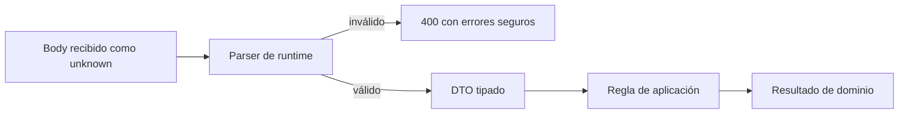
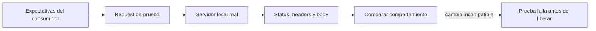
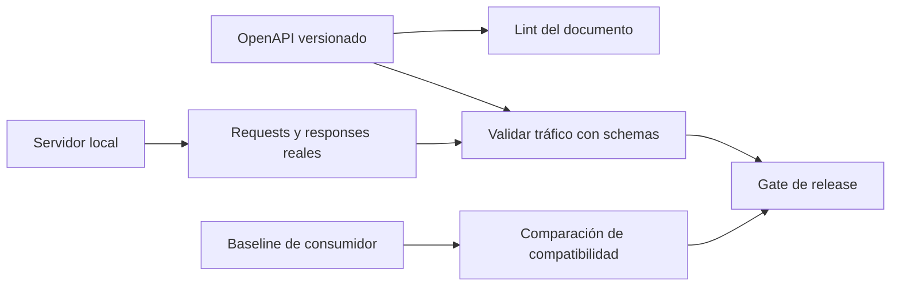
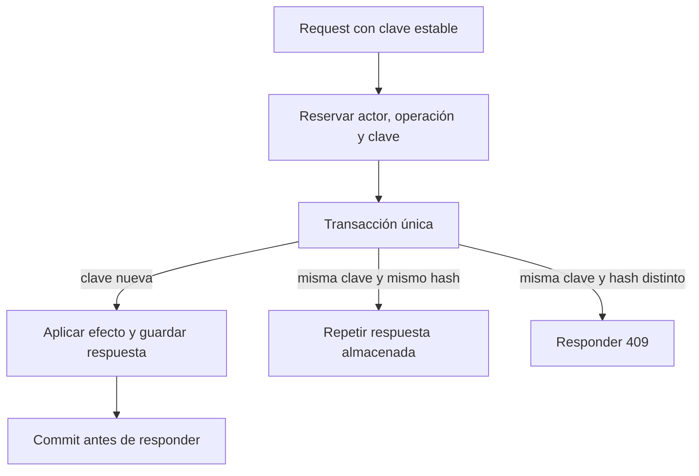
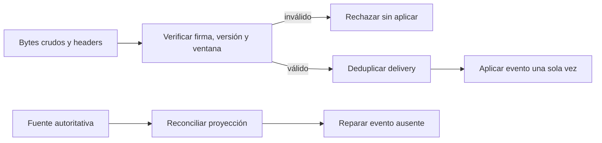

# Módulo 13: TypeScript, contratos e integraciones confiables

Una API puede compilar, pasar pruebas y aun romper consumidores o duplicar cobros. La red entrega bytes, no objetos TypeScript; los clientes reintentan cuando desconocen el resultado; una publicación puede separarse accidentalmente del cambio en base. Este módulo convierte esas incertidumbres en contratos e invariantes comprobables.

## Aprende construyendo

Cada tema comienza en una carpeta vacía y constituye un proyecto independiente. Escribe manualmente todos los archivos indicados: no copies ni abras ejemplos de la academia y no reutilices archivos de otros temas. Las pruebas de concurrencia son locales y acotadas; no necesitan credenciales reales, servicios externos, CI ni despliegues.


### Tema 1: Tipos estáticos dentro, datos desconocidos en la frontera · Avanzado · 45 min

<details open>
<summary><strong>Capa 1 — Lectura</strong></summary>

#### ► CÓMO FUNCIONA


</details>

<details>
<summary><strong>Capa 2 — Construcción</strong></summary>

#### Código y verificación
```text
bytes/JSON -> unknown -> schema runtime -> DTO válido -> caso de uso
                         |
                         +-> 400 con errores de entrada
```

```bash
mkdir frontera-envios
cd frontera-envios
mkdir src
```

```json
{
  "name": "frontera-envios",
  "private": true,
  "type": "module",
  "scripts": {
    "typecheck": "tsc --noEmit",
    "test": "tsx --test src/frontera.test.ts",
    "check": "npm run typecheck && npm test"
  }
}
```

```json
{
  "compilerOptions": {
    "target": "ES2022",
    "module": "NodeNext",
    "moduleResolution": "NodeNext",
    "strict": true,
    "noUncheckedIndexedAccess": true,
    "exactOptionalPropertyTypes": true,
    "noEmit": true,
    "types": ["node"]
  },
  "include": ["src/**/*.ts"]
}
```

```bash
npm install zod
npm install --save-dev typescript tsx @types/node
```

```typescript
import { z } from "zod";

export const CreateEnvioInput = z.object({
  guia: z.string().regex(/^RF-\d+$/),
  direccion: z.string().trim().min(1).max(200),
}).strict();

export type CreateEnvioInput = z.infer<typeof CreateEnvioInput>;

export function parseCreateEnvio(value: unknown): CreateEnvioInput {
  return CreateEnvioInput.parse(value);
}

export type CrearEnvioResultado =
  | { kind: "creado"; envio: { id: string; guia: string } }
  | { kind: "guia-duplicada"; envio: { id: string; guia: string } }
  | { kind: "cupo-excedido"; limite: number };

export function toHttp(result: CrearEnvioResultado): { status: number; body: unknown } {
  switch (result.kind) {
    case "creado":
      return { status: 201, body: result.envio };
    case "guia-duplicada":
      return { status: 200, body: result.envio };
    case "cupo-excedido":
      return { status: 409, body: { limite: result.limite } };
    default:
      return assertNever(result);
  }
}

function assertNever(value: never): never {
  throw new Error(`Resultado no contemplado: ${JSON.stringify(value)}`);
}
```

</details>

### Tema 2: Un contrato HTTP es comportamiento, no solo documentación · Avanzado · 45 min

<details open>
<summary><strong>Capa 1 — Lectura</strong></summary>

#### ► CÓMO FUNCIONA


</details>

<details>
<summary><strong>Capa 2 — Construcción</strong></summary>

#### Código y verificación
```bash
mkdir comportamiento-envios
cd comportamiento-envios
mkdir src test contracts
```

```json
{
  "name": "comportamiento-envios",
  "private": true,
  "type": "module",
  "scripts": {
    "test": "node --test test/*.test.js"
  }
}
```

```javascript
import { once } from "node:events";
import { createApp } from "../src/server.js";

export async function startTestServer() {
  const server = createApp();
  server.listen(0, "127.0.0.1");
  await once(server, "listening");

  const address = server.address();
  if (!address || typeof address === "string") {
    server.close();
    await once(server, "close");
    throw new Error("El servidor de pruebas no obtuvo una dirección TCP");
  }

  return {
    baseUrl: `http://127.0.0.1:${address.port}`,
    async close() {
      server.close();
      await once(server, "close");
    },
  };
}
```

```javascript
import { createServer } from "node:http";
import { randomUUID } from "node:crypto";

function responder(res, status, body, problem = false) {
  res.writeHead(status, {
    "Content-Type": problem
      ? "application/problem+json; charset=utf-8"
      : "application/json; charset=utf-8",
  });
  res.end(JSON.stringify(body));
}

function problema(res, status, title, detail) {
  responder(res, status, {
    type: "about:blank",
    title,
    status,
    detail,
    instance: "/envios",
  }, true);
}

export function createApp() {
  const envios = new Map();

  return createServer(async (req, res) => {
    if (req.method !== "POST" || req.url !== "/envios") {
      return problema(res, 404, "Ruta no encontrada", "La operación solicitada no existe");
    }

    let raw = "";
    for await (const chunk of req) raw += chunk;

    let body;
    try {
      body = JSON.parse(raw);
    } catch {
      return problema(res, 400, "Entrada inválida", "El body debe ser JSON válido");
    }

    if (!body || typeof body !== "object" || Array.isArray(body) ||
        typeof body.guia !== "string" || !/^RF-\d+$/.test(body.guia)) {
      return problema(res, 400, "Entrada inválida", "guia debe tener formato RF-<dígitos>");
    }

    if (envios.has(body.guia)) {
      return problema(res, 409, "Guía duplicada", "Ya existe un envío con esa guía");
    }

    const envio = { id: randomUUID(), guia: body.guia, estado: "creado" };
    envios.set(envio.guia, envio);
    return responder(res, 201, envio);
  });
}
```

```javascript
import test, { after, before } from "node:test";
import assert from "node:assert/strict";
import { startTestServer } from "./server-harness.js";

let testServer;

before(async () => {
  testServer = await startTestServer();
});

after(async () => {
  if (testServer) await testServer.close();
});

test("el proveedor crea con 201 y JSON observable", async () => {
  const response = await fetch(`${testServer.baseUrl}/envios`, {
    method: "POST",
    headers: { "Content-Type": "application/json" },
    body: JSON.stringify({ guia: "RF-100" }),
  });
  assert.equal(response.status, 201);
  assert.match(response.headers.get("content-type"), /^application\/json/);
  const body = await response.json();
  assert.equal(typeof body.id, "string");
  assert.equal(body.guia, "RF-100");
  assert.equal(body.estado, "creado");
});

test("el proveedor devuelve Problem Details en una entrada inválida", async () => {
  const response = await fetch(`${testServer.baseUrl}/envios`, {
    method: "POST",
    headers: { "Content-Type": "application/json" },
    body: JSON.stringify({ guia: 100 }),
  });
  assert.equal(response.status, 400);
  assert.match(response.headers.get("content-type"), /^application\/problem\+json/);
  const body = await response.json();
  assert.equal(body.status, 400);
  assert.equal(body.title, "Entrada inválida");
  assert.equal(body.instance, "/envios");
});
```

```json
{
  "consumer": "app-movil",
  "cases": [
    {
      "name": "crear envío visible para el conductor",
      "request": { "guia": "RF-700" },
      "expected": {
        "status": 201,
        "contentType": "application/json",
        "requiredFields": ["id"],
        "body": { "guia": "RF-700", "estado": "creado" }
      }
    },
    {
      "name": "mostrar una entrada inválida sin interpretar HTML",
      "request": { "guia": "incorrecta" },
      "expected": {
        "status": 400,
        "contentType": "application/problem+json",
        "requiredFields": ["detail"],
        "body": { "title": "Entrada inválida", "status": 400 }
      }
    }
  ]
}
```

</details>

### Tema 3: OpenAPI como contrato ejecutable · Avanzado · 45 min

<details open>
<summary><strong>Capa 1 — Lectura</strong></summary>

#### ► CÓMO FUNCIONA


</details>

<details>
<summary><strong>Capa 2 — Construcción</strong></summary>

#### Código y verificación
```bash
mkdir openapi-entregas
cd openapi-entregas
mkdir src test contracts
```

```json
{
  "name": "openapi-entregas",
  "private": true,
  "type": "module",
  "scripts": {
    "lint": "redocly lint src/openapi.yaml",
    "test": "node --test test/*.test.js",
    "check": "npm run lint && npm test"
  }
}
```

```bash
npm install ajv ajv-formats yaml
npm install --save-dev @redocly/cli
```

```yaml
openapi: 3.1.0
info:
  title: Delivery API
  version: 1.0.0
paths:
  /deliveries/{id}:
    get:
      operationId: getDelivery
      parameters:
        - in: path
          name: id
          required: true
          schema:
            type: string
            format: uuid
      responses:
        "200":
          description: Entrega encontrada
          content:
            application/json:
              schema:
                $ref: "#/components/schemas/Delivery"
        "404":
          description: Entrega inexistente
          content:
            application/problem+json:
              schema:
                $ref: "#/components/schemas/Problem"
components:
  schemas:
    Delivery:
      type: object
      additionalProperties: false
      required: [id, trackingCode, status]
      properties:
        id:
          type: string
          format: uuid
        trackingCode:
          type: string
          minLength: 6
        status:
          type: string
          enum: [created, assigned, in_transit, delivered]
    Problem:
      type: object
      additionalProperties: false
      required: [type, title, status, detail, instance]
      properties:
        type:
          type: string
        title:
          type: string
        status:
          type: integer
        detail:
          type: string
        instance:
          type: string
```

```javascript
import { createServer } from "node:http";

const delivery = Object.freeze({
  id: "7c9e6679-7425-40de-944b-e07fc1f90ae7",
  trackingCode: "RF-9000",
  status: "created",
});

function responder(res, status, body, contentType) {
  res.writeHead(status, { "Content-Type": `${contentType}; charset=utf-8` });
  res.end(JSON.stringify(body));
}

export function createApp() {
  return createServer((req, res) => {
    const match = req.method === "GET" && req.url?.match(/^\/deliveries\/([^/]+)$/);
    if (!match) {
      return responder(res, 404, {
        type: "about:blank",
        title: "Entrega inexistente",
        status: 404,
        detail: "No existe la entrega solicitada",
        instance: req.url ?? "/deliveries",
      }, "application/problem+json");
    }

    if (match[1] !== delivery.id) {
      return responder(res, 404, {
        type: "about:blank",
        title: "Entrega inexistente",
        status: 404,
        detail: "No existe la entrega solicitada",
        instance: req.url,
      }, "application/problem+json");
    }

    return responder(res, 200, delivery, "application/json");
  });
}
```

```javascript
import test, { after, before } from "node:test";
import assert from "node:assert/strict";
import { once } from "node:events";
import { readFile } from "node:fs/promises";
import YAML from "yaml";
import Ajv2020 from "ajv/dist/2020.js";
import addFormats from "ajv-formats";
import { createApp } from "../src/server.js";

const document = YAML.parse(await readFile(
  new URL("../src/openapi.yaml", import.meta.url),
  "utf8",
));
const ajv = new Ajv2020({ allErrors: true, strict: true });
addFormats(ajv);
const validateDelivery = ajv.compile(document.components.schemas.Delivery);
const validateProblem = ajv.compile(document.components.schemas.Problem);

let server;
let baseUrl;

before(async () => {
  server = createApp();
  server.listen(0, "127.0.0.1");
  await once(server, "listening");
  baseUrl = `http://127.0.0.1:${server.address().port}`;
});

after(async () => {
  server.close();
  await once(server, "close");
});

test("el 200 real cumple Delivery y su content type", async () => {
  const id = "7c9e6679-7425-40de-944b-e07fc1f90ae7";
  const response = await fetch(`${baseUrl}/deliveries/${id}`);
  assert.equal(response.status, 200);
  assert.match(response.headers.get("content-type"), /^application\/json/);
  const body = await response.json();
  assert.equal(validateDelivery(body), true, JSON.stringify(validateDelivery.errors));
});

test("el 404 real cumple Problem", async () => {
  const id = "00000000-0000-4000-8000-000000000000";
  const response = await fetch(`${baseUrl}/deliveries/${id}`);
  assert.equal(response.status, 404);
  assert.match(response.headers.get("content-type"), /^application\/problem\+json/);
  const body = await response.json();
  assert.equal(validateProblem(body), true, JSON.stringify(validateProblem.errors));
});
```

</details>

### Tema 4: Reintentar sin duplicar el efecto · Avanzado · 45 min

<details open>
<summary><strong>Capa 1 — Lectura</strong></summary>

#### ► CÓMO FUNCIONA


</details>

<details>
<summary><strong>Capa 2 — Construcción</strong></summary>

#### Código y verificación
```text
POST + actor A + operación crear + clave K + hash H
  -> transacción [reserva única + envío + respuesta + outbox E]
  -> reintento A/crear/K/H recupera la misma respuesta
  -> reintento A/crear/K/H2 recibe 409
```

```bash
mkdir idempotencia-envios
cd idempotencia-envios
mkdir -p src/db test
```

```json
{
  "name": "idempotencia-envios",
  "private": true,
  "type": "module",
  "scripts": {
    "test": "node --test test/idempotencia.test.js"
  }
}
```

```bash
npm install pg
```

```yaml
services:
  postgres:
    image: postgres:16-alpine
    environment:
      POSTGRES_USER: rutaflow
      POSTGRES_PASSWORD: laboratorio-local
      POSTGRES_DB: rutaflow
    ports:
      - "127.0.0.1:55432:5432"
    healthcheck:
      test: ["CMD-SHELL", "pg_isready -U rutaflow -d rutaflow"]
      interval: 1s
      timeout: 3s
      retries: 20
```

```sql
CREATE TABLE IF NOT EXISTS envios (
  id uuid PRIMARY KEY,
  actor_id text NOT NULL,
  guia text NOT NULL,
  direccion text NOT NULL
);

CREATE TABLE IF NOT EXISTS idempotency_keys (
  actor_id text NOT NULL,
  operation text NOT NULL,
  key text NOT NULL,
  request_hash text NOT NULL,
  status text NOT NULL,
  response_status integer,
  response_body jsonb,
  created_at timestamptz NOT NULL DEFAULT now(),
  PRIMARY KEY (actor_id, operation, key)
);

CREATE TABLE IF NOT EXISTS outbox (
  event_id uuid PRIMARY KEY,
  event_type text NOT NULL,
  aggregate_id uuid NOT NULL,
  payload jsonb NOT NULL,
  published_at timestamptz
);

CREATE TABLE IF NOT EXISTS eventos_consumidos (
  event_id uuid PRIMARY KEY,
  envio_id uuid NOT NULL,
  procesado_at timestamptz NOT NULL DEFAULT now()
);
```

</details>

### Tema 5: Webhooks verificables y recuperación por reconciliación · Avanzado · 45 min

<details open>
<summary><strong>Capa 1 — Lectura</strong></summary>

#### ► CÓMO FUNCIONA


</details>

<details>
<summary><strong>Capa 2 — Construcción</strong></summary>

#### Código y verificación
```bash
mkdir webhooks-cobros
cd webhooks-cobros
mkdir src test
```

```json
{
  "name": "webhooks-cobros",
  "private": true,
  "type": "module",
  "scripts": {
    "test": "node --test test/webhook.test.js"
  }
}
```

```javascript
import { createHmac, timingSafeEqual } from "node:crypto";

export function firmar(rawBody, timestamp, secret) {
  return createHmac("sha256", secret)
    .update(`v1.${timestamp}.`)
    .update(rawBody)
    .digest("hex");
}

export function verificar({
  rawBody,
  timestamp,
  signature,
  deliveryId,
  secret,
  nowSeconds,
  procesados,
}) {
  const expected = createHmac("sha256", secret)
    .update(`v1.${timestamp}.`)
    .update(rawBody)
    .digest();

  if (!/^(?:[0-9a-f]{2})+$/i.test(signature)) {
    return { ok: false, reason: "signature" };
  }
  const received = Buffer.from(signature, "hex");
  if (received.length !== expected.length || !timingSafeEqual(received, expected)) {
    return { ok: false, reason: "signature" };
  }

  const eventTime = Number(timestamp);
  if (!Number.isInteger(eventTime) || Math.abs(nowSeconds - eventTime) > 300) {
    return { ok: false, reason: "timestamp" };
  }
  if (typeof deliveryId !== "string" || deliveryId.length === 0) {
    return { ok: false, reason: "delivery" };
  }
  if (procesados.has(deliveryId)) {
    return { ok: false, reason: "replay" };
  }

  procesados.add(deliveryId);
  return { ok: true, reason: "accepted" };
}

export function reconciliar({ fuente, procesados, aplicar }) {
  const reparados = [];
  for (const event of fuente) {
    if (!procesados.has(event.id)) {
      aplicar(event);
      procesados.add(event.id);
      reparados.push(event.id);
    }
  }
  return reparados;
}
```

```javascript
import test from "node:test";
import assert from "node:assert/strict";
import { firmar, reconciliar, verificar } from "../src/webhook.js";

const secret = "secreto-local-de-prueba";
const nowSeconds = 1_760_000_300;
const timestamp = "1760000000";
const rawBody = Buffer.from('{ "id": "evt_1", "monto": 1500 }');

function entrada(overrides = {}) {
  return {
    rawBody,
    timestamp,
    signature: firmar(rawBody, timestamp, secret),
    deliveryId: "delivery-1",
    secret,
    nowSeconds,
    procesados: new Set(),
    ...overrides,
  };
}

test("acepta los bytes firmados y rechaza un body reserializado o alterado", () => {
  assert.deepEqual(verificar(entrada()), { ok: true, reason: "accepted" });

  const reserializado = Buffer.from(JSON.stringify(JSON.parse(rawBody.toString("utf8"))));
  assert.equal(verificar(entrada({ rawBody: reserializado })).reason, "signature");

  const alterado = Buffer.from(rawBody.toString("utf8").replace("1500", "1"));
  assert.equal(verificar(entrada({ rawBody: alterado })).reason, "signature");
});

test("rechaza un timestamp fuera de ventana aunque su HMAC sea válido", () => {
  const oldTimestamp = String(nowSeconds - 301);
  const result = verificar(entrada({
    timestamp: oldTimestamp,
    signature: firmar(rawBody, oldTimestamp, secret),
  }));
  assert.deepEqual(result, { ok: false, reason: "timestamp" });
});

test("rechaza un replay después de una entrega válida", () => {
  const procesados = new Set();
  assert.equal(verificar(entrada({ procesados })).ok, true);
  assert.deepEqual(verificar(entrada({ procesados })), { ok: false, reason: "replay" });
});

test("comprueba longitud y no lanza con una firma corta o no hexadecimal", () => {
  assert.doesNotThrow(() => verificar(entrada({ signature: "00" })));
  assert.equal(verificar(entrada({ signature: "00" })).reason, "signature");
  assert.equal(verificar(entrada({ signature: "zz" })).reason, "signature");
});

test("la reconciliación repara solo la fuente ausente", () => {
  const procesados = new Set(["evt_1"]);
  const aplicados = [];
  const reparados = reconciliar({
    fuente: [{ id: "evt_1", monto: 1500 }, { id: "evt_2", monto: 2000 }],
    procesados,
    aplicar: event => aplicados.push(event.id),
  });
  assert.deepEqual(reparados, ["evt_2"]);
  assert.deepEqual(aplicados, ["evt_2"]);
  assert.deepEqual([...procesados].sort(), ["evt_1", "evt_2"]);
});
```

```bash
npm test
```


</details>

### Proyecto: API contractual con efectos recuperables

<details open>
<summary><strong>Capa 1 — Lectura</strong></summary>

</details>

<details>
<summary><strong>Capa 2 — Construcción</strong></summary>

#### Código y verificación
```text
rutaflow-confiable/
├── compose.yaml
├── package.json
├── tsconfig.json
├── contracts/
│   ├── openapi.yaml
│   ├── consumidor-movil.json
│   └── consumidor-base.json
├── src/
│   ├── config.ts
│   ├── server.ts
│   ├── schemas.ts
│   ├── application.ts
│   ├── db/
│   │   ├── schema.sql
│   │   └── idempotencia.ts
│   ├── outbox.ts
│   ├── webhook.ts
│   ├── reconciliacion.ts
│   └── reintentos.ts
├── test/
│   ├── frontera.test.ts
│   ├── proveedor.test.ts
│   ├── consumidor.test.ts
│   ├── openapi.test.ts
│   ├── compatibilidad.test.ts
│   ├── idempotencia.test.ts
│   ├── outbox.test.ts
│   ├── webhook.test.ts
│   └── reconciliacion.test.ts
└── RUNBOOK.md
```

```json
{
  "scripts": {
    "typecheck": "tsc --noEmit",
    "lint:openapi": "redocly lint contracts/openapi.yaml",
    "test": "tsx --test test/*.test.ts",
    "check": "npm run typecheck && npm run lint:openapi && npm test"
  }
}
```

```bash
docker compose up -d
docker compose exec -T postgres psql -U rutaflow -d rutaflow < src/db/schema.sql
npm run check
```

</details>
