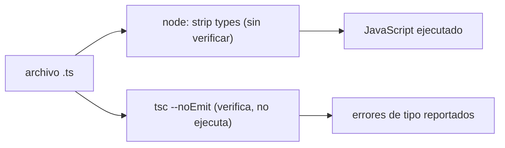
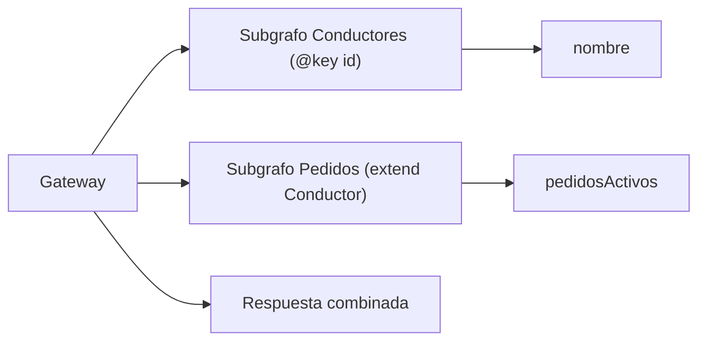
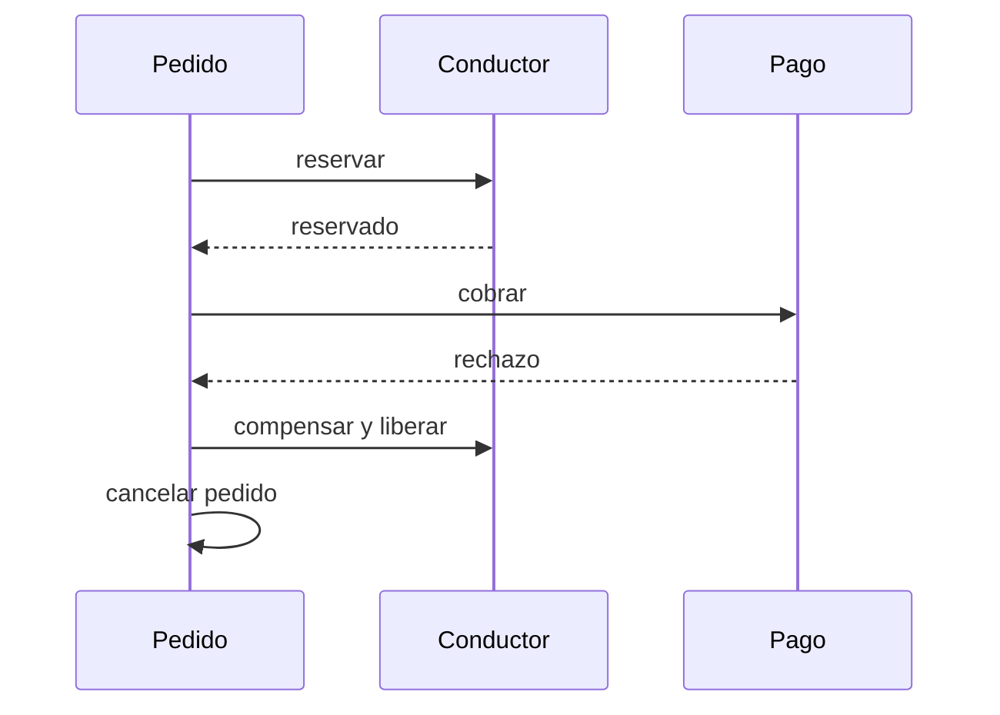
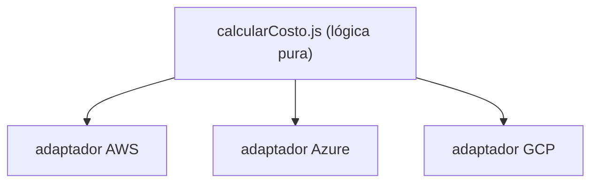
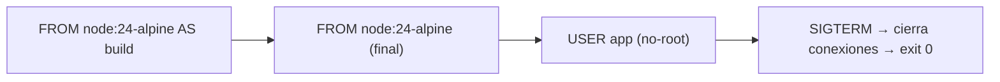
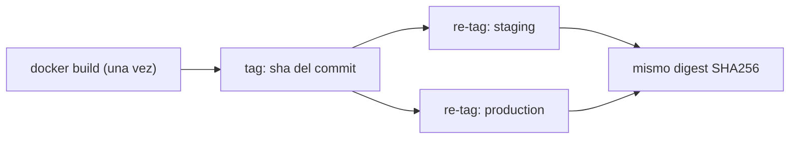

# Módulo 14: Node.js avanzado

## Aprende construyendo

Cada tema es independiente y comienza en una carpeta vacía.

### Tema 1: TypeScript en Node.js

#### Paso 1 · Objetivo y preparación

Al finalizar podrás ejecutar un archivo `.ts` directamente con `node archivo.ts`, sin paso de compilación previo, usando el soporte nativo de tipos de Node, y explicar qué validaciones NO hace ese soporte. Prerrequisitos: Node.js 24 LTS (o 22.18.0+ en la línea 22, donde el borrado de tipos se habilita por defecto); comprueba `node --version`.

#### Paso 2 · Contexto y caso real

El equipo quiere escribir el worker que asigna conductores a pedidos directamente en TypeScript, pero el pipeline actual compila con `tsc` a un directorio `dist/` antes de cada ejecución — un paso extra que ralentiza el ciclo de desarrollo local para un script que solo corre una vez por invocación.

#### Paso 3 · Teoría, modelo mental y analogía

Node ejecuta archivos `.ts` directamente eliminando (strip) las anotaciones de tipo del código fuente en memoria, sin verificar que esos tipos sean correctos — es "borrado de tipos" (type stripping), no un compilador: transforma `const x: number = 5` en `const x = 5` y ejecuta el resultado, sin comprobar si `5` realmente encaja con `number` en ningún otro punto del programa. La analogía: quitarle los carteles descriptivos a las cajas de un almacén antes de moverlas, sin revisar si el contenido real coincide con lo que decía cada cartel.

#### Paso 4 · Demostración guiada desde cero

Crea `src/asignar.ts`:

```ts
interface Pedido { id: string; conductorId: string | null; }

function asignarConductor(pedido: Pedido, conductorId: string): Pedido {
  return { ...pedido, conductorId };
}

const resultado = asignarConductor({ id: "p-1", conductorId: null }, "c-9");
console.log(resultado);
```

**Ejecuta el ejemplo** (monta el proyecto Node y córrelo):

```bash
mkdir -p ejemplo-node/src
cd ejemplo-node
npm init -y
npm pkg set type=module
node src/asignar.ts
```


Ejecuta directamente con `node src/asignar.ts` (sin `tsc`, sin `ts-node`, sin ningún paso de compilación). **Resultado esperado:** Node elimina las anotaciones de tipo (`: Pedido`, `: string`) en memoria y ejecuta el JavaScript resultante, imprimiendo `{ id: 'p-1', conductorId: 'c-9' }`, sin que ningún archivo `.js` compilado se haya generado en disco.

#### Paso 5 · Práctica guiada

Pista: cambia la llamada a `asignarConductor({ id: "p-1", conductorId: null }, 42)` (pasando un número en vez de un string) y ejecuta de nuevo. Ese es el fallo deliberado: `node src/asignar.ts` ejecuta igual, sin ningún error, porque el soporte nativo de Node solo BORRA las anotaciones de tipo, no las VERIFICA; el error de tipos solo lo detectaría `tsc --noEmit` corriendo por separado como un paso de chequeo de tipos.

#### Paso 6 · Práctica independiente

Corregí el Paso 5 ejecutando `npx tsc --noEmit` sobre el mismo archivo y confirmá que SÍ reporta el error de tipos que la ejecución directa con `node` silenciosamente ignoró; documentá en una frase por qué ambos pasos (ejecución nativa + chequeo de tipos separado) son necesarios en un pipeline de CI real.

#### Paso 7 · Cierre y evidencia

Entregá la ejecución directa del `.ts` del Paso 4, el error de tipos no detectado en ejecución del Paso 5, y el chequeo separado con `tsc --noEmit` del Paso 6; explicá por qué el soporte nativo de tipos de Node acelera el desarrollo local pero no reemplaza un chequeo de tipos explícito en CI. Siguiente paso: aplica GraphQL Federation para componer varios subgrafos de este mismo dominio. Errores comunes: asumir que `node archivo.ts` valida tipos (solo los borra), omitir `tsc --noEmit` en el pipeline de CI confiando solo en la ejecución nativa, y mezclar sintaxis de TypeScript que requiere transformación real (enums con valores computados, decoradores) que el borrado de tipos simple no soporta. Fuentes oficiales: [Node.js — TypeScript](https://nodejs.org/en/learn/typescript/run-natively) y [TypeScript — tsc CLI](https://www.typescriptlang.org/docs/handbook/compiler-options.html).

**¿Por qué es importante?** Ejecutar `.ts` nativamente acelera el ciclo de desarrollo local sin compilación previa, pero como solo borra anotaciones sin verificarlas, un pipeline real todavía necesita `tsc --noEmit` como chequeo de tipos explícito.

**Evidencia de aprendizaje:** entrega la ejecución nativa funcionando, el error de tipos no detectado al pasar un valor incorrecto, y el chequeo separado con `tsc --noEmit` confirmando el error real.

**Conceptos clave:** type stripping, borrado de tipos sin verificación, `node archivo.ts`, `tsc --noEmit` como chequeo separado.

**Diagrama:**



Cada worker del proyecto propio que proceses en este track puede escribirse directamente en `.ts` y ejecutarse sin build local; **cuándo no usarlo:** para sintaxis que requiere transformación real (enums con valores computados, decoradores de clase), el borrado de tipos simple no alcanza y sigue siendo necesario `tsc` como compilador completo.

**Transferencia al proyecto integrador «API operativa de entregas»:** Escribe el worker de asignación de conductores directamente en `.ts` sin paso de build, y corre `tsc --noEmit` en CI como chequeo de tipos separado antes de desplegar.

### Tema 2: GraphQL avanzado y Federation

#### Paso 1 · Objetivo y preparación

Al finalizar podrás componer dos subgrafos GraphQL independientes (Pedidos y Conductores) en un único supergrafo con Apollo Federation, resolviendo una referencia entre ellos sin que ningún subgrafo conozca los detalles internos del otro. Prerrequisitos: Módulo 5 de este track (bases de datos).

#### Paso 2 · Contexto y caso real

El equipo de Pedidos y el equipo de Conductores mantienen cada uno su propio servicio GraphQL; el frontend necesita una consulta que combine datos de ambos (el pedido y el conductor asignado) sin que ninguno de los dos equipos tenga que exponer tablas o endpoints internos del otro.

#### Paso 3 · Teoría, modelo mental y analogía

Apollo Federation permite que cada subgrafo declare una entidad con una clave (`@key`) y que OTRO subgrafo extienda esa entidad agregando campos propios, sin acceso directo a la base de datos del otro; un gateway compone ambos esquemas en un supergrafo único, resolviendo cada campo contra el subgrafo que lo declaró. La analogía: dos oficinas distintas que comparten únicamente un número de legajo común, cada una completando su propia parte del expediente sin acceso a los archivos internos de la otra.

#### Paso 4 · Demostración guiada desde cero
**Monta** el laboratorio completo en una carpeta nueva y revisá `server.mjs`, que orquesta los subgrafos `src/conductores/index.js` y `src/pedidos/index.js` junto con el gateway, antes de ejecutarlo.

Desde la raíz del repositorio prepara una copia independiente del laboratorio completo:
```bash
cp -R examples/node-federation ejemplo-federation
cd ejemplo-federation
npm ci
npm test
npm start
```
`server.mjs` crea dos subgrafos en 4001/4002 y el gateway en 4000. Conductores implementa `Conductor.__resolveReference`; Pedidos implementa `Query.pedido` y `pedidosActivos`. Ambos se unen por ID, no por acceso a tablas ajenas. El lockfile fija Apollo Server, Gateway, Subgraph y GraphQL.

Desde otra terminal consulta el gateway:
```bash
curl --fail http://127.0.0.1:4000/ -H 'content-type: application/json' --data '{"query":"{ pedido(id: \"p-1\") { conductor { nombre pedidosActivos } } }"}'
```
**Resultado esperado:** `{"data":{"pedido":{"conductor":{"nombre":"Ana","pedidosActivos":1}}}}`. Un ID de pedido inexistente devuelve `pedido: null`; `npm test` comprueba ambos casos con puertos efímeros y cierra los tres servidores. Ctrl+C cierra la ejecución interactiva. Es un laboratorio local con datos ficticios, sin autenticación; no lo publiques como servicio real.

#### Paso 5 · Práctica guiada

Pista: quitá la directiva `@key(fields: "id")` del tipo `Conductor` en su subgrafo original, dejando solo la extensión en Pedidos. Ese es el fallo deliberado: la composición del supergrafo falla al arrancar el gateway con un error de validación ("Conductor" no declara una clave resolvable), porque Federation necesita que la entidad ORIGINAL declare explícitamente su clave antes de que cualquier otro subgrafo pueda extenderla.

#### Paso 6 · Práctica independiente

Corregí el Paso 5 restaurando `@key(fields: "id")` en el subgrafo original de Conductores, y agregá un tercer subgrafo (Facturación) que también extienda `Conductor` con un campo propio (`saldoPendiente`), confirmando que Federation soporta múltiples extensiones de la misma entidad desde subgrafos distintos.

#### Paso 7 · Cierre y evidencia

Entregá la composición funcionando del Paso 4, el error de clave faltante del Paso 5, y la tercera extensión agregada del Paso 6; explicá por qué declarar una clave resolvable en el subgrafo propietario es un requisito, no una opción, para que otros subgrafos puedan extender esa entidad. Siguiente paso: coordina estos mismos servicios con mensajería y sagas para operaciones que cruzan varios de ellos. Errores comunes: extender una entidad sin que su subgrafo propietario declare `@key`, resolver el mismo campo en más de un subgrafo generando ambigüedad, y no versionar el supergrafo compuesto junto con cada subgrafo individual. Fuentes oficiales: [Apollo Federation](https://www.apollographql.com/docs/federation/) y [GraphQL — Federation spec](https://graphql.org/learn/federation/).

**¿Por qué es importante?** Federation permite que equipos independientes mantengan sus propios subgrafos sin acceso directo a los datos internos de otros, mientras el gateway compone un supergrafo único y consistente para el frontend.

**Evidencia de aprendizaje:** entrega la composición de dos subgrafos funcionando, el error de clave faltante reproducido y una tercera extensión agregada correctamente.

**Conceptos clave:** `@key`, `@external`, entidad federada, gateway, supergrafo, subgrafo propietario.

**Diagrama:**



Levantá ambos subgrafos con `node src/conductores/index.js` y `node src/pedidos/index.js`, y el gateway con `npx rover dev`. Esta misma composición es la que usarás para el proyecto propio que integre Pedidos y Conductores como servicios independientes; **cuándo no usarlo:** para un dominio chico con un único equipo y una sola base de datos, Federation agrega infraestructura (gateway, registro de esquemas) sin ningún beneficio frente a un esquema GraphQL monolítico simple.

**Transferencia al proyecto integrador «API operativa de entregas»:** Divide Conductores y Pedidos en subgrafos Federation propios, cada uno con su propio despliegue, y compón el supergrafo que el panel del operador consulta como si fuera un único servicio.

### Tema 3: Compensar una entrega cuando falla un paso

#### Paso 1 · Objetivo y preparación
Al finalizar podrás ejecutar una operación con tres pasos y revertir los que ya se completaron cuando falla el cobro. **Prerrequisitos:** funciones async de Node.js y manejo de errores. Comprueba `node --version`; desde la raíz crea una copia independiente del ejemplo.

#### Paso 2 · Contexto y caso real
Una entrega puede crear un pedido, reservar un conductor y cobrar. Si el cobro se rechaza, dejar el pedido abierto y el conductor ocupado confunde al equipo y al cliente. El programa debe saber qué hacer con lo que ya alcanzó a cambiar.

#### Paso 3 · Teoría y analogía
Una **saga** es una lista de pasos en la que cada paso tiene una acción para deshacerlo. Es parecido a reservar vuelo y hotel por separado: si la segunda reserva falla, cancelas la primera explícitamente. La base de datos de un servicio no puede deshacer por sí sola un cambio que hizo otro servicio.

El archivo guarda tres estados simples y dos compensaciones: cancelar el pedido y liberar al conductor. `undo.reverse()` las ejecuta en orden inverso. Este ejemplo ayuda a entender la idea; todavía no se conecta a microservicios, Kafka ni RabbitMQ.

#### Paso 4 · Demostración guiada
Crea una copia independiente en `ejemplo-saga/saga.mjs` desde `examples/node-sagas/saga.mjs`; ese archivo contiene el programa. Revisa estas acciones para ver cómo cada paso registra la compensación que puede revertirlo:

```js
async function createOrder() {
  state.order = "CREATED";
  undo.push(async () => { state.order = "CANCELLED"; });
}

async function reserveDriver() {
  state.driver = "RESERVED";
  undo.push(async () => { state.driver = "FREE"; });
}
```

Ejecuta desde la raíz del proyecto (las órdenes crean la carpeta de práctica y copian el archivo):

```bash
mkdir -p ejemplo-saga
cp examples/node-sagas/saga.mjs ejemplo-saga/saga.mjs
node ejemplo-saga/saga.mjs
node ejemplo-saga/saga.mjs --fail-payment
```

**Resultado esperado:** la primera ejecución muestra pedido creado, conductor reservado y pago aprobado. La segunda imprime `fallo=Pago rechazado | pedido:CANCELLED,conductor:FREE,pago:DECLINED`: el fallo de cobro activó las dos compensaciones.

#### Paso 5 · Práctica guiada
**Pista:** cada compensación debe corresponder a un paso que sí terminó; si el pago no se completó, no agregues una devolución ficticia.
1. Antes de correr el segundo comando, predice qué estado tendrá el conductor.
2. Cambia el orden de `undo.reverse()` por `undo` y vuelve a ejecutar. Anota en qué orden se revierten los cambios.
3. Quita temporalmente la llamada a las compensaciones. El pedido queda `CREATED` y el conductor `RESERVED` después del rechazo. **Ese es el fallo deliberado**; diagnostica qué estado quedó inconsistente y restáurala.
4. Explica por qué un mensaje de error no cancela automáticamente los pasos previos.

#### Paso 6 · Práctica independiente
Agrega una etapa `notificarCliente` después del cobro. Define qué estado guardarías si falla la notificación y si ese fallo debería cancelar el pedido ya cobrado. Escribe una salida que permita comprobar tu decisión.



#### Paso 7 · Cierre y evidencia
Entrega las dos salidas del Paso 4, el fallo diagnosticado y tu explicación de cuándo se ejecutan las compensaciones. En un sistema real, cada servicio conserva sus propios datos y el proceso puede reiniciarse a mitad de la operación: harían falta almacenamiento duradero, reintentos, idempotencia y alertas. La demostración actual solo enseña la secuencia en memoria. **Proyecto integrador RutaFlow:** si el flujo pasa a microservicios, persiste el estado de la saga para que sobreviva a reinicios. **Errores comunes:** compensar en orden de avance, dar por hecho que una compensación siempre tendrá éxito y usar este ejemplo en memoria como si fuera persistente. **Fuentes oficiales:** [Node.js: ejecución de programas](https://nodejs.org/en/learn/command-line/run-nodejs-scripts-from-the-command-line) y [patrón Saga](https://microservices.io/patterns/data/saga.html). Próximo paso: escoger un broker para transportar eventos entre servicios.

**Evidencia de aprendizaje:** entrega la salida de éxito, el fallo y la explicación de las dos compensaciones.

**Idea clave:** una falla no deshace cambios de otros servicios; el diseño debe explicar cómo compensarlos.
**¿Por qué es importante?** Si no defines la compensación, un pago rechazado puede dejar al conductor reservado y al pedido abierto.

### Tema 4: Serverless multi-cloud

#### Paso 1 · Objetivo y preparación

Al finalizar podrás escribir una función que calcula el costo de un envío y adaptarla para correr sin cambios de lógica en AWS Lambda y en Azure Functions, aislando las diferencias de "handler" de cada proveedor. Prerrequisitos: Módulo 4 del track de Cloud (Serverless con Lambda).

#### Paso 2 · Contexto y caso real

El equipo escribió la función de cálculo de costos directamente acoplada a la firma específica del handler de AWS Lambda; cuando la empresa decide evaluar Azure por un acuerdo comercial, migrar esa función obliga a reescribir toda la lógica de negocio mezclada con el código específico de AWS.

#### Paso 3 · Teoría, modelo mental y analogía

Aislar la lógica de negocio pura (una función normal de JavaScript, sin ningún detalle de un proveedor cloud específico) detrás de un adaptador delgado por proveedor permite migrar o correr en múltiples nubes sin tocar la lógica real, solo el adaptador. La analogía: un electrodoméstico con un enchufe universal removible — el aparato (la lógica) no cambia, solo el adaptador de enchufe según el país (el proveedor cloud).

#### Paso 4 · Demostración guiada desde cero

Crea `src/logica/calcularCosto.js` (lógica pura, sin ningún import de AWS o Azure):

```js
export function calcularCosto({ distanciaKm, pesoKg }) {
  return distanciaKm * 1500 + pesoKg * 200;
}
```

**Ejecuta el ejemplo** (monta el proyecto Node y córrelo):

```bash
npm init -y && npm install
node index.js
```
Para las pruebas: `npm test`.


Y dos adaptadores delgados:

```js
// src/aws/handler.js
import { calcularCosto } from "../logica/calcularCosto.js";
export const handler = async (event) => {
  const body = JSON.parse(event.body);
  return { statusCode: 200, body: JSON.stringify({ costo: calcularCosto(body) }) };
};
```

```js
// src/azure/handler.js
import { calcularCosto } from "../logica/calcularCosto.js";
export default async function (context, req) {
  context.res = { body: { costo: calcularCosto(req.body) } };
}
```

**Resultado esperado:** la misma función `calcularCosto` (sin ningún cambio) produce el resultado correcto invocada desde el handler de AWS y desde el handler de Azure, confirmando que la lógica de negocio nunca dependió de ningún detalle específico de un proveedor.

#### Paso 5 · Práctica guiada

Pista: movés el cálculo directamente dentro de `src/aws/handler.js`, eliminando `calcularCosto.js` "para simplificar". Ese es el fallo deliberado: al crear el adaptador equivalente de Azure hay que copiar y pegar la misma fórmula, y el día que la fórmula cambie (por ejemplo, un recargo por zona), alguien actualiza un archivo y olvida el otro, dejando ambos proveedores calculando costos distintos para el mismo pedido.

#### Paso 6 · Práctica independiente

Corregí el Paso 5 extrayendo de nuevo la lógica a `calcularCosto.js`, y agregá un tercer adaptador para GCP Cloud Functions, confirmando que los tres adaptadores producen el mismo resultado sin duplicar la fórmula en ningún lugar.

#### Paso 7 · Cierre y evidencia

Entregá la lógica aislada con dos adaptadores del Paso 4, la duplicación de fórmula del Paso 5, y el tercer adaptador agregado del Paso 6; explicá por qué acoplar lógica de negocio a la firma específica de un handler cloud hace que cada proveedor nuevo duplique esa lógica en vez de reusarla. Siguiente paso: empaqueta la misma lógica en un contenedor productivo para los casos donde no se usa serverless. Errores comunes: mezclar lógica de negocio con el formato específico de evento/respuesta de un proveedor, duplicar la misma fórmula en cada adaptador en vez de extraerla una sola vez, y no probar la lógica pura de forma aislada de ningún handler cloud. Fuentes oficiales: [AWS Lambda — Handler en Node.js](https://docs.aws.amazon.com/lambda/latest/dg/nodejs-handler.html) y [Azure Functions — Node.js](https://learn.microsoft.com/azure/azure-functions/functions-reference-node).

**¿Por qué es importante?** Aislar la lógica de negocio detrás de un adaptador delgado por proveedor permite migrar o correr en múltiples nubes sin duplicar ni reescribir la lógica real en cada una.

**Evidencia de aprendizaje:** entrega la lógica aislada funcionando en dos adaptadores, la duplicación de fórmula reproducida y el tercer adaptador agregado sin duplicar lógica.

**Conceptos clave:** adaptador por proveedor, lógica de negocio pura, handler específico de AWS/Azure/GCP, portabilidad multi-cloud.

**Diagrama:**



Esta misma separación lógica/adaptador es la que mantendrá portable el cálculo de costos del proyecto propio frente a cualquier proveedor cloud que el equipo decida evaluar después.

**Transferencia al proyecto integrador «API operativa de entregas»:** Extrae el cálculo de la tarifa de envío a una función pura, y despliégala primero en AWS Lambda y luego como una Azure Function sin tocar la fórmula, solo el adaptador del handler.

### Tema 5: Docker productivo con Node

#### Paso 1 · Objetivo y preparación

Al finalizar vas a construir una imagen Docker multi-stage para un servicio Node que corre como usuario no-root y responde correctamente a `SIGTERM` con un apagado ordenado. Prerrequisitos: Módulo 11 de este track (Despliegue y contenedores).

#### Paso 2 · Contexto y caso real

La imagen actual del servicio de pedidos corre como `root` dentro del contenedor e ignora las señales del sistema operativo durante un despliegue; cuando Kubernetes intenta terminar el pod de forma ordenada, el proceso Node no libera sus conexiones activas y las peticiones en curso se cortan abruptamente.

#### Paso 3 · Teoría, modelo mental y analogía

Un build multi-stage separa la etapa de instalación de dependencias (que necesita herramientas de build) de la imagen final de ejecución (mínima, sin esas herramientas); correr como un usuario no-root limita el daño si el proceso es comprometido; manejar `SIGTERM` explícitamente permite terminar las conexiones en curso antes de salir. La analogía: cerrar un restaurante ordenadamente (dejar de recibir clientes nuevos, pero terminar de atender a los que ya están sentados) frente a apagar las luces de golpe con gente todavía comiendo.

#### Paso 4 · Demostración guiada desde cero
**Crea** el archivo `src/servidor.js` y pega en él el código mostrado a continuación; guárdalo antes de ejecutarlo.


Crea `Dockerfile`:

```dockerfile
FROM node:24-alpine AS build
WORKDIR /app
COPY package*.json ./
RUN npm ci --omit=dev

FROM node:24-alpine
RUN addgroup -S app && adduser -S app -G app
WORKDIR /app
COPY --from=build /app/node_modules ./node_modules
COPY . .
USER app
CMD ["node", "src/servidor.js"]
```

**Ejecuta el ejemplo** (monta el proyecto Node y córrelo):

```bash
npm init -y && npm install
node index.js
```
Para las pruebas: `npm test`.


Y en `src/servidor.js`, el manejo explícito de la señal:

```js
const servidor = app.listen(3000);
process.on("SIGTERM", () => {
  servidor.close(() => process.exit(0));
});
```

**Resultado esperado:** `docker run` del contenedor muestra el proceso corriendo como el usuario `app` (no `root`, verificable con `docker exec <id> whoami`), y al enviar `docker stop` (que envía `SIGTERM`), el servidor termina las conexiones en curso antes de salir con código 0, en vez de cortarse abruptamente.

#### Paso 5 · Práctica guiada

Pista: quitá el bloque `process.on("SIGTERM", ...)` del servidor y hacé una petición lenta justo antes de `docker stop`. Ese es el fallo deliberado: el proceso termina inmediatamente al recibir `SIGTERM` sin esperar a que la conexión en curso complete, y el cliente de esa petición recibe una conexión cortada abruptamente en vez de una respuesta completa.

#### Paso 6 · Práctica independiente

Corregí el Paso 5 restaurando el manejo de `SIGTERM`, y agregá un timeout máximo de apagado ordenado (por ejemplo, 10 segundos) después del cual el proceso fuerza la salida aunque queden conexiones sin cerrar, documentando por qué un apagado ordenado sin límite de tiempo también es riesgoso.

#### Paso 7 · Cierre y evidencia

Entregá la imagen multi-stage con usuario no-root del Paso 4, la conexión cortada abruptamente del Paso 5, y el timeout de apagado forzado del Paso 6; explicá por qué un contenedor que ignora `SIGTERM` convierte cada despliegue en una fuente de errores para los clientes con peticiones en curso. Siguiente paso: automatiza este mismo build dentro de un pipeline de CI/CD con promoción de artefactos. Errores comunes: correr el proceso como `root` dentro del contenedor, ignorar `SIGTERM` dejando que Kubernetes mate el proceso con `SIGKILL` tras el timeout de gracia, y no limitar con un timeout máximo el apagado ordenado. Fuentes oficiales: [Docker — Multi-stage builds](https://docs.docker.com/build/building/multi-stage/) y [Node.js — Process signal events](https://nodejs.org/api/process.html#signal-events).

**¿Por qué es importante?** Un contenedor que corre como root y no maneja señales de apagado ordenado convierte cada despliegue rutinario en una fuente de errores para los clientes con peticiones en curso.

**Evidencia de aprendizaje:** entrega la imagen multi-stage no-root funcionando, la conexión cortada abruptamente reproducida y el timeout de apagado forzado documentado.

**Conceptos clave:** multi-stage build, usuario no-root, SIGTERM, apagado ordenado (graceful shutdown), timeout de apagado forzado.

**Diagrama:**



Esta misma imagen endurecida es la que empaquetará el servicio del proyecto propio para un despliegue real en Kubernetes.

**Transferencia al proyecto integrador «API operativa de entregas»:** Construye la imagen multi-stage no-root del servicio de entregas y verifica que, al recibir `SIGTERM` durante un despliegue, termina de responder las peticiones en curso antes de salir, sin cortar a un conductor que está confirmando una entrega en ese momento.

### Tema 6: CI/CD y promoción de artefactos

#### Paso 1 · Objetivo y preparación

Al finalizar vas a construir una imagen Docker UNA sola vez por commit y promoverla (retaguearla) a través de dev, staging y producción, en vez de reconstruirla en cada etapa. Prerrequisitos: Tema 5 de este módulo.

#### Paso 2 · Contexto y caso real

El pipeline actual ejecuta `docker build` por separado en cada etapa (dev, staging, producción); dos builds del mismo commit, ejecutados en momentos distintos, pueden producir binarios ligeramente distintos (una dependencia transitiva se actualizó entre medio), rompiendo la garantía de que "lo que se probó en staging es exactamente lo que llega a producción".

#### Paso 3 · Teoría, modelo mental y analogía

El principio "build once, promote many" construye el artefacto UNA sola vez, lo etiqueta con un identificador inmutable (el hash del commit), y cada etapa posterior simplemente lo re-etiqueta y lo despliega, sin reconstruirlo. La analogía: un mismo lote de producción de una fábrica que se distribuye a distintas tiendas, en vez de fabricar un lote nuevo (con el riesgo de pequeñas variaciones) para cada tienda.

#### Paso 4 · Demostración guiada desde cero

Crea el workflow de CI:

```yaml
jobs:
  build:
    steps:
      - run: docker build -t registro/pedidos:${{ github.sha }} .
      - run: docker push registro/pedidos:${{ github.sha }}
  promover-a-staging:
    needs: build
    steps:
      - run: docker pull registro/pedidos:${{ github.sha }}
      - run: docker tag registro/pedidos:${{ github.sha }} registro/pedidos:staging
      - run: docker push registro/pedidos:staging
  promover-a-produccion:
    needs: promover-a-staging
    steps:
      - run: docker pull registro/pedidos:${{ github.sha }}
      - run: docker tag registro/pedidos:${{ github.sha }} registro/pedidos:production
      - run: docker push registro/pedidos:production
```

**Ejecuta el ejemplo** (monta el proyecto Node y córrelo):

```bash
npm init -y && npm install
node index.js
```
Para las pruebas: `npm test`.


**Resultado esperado:** la imagen se construye una única vez con el tag inmutable `${{ github.sha }}`; tanto `staging` como `production` son simplemente ese mismo artefacto re-etiquetado, nunca reconstruido, garantizando bit por bit el mismo binario en ambos entornos.

#### Paso 5 · Práctica guiada

Pista: reemplazá los jobs `promover-a-staging` y `promover-a-produccion` por un `docker build` independiente en cada uno. Ese es el fallo deliberado: si una dependencia sin versión fijada (`^4.2.0` en vez de `4.2.1` exacto) publica una nueva versión menor entre el build de staging y el de producción, ambos binarios ya no son idénticos, aunque el código fuente no cambió.

#### Paso 6 · Práctica independiente

Corregí el Paso 5 restaurando el patrón de build único + promoción por re-tag, y agregá un paso de verificación que compare el digest SHA256 de la imagen en staging contra el digest en producción, confirmando que son bit por bit idénticos antes de considerar el despliegue exitoso.

#### Paso 7 · Cierre y evidencia

Entregá el pipeline de build único y promoción del Paso 4, la divergencia de binarios por reconstrucción del Paso 5, y la verificación de digest idéntico del Paso 6; explicá por qué reconstruir en cada etapa rompe la garantía central que la promoción de artefactos existe para dar. Siguiente paso: con esto cierras el módulo avanzado de Node, listo para operar en producción real. Errores comunes: reconstruir la imagen en cada etapa del pipeline en vez de promover el mismo artefacto, fijar dependencias con rangos semánticos abiertos (`^`) en vez de versiones exactas para un build reproducible, y no verificar el digest de la imagen antes de confirmar que staging y producción corren el mismo binario. Fuentes oficiales: [GitHub Actions — Environments](https://docs.github.com/actions/deployment/targeting-different-environments/using-environments-for-deployment) y [Docker — Image digests](https://docs.docker.com/engine/reference/commandline/images/#digests).

**¿Por qué es importante?** Construir una vez y promover el mismo artefacto a través de los entornos es la única forma de garantizar que lo que se validó en staging es exactamente lo mismo que llega a producción.

**Evidencia de aprendizaje:** entrega el pipeline de build único funcionando, la divergencia de binarios por reconstrucción reproducida y la verificación de digest idéntico confirmada.

**Conceptos clave:** build once promote many, tag inmutable por commit, digest de imagen, versiones exactas vs rangos semánticos abiertos.

**Diagrama:**



Guarda este workflow como `.github/workflows/promocion.yml`; es el mismo patrón que usarás para desplegar el proyecto propio con la garantía de que staging y producción corren bit por bit el mismo artefacto. **Cuándo no usarlo:** para un script interno de un solo uso, sin ambiente de staging real, la ceremonia de promoción por re-tag agrega pasos sin ningún beneficio frente a un build directo.

**Transferencia al proyecto integrador «API operativa de entregas»:** Promueve la misma imagen Docker del servicio de entregas, construida una sola vez, de staging a producción por re-tag, y verifica el digest antes de aceptar el despliegue como válido.

## Trazabilidad de la auditoría original

- **Serverless con Node.js**: adaptador portable y límites de ejecución.
- **Docker con Node.js**: imagen reproducible y usuario no root.
- **CI/CD con Node.js**: pruebas, artefactos y promoción.
- **Microservicios Avanzado**: eventos, brokers y compensaciones.

### Tema 7: Kafka desde Node: clave, grupo consumidor y offset

**Duración estimada:** 35 min.
**¿Por qué es importante?** La key mantiene orden por pedido y el grupo registra el avance de cada proyector.

**Prerrequisitos:** Node M0 T2 (módulos) y Node M8 T3 (promesas y workers). Proyecto continuo: RutaFlow produce cambios de pedidos para proyecciones independientes.

#### Subtema 7.1: Envía un evento con la clave del pedido · 10 min

**1. Contexto**
La clave `pedidoId` mantiene los eventos de un pedido en la misma partición; no evita duplicados.

**2. Hazlo tú**
Abre `examples/node-messaging/kafka/producer.mjs` y desde `examples/node-messaging/` ejecuta:

```bash
npm ci
npm test
```

**Resultado esperado:** las pruebas locales pasan; el productor crea `eventId`, usa `pedidoId` como `key` y publica JSON en `pedidos`. Estas pruebas no conectan al broker.

**Fallo deliberado:** cambia `key: event.pedidoId` a `key: event.eventId`. **Error esperado:** dos eventos del mismo pedido pueden usar claves distintas. **Diagnóstico:** el identificador único cambia en cada publicación; restaura `pedidoId` para ordenar por pedido.

**3. Entiende**
Kafka asigna cada clave a una partición. El orden que protege la clave es local a esa partición, no un orden global del tópico.

**4. Cierra**
Anota el tópico, la key y la partición observada en la práctica con broker.

#### Subtema 7.2: Reparte particiones con un grupo · 10 min

**1. Contexto**
Las instancias del mismo proyector comparten el trabajo; otro servicio necesita su propio grupo para leer el flujo completo.

**2. Hazlo tú**
Abre `examples/node-messaging/kafka/consumer.mjs`; levanta Kafka según `examples/node-messaging/README.md` y ejecuta desde `examples/node-messaging/`:

```bash
npm run kafka:consumer
```

En otra terminal, desde esa carpeta, ejecuta `npm run kafka:producer`.

**Resultado esperado:** el consumidor imprime `topic`, `partition`, `offset`, `key` y `value` para el evento.

**Fallo deliberado:** cambia `KAFKA_GROUP_ID` para la segunda instancia y compárala con la primera. **Resultado esperado:** ambas pueden leer el evento como grupos independientes. **Diagnóstico:** los grupos son cursores separados; devuelve a las réplicas del mismo proyector el mismo `groupId`.

**3. Entiende**
Dentro de un grupo, Kafka asigna particiones disponibles a sus miembros. Dos miembros no duplican la lectura de una misma partición mientras la asignación esté estable.

**4. Cierra**
Registra el `groupId` y cuántas particiones leyó cada instancia.

#### Subtema 7.3: Reconoce redelivery e idempotencia · 15 min

**1. Contexto**
El offset identifica el avance del grupo; no confirma por sí solo que la base de datos guardó el efecto de negocio.

**2. Hazlo tú**
Abre `examples/node-messaging/kafka/consumer.mjs` y `examples/spring-kafka-rutaflow/src/main/java/academia/rutaflow/inbox/InboxProcessor.java`. Ejecuta desde `examples/spring-kafka-rutaflow/`:

```bash
./mvnw -Dtest=EnvioEventPublisherTest#inboxHaceIdempotenteElEfectoDeNegocio test
```

**Resultado esperado:** al entregar dos veces el mismo `eventId`, una sola proyección queda registrada.

**Fallo deliberado:** quita la deduplicación de `InboxProcessor`. **Resultado esperado:** la prueba falla o la clave única rechaza la segunda escritura. **Diagnóstico:** protege el efecto con `eventId` en la misma transacción que actualiza la proyección.

**3. Entiende**
En producción una caída entre escribir el efecto y confirmar el offset puede repetir el mensaje. La inbox hace idempotente el cambio de negocio; no vuelve exactly-once a una base externa.

**4. Cierra**
Guarda la salida del test y explica qué estado comparte Kafka y cuál protege la inbox.

**Hito del tema:**

- [ ] Producer publica con `pedidoId` como key.
- [ ] Consumer muestra partición y offset.
- [ ] Distingo réplicas del mismo grupo de dos grupos independientes.
- [ ] La inbox evita duplicar el efecto al repetir `eventId`.

**Fuentes oficiales:** [Confluent JavaScript client](https://docs.confluent.io/kafka-clients/javascript/current/overview.html) y [Apache Kafka](https://kafka.apache.org/documentation/).

**Proyecto integrador:** el productor y el consumidor de `examples/node-messaging/kafka/` alimentan directamente la inbox de `examples/spring-kafka-rutaflow/`, el proyector real de pedidos de RutaFlow. **Límite:** usa Kafka cuando necesitas conservar el historial completo del flujo y varios consumidores independientes lean el mismo tópico a su propio ritmo; si solo necesitas repartir tareas una vez entre workers sin retener el historial, una cola de trabajo (RabbitMQ) es más simple que un log particionado.

### Tema 8: RabbitMQ desde Node: exchange, cola y confirmaciones

**Duración estimada:** 35 min.
**¿Por qué es importante?** Las confirmaciones y la DLQ evitan perder trabajo o esconder mensajes que requieren diagnóstico.

**Prerrequisitos:** Node M0 T2 (módulos) y Node M8 T3 (promesas). Proyecto continuo: RutaFlow distribuye tareas para generar etiquetas.

#### Subtema 8.1: Enruta una etiqueta con exchange y binding · 10 min

**1. Contexto**
RabbitMQ separa el destino lógico (exchange) de la cola que guarda trabajo pendiente.

**2. Hazlo tú**
Abre `examples/node-messaging/rabbit/topology.mjs` y ejecuta desde `examples/node-messaging/`:

```bash
npm ci
npm test
```

**Resultado esperado:** `topology.test.mjs` comprueba el exchange directo `entregas`, la cola `envios` y el binding `label.ready`.

**Fallo deliberado:** cambia la routing key del binding a `label.created`. **Resultado esperado:** el test compara valores distintos y falla. **Diagnóstico:** el productor publica con `label.ready`; restaura la misma key en el binding.

**3. Entiende**
El exchange no almacena mensajes. Enruta según tipo y binding key; la cola los conserva para que el worker los reciba.

**4. Cierra**
Dibuja `producer → exchange → binding → queue` y guarda el test verde.

#### Subtema 8.2: Confirma una publicación y un procesamiento · 10 min

**1. Contexto**
La confirmación del productor y el `ack` del consumidor hablan de dos etapas diferentes.

**2. Hazlo tú**
Abre `examples/node-messaging/rabbit/producer.mjs` y `examples/node-messaging/rabbit/worker.mjs`. Desde `examples/node-messaging/` levanta RabbitMQ y corre el worker según `examples/node-messaging/README.md`:

```bash
docker compose -f compose.rabbit.yaml up -d --wait
npm run rabbit:worker
```

En otra terminal ejecuta `npm run rabbit:producer`.

**Resultado esperado:** el productor imprime `confirmado=...`; el worker imprime `procesado=...`. `waitForConfirms()` no prueba que el worker guardó el efecto.

**Fallo deliberado:** confirma el mensaje antes de terminar el efecto en el worker. **Resultado esperado:** si el proceso cae, RabbitMQ no lo vuelve a entregar. **Diagnóstico:** procesa y guarda primero; confirma después con `channel.ack(message)`.

**3. Entiende**
Publisher confirm muestra aceptación del broker. Consumer ack permite retirar una entrega tras el procesamiento. Ninguno garantiza por sí solo una transacción con tu base de datos.

**4. Cierra**
Registra dos evidencias separadas: confirm del productor y ack del worker.

#### Subtema 8.3: Rechaza y enruta un mensaje inválido a la DLQ · 15 min

**1. Contexto**
Un mensaje sin `eventId` no puede deduplicarse ni procesarse con seguridad.

**2. Hazlo tú**
Abre `examples/node-messaging/rabbit/topology.mjs` y `examples/node-messaging/rabbit/worker.mjs`. Levanta RabbitMQ desde `examples/node-messaging/`:

```bash
docker compose -f compose.rabbit.yaml up -d --wait
npm run rabbit:worker
```

Publica desde la consola local el JSON `{"pedidoId":"p-17"}` en `entregas` con routing key `label.ready`; revisa `envios.dlq` en `http://localhost:15672`.

**Resultado esperado:** el worker registra mensaje inválido y la cola `envios.dlq` lo conserva mediante `entregas.dlx`.

**Fallo deliberado:** cambia `channel.nack(message, false, false)` a `channel.nack(message, false, true)`. **Resultado esperado:** el mensaje vuelve a `envios` y se procesa repetidamente. **Diagnóstico:** el tercer argumento es `requeue`; `true` vuelve a encolar en vez de aplicar dead-letter routing.

**3. Entiende**
La cola de errores conserva una entrega para diagnóstico. El `Set` de este ejemplo solo vive en memoria; en producción reemplázalo por una inbox persistente con `eventId` único.

**4. Cierra**
Guarda el mensaje de error y el nombre del exchange y la cola que lo recibieron.

**Hito del tema:**

- [ ] La routing key llega a la cola esperada.
- [ ] Distingo publisher confirm y consumer ack.
- [ ] Un mensaje sin `eventId` se enruta a DLQ.
- [ ] Registro el límite de idempotencia en memoria.

**Fuentes oficiales:** [tutorial de Node.js](https://www.rabbitmq.com/tutorials/tutorial-one-javascript), [confirmaciones, acknowledgements y prefetch](https://www.rabbitmq.com/docs/confirms) y [colas](https://www.rabbitmq.com/docs/queues).

**Proyecto integrador:** este exchange/cola/DLQ es la topología real que RutaFlow usa para distribuir la generación de etiquetas entre varios workers sin perder los mensajes inválidos. **Práctica:** modifica `worker.mjs` para que, además de enrutar a `envios.dlq`, registre en consola el motivo exacto (`eventId` ausente, `pedidoId` ausente) antes de hacer `nack`, y confirma con un mensaje sin `pedidoId` que el motivo distinto también llega a la DLQ.
