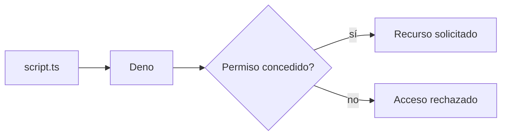
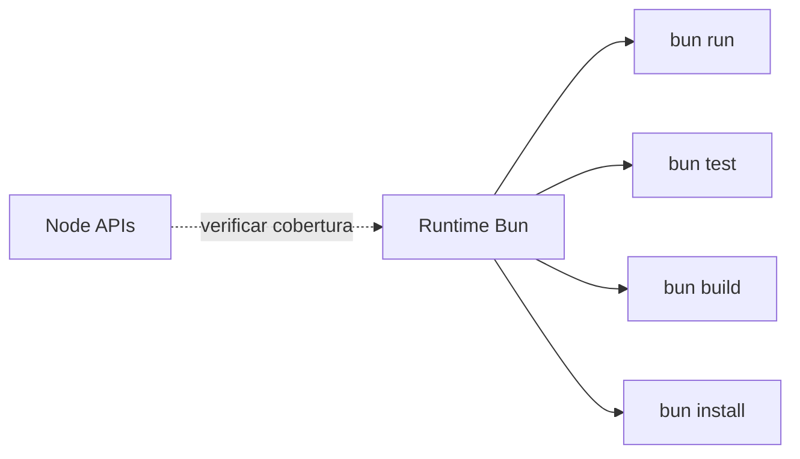
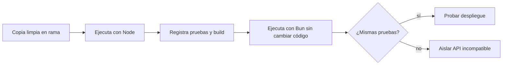
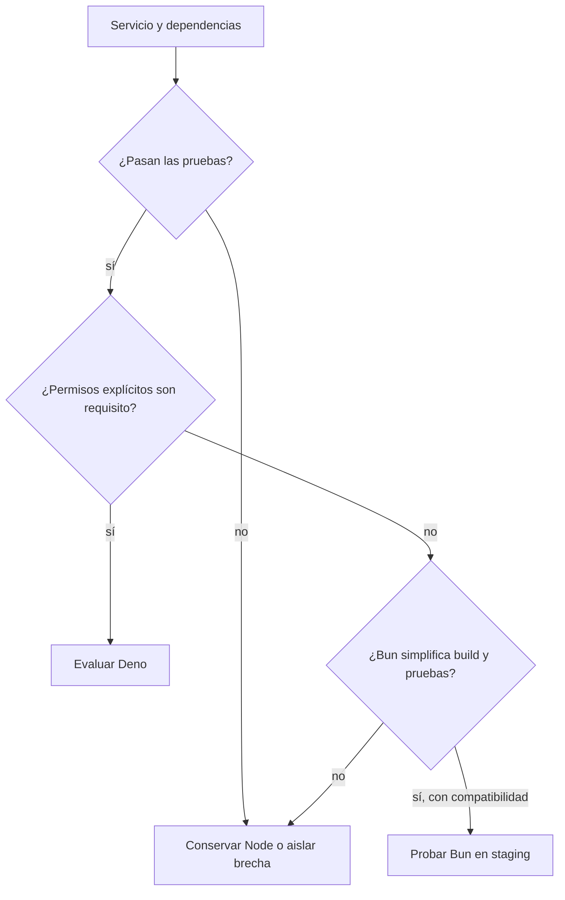

# Módulo 15: Deno y Bun

## Aprende construyendo

Este módulo prueba dos runtimes con la misma tarea y toma una decisión basada en compatibilidad, permisos, instalación y despliegue. No asumas que una prueba corta de velocidad predice el comportamiento de una API productiva.

### Tema 1: Deno y permisos explícitos

#### Paso 1 · Objetivo y preparación

Al finalizar podrás ejecutar un programa TypeScript en Deno y conceder solo el acceso a red o archivos que necesita. **Prerrequisitos:** JavaScript/TypeScript básico y Node.js. Instala Deno desde su documentación oficial y confirma `deno --version`.

#### Paso 2 · Contexto y caso real

Un script pequeño consulta una API de envíos. Si una dependencia comprometida intenta leer claves del equipo o abrir conexiones a cualquier host, esos permisos pueden causar daño incluso aunque el script solo pretendía hacer una petición.

#### Paso 3 · Teoría, modelo mental y analogía

Deno ejecuta JavaScript y TypeScript y niega por defecto gran parte del acceso al sistema: lectura, escritura, variables de entorno, red y procesos se habilitan con permisos. Es parecido a dar una llave específica para una puerta, no la llave maestra de todo el edificio. Deno también acepta módulos `node:` y paquetes npm, pero la compatibilidad tiene límites: add-ons nativos, scripts de instalación y herramientas que esperan un `node_modules` exacto necesitan revisión.



#### Paso 4 · Demostración guiada

Ejemplo independiente desde cero: crea `ejemplo-deno/main.ts`:

```ts
const response = await fetch("http://127.0.0.1:3000/health");
console.log(`estado=${response.status}`);
```

En una terminal sirve una respuesta local en el puerto 3000. Ejecuta el archivo primero sin permiso y después con acceso limitado. Inicia este servidor en otra terminal y detenlo con Ctrl+C al terminar:

```bash
node -e 'require("node:http").createServer((req,res)=>{res.writeHead(200);res.end("ok")}).listen(3000,"127.0.0.1")'
```

```bash
mkdir -p ejemplo-deno
deno run ejemplo-deno/main.ts
deno run --allow-net=127.0.0.1:3000 ejemplo-deno/main.ts
```

**Resultado esperado:** la primera ejecución rechaza la conexión; la segunda imprime `estado=200`. No concedas `--allow-all` para hacer desaparecer el mensaje: eso elimina precisamente el límite que enseña el ejemplo.

#### Paso 5 · Práctica guiada

**Fallo deliberado:** cambia la URL a `http://example.com`. Ejecuta otra vez con el permiso limitado. **Pista:** `127.0.0.1:3000` no cubre otro host; Deno debe denegar la salida. Restaura la URL y diagnostica qué permiso necesita cada dependencia, sin ampliar el host permitido a toda la red.

#### Paso 6 · Práctica independiente

Crea `ejemplo-deno/leer.ts` que lea `./pedido.json`. Ejecuta con permiso de red pero sin permiso de lectura, luego concede solo `--allow-read=./pedido.json`. Compara Node y Deno usando el mismo archivo y guarda ambos comandos y mensajes. Investiga qué cambia si el proyecto usa una dependencia npm que ejecuta un script de instalación o carga un add-on nativo.

#### Paso 7 · Cierre y evidencia

Entrega el resultado permitido, el acceso rechazado y una lista de permisos por capacidad. **Proyecto integrador RutaFlow:** si un worker de entregas se migra a Deno, concede únicamente acceso a la URL del servicio de mapas y al archivo/configuración que necesita. Errores comunes: usar `-A` como permiso habitual, creer que los paquetes npm pierden acceso al sistema automáticamente si se les concede y asumir que compatibilidad Node significa identidad total. Siguiente paso: comparar el entorno integrado de Bun. Fuentes oficiales: [Deno: permisos](https://docs.deno.com/runtime/reference/permissions/), [seguridad](https://docs.deno.com/runtime/fundamentals/security/) y [compatibilidad Node](https://docs.deno.com/runtime/fundamentals/node/).

**¿Por qué es importante?** Un permiso pequeño reduce cuánto puede hacer accidentalmente un programa o una dependencia.
**Evidencia de aprendizaje:** entrega las dos ejecuciones, el error por host no permitido y la lista de accesos mínimos.
**Cuándo no elegirlo:** si una dependencia crítica requiere acceso nativo o APIs que la capa de compatibilidad no implementa, primero confirma el soporte con un caso real.

### Tema 2: Bun reúne runtime, paquetes, pruebas y bundler

#### Paso 1 · Objetivo y preparación

Al finalizar podrás correr el mismo archivo JavaScript con Bun y distinguir qué herramienta de su CLI estás usando. **Prerrequisitos:** Node, `package.json`, scripts npm y pruebas básicas. Instala Bun desde su guía y comprueba `bun --version`.

#### Paso 2 · Contexto y caso real

Un equipo mantiene Node, npm y un bundler como herramientas separadas. Bun reúne runtime, instalación de paquetes, pruebas y bundling en una CLI; el equipo quiere saber si la simplificación funciona con sus dependencias, no solo en una demo vacía.

#### Paso 3 · Teoría y analogía

`bun run` ejecuta un script, `bun install` resuelve paquetes, `bun test` ejecuta pruebas y `bun build` empaqueta código. Tener varias herramientas en una caja puede acortar el montaje, como una multiherramienta; no demuestra que cada hoja sea adecuada para todos los tornillos. Bun busca compatibilidad con Node, pero declara brechas en algunas APIs; por eso un paquete que usa timers, streams, TLS o add-ons debe verificarse en el runtime objetivo.



#### Paso 4 · Demostración guiada

Ejemplo independiente desde cero: crea `ejemplo-bun/package.json` con `type: module` y scripts `start` y `test`, luego `src/main.js`:

```json
{"type":"module","scripts":{"start":"bun run src/main.js","test":"bun test"}}
```

```js
export function precioFinal(precio, recargo) {
  if (precio < 0 || recargo < 0) throw new Error("valores no negativos");
  return precio + recargo;
}
console.log(`total=${precioFinal(100, 15)}`);
```

En `src/main.test.js`, comprueba que `precioFinal(100, 15)` devuelve `115`:

```js
import { expect, test } from "bun:test";
import { precioFinal } from "./main.js";
test("suma precio y recargo", () => expect(precioFinal(100, 15)).toBe(115));
```

Desde una carpeta nueva ejecuta:

```bash
mkdir -p ejemplo-bun/src
cd ejemplo-bun
bun install
bun run src/main.js
bun test
```

**Resultado esperado:** se imprime `total=115` y la prueba pasa. Después repite `node src/main.js` y `npm test` si los scripts pueden ejecutarse en ambos runtimes.

#### Paso 5 · Práctica guiada

**Fallo deliberado:** agrega una dependencia que use un módulo nativo de Node y cárgala en el proyecto. **Pista:** una dependencia declarada en npm no garantiza que Bun implemente cada detalle del runtime Node. Registra el error, identifica la API que falta y restaura el lockfile antes de comparar resultados.

#### Paso 6 · Práctica independiente

Ejecuta el mismo proyecto con Node/npm y Bun. Compara instalación limpia, pruebas, salida y APIs; conserva los lockfiles en ramas separadas y no mezcles gestores en una misma instalación. Empaqueta `src/main.js` con `bun build` y comprueba que la salida producida mantiene el resultado. Registra versiones y sistema operativo.

#### Paso 7 · Cierre y evidencia

Entrega resultados de instalación, ejecución, pruebas y bundle. **Proyecto integrador RutaFlow:** usa Bun solo después de correr el conjunto de integración real de la API, especialmente base de datos, autenticación y observabilidad. Errores comunes: concluir compatibilidad por un `console.log`, dejar npm y Bun modificando lockfiles a la vez y atribuir una mejora de build a mejor latencia del servicio. Siguiente paso: decidir si conviene migrar un proyecto Node existente. Fuentes oficiales: [Bun: bienvenida](https://bun.sh/docs), [runtime](https://bun.sh/docs/runtime), [compatibilidad Node](https://bun.sh/docs/runtime/nodejs-compat) y [bun install](https://bun.sh/docs/pm/cli/install).

**¿Por qué es importante?** Una herramienta integrada solo ayuda si conserva el comportamiento de las dependencias que el proyecto usa.
**Evidencia de aprendizaje:** compara las dos instalaciones y las mismas pruebas con salida registrada.
**Cuándo no elegirlo:** no cambies un servicio estable solo por una medición vacía; primero verifica drivers, instrumentación y plataforma de despliegue.

### Tema 3: Migrar un proyecto Node a Bun sin perder reproducibilidad

#### Paso 1 · Objetivo y preparación

Al finalizar ejecutarás una copia de un proyecto Node bajo Bun, documentarás incompatibilidades y decidirás qué cambios aceptar. **Prerrequisitos:** módulos ESM/CommonJS, scripts y lockfile. Necesitas Node y Bun instalados en versiones anotadas.

#### Paso 2 · Contexto y caso real

La API de RutaFlow usa PostgreSQL, JWT y una cola. Migrar el runtime tocando al mismo tiempo código, dependencias y configuración de producción haría difícil saber por qué falló un endpoint.

#### Paso 3 · Teoría, modelo mental y analogía

Una migración segura cambia una variable a la vez: primero ejecutar código sin cambios, luego comparar pruebas, después revisar dependencias, y por último decidir si Bun será runtime, gestor o bundler. Mantén una ruta de vuelta a Node. Es como cambiar una pieza del motor y medir antes de cambiar transmisión y combustible también. Los resultados dependen de versiones de Bun y Node, sistema operativo, dependencias nativas y pasos de instalación.



#### Paso 4 · Demostración guiada

Crea una copia independiente llamada `experimento-bun`, conserva `package-lock.json` y ejecuta el proyecto con Node antes de cambiar gestor. Guarda salida de `node --version`, `npm ci` y `npm test`. Después instala Bun y corre `bun run` y `bun test` con las mismas pruebas. Mantén intacto `src/` en esta primera comparación.

```bash
mkdir -p ../experimento-bun
cp -R src package.json package-lock.json ../experimento-bun/
cd ../experimento-bun
npm ci
npm test
bun --version
bun test
```

**Resultado esperado:** ambas suites pasan o la primera diferencia queda capturada como un caso reproducible. Una instalación que usa paquetes nativos debe confirmar que se ejecutaron los scripts necesarios.

#### Paso 5 · Práctica guiada

**Fallo deliberado:** sustituye el lockfile y el gestor antes de registrar la ejecución Node. **Pista:** ya no podrás separar efecto del runtime y efecto de las versiones resueltas. Regresa a la copia limpia, vuelve a capturar la línea base y modifica una sola variable cada vez.

#### Paso 6 · Práctica independiente

Prueba los endpoints de salud, login, consulta de base de datos, una transacción y consumo de una cola. Ejecuta una prueba de cierre del proceso y verifica que los logs y métricas sigan disponibles. Documenta dependencia, API, versión, plataforma y resultado por cada incompatibilidad; no marques “compatible” si omitiste una ruta.

#### Paso 7 · Cierre y evidencia

Entrega la tabla Node/Bun, los comandos exactos y la lista de rutas comprobadas. **Proyecto integrador RutaFlow:** conserva Node como despliegue candidato hasta que staging reproduzca los mismos contratos, conexiones y apagado. Errores comunes: actualizar paquetes durante la migración, comparar instalaciones con lockfiles distintos y probar solo la ruta feliz. Siguiente paso: convertir evidencia en una decisión de runtime. Fuentes oficiales: [Bun: compatibilidad Node](https://bun.sh/docs/runtime/nodejs-compat), [Deno: compatibilidad Node](https://docs.deno.com/runtime/fundamentals/node/) y [Node: ejecutar scripts](https://nodejs.org/en/learn/command-line/run-nodejs-scripts-from-the-command-line).

**¿Por qué es importante?** La misma app puede comportarse distinto en las APIs de red, archivos, procesos y complementos nativos.
**Evidencia de aprendizaje:** entrega la matriz con comandos, pruebas y errores reproducibles, no una afirmación general.
**Cuándo no migrar:** si no puedes reproducir el entorno real o no tienes pruebas de contrato suficientes, primero crea esa evidencia.

### Tema 4: Elegir entre Node, Deno y Bun

#### Paso 1 · Objetivo y preparación

Al finalizar elegirás un runtime para un caso concreto usando compatibilidad, seguridad, soporte operacional y facilidad de despliegue. **Prerrequisitos:** haber ejecutado Deno y Bun en los Temas 1–3.

#### Paso 2 · Contexto y caso real

Un worker que transforma archivos locales tiene necesidades distintas a una API con drivers nativos, instrumentación y procesos administrados por una plataforma ya estandarizada en Node.

#### Paso 3 · Teoría y analogía

Node aporta el entorno que el equipo ya opera y una gran compatibilidad con su ecosistema. Deno ofrece permisos explícitos y compatibilidad Node/npm, que debe evaluarse en el proyecto. Bun integra herramientas y prioriza compatibilidad Node, con APIs aún en evolución. No hay ganador universal: comparar es como elegir vehículo por la ruta, carga y mantenimiento, no solo por velocidad en pista.

| Pregunta | Node | Deno | Bun |
|---|---|---|---|
| Proyecto ya existente | Línea base y compatibilidad | Probar dependencias Node/npm | Probar APIs Node y paquetes |
| Permisos explícitos por defecto | Configuración externa/sandbox | Sí para muchos accesos de sistema | No asumir el modelo de Deno |
| Herramientas integradas | npm y herramientas elegidas | CLI de Deno | Runtime, gestor, test y bundler |
| Decisión práctica | Mantener si resuelve el servicio | Evaluar scripts/herramientas seguras | Evaluar app completa y despliegue |



#### Paso 4 · Demostración guiada

Ejemplo independiente desde cero: crea `docs/runtime-decision.json` en una rama de prueba. Elige un servicio concreto y anota: versión del runtime, dependencias críticas, uso de archivos/red/procesos, add-ons nativos, CI, imagen contenedora, observabilidad y compatibilidad con el despliegue actual. Ejecuta el mismo conjunto de pruebas en cada candidato viable. **Resultado esperado:** la decisión señala un runtime preferido, las rutas verificadas y al menos una limitación conocida. Las versiones cambian: consulta la página oficial antes de fijar baseline.

`docs/runtime-decision.json` contiene una decisión revisable:

```json
{
  "servicio": "worker-entregas",
  "runtime": "Node",
  "evidencia": ["tests-integracion", "pg-driver", "shutdown"],
  "revisarSi": "las dependencias críticas pasan en otro runtime"
}
```

Ejecuta la matriz de comandos en terminal y guarda las versiones:

```bash
mkdir -p ejemplo-decision/docs
cp docs/runtime-decision.json ejemplo-decision/docs/runtime-decision.json
node --version
deno --version
bun --version
```

#### Paso 5 · Práctica guiada

**Fallo deliberado:** decide solo por la duración de `bun run` o por la cantidad de permisos que pide Deno. **Pista:** estas medidas no cubren compatibilidad, mantenimiento ni operación. Revisa la tabla y agrega una prueba de la API que más riesgo tenga.

#### Paso 6 · Práctica independiente

Escribe un caso donde conservar Node sea lo correcto, otro donde Deno reduzca acceso accidental para un script y otro donde Bun simplifique una herramienta local tras pasar pruebas. Explica qué evidencia podría cambiar cada recomendación. No presentes una diferencia de benchmark como prueba sin repetirla con carga y versión registradas.

#### Paso 7 · Cierre y evidencia

Entrega la matriz y el razonamiento ligado a evidencia técnica. **Proyecto integrador RutaFlow:** registra decisión de runtime, rollback y pruebas de aceptación para el worker, no cambies todos los servicios a la vez. Errores comunes: tratar compatibilidad como sí/no, confundir seguridad del runtime con seguridad de toda la aplicación y mantener versiones sin política de actualización. Siguiente paso: aplica la decisión y registra métricas de operación. Fuentes oficiales: [Node.js](https://nodejs.org/en/learn), [Deno: seguridad](https://docs.deno.com/runtime/fundamentals/security/) y [Bun: compatibilidad](https://bun.sh/docs/runtime/nodejs-compat).

**¿Por qué es importante?** El runtime participa en seguridad, despliegue y soporte de cada dependencia.
**Evidencia de aprendizaje:** entrega decisión, pruebas que la sostienen y condición para revisarla.
**Cuándo no cambiarlo:** si el costo de migración excede una necesidad demostrada, conservar el runtime actual es una decisión técnica válida.
