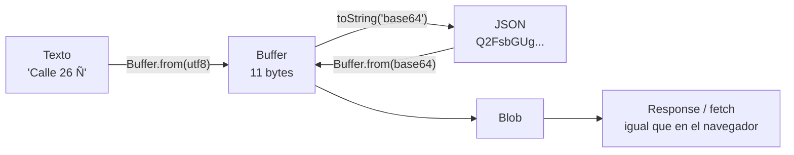
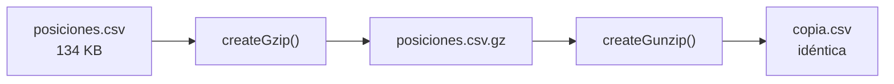
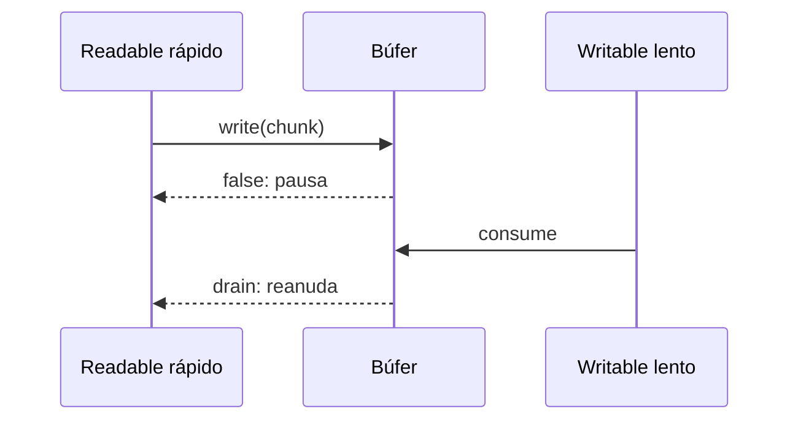
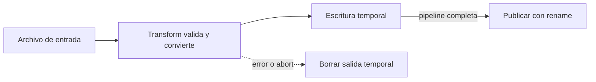

# Módulo 2: Sistema de archivos y streams


## Aprende construyendo


### Tema 1: fs/promises frente a callbacks · Intermedio · 45 min

<details open>
<summary><strong>Capa 1 — Lectura</strong></summary>

#### ► REGLA PRÁCTICA
En código nuevo, usa `fs/promises` con `async`/`await`: se compone directamente con otras operaciones asíncronas sin anidar callbacks ni olvidar comprobar `err`. Usa el callback clásico (`fs.readFile(..., cb)`) solo si mantienes código existente que ya lo usa; usa la versión síncrona (`readFileSync`) exclusivamente fuera del camino de tráfico activo (scripts de arranque, CLIs), porque bloquea el único hilo de Node mientras lee.

</details>

<details>
<summary><strong>Capa 2 — Construcción</strong></summary>

#### Código y verificación
```js
import * as fs from "node:fs";
import { readFile } from "node:fs/promises";

// Síncrono: bloquea el hilo; úsalo solo fuera del camino de tráfico activo.
const datos = fs.readFileSync("config.json", "utf8");

// Callback clásico: comprueba err antes de utilizar datosCallback.
fs.readFile("config.json", "utf8", (err, datosCallback) => {
  if (err) {
    console.error(err);
    return;
  }
  console.log(datosCallback);
});

// fs/promises: se compone directamente con async/await.
const datosModernos = await readFile("config.json", "utf8");
```

```bash
mkdir ejemplo-fs-promises
cd ejemplo-fs-promises
npm init -y
mkdir src
```

```json
{
  "port": 3000,
  "maxUploadMb": 25
}
```

```js
import { readFile } from "node:fs/promises";

function validarConfig(valor) {
  if (!Number.isInteger(valor.port) || valor.port < 1 || valor.port > 65_535) {
    throw new Error("config.port debe ser un entero entre 1 y 65535");
  }
  if (!Number.isFinite(valor.maxUploadMb) || valor.maxUploadMb <= 0) {
    throw new Error("config.maxUploadMb debe ser un número positivo");
  }
  return Object.freeze(valor);
}

async function cargarConfig(ruta) {
  try {
    // readFile rechaza la promesa ante errores del sistema de archivos.
    const texto = await readFile(ruta, "utf8");
    return validarConfig(JSON.parse(texto));
  } catch (error) {
    // cause conserva ENOENT, SyntaxError u otra causa original para diagnóstico.
    throw new Error(`No fue posible cargar la configuración desde ${ruta}`, {
      cause: error,
    });
  }
}

try {
  const config = await cargarConfig(new URL("../config.json", import.meta.url));
  console.log("Configuración válida:", config);
} catch (error) {
  console.error(error.message);
  console.error("Causa:", error.cause?.code ?? error.cause?.message);
  process.exitCode = 1;
}
```

```bash
node src/cargar-config.js
```

```json
{
  "maxRetries": 3,
  "timeoutMs": 5000
}
```

</details>

### Tema 2: Buffer, Blob y las Web APIs de Node: bytes, codificaciones y código compartido con el navegador · Intermedio · 40 min

<details open>
<summary><strong>Capa 1 — Lectura</strong></summary>

#### ► CÓMO FUNCIONA


</details>

<details>
<summary><strong>Capa 2 — Construcción</strong></summary>

#### Código y verificación

```js
import { Buffer } from 'node:buffer';

// Un Buffer es una vista de bytes. La "Ñ" ocupa 2 bytes en UTF-8.
const texto = 'Calle 26 Ñ';
const bytes = Buffer.from(texto, 'utf8');
console.log(`caracteres: ${texto.length}, bytes: ${bytes.length}`);
console.log(`hex: ${bytes.subarray(-2).toString('hex')}`);

// Cortar un Buffer por bytes puede partir un carácter.
console.log(`corte malo: ${bytes.subarray(0, bytes.length - 1).toString('utf8')}`);

// Base64 para mandar binario dentro de JSON.
const base64 = bytes.toString('base64');
console.log(`base64: ${base64}`);
console.log(`ida y vuelta: ${Buffer.from(base64, 'base64').toString('utf8')}`);

// Blob y las Web APIs: el mismo código sirve en el navegador.
const blob = new Blob([bytes], { type: 'text/plain' });
console.log(`blob: ${blob.size} bytes, ${blob.type}`);
console.log(`texto del blob: ${await blob.text()}`);
const respuesta = new Response(blob);
console.log(`Response.arrayBuffer: ${(await respuesta.arrayBuffer()).byteLength} bytes`);
```

```bash
cd academia-labs/node/buffers
node buffers.mjs
```

```text
caracteres: 10, bytes: 11
hex: c391
corte malo: Calle 26 �
base64: Q2FsbGUgMjYgw5E=
ida y vuelta: Calle 26 Ñ
blob: 11 bytes, text/plain
texto del blob: Calle 26 Ñ
Response.arrayBuffer: 11 bytes
```

</details>

### Tema 3: Streams básicos: Readable, Writable y Transform · Intermedio · 35 min

<details open>
<summary><strong>Capa 1 — Lectura</strong></summary>

</details>

<details>
<summary><strong>Capa 2 — Construcción</strong></summary>

#### Código y verificación
```js
import { createReadStream, createWriteStream } from "node:fs";
import { Transform } from "node:stream";
import { pipeline } from "node:stream/promises";

const aMayusculas = new Transform({
  transform(chunk, _encoding, callback) {
    callback(null, chunk.toString().toUpperCase());
  },
});

await pipeline(
  createReadStream("entrada.txt"),
  aMayusculas,
  createWriteStream("salida.txt"),
);
```

```bash
mkdir ejemplo-streams
cd ejemplo-streams
npm init -y
mkdir src
```

```csv
A1,2.5
B2,4
```

```js
import { createReadStream, createWriteStream } from "node:fs";
import { Transform } from "node:stream";
import { pipeline } from "node:stream/promises";

const convertir = new Transform({
  transform(chunk, _encoding, callback) {
    try {
      for (const linea of chunk.toString().split("\n").filter(Boolean)) {
        const [id, peso] = linea.split(",");
        const numero = Number(peso);
        if (!id || !Number.isFinite(numero)) {
          throw new Error(`Línea inválida: ${linea}`);
        }
        this.push(JSON.stringify({ id, peso: numero }) + "\n");
      }
      callback();
    } catch (error) {
      callback(error);
    }
  },
});

await pipeline(
  createReadStream("datos.csv"),
  convertir,
  createWriteStream("salida.jsonl"),
);
console.log("Conversión completa: revisa salida.jsonl");
```

```bash
node src/convertir.js
```

```jsonl
{"id":"A1","peso":2.5}
{"id":"B2","peso":4}
```

</details>

### Tema 4: Compresión con zlib: gzip y Brotli por streams · Intermedio · 35 min

<details open>
<summary><strong>Capa 1 — Lectura</strong></summary>

#### ► CÓMO FUNCIONA


</details>

<details>
<summary><strong>Capa 2 — Construcción</strong></summary>

#### Código y verificación


```js
import { createReadStream, createWriteStream } from 'node:fs';
import { stat, writeFile } from 'node:fs/promises';
import { pipeline } from 'node:stream/promises';
import { createGzip, createGunzip, brotliCompressSync, gzipSync } from 'node:zlib';

// Un registro repetitivo, como los de posiciones de RutaFlow.
const lineas = Array.from({ length: 5000 }, (_, i) => `ENV-${i % 50},4.65,-74.05,EN_RUTA`).join('\n');
await writeFile('posiciones.csv', lineas);

// Comprimir por streams: no carga el archivo entero en memoria.
await pipeline(createReadStream('posiciones.csv'), createGzip(), createWriteStream('posiciones.csv.gz'));

const original = (await stat('posiciones.csv')).size;
const gzip = (await stat('posiciones.csv.gz')).size;
console.log(`original: ${original} bytes`);
console.log(`gzip: ${gzip} bytes (${Math.round((gzip / original) * 100)} %)`);
console.log(`brotli: ${brotliCompressSync(lineas).length < gzipSync(lineas).length ? 'más pequeño que gzip' : 'no mejora a gzip'}`);

// Descomprimir y comprobar que no se perdió nada.
await pipeline(createReadStream('posiciones.csv.gz'), createGunzip(), createWriteStream('copia.csv'));
console.log(`copia idéntica: ${(await stat('copia.csv')).size === original}`);
```

```bash
cd academia-labs/node/compresion
node comprimir.mjs
```

```text
original: 133999 bytes
gzip: 901 bytes (1 %)
brotli: más pequeño que gzip
copia idéntica: true
```

</details>

### Tema 5: Backpressure: write() y el evento drain · Intermedio · 35 min

<details open>
<summary><strong>Capa 1 — Lectura</strong></summary>

#### ► CÓMO FUNCIONA


</details>

<details>
<summary><strong>Capa 2 — Construcción</strong></summary>

#### Código y verificación


```js
import { Writable } from "node:stream";

const destino = new Writable({
  highWaterMark: 2,
  write(chunk, _encoding, callback) {
    setTimeout(callback, 20);
  },
});

const puedeContinuar = destino.write("dato");
if (!puedeContinuar) {
  await new Promise((resolve) => destino.once("drain", resolve));
}
```

```bash
mkdir ejemplo-backpressure
cd ejemplo-backpressure
npm init -y
mkdir src
```

```js
import { Writable } from "node:stream";

let recibidos = 0;
const lento = new Writable({
  highWaterMark: 2,
  write(chunk, _encoding, callback) {
    setTimeout(() => {
      recibidos += 1;
      callback();
    }, 20);
  },
});

for (let i = 0; i < 10; i += 1) {
  const puedeContinuar = lento.write(`paquete-${i}`);
  console.log({ i, puedeContinuar });
  if (!puedeContinuar) {
    await new Promise((resolve) => lento.once("drain", resolve));
  }
}

lento.end(() => console.log("Procesados:", recibidos));
```

```bash
node src/medir.js
```

```js
import { once } from "node:events";
import { Writable } from "node:stream";

class DestinoLento extends Writable {
  _write(chunk, _encoding, callback) {
    setTimeout(() => {
      console.log("Consumido:", chunk.toString().trim());
      callback();
    }, 15);
  }
}

const destino = new DestinoLento({ highWaterMark: 12 });
let pausas = 0;

for (let indice = 1; indice <= 8; indice += 1) {
  const puedeContinuar = destino.write(`dato-${indice}\n`);
  if (!puedeContinuar) {
    pausas += 1;
    console.log("Pausa: búfer lleno; esperando drain");
    await once(destino, "drain");
  }
}

destino.end();
await once(destino, "finish");
console.log({ pausas, rssMb: Math.round(process.memoryUsage().rss / 1024 / 1024) });
```

</details>

### Tema 6: pipeline() para componer streams de forma segura · Intermedio · 35 min

<details open>
<summary><strong>Capa 1 — Lectura</strong></summary>

#### ► CÓMO FUNCIONA


</details>

<details>
<summary><strong>Capa 2 — Construcción</strong></summary>

#### Código y verificación
```js
import { pipeline } from "node:stream/promises";

try {
  await pipeline(lectura, transformacion, escritura);
  console.log("Pipeline completo");
} catch (error) {
  console.error("Falló y la cadena ya se cerró:", error.message);
  // La salida parcial todavía requiere una decisión explícita.
}
```

```bash
mkdir ejemplo-pipeline
cd ejemplo-pipeline
npm init -y
mkdir src
```

```text
guia E-001
entrega completada
```

```js
import { createReadStream, createWriteStream } from "node:fs";
import { Transform } from "node:stream";
import { pipeline } from "node:stream/promises";

const mayusculas = new Transform({
  transform(chunk, _encoding, callback) {
    const texto = chunk.toString();
    if (texto.includes("ERROR")) {
      return callback(new Error("Entrada rechazada"));
    }
    callback(null, texto.toUpperCase());
  },
});

try {
  await pipeline(
    createReadStream("datos.txt"),
    mayusculas,
    createWriteStream("salida.txt"),
  );
  console.log("Pipeline completo");
} catch (error) {
  console.error("Importación cancelada:", error.message);
  process.exitCode = 1;
}
```

```js
import { rm } from "node:fs/promises";
```

```js
} catch (error) {
  await rm("salida.txt", { force: true });
  console.error("Importación cancelada:", error.message);
  process.exitCode = 1;
}
```

</details>
