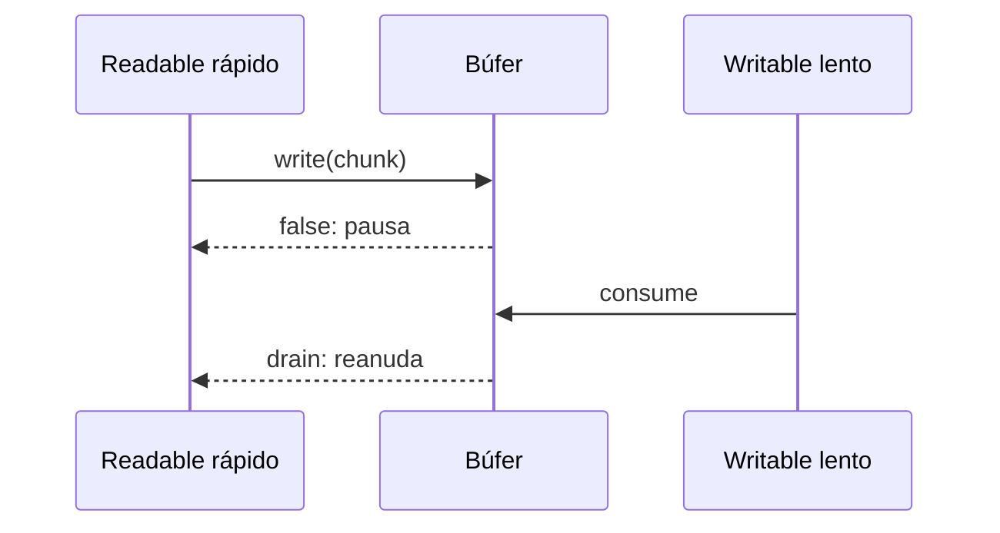

# Módulo 2: Sistema de archivos y streams


## Aprende construyendo

### Tema 1: fs/promises frente a callbacks

**Conceptos clave:** tres estilos de API de archivos, evolución histórica de Node.

Node ofrece tres estilos distintos para operaciones del sistema de archivos, reflejando la evolución histórica del propio lenguaje y del runtime. El estilo síncrono (`fs.readFileSync`) bloquea el hilo único de JavaScript hasta que la operación completa, siendo apropiado únicamente para scripts de configuración ejecutados una sola vez al inicio de un proceso (antes de que el servidor empiece a atender tráfico), nunca dentro del camino crítico de una petición HTTP activa, como se discutió en el Módulo 0. El estilo de callbacks clásico (`fs.readFile(ruta, callback)`) fue la forma original y predominante de Node antes de que las Promesas se estandarizaran en el propio lenguaje JavaScript, y sigue presente en gran cantidad de código legado y en ciertas APIs internas de Node que aún no tienen equivalente moderno.

`fs/promises` (importado como `import { readFile } from "node:fs/promises";`) es la interfaz moderna y recomendada para código nuevo, devolviendo Promesas en vez de requerir callbacks, permitiendo el uso directo de `async`/`await` (estudiado en profundidad en el Módulo 6 del track de JavaScript) para escribir código de manejo de archivos que se lee de forma secuencial y con manejo de errores mediante `try`/`catch` normal, en vez del patrón "error-first callback" (`(err, data) => {...}`) característico del estilo clásico de callbacks de Node, donde el primer argumento del callback está reservado convencionalmente para un posible error, y el desarrollador debe verificarlo explícitamente en cada callback antes de proceder a usar el resultado.

Elegir `fs/promises` para código nuevo no es solo una preferencia estilística: código basado en Promesas se compone naturalmente con `Promise.all` (Módulo 5 del track de JavaScript) para operaciones paralelas, con `try`/`catch` para manejo de errores unificado, y con el resto del ecosistema moderno de JavaScript que asume Promesas como el mecanismo estándar de asincronía, mientras que mezclar estilos de callback clásico con código moderno basado en `async`/`await` introduce fricción de composición y aumenta el riesgo de errores de manejo de errores olvidados (un callback de error no verificado explícitamente falla silenciosamente, mientras que una Promesa rechazada sin manejar produce al menos una advertencia visible de "unhandled rejection").

Reconocer y poder leer las tres formas es, sin embargo, necesario en la práctica real: código legado de Node con años de antigüedad frecuentemente usa el estilo de callbacks clásico, y comprender su patrón (incluyendo la convención "error-first") es indispensable para mantener y depurar ese código existente, incluso cuando código nuevo debería preferir consistentemente `fs/promises`.

**Analogía:** las tres formas de la API de archivos son como tres formas distintas de encargar un trabajo externo: la versión síncrona es esperar de pie, sin hacer nada más, hasta que el trabajo termine completamente; la versión de callback clásico es dejar un número de contacto para que te avisen cuando termine, revisando manualmente si hubo algún problema en ese aviso; la versión de Promesas es recibir un recibo formal con garantías claras sobre cómo se comunicará tanto el éxito como cualquier fallo, integrado naturalmente con el resto de tus herramientas de seguimiento modernas.

**¿Por qué es importante?** `fs/promises` es la interfaz recomendada para código nuevo por su composición natural con `async`/`await` y el manejo de errores unificado, pero reconocer el estilo de callbacks clásico sigue siendo necesario para trabajar con código legado ampliamente presente en el ecosistema Node.

**Código del ejemplo:**

```js
// Síncrono: bloquea el hilo, solo para scripts de configuración inicial
const datos = fs.readFileSync("config.json", "utf-8");

// Callback clásico: error-first, código legado común
fs.readFile("config.json", "utf-8", (err, datos) => { /* verificar err primero */ });

// fs/promises: moderno, recomendado, compone con async/await
const datos2 = await readFile("config.json", "utf-8");
```

#### Paso 1 · Objetivo y preparación

Al finalizar podrás leer y validar JSON con `fs/promises`, y reconocer código de callbacks sin mezclar ambos estilos. Los prerrequisitos son Node LTS, `async`/`await` básico y saber qué representa una ruta. Este ejemplo independiente comienza en una carpeta vacía.

#### Paso 2 · Contexto y caso real

En un caso profesional, una herramienta de línea de comandos carga configuración antes de ejecutar un trabajo. El archivo puede no existir, tener JSON inválido o contener datos con tipos incorrectos; cada fallo necesita un diagnóstico distinto y una acción concreta.

#### Paso 3 · Teoría y analogía aplicada

La API síncrona espera de pie; el callback deja un número; la promesa entrega un comprobante componible. Para código nuevo se prefiere `fs/promises`, pero eso no elimina la obligación de validar el contenido: leer bytes correctamente no garantiza que el JSON tenga la forma esperada.

#### Paso 4 · Demostración guiada desde cero

Desde una carpeta vacía crea el proyecto nuevo:

```bash
mkdir ejemplo-fs-promises
cd ejemplo-fs-promises
npm init -y
mkdir src
```

Añade `"type": "module"` a `package.json`. Crea `config.json`:

```json
{
  "port": 3000,
  "maxUploadMb": 25
}
```

Crea `src/cargar-config.js`:

```js
import { readFile } from "node:fs/promises";

function validarConfig(valor) {
  if (!Number.isInteger(valor.port) || valor.port < 1 || valor.port > 65_535) {
    throw new Error("config.port debe ser un entero entre 1 y 65535");
  }
  if (!Number.isFinite(valor.maxUploadMb) || valor.maxUploadMb <= 0) {
    throw new Error("config.maxUploadMb debe ser un número positivo");
  }
  return Object.freeze(valor);
}

async function cargarConfig(ruta) {
  try {
    // readFile rechaza la promesa ante errores del sistema de archivos.
    const texto = await readFile(ruta, "utf8");
    return validarConfig(JSON.parse(texto));
  } catch (error) {
    // cause conserva ENOENT, SyntaxError u otra causa original para diagnóstico.
    throw new Error(`No fue posible cargar la configuración desde ${ruta}`, {
      cause: error,
    });
  }
}

try {
  const config = await cargarConfig(new URL("../config.json", import.meta.url));
  console.log("Configuración válida:", config);
} catch (error) {
  console.error(error.message);
  console.error("Causa:", error.cause?.code ?? error.cause?.message);
  process.exitCode = 1;
}
```

La función separa transporte, parseo y validación; `cause` conserva el error técnico sin perder el mensaje útil. Ejecuta:

```bash
node src/cargar-config.js
```

**Resultado esperado:** imprime `Configuración válida` con puerto `3000` y límite `25`.

**Fallo deliberado y diagnóstico:** renombra `config.json` a `config.backup.json` y ejecuta otra vez. Debes ver la ruta solicitada y la causa `ENOENT`, que significa archivo inexistente. Restáuralo; luego elimina una comilla para observar que `SyntaxError` es un fallo diferente.

#### Paso 5 · Práctica guiada

Añade `region` y exige una cadena no vacía. **Pista:** valida después de `JSON.parse`, muestra un mensaje con el nombre exacto del campo y prueba primero con `"region": "co"` y después con `"region": ""`.

#### Paso 6 · Práctica independiente

Crea `limits.json`, cárgalo junto con `config.json` mediante `Promise.all` y entrega salida de éxito y de archivo ausente. Explica por qué las lecturas independientes pueden iniciarse juntas y cómo identificar cuál falló.

#### Paso 7 · Cierre y conexión

Ya puedes leer, parsear, validar y diagnosticar archivos sin bloquear. El siguiente tema procesará datos demasiado grandes para cargarlos completos en memoria mediante otro proyecto nuevo.

**Errores comunes:** olvidar `utf8` y recibir un `Buffer`; capturar el error sin conservar su causa; confiar en JSON sin validar; mezclar callback y `await`; usar lectura síncrona dentro de tráfico activo.

**Fuentes oficiales:** [`fs/promises`](https://nodejs.org/api/fs.html#promises-api), [`readFile`](https://nodejs.org/api/fs.html#fspromisesreadfilepath-options) y [errores de sistema Node](https://nodejs.org/api/errors.html#common-system-errors).

**Transferencia al proyecto integrador «API operativa de entregas»:** Lee metadatos de evidencia usando fs/promises con manejo de archivo ausente. Prueba éxito y rechazo y confirma que el descriptor se libera cuando la operación termina o falla.

### Tema 2: Streams básicos: Readable, Writable y Transform

**Conceptos clave:** `Readable`, `Writable`, `Transform`, procesamiento por chunks, corte de líneas entre chunks, `pipeline()`.

Un stream procesa datos en fragmentos pequeños (chunks) a medida que están disponibles, en vez de esperar a que el conjunto completo esté en memoria — la diferencia que permite trabajar con archivos de tamaño arbitrario, incluso mayor que la RAM disponible, sin agotar los recursos del proceso. Node modela tres roles: un `Readable` produce datos (`fs.createReadStream` lee un archivo en chunks sucesivos, en vez de cargarlo completo con `readFile`), un `Writable` consume datos (`fs.createWriteStream` escribe chunks progresivamente a un destino), y un `Transform` hace ambas cosas a la vez: recibe un chunk, lo transforma, y produce un chunk de salida para el siguiente eslabón de la cadena. Los tres se conectan con `pipeline()` desde el primer intento, en vez de con `.pipe()` manual, para adoptar desde el principio el hábito correcto (Tema 4 explica en detalle por qué).

Un chunk no es necesariamente una línea completa: el sistema operativo entrega los bytes disponibles en ese momento, sin alinearlos con ningún límite textual con significado para tu programa — una fila de un CSV puede partirse exactamente a la mitad entre dos chunks sucesivos. Un `Transform` que procesa texto línea por línea tiene que conservar explícitamente el fragmento incompleto de un chunk y pegarlo al siguiente antes de poder tratarlo como una línea completa; ignorar ese matiz es el error más común al escribir el primer parser de streams, y es exactamente lo que este tema hace evidente y resuelve más adelante en este mismo tema.

**Analogía:** procesar un archivo completo en memoria es como intentar tragar un pastel entero de una sola vez; procesarlo con streams es como comerlo en bocados manejables, uno tras otro. Pero el tamaño de un bocado (un chunk) no coincide necesariamente con el tamaño de una porción con sentido (una línea completa): a veces un bocado corta la cobertura de una porción justo a la mitad, y hace falta guardar ese resto y unirlo al próximo bocado antes de poder decir "esto ya es una porción entera".

**¿Por qué es importante?** Los streams son el patrón fundamental que permite a Node procesar archivos y datos de red de tamaño arbitrario con memoria acotada — un mecanismo que subyace a gran parte de la API core de Node, incluyendo el manejo de peticiones HTTP (Módulo 3). Conservar explícitamente el corte entre chunks es lo que separa una demo de juguete de un parser de streams que funciona con datos reales.

**Código del ejemplo:**

```js
import { createReadStream, createWriteStream } from "node:fs";
import { Transform } from "node:stream";
import { pipeline } from "node:stream/promises";

const aMayusculas = new Transform({
  transform(chunk, _encoding, callback) {
    callback(null, chunk.toString().toUpperCase());
  },
});

await pipeline(createReadStream("entrada.txt"), aMayusculas, createWriteStream("salida.txt"));
```

#### Paso 1 · Objetivo y preparación

Al finalizar podrás leer, transformar y escribir datos por fragmentos sin cargar todo el archivo, y sabrás por qué un `Transform` de texto debe conservar explícitamente el fragmento de línea incompleto entre un chunk y el siguiente. Necesitas Node LTS y reconocer una función callback; el ejemplo inicia en una carpeta vacía.
**Conocimiento previo:** haber seguido el tema anterior de este módulo y tener instalado el entorno del stack.

#### Paso 2 · Contexto y caso real

En una situación real, una exportación CSV puede ocupar gigabytes. Un stream permite convertir cada línea mientras llega, con memoria acotada — siempre que el parser no asuma, incorrectamente, que cada chunk contiene únicamente líneas completas.

#### Paso 3 · Teoría y analogía aplicada

Un `Readable` produce, un `Transform` modifica y un `Writable` consume. La analogía del pastel se aplica a los chunks: nunca intentas guardar el pastel entero en memoria, pero un bocado tampoco coincide necesariamente con una porción completa — el parser debe guardar el sobrante de un bocado y unirlo al siguiente antes de interpretar una línea como completa.

#### Paso 4 · Demostración guiada desde cero

Desde una carpeta vacía crea el proyecto nuevo:

```bash
mkdir ejemplo-streams
cd ejemplo-streams
npm init -y
mkdir src
```

Añade `"type": "module"` a `package.json`. Crea `datos.csv` con dos filas (`A1,2.5` y `B2,4`) y `src/convertir.js`:

```js
import { createReadStream, createWriteStream } from "node:fs";
import { Transform } from "node:stream";
import { pipeline } from "node:stream/promises";

// Versión simple: trata cada chunk como si ya contuviera únicamente líneas completas.
const convertir = new Transform({
  transform(chunk, _encoding, callback) {
    try {
      for (const linea of chunk.toString().split("\n").filter(Boolean)) {
        const [id, peso] = linea.split(",");
        const numero = Number(peso);
        if (!id || !Number.isFinite(numero)) throw new Error(`Línea inválida: ${linea}`);
        this.push(JSON.stringify({ id, peso: numero }) + "\n");
      }
      callback();
    } catch (error) { callback(error); }
  },
});

await pipeline(createReadStream("datos.csv"), convertir, createWriteStream("salida.jsonl"));
console.log("Conversión completa: revisa salida.jsonl");
```

Ejecuta desde la raíz:

```bash
node src/convertir.js
```

**Resultado esperado:** con el archivo pequeño del ejemplo, `salida.jsonl` contiene dos objetos JSON correctos — porque con el `highWaterMark` por defecto (64 KB), un archivo de pocos bytes llega completo en un único chunk, así que la suposición de "cada chunk trae líneas completas" todavía no se rompe.

**Fallo deliberado y diagnóstico:** cambia `B2,4` por `B2,cuatro` y ejecuta de nuevo. El pipeline termina con código distinto de cero y señala la línea inválida; ese fallo es de datos, no de chunking. Restaura el valor correcto antes de seguir.

#### Paso 5 · Práctica guiada — el matiz que la versión simple ignora

Agrega `{ highWaterMark: 8 }` como segundo argumento de `createReadStream("datos.csv", { highWaterMark: 8 })` para forzar chunks de solo 8 bytes, y ejecuta de nuevo `node src/convertir.js`. Con un archivo de más de un par de filas verás que `salida.jsonl` queda incompleto, con campos `NaN` o directamente con un `Error: Línea inválida` — porque ahora una fila casi siempre queda partida entre dos chunks, y la versión simple del Paso 4 trata cada chunk como si ya fuera una o más líneas completas, perdiendo o corrompiendo el fragmento que quedó cortado.

**Pista:** reproduce esto primero con el archivo de dos filas del Paso 4, después genera uno de al menos 20 filas — con más filas es más probable que una quede exactamente partida por la mitad entre dos chunks de 8 bytes, haciendo el fallo visible de forma consistente en vez de ocasional.

#### Paso 6 · Práctica independiente — resuelve el corte con un `Transform` separado

Agrega un segundo `Transform`, `separarLineas`, que SOLO se encargue de juntar chunks y emitir líneas completas (sin parsear nada), y encadénalo antes de un `Transform` de conversión que ya recibe líneas garantizadas completas:

```js
let pendiente = "";
const separarLineas = new Transform({
  transform(chunk, _encoding, callback) {
    pendiente += chunk.toString("utf8");
    const lineas = pendiente.split("\n");
    pendiente = lineas.pop(); // Guarda el fragmento cortado para el próximo chunk.
    for (const linea of lineas) this.push(linea);
    callback();
  },
  flush(callback) {
    if (pendiente) this.push(pendiente);
    callback();
  },
});
```

Conéctalo antes de `convertir` en el `pipeline(...)` (`createReadStream("datos.csv", { highWaterMark: 8 }), separarLineas, convertir, createWriteStream("salida.jsonl")`) y repite la prueba del Paso 5 con chunks de 8 bytes. Entrega la salida correcta con chunks pequeños y explica por qué separar "juntar líneas" de "interpretar una línea" en dos `Transform` distintos resuelve el problema sin tener que repetir la lógica de buffering dentro de cada parser futuro.

#### Paso 7 · Cierre y conexión

Ya conectas `Readable`, `Transform` y `Writable` con `pipeline()`, y sabes exactamente por qué una versión que ignora el corte entre chunks funciona con archivos chicos y falla con `highWaterMark` pequeño o archivos grandes — y cómo `separarLineas` lo resuelve de forma reutilizable. El siguiente tema aplica el mismo cuidado al otro extremo de la cadena: qué pasa cuando el destino es más lento que la fuente.

**Errores comunes:** asumir que un chunk es una línea completa; olvidar `flush` (el último fragmento sin salto de línea final se pierde); usar `split(",")` para CSV con comillas o comas dentro de un campo sin un parser real; ignorar el error del callback; acumular todo en un arreglo en memoria en vez de emitir progresivamente.

**Fuentes oficiales:** [Streams de Node](https://nodejs.org/api/stream.html), [`Transform`](https://nodejs.org/api/stream.html#class-streamtransform), [`pipeline`](https://nodejs.org/api/stream.html#streampipelinestreams-options) y [`createReadStream`](https://nodejs.org/api/fs.html#fscreatereadstreampath-options).

**Transferencia al proyecto integrador «API operativa de entregas»:** Transforma un export de entregas por partes con un `separarLineas` reutilizable antes del parser específico del dominio. Un registro inválido debe producir el diagnóstico definido sin corromper silenciosamente las filas posteriores, y el resultado debe ser idéntico sin importar el tamaño de chunk configurado.

### Tema 3: Backpressure: write() y el evento drain

**Conceptos clave:** valor de retorno de `write()`, evento `drain`, `highWaterMark`, conteo de pausas, medición de memoria.

Todo `Writable` tiene un búfer interno con un límite (`highWaterMark`). Cuando ese búfer se llena, `write()` devuelve `false` para avisar que el productor debería pausarse; cuando el búfer vuelve a tener espacio, el stream emite el evento `drain` para avisar que puede reanudar. Ignorar ese valor de retorno no produce un error inmediato — el stream sigue aceptando `write()` adicionales — pero el búfer crece sin límite si el productor nunca se detiene, exactamente el problema que los streams existen para evitar. Sin este mecanismo, una fuente rápida conectada a un destino lento acumularía datos en memoria de forma indefinidamente creciente, hasta agotar la memoria disponible del proceso.

Este tema empieza con la forma más simple posible de observar `write()` devolviendo `false` con un `Writable` anónimo deliberadamente lento, y más adelante en este mismo tema pasa a medir el fenómeno con rigor: cuántas veces pausa exactamente, y cuánta memoria (RSS) se mantiene acotada mientras lo hace, usando una clase `Writable` personalizada en vez de un objeto anónimo.

**Analogía:** el valor de retorno de `write()` es como la luz de un semáforo en la entrada de un estacionamiento: mientras hay espacio, deja entrar autos sin preguntar; cuando se llena, enciende la luz roja (`false`) y nadie debería entrar hasta que salga un auto y se encienda la luz verde (`drain`) de nuevo.

**¿Por qué es importante?** El valor booleano de `write()` es la única señal explícita de que un destino está saturado; ignorarlo no produce un error visible de inmediato, solo un búfer de memoria que crece sin que nada lo esté limitando. Gestionarlo manualmente en cada punto de una cadena es propenso a errores si se repite a mano en cada conexión — por eso `pipeline()` (Tema 4) es preferible a conectar streams uno por uno: gestiona el backpressure automáticamente a través de toda la cadena.

**Diagrama:**



**Código del ejemplo:**

```js
import { Writable } from "node:stream";

const destino = new Writable({ highWaterMark: 2, write(chunk, _e, cb) { setTimeout(cb, 20); } });
const puedeContinuar = destino.write("dato");
if (!puedeContinuar) await new Promise((resolve) => destino.once("drain", resolve));
```

#### Paso 1 · Objetivo y preparación

Al finalizar podrás detectar backpressure, respetar el valor booleano de `write()`, y medir con precisión cuántas pausas provoca y cuánta memoria se mantiene acotada mientras ocurre. Necesitas Node LTS; el laboratorio es un ejemplo independiente desde carpeta vacía.
**Conocimiento previo:** haber seguido el tema anterior de este módulo y tener instalado el entorno del stack.

#### Paso 2 · Contexto y caso real

En producción un lector de red puede entregar datos mucho más rápido que una base de datos o una conexión lenta puede guardarlos. Sin backpressure, el búfer crece hasta presionar la memoria del proceso y empeorar la latencia de todos los usuarios, no solo del productor rápido.

#### Paso 3 · Teoría y analogía aplicada

`Writable.write()` devuelve `false` cuando su búfer alcanzó el límite; el productor debe esperar `drain`. Es la analogía de una banda transportadora: cuando el almacén se llena, la fábrica pausa la entrada hasta que haya espacio de nuevo.

#### Paso 4 · Demostración guiada desde cero

Desde una carpeta vacía crea el proyecto nuevo y `src/medir.js`:

```bash
mkdir ejemplo-backpressure
cd ejemplo-backpressure
npm init -y
mkdir src
```

Añade `"type": "module"` y escribe `src/medir.js`:

```js
import { Writable } from "node:stream";

let recibidos = 0;
const lento = new Writable({
  highWaterMark: 2,
  write(chunk, _encoding, callback) {
    setTimeout(() => { recibidos += 1; callback(); }, 20);
  },
});

for (let i = 0; i < 10; i += 1) {
  const puedeContinuar = lento.write(`paquete-${i}`);
  console.log({ i, puedeContinuar });
  if (!puedeContinuar) await new Promise((resolve) => lento.once("drain", resolve));
}
lento.end(() => console.log("Procesados:", recibidos));
```

Desde la raíz ejecuta `node src/medir.js`. **Resultado esperado:** aparecen valores `false` y el productor espera; finalmente `Procesados: 10`.

**Fallo deliberado y diagnóstico:** elimina la espera de `drain` y cambia el bucle a 100000 elementos. Observa el crecimiento de memoria y deténlo con `Ctrl+C` si es necesario. El diagnóstico es ignorar el contrato de `write()`, no "un stream lento" — restaura la espera y el límite de 10 antes de continuar.

#### Paso 5 · Práctica guiada — midiendo pausas y memoria con precisión

El objeto `Writable` anónimo del Paso 4 demuestra el mecanismo, pero no dice CUÁNTAS veces pausó ni CUÁNTA memoria se mantuvo acotada. Reemplázalo por una clase `DestinoLento extends Writable` que cuente explícitamente sus pausas y mida `process.memoryUsage().rss` al terminar:

```js
import { Writable } from "node:stream";
import { once } from "node:events";

class DestinoLento extends Writable {
  _write(chunk, _encoding, callback) {
    setTimeout(() => {
      console.log("Consumido:", chunk.toString().trim());
      callback();
    }, 15);
  }
}

const destino = new DestinoLento({ highWaterMark: 12 });
let pausas = 0;

for (let indice = 1; indice <= 8; indice += 1) {
  const puedeContinuar = destino.write(`dato-${indice}\n`);
  if (!puedeContinuar) {
    pausas += 1;
    console.log("Pausa: búfer lleno; esperando drain");
    await once(destino, "drain");
  }
}

destino.end();
await once(destino, "finish");
console.log({ pausas, rssMb: Math.round(process.memoryUsage().rss / 1024 / 1024) });
```

**Pista:** ejecutá esta versión con `highWaterMark: 12` y comparála con `highWaterMark: 48` — el número de `pausas` baja porque el búfer absorbe más datos antes de llenarse, pero eso no es gratis: más memoria queda en cola esperando ser escrita.

#### Paso 6 · Práctica independiente

Compara `highWaterMark` en `6` y en `48` con 1000 mensajes en vez de 8, registrando `writableLength` cada vez que `write()` devuelve `false`. Entrega una tabla con pausas, duración total y memoria para ambos límites, y explica el compromiso entre rendimiento y memoria: qué métrica usarías en producción antes de decidir aumentar un búfer.

#### Paso 7 · Cierre y conexión

Ya sabes cuándo pausar un productor, por qué ignorar `write()` solo retrasa el problema a un crecimiento de memoria silencioso, y cómo medir pausas y RSS con una clase `Writable` propia en vez de confiar en una impresión visual. El siguiente tema deja esta misma coordinación en manos de `pipeline()` para una cadena completa y segura.

**Errores comunes:** ignorar el valor de retorno `false` de `write()`; usar buffers enormes como "solución" sin medir el costo real en memoria; registrar listeners `drain` que nunca se retiran; confundir backpressure con un error; bloquear `_write` con trabajo de CPU en vez de delegarlo.

**Fuentes oficiales:** [backpressuring en Node](https://nodejs.org/en/learn/modules/backpressuring-in-streams), [`Writable.write`](https://nodejs.org/api/stream.html#writablewritechunk-encoding-callback) y [`drain`](https://nodejs.org/api/stream.html#event-drain).

**Transferencia al proyecto integrador «API operativa de entregas»:** Simula un destino lento para exportar eventos y respeta `write`/`drain` con una clase propia que cuente sus pausas. Mide memoria durante la prueba; la velocidad del productor debe ajustarse al consumidor sin acumular todo el export en memoria.

### Tema 4: pipeline() para componer streams de forma segura

**Conceptos clave:** `pipeline()`, propagación automática de errores, cierre de recursos, limpieza de salida parcial, `AbortController`.

Conectar streams manualmente encadenando `.pipe()` (`lectura.pipe(transformacion).pipe(escritura)`) funciona en el caso feliz, pero tiene un problema serio: si cualquier stream intermedio emite un error, `.pipe()` encadenado manualmente no propaga ni maneja ese error de forma automática hacia los demás streams de la cadena, dejando potencialmente streams sin cerrar (una fuga de descriptores de archivo abiertos indefinidamente). `pipeline()` — disponible en su forma de callback (`stream.pipeline`) y de Promesa (`stream/promises`, para usar con `await`) — resuelve esto: si cualquier stream de la cadena falla, se asegura de que TODOS los demás se cierren correctamente, liberando sus recursos, además de gestionar el backpressure (Tema 3) a través de toda la cadena sin que el desarrollador implemente esa coordinación manualmente en cada conexión.

Este tema empieza con el caso más simple posible de ese comportamiento — un `Transform` que puede fallar a mitad de camino (si detecta la palabra `ERROR`) y una cadena que se cierra limpiamente como consecuencia — y más adelante en este mismo tema construye sobre eso una importación real que, además, limpia explícitamente el archivo de salida parcial cuando la cadena falla, y agrega cancelación con `AbortController`.

**Analogía:** encadenar `.pipe()` manualmente es como conectar varias mangueras de agua una tras otra sin ningún mecanismo de seguridad: si una manguera intermedia revienta, el agua sigue fluyendo descontroladamente por las demás. `pipeline()` es como un sistema de mangueras con válvulas de seguridad automáticas en cada conexión, que cierran instantáneamente todo el sistema si cualquier punto falla, evitando derrames descontrolados.

**¿Por qué es importante?** `pipeline()` es la forma correcta y recomendada de componer streams en Node: gestiona automáticamente tanto la propagación de errores como el backpressure a través de toda la cadena, evitando fugas de recursos que `.pipe()` encadenado manualmente no previene de forma segura — la diferencia no es solo de conveniencia, sino de corrección real ante fallos parciales (un archivo corrupto a mitad de lectura, una conexión que se interrumpe durante la escritura), mucho más probables en producción que en el escenario ideal donde nada falla.

**Código del ejemplo:**

```js
import { pipeline } from "node:stream/promises";

try {
  await pipeline(lectura, transformacion, escritura);
  console.log("Pipeline completo");
} catch (error) {
  console.error("Falló y la cadena ya se cerró:", error.message);
  // pipeline() ya cerró correctamente todos los streams involucrados
}
```

#### Paso 1 · Objetivo y preparación

Al finalizar podrás componer lectura, transformación y escritura con `pipeline()`, propagar y diagnosticar un error a mitad de la cadena, limpiar la salida parcial que ese error deja, y cancelar la cadena explícitamente con `AbortController`. Necesitas Node LTS; el ejemplo es independiente.
**Conocimiento previo:** haber seguido el tema anterior de este módulo y tener instalado el entorno del stack.

#### Paso 2 · Contexto y caso real

Una importación profesional no debe dejar un archivo parcial si una fila es inválida o el usuario cancela la operación a mitad de camino. `pipeline()` centraliza el cierre y la propagación de errores; tu código decide qué hacer con la salida parcial que queda cuando eso ocurre.

#### Paso 3 · Teoría y analogía aplicada

`pipeline` conecta etapas como una cadena de producción con un supervisor: si una estación falla, detiene y cierra las demás de inmediato. Un `.pipe()` manual puede olvidar listeners, dejar archivos abiertos o silenciar errores. En la analogía de las mangueras, la válvula de seguridad detiene el conjunto cuando una sección falla; después, tu código decide si elimina el producto parcial que quedó a medio escribir.

#### Paso 4 · Demostración guiada desde cero

Desde una carpeta vacía crea el proyecto nuevo:

```bash
mkdir ejemplo-pipeline
cd ejemplo-pipeline
npm init -y
mkdir src
```

Añade `"type": "module"` y crea `src/importar.js`:

```js
import { createReadStream, createWriteStream } from "node:fs";
import { Transform } from "node:stream";
import { pipeline } from "node:stream/promises";

const mayusculas = new Transform({
  transform(chunk, _encoding, callback) {
    const texto = chunk.toString();
    if (texto.includes("ERROR")) return callback(new Error("Entrada rechazada"));
    callback(null, texto.toUpperCase());
  },
});

try {
  await pipeline(createReadStream("datos.txt"), mayusculas, createWriteStream("salida.txt"));
  console.log("Pipeline completo");
} catch (error) {
  console.error("Importación cancelada:", error.message);
  process.exitCode = 1;
}
```

Ejecuta `node src/importar.js`. **Resultado esperado:** `salida.txt` contiene el texto en mayúsculas. Cambia una línea de `datos.txt` a `ERROR`: el comando termina con código 1 y cierra la cadena, pero `salida.txt` queda con el contenido parcial escrito antes del fallo — ese resto parcial es exactamente lo que el Paso 5 enseña a limpiar.

#### Paso 5 · Práctica guiada — limpiar la salida parcial y cancelar con AbortController

**Fallo deliberado:** quita temporalmente el `try`/`catch` del Paso 4 y deja la línea con `ERROR` en `datos.txt`; ejecuta de nuevo. El proceso termina abruptamente con una excepción no capturada en la consola, y `salida.txt` queda publicado con contenido parcial sin que nada lo avise — diagnostica por qué, sin limpieza explícita en el `catch`, un archivo a medio escribir puede pasar por un archivo completo para el siguiente paso de un pipeline mayor. Restaura el `try`/`catch`.

Ahora agrega la limpieza real: en el bloque `catch`, antes de registrar el error, borra la salida parcial con `await rm("salida.txt", { force: true })` (importado de `node:fs/promises`) para que un fallo nunca deje publicado un archivo a medio escribir. Después agrega un `AbortController` y cancela la operación después de 10 ms: pasa `{ signal: controller.signal }` como cuarta opción de `pipeline(...)`.

**Pista:** probá primero el `AbortController` con un archivo de entrada grande (para que la cancelación a los 10 ms ocurra realmente a mitad de la lectura, no después de que ya terminó) y confirmá que el `catch` también limpia la salida parcial cuando la causa del fallo es una cancelación, no solo cuando es una línea con `ERROR`.

#### Paso 6 · Práctica independiente

Haz que la salida se escriba primero en `salida.tmp` y se renombre al nombre final solo tras éxito (en vez de depender únicamente de borrar en el `catch`). Entrega qué archivo queda después de una fila inválida y después de una cancelación con `AbortController`, y explica por qué publicar solo al final evita tener que recordar borrar en cada camino de error posible.

#### Paso 7 · Cierre y conexión

Ya puedes construir una cadena de streams que falla de forma segura: propaga el error, cierra todos los recursos, limpia la salida parcial y responde a una cancelación explícita con `AbortController`. El siguiente módulo introduce HTTP, también con un ejemplo que se crea desde cero.

**Errores comunes:** usar `.pipe()` sin manejo de errores; publicar la salida antes de confirmar que la cadena completa terminó con éxito; limpiar el archivo parcial pero ocultar el error original en el proceso; asumir que cada chunk contiene líneas completas (Tema 2); olvidar cerrar recursos o limpiar la salida al cancelar con `AbortController`.

**Fuentes oficiales:** [`stream.pipeline`](https://nodejs.org/api/stream.html#streampipelinestreams-options), [`stream/promises.pipeline`](https://nodejs.org/api/stream.html#streampromisespipeline) y [`AbortController` en Node](https://nodejs.org/api/globals.html#class-abortcontroller).

**Evidencia de aprendizaje:** entrega la salida completa del Paso 4, el fallo sin capturar reproducido en el Paso 5 junto con la salida parcial ya limpiada tras restaurar el `catch`, y la cancelación con `AbortController` verificada sin dejar un archivo a medio escribir.

**Transferencia al proyecto integrador «API operativa de entregas»:** Compón lectura, transformación y escritura del export mediante `pipeline`, limpia la salida parcial ante cualquier fallo y agrega cancelación explícita. Interrumpe el destino y verifica que no queda un archivo parcial anunciado como completo ni una lectura activa sin consumidor.

## Construcción guiada del capítulo

**Objetivo del laboratorio:** transformar un archivo CSV grande a formato JSON usando streams compuestos con `pipeline()`, sin cargarlo completo en memoria, y observar backpressure de forma experimental.

**Requisitos previos:** Node.js instalado, Módulos 0-1 completados.

| Paso | Acción | Código | Explicación |
|---|---|---|---|
| 1 | Comparar las tres formas de leer un archivo | `readFileSync`, callback clásico, `fs/promises` | Compara sintaxis y manejo de errores de cada una |
| 2 | Generar un CSV de 500k líneas | Script generador simple | Mide memoria usada al leerlo completo con `readFileSync` |
| 3 | Leer el mismo archivo con un stream | `fs.createReadStream` | Procesa línea por línea sin cargarlo completo en memoria |
| 4 | Implementar un `Transform` CSV→JSON | Ver Tema 2 | Convierte cada línea a un objeto JSON serializado |
| 5 | Componer los tres streams con `pipeline()` | Ver Tema 4 | Verifica manejo correcto de errores si el archivo está corrupto |
| 6 | Provocar backpressure intencionalmente | Escritura artificialmente ralentizada | Observa que la lectura se autorregula, pausándose |

**Verificación:** el laboratorio se considera exitoso si el uso de memoria al procesar el archivo con streams permanece acotado y bajo (no crece proporcionalmente al tamaño del archivo), a diferencia de `readFileSync` del paso 2, y si `pipeline()` maneja correctamente un fallo intencional (archivo corrupto) cerrando todos los streams sin dejar recursos abiertos.

### Comprueba lo construido

#### Ejercicio verificable 1

¿Qué módulo moderno permite usar archivos con `async/await`?

**Respuesta esperada:** node:fs/promises|fs/promises

#### Ejercicio verificable 2

¿Qué evento indica que un Writable saturado puede recibir más datos?

**Respuesta esperada:** drain

#### Ejercicio verificable 3

¿Qué función recomendada propaga errores y cierra toda una cadena de streams?

**Respuesta esperada:** pipeline|pipeline()

**Errores comunes y soluciones**

- **Usar `readFileSync` en un archivo de tamaño desconocido o potencialmente grande.** Usa streams para cualquier archivo cuyo tamaño no esté acotado y controlado de antemano.
- **Encadenar `.pipe()` manualmente sin manejo de errores en cada stream individual.** Usa `pipeline()` en su lugar, que gestiona la propagación de errores automáticamente.
- **Olvidar invocar el `callback` dentro de `_transform` de un stream personalizado.** Sin invocarlo, el stream se queda colgado indefinidamente esperando esa señal de que el chunk terminó de procesarse.

---
