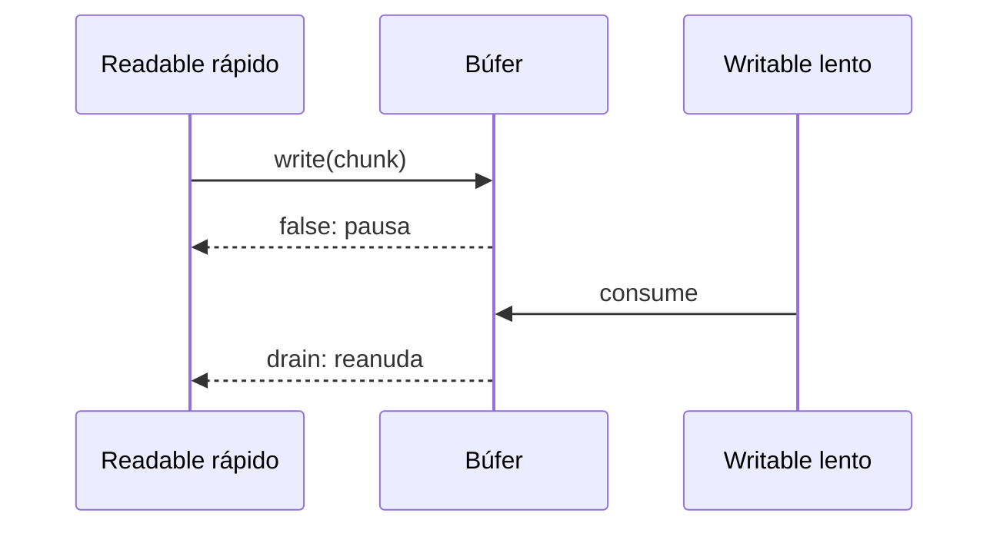
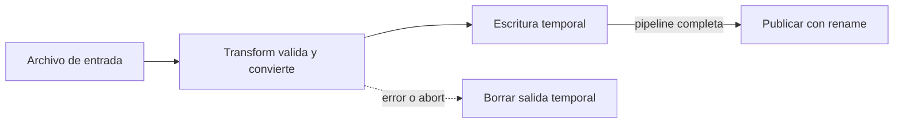

# Módulo 2: Sistema de archivos y streams


## Aprende construyendo

### Tema 1: fs/promises frente a callbacks · Intermedio · 45 min

**Prerrequisito:** Node.js LTS, `async`/`await` básico y comprensión de qué representa una ruta. Comprueba la instalación con `node --version` y `npm --version`.

**Al terminar podrás:** leer y validar JSON con `fs/promises`, diagnosticar por separado un archivo ausente, un JSON inválido y un dato con tipo incorrecto, y reconocer código de callbacks sin mezclar ambos estilos.

#### Aprende

Una herramienta de línea de comandos carga configuración antes de ejecutar un trabajo. El archivo puede no existir, contener JSON inválido o tener datos con tipos incorrectos; cada fallo necesita un diagnóstico distinto y una acción concreta.

**Por qué importa:** `fs/promises` es la interfaz recomendada para código nuevo porque se compone con `async`/`await`, `Promise.all` y un manejo de errores unificado. Aun así, leer bytes correctamente no garantiza que el contenido tenga la forma esperada, y reconocer callbacks sigue siendo necesario para mantener código Node legado.

Node ofrece tres estilos de API de archivos, resultado de la evolución histórica del lenguaje y del runtime:

- El estilo síncrono, como `fs.readFileSync`, bloquea el hilo único de JavaScript hasta completar la operación. Es apropiado para configuración leída una sola vez antes de que un servidor atienda tráfico, no dentro del camino crítico de una petición activa ni para archivos de tamaño desconocido.
- El callback clásico, como `fs.readFile(ruta, callback)`, fue la forma original de Node y continúa en código legado y en APIs sin equivalente moderno. Su convención *error-first* reserva el primer argumento para un posible error: debes comprobarlo antes de usar el resultado.
- `fs/promises`, importado desde `node:fs/promises`, devuelve Promesas. Permite escribir operaciones que se leen secuencialmente con `await`, capturar errores con `try`/`catch` e iniciar lecturas independientes juntas con `Promise.all`.

Elegir Promesas no es solo una preferencia estilística. Mezclar callbacks con `async`/`await` dificulta la composición y facilita olvidar errores: un `err` no comprobado puede pasar desapercibido, mientras que una Promesa rechazada puede propagarse hasta un `catch` explícito. Las tres formas conviven en el ecosistema, por lo que debes saber leerlas aunque uses `fs/promises` en código nuevo.

**Analogía:** la versión síncrona es esperar de pie sin hacer nada más hasta que termine un trabajo; el callback es dejar un número de contacto y revisar manualmente si el aviso comunica un problema; la Promesa es un comprobante componible que representa tanto el éxito como el fallo e integra ese seguimiento con las herramientas modernas.

**Conceptos clave:** tres estilos de API de archivos, evolución histórica de Node, validación de contenido y conservación de la causa del error.

```js
import * as fs from "node:fs";
import { readFile } from "node:fs/promises";

// Síncrono: bloquea el hilo; úsalo solo fuera del camino de tráfico activo.
const datos = fs.readFileSync("config.json", "utf8");

// Callback clásico: comprueba err antes de utilizar datosCallback.
fs.readFile("config.json", "utf8", (err, datosCallback) => {
  if (err) {
    console.error(err);
    return;
  }
  console.log(datosCallback);
});

// fs/promises: se compone directamente con async/await.
const datosModernos = await readFile("config.json", "utf8");
```

#### Practica

**Desde cero:** crea una carpeta vacía y, dentro de ella, todos los archivos del proyecto; no uses archivos de otros temas ni ejemplos del repositorio:

```bash
mkdir ejemplo-fs-promises
cd ejemplo-fs-promises
npm init -y
mkdir src
```

Abre el `package.json` generado y añade `"type": "module"` al objeto principal.

**Crea** `config.json`:

```json
{
  "port": 3000,
  "maxUploadMb": 25
}
```

**Crea** `src/cargar-config.js`:

```js
import { readFile } from "node:fs/promises";

function validarConfig(valor) {
  if (!Number.isInteger(valor.port) || valor.port < 1 || valor.port > 65_535) {
    throw new Error("config.port debe ser un entero entre 1 y 65535");
  }
  if (!Number.isFinite(valor.maxUploadMb) || valor.maxUploadMb <= 0) {
    throw new Error("config.maxUploadMb debe ser un número positivo");
  }
  return Object.freeze(valor);
}

async function cargarConfig(ruta) {
  try {
    // readFile rechaza la promesa ante errores del sistema de archivos.
    const texto = await readFile(ruta, "utf8");
    return validarConfig(JSON.parse(texto));
  } catch (error) {
    // cause conserva ENOENT, SyntaxError u otra causa original para diagnóstico.
    throw new Error(`No fue posible cargar la configuración desde ${ruta}`, {
      cause: error,
    });
  }
}

try {
  const config = await cargarConfig(new URL("../config.json", import.meta.url));
  console.log("Configuración válida:", config);
} catch (error) {
  console.error(error.message);
  console.error("Causa:", error.cause?.code ?? error.cause?.message);
  process.exitCode = 1;
}
```

La función separa transporte, parseo y validación. `cause` conserva el error técnico sin perder un mensaje útil, y la ruta basada en `import.meta.url` se resuelve respecto del archivo, no respecto del directorio desde el que ejecutaste Node.

**Ejecuta** desde la raíz del proyecto:

```bash
node src/cargar-config.js
```

**Resultado esperado:** imprime `Configuración válida` con puerto `3000` y límite `25`.

**Fallo deliberado:** renombra `config.json` a `config.backup.json` y ejecuta otra vez. Debes ver la ruta solicitada y la causa `ENOENT`, que significa archivo inexistente. Restaura el nombre; después elimina una comilla del JSON y repite el comando para observar que `SyntaxError` es un fallo diferente. **Corrección:** restablece tanto el nombre como el JSON válido y comprueba de nuevo la salida de éxito.

**Práctica guiada:** añade `"region": "co"` a `config.json` y exige en `validarConfig` una cadena no vacía. **Pista:** valida después de `JSON.parse`, muestra un mensaje con el nombre exacto del campo y prueba después con `"region": ""`. Restaura un valor válido al terminar.

**Si falla.** Si recibes un `Buffer` en una adaptación del ejemplo, comprueba la codificación `utf8`. Si el mensaje ya no distingue la causa, verifica que pases `{ cause: error }` y que leas `error.cause`. Si cambiar el directorio de ejecución rompe la ruta, conserva el `new URL("../config.json", import.meta.url)` en lugar de depender del directorio actual.

#### Aplica

**Práctica independiente:** crea manualmente `limits.json` junto a `config.json` con este contenido:

```json
{
  "maxRetries": 3,
  "timeoutMs": 5000
}
```

Modifica `src/cargar-config.js` para cargarlo junto con `config.json` mediante `Promise.all`, manteniendo una ruta y un diagnóstico identificables para cada archivo. Entrega una ejecución de éxito y otra con `limits.json` ausente, y explica por qué las lecturas independientes pueden iniciarse juntas sin convertir un fallo de parseo o validación en un `ENOENT`.

**Checklist de salida.**

- [ ] El proyecto se creó desde una carpeta vacía y contiene sus propios `package.json`, `config.json` y `src/cargar-config.js`.
- [ ] La lectura usa `node:fs/promises` y no mezcla un callback clásico con `await`.
- [ ] La ejecución válida muestra puerto `3000`, límite `25` y la región añadida.
- [ ] El archivo ausente se diagnostica con `ENOENT` y el JSON roto con `SyntaxError`.
- [ ] Los valores de puerto, tamaño y región se validan después de `JSON.parse`.
- [ ] Las dos lecturas de la práctica independiente se inician con `Promise.all` y conservan diagnósticos distinguibles.

**Si falla.** Si `Promise.all` rechaza pero no sabes qué archivo falló, no captures ambos errores en un mensaje genérico: conserva la ruta en el error de cada carga. Si una lectura depende del resultado de la otra, no la fuerces a `Promise.all`; este ejercicio solo paraleliza operaciones independientes.

**Errores comunes:** olvidar `utf8` y recibir un `Buffer`; capturar el error sin conservar su causa; confiar en JSON sin validar; mezclar callback y `await`; usar lectura síncrona dentro de tráfico activo.

**Fuentes oficiales:** [`fs/promises`](https://nodejs.org/api/fs.html#promises-api), [`readFile`](https://nodejs.org/api/fs.html#fspromisesreadfilepath-options) y [errores de sistema Node](https://nodejs.org/api/errors.html#common-system-errors).

**Transferencia al proyecto integrador «API operativa de entregas»:** lee metadatos de evidencia usando `fs/promises` con manejo de archivo ausente. Prueba éxito y rechazo y confirma que el descriptor se libera cuando la operación termina o falla. Como siguiente tema, procesarás datos demasiado grandes para cargarlos completos en memoria mediante otro proyecto nuevo.

---

### Tema 2: Streams básicos: Readable, Writable y Transform · Intermedio · 60 min

**Prerrequisito:** Node.js LTS y capacidad para reconocer una función callback. Comprueba `node --version`; no necesitas archivos del tema anterior.

**Al terminar podrás:** conectar `Readable`, `Transform` y `Writable` con `pipeline()`, procesar datos por fragmentos sin cargar el archivo completo y conservar el resto de una línea partida entre chunks.

#### Aprende

Una exportación CSV puede ocupar gigabytes. Un stream permite convertir cada línea mientras llega, con memoria acotada, siempre que el parser no asuma incorrectamente que cada chunk contiene únicamente líneas completas.

**Por qué importa:** los streams permiten procesar archivos y datos de red de tamaño arbitrario sin mantener todo el contenido en memoria. Conservar explícitamente el corte entre chunks es lo que separa una demo que funciona con un archivo pequeño de un parser que funciona con datos reales.

Un `Readable` produce datos: `fs.createReadStream` lee un archivo en chunks sucesivos en vez de cargarlo completo. Un `Writable` consume datos: `fs.createWriteStream` escribe progresivamente en un destino. Un `Transform` cumple ambos roles: recibe un chunk, lo transforma y emite salida para el siguiente eslabón. Desde el primer ejemplo se conectan con `pipeline()` para propagar errores, cerrar recursos y respetar backpressure.

Un chunk no es necesariamente una línea completa. El sistema operativo entrega los bytes disponibles sin alinearlos con límites textuales; una fila CSV puede partirse a la mitad entre dos chunks. Un `Transform` de texto debe conservar el fragmento incompleto y anteponerlo al chunk siguiente. Además, su `flush` debe emitir el último fragmento cuando el archivo no termina en salto de línea.

**Analogía:** cargar un archivo completo es intentar tragar un pastel entero; usar streams es comerlo en bocados manejables. Pero un bocado no coincide con una porción con sentido: si corta una línea, debes guardar ese resto y unirlo al bocado siguiente antes de interpretarla.

**Conceptos clave:** `Readable`, `Writable`, `Transform`, procesamiento por chunks, corte de líneas entre chunks y `pipeline()`.

```js
import { createReadStream, createWriteStream } from "node:fs";
import { Transform } from "node:stream";
import { pipeline } from "node:stream/promises";

const aMayusculas = new Transform({
  transform(chunk, _encoding, callback) {
    callback(null, chunk.toString().toUpperCase());
  },
});

await pipeline(
  createReadStream("entrada.txt"),
  aMayusculas,
  createWriteStream("salida.txt"),
);
```

#### Practica

**Desde cero:** crea una carpeta vacía y todos los archivos de este proyecto, sin reutilizar el convertidor de otro tema:

```bash
mkdir ejemplo-streams
cd ejemplo-streams
npm init -y
mkdir src
```

Añade `"type": "module"` al objeto principal de `package.json`.

**Crea** `datos.csv` con estas dos filas:

```csv
A1,2.5
B2,4
```

**Crea** `src/convertir.js`. Esta primera versión trata deliberadamente cada chunk como si contuviera líneas completas:

```js
import { createReadStream, createWriteStream } from "node:fs";
import { Transform } from "node:stream";
import { pipeline } from "node:stream/promises";

const convertir = new Transform({
  transform(chunk, _encoding, callback) {
    try {
      for (const linea of chunk.toString().split("\n").filter(Boolean)) {
        const [id, peso] = linea.split(",");
        const numero = Number(peso);
        if (!id || !Number.isFinite(numero)) {
          throw new Error(`Línea inválida: ${linea}`);
        }
        this.push(JSON.stringify({ id, peso: numero }) + "\n");
      }
      callback();
    } catch (error) {
      callback(error);
    }
  },
});

await pipeline(
  createReadStream("datos.csv"),
  convertir,
  createWriteStream("salida.jsonl"),
);
console.log("Conversión completa: revisa salida.jsonl");
```

**Ejecuta** desde la raíz:

```bash
node src/convertir.js
```

**Resultado esperado:** con este archivo pequeño, `salida.jsonl` contiene dos objetos JSON correctos. Con el `highWaterMark` predeterminado, unos pocos bytes llegan en un único chunk, por lo que todavía no se rompe la suposición de líneas completas:

```jsonl
{"id":"A1","peso":2.5}
{"id":"B2","peso":4}
```

**Fallo deliberado:** cambia `B2,4` por `B2,cuatro` y ejecuta de nuevo. El pipeline termina con código distinto de cero y señala la línea inválida; es un fallo de datos, no de chunking. **Corrección:** restaura `B2,4` antes de continuar.

**Práctica guiada:** cambia la lectura a `createReadStream("datos.csv", { highWaterMark: 8 })` para forzar chunks de 8 bytes y ejecuta otra vez. Ahora una fila puede quedar partida entre chunks y la versión simple pierde o corrompe fragmentos: observa salida incompleta, campos incorrectos o `Error: Línea inválida`. Reproduce el caso primero con las dos filas y después amplía manualmente `datos.csv` a al menos 20 filas válidas para hacer el corte más visible.

**Pista:** no aumentes el búfer para ocultar el problema ni acumules el archivo entero. El parser necesita separar dos responsabilidades: juntar líneas e interpretar cada línea.

**Si falla.** Si el archivo pequeño parece correcto con el búfer predeterminado, eso no prueba que el parser sea robusto: conserva `highWaterMark: 8` para reproducir el corte. Si el proceso queda esperando, comprueba que cada rama de `transform` termine llamando a `callback()` o `callback(error)`.

#### Aplica

**Práctica independiente:** agrega en `src/convertir.js` un `Transform` llamado `separarLineas` que solo junte chunks y emita líneas completas. Usa este patrón y colócalo antes de `convertir`:

```js
let pendiente = "";
const separarLineas = new Transform({
  transform(chunk, _encoding, callback) {
    pendiente += chunk.toString("utf8");
    const lineas = pendiente.split("\n");
    pendiente = lineas.pop();
    for (const linea of lineas) this.push(linea);
    callback();
  },
  flush(callback) {
    if (pendiente) this.push(pendiente);
    callback();
  },
});
```

La cadena debe quedar así:

```js
await pipeline(
  createReadStream("datos.csv", { highWaterMark: 8 }),
  separarLineas,
  convertir,
  createWriteStream("salida.jsonl"),
);
```

Repite la prueba con chunks de 8 bytes, incluye una última fila sin salto de línea final y compara el resultado con una lectura usando el tamaño de chunk predeterminado. Explica por qué separar «juntar líneas» de «interpretar una línea» evita repetir la lógica de buffering en cada parser futuro.

**Checklist de salida.**

- [ ] El proyecto contiene su propio `datos.csv` y `src/convertir.js`, creados desde una carpeta vacía.
- [ ] La cadena conecta `createReadStream`, dos `Transform` y `createWriteStream` mediante `pipeline()`.
- [ ] La fila `B2,cuatro` produce un diagnóstico de dato inválido y su corrección restaura la ejecución.
- [ ] `highWaterMark: 8` hace visible el corte de líneas en la versión simple.
- [ ] `separarLineas` conserva `pendiente` y `flush` emite la última línea sin salto final.
- [ ] La salida correcta no depende del tamaño de chunk y no acumula el archivo completo en memoria.

**Si falla.** Si desaparece la última fila, revisa `flush`. Si aparecen campos partidos, confirma que `separarLineas` esté antes de `convertir` y que `lineas.pop()` guarde el fragmento aún incompleto. Si necesitas comillas o comas dentro de campos CSV, no extiendas `split(",")` como si fuera un parser CSV completo; delimita esa limitación y usa un parser real.

**Errores comunes:** asumir que un chunk es una línea completa; olvidar `flush`; usar `split(",")` para CSV con comillas o comas internas; ignorar el error del callback; acumular todo en un arreglo en memoria en vez de emitir progresivamente.

**Fuentes oficiales:** [Streams de Node](https://nodejs.org/api/stream.html), [`Transform`](https://nodejs.org/api/stream.html#class-streamtransform), [`pipeline`](https://nodejs.org/api/stream.html#streampipelinestreams-options) y [`createReadStream`](https://nodejs.org/api/fs.html#fscreatereadstreampath-options).

**Transferencia al proyecto integrador «API operativa de entregas»:** transforma un export de entregas por partes con un `separarLineas` reutilizable antes del parser del dominio. Un registro inválido debe producir el diagnóstico definido sin corromper silenciosamente las filas posteriores, y el resultado debe ser idéntico sin importar el tamaño de chunk. El siguiente cuidado es qué ocurre cuando el destino es más lento que la fuente.

---

### Tema 3: Backpressure: write() y el evento drain · Avanzado · 55 min

**Prerrequisito:** Node.js LTS y conocimiento básico de `Writable`. El laboratorio crea su propio destino y no reutiliza streams de otros temas.

**Al terminar podrás:** detectar backpressure, respetar el valor booleano de `write()`, esperar `drain` y medir pausas, longitud del búfer, duración y memoria antes de cambiar `highWaterMark`.

#### Aprende

Un lector de red puede entregar datos mucho más rápido de lo que una base de datos o una conexión lenta puede guardarlos. Sin backpressure, el búfer crece, presiona la memoria del proceso y empeora la latencia de todos los usuarios, no solo la del productor rápido.

**Por qué importa:** el valor booleano de `write()` es la señal explícita de saturación de un destino. Ignorarlo no produce un error inmediato: el stream sigue aceptando datos y el búfer crece sin el límite que los streams deben proporcionar.

Todo `Writable` tiene un búfer interno con `highWaterMark`. Cuando alcanza su límite, `write()` devuelve `false` para indicar que el productor debe pausarse. Cuando vuelve a haber espacio, el stream emite `drain`. El valor `false` no es una excepción ni significa que el chunk se perdió; es una señal de coordinación. `pipeline()` gestiona esta coordinación automáticamente en una cadena, mientras que este laboratorio la hace visible escribiendo manualmente.

**Analogía:** `write()` es el semáforo de entrada a un estacionamiento. Mientras hay espacio deja entrar autos; cuando se llena enciende la luz roja (`false`) y nadie más debería entrar hasta que salga un auto y se encienda la verde (`drain`).

**Conceptos clave:** valor de retorno de `write()`, evento `drain`, `highWaterMark`, conteo de pausas y medición de memoria.



```js
import { Writable } from "node:stream";

const destino = new Writable({
  highWaterMark: 2,
  write(chunk, _encoding, callback) {
    setTimeout(callback, 20);
  },
});

const puedeContinuar = destino.write("dato");
if (!puedeContinuar) {
  await new Promise((resolve) => destino.once("drain", resolve));
}
```

#### Practica

**Desde cero:** crea el proyecto en una carpeta vacía:

```bash
mkdir ejemplo-backpressure
cd ejemplo-backpressure
npm init -y
mkdir src
```

Añade `"type": "module"` a `package.json` y **crea** `src/medir.js`:

```js
import { Writable } from "node:stream";

let recibidos = 0;
const lento = new Writable({
  highWaterMark: 2,
  write(chunk, _encoding, callback) {
    setTimeout(() => {
      recibidos += 1;
      callback();
    }, 20);
  },
});

for (let i = 0; i < 10; i += 1) {
  const puedeContinuar = lento.write(`paquete-${i}`);
  console.log({ i, puedeContinuar });
  if (!puedeContinuar) {
    await new Promise((resolve) => lento.once("drain", resolve));
  }
}

lento.end(() => console.log("Procesados:", recibidos));
```

**Ejecuta** desde la raíz:

```bash
node src/medir.js
```

**Resultado esperado:** aparecen valores `false`, el productor espera y finalmente se imprime `Procesados: 10`.

**Fallo deliberado:** elimina la espera de `drain` y cambia el bucle a 100000 elementos. Observa el crecimiento de memoria y detén el proceso con `Ctrl+C` si es necesario. El diagnóstico es incumplir el contrato de `write()`, no simplemente «tener un stream lento». **Corrección:** restaura la espera y el límite de 10 antes de continuar.

**Práctica guiada:** el `Writable` anónimo demuestra el mecanismo, pero no cuenta las pausas ni registra memoria al finalizar. Sustituye el contenido de `src/medir.js` por esta versión con una clase propia:

```js
import { once } from "node:events";
import { Writable } from "node:stream";

class DestinoLento extends Writable {
  _write(chunk, _encoding, callback) {
    setTimeout(() => {
      console.log("Consumido:", chunk.toString().trim());
      callback();
    }, 15);
  }
}

const destino = new DestinoLento({ highWaterMark: 12 });
let pausas = 0;

for (let indice = 1; indice <= 8; indice += 1) {
  const puedeContinuar = destino.write(`dato-${indice}\n`);
  if (!puedeContinuar) {
    pausas += 1;
    console.log("Pausa: búfer lleno; esperando drain");
    await once(destino, "drain");
  }
}

destino.end();
await once(destino, "finish");
console.log({ pausas, rssMb: Math.round(process.memoryUsage().rss / 1024 / 1024) });
```

Ejecuta esta versión con `highWaterMark: 12` y compárala con `highWaterMark: 48`. **Pista:** el segundo búfer puede absorber más datos antes de llenarse; registra lo observado en lugar de asumir que un búfer mayor siempre mejora el sistema.

**Si falla.** Si nunca observas `false`, conserva el destino lento y los límites pequeños del experimento: la señal depende de la relación entre producción, consumo y búfer. Si el proceso no llega a `finish`, comprueba que `_write` invoque su callback y que ejecutes `destino.end()` después del bucle.

#### Aplica

**Práctica independiente:** compara `highWaterMark` en `6` y en `48` con 1000 mensajes en vez de 8. Registra `destino.writableLength` cada vez que `write()` devuelva `false`, y mide pausas, duración total y RSS para ambos límites. Entrega una tabla con tus observaciones y explica el compromiso entre rendimiento y memoria: qué métrica comprobarías en producción antes de aumentar un búfer.

**Checklist de salida.**

- [ ] El proyecto se inició en una carpeta vacía y contiene su propio `src/medir.js`.
- [ ] Cada `write()` que devuelve `false` va seguido de una espera de `drain`.
- [ ] La versión corregida termina con `Procesados: 10` o con el evento `finish` de la clase propia.
- [ ] El fallo sin espera se identifica como crecimiento del búfer por ignorar backpressure.
- [ ] `DestinoLento` cuenta pausas y registra RSS sin afirmar valores no medidos.
- [ ] La comparación independiente registra `writableLength`, duración y memoria para los dos límites.

**Si falla.** Si la comparación solo reporta velocidad, vuelve a incluir memoria y longitud del búfer: aumentar `highWaterMark` desplaza el costo hacia datos en cola. Si aparecen listeners que permanecen después de cada pausa, usa `once` como en el ejemplo en lugar de acumular `on("drain", ...)`.

**Errores comunes:** ignorar el valor `false`; usar buffers enormes como solución sin medir memoria; registrar listeners `drain` que nunca se retiran; confundir backpressure con un error; bloquear `_write` con trabajo de CPU en vez de delegarlo.

**Fuentes oficiales:** [backpressuring en Node](https://nodejs.org/en/learn/modules/backpressuring-in-streams), [`Writable.write`](https://nodejs.org/api/stream.html#writablewritechunk-encoding-callback) y [`drain`](https://nodejs.org/api/stream.html#event-drain).

**Transferencia al proyecto integrador «API operativa de entregas»:** simula un destino lento para exportar eventos y respeta `write`/`drain` con una clase propia que cuente sus pausas. Mide memoria durante la prueba; la velocidad del productor debe ajustarse al consumidor sin acumular todo el export en memoria. En una cadena completa, delega esta coordinación a `pipeline()`.

---

### Tema 4: pipeline() para componer streams de forma segura · Avanzado · 60 min

**Prerrequisito:** Node.js LTS y conocimiento básico de `Readable`, `Transform` y `Writable`. Crearás una entrada, una transformación y una salida nuevas en este tema.

**Al terminar podrás:** componer streams con `pipeline()`, propagar un error a mitad de la cadena, limpiar la salida parcial, cancelar con `AbortController` y publicar un archivo solo después del éxito.

#### Aprende

Una importación profesional no debe dejar un archivo parcial presentado como completo si una fila es inválida o el usuario cancela la operación. El cierre de streams y la decisión sobre el archivo parcial son responsabilidades relacionadas, pero distintas.

**Por qué importa:** `pipeline()` propaga errores, cierra todos los streams de la cadena y gestiona backpressure. Un `.pipe()` encadenado manualmente no coordina esos errores de forma segura y puede dejar descriptores abiertos; `pipeline()` evita esa fuga, pero no decide por ti si el archivo parcial debe borrarse o conservarse para diagnóstico.

La forma de callback está disponible como `stream.pipeline`; la forma de Promesa, adecuada para `await`, se importa de `node:stream/promises`. Si una etapa falla, la Promesa rechaza y la cadena se cierra. Un `AbortController` permite cancelar explícitamente mediante su señal. Después de que la cadena se cierra, tu código todavía debe limpiar la salida parcial o evitar publicarla hasta que toda la operación haya terminado.

**Analogía:** conectar `.pipe()` manualmente es unir mangueras sin válvulas de seguridad: si una sección revienta, las demás no se cierran automáticamente. `pipeline()` instala un supervisor que detiene y cierra el conjunto; después, tu código decide qué hacer con el producto que quedó a medio escribir.

**Conceptos clave:** `pipeline()`, propagación automática de errores, cierre de recursos, limpieza de salida parcial y `AbortController`.

```js
import { pipeline } from "node:stream/promises";

try {
  await pipeline(lectura, transformacion, escritura);
  console.log("Pipeline completo");
} catch (error) {
  console.error("Falló y la cadena ya se cerró:", error.message);
  // La salida parcial todavía requiere una decisión explícita.
}
```

#### Practica

**Desde cero:** crea una carpeta vacía y todos los archivos del ejercicio:

```bash
mkdir ejemplo-pipeline
cd ejemplo-pipeline
npm init -y
mkdir src
```

Añade `"type": "module"` a `package.json`.

**Crea** `datos.txt`:

```text
guia E-001
entrega completada
```

**Crea** `src/importar.js`:

```js
import { createReadStream, createWriteStream } from "node:fs";
import { Transform } from "node:stream";
import { pipeline } from "node:stream/promises";

const mayusculas = new Transform({
  transform(chunk, _encoding, callback) {
    const texto = chunk.toString();
    if (texto.includes("ERROR")) {
      return callback(new Error("Entrada rechazada"));
    }
    callback(null, texto.toUpperCase());
  },
});

try {
  await pipeline(
    createReadStream("datos.txt"),
    mayusculas,
    createWriteStream("salida.txt"),
  );
  console.log("Pipeline completo");
} catch (error) {
  console.error("Importación cancelada:", error.message);
  process.exitCode = 1;
}
```

**Ejecuta** `node src/importar.js`. **Resultado esperado:** aparece `Pipeline completo` y `salida.txt` contiene el texto en mayúsculas.

**Fallo deliberado:** cambia una línea de `datos.txt` a `ERROR` y ejecuta de nuevo. El comando termina con código 1 y cierra la cadena, pero `salida.txt` puede conservar contenido parcial escrito antes del fallo. Quita temporalmente el `try`/`catch`, ejecuta otra vez y observa la excepción no capturada: sin una decisión explícita, ese resto puede pasar por archivo completo ante una etapa posterior. **Corrección:** restaura el `try`/`catch` y el contenido válido de `datos.txt`.

**Práctica guiada:** añade `rm` a los imports y limpia la salida en el `catch`:

```js
import { rm } from "node:fs/promises";
```

```js
} catch (error) {
  await rm("salida.txt", { force: true });
  console.error("Importación cancelada:", error.message);
  process.exitCode = 1;
}
```

Repite el fallo con `ERROR` y confirma que desaparece `salida.txt`. Después usa la clase global `AbortController` disponible en Node LTS:

```js
const controller = new AbortController();
const temporizador = setTimeout(() => controller.abort(), 10);

try {
  await pipeline(
    createReadStream("datos.txt"),
    mayusculas,
    createWriteStream("salida.txt"),
    { signal: controller.signal },
  );
  console.log("Pipeline completo");
} catch (error) {
  await rm("salida.txt", { force: true });
  console.error("Importación cancelada:", error.message);
  process.exitCode = 1;
} finally {
  clearTimeout(temporizador);
}
```

Para observar una cancelación a mitad de la lectura y no después de terminar, amplía manualmente `datos.txt` con contenido válido suficiente antes de ejecutar. El `catch` debe limpiar también cuando la causa sea la cancelación.

**Si falla.** Si el proceso imprime éxito antes de los 10 ms, la entrada terminó antes de la cancelación; no confundas ese resultado con una señal ignorada. Si queda `salida.txt` tras `ERROR`, comprueba que el `catch` haga `await rm(...)` y que el error no se oculte antes de llegar allí.

#### Aplica

**Práctica independiente:** cambia la publicación para escribir primero en `salida.tmp` y renombrarla a `salida.txt` solo después de que `pipeline()` termine con éxito. Importa `rename` de `node:fs/promises`, conserva la limpieza de `salida.tmp` en los caminos de error y no borres una versión final válida antes de disponer de un reemplazo completo. Entrega qué archivo queda después de una fila inválida y después de una cancelación, y explica por qué publicar al final reduce la dependencia de recordar cada limpieza posible.

**Checklist de salida.**

- [ ] El proyecto incluye sus propios `datos.txt` y `src/importar.js`, creados desde cero.
- [ ] La cadena usa `pipeline()` de `node:stream/promises`, no `.pipe()` sin coordinación.
- [ ] La entrada `ERROR` produce código 1, cierra la cadena y no deja salida parcial publicada.
- [ ] El `try`/`catch` restaurado conserva el mensaje del error original.
- [ ] `AbortController` cancela mediante `{ signal }` y el `finally` limpia el temporizador.
- [ ] La versión independiente escribe `salida.tmp` y la renombra únicamente después del éxito.

**Si falla.** Si el archivo temporal queda tras cancelar, revisa que la limpieza cubra tanto rechazo de datos como `AbortError`. Si la salida final aparece aunque el pipeline falló, comprueba que `rename` esté después de `await pipeline(...)` y no en un camino que se ejecuta siempre.

**Errores comunes:** usar `.pipe()` sin manejo de errores; publicar antes de confirmar el éxito; limpiar el parcial pero ocultar el error original; asumir que cada chunk contiene líneas completas; olvidar cerrar recursos o limpiar al cancelar.



**Cuándo elegir `pipeline()`:** úsala cuando los streams forman una sola operación cuyo éxito depende de toda la cadena: centraliza propagación de error, cierre y cancelación. Una cadena con `.pipe()` puede ser adecuada si cada tramo necesita recuperación independiente, pero entonces debes demostrar quién escucha cada error y quién cierra cada recurso; no publiques el archivo hasta confirmar el éxito completo.

**Fuentes oficiales:** [`stream.pipeline`](https://nodejs.org/api/stream.html#streampipelinestreams-options), [`stream/promises.pipeline`](https://nodejs.org/api/stream.html#streampromisespipeline) y [`AbortController` en Node](https://nodejs.org/api/globals.html#class-abortcontroller).

**Transferencia al proyecto integrador «API operativa de entregas»:** compón lectura, transformación y escritura del export mediante `pipeline`, limpia la salida parcial ante cualquier fallo y agrega cancelación explícita. Interrumpe el destino y verifica que no quede un archivo parcial anunciado como completo ni una lectura activa sin consumidor. El siguiente módulo introduce HTTP, también con ejemplos creados desde cero.

---

## Construcción guiada del capítulo

**Objetivo del laboratorio:** construir un proyecto independiente que transforme un CSV de 500000 líneas a JSONL mediante streams compuestos con `pipeline()`, comparar su memoria con una lectura completa, comprobar el tratamiento de un archivo corrupto y observar backpressure experimentalmente.

**Requisitos previos:** Node.js instalado y Módulos 0-1 completados. No copies archivos de los temas: este proyecto crea su propia entrada, parser y destino.

**1. Crea el proyecto desde una carpeta vacía:**

```bash
mkdir proyecto-csv-streams
cd proyecto-csv-streams
npm init -y
mkdir src
```

Añade `"type": "module"` a `package.json`.

**2. Crea `src/generar.js` para producir tu propio CSV sin acumularlo en memoria:**

```js
import { createWriteStream } from "node:fs";
import { once } from "node:events";

const salida = createWriteStream("grande.csv");

for (let indice = 0; indice < 500_000; indice += 1) {
  const linea = `E${indice},${(indice % 100) / 10}\n`;
  if (!salida.write(linea)) await once(salida, "drain");
}

salida.end();
await once(salida, "finish");
console.log("CSV generado: grande.csv");
```

Ejecuta `node src/generar.js`. **Resultado esperado:** aparece `CSV generado: grande.csv` y el archivo contiene 500000 filas con un identificador y un peso numérico.

**3. Crea `src/medir-completo.js` para observar el costo de cargar todo el archivo:**

```js
import { readFileSync } from "node:fs";

const rssInicial = process.memoryUsage().rss;
const texto = readFileSync("grande.csv", "utf8");
const filas = texto.split("\n").filter(Boolean);

console.log({
  filas: filas.length,
  rssMb: Math.round(process.memoryUsage().rss / 1024 / 1024),
  incrementoRssMb: Math.round((process.memoryUsage().rss - rssInicial) / 1024 / 1024),
});
```

Ejecuta `node src/medir-completo.js` y registra los valores observados en tu entorno. Esta lectura síncrona es una comparación local deliberada, no un patrón para tráfico activo ni para archivos de tamaño desconocido.

**4. Crea `src/convertir.js` con separación de líneas, validación, salida temporal y publicación al final:**

```js
import { createReadStream, createWriteStream } from "node:fs";
import { rename, rm } from "node:fs/promises";
import { Transform } from "node:stream";
import { pipeline } from "node:stream/promises";

let pendiente = "";
const separarLineas = new Transform({
  transform(chunk, _encoding, callback) {
    pendiente += chunk.toString("utf8");
    const lineas = pendiente.split("\n");
    pendiente = lineas.pop();
    for (const linea of lineas) this.push(linea);
    callback();
  },
  flush(callback) {
    if (pendiente) this.push(pendiente);
    callback();
  },
});

const convertir = new Transform({
  transform(chunk, _encoding, callback) {
    const linea = chunk.toString();
    const [id, peso] = linea.split(",");
    const numero = Number(peso);
    if (!id || !Number.isFinite(numero)) {
      callback(new Error(`Línea inválida: ${linea}`));
      return;
    }
    callback(null, JSON.stringify({ id, peso: numero }) + "\n");
  },
});

try {
  await pipeline(
    createReadStream("grande.csv"),
    separarLineas,
    convertir,
    createWriteStream("salida.tmp"),
  );
  await rename("salida.tmp", "salida.jsonl");
  console.log({
    resultado: "salida.jsonl",
    rssMb: Math.round(process.memoryUsage().rss / 1024 / 1024),
  });
} catch (error) {
  await rm("salida.tmp", { force: true });
  console.error("Conversión cancelada:", error.message);
  process.exitCode = 1;
}
```

Ejecuta `node src/convertir.js` y registra su RSS. **Resultado esperado:** `salida.tmp` se renombra a `salida.jsonl` solo al completar, con un objeto JSON por cada fila válida. Compara la memoria observada con `src/medir-completo.js`; no uses una cifra fija como criterio, sino si crece con el tamaño total cargado o se mantiene acotada por los búferes.

**5. Provoca y corrige un archivo corrupto:** añade manualmente al final de `grande.csv` la línea `ROTA,cuatro` y vuelve a ejecutar `node src/convertir.js`. **Resultado esperado:** el proceso señala `Línea inválida`, sale con código 1, cierra la cadena y elimina `salida.tmp`; no publica ese intento como una salida completa. Elimina la línea inválida y ejecuta de nuevo para restaurar el estado verde.

**6. Crea `src/observar-backpressure.js` para hacer visible la autorregulación con un destino lento:**

```js
import { once } from "node:events";
import { Writable } from "node:stream";

const destino = new Writable({
  highWaterMark: 12,
  write(chunk, _encoding, callback) {
    setTimeout(callback, 2);
  },
});

let pausas = 0;
for (let indice = 0; indice < 1000; indice += 1) {
  if (!destino.write(`evento-${indice}\n`)) {
    pausas += 1;
    await once(destino, "drain");
  }
}

destino.end();
await once(destino, "finish");
console.log({
  pausas,
  rssMb: Math.round(process.memoryUsage().rss / 1024 / 1024),
});
```

Ejecuta `node src/observar-backpressure.js`. **Resultado esperado:** el productor espera `drain` cuando `write()` devuelve `false` y el proceso llega a `finish`; registra las pausas y el RSS observados sin asumir valores universales. En `src/convertir.js`, `pipeline()` realiza esta coordinación por toda la cadena.

**Verificación del proyecto.**

- [ ] Los cuatro archivos de `src/` fueron creados manualmente dentro de este proyecto y no importan código de otros temas.
- [ ] `grande.csv` contiene 500000 filas antes de la prueba de corrupción.
- [ ] La lectura completa y la conversión por streams tienen mediciones RSS observadas y comparadas.
- [ ] `separarLineas` conserva fragmentos entre chunks y emite el resto en `flush`.
- [ ] Cada fila válida se transforma a JSONL sin acumular todo el archivo en un arreglo.
- [ ] La fila corrupta propaga el error, cierra la cadena y no deja un intento parcial publicado.
- [ ] El experimento lento espera `drain` y registra pausas y memoria.

**Errores comunes y soluciones.**

- **Usar `readFileSync` en un archivo de tamaño desconocido o potencialmente grande.** Limítalo a la comparación local; usa streams para archivos cuyo tamaño no esté acotado y controlado.
- **Encadenar `.pipe()` manualmente sin manejo de errores en cada stream.** Usa `pipeline()` para propagar errores, cerrar recursos y coordinar backpressure.
- **Olvidar invocar el callback dentro de `_transform` o `transform`.** Cada chunk debe terminar con `callback()` o `callback(error)`; de lo contrario, el stream queda esperando indefinidamente.
- **Confundir memoria acotada con una cifra universal.** Compara mediciones de tu propio proceso y comprueba si el crecimiento depende del tamaño completo del archivo o de los búferes configurados.

---
