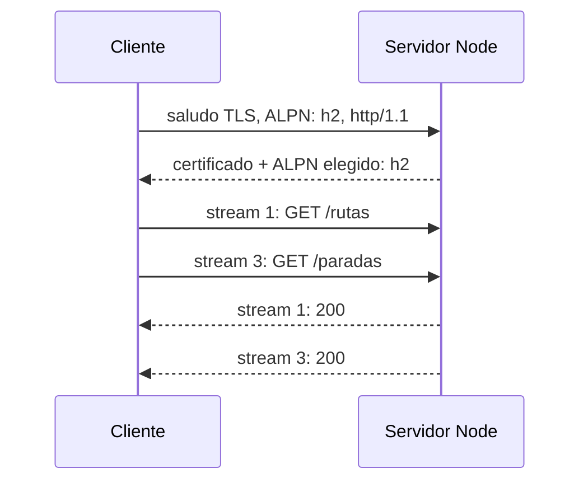
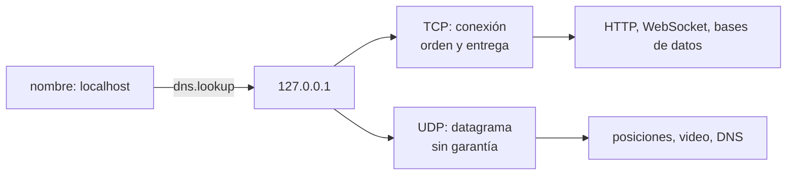

# Módulo 3: Servidores HTTP nativos

## Aprende construyendo

Cada tema comienza en una carpeta vacía y usa únicamente Node.js 24 LTS y `curl`. Escribe manualmente los archivos indicados; no necesitas Express, código prefabricado de la academia ni archivos de otros temas.

### Tema 1: El modelo request/response · Básico · 60 min

#### Aprende

**Prerrequisitos:** Node.js 24 LTS y terminal; no necesitas Express.

**Al terminar podrás:** crear, arrancar y detener un servidor HTTP que responda JSON, elegir explícitamente estado y cabeceras y diagnosticar una ruta desconocida o un puerto ocupado.

**Por qué importa:** Express y Fastify automatizan parsing, routing y respuestas, pero esas abstracciones siguen apoyándose en el intercambio nativo. Conocerlo permite diagnosticar cabeceras ausentes, respuestas duplicadas y cuerpos mal formados en lugar de tratar el framework como magia.

`http.createServer(callback)` registra una función que recibe `req`, un `IncomingMessage`, y `res`, un `ServerResponse`. `req.method` y `req.url` identifican la operación; `req` también es un stream legible porque el cuerpo llega por chunks. La respuesta se construye con `writeHead`, uno o varios `write` opcionales y `end` para cerrarla.

`listen(puerto)` mantiene el proceso atendiendo conexiones mediante I/O no bloqueante. Un framework puede exponer `req.body` y `res.json`, pero antes debes entender qué trabajo realiza por ti.

**Analogía:** el módulo nativo es recibir correspondencia sin asistente: abres cada sobre, interpretas su contenido y redactas la respuesta. Un framework clasifica y resume el sobre, pero no cambia el significado de la carta.

#### Practica

Desde una carpeta vacía:

```bash
mkdir ejemplo-http-basico
cd ejemplo-http-basico
npm init -y
mkdir src
```

Añade `"type": "module"` a `package.json` y crea `src/server.js`:

```js
import { createServer } from "node:http";

const servidor = createServer((req, res) => {
  if (req.method === "GET" && req.url === "/") {
    const respuesta = JSON.stringify({ mensaje: "Servidor Node activo" });
    res.writeHead(200, { "Content-Type": "application/json; charset=utf-8" });
    res.end(respuesta);
    return;
  }

  res.writeHead(404, { "Content-Type": "application/json; charset=utf-8" });
  res.end(JSON.stringify({ error: "Ruta no encontrada" }));
});

servidor.listen(3000, "127.0.0.1", () => {
  console.log("Servidor listo en http://127.0.0.1:3000");
});
```

Ejecuta en una terminal:

```bash
node src/server.js
```

En otra terminal:

```bash
curl -i http://127.0.0.1:3000/
```

**Resultado esperado:** `HTTP/1.1 200 OK`, `content-type: application/json` y `{"mensaje":"Servidor Node activo"}`. Detén el servidor con `Ctrl+C` al terminar.

**Fallo deliberado y corrección:** solicita `http://127.0.0.1:3000/inexistente`. El `404` y `{"error":"Ruta no encontrada"}` son la respuesta correcta, no un fallo del servidor. Si aparece `EADDRINUSE`, detén el proceso anterior o cambia el puerto en `listen` y `curl`; no respondas eliminando procesos que no reconoces.

**Práctica guiada:** cambia el mensaje e incluye `method: req.method` en la respuesta. Conserva `JSON.stringify`: pasar un objeto directamente a `res.end` produce un error de tipo.

**Ejercicio independiente:** añade `GET /salud` que responda `{ "status": "ok" }`. Prueba `/`, `/salud` y una ruta desconocida con `curl -i`, y explica por qué la última no debe responder `200`.

#### Aplica

En el **[Proyecto integrador: API nativa de tareas](#proyecto-3-api-http-nativa-de-tareas)**, construye primero una ruta de salud con estado, tipo de contenido y cierre explícitos antes de añadir operaciones.

**Checklist de salida**

- [ ] Creaste el proyecto y `src/server.js` manualmente.
- [ ] La ruta válida responde JSON con estado y `Content-Type` correctos.
- [ ] Cada rama termina su respuesta una sola vez.
- [ ] Una ruta desconocida produce `404`.
- [ ] Puedes explicar y resolver `EADDRINUSE` sin confundirlo con un error de sintaxis.
- [ ] Sabes qué trabajo adicional automatizaría un framework.

**Cuándo no usarlo:** para muchas rutas, `http` puro obliga a reimplementar routing, parsing y errores. Es apropiado para un servicio mínimo, streaming de bajo nivel o para comprender el contrato antes de usar Express.

**Fuentes oficiales:** [`node:http`](https://nodejs.org/api/http.html), [`http.createServer`](https://nodejs.org/api/http.html#httpcreateserveroptions-requestlistener) y [códigos de estado HTTP de MDN](https://developer.mozilla.org/es/docs/Web/HTTP/Status).

### Tema 2: Routing manual · Básico · 75 min

#### Aprende

**Prerrequisitos:** Node 24 LTS, JSON básico y `curl`. Este proyecto no reutiliza el servidor anterior.

**Al terminar podrás:** implementar rutas `GET` y `POST` sin framework, leer un body JSON, devolver `201`, `400` y `404` de forma consistente y explicar los límites del estado en memoria.

**Por qué importa:** una API pequeña necesita distinguir consulta y creación aunque compartan URL. Escribir el router manual muestra exactamente qué decisiones ocultan `app.get` y `app.post`, y evita que una coincidencia parcial ejecute la operación equivocada.

Una ruta se identifica por método y URL. `GET /tareas` consulta; `POST /tareas` crea. Cualquier combinación no reconocida debe recibir una respuesta explícita, normalmente `404`, en lugar de quedar abierta.

El array en memoria permite practicar el contrato sin base de datos, pero se pierde al reiniciar y no se comparte entre procesos. No es persistencia real. Con muchas rutas, una cadena de condicionales se vuelve difícil de mantener; un router de framework también aporta parámetros y organización modular.

**Analogía:** el routing manual es una recepcionista con una lista de instrucciones para cada combinación de pregunta y procedimiento. El array es su libreta temporal: útil durante el turno, inexistente si se rompe o se reinicia.

#### Practica

Desde una carpeta vacía:

```bash
mkdir ejemplo-routing-manual
cd ejemplo-routing-manual
npm init -y
mkdir src
```

Añade `"type": "module"` a `package.json` y crea `src/server.js`:

```js
import { createServer } from "node:http";

const tareas = [];

function responderJson(res, status, cuerpo) {
  res.writeHead(status, { "Content-Type": "application/json; charset=utf-8" });
  res.end(JSON.stringify(cuerpo));
}

async function leerJson(req) {
  const chunks = [];
  for await (const chunk of req) chunks.push(chunk);
  return JSON.parse(Buffer.concat(chunks).toString("utf8"));
}

const servidor = createServer(async (req, res) => {
  if (req.method === "GET" && req.url === "/tareas") {
    return responderJson(res, 200, { tareas });
  }

  if (req.method === "POST" && req.url === "/tareas") {
    try {
      const body = await leerJson(req);
      const titulo = body.titulo?.trim();
      if (!titulo) return responderJson(res, 400, { error: "titulo es obligatorio" });

      const tarea = { id: tareas.length + 1, titulo };
      tareas.push(tarea);
      return responderJson(res, 201, { tarea });
    } catch {
      return responderJson(res, 400, { error: "El body debe ser JSON válido" });
    }
  }

  return responderJson(res, 404, { error: "Ruta no encontrada" });
});

servidor.listen(3001, "127.0.0.1", () => {
  console.log("API en http://127.0.0.1:3001");
});
```

Arranca el servidor y, en otra terminal, consulta, crea y vuelve a consultar:

```bash
node src/server.js
```

```bash
curl -i http://127.0.0.1:3001/tareas
curl -i -X POST http://127.0.0.1:3001/tareas -H "Content-Type: application/json" -d '{"titulo":"Leer HTTP"}'
curl -i http://127.0.0.1:3001/tareas
```

**Resultado esperado:** la primera consulta devuelve `200` y lista vacía; el POST devuelve `201` con `id: 1`; la última incluye la tarea. Al reiniciar, la lista vuelve a estar vacía.

**Fallo deliberado y corrección:** envía `curl -i -X POST http://127.0.0.1:3001/tareas -d '{titulo:sin-comillas}'`. Recibes `400` porque el JSON es inválido y el proceso sigue disponible. Corrige el cuerpo a `{"titulo":"Leer HTTP"}` con la cabecera JSON y verifica `201`. Prueba también `GET /tarea` para observar `404`.

**Práctica guiada:** añade `GET /tareas/1` con comparación exacta y búsqueda por `id`. Si no existe, responde `404`, no `200` con una lista vacía.

**Ejercicio independiente:** implementa `DELETE /tareas/1`; prueba una tarea existente y otra inexistente. Explica por qué reiniciar borra el estado y qué responsabilidad asumiría una base de datos.

#### Aplica

En el **[Proyecto integrador: routing de tareas](#proyecto-3-api-http-nativa-de-tareas)**, enruta consulta y creación por método y URL exactos. Una combinación no soportada no debe ejecutar otra operación por coincidencia parcial.

**Checklist de salida**

- [ ] El servidor fue creado desde cero y no usa framework.
- [ ] `GET` y `POST` se distinguen aunque compartan URL.
- [ ] La creación válida devuelve `201`; la entrada inválida, `400`.
- [ ] Toda rama responde una sola vez y el fallback devuelve `404`.
- [ ] Comprobaste que el estado desaparece al reiniciar.
- [ ] Puedes señalar qué aportaría un router de framework.

**Errores comunes:** comprobar solo la URL, no devolver después de responder, usar memoria como persistencia, responder `200` al crear y dejar `JSON.parse` sin capturar.

**Fuentes oficiales:** [métodos HTTP en MDN](https://developer.mozilla.org/es/docs/Web/HTTP/Reference/Methods), [estado `201`](https://developer.mozilla.org/es/docs/Web/HTTP/Status/201), [estado `404`](https://developer.mozilla.org/es/docs/Web/HTTP/Status/404) y [`IncomingMessage`](https://nodejs.org/api/http.html#class-httpincomingmessage).

### Tema 3: Parsing de body y headers · Intermedio · 75 min

#### Aprende

**Prerrequisitos:** Node 24 LTS, streams básicos y JSON. Comienza otro proyecto vacío.

**Al terminar podrás:** leer un body JSON mediante iteración asíncrona, validar `Content-Type`, limitar bytes y traducir errores de cliente sin derribar el proceso.

**Por qué importa:** una API no puede aceptar datos ilimitados ni asumir que todo cuerpo es JSON válido. Sin límite, un cliente consume memoria; sin manejo de errores, un cuerpo mal formado puede afectar solicitudes que no tienen relación con él.

`req` es un stream legible. `for await (const chunk of req)` permite acumular los fragmentos; `Buffer.concat` los une y `JSON.parse` interpreta el texto. El parseo debe estar protegido porque un JSON inválido lanza una excepción.

`req.headers` contiene nombres normalizados en minúsculas. `content-type` declara el formato recibido. El límite debe medir `chunk.length` en bytes mientras llega el stream, no caracteres después de cargar todo. `415` comunica formato no admitido, `413` tamaño excesivo y `400` sintaxis inválida.

**Analogía:** el documento llega en varios sobres. Recepción revisa la etiqueta y el peso antes de abrirlos, los ensambla en orden y solo entonces interpreta el documento.

#### Practica

Desde una carpeta vacía:

```bash
mkdir ejemplo-body-headers
cd ejemplo-body-headers
npm init -y
mkdir src
```

Añade `"type": "module"` a `package.json` y crea `src/server.js`:

```js
import { createServer } from "node:http";

const LIMITE_BYTES = 1_024;

async function leerJson(req) {
  if (!req.headers["content-type"]?.includes("application/json")) {
    throw Object.assign(new Error("Content-Type debe incluir application/json"), { status: 415 });
  }

  const chunks = [];
  let total = 0;
  for await (const chunk of req) {
    total += chunk.length;
    if (total > LIMITE_BYTES) {
      throw Object.assign(new Error(`Body supera ${LIMITE_BYTES} bytes`), { status: 413 });
    }
    chunks.push(chunk);
  }

  try {
    return JSON.parse(Buffer.concat(chunks).toString("utf8"));
  } catch {
    throw Object.assign(new Error("JSON inválido"), { status: 400 });
  }
}

function responder(res, status, body) {
  res.writeHead(status, { "Content-Type": "application/json; charset=utf-8" });
  res.end(JSON.stringify(body));
}

createServer(async (req, res) => {
  if (req.method !== "POST" || req.url !== "/eco") {
    return responder(res, 404, { error: "Ruta no encontrada" });
  }

  try {
    const datos = await leerJson(req);
    return responder(res, 200, { recibido: datos });
  } catch (error) {
    return responder(res, error.status ?? 500, { error: error.message });
  }
}).listen(3002, "127.0.0.1", () => console.log("API en http://127.0.0.1:3002"));
```

Arranca y envía JSON válido:

```bash
node src/server.js
```

```bash
curl -i -X POST http://127.0.0.1:3002/eco -H "Content-Type: application/json" -d '{"nombre":"Ana"}'
```

**Resultado esperado:** `200` y `{"recibido":{"nombre":"Ana"}}`.

**Fallo deliberado y corrección:** repite sin la cabecera `Content-Type`: recibes `415`. Después envía `-d '{nombre:Ana}'` con la cabecera correcta: recibes `400 JSON inválido`. Restaura el cuerpo `{"nombre":"Ana"}` y verifica `200`; el proceso permanece disponible durante los tres casos.

**Práctica guiada:** reduce `LIMITE_BYTES` a `20` y envía un JSON que lo supere. Comprueba `413`, restaura después un límite razonable y no lo aumentes solo para ocultar la prueba.

**Ejercicio independiente:** exige `x-request-id` de 8 a 40 caracteres. Entrega un caso válido y otro con `400`, y explica por qué la cabecera se valida antes de la lógica de negocio.

#### Aplica

En el **[Proyecto integrador: entrada acotada](#proyecto-3-api-http-nativa-de-tareas)**, limita tamaño y formato del cuerpo de creación. JSON inválido, cuerpo excesivo y cabecera incompatible deben rechazarse antes de agregar una tarea.

**Checklist de salida**

- [ ] Escribiste un proyecto nuevo sin middleware.
- [ ] Acumulas chunks y mides bytes antes de parsear.
- [ ] Un tipo no admitido devuelve `415`.
- [ ] Un cuerpo excesivo devuelve `413` durante la lectura.
- [ ] JSON inválido devuelve `400` y no derriba el proceso.
- [ ] Los identificadores de solicitud se validan sin imprimir datos sensibles.

**Errores comunes:** asumir `req.body`, omitir límite, validar el tipo después de consumir el cuerpo, responder `500` a errores del cliente y medir caracteres en lugar de bytes.

**Fuentes oficiales:** [`IncomingMessage.headers`](https://nodejs.org/api/http.html#messageheaders), [estado `400`](https://developer.mozilla.org/es/docs/Web/HTTP/Status/400), [estado `413`](https://developer.mozilla.org/es/docs/Web/HTTP/Status/413) y [estado `415`](https://developer.mozilla.org/es/docs/Web/HTTP/Status/415).

### Tema 4: Códigos de estado y content negotiation · Intermedio · 75 min

#### Aprende

**Prerrequisitos:** Node 24 LTS y cabeceras HTTP básicas. Este ejemplo es independiente.

**Al terminar podrás:** elegir estados HTTP coherentes, servir JSON o texto según `Accept`, declarar `Content-Type` y `Vary`, y distinguir `406` de `404`.

**Por qué importa:** los clientes automatizados deciden reintentos y alertas según el estado, no según una interpretación humana del cuerpo. Un mismo recurso puede necesitar JSON para una aplicación y texto para una terminal sin obligar a adivinar el formato.

Usa `200` para consulta correcta, `201` para creación, `400` para petición inválida, `404` para recurso inexistente y `500` para fallo inesperado del servidor. El código forma parte del contrato.

`Accept` expresa qué representaciones acepta el cliente. El servidor elige una que pueda producir y la declara en `Content-Type`. `Vary: Accept` advierte a las cachés que la respuesta cambia según esa cabecera. Si el recurso existe pero no hay representación compatible, corresponde `406`.

**Analogía:** el estado es una señal de tráfico común para personas y sistemas. `Accept` es el idioma que el visitante acepta y `Content-Type` el idioma en que finalmente recibe el documento.

#### Practica

Desde una carpeta vacía:

```bash
mkdir ejemplo-content-negotiation
cd ejemplo-content-negotiation
npm init -y
mkdir src
```

Añade `"type": "module"` a `package.json` y crea `src/server.js`:

```js
import { createServer } from "node:http";

const producto = Object.freeze({ id: 7, nombre: "Cuaderno", precio: 12_000 });

function responderProducto(req, res) {
  const acepta = req.headers.accept ?? "*/*";

  if (acepta.includes("application/json") || acepta.includes("*/*")) {
    res.writeHead(200, { "Content-Type": "application/json; charset=utf-8", Vary: "Accept" });
    return res.end(JSON.stringify(producto));
  }

  if (acepta.includes("text/plain")) {
    res.writeHead(200, { "Content-Type": "text/plain; charset=utf-8", Vary: "Accept" });
    return res.end(`${producto.nombre}: $${producto.precio}`);
  }

  res.writeHead(406, { "Content-Type": "application/json; charset=utf-8", Vary: "Accept" });
  return res.end(JSON.stringify({ error: "Formato no disponible" }));
}

createServer((req, res) => {
  if (req.method === "GET" && req.url === "/producto") return responderProducto(req, res);

  res.writeHead(404, { "Content-Type": "application/json; charset=utf-8" });
  res.end(JSON.stringify({ error: "Ruta no encontrada" }));
}).listen(3003, "127.0.0.1", () => console.log("API en http://127.0.0.1:3003"));
```

Arranca y prueba las dos representaciones:

```bash
node src/server.js
```

```bash
curl -i -H "Accept: application/json" http://127.0.0.1:3003/producto
curl -i -H "Accept: text/plain" http://127.0.0.1:3003/producto
```

**Resultado esperado:** ambas respuestas usan `200`, una con JSON y otra con texto; ambas incluyen `Vary: Accept`.

**Fallo deliberado y corrección:** solicita `curl -i -H "Accept: application/xml" http://127.0.0.1:3003/producto`. Recibes `406`: el recurso existe, pero no hay XML. Cambia `Accept` a `application/json` y vuelve a `200`. Solicita `/productos` para comparar el `404` de ruta inexistente.

**Práctica guiada:** añade `text/csv` con una cabecera y una fila, conserva `Vary: Accept` y verifica el `Content-Type` con `curl -i`.

**Ejercicio independiente:** crea `POST /producto` que valide nombre y precio, responda `201` al crear y `400` cuando falte un campo. Entrega creación válida, body inválido y formato no aceptado, explicando cada estado.

#### Aplica

En el **[Proyecto integrador: representaciones de tareas](#proyecto-3-api-http-nativa-de-tareas)**, ofrece JSON y texto solo si ambos son necesarios, y conserva estados coherentes para creación, entrada inválida y recursos ausentes.

**Checklist de salida**

- [ ] El proyecto fue creado manualmente desde una carpeta vacía.
- [ ] JSON y texto tienen el `Content-Type` que realmente describen.
- [ ] Las respuestas variables incluyen `Vary: Accept`.
- [ ] Un formato incompatible devuelve `406`, no `404`.
- [ ] Una creación válida usa `201` y una entrada inválida usa `400`.
- [ ] Puedes justificar cuándo negociar formatos añade complejidad innecesaria.

**Cuándo no usarlo:** si solo existe un consumidor y un formato fijo, fija `Content-Type` y evita negociación manual. No inventes formatos que el servidor no pueda serializar correctamente.

**Fuentes oficiales:** [negociación de contenido en MDN](https://developer.mozilla.org/es/docs/Web/HTTP/Content_negotiation), [cabecera `Accept`](https://developer.mozilla.org/es/docs/Web/HTTP/Reference/Headers/Accept), [cabecera `Vary`](https://developer.mozilla.org/es/docs/Web/HTTP/Reference/Headers/Vary) y [estado `406`](https://developer.mozilla.org/es/docs/Web/HTTP/Status/406).

### Tema 5: Paginación por cursor y límites de entrada comprobables · Intermedio · 60 min

#### Aprende

**Prerrequisitos:** arrays, módulos ESM, HTTP y `node:test`; Node 24 o superior. Comprueba `node --version`.

**Al terminar podrás:** diseñar un corte estable con cursor, detectar la página siguiente sin cargar resultados innecesarios y rechazar cursores o tamaños inválidos antes de consultar datos.

**Por qué importa:** la API no debe cargar todos los envíos en una petición ni repetir elementos por ordenar solo una fecha no única. La paginación afecta memoria, latencia y la capacidad de reanudar una lectura.

El cursor representa una posición en un orden estable. Aquí es un identificador entero ascendente y único: la página incluye IDs estrictamente mayores. Seleccionar `size + 1` elementos permite saber si existe otra página; el último ID visible se convierte en el cursor siguiente.

En una base de datos, filtro, orden y límite deben ejecutarse en la consulta con un índice apropiado. Este ejemplo en memoria aísla el algoritmo, pero no demuestra escalabilidad ni una foto inmutable bajo concurrencia. Un cursor real conserva filtros y orden, y nunca elude autorización.

**Analogía:** el cursor es un separador que indica después de qué ficha continuar. Pedir una ficha adicional permite saber si queda otra sección sin mostrarla todavía.

#### Practica

Desde una carpeta vacía:

```bash
mkdir cursor-envios
cd cursor-envios
```

Crea `pagina.mjs`:

```js
export function pagina(rows, after = 0, size = 2) {
  if (!Number.isSafeInteger(after) || after < 0 ||
      !Number.isSafeInteger(size) || size < 1 || size > 100) {
    throw new RangeError("Cursor o tamaño inválido");
  }
  const selected = rows.filter(row => row.id > after)
    .sort((a, b) => a.id - b.id).slice(0, size + 1);
  const items = selected.slice(0, size);
  return { items, next: selected.length > size ? items.at(-1).id : null };
}
```

Crea `pagina.test.mjs`:

```js
import test from "node:test";
import assert from "node:assert/strict";
import { pagina } from "./pagina.mjs";

const rows = [1, 2, 3, 4, 5].map(id => ({ id }));

test("recorre sin repetir y termina", () => {
  const first = pagina(rows);
  const second = pagina(rows, first.next);
  assert.deepEqual(first.items.map(x => x.id), [1, 2]);
  assert.deepEqual(second.items.map(x => x.id), [3, 4]);
  assert.equal(pagina(rows, second.next).next, null);
});

test("rechaza límites y cursor inválidos", () => {
  assert.throws(() => pagina(rows, 0, 1000), RangeError);
  assert.throws(() => pagina(rows, -1, 2), RangeError);
});
```

Ejecuta:

```bash
node --test pagina.test.mjs
```

**Resultado esperado:** dos pruebas correctas. La primera recorre IDs `1,2`, después `3,4` y termina sin cursor; la segunda rechaza tamaño `1000` y cursor `-1`.

**Fallo deliberado y corrección:** cambia `row.id > after` por `>=`. La segunda página repite el último elemento anterior y la prueba falla. Restaura `>` para que «después de» sea estricto y repite las pruebas.

**Práctica guiada:** añade casos de lista vacía, tamaño `1` y cursor mayor que el último ID. Verifica elementos, cursor siguiente y ausencia de repeticiones.

**Ejercicio independiente:** diseña el contrato HTTP con parámetros `after` y `size`, y respuesta `400` para valores inválidos. Escribe `contrato.http.md` con ejemplos y justifica por qué no convertir texto inválido silenciosamente a cero.

#### Aplica

Lleva el cursor al **[Proyecto integrador: listado acotado](#proyecto-3-api-http-nativa-de-tareas)**. El siguiente paso será trasladar filtro, orden único y límite a SQL con un índice, y medir con datos representativos.

**Checklist de salida**

- [ ] Creaste `pagina.mjs` y sus pruebas desde una carpeta vacía.
- [ ] El cursor usa un orden único y una comparación estricta.
- [ ] El elemento adicional determina `next` sin incluirlo en la página.
- [ ] Tamaño y cursor se validan antes de seleccionar.
- [ ] Lista vacía, tamaño uno y cursor final tienen pruebas explícitas.
- [ ] Reconoces que memoria y concurrencia requieren otra verificación.

**Errores comunes:** ordenar por un campo no único, aceptar tamaños sin límite y paginar después de cargar todos los datos.

**Fuente oficial:** [Node test runner](https://nodejs.org/api/test.html).

### Tema 6: HTTPS y HTTP/2 con TLS: certificados, ALPN y varias peticiones por conexión · Avanzado · 45 min

**Prerrequisito:** tema «El modelo request/response» de este módulo.

**Al finalizar podrás:** levantar un servidor HTTP/2 sobre TLS con un certificado propio, conectarte con un cliente que confía en él y comprobar que dos peticiones comparten la misma conexión.

**¿Por qué es importante?** Sin TLS, cualquiera en la red puede leer o cambiar lo que viaja, incluidos tokens. HTTP/2 reduce la latencia al enviar muchas peticiones por una sola conexión. Saber configurar ambos evita desactivar la verificación de certificados «para que funcione».

#### Aprende

**Objetivo y preparación.**

Usa Node.js 24 LTS y `openssl`, que viene en macOS y Linux (en Windows, con Git Bash). Crea la carpeta `academia-labs/node/http2-tls`.

**Contexto y caso real.**

La app móvil de RutaFlow pide la ruta, las paradas y el estado del mensajero al mismo tiempo. Con HTTP/1.1 abría varias conexiones TLS, y cada una pagaba su propio saludo inicial. Con HTTP/2, las tres peticiones viajan por una conexión.

**Teoría, modelo mental y analogía.**

**Conceptos clave:** TLS, certificado, autoridad de confianza (`ca`), ALPN, HTTP/2, stream, multiplexación.

**TLS** cifra la conexión y demuestra la identidad del servidor con un **certificado**. El cliente solo acepta el certificado si lo firmó alguien en quien confía. En desarrollo creas un certificado propio y se lo das al cliente con la opción `ca`; nunca desactives la verificación.

Al conectarse, cliente y servidor acuerdan el protocolo con **ALPN**: `h2` es HTTP/2 y `http/1.1` es el anterior.

En **HTTP/2** cada petición es un **stream** con un número (los del cliente son impares: 1, 3, 5…). Muchos streams comparten una conexión: eso es la **multiplexación**.

**Analogía:** HTTP/1.1 es abrir una ventanilla nueva del banco por cada trámite; HTTP/2 es una sola ventanilla que atiende varios trámites intercalados. TLS es el vidrio blindado de la ventanilla. La analogía falla en que, si un paquete TCP se pierde, todos los streams de la conexión esperan (eso lo resuelve HTTP/3).

**Límite de uso:** los navegadores solo usan HTTP/2 con TLS. Detrás de un proxy (Nginx, un balanceador) muchas veces el TLS termina en el proxy y Node recibe HTTP/1.1. El certificado autofirmado es solo para desarrollo.



#### Practica

**Demostración guiada desde cero.**

Archivo `academia-labs/node/http2-tls/servidor-h2.mjs`:

```js
import { readFileSync } from 'node:fs';
import { createSecureServer, connect } from 'node:http2';

const cert = readFileSync('cert.pem');
const key = readFileSync('clave.pem');

// Servidor HTTP/2 sobre TLS. allowHTTP1 deja entrar clientes HTTP/1.1.
const servidor = createSecureServer({ key, cert, allowHTTP1: true }, (req, res) => {
  res.setHeader('content-type', 'application/json');
  res.end(JSON.stringify({ protocolo: req.httpVersion, tls: req.socket.getProtocol() }));
});
await new Promise((listo) => servidor.listen(0, 'localhost', listo));
const { port } = servidor.address();

// Cliente HTTP/2 que confía solo en nuestro certificado de prueba.
const sesion = connect(`https://localhost:${port}`, { ca: cert });
sesion.on('connect', () => console.log(`ALPN negociado: ${sesion.alpnProtocol}`));

// Dos peticiones viajan por la MISMA conexión, cada una en su stream.
const pedir = (ruta) => new Promise((resolver, rechazar) => {
  const stream = sesion.request({ ':path': ruta });
  let cuerpo = '';
  stream.setEncoding('utf8');
  stream.on('response', (cabeceras) => console.log(`${ruta} -> ${cabeceras[':status']} en el stream ${stream.id}`));
  stream.on('data', (trozo) => { cuerpo += trozo; });
  stream.on('end', () => resolver(JSON.parse(cuerpo)));
  stream.on('error', rechazar);
});

const [a] = await Promise.all([pedir('/rutas'), pedir('/paradas')]);
console.log(`respuesta: HTTP/${a.protocolo} sobre ${a.tls}`);
sesion.close();
servidor.close();
```

Ejecútalo:

```bash
cd academia-labs/node/http2-tls
openssl req -x509 -newkey ec -pkeyopt ec_paramgen_curve:prime256v1 -nodes \
  -keyout clave.pem -out cert.pem -days 30 -subj "/CN=localhost" \
  -addext "subjectAltName=DNS:localhost"
node servidor-h2.mjs
```

**Explicación por bloques:** `openssl` crea una clave y un certificado autofirmado para `localhost`, válido 30 días. El servidor usa los dos con `createSecureServer`. El cliente pasa `ca: cert`, así confía solo en ese certificado sin desactivar la verificación. `alpnProtocol` muestra que se eligió `h2`. Las dos peticiones salen en paralelo por la misma sesión y reciben los streams 1 y 3. El orden de las dos líneas de respuesta puede variar, porque viajan intercaladas. La respuesta confirma HTTP/2 sobre TLS 1.3.


**Resultado esperado:**

```text
ALPN negociado: h2
/rutas -> 200 en el stream 1
/paradas -> 200 en el stream 3
respuesta: HTTP/2.0 sobre TLSv1.3
```

**Fallo deliberado:** quita `{ ca: cert }` del `connect`. **Error esperado:** `Error: self-signed certificate` (código `DEPTH_ZERO_SELF_SIGNED_CERT`). **Diagnóstico:** el cliente no confía en un certificado que nadie conocido firmó. La solución es darle el certificado con `ca`, no poner `rejectUnauthorized: false` ni `NODE_TLS_REJECT_UNAUTHORIZED=0`.

**Práctica guiada.**

1. **Reproducción:** ejecuta el ejemplo y anota los números de stream.
2. **Variación:** agrega una tercera petición `/estado` y predice qué número de stream recibe.
3. **Diagnóstico:** reproduce el fallo deliberado y explica por qué desactivar la verificación sería peligroso.
4. **Integración:** prueba el servidor con `curl --cacert cert.pem --http2 -v https://localhost:<puerto>/rutas` y busca `ALPN: server accepted h2` en la salida.
5. **Diseño:** dibuja qué cambia si un balanceador termina TLS antes de llegar a Node.

**Pista:** si ves un error de certificado, pregúntate quién lo firmó y si el cliente conoce a ese firmante.

#### Aplica

**Práctica independiente.**

Convierte el servidor para que, además, acepte HTTP/1.1. Conéctate con `curl --http1.1 --cacert cert.pem` y comprueba que `protocolo` cambia a `1.1` mientras `tls` sigue siendo TLS 1.3.

**Checklist de salida.**

- [ ] Explicas para qué sirve ALPN.
- [ ] El ejemplo imprime las cuatro líneas esperadas.
- [ ] Reprodujiste el error de certificado y lo corregiste con `ca`.
- [ ] Explicas qué es un stream en HTTP/2.

Si fallas dos o más, vuelve a la sección Aprende. **Errores comunes:** desactivar la verificación TLS en desarrollo y olvidarlo en producción, usar el certificado autofirmado fuera de desarrollo y esperar HTTP/2 en el navegador sin TLS. **Siguiente paso:** el tema siguiente baja a los protocolos debajo de HTTP: TCP, UDP y DNS.

**Transferencia al proyecto integrador «RutaFlow»:** en el entorno local de RutaFlow, sirve la API con HTTP/2 y un certificado de desarrollo, y documenta en el README cómo confiar en él sin desactivar la verificación.

**Fuente oficial:** [Node.js — HTTP/2](https://nodejs.org/api/http2.html) y [Node.js — TLS (SSL)](https://nodejs.org/api/tls.html).

### Tema 7: Debajo de HTTP: TCP con net, UDP con dgram y resolución DNS · Intermedio · 40 min

**Prerrequisito:** tema «El modelo request/response» de este módulo.

**Al finalizar podrás:** resolver un nombre con `dns`, intercambiar un mensaje por TCP con `net` y enviar un datagrama UDP con `dgram`, y explicar cuándo conviene cada protocolo.

**¿Por qué es importante?** HTTP corre sobre TCP, y TCP necesita DNS para encontrar al servidor. Cuando una conexión falla con `ENOTFOUND`, `ECONNREFUSED` o `ETIMEDOUT`, entender estas capas te dice dónde buscar.

#### Aprende

**Objetivo y preparación.**

Usa Node.js 24 LTS. Crea la carpeta `academia-labs/node/redes`. Todo ocurre en tu máquina (`localhost`), no necesitas internet.

**Contexto y caso real.**

Los mensajeros de RutaFlow envían su posición cada pocos segundos. Si una posición se pierde no pasa nada, porque llega otra. En cambio, la confirmación de entrega no puede perderse. La primera encaja con UDP; la segunda con TCP.

**Teoría, modelo mental y analogía.**

**Conceptos clave:** DNS, dirección IP, puerto, TCP (conexión, orden, entrega garantizada), UDP (datagrama, sin conexión), `ENOTFOUND`, `ECONNREFUSED`.

- **DNS** traduce un nombre (`api.rutaflow.co`) a una dirección IP. `dns.lookup` usa el resolvedor del sistema operativo, el mismo que usa `fetch`. Si el nombre no existe, el error es `ENOTFOUND`.
- **TCP** abre una conexión, entrega los bytes en orden y reenvía lo que se pierde. Si nadie escucha en el puerto, el error es `ECONNREFUSED`. HTTP/1.1 y HTTP/2 viajan sobre TCP.
- **UDP** envía **datagramas** sueltos: sin conexión, sin orden y sin garantía de entrega. Es más ligero y sirve cuando un dato viejo ya no importa (posiciones, video en vivo, DNS mismo).

| Necesitas | Usa |
|---|---|
| que todo llegue y en orden | TCP |
| lo más reciente, rápido, y tolerar pérdidas | UDP |

**Analogía:** TCP es una llamada telefónica: marcas, la otra persona contesta y conversan en orden. UDP es lanzar postales: cada una va sola y alguna puede perderse. DNS es la guía telefónica. La analogía falla en que TCP no «escucha» palabras, sino bytes: tu programa debe saber dónde termina cada mensaje.

**Límite de uso:** no construyas tu propio protocolo sobre TCP o UDP si HTTP, WebSocket o un broker de mensajes resuelven el problema: tendrías que diseñar reintentos, formatos y seguridad. Los datagramas UDP grandes pueden fragmentarse y perderse.



#### Practica

**Demostración guiada desde cero.**

Archivo `academia-labs/node/redes/redes.mjs`:

```js
import { createServer, connect } from 'node:net';
import { createSocket } from 'node:dgram';
import { lookup } from 'node:dns/promises';

// DNS: el sistema traduce un nombre a una dirección IP.
const { address, family } = await lookup('localhost', { family: 4 });
console.log(`DNS: localhost -> ${address} (IPv${family})`);

// TCP: conexión con orden y entrega garantizados.
const servidorTcp = createServer((socket) => {
  socket.on('data', (datos) => socket.end(`recibido ${datos.toString().trim()}`));
});
await new Promise((listo) => servidorTcp.listen(0, address, listo));
const respuestaTcp = await new Promise((resolver) => {
  const cliente = connect(servidorTcp.address().port, address, () => cliente.write('ENV-42\n'));
  cliente.on('data', (datos) => resolver(datos.toString()));
});
console.log(`TCP: ${respuestaTcp}`);
servidorTcp.close();

// UDP: datagramas sueltos, sin conexión ni garantía de entrega.
const servidorUdp = createSocket('udp4');
const llegada = new Promise((resolver) =>
  servidorUdp.once('message', (mensaje) => resolver(mensaje.toString())));
await new Promise((listo) => servidorUdp.bind(0, address, listo));
const clienteUdp = createSocket('udp4');
clienteUdp.send('posicion 4.65,-74.05', servidorUdp.address().port, address);
console.log(`UDP: ${await llegada}`);
clienteUdp.close();
servidorUdp.close();
```

Ejecútalo:

```bash
cd academia-labs/node/redes
node redes.mjs
```

**Explicación por bloques:** `lookup` pide al sistema la IP de `localhost`. El servidor TCP responde a cada mensaje y cierra con `socket.end`; el cliente se conecta, escribe y espera la respuesta. El servidor UDP no acepta conexiones: solo recibe datagramas con el evento `message`. El cliente UDP envía uno sin saber si alguien lo recibe. Ambos servidores usan el puerto `0` para que el sistema elija uno libre.


**Resultado esperado:**

```text
DNS: localhost -> 127.0.0.1 (IPv4)
TCP: recibido ENV-42
UDP: posicion 4.65,-74.05
```

**Fallo deliberado:** cambia `lookup('localhost', ...)` por `lookup('api.rutaflow.invalid', ...)`. **Error esperado:** `Error: getaddrinfo ENOTFOUND api.rutaflow.invalid`. **Diagnóstico:** el fallo ocurre antes de abrir cualquier conexión: el nombre no existe. Revisa DNS antes de culpar al servidor o al firewall.

**Práctica guiada.**

1. **Reproducción:** ejecuta el ejemplo y explica qué línea usa cada protocolo.
2. **Variación:** conecta el cliente TCP a un puerto donde nadie escucha y anota el error (`ECONNREFUSED`).
3. **Diagnóstico:** reproduce el fallo deliberado de DNS y compáralo con el de la variación.
4. **Integración:** envía diez datagramas UDP seguidos y cuenta cuántos llegan; repite enviando 60 000 bytes en uno solo.
5. **Diseño:** decide si las confirmaciones de entrega de RutaFlow pueden ir por UDP y justifica.

**Pista:** lee el código de error: `ENOTFOUND` es DNS, `ECONNREFUSED` es que nadie escucha y `ETIMEDOUT` es que nadie responde.

#### Aplica

**Práctica independiente.**

Escribe un servidor TCP de eco que responda en mayúsculas, línea por línea, aunque el cliente envíe varias líneas en un solo `write`. Pruébalo con `nc localhost <puerto>`.

**Checklist de salida.**

- [ ] Explicas qué hace DNS antes de una petición HTTP.
- [ ] El script imprime las tres líneas esperadas.
- [ ] Distingues `ENOTFOUND`, `ECONNREFUSED` y `ETIMEDOUT`.
- [ ] Eliges TCP o UDP con un criterio, no por costumbre.

Si fallas dos o más, vuelve a la sección Aprende. **Errores comunes:** suponer que cada `data` de TCP es un mensaje completo, usar UDP para datos que no pueden perderse y diagnosticar un `ENOTFOUND` como problema del servidor. **Siguiente paso:** el tema «Códigos de estado y content negotiation» vuelve a HTTP, ahora sabiendo qué hay debajo.

**Transferencia al proyecto integrador «RutaFlow»:** en RutaFlow, documenta en un diagrama qué viaja por TCP (API, base de datos) y qué podría viajar por UDP (posiciones), y agrega a la guía de soporte la tabla de errores de red.

**Fuente oficial:** [Node.js — net](https://nodejs.org/api/net.html) y [Node.js — dgram](https://nodejs.org/api/dgram.html) y [Node.js — dns](https://nodejs.org/api/dns.html).

### Tema 8: Consumir APIs desde Node con `fetch`: timeouts, errores HTTP y reintentos · Intermedio · 40 min

**Duración estimada:** 40 min (3 subtemas de 10–15 min).
**¿Por qué es importante?** Hasta ahora tu servidor **responde**; en RutaFlow también **pregunta**: tarifas de una transportadora, geocodificación, pagos. Un servicio externo que tarda o falla no debe colgar tu API. Node 24 trae `fetch` global (implementado con undici), así que el cliente HTTP no requiere dependencias; lo que sí requiere es decidir cuánto esperar, qué contar como error y cuándo reintentar.

**Prerrequisitos:** Temas 1, 2 y 4 de este módulo (servidor con `node:http` y códigos de estado), JS Módulo 6 Temas 3 y 4 (`fetch`, `AbortController` y reintentos en el navegador) y JS Módulo 1 Tema 7 (`Error` con `cause`). Node 24 LTS. Todo ocurre en `localhost`.

```bash
mkdir -p academia-labs/node/cliente-fetch && cd academia-labs/node/cliente-fetch
npm init -y
npm pkg set type=module
```

Crea `servidor-tarifas.js`, un proveedor simulado con una ruta normal, una lenta (3 s) y una inestable (falla dos de cada tres llamadas):

```javascript
import { createServer } from 'node:http';

let llamadasInestable = 0;

const servidor = createServer((req, res) => {
  const url = new URL(req.url, 'http://localhost');

  if (url.pathname === '/tarifas/lenta') {
    setTimeout(() => res.end(JSON.stringify({ ciudad: 'Cali', tarifa: 9000 })), 3000);
    return;
  }
  if (url.pathname === '/tarifas/inestable' && ++llamadasInestable % 3 !== 0) {
    res.writeHead(503, { 'content-type': 'application/json', 'retry-after': '0' });
    res.end(JSON.stringify({ error: 'mantenimiento' }));
    return;
  }
  if (url.pathname.startsWith('/tarifas/')) {
    res.writeHead(200, { 'content-type': 'application/json' });
    res.end(JSON.stringify({ ciudad: 'Bogotá', tarifa: 5000 }));
    return;
  }
  res.writeHead(404, { 'content-type': 'application/json' });
  res.end(JSON.stringify({ error: 'no existe' }));
});

servidor.listen(4010, () => console.log('tarifas en http://localhost:4010'));
```

Arráncalo en una terminal aparte y déjalo abierto durante el tema:

```bash
node servidor-tarifas.js
```

#### Subtema 8.1: Convierte cada fallo en un error con contexto · 15 min

**1. Contexto**
`fetch` solo rechaza la promesa cuando **no hay respuesta** (red caída, DNS, cancelación). Un `404` o un `503` llegan como respuesta «exitosa» con `ok: false`. Si no lo revisas, tratarás `{ error: 'no existe' }` como si fuera una tarifa.

**2. Hazlo tú**
Crea `cliente.js`:

```javascript
const BASE = 'http://localhost:4010';

export class TarifaError extends Error {
  constructor(message, { status, cause } = {}) {
    super(message, { cause });
    this.name = 'TarifaError';
    this.status = status;
  }
}

export async function obtenerTarifa(ruta, { timeoutMs = 1000 } = {}) {
  let respuesta;
  try {
    respuesta = await fetch(`${BASE}${ruta}`, {
      headers: { accept: 'application/json' },
      signal: AbortSignal.timeout(timeoutMs),
    });
  } catch (error) {
    throw new TarifaError(`sin respuesta de ${ruta}`, { cause: error });
  }
  if (!respuesta.ok) {
    throw new TarifaError(`HTTP ${respuesta.status} en ${ruta}`, { status: respuesta.status });
  }
  return respuesta.json();
}
```

Y `probar-cliente.js`:

```javascript
import { obtenerTarifa } from './cliente.js';

for (const ruta of ['/tarifas/bogota', '/otra', '/tarifas/lenta']) {
  try {
    console.log(ruta, '→', await obtenerTarifa(ruta));
  } catch (error) {
    console.log(ruta, '→', `${error.name}: ${error.message}`, error.cause ? `(causa: ${error.cause.name})` : '');
  }
}
```

```bash
node probar-cliente.js
```

**Resultado esperado** (la tercera línea tarda un segundo):

```text
/tarifas/bogota → { ciudad: 'Bogotá', tarifa: 5000 }
/otra → TarifaError: HTTP 404 en /otra 
/tarifas/lenta → TarifaError: sin respuesta de /tarifas/lenta (causa: TimeoutError)
```

**Fallo deliberado:** borra el bloque `if (!respuesta.ok) { ... }`. **Resultado:** `/otra → { error: 'no existe' }`: el cuerpo del 404 pasa como dato válido. **Diagnóstico:** revisa siempre `respuesta.ok` (o `respuesta.status`) antes de leer el cuerpo; restaura el bloque. Prueba también a detener el servidor y ejecutar de nuevo: las tres líneas dicen `sin respuesta` con `causa: TypeError` (el `fetch failed` de undici, cuyo propio `cause` contiene `ECONNREFUSED`).

**3. Entiende**
Hay dos familias de fallo: **sin respuesta** (la promesa de `fetch` rechaza) y **respuesta de error** (`ok` es `false` para estados fuera de 200–299). `TarifaError` las unifica para quien llama, guarda el `status` cuando existe y conserva el error original en `cause`. **Límite:** `respuesta.json()` también puede fallar si el proveedor devuelve HTML; en producción valida el cuerpo igual que validas un body entrante (Tema 3).

**4. Cierra**
Guarda la salida. Tienes un cliente que nunca confunde un error con un dato.

#### Subtema 8.2: Pon un límite de tiempo con `AbortSignal.timeout` · 10 min

**1. Contexto**
Sin límite, una llamada a `/tarifas/lenta` retiene la petición de tu propio cliente todo lo que el proveedor quiera. Si el proveedor se cuelga, tu API se cuelga con él.

**2. Hazlo tú**
En `probar-cliente.js`, cambia la llamada por `obtenerTarifa(ruta, { timeoutMs: 5000 })` y ejecuta de nuevo:

```bash
node probar-cliente.js
```

**Resultado esperado:** la tercera línea tarda unos 3 segundos y ahora es `/tarifas/lenta → { ciudad: 'Cali', tarifa: 9000 }`. Vuelve a dejar el valor por defecto (1000 ms).

**Fallo deliberado:** quita la línea `signal: AbortSignal.timeout(timeoutMs),` de `cliente.js` y cambia en el servidor el retraso de `3000` a `60000`. **Resultado:** `probar-cliente.js` se queda esperando un minuto en la tercera ruta. **Diagnóstico:** `fetch` no tiene un límite corto por defecto; cada llamada saliente necesita su propio `signal`. Restaura ambos valores.

**3. Entiende**
`AbortSignal.timeout(ms)` crea una señal que se cancela sola pasado el tiempo; `fetch` rechaza entonces con un `DOMException` de nombre `TimeoutError` (si cancelas tú con un `AbortController`, el nombre es `AbortError`). El tiempo límite es una decisión de negocio: el que elijas debe ser menor que el que tu propio cliente está dispuesto a esperarte. **Límite:** cancelar del lado del cliente no detiene el trabajo en el proveedor; la petición puede haberse procesado igual.

**4. Cierra**
Anota qué tiempo límite elegirías para tarifas y por qué.

#### Subtema 8.3: Reintenta solo lo que tiene sentido reintentar · 15 min

**1. Contexto**
Un `503` («vuelve en un momento») o una red que se cortó suelen resolverse solos. Un `404` no: reintentarlo solo multiplica la carga sobre un proveedor que ya respondió con claridad.

**2. Hazlo tú**
Crea `reintentos.js`:

```javascript
import { setTimeout as esperar } from 'node:timers/promises';
import { obtenerTarifa } from './cliente.js';

const REINTENTABLES = new Set([429, 502, 503, 504]);

function esReintentable(error) {
  return error.status === undefined || REINTENTABLES.has(error.status);
}

export async function conReintentos(operacion, { intentos = 4, baseMs = 100 } = {}) {
  for (let intento = 1; ; intento++) {
    try {
      return await operacion();
    } catch (error) {
      if (intento >= intentos || !esReintentable(error)) throw error;
      const espera = baseMs * 2 ** (intento - 1) + Math.floor(Math.random() * baseMs);
      console.log(`  intento ${intento} falló (${error.message}); espero ${espera} ms`);
      await esperar(espera);
    }
  }
}

for (const ruta of ['/tarifas/inestable', '/otra']) {
  try {
    console.log(ruta, '→', await conReintentos(() => obtenerTarifa(ruta)));
  } catch (error) {
    console.log(ruta, '→ falló definitivamente:', error.message);
  }
}
```

```bash
node reintentos.js
```

**Resultado esperado** (los milisegundos varían por el componente aleatorio):

```text
  intento 1 falló (HTTP 503 en /tarifas/inestable); espero 169 ms
  intento 2 falló (HTTP 503 en /tarifas/inestable); espero 253 ms
/tarifas/inestable → { ciudad: 'Bogotá', tarifa: 5000 }
/otra → falló definitivamente: HTTP 404 en /otra
```

**Fallo deliberado:** cambia la condición por `if (intento >= intentos) throw error;` (sin `esReintentable`). **Resultado:** aparecen tres líneas `intento N falló (HTTP 404 en /otra)` antes del fallo definitivo. **Diagnóstico:** reintentaste un error permanente; el 404 no cambiará. Restaura la comprobación.

**3. Entiende**
Se reintenta ante **ausencia de respuesta** (sin `status`) y ante estados transitorios (429, 502, 503, 504). La espera crece de forma **exponencial** (100, 200, 400 ms…) y suma un componente aleatorio (*jitter*) para que muchos clientes no reintenten a la vez. `setTimeout` de `node:timers/promises` devuelve una promesa, así que se puede esperar con `await`. **Límite:** reintentar es seguro solo si la operación es **idempotente**: un `GET` de tarifa sí; un `POST` que cobra no, salvo que el proveedor acepte una clave de idempotencia (Módulo 13).

**4. Cierra**
Guarda la salida. El cliente de tarifas ya tiene tiempo límite, errores con contexto y reintentos acotados.

**Hito del tema:**

- [ ] `probar-cliente.js` distingue respuesta correcta, 404 y timeout.
- [ ] Reproduje un `fetch` sin `signal` que espera indefinidamente y lo corregí.
- [ ] `reintentos.js` recupera `/tarifas/inestable` y no reintenta `/otra`.
- [ ] Expliqué por qué no reintentaría un `POST` de cobro sin clave de idempotencia.

**Ejercicio:** el proveedor envía la cabecera `retry-after` (en segundos) con el 503. Modifica `TarifaError` y `conReintentos` para que, si la cabecera existe, se espere `retry-after × 1000` ms en lugar del backoff calculado (con un máximo de 2000 ms). Antes de abrir la solución, escribe cuántos ms esperará con la cabecera `retry-after: 0` del servidor de prueba.

<details>
<summary>Solución — ábrela después de intentarlo</summary>

En `cliente.js`, guarda la cabecera al construir el error:

```javascript
export class TarifaError extends Error {
  constructor(message, { status, cause, retryAfter } = {}) {
    super(message, { cause });
    this.name = 'TarifaError';
    this.status = status;
    this.retryAfter = retryAfter;
  }
}

// dentro de obtenerTarifa:
if (!respuesta.ok) {
  const cabecera = respuesta.headers.get('retry-after');
  throw new TarifaError(`HTTP ${respuesta.status} en ${ruta}`, {
    status: respuesta.status,
    retryAfter: cabecera === null ? undefined : Number(cabecera),
  });
}
```

En `reintentos.js`, calcula la espera así:

```javascript
const espera = Number.isFinite(error.retryAfter)
  ? Math.min(error.retryAfter * 1000, 2000)
  : baseMs * 2 ** (intento - 1) + Math.floor(Math.random() * baseMs);
```

Salida con el servidor de prueba (`retry-after: 0`):

```text
  intento 1 falló (HTTP 503 en /tarifas/inestable); espero 0 ms
  intento 2 falló (HTTP 503 en /tarifas/inestable); espero 0 ms
/tarifas/inestable → { ciudad: 'Bogotá', tarifa: 5000 }
/otra → falló definitivamente: HTTP 404 en /otra
```

El tope de 2000 ms protege tu API de un proveedor que pida esperar diez minutos; en ese caso es mejor fallar rápido y avisar.

</details>

**Fuentes oficiales:** [Node.js — `fetch`](https://nodejs.org/api/globals.html#fetch), [MDN — `AbortSignal.timeout()`](https://developer.mozilla.org/en-US/docs/Web/API/AbortSignal/timeout_static), [Node.js — `timers/promises`](https://nodejs.org/api/timers.html#timers-promises-api) y [MDN — `Retry-After`](https://developer.mozilla.org/en-US/docs/Web/HTTP/Reference/Headers/Retry-After).

## Laboratorio práctico

### Proyecto 3: API HTTP nativa de tareas

Desde una carpeta vacía crea `api-http-tareas/` y ejecuta `npm init -y`. Escribe manualmente un proyecto ESM con `src/server.js` y las funciones auxiliares que necesites, sin framework ni archivos copiados de los temas.

**Entregable:** un servidor con `GET /salud`, `GET /tareas` y `POST /tareas`; body JSON limitado, estados explícitos y representaciones JSON o texto según `Accept`.

**Criterios de aceptación observables:**

1. `GET /salud` responde `200` y JSON válido.
2. La primera consulta de tareas devuelve una lista vacía; una creación válida devuelve `201`; la consulta posterior contiene la tarea.
3. JSON inválido devuelve `400`, tamaño excesivo `413`, tipo incompatible `415` y ruta desconocida `404`, sin derribar el proceso.
4. `Accept: application/json` y `Accept: text/plain` producen representaciones y cabeceras coherentes con `Vary: Accept`.
5. Un listado paginado valida `after` y `size`, no repite elementos y termina con `next: null`.
6. El README escrito por ti incluye los comandos `curl`, salidas esperadas y la advertencia de que el estado en memoria desaparece al reiniciar.
