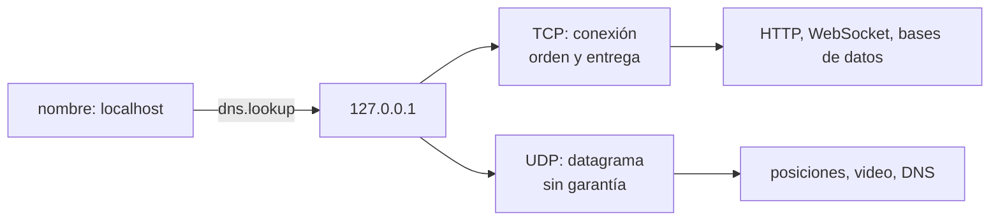
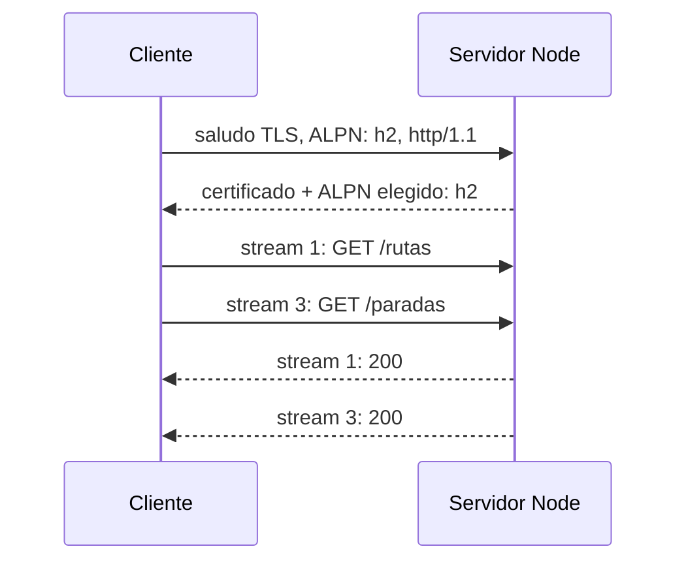

# Módulo 3: Servidores HTTP nativos

## Aprende construyendo

Cada tema comienza en una carpeta vacía y usa únicamente Node.js LTS y `curl`. Escribe manualmente los archivos indicados; no necesitas Express, código prefabricado de la academia ni archivos de otros temas.


### Tema 1: El modelo request/response · Intermedio · 45 min

<details open>
<summary><strong>Capa 1 — Lectura</strong></summary>

#### ► DE QUÉ TRATA
Este tema te guía por el modelo request/response con foco en comprensión antes de implementación.

#### ► LA IDEA EN UNA FRASE
**Entender el modelo request/response te permite tomar mejores decisiones técnicas.**

#### ► POR QUÉ EXISTE ESTO
Resuelve un problema real de diseño o implementación y evita decisiones a ciegas.

#### ► LA ANALOGÍA
Piensa en el modelo request/response como una herramienta de taller: útil cuando conoces su propósito y sus límites.
**Dónde se rompe la analogía:** en software, los efectos dependen del contexto, la escala y los trade-offs.

#### ► CÓMO FUNCIONA
1. Identifica el problema que el modelo request/response resuelve.
2. Observa sus componentes y relaciones.
3. Aplica la opción más simple que funcione.
4. Verifica el resultado y los límites.

#### ► LO QUE PUEDE SALIR MAL
| Síntoma | Causa probable | Arreglo |
|---|---|---|
| El modelo request/response se aplica pero el resultado no mejora | Se usó sin medir el problema real | Mide antes y compara contra la alternativa simple |
| Aparece complejidad inesperada | Se adoptó la técnica sin comprender sus trade-offs | Vuelve a la sección de trade-offs y reduce el alcance |
| Falla en un caso límite | Se asumió un contexto que no se cumple | Prueba el caso límite y documenta cuándo NO usarlo |

#### ► TRADE-OFFS
| Opción | Cuándo usarla | Cuándo NO usarla |
|---|---|---|
| Usar El modelo request/response | Cuando el problema coincide con su propósito y el beneficio es observable | Cuando agrega complejidad sin resolver un problema real |
| Alternativa más simple | Cuando el contexto es pequeño, estable o fácil de razonar | Cuando ya demostró no escalar o no cumplir el requisito |
| Postergar la decisión | Cuando falta evidencia del problema | Cuando el costo de esperar es mayor que el costo de probar |

#### ► CUÁNDO NO USAR ESTO
No uses el modelo request/response por defecto. Aplícalo cuando el problema lo justifique y puedas verificar el beneficio; si una alternativa más simple resuelve igual, prefiérela.

#### ► DE VUELTA A LA ANALOGÍA
Volviendo a la analogía: el modelo request/response funciona como el modelo inicial, pero recuerda dónde se rompe: en producción importan la evidencia, la escala y el costo de equivocarte.

#### ► LO QUE DEBES RECORDAR
- El modelo request/response existe para resolver un problema específico.
- Mide antes de adoptar complejidad.
- Conoce el caso donde NO usarlo.
- Verifica con evidencia observable.

#### ► PREGUNTAS PARA PENSAR
1. ¿Qué problema concreto resuelve el modelo request/response en tu contexto?
2. ¿Cómo sabrías que el modelo request/response no está funcionando bien?
3. ¿Qué alternativa más simple considerarías antes de usar el modelo request/response?

</details>

<details>
<summary><strong>Capa 2 — Construcción</strong></summary>

#### Código y verificación
```bash
mkdir ejemplo-http-basico
cd ejemplo-http-basico
npm init -y
mkdir src
```

```js
import { createServer } from "node:http";

const servidor = createServer((req, res) => {
  if (req.method === "GET" && req.url === "/") {
    const respuesta = JSON.stringify({ mensaje: "Servidor Node activo" });
    res.writeHead(200, { "Content-Type": "application/json; charset=utf-8" });
    res.end(respuesta);
    return;
  }

  res.writeHead(404, { "Content-Type": "application/json; charset=utf-8" });
  res.end(JSON.stringify({ error: "Ruta no encontrada" }));
});

servidor.listen(3000, "127.0.0.1", () => {
  console.log("Servidor listo en http://127.0.0.1:3000");
});
```

```bash
node src/server.js
```

```bash
curl -i http://127.0.0.1:3000/
```

</details>

### Tema 2: Routing manual · Intermedio · 45 min

<details open>
<summary><strong>Capa 1 — Lectura</strong></summary>

#### ► DE QUÉ TRATA
Este tema te guía por routing manual con foco en comprensión antes de implementación.

#### ► LA IDEA EN UNA FRASE
**Entender routing manual te permite tomar mejores decisiones técnicas.**

#### ► POR QUÉ EXISTE ESTO
Resuelve un problema real de diseño o implementación y evita decisiones a ciegas.

#### ► LA ANALOGÍA
Piensa en routing manual como una herramienta de taller: útil cuando conoces su propósito y sus límites.
**Dónde se rompe la analogía:** en software, los efectos dependen del contexto, la escala y los trade-offs.

#### ► CÓMO FUNCIONA
1. Identifica el problema que routing manual resuelve.
2. Observa sus componentes y relaciones.
3. Aplica la opción más simple que funcione.
4. Verifica el resultado y los límites.

#### ► LO QUE PUEDE SALIR MAL
| Síntoma | Causa probable | Arreglo |
|---|---|---|
| Routing manual se aplica pero el resultado no mejora | Se usó sin medir el problema real | Mide antes y compara contra la alternativa simple |
| Aparece complejidad inesperada | Se adoptó la técnica sin comprender sus trade-offs | Vuelve a la sección de trade-offs y reduce el alcance |
| Falla en un caso límite | Se asumió un contexto que no se cumple | Prueba el caso límite y documenta cuándo NO usarlo |

#### ► TRADE-OFFS
| Opción | Cuándo usarla | Cuándo NO usarla |
|---|---|---|
| Usar Routing manual | Cuando el problema coincide con su propósito y el beneficio es observable | Cuando agrega complejidad sin resolver un problema real |
| Alternativa más simple | Cuando el contexto es pequeño, estable o fácil de razonar | Cuando ya demostró no escalar o no cumplir el requisito |
| Postergar la decisión | Cuando falta evidencia del problema | Cuando el costo de esperar es mayor que el costo de probar |

#### ► CUÁNDO NO USAR ESTO
No uses routing manual por defecto. Aplícalo cuando el problema lo justifique y puedas verificar el beneficio; si una alternativa más simple resuelve igual, prefiérela.

#### ► DE VUELTA A LA ANALOGÍA
Volviendo a la analogía: routing manual funciona como el modelo inicial, pero recuerda dónde se rompe: en producción importan la evidencia, la escala y el costo de equivocarte.

#### ► LO QUE DEBES RECORDAR
- Routing manual existe para resolver un problema específico.
- Mide antes de adoptar complejidad.
- Conoce el caso donde NO usarlo.
- Verifica con evidencia observable.

#### ► PREGUNTAS PARA PENSAR
1. ¿Qué problema concreto resuelve routing manual en tu contexto?
2. ¿Cómo sabrías que routing manual no está funcionando bien?
3. ¿Qué alternativa más simple considerarías antes de usar routing manual?

</details>

<details>
<summary><strong>Capa 2 — Construcción</strong></summary>

#### Código y verificación
```bash
mkdir ejemplo-routing-manual
cd ejemplo-routing-manual
npm init -y
mkdir src
```

```js
import { createServer } from "node:http";

const tareas = [];

function responderJson(res, status, cuerpo) {
  res.writeHead(status, { "Content-Type": "application/json; charset=utf-8" });
  res.end(JSON.stringify(cuerpo));
}

async function leerJson(req) {
  const chunks = [];
  for await (const chunk of req) chunks.push(chunk);
  return JSON.parse(Buffer.concat(chunks).toString("utf8"));
}

const servidor = createServer(async (req, res) => {
  if (req.method === "GET" && req.url === "/tareas") {
    return responderJson(res, 200, { tareas });
  }

  if (req.method === "POST" && req.url === "/tareas") {
    try {
      const body = await leerJson(req);
      const titulo = body.titulo?.trim();
      if (!titulo) return responderJson(res, 400, { error: "titulo es obligatorio" });

      const tarea = { id: tareas.length + 1, titulo };
      tareas.push(tarea);
      return responderJson(res, 201, { tarea });
    } catch {
      return responderJson(res, 400, { error: "El body debe ser JSON válido" });
    }
  }

  return responderJson(res, 404, { error: "Ruta no encontrada" });
});

servidor.listen(3001, "127.0.0.1", () => {
  console.log("API en http://127.0.0.1:3001");
});
```

```bash
node src/server.js
```

```bash
curl -i http://127.0.0.1:3001/tareas
curl -i -X POST http://127.0.0.1:3001/tareas -H "Content-Type: application/json" -d '{"titulo":"Leer HTTP"}'
curl -i http://127.0.0.1:3001/tareas
```

</details>

### Tema 3: Parsing de body y headers · Intermedio · 45 min

<details open>
<summary><strong>Capa 1 — Lectura</strong></summary>

#### ► DE QUÉ TRATA
Este tema te guía por parsing de body y headers con foco en comprensión antes de implementación.

#### ► LA IDEA EN UNA FRASE
**Entender parsing de body y headers te permite tomar mejores decisiones técnicas.**

#### ► POR QUÉ EXISTE ESTO
Resuelve un problema real de diseño o implementación y evita decisiones a ciegas.

#### ► LA ANALOGÍA
Piensa en parsing de body y headers como una herramienta de taller: útil cuando conoces su propósito y sus límites.
**Dónde se rompe la analogía:** en software, los efectos dependen del contexto, la escala y los trade-offs.

#### ► CÓMO FUNCIONA
1. Identifica el problema que parsing de body y headers resuelve.
2. Observa sus componentes y relaciones.
3. Aplica la opción más simple que funcione.
4. Verifica el resultado y los límites.

#### ► LO QUE PUEDE SALIR MAL
| Síntoma | Causa probable | Arreglo |
|---|---|---|
| Parsing de body y headers se aplica pero el resultado no mejora | Se usó sin medir el problema real | Mide antes y compara contra la alternativa simple |
| Aparece complejidad inesperada | Se adoptó la técnica sin comprender sus trade-offs | Vuelve a la sección de trade-offs y reduce el alcance |
| Falla en un caso límite | Se asumió un contexto que no se cumple | Prueba el caso límite y documenta cuándo NO usarlo |

#### ► TRADE-OFFS
| Opción | Cuándo usarla | Cuándo NO usarla |
|---|---|---|
| Usar Parsing de body y headers | Cuando el problema coincide con su propósito y el beneficio es observable | Cuando agrega complejidad sin resolver un problema real |
| Alternativa más simple | Cuando el contexto es pequeño, estable o fácil de razonar | Cuando ya demostró no escalar o no cumplir el requisito |
| Postergar la decisión | Cuando falta evidencia del problema | Cuando el costo de esperar es mayor que el costo de probar |

#### ► CUÁNDO NO USAR ESTO
No uses parsing de body y headers por defecto. Aplícalo cuando el problema lo justifique y puedas verificar el beneficio; si una alternativa más simple resuelve igual, prefiérela.

#### ► DE VUELTA A LA ANALOGÍA
Volviendo a la analogía: parsing de body y headers funciona como el modelo inicial, pero recuerda dónde se rompe: en producción importan la evidencia, la escala y el costo de equivocarte.

#### ► LO QUE DEBES RECORDAR
- Parsing de body y headers existe para resolver un problema específico.
- Mide antes de adoptar complejidad.
- Conoce el caso donde NO usarlo.
- Verifica con evidencia observable.

#### ► PREGUNTAS PARA PENSAR
1. ¿Qué problema concreto resuelve parsing de body y headers en tu contexto?
2. ¿Cómo sabrías que parsing de body y headers no está funcionando bien?
3. ¿Qué alternativa más simple considerarías antes de usar parsing de body y headers?

</details>

<details>
<summary><strong>Capa 2 — Construcción</strong></summary>

#### Código y verificación
```bash
mkdir ejemplo-body-headers
cd ejemplo-body-headers
npm init -y
mkdir src
```

```js
import { createServer } from "node:http";

const LIMITE_BYTES = 1_024;

async function leerJson(req) {
  if (!req.headers["content-type"]?.includes("application/json")) {
    throw Object.assign(new Error("Content-Type debe incluir application/json"), { status: 415 });
  }

  const chunks = [];
  let total = 0;
  for await (const chunk of req) {
    total += chunk.length;
    if (total > LIMITE_BYTES) {
      throw Object.assign(new Error(`Body supera ${LIMITE_BYTES} bytes`), { status: 413 });
    }
    chunks.push(chunk);
  }

  try {
    return JSON.parse(Buffer.concat(chunks).toString("utf8"));
  } catch {
    throw Object.assign(new Error("JSON inválido"), { status: 400 });
  }
}

function responder(res, status, body) {
  res.writeHead(status, { "Content-Type": "application/json; charset=utf-8" });
  res.end(JSON.stringify(body));
}

createServer(async (req, res) => {
  if (req.method !== "POST" || req.url !== "/eco") {
    return responder(res, 404, { error: "Ruta no encontrada" });
  }

  try {
    const datos = await leerJson(req);
    return responder(res, 200, { recibido: datos });
  } catch (error) {
    return responder(res, error.status ?? 500, { error: error.message });
  }
}).listen(3002, "127.0.0.1", () => console.log("API en http://127.0.0.1:3002"));
```

```bash
node src/server.js
```

```bash
curl -i -X POST http://127.0.0.1:3002/eco -H "Content-Type: application/json" -d '{"nombre":"Ana"}'
```

</details>

### Tema 4: Códigos de estado y content negotiation · Intermedio · 45 min

<details open>
<summary><strong>Capa 1 — Lectura</strong></summary>

#### ► DE QUÉ TRATA
Este tema te guía por códigos de estado y content negotiation con foco en comprensión antes de implementación.

#### ► LA IDEA EN UNA FRASE
**Entender códigos de estado y content negotiation te permite tomar mejores decisiones técnicas.**

#### ► POR QUÉ EXISTE ESTO
Resuelve un problema real de diseño o implementación y evita decisiones a ciegas.

#### ► LA ANALOGÍA
Piensa en códigos de estado y content negotiation como una herramienta de taller: útil cuando conoces su propósito y sus límites.
**Dónde se rompe la analogía:** en software, los efectos dependen del contexto, la escala y los trade-offs.

#### ► CÓMO FUNCIONA
1. Identifica el problema que códigos de estado y content negotiation resuelve.
2. Observa sus componentes y relaciones.
3. Aplica la opción más simple que funcione.
4. Verifica el resultado y los límites.

#### ► LO QUE PUEDE SALIR MAL
| Síntoma | Causa probable | Arreglo |
|---|---|---|
| Códigos de estado y content negotiation se aplica pero el resultado no mejora | Se usó sin medir el problema real | Mide antes y compara contra la alternativa simple |
| Aparece complejidad inesperada | Se adoptó la técnica sin comprender sus trade-offs | Vuelve a la sección de trade-offs y reduce el alcance |
| Falla en un caso límite | Se asumió un contexto que no se cumple | Prueba el caso límite y documenta cuándo NO usarlo |

#### ► TRADE-OFFS
| Opción | Cuándo usarla | Cuándo NO usarla |
|---|---|---|
| Usar Códigos de estado y content negotiation | Cuando el problema coincide con su propósito y el beneficio es observable | Cuando agrega complejidad sin resolver un problema real |
| Alternativa más simple | Cuando el contexto es pequeño, estable o fácil de razonar | Cuando ya demostró no escalar o no cumplir el requisito |
| Postergar la decisión | Cuando falta evidencia del problema | Cuando el costo de esperar es mayor que el costo de probar |

#### ► CUÁNDO NO USAR ESTO
No uses códigos de estado y content negotiation por defecto. Aplícalo cuando el problema lo justifique y puedas verificar el beneficio; si una alternativa más simple resuelve igual, prefiérela.

#### ► DE VUELTA A LA ANALOGÍA
Volviendo a la analogía: códigos de estado y content negotiation funciona como el modelo inicial, pero recuerda dónde se rompe: en producción importan la evidencia, la escala y el costo de equivocarte.

#### ► LO QUE DEBES RECORDAR
- Códigos de estado y content negotiation existe para resolver un problema específico.
- Mide antes de adoptar complejidad.
- Conoce el caso donde NO usarlo.
- Verifica con evidencia observable.

#### ► PREGUNTAS PARA PENSAR
1. ¿Qué problema concreto resuelve códigos de estado y content negotiation en tu contexto?
2. ¿Cómo sabrías que códigos de estado y content negotiation no está funcionando bien?
3. ¿Qué alternativa más simple considerarías antes de usar códigos de estado y content negotiation?

</details>

<details>
<summary><strong>Capa 2 — Construcción</strong></summary>

#### Código y verificación
```bash
mkdir ejemplo-content-negotiation
cd ejemplo-content-negotiation
npm init -y
mkdir src
```

```js
import { createServer } from "node:http";

const producto = Object.freeze({ id: 7, nombre: "Cuaderno", precio: 12_000 });

function responderProducto(req, res) {
  const acepta = req.headers.accept ?? "*/*";

  if (acepta.includes("application/json") || acepta.includes("*/*")) {
    res.writeHead(200, { "Content-Type": "application/json; charset=utf-8", Vary: "Accept" });
    return res.end(JSON.stringify(producto));
  }

  if (acepta.includes("text/plain")) {
    res.writeHead(200, { "Content-Type": "text/plain; charset=utf-8", Vary: "Accept" });
    return res.end(`${producto.nombre}: $${producto.precio}`);
  }

  res.writeHead(406, { "Content-Type": "application/json; charset=utf-8", Vary: "Accept" });
  return res.end(JSON.stringify({ error: "Formato no disponible" }));
}

createServer((req, res) => {
  if (req.method === "GET" && req.url === "/producto") return responderProducto(req, res);

  res.writeHead(404, { "Content-Type": "application/json; charset=utf-8" });
  res.end(JSON.stringify({ error: "Ruta no encontrada" }));
}).listen(3003, "127.0.0.1", () => console.log("API en http://127.0.0.1:3003"));
```

```bash
node src/server.js
```

```bash
curl -i -H "Accept: application/json" http://127.0.0.1:3003/producto
curl -i -H "Accept: text/plain" http://127.0.0.1:3003/producto
```

</details>

### Tema 5: Paginación por cursor y límites de entrada comprobables · Intermedio · 45 min

<details open>
<summary><strong>Capa 1 — Lectura</strong></summary>

#### ► DE QUÉ TRATA
Este tema te guía por paginación por cursor y límites de entrada comprobables con foco en comprensión antes de implementación.

#### ► LA IDEA EN UNA FRASE
**Entender paginación por cursor y límites de entrada comprobables te permite tomar mejores decisiones técnicas.**

#### ► POR QUÉ EXISTE ESTO
Resuelve un problema real de diseño o implementación y evita decisiones a ciegas.

#### ► LA ANALOGÍA
Piensa en paginación por cursor y límites de entrada comprobables como una herramienta de taller: útil cuando conoces su propósito y sus límites.
**Dónde se rompe la analogía:** en software, los efectos dependen del contexto, la escala y los trade-offs.

#### ► CÓMO FUNCIONA
1. Identifica el problema que paginación por cursor y límites de entrada comprobables resuelve.
2. Observa sus componentes y relaciones.
3. Aplica la opción más simple que funcione.
4. Verifica el resultado y los límites.

#### ► LO QUE PUEDE SALIR MAL
| Síntoma | Causa probable | Arreglo |
|---|---|---|
| Paginación por cursor y límites de entrada comprobables se aplica pero el resultado no mejora | Se usó sin medir el problema real | Mide antes y compara contra la alternativa simple |
| Aparece complejidad inesperada | Se adoptó la técnica sin comprender sus trade-offs | Vuelve a la sección de trade-offs y reduce el alcance |
| Falla en un caso límite | Se asumió un contexto que no se cumple | Prueba el caso límite y documenta cuándo NO usarlo |

#### ► TRADE-OFFS
| Opción | Cuándo usarla | Cuándo NO usarla |
|---|---|---|
| Usar Paginación por cursor y límites de entrada comprobables | Cuando el problema coincide con su propósito y el beneficio es observable | Cuando agrega complejidad sin resolver un problema real |
| Alternativa más simple | Cuando el contexto es pequeño, estable o fácil de razonar | Cuando ya demostró no escalar o no cumplir el requisito |
| Postergar la decisión | Cuando falta evidencia del problema | Cuando el costo de esperar es mayor que el costo de probar |

#### ► CUÁNDO NO USAR ESTO
No uses paginación por cursor y límites de entrada comprobables por defecto. Aplícalo cuando el problema lo justifique y puedas verificar el beneficio; si una alternativa más simple resuelve igual, prefiérela.

#### ► DE VUELTA A LA ANALOGÍA
Volviendo a la analogía: paginación por cursor y límites de entrada comprobables funciona como el modelo inicial, pero recuerda dónde se rompe: en producción importan la evidencia, la escala y el costo de equivocarte.

#### ► LO QUE DEBES RECORDAR
- Paginación por cursor y límites de entrada comprobables existe para resolver un problema específico.
- Mide antes de adoptar complejidad.
- Conoce el caso donde NO usarlo.
- Verifica con evidencia observable.

#### ► PREGUNTAS PARA PENSAR
1. ¿Qué problema concreto resuelve paginación por cursor y límites de entrada comprobables en tu contexto?
2. ¿Cómo sabrías que paginación por cursor y límites de entrada comprobables no está funcionando bien?
3. ¿Qué alternativa más simple considerarías antes de usar paginación por cursor y límites de entrada comprobables?

</details>

<details>
<summary><strong>Capa 2 — Construcción</strong></summary>

#### Código y verificación
```bash
mkdir cursor-envios
cd cursor-envios
```

```js
export function pagina(rows, after = 0, size = 2) {
  if (!Number.isSafeInteger(after) || after < 0 ||
      !Number.isSafeInteger(size) || size < 1 || size > 100) {
    throw new RangeError("Cursor o tamaño inválido");
  }
  const selected = rows.filter(row => row.id > after)
    .sort((a, b) => a.id - b.id).slice(0, size + 1);
  const items = selected.slice(0, size);
  return { items, next: selected.length > size ? items.at(-1).id : null };
}
```

```js
import test from "node:test";
import assert from "node:assert/strict";
import { pagina } from "./pagina.mjs";

const rows = [1, 2, 3, 4, 5].map(id => ({ id }));

test("recorre sin repetir y termina", () => {
  const first = pagina(rows);
  const second = pagina(rows, first.next);
  assert.deepEqual(first.items.map(x => x.id), [1, 2]);
  assert.deepEqual(second.items.map(x => x.id), [3, 4]);
  assert.equal(pagina(rows, second.next).next, null);
});

test("rechaza límites y cursor inválidos", () => {
  assert.throws(() => pagina(rows, 0, 1000), RangeError);
  assert.throws(() => pagina(rows, -1, 2), RangeError);
});
```

```bash
node --test pagina.test.mjs
```

</details>

### Tema 6: Debajo de HTTP: TCP con net, UDP con dgram y resolución DNS · Intermedio · 40 min

<details open>
<summary><strong>Capa 1 — Lectura</strong></summary>

#### ► DE QUÉ TRATA
Este tema te guía por debajo de http: tcp con net, udp con dgram y resolución dns con foco en comprensión antes de implementación.

#### ► LA IDEA EN UNA FRASE
**Entender debajo de http: tcp con net, udp con dgram y resolución dns te permite tomar mejores decisiones técnicas.**

#### ► POR QUÉ EXISTE ESTO
Resuelve un problema real de diseño o implementación y evita decisiones a ciegas.

#### ► LA ANALOGÍA
Piensa en debajo de http: tcp con net, udp con dgram y resolución dns como una herramienta de taller: útil cuando conoces su propósito y sus límites.
**Dónde se rompe la analogía:** en software, los efectos dependen del contexto, la escala y los trade-offs.

#### ► CÓMO FUNCIONA


#### ► LO QUE PUEDE SALIR MAL
| Síntoma | Causa probable | Arreglo |
|---|---|---|
| Debajo de HTTP: TCP con net, UDP con dgram y resolución DNS se aplica pero el resultado no mejora | Se usó sin medir el problema real | Mide antes y compara contra la alternativa simple |
| Aparece complejidad inesperada | Se adoptó la técnica sin comprender sus trade-offs | Vuelve a la sección de trade-offs y reduce el alcance |
| Falla en un caso límite | Se asumió un contexto que no se cumple | Prueba el caso límite y documenta cuándo NO usarlo |

#### ► TRADE-OFFS
| Opción | Cuándo usarla | Cuándo NO usarla |
|---|---|---|
| Usar Debajo de HTTP: TCP con net, UDP con dgram y resolución DNS | Cuando el problema coincide con su propósito y el beneficio es observable | Cuando agrega complejidad sin resolver un problema real |
| Alternativa más simple | Cuando el contexto es pequeño, estable o fácil de razonar | Cuando ya demostró no escalar o no cumplir el requisito |
| Postergar la decisión | Cuando falta evidencia del problema | Cuando el costo de esperar es mayor que el costo de probar |

#### ► CUÁNDO NO USAR ESTO
No uses debajo de http: tcp con net, udp con dgram y resolución dns por defecto. Aplícalo cuando el problema lo justifique y puedas verificar el beneficio; si una alternativa más simple resuelve igual, prefiérela.

#### ► DE VUELTA A LA ANALOGÍA
Volviendo a la analogía: debajo de http: tcp con net, udp con dgram y resolución dns funciona como el modelo inicial, pero recuerda dónde se rompe: en producción importan la evidencia, la escala y el costo de equivocarte.

#### ► LO QUE DEBES RECORDAR
- Debajo de HTTP: TCP con net, UDP con dgram y resolución DNS existe para resolver un problema específico.
- Mide antes de adoptar complejidad.
- Conoce el caso donde NO usarlo.
- Verifica con evidencia observable.

#### ► PREGUNTAS PARA PENSAR
1. ¿Qué problema concreto resuelve debajo de http: tcp con net, udp con dgram y resolución dns en tu contexto?
2. ¿Cómo sabrías que debajo de http: tcp con net, udp con dgram y resolución dns no está funcionando bien?
3. ¿Qué alternativa más simple considerarías antes de usar debajo de http: tcp con net, udp con dgram y resolución dns?

</details>

<details>
<summary><strong>Capa 2 — Construcción</strong></summary>

#### Código y verificación


```js
import { createServer, connect } from 'node:net';
import { createSocket } from 'node:dgram';
import { lookup } from 'node:dns/promises';

// DNS: el sistema traduce un nombre a una dirección IP.
const { address, family } = await lookup('localhost', { family: 4 });
console.log(`DNS: localhost -> ${address} (IPv${family})`);

// TCP: conexión con orden y entrega garantizados.
const servidorTcp = createServer((socket) => {
  socket.on('data', (datos) => socket.end(`recibido ${datos.toString().trim()}`));
});
await new Promise((listo) => servidorTcp.listen(0, address, listo));
const respuestaTcp = await new Promise((resolver) => {
  const cliente = connect(servidorTcp.address().port, address, () => cliente.write('ENV-42\n'));
  cliente.on('data', (datos) => resolver(datos.toString()));
});
console.log(`TCP: ${respuestaTcp}`);
servidorTcp.close();

// UDP: datagramas sueltos, sin conexión ni garantía de entrega.
const servidorUdp = createSocket('udp4');
const llegada = new Promise((resolver) =>
  servidorUdp.once('message', (mensaje) => resolver(mensaje.toString())));
await new Promise((listo) => servidorUdp.bind(0, address, listo));
const clienteUdp = createSocket('udp4');
clienteUdp.send('posicion 4.65,-74.05', servidorUdp.address().port, address);
console.log(`UDP: ${await llegada}`);
clienteUdp.close();
servidorUdp.close();
```

```bash
cd academia-labs/node/redes
node redes.mjs
```

```text
DNS: localhost -> 127.0.0.1 (IPv4)
TCP: recibido ENV-42
UDP: posicion 4.65,-74.05
```

</details>

### Tema 7: HTTPS y HTTP/2 con TLS: certificados, ALPN y varias peticiones por conexión · Avanzado · 45 min

<details open>
<summary><strong>Capa 1 — Lectura</strong></summary>

#### ► DE QUÉ TRATA
Este tema te guía por https y http/2 con tls: certificados, alpn y varias peticiones por conexión con foco en comprensión antes de implementación.

#### ► LA IDEA EN UNA FRASE
**Entender https y http/2 con tls: certificados, alpn y varias peticiones por conexión te permite tomar mejores decisiones técnicas.**

#### ► POR QUÉ EXISTE ESTO
Resuelve un problema real de diseño o implementación y evita decisiones a ciegas.

#### ► LA ANALOGÍA
Piensa en https y http/2 con tls: certificados, alpn y varias peticiones por conexión como una herramienta de taller: útil cuando conoces su propósito y sus límites.
**Dónde se rompe la analogía:** en software, los efectos dependen del contexto, la escala y los trade-offs.

#### ► CÓMO FUNCIONA


#### ► LO QUE PUEDE SALIR MAL
| Síntoma | Causa probable | Arreglo |
|---|---|---|
| HTTPS y HTTP/2 con TLS: certificados, ALPN y varias peticiones por conexión se aplica pero el resultado no mejora | Se usó sin medir el problema real | Mide antes y compara contra la alternativa simple |
| Aparece complejidad inesperada | Se adoptó la técnica sin comprender sus trade-offs | Vuelve a la sección de trade-offs y reduce el alcance |
| Falla en un caso límite | Se asumió un contexto que no se cumple | Prueba el caso límite y documenta cuándo NO usarlo |

#### ► TRADE-OFFS
| Opción | Cuándo usarla | Cuándo NO usarla |
|---|---|---|
| Usar HTTPS y HTTP/2 con TLS: certificados, ALPN y varias peticiones por conexión | Cuando el problema coincide con su propósito y el beneficio es observable | Cuando agrega complejidad sin resolver un problema real |
| Alternativa más simple | Cuando el contexto es pequeño, estable o fácil de razonar | Cuando ya demostró no escalar o no cumplir el requisito |
| Postergar la decisión | Cuando falta evidencia del problema | Cuando el costo de esperar es mayor que el costo de probar |

#### ► CUÁNDO NO USAR ESTO
No uses https y http/2 con tls: certificados, alpn y varias peticiones por conexión por defecto. Aplícalo cuando el problema lo justifique y puedas verificar el beneficio; si una alternativa más simple resuelve igual, prefiérela.

#### ► DE VUELTA A LA ANALOGÍA
Volviendo a la analogía: https y http/2 con tls: certificados, alpn y varias peticiones por conexión funciona como el modelo inicial, pero recuerda dónde se rompe: en producción importan la evidencia, la escala y el costo de equivocarte.

#### ► LO QUE DEBES RECORDAR
- HTTPS y HTTP/2 con TLS: certificados, ALPN y varias peticiones por conexión existe para resolver un problema específico.
- Mide antes de adoptar complejidad.
- Conoce el caso donde NO usarlo.
- Verifica con evidencia observable.

#### ► PREGUNTAS PARA PENSAR
1. ¿Qué problema concreto resuelve https y http/2 con tls: certificados, alpn y varias peticiones por conexión en tu contexto?
2. ¿Cómo sabrías que https y http/2 con tls: certificados, alpn y varias peticiones por conexión no está funcionando bien?
3. ¿Qué alternativa más simple considerarías antes de usar https y http/2 con tls: certificados, alpn y varias peticiones por conexión?

</details>

<details>
<summary><strong>Capa 2 — Construcción</strong></summary>

#### Código y verificación


```js
import { readFileSync } from 'node:fs';
import { createSecureServer, connect } from 'node:http2';

const cert = readFileSync('cert.pem');
const key = readFileSync('clave.pem');

// Servidor HTTP/2 sobre TLS. allowHTTP1 deja entrar clientes HTTP/1.1.
const servidor = createSecureServer({ key, cert, allowHTTP1: true }, (req, res) => {
  res.setHeader('content-type', 'application/json');
  res.end(JSON.stringify({ protocolo: req.httpVersion, tls: req.socket.getProtocol() }));
});
await new Promise((listo) => servidor.listen(0, 'localhost', listo));
const { port } = servidor.address();

// Cliente HTTP/2 que confía solo en nuestro certificado de prueba.
const sesion = connect(`https://localhost:${port}`, { ca: cert });
sesion.on('connect', () => console.log(`ALPN negociado: ${sesion.alpnProtocol}`));

// Dos peticiones viajan por la MISMA conexión, cada una en su stream.
const pedir = (ruta) => new Promise((resolver, rechazar) => {
  const stream = sesion.request({ ':path': ruta });
  let cuerpo = '';
  stream.setEncoding('utf8');
  stream.on('response', (cabeceras) => console.log(`${ruta} -> ${cabeceras[':status']} en el stream ${stream.id}`));
  stream.on('data', (trozo) => { cuerpo += trozo; });
  stream.on('end', () => resolver(JSON.parse(cuerpo)));
  stream.on('error', rechazar);
});

const [a] = await Promise.all([pedir('/rutas'), pedir('/paradas')]);
console.log(`respuesta: HTTP/${a.protocolo} sobre ${a.tls}`);
sesion.close();
servidor.close();
```

```bash
cd academia-labs/node/http2-tls
openssl req -x509 -newkey ec -pkeyopt ec_paramgen_curve:prime256v1 -nodes \
  -keyout clave.pem -out cert.pem -days 30 -subj "/CN=localhost" \
  -addext "subjectAltName=DNS:localhost"
node servidor-h2.mjs
```

```text
ALPN negociado: h2
/rutas -> 200 en el stream 1
/paradas -> 200 en el stream 3
respuesta: HTTP/2.0 sobre TLSv1.3
```

</details>

### Proyecto 3: API HTTP nativa de tareas

<details open>
<summary><strong>Capa 1 — Lectura</strong></summary>

#### ► DE QUÉ TRATA
Este tema te guía por proyecto 3: api http nativa de tareas con foco en comprensión antes de implementación.

#### ► LA IDEA EN UNA FRASE
**Entender proyecto 3: api http nativa de tareas te permite tomar mejores decisiones técnicas.**

#### ► POR QUÉ EXISTE ESTO
Resuelve un problema real de diseño o implementación y evita decisiones a ciegas.

#### ► LA ANALOGÍA
Piensa en proyecto 3: api http nativa de tareas como una herramienta de taller: útil cuando conoces su propósito y sus límites.
**Dónde se rompe la analogía:** en software, los efectos dependen del contexto, la escala y los trade-offs.

#### ► CÓMO FUNCIONA
1. Identifica el problema que proyecto 3: api http nativa de tareas resuelve.
2. Observa sus componentes y relaciones.
3. Aplica la opción más simple que funcione.
4. Verifica el resultado y los límites.

#### ► LO QUE PUEDE SALIR MAL
| Síntoma | Causa probable | Arreglo |
|---|---|---|
| Proyecto 3: API HTTP nativa de tareas se aplica pero el resultado no mejora | Se usó sin medir el problema real | Mide antes y compara contra la alternativa simple |
| Aparece complejidad inesperada | Se adoptó la técnica sin comprender sus trade-offs | Vuelve a la sección de trade-offs y reduce el alcance |
| Falla en un caso límite | Se asumió un contexto que no se cumple | Prueba el caso límite y documenta cuándo NO usarlo |

#### ► TRADE-OFFS
| Opción | Cuándo usarla | Cuándo NO usarla |
|---|---|---|
| Usar Proyecto 3: API HTTP nativa de tareas | Cuando el problema coincide con su propósito y el beneficio es observable | Cuando agrega complejidad sin resolver un problema real |
| Alternativa más simple | Cuando el contexto es pequeño, estable o fácil de razonar | Cuando ya demostró no escalar o no cumplir el requisito |
| Postergar la decisión | Cuando falta evidencia del problema | Cuando el costo de esperar es mayor que el costo de probar |

#### ► CUÁNDO NO USAR ESTO
No uses proyecto 3: api http nativa de tareas por defecto. Aplícalo cuando el problema lo justifique y puedas verificar el beneficio; si una alternativa más simple resuelve igual, prefiérela.

#### ► DE VUELTA A LA ANALOGÍA
Volviendo a la analogía: proyecto 3: api http nativa de tareas funciona como el modelo inicial, pero recuerda dónde se rompe: en producción importan la evidencia, la escala y el costo de equivocarte.

#### ► LO QUE DEBES RECORDAR
- Proyecto 3: API HTTP nativa de tareas existe para resolver un problema específico.
- Mide antes de adoptar complejidad.
- Conoce el caso donde NO usarlo.
- Verifica con evidencia observable.

#### ► PREGUNTAS PARA PENSAR
1. ¿Qué problema concreto resuelve proyecto 3: api http nativa de tareas en tu contexto?
2. ¿Cómo sabrías que proyecto 3: api http nativa de tareas no está funcionando bien?
3. ¿Qué alternativa más simple considerarías antes de usar proyecto 3: api http nativa de tareas?

</details>

<details>
<summary><strong>Capa 2 — Construcción</strong></summary>

#### Nota de construcción
Este tema es principalmente conceptual en esta versión. La verificación se realiza con las preguntas de comprensión y el criterio de cuándo NO usar proyecto 3: api http nativa de tareas.

</details>
