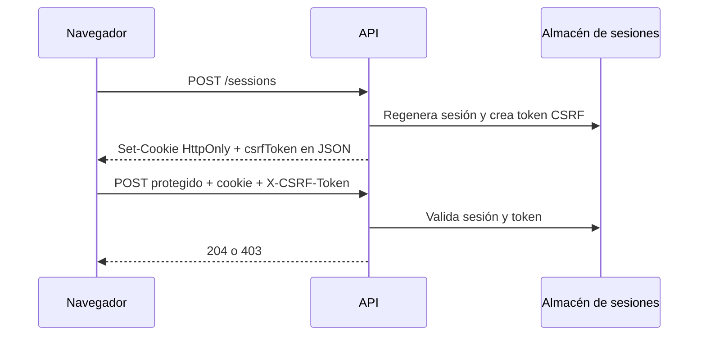
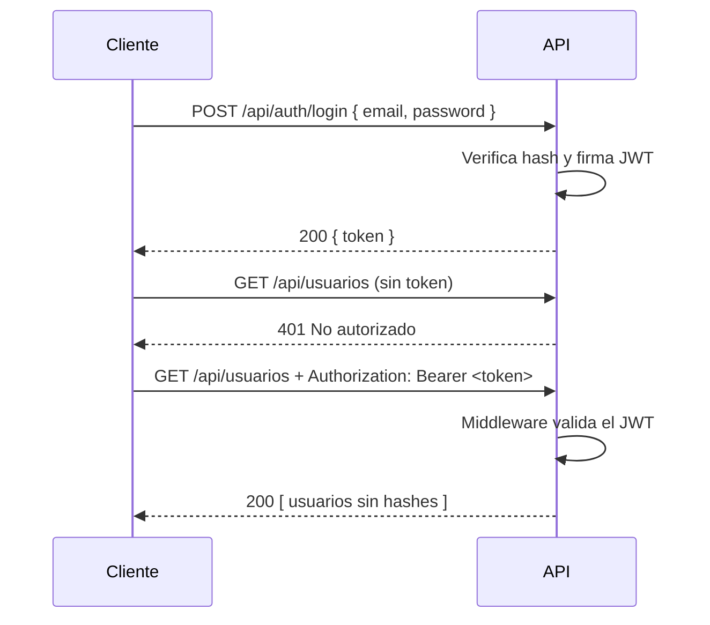

# Módulo 6: Autenticación y autorización

## Aprende construyendo

Cada tema es un proyecto independiente que comienza en una carpeta vacía. Escribe manualmente todos los archivos indicados: no copies código del repositorio de la academia ni reutilices archivos de otro tema. `npm init -y` crea el `package.json` de cada proyecto y las dependencias se instalan dentro de esa carpeta.

Los ejemplos son laboratorios locales. Las claves de firma y de sesión se leen de variables de entorno, sin valores de respaldo en el código; fuera del laboratorio, usa un mecanismo de gestión de secretos del entorno. No imprimas contraseñas, hashes, tokens ni cookies en logs reales.


### Tema 1: Hashing de contraseñas · Avanzado · 45 min

<details open>
<summary><strong>Capa 1 — Lectura</strong></summary>

#### ► DE QUÉ TRATA
Este tema te guía por hashing de contraseñas con foco en comprensión antes de implementación.

#### ► LA IDEA EN UNA FRASE
**Entender hashing de contraseñas te permite tomar mejores decisiones técnicas.**

#### ► POR QUÉ EXISTE ESTO
Resuelve un problema real de diseño o implementación y evita decisiones a ciegas.

#### ► LA ANALOGÍA
Piensa en hashing de contraseñas como una herramienta de taller: útil cuando conoces su propósito y sus límites.
**Dónde se rompe la analogía:** en software, los efectos dependen del contexto, la escala y los trade-offs.

#### ► CÓMO FUNCIONA
1. Identifica el problema que hashing de contraseñas resuelve.
2. Observa sus componentes y relaciones.
3. Aplica la opción más simple que funcione.
4. Verifica el resultado y los límites.

#### ► LO QUE PUEDE SALIR MAL
| Síntoma | Causa probable | Arreglo |
|---|---|---|
| Hashing de contraseñas se aplica pero el resultado no mejora | Se usó sin medir el problema real | Mide antes y compara contra la alternativa simple |
| Aparece complejidad inesperada | Se adoptó la técnica sin comprender sus trade-offs | Vuelve a la sección de trade-offs y reduce el alcance |
| Falla en un caso límite | Se asumió un contexto que no se cumple | Prueba el caso límite y documenta cuándo NO usarlo |

#### ► TRADE-OFFS
| Opción | Cuándo usarla | Cuándo NO usarla |
|---|---|---|
| Usar Hashing de contraseñas | Cuando el problema coincide con su propósito y el beneficio es observable | Cuando agrega complejidad sin resolver un problema real |
| Alternativa más simple | Cuando el contexto es pequeño, estable o fácil de razonar | Cuando ya demostró no escalar o no cumplir el requisito |
| Postergar la decisión | Cuando falta evidencia del problema | Cuando el costo de esperar es mayor que el costo de probar |

#### ► CUÁNDO NO USAR ESTO
No uses hashing de contraseñas por defecto. Aplícalo cuando el problema lo justifique y puedas verificar el beneficio; si una alternativa más simple resuelve igual, prefiérela.

#### ► DE VUELTA A LA ANALOGÍA
Volviendo a la analogía: hashing de contraseñas funciona como el modelo inicial, pero recuerda dónde se rompe: en producción importan la evidencia, la escala y el costo de equivocarte.

#### ► LO QUE DEBES RECORDAR
- Hashing de contraseñas existe para resolver un problema específico.
- Mide antes de adoptar complejidad.
- Conoce el caso donde NO usarlo.
- Verifica con evidencia observable.

#### ► PREGUNTAS PARA PENSAR
1. ¿Qué problema concreto resuelve hashing de contraseñas en tu contexto?
2. ¿Cómo sabrías que hashing de contraseñas no está funcionando bien?
3. ¿Qué alternativa más simple considerarías antes de usar hashing de contraseñas?

</details>

<details>
<summary><strong>Capa 2 — Construcción</strong></summary>

#### Código y verificación
```js
import bcrypt from "bcrypt";
const hash = await bcrypt.hash(contraseñaPlano, 10); // lento a propósito, con sal embebida
const esValida = await bcrypt.compare(contraseñaIngresada, hash); // verifica sin revertir
```

```bash
mkdir ejemplo-password-hash
cd ejemplo-password-hash
npm init -y
npm pkg set type=module
mkdir src
```

```js
import {
  randomBytes,
  scrypt as derivar,
  timingSafeEqual,
} from "node:crypto";
import { promisify } from "node:util";

const scrypt = promisify(derivar);

export async function crearHash(password) {
  if (typeof password !== "string" || password.length < 12) {
    throw new Error("Usa al menos 12 caracteres");
  }
  const salt = randomBytes(16).toString("hex");
  const clave = await scrypt(password, salt, 64);
  return `${salt}:${clave.toString("hex")}`;
}

export async function verificar(password, registro) {
  const [salt, esperado] = registro.split(":");
  if (!salt || !esperado) return false;

  const esperadoBuffer = Buffer.from(esperado, "hex");
  const actual = await scrypt(password, salt, 64);

  return actual.length === esperadoBuffer.length
    && timingSafeEqual(actual, esperadoBuffer);
}

const password = "una-clave-larga-segura";
const registro = await crearHash(password);
const otroRegistro = await crearHash(password);

console.log({
  valida: await verificar(password, registro),
  invalida: await verificar("otra-clave-larga", registro),
  huellasDistintas: registro !== otroRegistro,
});
```

```bash
node src/password.js
```

</details>

### Tema 2: JWT — access y refresh tokens · Avanzado · 45 min

<details open>
<summary><strong>Capa 1 — Lectura</strong></summary>

#### ► DE QUÉ TRATA
Este tema te guía por jwt — access y refresh tokens con foco en comprensión antes de implementación.

#### ► LA IDEA EN UNA FRASE
**Entender jwt — access y refresh tokens te permite tomar mejores decisiones técnicas.**

#### ► POR QUÉ EXISTE ESTO
Resuelve un problema real de diseño o implementación y evita decisiones a ciegas.

#### ► LA ANALOGÍA
Piensa en jwt — access y refresh tokens como una herramienta de taller: útil cuando conoces su propósito y sus límites.
**Dónde se rompe la analogía:** en software, los efectos dependen del contexto, la escala y los trade-offs.

#### ► CÓMO FUNCIONA
1. Identifica el problema que jwt — access y refresh tokens resuelve.
2. Observa sus componentes y relaciones.
3. Aplica la opción más simple que funcione.
4. Verifica el resultado y los límites.

#### ► LO QUE PUEDE SALIR MAL
| Síntoma | Causa probable | Arreglo |
|---|---|---|
| JWT — access y refresh tokens se aplica pero el resultado no mejora | Se usó sin medir el problema real | Mide antes y compara contra la alternativa simple |
| Aparece complejidad inesperada | Se adoptó la técnica sin comprender sus trade-offs | Vuelve a la sección de trade-offs y reduce el alcance |
| Falla en un caso límite | Se asumió un contexto que no se cumple | Prueba el caso límite y documenta cuándo NO usarlo |

#### ► TRADE-OFFS
| Opción | Cuándo usarla | Cuándo NO usarla |
|---|---|---|
| Usar JWT — access y refresh tokens | Cuando el problema coincide con su propósito y el beneficio es observable | Cuando agrega complejidad sin resolver un problema real |
| Alternativa más simple | Cuando el contexto es pequeño, estable o fácil de razonar | Cuando ya demostró no escalar o no cumplir el requisito |
| Postergar la decisión | Cuando falta evidencia del problema | Cuando el costo de esperar es mayor que el costo de probar |

#### ► CUÁNDO NO USAR ESTO
No uses jwt — access y refresh tokens por defecto. Aplícalo cuando el problema lo justifique y puedas verificar el beneficio; si una alternativa más simple resuelve igual, prefiérela.

#### ► DE VUELTA A LA ANALOGÍA
Volviendo a la analogía: jwt — access y refresh tokens funciona como el modelo inicial, pero recuerda dónde se rompe: en producción importan la evidencia, la escala y el costo de equivocarte.

#### ► LO QUE DEBES RECORDAR
- JWT — access y refresh tokens existe para resolver un problema específico.
- Mide antes de adoptar complejidad.
- Conoce el caso donde NO usarlo.
- Verifica con evidencia observable.

#### ► PREGUNTAS PARA PENSAR
1. ¿Qué problema concreto resuelve jwt — access y refresh tokens en tu contexto?
2. ¿Cómo sabrías que jwt — access y refresh tokens no está funcionando bien?
3. ¿Qué alternativa más simple considerarías antes de usar jwt — access y refresh tokens?

</details>

<details>
<summary><strong>Capa 2 — Construcción</strong></summary>

#### Código y verificación
```bash
mkdir ejemplo-jwt
cd ejemplo-jwt
npm init -y
npm pkg set type=module
npm install jose
mkdir src
```

```js
import { SignJWT, jwtVerify } from "jose";

const secreto = new TextEncoder().encode(process.env.JWT_SECRET ?? "");
if (secreto.length < 32) {
  throw new Error("Define JWT_SECRET con al menos 32 bytes para este laboratorio");
}

const issuer = "rutaflow-lab";
const audience = "entregas-api";

const token = await new SignJWT({ role: "driver" })
  .setProtectedHeader({ alg: "HS256" })
  .setSubject("usuario-1")
  .setIssuer(issuer)
  .setAudience(audience)
  .setIssuedAt()
  .setExpirationTime("5m")
  .sign(secreto);

console.log("token emitido", token.split(".").length === 3);

const { payload } = await jwtVerify(token, secreto, {
  issuer,
  audience,
  algorithms: ["HS256"],
});

console.log({ subject: payload.sub, role: payload.role });
```

```bash
JWT_SECRET='clave-local-de-laboratorio-con-mas-de-32-bytes' node src/tokens.js
```

```powershell
$env:JWT_SECRET="clave-local-de-laboratorio-con-mas-de-32-bytes"; node src/tokens.js
```

</details>

### Tema 3: Middleware de autenticación y control de roles · Avanzado · 45 min

<details open>
<summary><strong>Capa 1 — Lectura</strong></summary>

#### ► DE QUÉ TRATA
Este tema te guía por middleware de autenticación y control de roles con foco en comprensión antes de implementación.

#### ► LA IDEA EN UNA FRASE
**Entender middleware de autenticación y control de roles te permite tomar mejores decisiones técnicas.**

#### ► POR QUÉ EXISTE ESTO
Resuelve un problema real de diseño o implementación y evita decisiones a ciegas.

#### ► LA ANALOGÍA
Piensa en middleware de autenticación y control de roles como una herramienta de taller: útil cuando conoces su propósito y sus límites.
**Dónde se rompe la analogía:** en software, los efectos dependen del contexto, la escala y los trade-offs.

#### ► CÓMO FUNCIONA
1. Identifica el problema que middleware de autenticación y control de roles resuelve.
2. Observa sus componentes y relaciones.
3. Aplica la opción más simple que funcione.
4. Verifica el resultado y los límites.

#### ► LO QUE PUEDE SALIR MAL
| Síntoma | Causa probable | Arreglo |
|---|---|---|
| Middleware de autenticación y control de roles se aplica pero el resultado no mejora | Se usó sin medir el problema real | Mide antes y compara contra la alternativa simple |
| Aparece complejidad inesperada | Se adoptó la técnica sin comprender sus trade-offs | Vuelve a la sección de trade-offs y reduce el alcance |
| Falla en un caso límite | Se asumió un contexto que no se cumple | Prueba el caso límite y documenta cuándo NO usarlo |

#### ► TRADE-OFFS
| Opción | Cuándo usarla | Cuándo NO usarla |
|---|---|---|
| Usar Middleware de autenticación y control de roles | Cuando el problema coincide con su propósito y el beneficio es observable | Cuando agrega complejidad sin resolver un problema real |
| Alternativa más simple | Cuando el contexto es pequeño, estable o fácil de razonar | Cuando ya demostró no escalar o no cumplir el requisito |
| Postergar la decisión | Cuando falta evidencia del problema | Cuando el costo de esperar es mayor que el costo de probar |

#### ► CUÁNDO NO USAR ESTO
No uses middleware de autenticación y control de roles por defecto. Aplícalo cuando el problema lo justifique y puedas verificar el beneficio; si una alternativa más simple resuelve igual, prefiérela.

#### ► DE VUELTA A LA ANALOGÍA
Volviendo a la analogía: middleware de autenticación y control de roles funciona como el modelo inicial, pero recuerda dónde se rompe: en producción importan la evidencia, la escala y el costo de equivocarte.

#### ► LO QUE DEBES RECORDAR
- Middleware de autenticación y control de roles existe para resolver un problema específico.
- Mide antes de adoptar complejidad.
- Conoce el caso donde NO usarlo.
- Verifica con evidencia observable.

#### ► PREGUNTAS PARA PENSAR
1. ¿Qué problema concreto resuelve middleware de autenticación y control de roles en tu contexto?
2. ¿Cómo sabrías que middleware de autenticación y control de roles no está funcionando bien?
3. ¿Qué alternativa más simple considerarías antes de usar middleware de autenticación y control de roles?

</details>

<details>
<summary><strong>Capa 2 — Construcción</strong></summary>

#### Código y verificación
```js
app.delete("/tareas/:id", exigirToken, exigirRol("admin"), borrarTarea);
```

```bash
mkdir ejemplo-auth-middleware
cd ejemplo-auth-middleware
npm init -y
npm pkg set type=module
npm install express jose
mkdir src
```

```js
export const issuer = "rutaflow-lab";
export const audience = "entregas-api";
export const secreto = new TextEncoder().encode(process.env.JWT_SECRET ?? "");

if (secreto.length < 32) {
  throw new Error("Define JWT_SECRET con al menos 32 bytes para este laboratorio");
}
```

```js
import { SignJWT } from "jose";
import { audience, issuer, secreto } from "./config.js";

const identidades = {
  admin: { sub: "admin-1", role: "admin" },
  driver: { sub: "driver-1", role: "driver" },
  "driver-2": { sub: "driver-2", role: "driver" },
};

const identidad = identidades[process.argv[2] ?? "driver"];
if (!identidad) throw new Error("Usa admin, driver o driver-2");

const token = await new SignJWT({ role: identidad.role })
  .setProtectedHeader({ alg: "HS256" })
  .setSubject(identidad.sub)
  .setIssuer(issuer)
  .setAudience(audience)
  .setIssuedAt()
  .setExpirationTime("5m")
  .sign(secreto);

console.log(token);
```

```js
import express from "express";
import { jwtVerify } from "jose";
import { audience, issuer, secreto } from "./config.js";

const app = express();
const entregas = [
  { id: "42", driverId: "driver-1", estado: "en-ruta" },
];

async function exigirToken(req, res, next) {
  try {
    const header = req.headers.authorization ?? "";
    const token = header.startsWith("Bearer ") ? header.slice(7) : null;
    if (!token) return res.status(401).json({ error: "Falta Bearer token" });

    const { payload } = await jwtVerify(token, secreto, {
      issuer,
      audience,
      algorithms: ["HS256"],
    });
    req.user = payload;
    next();
  } catch {
    res.status(401).json({ error: "Token inválido o expirado" });
  }
}

function exigirRol(...roles) {
  return (req, res, next) => roles.includes(req.user.role)
    ? next()
    : res.status(403).json({ error: "Permiso insuficiente" });
}

function exigirAccesoEntrega(req, res, next) {
  const entrega = entregas.find((item) => item.id === req.params.id);
  if (!entrega) return res.status(404).json({ error: "Entrega no encontrada" });

  const esPropietario = entrega.driverId === req.user.sub;
  const esAdmin = req.user.role === "admin";
  if (!esPropietario && !esAdmin) {
    return res.status(403).json({ error: "Entrega ajena" });
  }

  req.entrega = entrega;
  next();
}

app.get("/admin", exigirToken, exigirRol("admin"), (_req, res) => {
  res.json({ ok: true });
});

app.get(
  "/deliveries/:id",
  exigirToken,
  exigirAccesoEntrega,
  (req, res) => res.json(req.entrega),
);

app.listen(3000, () => console.log("API en http://127.0.0.1:3000"));
```

```bash
JWT_SECRET='clave-local-de-laboratorio-con-mas-de-32-bytes' node src/server.js
```

</details>

### Tema 4: OAuth 2.0 y Passport.js · Avanzado · 45 min

<details open>
<summary><strong>Capa 1 — Lectura</strong></summary>

#### ► DE QUÉ TRATA
Este tema te guía por oauth 2.0 y passport.js con foco en comprensión antes de implementación.

#### ► LA IDEA EN UNA FRASE
**Entender oauth 2.0 y passport.js te permite tomar mejores decisiones técnicas.**

#### ► POR QUÉ EXISTE ESTO
Resuelve un problema real de diseño o implementación y evita decisiones a ciegas.

#### ► LA ANALOGÍA
Piensa en oauth 2.0 y passport.js como una herramienta de taller: útil cuando conoces su propósito y sus límites.
**Dónde se rompe la analogía:** en software, los efectos dependen del contexto, la escala y los trade-offs.

#### ► CÓMO FUNCIONA
1. Identifica el problema que oauth 2.0 y passport.js resuelve.
2. Observa sus componentes y relaciones.
3. Aplica la opción más simple que funcione.
4. Verifica el resultado y los límites.

#### ► LO QUE PUEDE SALIR MAL
| Síntoma | Causa probable | Arreglo |
|---|---|---|
| OAuth 2.0 y Passport.js se aplica pero el resultado no mejora | Se usó sin medir el problema real | Mide antes y compara contra la alternativa simple |
| Aparece complejidad inesperada | Se adoptó la técnica sin comprender sus trade-offs | Vuelve a la sección de trade-offs y reduce el alcance |
| Falla en un caso límite | Se asumió un contexto que no se cumple | Prueba el caso límite y documenta cuándo NO usarlo |

#### ► TRADE-OFFS
| Opción | Cuándo usarla | Cuándo NO usarla |
|---|---|---|
| Usar OAuth 2.0 y Passport.js | Cuando el problema coincide con su propósito y el beneficio es observable | Cuando agrega complejidad sin resolver un problema real |
| Alternativa más simple | Cuando el contexto es pequeño, estable o fácil de razonar | Cuando ya demostró no escalar o no cumplir el requisito |
| Postergar la decisión | Cuando falta evidencia del problema | Cuando el costo de esperar es mayor que el costo de probar |

#### ► CUÁNDO NO USAR ESTO
No uses oauth 2.0 y passport.js por defecto. Aplícalo cuando el problema lo justifique y puedas verificar el beneficio; si una alternativa más simple resuelve igual, prefiérela.

#### ► DE VUELTA A LA ANALOGÍA
Volviendo a la analogía: oauth 2.0 y passport.js funciona como el modelo inicial, pero recuerda dónde se rompe: en producción importan la evidencia, la escala y el costo de equivocarte.

#### ► LO QUE DEBES RECORDAR
- OAuth 2.0 y Passport.js existe para resolver un problema específico.
- Mide antes de adoptar complejidad.
- Conoce el caso donde NO usarlo.
- Verifica con evidencia observable.

#### ► PREGUNTAS PARA PENSAR
1. ¿Qué problema concreto resuelve oauth 2.0 y passport.js en tu contexto?
2. ¿Cómo sabrías que oauth 2.0 y passport.js no está funcionando bien?
3. ¿Qué alternativa más simple considerarías antes de usar oauth 2.0 y passport.js?

</details>

<details>
<summary><strong>Capa 2 — Construcción</strong></summary>

#### Código y verificación
```text
Usuario → [Login con Google] → Google (autentica, pide autorización)
                                       │
Usuario ◄── redirige con código ───────┘
    │
Aplicación intercambia código por token
    │
Aplicación consulta solamente el alcance autorizado
```

```bash
mkdir ejemplo-oauth-pkce
cd ejemplo-oauth-pkce
npm init -y
npm pkg set type=module
mkdir src
```

```js
import { createHash, randomBytes } from "node:crypto";

const verifier = randomBytes(32).toString("base64url");
const challenge = createHash("sha256").update(verifier).digest("base64url");
const state = randomBytes(32).toString("base64url");

const url = new URL("https://provider.example/authorize");
url.searchParams.set("response_type", "code");
url.searchParams.set("code_challenge", challenge);
url.searchParams.set("code_challenge_method", "S256");
url.searchParams.set("state", state);

console.log({
  verifierGenerado: verifier.length > 0,
  stateGenerado: state.length > 0,
  url: url.toString(),
});
```

```bash
node src/pkce.js
```

</details>

### Tema 5: Sesiones, cookies seguras y protección CSRF · Avanzado · 45 min

<details open>
<summary><strong>Capa 1 — Lectura</strong></summary>

#### ► DE QUÉ TRATA
Este tema te guía por sesiones, cookies seguras y protección csrf con foco en comprensión antes de implementación.

#### ► LA IDEA EN UNA FRASE
**Entender sesiones, cookies seguras y protección csrf te permite tomar mejores decisiones técnicas.**

#### ► POR QUÉ EXISTE ESTO
Resuelve un problema real de diseño o implementación y evita decisiones a ciegas.

#### ► LA ANALOGÍA
Piensa en sesiones, cookies seguras y protección csrf como una herramienta de taller: útil cuando conoces su propósito y sus límites.
**Dónde se rompe la analogía:** en software, los efectos dependen del contexto, la escala y los trade-offs.

#### ► CÓMO FUNCIONA


#### ► LO QUE PUEDE SALIR MAL
| Síntoma | Causa probable | Arreglo |
|---|---|---|
| Sesiones, cookies seguras y protección CSRF se aplica pero el resultado no mejora | Se usó sin medir el problema real | Mide antes y compara contra la alternativa simple |
| Aparece complejidad inesperada | Se adoptó la técnica sin comprender sus trade-offs | Vuelve a la sección de trade-offs y reduce el alcance |
| Falla en un caso límite | Se asumió un contexto que no se cumple | Prueba el caso límite y documenta cuándo NO usarlo |

#### ► TRADE-OFFS
| Opción | Cuándo usarla | Cuándo NO usarla |
|---|---|---|
| Usar Sesiones, cookies seguras y protección CSRF | Cuando el problema coincide con su propósito y el beneficio es observable | Cuando agrega complejidad sin resolver un problema real |
| Alternativa más simple | Cuando el contexto es pequeño, estable o fácil de razonar | Cuando ya demostró no escalar o no cumplir el requisito |
| Postergar la decisión | Cuando falta evidencia del problema | Cuando el costo de esperar es mayor que el costo de probar |

#### ► CUÁNDO NO USAR ESTO
No uses sesiones, cookies seguras y protección csrf por defecto. Aplícalo cuando el problema lo justifique y puedas verificar el beneficio; si una alternativa más simple resuelve igual, prefiérela.

#### ► DE VUELTA A LA ANALOGÍA
Volviendo a la analogía: sesiones, cookies seguras y protección csrf funciona como el modelo inicial, pero recuerda dónde se rompe: en producción importan la evidencia, la escala y el costo de equivocarte.

#### ► LO QUE DEBES RECORDAR
- Sesiones, cookies seguras y protección CSRF existe para resolver un problema específico.
- Mide antes de adoptar complejidad.
- Conoce el caso donde NO usarlo.
- Verifica con evidencia observable.

#### ► PREGUNTAS PARA PENSAR
1. ¿Qué problema concreto resuelve sesiones, cookies seguras y protección csrf en tu contexto?
2. ¿Cómo sabrías que sesiones, cookies seguras y protección csrf no está funcionando bien?
3. ¿Qué alternativa más simple considerarías antes de usar sesiones, cookies seguras y protección csrf?

</details>

<details>
<summary><strong>Capa 2 — Construcción</strong></summary>

#### Código y verificación


```bash
mkdir ejemplo-sesion-csrf
cd ejemplo-sesion-csrf
npm init -y
npm pkg set type=module
npm pkg set scripts.test="node --test"
npm install express express-session
npm install --save-dev supertest
mkdir src test
```

```js
import { randomBytes, timingSafeEqual } from "node:crypto";
import session from "express-session";

if (!process.env.SESSION_SECRET) {
  throw new Error("Define SESSION_SECRET antes de iniciar la aplicación");
}

export const sessionMiddleware = session({
  name: "app.sid",
  secret: process.env.SESSION_SECRET,
  resave: false,
  saveUninitialized: false,
  cookie: {
    httpOnly: true,
    secure: process.env.NODE_ENV === "production",
    sameSite: "lax",
    maxAge: 30 * 60 * 1000,
  },
});

export function beginSession(req, userId) {
  return new Promise((resolve, reject) => {
    req.session.regenerate((error) => {
      if (error) return reject(error);
      req.session.userId = userId;
      req.session.csrfToken = randomBytes(32).toString("hex");
      resolve(req.session.csrfToken);
    });
  });
}

export function requireSession(req, res, next) {
  if (!req.session.userId) {
    return res.status(401).json({ code: "SESSION_REQUIRED" });
  }
  next();
}

export function requireCsrf(req, res, next) {
  const received = req.get("x-csrf-token");
  const expected = req.session.csrfToken;
  if (!received || !expected) {
    return res.status(403).json({ code: "INVALID_CSRF_TOKEN" });
  }

  const receivedBuffer = Buffer.from(received);
  const expectedBuffer = Buffer.from(expected);
  const valid = receivedBuffer.length === expectedBuffer.length
    && timingSafeEqual(receivedBuffer, expectedBuffer);

  if (!valid) {
    return res.status(403).json({ code: "INVALID_CSRF_TOKEN" });
  }
  next();
}
```

```js
import express from "express";
import {
  beginSession,
  requireCsrf,
  requireSession,
  sessionMiddleware,
} from "./session.js";

export function crearApp() {
  const app = express();
  app.use(express.json());
  app.use(sessionMiddleware);

  app.post("/sessions", async (req, res, next) => {
    try {
      const csrfToken = await beginSession(req, "operador-1");
      res.json({ csrfToken });
    } catch (error) {
      next(error);
    }
  });

  app.post(
    "/deliveries/:id/assign",
    requireSession,
    requireCsrf,
    (_req, res) => res.status(204).end(),
  );

  app.post("/sessions/logout", requireSession, (req, res, next) => {
    req.session.destroy((error) => {
      if (error) return next(error);
      res.status(204).end();
    });
  });

  app.use((error, _req, res, _next) => {
    console.error("Error de sesión:", error.message);
    res.status(500).json({ error: "Error interno" });
  });

  return app;
}
```

```js
import { crearApp } from "./app.js";

const app = crearApp();
app.listen(3000, () => console.log("API en http://127.0.0.1:3000"));
```

```js
import assert from "node:assert/strict";
import test from "node:test";
import supertest from "supertest";

process.env.NODE_ENV = "test";
process.env.SESSION_SECRET = "secreto-local-de-pruebas-con-mas-de-32-bytes";

const { crearApp } = await import("../src/app.js");

test("la mutación exige sesión y token CSRF", async () => {
  const agent = supertest.agent(crearApp());

  const login = await agent.post("/sessions").expect(200);
  assert.equal(typeof login.body.csrfToken, "string");

  await agent.post("/deliveries/42/assign").expect(403);

  await agent
    .post("/deliveries/42/assign")
    .set("X-CSRF-Token", login.body.csrfToken)
    .expect(204);
});
```

</details>

### Tema 6: Flujo de login completo — de `/api/auth/login` a una ruta protegida · Avanzado · 45 min

<details open>
<summary><strong>Capa 1 — Lectura</strong></summary>

#### ► DE QUÉ TRATA
Este tema te guía por flujo de login completo — de `/api/auth/login` a una ruta protegida con foco en comprensión antes de implementación.

#### ► LA IDEA EN UNA FRASE
**Entender flujo de login completo — de `/api/auth/login` a una ruta protegida te permite tomar mejores decisiones técnicas.**

#### ► POR QUÉ EXISTE ESTO
Resuelve un problema real de diseño o implementación y evita decisiones a ciegas.

#### ► LA ANALOGÍA
Piensa en flujo de login completo — de `/api/auth/login` a una ruta protegida como una herramienta de taller: útil cuando conoces su propósito y sus límites.
**Dónde se rompe la analogía:** en software, los efectos dependen del contexto, la escala y los trade-offs.

#### ► CÓMO FUNCIONA


#### ► LO QUE PUEDE SALIR MAL
| Síntoma | Causa probable | Arreglo |
|---|---|---|
| Flujo de login completo — de `/api/auth/login` a una ruta protegida se aplica pero el resultado no mejora | Se usó sin medir el problema real | Mide antes y compara contra la alternativa simple |
| Aparece complejidad inesperada | Se adoptó la técnica sin comprender sus trade-offs | Vuelve a la sección de trade-offs y reduce el alcance |
| Falla en un caso límite | Se asumió un contexto que no se cumple | Prueba el caso límite y documenta cuándo NO usarlo |

#### ► TRADE-OFFS
| Opción | Cuándo usarla | Cuándo NO usarla |
|---|---|---|
| Usar Flujo de login completo — de `/api/auth/login` a una ruta protegida | Cuando el problema coincide con su propósito y el beneficio es observable | Cuando agrega complejidad sin resolver un problema real |
| Alternativa más simple | Cuando el contexto es pequeño, estable o fácil de razonar | Cuando ya demostró no escalar o no cumplir el requisito |
| Postergar la decisión | Cuando falta evidencia del problema | Cuando el costo de esperar es mayor que el costo de probar |

#### ► CUÁNDO NO USAR ESTO
No uses flujo de login completo — de `/api/auth/login` a una ruta protegida por defecto. Aplícalo cuando el problema lo justifique y puedas verificar el beneficio; si una alternativa más simple resuelve igual, prefiérela.

#### ► DE VUELTA A LA ANALOGÍA
Volviendo a la analogía: flujo de login completo — de `/api/auth/login` a una ruta protegida funciona como el modelo inicial, pero recuerda dónde se rompe: en producción importan la evidencia, la escala y el costo de equivocarte.

#### ► LO QUE DEBES RECORDAR
- Flujo de login completo — de `/api/auth/login` a una ruta protegida existe para resolver un problema específico.
- Mide antes de adoptar complejidad.
- Conoce el caso donde NO usarlo.
- Verifica con evidencia observable.

#### ► PREGUNTAS PARA PENSAR
1. ¿Qué problema concreto resuelve flujo de login completo — de `/api/auth/login` a una ruta protegida en tu contexto?
2. ¿Cómo sabrías que flujo de login completo — de `/api/auth/login` a una ruta protegida no está funcionando bien?
3. ¿Qué alternativa más simple considerarías antes de usar flujo de login completo — de `/api/auth/login` a una ruta protegida?

</details>

<details>
<summary><strong>Capa 2 — Construcción</strong></summary>

#### Código y verificación


```bash
mkdir ejemplo-login-flow
cd ejemplo-login-flow
npm init -y
npm pkg set type=module
npm install express jose bcrypt
mkdir src
```

```js
import express from "express";
import bcrypt from "bcrypt";
import { SignJWT, jwtVerify } from "jose";

const app = express();
app.use(express.json());

const secreto = new TextEncoder().encode(process.env.JWT_SECRET ?? "");
if (secreto.length < 32) {
  throw new Error("Define JWT_SECRET con al menos 32 bytes para este laboratorio");
}
const issuer = "rutaflow-lab";
const audience = "entregas-api";

// Base de datos local de laboratorio: nunca guarda la contraseña en texto plano.
const usuarios = [
  {
    id: 1,
    email: "ana@rutaflow.dev",
    rol: "admin",
    hash: await bcrypt.hash("clave-larga-segura", 10),
  },
];

app.post("/api/auth/login", async (req, res) => {
  const { email, password } = req.body ?? {};
  const usuario = usuarios.find((item) => item.email === email);
  if (!usuario || !(await bcrypt.compare(password ?? "", usuario.hash))) {
    return res.status(401).json({ error: "Credenciales inválidas" });
  }

  const token = await new SignJWT({ rol: usuario.rol })
    .setProtectedHeader({ alg: "HS256" })
    .setSubject(String(usuario.id))
    .setIssuer(issuer)
    .setAudience(audience)
    .setIssuedAt()
    .setExpirationTime("15m")
    .sign(secreto);

  res.json({ token });
});

async function exigirToken(req, res, next) {
  const header = req.headers.authorization ?? "";
  const token = header.startsWith("Bearer ") ? header.slice(7) : null;
  if (!token) return res.status(401).json({ error: "Falta Bearer token" });

  try {
    const { payload } = await jwtVerify(token, secreto, {
      issuer,
      audience,
      algorithms: ["HS256"],
    });
    req.user = payload;
    next();
  } catch {
    res.status(401).json({ error: "Token inválido o expirado" });
  }
}

app.get("/api/usuarios", exigirToken, (_req, res) => {
  res.json(usuarios.map(({ id, email, rol }) => ({ id, email, rol })));
});

app.listen(3000, () => console.log("API en http://127.0.0.1:3000"));
```

```bash
JWT_SECRET='clave-local-de-laboratorio-con-mas-de-32-bytes' node src/server.js
```

```powershell
$env:JWT_SECRET="clave-local-de-laboratorio-con-mas-de-32-bytes"; node src/server.js
```

```bash
# 1. Login: obtén el token
curl -s -X POST http://127.0.0.1:3000/api/auth/login \
  -H 'Content-Type: application/json' \
  -d '{"email":"ana@rutaflow.dev","password":"clave-larga-segura"}'

# 2. Ruta protegida SIN token -> 401
curl -s -i http://127.0.0.1:3000/api/usuarios

# 3. Ruta protegida CON token -> 200 (pega el token del paso 1)
curl -s -i http://127.0.0.1:3000/api/usuarios \
  -H "Authorization: Bearer PEGA_AQUI_EL_TOKEN"
```

</details>

### Proyecto 6: API operativa de entregas

<details open>
<summary><strong>Capa 1 — Lectura</strong></summary>

#### ► DE QUÉ TRATA
Este tema te guía por proyecto 6: api operativa de entregas con foco en comprensión antes de implementación.

#### ► LA IDEA EN UNA FRASE
**Entender proyecto 6: api operativa de entregas te permite tomar mejores decisiones técnicas.**

#### ► POR QUÉ EXISTE ESTO
Resuelve un problema real de diseño o implementación y evita decisiones a ciegas.

#### ► LA ANALOGÍA
Piensa en proyecto 6: api operativa de entregas como una herramienta de taller: útil cuando conoces su propósito y sus límites.
**Dónde se rompe la analogía:** en software, los efectos dependen del contexto, la escala y los trade-offs.

#### ► CÓMO FUNCIONA
1. Identifica el problema que proyecto 6: api operativa de entregas resuelve.
2. Observa sus componentes y relaciones.
3. Aplica la opción más simple que funcione.
4. Verifica el resultado y los límites.

#### ► LO QUE PUEDE SALIR MAL
| Síntoma | Causa probable | Arreglo |
|---|---|---|
| Proyecto 6: API operativa de entregas se aplica pero el resultado no mejora | Se usó sin medir el problema real | Mide antes y compara contra la alternativa simple |
| Aparece complejidad inesperada | Se adoptó la técnica sin comprender sus trade-offs | Vuelve a la sección de trade-offs y reduce el alcance |
| Falla en un caso límite | Se asumió un contexto que no se cumple | Prueba el caso límite y documenta cuándo NO usarlo |

#### ► TRADE-OFFS
| Opción | Cuándo usarla | Cuándo NO usarla |
|---|---|---|
| Usar Proyecto 6: API operativa de entregas | Cuando el problema coincide con su propósito y el beneficio es observable | Cuando agrega complejidad sin resolver un problema real |
| Alternativa más simple | Cuando el contexto es pequeño, estable o fácil de razonar | Cuando ya demostró no escalar o no cumplir el requisito |
| Postergar la decisión | Cuando falta evidencia del problema | Cuando el costo de esperar es mayor que el costo de probar |

#### ► CUÁNDO NO USAR ESTO
No uses proyecto 6: api operativa de entregas por defecto. Aplícalo cuando el problema lo justifique y puedas verificar el beneficio; si una alternativa más simple resuelve igual, prefiérela.

#### ► DE VUELTA A LA ANALOGÍA
Volviendo a la analogía: proyecto 6: api operativa de entregas funciona como el modelo inicial, pero recuerda dónde se rompe: en producción importan la evidencia, la escala y el costo de equivocarte.

#### ► LO QUE DEBES RECORDAR
- Proyecto 6: API operativa de entregas existe para resolver un problema específico.
- Mide antes de adoptar complejidad.
- Conoce el caso donde NO usarlo.
- Verifica con evidencia observable.

#### ► PREGUNTAS PARA PENSAR
1. ¿Qué problema concreto resuelve proyecto 6: api operativa de entregas en tu contexto?
2. ¿Cómo sabrías que proyecto 6: api operativa de entregas no está funcionando bien?
3. ¿Qué alternativa más simple considerarías antes de usar proyecto 6: api operativa de entregas?

</details>

<details>
<summary><strong>Capa 2 — Construcción</strong></summary>

#### Nota de construcción
Este tema es principalmente conceptual en esta versión. La verificación se realiza con las preguntas de comprensión y el criterio de cuándo NO usar proyecto 6: api operativa de entregas.

</details>
