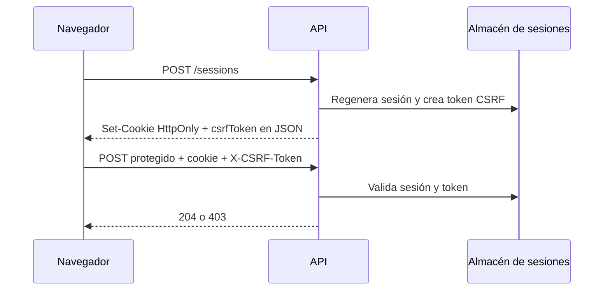
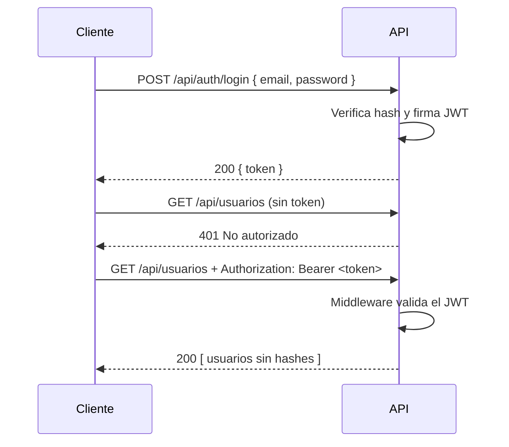

# Módulo 6: Autenticación y autorización

## Aprende construyendo

Cada tema es un proyecto independiente que comienza en una carpeta vacía. Escribe manualmente todos los archivos indicados: no copies código del repositorio de la academia ni reutilices archivos de otro tema. `npm init -y` crea el `package.json` de cada proyecto y las dependencias se instalan dentro de esa carpeta.

Los ejemplos son laboratorios locales. Las claves de firma y de sesión se leen de variables de entorno, sin valores de respaldo en el código; fuera del laboratorio, usa un mecanismo de gestión de secretos del entorno. No imprimas contraseñas, hashes, tokens ni cookies en logs reales.

### Tema 1: Hashing de contraseñas · Intermedio · 90 min

#### Aprende

**Prerrequisitos:** Node.js LTS, npm, terminal y JavaScript con `async`/`await`. El proyecto es independiente y empieza en una carpeta vacía.

**Al terminar podrás:** almacenar una contraseña como sal aleatoria más derivación, verificar un intento de inicio de sesión sin guardar el texto original y comparar las claves derivadas con `timingSafeEqual`.

**Por qué importa:** una fuga de la base de usuarios no debe revelar contraseñas reutilizadas. El servidor necesita una función lenta y con salt para que probar millones de candidatos sea costoso; una huella rápida de propósito general o una comparación innecesariamente variable debilitan esa defensa.

Hashing no es cifrado reversible. El cifrado permite recuperar el texto original con una clave y es apropiado para datos que legítimamente deben recuperarse; el hashing de contraseñas es unidireccional porque el sistema solo necesita comprobar si un intento coincide, no “recordar” la contraseña. Nunca almacenes contraseñas en texto plano ni cifradas de forma reversible para autenticación.

`scrypt`, `bcrypt` y `argon2` son funciones diseñadas para contraseñas. Su coste es deliberadamente configurable para dificultar la fuerza bruta a medida que mejora el hardware. Esto contrasta con SHA-256 o MD5, funciones rápidas de propósito general: su velocidad es útil para otras tareas, pero facilita probar grandes cantidades de contraseñas candidatas. No uses MD5 ni construyas un algoritmo propio, ni siquiera en un proyecto pequeño.

El **salt** aleatorio evita que dos usuarios con la misma contraseña produzcan el mismo registro. En `bcrypt`, la sal y los parámetros quedan embebidos en el hash; en el ejemplo con `scrypt`, guardamos la sal junto a la clave derivada. El parámetro de coste debe revisarse con mediciones y recomendaciones vigentes, no copiarse como una cifra universal permanente.

`bcrypt.compare(contraseñaIngresada, hashAlmacenado)` deriva el intento con los parámetros originales y lo compara sin revertir el hash. En el laboratorio con `scrypt`, la comparación usa `crypto.timingSafeEqual` sobre buffers de igual longitud, en vez de comparar cadenas con `===`. Ninguna de estas comprobaciones revela qué parte del intento coincidió.

```js
import bcrypt from "bcrypt";
const hash = await bcrypt.hash(contraseñaPlano, 10); // lento a propósito, con sal embebida
const esValida = await bcrypt.compare(contraseñaIngresada, hash); // verifica sin revertir
```

**Analogía:** hashear una contraseña es como triturar un documento en una trituradora industrial: no reconstruyes el documento original, sino que compruebas si un nuevo documento produce el resultado esperado. Que la operación sea lenta equivale a dificultar también triturar millones de documentos candidatos por segundo. La sal hace que dos documentos iguales no dejen exactamente el mismo registro.

#### Practica

Desde una carpeta vacía crea el proyecto:

```bash
mkdir ejemplo-password-hash
cd ejemplo-password-hash
npm init -y
npm pkg set type=module
mkdir src
```

Crea manualmente `src/password.js`:

```js
import {
  randomBytes,
  scrypt as derivar,
  timingSafeEqual,
} from "node:crypto";
import { promisify } from "node:util";

const scrypt = promisify(derivar);

export async function crearHash(password) {
  if (typeof password !== "string" || password.length < 12) {
    throw new Error("Usa al menos 12 caracteres");
  }
  const salt = randomBytes(16).toString("hex");
  const clave = await scrypt(password, salt, 64);
  return `${salt}:${clave.toString("hex")}`;
}

export async function verificar(password, registro) {
  const [salt, esperado] = registro.split(":");
  if (!salt || !esperado) return false;

  const esperadoBuffer = Buffer.from(esperado, "hex");
  const actual = await scrypt(password, salt, 64);

  return actual.length === esperadoBuffer.length
    && timingSafeEqual(actual, esperadoBuffer);
}

const password = "una-clave-larga-segura";
const registro = await crearHash(password);
const otroRegistro = await crearHash(password);

console.log({
  valida: await verificar(password, registro),
  invalida: await verificar("otra-clave-larga", registro),
  huellasDistintas: registro !== otroRegistro,
});
```

Ejecuta desde la raíz del proyecto:

```bash
node src/password.js
```

**Resultado esperado:** `valida: true`, `invalida: false` y `huellasDistintas: true`. La misma contraseña produce registros distintos porque cada llamada genera una sal nueva. No imprimas `registro`: en producción, los hashes tampoco pertenecen a los logs.

**Fallo deliberado y corrección:** cambia la contraseña usada para crear el registro a `1234` y ejecuta. El programa rechaza la entrada con `Usa al menos 12 caracteres` antes de derivar la clave. Restaura una contraseña larga; nunca “corrijas” el fallo guardando el texto original ni rebajando la validación para aceptar contraseñas triviales.

**Práctica guiada:** conserva la verificación de una contraseña incorrecta y comprueba que devuelve `false` sin indicar qué parte de la derivación coincide. Añade temporalmente una comparación con `===`, observa que la sustituye una comparación de cadenas sin la protección explícita de `timingSafeEqual`, y restaura la versión con buffers de igual longitud.

**Ejercicio independiente:** añade un registro de intento fallido que contenga fecha, identificador de usuario y resultado, pero nunca la contraseña ni el hash. Entrega la salida de éxito y fallo y explica por qué `timingSafeEqual` exige comparar buffers de la misma longitud.

#### Aplica

En el **[Proyecto integrador: API operativa de entregas](#proyecto-6-api-operativa-de-entregas)**, guarda contraseñas mediante una función de derivación apropiada, nunca texto directo. Prueba verificación válida e inválida y confirma que logs y respuestas no exponen contraseña ni hash.

**Checklist de salida.**

- [ ] Creaste manualmente el proyecto desde una carpeta vacía.
- [ ] Cada registro usa una sal aleatoria y la misma contraseña produce huellas distintas.
- [ ] Una contraseña correcta devuelve `true` y una incorrecta devuelve `false`.
- [ ] La verificación usa `timingSafeEqual` y comprueba antes la longitud de los buffers.
- [ ] Una entrada trivial se rechaza sin guardar su texto como alternativa.
- [ ] Los registros de intentos y las respuestas no contienen contraseñas ni hashes.

**Si falla.** `timingSafeEqual` lanza un error si los buffers tienen longitudes distintas: valida el formato `salt:hash` y conserva la comprobación de longitud antes de comparar. Si dos ejecuciones generan el mismo registro, comprueba que `randomBytes` se ejecute dentro de cada llamada a `crearHash`.

**Errores comunes:** usar MD5 o SHA-256 directamente, reutilizar salt, cifrar esperando descifrar, aceptar contraseñas triviales, imprimir hashes en producción o inventar criptografía propia.

**Límites y decisión de uso:** el hash protege la contraseña almacenada, pero no sustituye políticas de contraseñas, protección contra fuerza bruta, MFA ni transporte seguro. El coste debe ajustarse al entorno sin convertir cada login en una degradación del servicio.

**Fuentes oficiales:** [`node:crypto`](https://nodejs.org/api/crypto.html) y [OWASP Password Storage Cheat Sheet](https://cheatsheetseries.owasp.org/cheatsheets/Password_Storage_Cheat_Sheet.html).

### Tema 2: JWT — access y refresh tokens · Intermedio · 90 min

#### Aprende

**Prerrequisitos:** Node.js LTS, npm y nociones de JSON. Este ejemplo empieza en una carpeta vacía y no usa archivos del tema anterior.

**Al terminar podrás:** emitir y verificar un access token firmado con expiración, exigiendo explícitamente algoritmo, issuer y audience, y explicar el papel de un refresh token revocable.

**Por qué importa:** una API móvil necesita identificar solicitudes sin mantener una sesión en memoria del proceso. Un token sin expiración, sin audiencia o sin verificación de firma puede convertir una filtración en acceso permanente o permitir que un token emitido para otra aplicación se acepte aquí.

Un JWT contiene header, payload y firma. El payload está codificado, **no cifrado**: cualquiera que posea el token puede leerlo. La firma permite detectar cambios, pero no oculta claims. Nunca pongas contraseñas ni otros secretos en el payload ni en la URL.

La verificación debe limitar los algoritmos aceptados y comprobar `iss` (quién emite), `aud` (para qué servicio se emite), firma y expiración. Decodificar el payload sin verificar no autentica a nadie. El claim `role` solo es confiable después de validar el token y, aun entonces, no sustituye la autorización sobre el objeto solicitado.

El par **access/refresh** usa un access token de corta duración y otro de renovación con mayor expiración. Reduce la ventana de exposición, pero no elimina la necesidad de revocación, rotación y almacenamiento seguro. En una app móvil corresponde almacenamiento seguro del sistema; en web, una cookie `HttpOnly` cambia el modelo de amenazas y exige defensas CSRF en las mutaciones.

**Analogía:** el access token es un pase temporal con sello verificable, nombre del emisor y recinto donde vale. El refresh token es el comprobante custodiado para solicitar otro pase; si se revoca, no debe poder renovar acceso aunque todavía no haya expirado.

#### Practica

Desde una carpeta vacía:

```bash
mkdir ejemplo-jwt
cd ejemplo-jwt
npm init -y
npm pkg set type=module
npm install jose
mkdir src
```

Crea manualmente `src/tokens.js`:

```js
import { SignJWT, jwtVerify } from "jose";

const secreto = new TextEncoder().encode(process.env.JWT_SECRET ?? "");
if (secreto.length < 32) {
  throw new Error("Define JWT_SECRET con al menos 32 bytes para este laboratorio");
}

const issuer = "rutaflow-lab";
const audience = "entregas-api";

const token = await new SignJWT({ role: "driver" })
  .setProtectedHeader({ alg: "HS256" })
  .setSubject("usuario-1")
  .setIssuer(issuer)
  .setAudience(audience)
  .setIssuedAt()
  .setExpirationTime("5m")
  .sign(secreto);

console.log("token emitido", token.split(".").length === 3);

const { payload } = await jwtVerify(token, secreto, {
  issuer,
  audience,
  algorithms: ["HS256"],
});

console.log({ subject: payload.sub, role: payload.role });
```

En macOS o Linux ejecuta:

```bash
JWT_SECRET='clave-local-de-laboratorio-con-mas-de-32-bytes' node src/tokens.js
```

En PowerShell:

```powershell
$env:JWT_SECRET="clave-local-de-laboratorio-con-mas-de-32-bytes"; node src/tokens.js
```

La clave del comando es solo para el laboratorio local; no la copies como valor fijo al código ni la reutilices en producción.

**Resultado esperado:** `token emitido true` y un objeto con `subject: 'usuario-1'` y `role: 'driver'`. El token tiene tres segmentos y la verificación acepta únicamente el issuer, audience y algoritmo declarados.

**Fallo deliberado y corrección:** cambia el primer carácter de la firma del token, después del último punto, y vuelve a ejecutar la verificación. `jwtVerify` rechaza el token; la API debe responder `401`, no confiar en el payload. Restaura el token original y confirma nuevamente la verificación. Después cambia temporalmente `audience` en las opciones por otro valor: también debe rechazarse, aunque la firma siga siendo válida. Restaura `entregas-api`.

**Práctica guiada:** emite un segundo token con otro issuer o audience y comprueba que la firma por sí sola no basta para aceptarlo. Usa las opciones `issuer`, `audience` y `algorithms` de `jwtVerify`; no añadas excepciones que vuelvan a aceptar cualquier emisor.

**Ejercicio independiente:** implementa en este mismo laboratorio un refresh token con expiración mayor, un `jti` único y una lista de revocación en memoria. Distingue su propósito del access token y entrega un token válido, uno vencido y uno revocado. Explica por qué la lista en memoria desaparece al reiniciar y no sirve como almacén compartido de producción.

#### Aplica

En el **[Proyecto integrador: API operativa de entregas](#proyecto-6-api-operativa-de-entregas)**, exige un access token válido en las rutas que crean o borran datos y renueva mediante `/refresh` sin pedir otra vez la contraseña. Verifica issuer, audience y algoritmo tanto en el acceso como en la renovación.

**Checklist de salida.**

- [ ] Creaste el proyecto y sus archivos manualmente en una carpeta independiente.
- [ ] El payload no contiene contraseñas ni secretos y sabes que no está cifrado.
- [ ] El access token expira y la firma se verifica antes de usar sus claims.
- [ ] La verificación exige `issuer`, `audience` y `algorithms: ["HS256"]`.
- [ ] Una firma alterada o una audiencia incorrecta provoca rechazo.
- [ ] El refresh token tiene identificador y revocación comprobables en el experimento.
- [ ] La clave se obtiene del entorno y no queda hardcodeada en el archivo.

**Si falla.** Un token de otra aplicación puede tener firma válida y aun así ser incorrecto para esta API: compara `iss` y `aud` con los valores configurados. Si el servidor acepta un algoritmo inesperado, revisa que `algorithms` esté presente en cada verificación. Ante `401`, registra un identificador de correlación, no el token completo.

**Cuándo no usarlo:** para una API interna consumida solo por servicios de confianza, mTLS o credenciales de servicio pueden ser más simples. El patrón access/refresh se justifica cuando el cliente está expuesto a robo de tokens; una lista de revocación en memoria no es suficiente para varias instancias.

**Errores comunes:** guardar JWT en URL, no verificar firma, omitir expiración, aceptar cualquier issuer/audience/algoritmo, poner secretos en el payload o usar una clave débil o hardcodeada fuera del laboratorio.

**Fuentes oficiales:** [RFC 7519](https://www.rfc-editor.org/rfc/rfc7519) y [jose](https://github.com/panva/jose).

### Tema 3: Middleware de autenticación y control de roles · Intermedio · 90 min

#### Aprende

**Prerrequisitos:** Node.js LTS, HTTP, Express y nociones de JWT. El ejemplo crea sus propios archivos y emite sus propios tokens; no depende de los proyectos anteriores.

**Al terminar podrás:** rechazar una petición sin credenciales válidas, autorizar por rol y añadir una comprobación de propiedad o pertenencia del objeto antes de modificarlo.

**Por qué importa:** una ruta pública puede consultar el estado de un envío, mientras que cancelar una entrega exige identidad y permisos. Dos repartidores pueden tener el mismo rol y, aun así, ninguno debe acceder a las entregas asignadas al otro.

**Autenticación** responde “quién eres”; **autorización** responde “qué puedes hacer sobre esta acción y este objeto”. Un middleware de autenticación extrae el Bearer token, lo verifica y añade un usuario confiable a `req.user`. Si falta o falla la credencial, responde `401` y detiene la cadena sin llamar a `next()`.

El control por roles añade otra capa: `exigirRol("admin")` responde `403` cuando el usuario ya está autenticado pero no tiene el rol requerido. Encadenar middleware deja visibles los requisitos de la ruta:

```js
app.delete("/tareas/:id", exigirToken, exigirRol("admin"), borrarTarea);
```

El rol no basta cuando el recurso tiene propietario. Una ruta de entregas debe cargar la entrega y comprobar que `req.user.sub` coincide con su repartidor, salvo que una regla explícita permita al administrador. Nunca uses un `role`, `x-role` o identificador de propietario enviado por el cliente sin validarlo contra el token verificado y el estado del recurso.

**Analogía:** autenticación es el guardia que verifica la identificación en la entrada; el rol es la credencial que permite entrar a un área; la autorización por objeto es comprobar además que la persona intenta abrir su propio casillero y no cualquiera dentro del área.

#### Practica

Desde una carpeta vacía:

```bash
mkdir ejemplo-auth-middleware
cd ejemplo-auth-middleware
npm init -y
npm pkg set type=module
npm install express jose
mkdir src
```

Crea `src/config.js`:

```js
export const issuer = "rutaflow-lab";
export const audience = "entregas-api";
export const secreto = new TextEncoder().encode(process.env.JWT_SECRET ?? "");

if (secreto.length < 32) {
  throw new Error("Define JWT_SECRET con al menos 32 bytes para este laboratorio");
}
```

Crea `src/emitir-token.js` para generar identidades de laboratorio sin un endpoint público que regale privilegios:

```js
import { SignJWT } from "jose";
import { audience, issuer, secreto } from "./config.js";

const identidades = {
  admin: { sub: "admin-1", role: "admin" },
  driver: { sub: "driver-1", role: "driver" },
  "driver-2": { sub: "driver-2", role: "driver" },
};

const identidad = identidades[process.argv[2] ?? "driver"];
if (!identidad) throw new Error("Usa admin, driver o driver-2");

const token = await new SignJWT({ role: identidad.role })
  .setProtectedHeader({ alg: "HS256" })
  .setSubject(identidad.sub)
  .setIssuer(issuer)
  .setAudience(audience)
  .setIssuedAt()
  .setExpirationTime("5m")
  .sign(secreto);

console.log(token);
```

Crea `src/server.js`:

```js
import express from "express";
import { jwtVerify } from "jose";
import { audience, issuer, secreto } from "./config.js";

const app = express();
const entregas = [
  { id: "42", driverId: "driver-1", estado: "en-ruta" },
];

async function exigirToken(req, res, next) {
  try {
    const header = req.headers.authorization ?? "";
    const token = header.startsWith("Bearer ") ? header.slice(7) : null;
    if (!token) return res.status(401).json({ error: "Falta Bearer token" });

    const { payload } = await jwtVerify(token, secreto, {
      issuer,
      audience,
      algorithms: ["HS256"],
    });
    req.user = payload;
    next();
  } catch {
    res.status(401).json({ error: "Token inválido o expirado" });
  }
}

function exigirRol(...roles) {
  return (req, res, next) => roles.includes(req.user.role)
    ? next()
    : res.status(403).json({ error: "Permiso insuficiente" });
}

function exigirAccesoEntrega(req, res, next) {
  const entrega = entregas.find((item) => item.id === req.params.id);
  if (!entrega) return res.status(404).json({ error: "Entrega no encontrada" });

  const esPropietario = entrega.driverId === req.user.sub;
  const esAdmin = req.user.role === "admin";
  if (!esPropietario && !esAdmin) {
    return res.status(403).json({ error: "Entrega ajena" });
  }

  req.entrega = entrega;
  next();
}

app.get("/admin", exigirToken, exigirRol("admin"), (_req, res) => {
  res.json({ ok: true });
});

app.get(
  "/deliveries/:id",
  exigirToken,
  exigirAccesoEntrega,
  (req, res) => res.json(req.entrega),
);

app.listen(3000, () => console.log("API en http://127.0.0.1:3000"));
```

En macOS o Linux inicia el servidor:

```bash
JWT_SECRET='clave-local-de-laboratorio-con-mas-de-32-bytes' node src/server.js
```

En PowerShell:

```powershell
$env:JWT_SECRET="clave-local-de-laboratorio-con-mas-de-32-bytes"; node src/server.js
```

En otra terminal, con la misma variable de entorno, emite los tokens que necesites:

```bash
JWT_SECRET='clave-local-de-laboratorio-con-mas-de-32-bytes' node src/emitir-token.js driver
JWT_SECRET='clave-local-de-laboratorio-con-mas-de-32-bytes' node src/emitir-token.js admin
```

Solicita `/admin` sin token y luego con los tokens emitidos, sustituyendo los marcadores:

```bash
curl -i http://127.0.0.1:3000/admin
curl -i http://127.0.0.1:3000/admin -H "Authorization: Bearer PEGA_TOKEN_DRIVER"
curl -i http://127.0.0.1:3000/admin -H "Authorization: Bearer PEGA_TOKEN_ADMIN"
```

**Resultado esperado:** sin token, `401`; con token válido de rol `driver`, `403`; con rol `admin`, `200` y `{ "ok": true }`. Con el token de `driver`, `GET /deliveries/42` devuelve la entrega; con un token de `driver-2`, devuelve `403` aunque ambos comparten rol.

**Fallo deliberado y corrección:** cambia temporalmente `exigirRol` para leer `req.get("x-role")` en lugar de `req.user.role`. Un cliente con token de driver podrá elevar privilegios enviando `x-role: admin`. Restaura el claim verificado, repite la solicitud con esa cabecera y confirma que vuelve a recibir `403`.

**Práctica guiada:** añade una ruta `/driver` accesible a `driver` y `admin`. Conserva el middleware genérico y cambia solo la lista de roles permitidos. Después prueba `/deliveries/42` con `driver` y `driver-2` para separar rol de propiedad.

**Ejercicio independiente:** registra un identificador de correlación, nunca el token completo, y entrega respuestas `401`/`403` diferenciadas para tres solicitudes. Añade una cuarta prueba de acceso cruzado entre repartidores y explica por qué `exigirRol("driver")` por sí solo no la impediría.

#### Aplica

En el **[Proyecto integrador: API operativa de entregas](#proyecto-6-api-operativa-de-entregas)**, comprueba identidad, rol y pertenencia de la entrega antes de modificarla. Una prueba con dos repartidores debe rechazar el acceso cruzado aunque ambos tengan el mismo rol general.

**Checklist de salida.**

- [ ] El proyecto crea sus propios tokens y archivos, sin reutilizar otros laboratorios.
- [ ] Una credencial ausente o inválida produce `401` y detiene la cadena.
- [ ] Un usuario autenticado sin rol suficiente recibe `403`.
- [ ] El rol procede del token verificado, no de una cabecera del cliente.
- [ ] La verificación exige issuer, audience y algoritmo.
- [ ] La autorización comprueba también el propietario de la entrega.
- [ ] Los logs contienen correlación, no tokens completos.

**Si falla.** Si todas las rutas devuelven `401`, comprueba que emisor, audiencia y clave sean los mismos al emitir y verificar. Si dos drivers acceden a la misma entrega, no basta con añadir otro rol: revisa la comparación entre `req.user.sub` y `entrega.driverId`. Si una respuesta continúa ejecutando middleware, añade el `return` apropiado al responder.

**Errores comunes:** devolver `403` cuando falta identidad, confiar en headers de rol, imprimir tokens, olvidar `return`, permitir algoritmos inesperados o confundir permiso general con propiedad del recurso.

**Fuentes oficiales:** [Express middleware](https://expressjs.com/en/guide/using-middleware.html), [RFC 6750 Bearer](https://www.rfc-editor.org/rfc/rfc6750) y [OWASP Broken Access Control](https://owasp.org/Top10/A01_2021-Broken_Access_Control/).

### Tema 4: OAuth 2.0 y Passport.js · Intermedio · 75 min

#### Aprende

**Prerrequisitos:** Node.js LTS, HTTP y redirecciones. Este experimento no requiere credenciales reales ni archivos de otros temas.

**Al terminar podrás:** explicar authorization code con PKCE, generar un `code_verifier` y su challenge `S256`, distinguir cliente, proveedor y API, y comprobar `state` en el callback.

**Por qué importa:** una aplicación puede delegar el acceso a un proveedor externo sin conocer la contraseña del usuario. Si el código no queda ligado al cliente que inició el flujo o el callback no valida `state`, una respuesta de autorización puede terminar en el contexto equivocado.

OAuth 2.0 delega **autorización**, no define por sí solo autenticación ni un formato de identidad. OpenID Connect añade esa capa de identidad. En authorization code, el proveedor redirige con un código temporal y de un solo uso; el cliente lo intercambia por tokens según su registro. Un access token autoriza acceso a una API y no debe tratarse automáticamente como prueba de identidad.

**PKCE** añade un secreto temporal: el cliente conserva el `code_verifier`, envía su hash como `code_challenge` y presenta el verifier al intercambiar el código. Así, el código queda atado al cliente que inició el flujo. `state` es otro valor aleatorio, destinado a vincular la respuesta con la solicitud y detectar CSRF de login. No almacenes un `client_secret` en una app móvil y acepta únicamente `redirect_uri` registradas.

Passport.js abstrae estrategias de autenticación para Node —local y distintos proveedores— detrás de una interfaz consistente. Puede reducir código de integración, pero no elimina la necesidad de entender el protocolo. Algunos equipos implementan OAuth/OIDC directamente o usan servicios especializados de identidad; la decisión no cambia los controles de PKCE, state, redirección y validación de tokens.

**Analogía:** el proveedor es una recepción que emite un comprobante canjeable por un pase limitado. PKCE es la mitad privada que solo puede presentar quien inició la solicitud; `state` es el número que permite reconocer que la respuesta corresponde a tu trámite y no a otro.

```text
Usuario → [Login con Google] → Google (autentica, pide autorización)
                                       │
Usuario ◄── redirige con código ───────┘
    │
Aplicación intercambia código por token
    │
Aplicación consulta solamente el alcance autorizado
```

#### Practica

Desde una carpeta vacía:

```bash
mkdir ejemplo-oauth-pkce
cd ejemplo-oauth-pkce
npm init -y
npm pkg set type=module
mkdir src
```

Crea manualmente `src/pkce.js`:

```js
import { createHash, randomBytes } from "node:crypto";

const verifier = randomBytes(32).toString("base64url");
const challenge = createHash("sha256").update(verifier).digest("base64url");
const state = randomBytes(32).toString("base64url");

const url = new URL("https://provider.example/authorize");
url.searchParams.set("response_type", "code");
url.searchParams.set("code_challenge", challenge);
url.searchParams.set("code_challenge_method", "S256");
url.searchParams.set("state", state);

console.log({
  verifierGenerado: verifier.length > 0,
  stateGenerado: state.length > 0,
  url: url.toString(),
});
```

Ejecuta:

```bash
node src/pkce.js
```

**Resultado esperado:** una URL de autorización con `response_type=code`, `code_challenge`, `code_challenge_method=S256` y `state`. El programa informa que verifier y state se generaron, pero no imprime sus valores ni tokens.

**Fallo deliberado y corrección:** elimina temporalmente las dos líneas que configuran `code_challenge` y `code_challenge_method`. La URL ya no liga el código al verifier; un cliente registrado para exigir PKCE no podrá completar correctamente ese intercambio. Restaura ambas líneas y comprueba que vuelven a aparecer en la URL. Este laboratorio construye la solicitud localmente; no simula una respuesta real del proveedor.

**Práctica guiada:** simula el callback guardando `state` en una variable de sesión de laboratorio y compara el valor recibido con el guardado antes de aceptar el código. Un `state` inesperado debe rechazarse como posible CSRF de login. Después prueba un callback sin `state` y confirma el mismo rechazo.

**Ejercicio independiente:** dibuja en Mermaid la secuencia navegador → proveedor → callback → API y etiqueta quién posee el verifier, el código y cada token. Entrega el diagrama y explica por qué el access token no debe ir a logs ni convertirse por sí solo en autorización sobre una guía.

#### Aplica

En el **[Proyecto integrador: API operativa de entregas](#proyecto-6-api-operativa-de-entregas)**, documenta e integra el proveedor de identidad en un entorno de prueba. Valida el retorno de autorización, un `state` inválido y una sesión rechazada sin aceptar datos del perfil como autorización sobre una entrega.

**Checklist de salida.**

- [ ] Generaste el laboratorio desde una carpeta vacía sin credenciales reales.
- [ ] El verifier permanece privado y la URL transporta únicamente su challenge.
- [ ] El método de PKCE es `S256` y el flujo usa authorization code.
- [ ] `state` se genera, se conserva y se compara antes de aceptar el callback.
- [ ] Distingues autorización OAuth de autenticación con OIDC.
- [ ] El access token no aparece en logs ni sustituye controles por objeto.
- [ ] Puedes explicar qué aporta Passport y qué controles siguen siendo tu responsabilidad.

**Si falla.** Si falta `code_challenge`, el proveedor no puede aplicar el vínculo PKCE esperado; restaura challenge y método antes del intercambio. Si el callback tiene otro `state`, detén el flujo en lugar de intentar “repararlo” aceptando el código. Comprueba también que la `redirect_uri` coincida exactamente con una registrada.

**Errores comunes:** omitir PKCE donde el cliente lo requiere, aceptar cualquier `redirect_uri`, confundir access token con identidad, almacenar un client secret en una app móvil o delegar la autorización de entregas al perfil del proveedor.

**Cuándo elegir OAuth frente a OIDC:** OAuth delega autorización para acceder a un recurso; si necesitas una identidad autenticada y claims normalizados, usa OpenID Connect sobre OAuth. Passport puede integrar estrategias y sesiones, pero no sustituye PKCE, la validación de `state`, la coincidencia exacta de `redirect_uri` ni la autorización propia sobre cada envío. Para un backend y un proveedor bajo el mismo control, una sesión local bien protegida puede ser más simple que introducir un flujo federado.

**Fuentes oficiales:** [OAuth 2.0 RFC 6749](https://www.rfc-editor.org/rfc/rfc6749), [PKCE RFC 7636](https://www.rfc-editor.org/rfc/rfc7636) y [OAuth Security BCP](https://www.rfc-editor.org/rfc/rfc9700).

### Tema 5: Sesiones, cookies seguras y protección CSRF · Intermedio · 105 min

#### Aprende

**Prerrequisitos:** Node.js LTS, npm, Express y HTTP. El laboratorio comienza en una carpeta vacía y contiene su propia aplicación y pruebas.

**Al terminar podrás:** crear una sesión almacenada en el servidor, regenerarla después del login, conservar su cookie con un agente de pruebas y rechazar una mutación sin token CSRF válido.

**Por qué importa:** el navegador adjunta cookies automáticamente. Si un operador inicia sesión para reasignar entregas, otro sitio podría intentar provocar `POST /deliveries/42/assign` en su nombre; la cookie por sí sola no demuestra que la acción fue intencionada.

Una sesión guarda el estado sensible en el servidor y entrega al navegador solo un identificador opaco. Es una alternativa útil a JWT cuando se necesita revocar acceso inmediatamente o controlar sesiones activas. Después del login se debe **regenerar** la sesión para evitar fijación; el almacén en memoria de `express-session` sirve para aprender, no para varias instancias en producción.

Los atributos de cookie cumplen funciones distintas:

- `HttpOnly` impide que JavaScript lea la cookie, reduciendo el impacto de algunos ataques XSS.
- `Secure` exige HTTPS; en desarrollo local debe depender del entorno para no perder la cookie por usar HTTP.
- `SameSite=Lax` o `Strict` limita envíos entre sitios, pero no reemplaza el token CSRF.
- La expiración limita la duración de la sesión y debe probarse junto con el cierre de sesión.

El token CSRF es una segunda prueba que el sitio atacante no puede leer. En este laboratorio se guarda en la sesión, se devuelve en el cuerpo JSON del login y se exige en `X-CSRF-Token`; no se usa una segunda demo de doble cookie. `SameSite`, validación de origen y token CSRF son capas complementarias. CORS controla lectura desde JavaScript, pero no constituye por sí solo una defensa CSRF completa.

**Analogía:** la cookie es el número de una ficha de guardarropa y el abrigo permanece detrás del mostrador. El token CSRF es una segunda marca presente solo en el formulario legítimo: una sola pieza no basta para retirar el abrigo.



#### Practica

Desde una carpeta vacía:

```bash
mkdir ejemplo-sesion-csrf
cd ejemplo-sesion-csrf
npm init -y
npm pkg set type=module
npm pkg set scripts.test="node --test"
npm install express express-session
npm install --save-dev supertest
mkdir src test
```

Crea `src/session.js`:

```js
import { randomBytes, timingSafeEqual } from "node:crypto";
import session from "express-session";

if (!process.env.SESSION_SECRET) {
  throw new Error("Define SESSION_SECRET antes de iniciar la aplicación");
}

export const sessionMiddleware = session({
  name: "app.sid",
  secret: process.env.SESSION_SECRET,
  resave: false,
  saveUninitialized: false,
  cookie: {
    httpOnly: true,
    secure: process.env.NODE_ENV === "production",
    sameSite: "lax",
    maxAge: 30 * 60 * 1000,
  },
});

export function beginSession(req, userId) {
  return new Promise((resolve, reject) => {
    req.session.regenerate((error) => {
      if (error) return reject(error);
      req.session.userId = userId;
      req.session.csrfToken = randomBytes(32).toString("hex");
      resolve(req.session.csrfToken);
    });
  });
}

export function requireSession(req, res, next) {
  if (!req.session.userId) {
    return res.status(401).json({ code: "SESSION_REQUIRED" });
  }
  next();
}

export function requireCsrf(req, res, next) {
  const received = req.get("x-csrf-token");
  const expected = req.session.csrfToken;
  if (!received || !expected) {
    return res.status(403).json({ code: "INVALID_CSRF_TOKEN" });
  }

  const receivedBuffer = Buffer.from(received);
  const expectedBuffer = Buffer.from(expected);
  const valid = receivedBuffer.length === expectedBuffer.length
    && timingSafeEqual(receivedBuffer, expectedBuffer);

  if (!valid) {
    return res.status(403).json({ code: "INVALID_CSRF_TOKEN" });
  }
  next();
}
```

Crea `src/app.js`. El login está simplificado porque el laboratorio estudia sesión y CSRF, no validación de credenciales:

```js
import express from "express";
import {
  beginSession,
  requireCsrf,
  requireSession,
  sessionMiddleware,
} from "./session.js";

export function crearApp() {
  const app = express();
  app.use(express.json());
  app.use(sessionMiddleware);

  app.post("/sessions", async (req, res, next) => {
    try {
      const csrfToken = await beginSession(req, "operador-1");
      res.json({ csrfToken });
    } catch (error) {
      next(error);
    }
  });

  app.post(
    "/deliveries/:id/assign",
    requireSession,
    requireCsrf,
    (_req, res) => res.status(204).end(),
  );

  app.post("/sessions/logout", requireSession, (req, res, next) => {
    req.session.destroy((error) => {
      if (error) return next(error);
      res.status(204).end();
    });
  });

  app.use((error, _req, res, _next) => {
    console.error("Error de sesión:", error.message);
    res.status(500).json({ error: "Error interno" });
  });

  return app;
}
```

Crea `src/server.js`:

```js
import { crearApp } from "./app.js";

const app = crearApp();
app.listen(3000, () => console.log("API en http://127.0.0.1:3000"));
```

Crea `test/session.test.js` con un agente que conserva la cookie entre login y mutación:

```js
import assert from "node:assert/strict";
import test from "node:test";
import supertest from "supertest";

process.env.NODE_ENV = "test";
process.env.SESSION_SECRET = "secreto-local-de-pruebas-con-mas-de-32-bytes";

const { crearApp } = await import("../src/app.js");

test("la mutación exige sesión y token CSRF", async () => {
  const agent = supertest.agent(crearApp());

  const login = await agent.post("/sessions").expect(200);
  assert.equal(typeof login.body.csrfToken, "string");

  await agent.post("/deliveries/42/assign").expect(403);

  await agent
    .post("/deliveries/42/assign")
    .set("X-CSRF-Token", login.body.csrfToken)
    .expect(204);
});
```

En macOS o Linux ejecuta:

```bash
SESSION_SECRET='secreto-local-de-laboratorio-con-mas-de-32-bytes' npm test
```

En PowerShell:

```powershell
$env:SESSION_SECRET="secreto-local-de-laboratorio-con-mas-de-32-bytes"; npm test
```

**Resultado esperado:** la prueba conserva automáticamente `Set-Cookie`, recibe `403` sin `X-CSRF-Token` y `204` con el token correcto. No copia la cookie manualmente ni imprime su valor. Si `SESSION_SECRET` falta al arrancar la aplicación fuera de la prueba, el proceso se detiene en vez de usar un valor por defecto.

**Fallo deliberado y corrección:** la primera mutación de la prueba omite deliberadamente la cabecera y confirma `403`, porque la cookie de sesión por sí sola no prueba intención. La corrección no consiste en desactivar CSRF: el agente repite la misma operación con el token obtenido del login y entonces recibe `204`.

**Práctica guiada:** cambia temporalmente `sameSite` a `"strict"`, repite la prueba y documenta su efecto. Compara ese comportamiento con retornos OAuth legítimos: una cookie `Strict` puede no acompañar ciertas navegaciones cross-site, por lo que la elección debe revisarse con el flujo real. Restaura `"lax"` para el laboratorio.

**Ejercicio independiente:** sustituye el almacén en memoria por Redis en una variante del proyecto, prueba el cierre de sesión y comprueba que una cookie anterior ya no autoriza operaciones. Añade otra prueba con una expiración corta para demostrar que una sesión vencida recibe `401`. Conserva solo identificadores y permisos mínimos en la sesión, nunca contraseñas o datos personales completos.

#### Aplica

En el **[Proyecto integrador: API operativa de entregas](#proyecto-6-api-operativa-de-entregas)**, define cookies, expiración y defensa CSRF según el transporte de sesión. Prueba una mutación legítima y otra sin la protección requerida; cerrar sesión debe invalidar el acceso posterior.

**Checklist de salida.**

- [ ] Creaste manualmente aplicación, configuración de sesión y pruebas desde una carpeta vacía.
- [ ] La sesión se regenera después del login y guarda solo datos mínimos.
- [ ] La cookie usa `HttpOnly`, `SameSite` y `Secure` condicionado al entorno.
- [ ] El agente conserva la cookie sin copiarla ni imprimirla.
- [ ] Una mutación sin token CSRF recibe `403` y con token válido recibe `204`.
- [ ] El secreto de sesión es obligatorio y no tiene un valor por defecto en código.
- [ ] Puedes probar expiración, logout y rechazo de la cookie anterior.

**Si falla.** Con `secure: true` sobre HTTP local, el navegador no enviará la cookie y parecerá que el login “se pierde”; usa la configuración dependiente del entorno del laboratorio. Si la prueba no conserva sesión, utiliza el mismo `supertest.agent(app)` para login y mutación. Si `requireCsrf` falla con el token aparentemente correcto, comprueba que la sesión no se haya regenerado entre ambas solicitudes y conserva la comparación de longitudes antes de `timingSafeEqual`.

**Errores comunes:** confiar solo en CORS o `SameSite`, omitir `HttpOnly`, no regenerar la sesión después del login, guardar contraseñas en ella, imprimir tokens o usar el almacén en memoria como solución de producción distribuida.

**Límites y decisión de uso:** CSRF depende de credenciales que el navegador adjunta automáticamente, no del nombre “JWT” o “sesión”. Revisa dónde viaja la credencial, combina protección de mutaciones y cookies apropiadas, y mantén controles separados contra XSS y acceso a recursos ajenos. A continuación, conecta el almacén con Redis y aprende a usarlo también para caché e idempotencia.

**Fuentes oficiales:** [MDN cookies](https://developer.mozilla.org/es/docs/Web/HTTP/Cookies), [OWASP CSRF](https://owasp.org/www-community/attacks/csrf), [Express cookies](https://expressjs.com/en/api.html#res.cookie) y [express-session](https://expressjs.com/en/resources/middleware/session.html).

### Tema 6: Flujo de login completo — de `/api/auth/login` a una ruta protegida · Intermedio · 105 min

#### Aprende

**Prerrequisitos:** Node.js LTS, npm, HTTP y conceptos básicos de hashing y JWT. El proyecto implementa todas sus piezas en archivos propios y no reutiliza código de otros temas.

**Al terminar podrás:** construir un endpoint de login que verifica una contraseña hasheada y emite un JWT estrictamente validado, y consumir una ruta protegida mediante `Authorization: Bearer`, con respuestas diferenciadas para credenciales inválidas y tokens ausentes o inválidos.

**Por qué importa:** firmar tokens y validar middleware por separado no demuestra que el acceso funcione de punta a punta. En el panel de RutaFlow, el usuario introduce sus credenciales una vez, el backend emite un token y el cliente lo adjunta después; probar ese recorrido revela errores de contrato entre login, almacenamiento y rutas protegidas.

El flujo tiene tres momentos:

1. **Login:** el cliente envía credenciales a `POST /api/auth/login`; el servidor compara la contraseña con el hash guardado y, si coincide, firma un JWT con expiración, issuer y audience.
2. **Almacenamiento:** una app móvil usa almacenamiento seguro; en web, una cookie `HttpOnly` requiere además defensa CSRF. Este laboratorio devuelve JSON para poder probar el flujo con `curl`, no prescribe ese transporte para todos los clientes.
3. **Uso:** el cliente añade `Authorization: Bearer <token>` y el middleware valida firma, expiración, issuer, audience y algoritmo antes de dejar pasar.

La respuesta de login debe ser la misma para email inexistente y contraseña incorrecta, para no revelar qué cuentas existen. La lista de usuarios nunca devuelve hashes. Una ruta por identificador debe comprobar además si el usuario puede ver ese objeto: ser admin o tener el mismo `sub` no son reglas intercambiables con simplemente “estar autenticado”.

**Analogía:** el login es presentar el documento en recepción y recibir una tarjeta temporal. Después no muestras el documento en cada puerta, solo la tarjeta; `401` es la puerta que no se abre sin una tarjeta válida.



#### Practica

Desde una carpeta vacía:

```bash
mkdir ejemplo-login-flow
cd ejemplo-login-flow
npm init -y
npm pkg set type=module
npm install express jose bcrypt
mkdir src
```

Crea manualmente `src/server.js`:

```js
import express from "express";
import bcrypt from "bcrypt";
import { SignJWT, jwtVerify } from "jose";

const app = express();
app.use(express.json());

const secreto = new TextEncoder().encode(process.env.JWT_SECRET ?? "");
if (secreto.length < 32) {
  throw new Error("Define JWT_SECRET con al menos 32 bytes para este laboratorio");
}
const issuer = "rutaflow-lab";
const audience = "entregas-api";

// Base de datos local de laboratorio: nunca guarda la contraseña en texto plano.
const usuarios = [
  {
    id: 1,
    email: "ana@rutaflow.dev",
    rol: "admin",
    hash: await bcrypt.hash("clave-larga-segura", 10),
  },
];

app.post("/api/auth/login", async (req, res) => {
  const { email, password } = req.body ?? {};
  const usuario = usuarios.find((item) => item.email === email);
  if (!usuario || !(await bcrypt.compare(password ?? "", usuario.hash))) {
    return res.status(401).json({ error: "Credenciales inválidas" });
  }

  const token = await new SignJWT({ rol: usuario.rol })
    .setProtectedHeader({ alg: "HS256" })
    .setSubject(String(usuario.id))
    .setIssuer(issuer)
    .setAudience(audience)
    .setIssuedAt()
    .setExpirationTime("15m")
    .sign(secreto);

  res.json({ token });
});

async function exigirToken(req, res, next) {
  const header = req.headers.authorization ?? "";
  const token = header.startsWith("Bearer ") ? header.slice(7) : null;
  if (!token) return res.status(401).json({ error: "Falta Bearer token" });

  try {
    const { payload } = await jwtVerify(token, secreto, {
      issuer,
      audience,
      algorithms: ["HS256"],
    });
    req.user = payload;
    next();
  } catch {
    res.status(401).json({ error: "Token inválido o expirado" });
  }
}

app.get("/api/usuarios", exigirToken, (_req, res) => {
  res.json(usuarios.map(({ id, email, rol }) => ({ id, email, rol })));
});

app.listen(3000, () => console.log("API en http://127.0.0.1:3000"));
```

En macOS o Linux inicia el servidor:

```bash
JWT_SECRET='clave-local-de-laboratorio-con-mas-de-32-bytes' node src/server.js
```

En PowerShell:

```powershell
$env:JWT_SECRET="clave-local-de-laboratorio-con-mas-de-32-bytes"; node src/server.js
```

En otra terminal prueba el recorrido completo:

```bash
# 1. Login: obtén el token
curl -s -X POST http://127.0.0.1:3000/api/auth/login \
  -H 'Content-Type: application/json' \
  -d '{"email":"ana@rutaflow.dev","password":"clave-larga-segura"}'

# 2. Ruta protegida SIN token -> 401
curl -s -i http://127.0.0.1:3000/api/usuarios

# 3. Ruta protegida CON token -> 200 (pega el token del paso 1)
curl -s -i http://127.0.0.1:3000/api/usuarios \
  -H "Authorization: Bearer PEGA_AQUI_EL_TOKEN"
```

**Resultado esperado:** el login devuelve `{ "token": "eyJ..." }`; `GET /api/usuarios` sin token responde `401`; con el Bearer válido responde `200` y la lista de usuarios sin el hash. El token no viaja en la URL.

**Fallo deliberado y corrección:** haz login con `"password":"incorrecta"`; el servidor responde `401 Credenciales inválidas` y no devuelve token porque `bcrypt.compare` falla. Repite con un email inexistente y confirma que el cuerpo y el estado son los mismos. Corrige la solicitud usando las credenciales válidas del laboratorio y verifica nuevamente el acceso; no diferencies los mensajes para facilitar la prueba.

**Práctica guiada:** añade `GET /api/usuarios/:id` que solo devuelva el usuario si el parámetro coincide con `req.user.sub`, salvo rol `admin`. Lee `sub` y `rol` del payload ya verificado; nunca confíes en un `id` de la URL como prueba de identidad. Prueba acceso propio, acceso ajeno y acceso admin.

**Ejercicio independiente:** separa el login en access token de 15 minutos y refresh token de 7 días, ambos con issuer, audience, algoritmo, propósito y `jti` explícitos. Añade `POST /api/auth/refresh` que valide el refresh y su revocación antes de emitir otro access token. Entrega cuatro respuestas: login, acceso válido, acceso expirado (`401`) y refresh exitoso; añade una quinta con refresh revocado.

#### Aplica

En el **[Proyecto integrador: API operativa de entregas](#proyecto-6-api-operativa-de-entregas)**, conecta el panel y la app con `/api/auth/login`, adjunta el Bearer en cada operación y conserva las reglas de autorización por rol y por entrega. Si eliges cookie web en vez de JSON, incorpora la protección CSRF correspondiente.

**Checklist de salida.**

- [ ] El proyecto incluye desde cero hashing, emisión, middleware y rutas, sin importar otros laboratorios.
- [ ] El login válido emite un token y el inválido no lo emite.
- [ ] Email inexistente y contraseña incorrecta producen la misma respuesta.
- [ ] La ruta sin token responde `401` y con token válido responde `200`.
- [ ] La verificación exige expiración, issuer, audience y algoritmo.
- [ ] Las respuestas de usuarios nunca incluyen hashes.
- [ ] La ruta por id comprueba acceso al objeto además de autenticación.
- [ ] El refresh no renueva tokens vencidos o revocados sin validación.

**Si falla.** Si el login funciona pero la ruta rechaza el token, comprueba que el servidor use la misma clave, issuer y audience al firmar y verificar, y que el header comience exactamente por `Bearer `. Si un usuario ve otro por cambiar el id de la URL, falta la regla de objeto; añade la comparación con `sub` o la excepción admin. No registres el token para diagnosticar el fallo.

**Cuándo no usarlo:** si delegas autenticación a un proveedor OAuth/OIDC, no implementas este login propio: el proveedor custodia las credenciales y emite el token, mientras tu API lo valida. Implementa login propio cuando controlas la base de usuarios; delega cuando prefieres no gestionar contraseñas.

**Errores comunes:** devolver hashes, revelar si un correo existe, poner tokens en la URL, omitir expiración, aceptar cualquier algoritmo, confundir autenticación con acceso a un recurso o dejar secretos hardcodeados fuera del laboratorio.

**Fuentes oficiales:** [RFC 6750 — Bearer Token Usage](https://www.rfc-editor.org/rfc/rfc6750), [Express — routing](https://expressjs.com/en/guide/routing.html) y [jose](https://github.com/panva/jose).

## Laboratorio práctico

### Proyecto 6: API operativa de entregas

**Objetivo del laboratorio:** crear una API nueva con autenticación completa, hashing de contraseñas, JWT de access y refresh, y control de roles y de objetos.

**Requisitos previos:** Módulos 0–5 completados. Comienza en una carpeta vacía llamada `lab-autenticacion-entregas`, ejecuta `npm init -y` y escribe manualmente el manifiesto, la configuración, los archivos fuente y las pruebas de este proyecto. No copies ni importes archivos de los temas anteriores; instala aquí todas las dependencias que declares.

| Paso | Acción | Código | Explicación |
|---|---|---|---|
| 1 | Implementar registro con contraseña hasheada | Función lenta con salt y verificación segura | Nunca almacenar la contraseña en texto plano |
| 2 | Implementar login con verificación y access token | `bcrypt.compare` + JWT firmado | Access token de corta duración, con issuer, audience y algoritmo |
| 3 | Agregar refresh token y endpoint `/refresh` | Token con propósito y `jti`, revocación | Emite un nuevo access token sin pedir contraseña de nuevo |
| 4 | Crear el middleware `requireAuth` | Verificación estricta del JWT | Rechaza con `401` si el JWT falta o es inválido |
| 5 | Agregar control de roles y pertenencia | `requireRole("admin")` + regla por entrega | El rol permite una acción general; la pertenencia evita acceso cruzado |
| 6 | Documentar integración con OAuth (Google) | Sin implementación completa | Describe authorization code con PKCE, state e intercambio por token |
| 7 | Elegir transporte web y defensa de mutaciones | Bearer o cookie con CSRF | La cookie automática exige controles CSRF y cierre de sesión |

**Verificación:** el laboratorio se considera exitoso si un usuario puede registrarse, iniciar sesión y refrescar su access token expirado sin volver a introducir la contraseña; una ruta protegida por rol rechaza al usuario sin permiso; dos repartidores con el mismo rol no pueden modificar entregas ajenas; y, si se usan cookies, una mutación sin CSRF y una cookie de una sesión cerrada son rechazadas.

**Errores comunes y soluciones**

- **Almacenar contraseñas en texto plano “temporalmente, solo para probar”.** No lo hagas: adopta el hábito de hashear desde la primera línea de autenticación.
- **Usar un único token de larga duración en vez del patrón access/refresh.** Esto amplía el daño potencial si el token se roba; combina expiración corta, renovación y revocación.
- **Verificar solo la firma del JWT.** Exige también expiración, issuer, audience y algoritmo, y no uses el payload antes de verificarlo.
- **Confundir 401 con 403.** Usa `401` cuando falta identidad válida y `403` cuando el usuario está autenticado pero no tiene permiso.
- **Confiar solo en el rol.** Comprueba también la pertenencia de la entrega para impedir acceso cruzado entre usuarios con el mismo rol.

La ejecución y las pruebas de estos criterios son la evidencia del módulo; una marca de finalización no sustituye el recorrido de login, los rechazos observados ni la explicación de las decisiones de seguridad.
