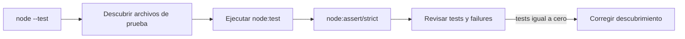
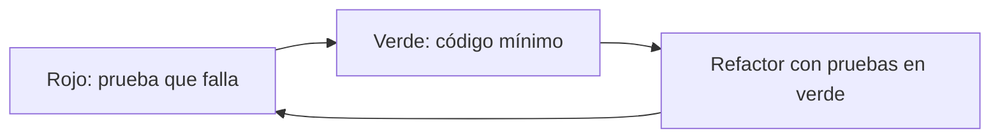
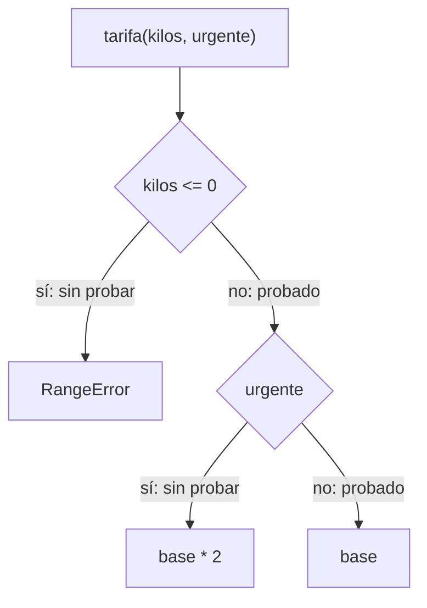
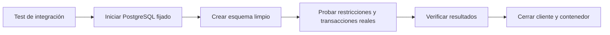
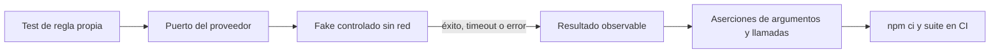

# Módulo 7: Testing e integración continua

## Aprende construyendo


### Tema 1: node:test — test runner nativo sin dependencias · Intermedio · 40 min

<details open>
<summary><strong>Capa 1 — Lectura</strong></summary>

#### ► CÓMO FUNCIONA


</details>

<details>
<summary><strong>Capa 2 — Construcción</strong></summary>

#### Código y verificación
```bash
mkdir practica-node-test
cd practica-node-test
mkdir src test
```

```json
{
  "name": "practica-node-test",
  "version": "1.0.0",
  "private": true,
  "type": "module",
  "scripts": {
    "test": "node --test"
  }
}
```

```js
export function sumar(a, b) {
  return a + b;
}
```

```js
import { test } from "node:test";
import assert from "node:assert/strict";
import { sumar } from "./sumar.js";

test("suma dos valores", () => {
  assert.strictEqual(sumar(2, 3), 5);
});
```

```bash
npm test
```

```bash
mv src/sumar.test.js src/sumarPrueba.js
npm test
```

</details>

### Tema 2: TDD práctico: rojo, verde y refactor con node:test · Avanzado · 45 min

<details open>
<summary><strong>Capa 1 — Lectura</strong></summary>

#### ► CÓMO FUNCIONA


</details>

<details>
<summary><strong>Capa 2 — Construcción</strong></summary>

#### Código y verificación

```bash
mkdir practica-tdd-tarifas
cd practica-tdd-tarifas
```

```json
{
  "name": "practica-tdd-tarifas",
  "version": "1.0.0",
  "private": true,
  "type": "module",
  "scripts": {
    "test": "node --test --test-reporter=spec"
  }
}
```

```js
import { test } from "node:test";
import assert from "node:assert/strict";
import { tarifa } from "./tarifa.js";

test("cobra la base de la ciudad más 1200 por kilo iniciado", () => {
  assert.equal(tarifa({ ciudad: "Bogotá", kilos: 2.5 }), 5000 + 3 * 1200);
});
```

```js
export function tarifa() {
  throw new Error("Comportamiento aún no implementado");
}
```

```js
export function tarifa({ ciudad, kilos }) {
  const base = ciudad === "Bogotá" ? 5000 : 7000;
  return base + Math.ceil(kilos) * 1200;
}
```

</details>

### Tema 3: Cobertura de pruebas con node:test: líneas, ramas y umbrales · Avanzado · 35 min

<details open>
<summary><strong>Capa 1 — Lectura</strong></summary>

#### ► CÓMO FUNCIONA


</details>

<details>
<summary><strong>Capa 2 — Construcción</strong></summary>

#### Código y verificación


```js
export function tarifa(kilos, urgente = false) {
  if (kilos <= 0) throw new RangeError('peso inválido');
  const base = 1000 + kilos * 120;
  if (urgente) return base * 2;
  return base;
}
```

```js
import { test } from 'node:test';
import assert from 'node:assert/strict';
import { tarifa } from './tarifa.mjs';

test('tarifa normal', () => {
  assert.equal(tarifa(2), 1240);
});
```

```bash
cd academia-labs/node/cobertura
node --test --experimental-test-coverage --test-reporter=spec tarifa.test.mjs
```

```text
✔ tarifa normal
ℹ pass 1
ℹ file            | line % | branch % | funcs % | uncovered lines
ℹ tarifa.mjs      | 100.00 |    50.00 |  100.00 |
```

</details>

### Tema 4: Vitest y Supertest — pruebas de integración HTTP reales · Avanzado · 45 min

<details open>
<summary><strong>Capa 1 — Lectura</strong></summary>

</details>

<details>
<summary><strong>Capa 2 — Construcción</strong></summary>

#### Código y verificación
```bash
mkdir practica-vitest-http
cd practica-vitest-http
mkdir src test
```

```json
{
  "name": "practica-vitest-http",
  "version": "1.0.0",
  "private": true,
  "type": "module",
  "scripts": {
    "test": "vitest run"
  }
}
```

```bash
npm install express
npm install --save-dev vitest supertest
```

```js
import express from "express";

export const app = express();
app.use(express.json());

app.get("/health", (_req, res) => {
  res.status(200).json({ status: "ok" });
});

app.post("/tareas", (req, res) => {
  const { titulo } = req.body;
  if (typeof titulo !== "string" || titulo.trim() === "") {
    return res.status(400).json({ error: "titulo es obligatorio" });
  }
  return res.status(201).json({ id: 1, titulo: titulo.trim() });
});
```

```js
import request from "supertest";
import { describe, expect, it } from "vitest";
import { app } from "../src/app.js";

describe("contrato HTTP", () => {
  it("GET /health devuelve 200 y el cuerpo esperado", async () => {
    const response = await request(app).get("/health");

    expect(response.status).toBe(200);
    expect(response.body).toEqual({ status: "ok" });
  });

  it("POST /tareas rechaza un título vacío", async () => {
    const response = await request(app)
      .post("/tareas")
      .send({ titulo: "  " });

    expect(response.status).toBe(400);
    expect(response.body).toEqual({ error: "titulo es obligatorio" });
  });
});
```

```bash
npm test
```

</details>

### Tema 5: Testcontainers — bases de datos de prueba reales y efímeras · Avanzado · 45 min

<details open>
<summary><strong>Capa 1 — Lectura</strong></summary>

#### ► CÓMO FUNCIONA


</details>

<details>
<summary><strong>Capa 2 — Construcción</strong></summary>

#### Código y verificación
```bash
mkdir practica-testcontainers
cd practica-testcontainers
mkdir test
```

```json
{
  "name": "practica-testcontainers",
  "version": "1.0.0",
  "private": true,
  "type": "module",
  "scripts": {
    "test": "vitest run"
  }
}
```

```bash
npm install pg
npm install --save-dev vitest @testcontainers/postgresql
```

```bash
docker info
```

```js
import { PostgreSqlContainer } from "@testcontainers/postgresql";
import pg from "pg";
import { afterAll, beforeAll, describe, expect, it } from "vitest";

const { Client } = pg;
let container;
let client;

beforeAll(async () => {
  container = await new PostgreSqlContainer("postgres:16-alpine").start();
  client = new Client({ connectionString: container.getConnectionUri() });
  await client.connect();
  await client.query(`
    CREATE TABLE tareas (
      id SERIAL PRIMARY KEY,
      titulo TEXT NOT NULL UNIQUE
    )
  `);
}, 120_000);

afterAll(async () => {
  try {
    if (client) await client.end();
  } finally {
    if (container) await container.stop();
  }
});

describe("PostgreSQL efímero", () => {
  it("inserta y recupera una tarea con SQL real", async () => {
    await client.query("INSERT INTO tareas(titulo) VALUES ($1)", ["Entregar"]);
    const result = await client.query(
      "SELECT titulo FROM tareas WHERE titulo = $1",
      ["Entregar"],
    );

    expect(result.rows).toEqual([{ titulo: "Entregar" }]);
    expect(container.getPort()).toBeGreaterThan(0);
  });
});
```

```bash
npm test
```

</details>

### Tema 6: Mocks de servicios externos y CI · Avanzado · 45 min

<details open>
<summary><strong>Capa 1 — Lectura</strong></summary>

#### ► CÓMO FUNCIONA


</details>

<details>
<summary><strong>Capa 2 — Construcción</strong></summary>

#### Código y verificación
```bash
mkdir practica-mocks-ci
cd practica-mocks-ci
mkdir -p src test .github/workflows
```

```json
{
  "name": "practica-mocks-ci",
  "version": "1.0.0",
  "private": true,
  "type": "module",
  "scripts": {
    "test": "vitest run"
  }
}
```

```bash
npm install --save-dev vitest
```

```js
export async function calcularRuta(cliente, origen, destino) {
  const respuesta = await cliente.route(origen, destino);
  if (!respuesta.ok) {
    throw new Error("Proveedor de rutas no disponible");
  }
  return respuesta.distanceKm;
}
```

```js
import { describe, expect, it, vi } from "vitest";
import { calcularRuta } from "../src/rutas.js";

describe("calcularRuta", () => {
  it("usa el contrato del proveedor y devuelve la distancia", async () => {
    const cliente = {
      route: vi.fn().mockResolvedValue({ ok: true, distanceKm: 4.2 }),
    };

    await expect(calcularRuta(cliente, "A", "B")).resolves.toBe(4.2);
    expect(cliente.route).toHaveBeenCalledWith("A", "B");
    expect(cliente.route).toHaveBeenCalledTimes(1);
  });

  it("propaga un timeout sin inventar una distancia", async () => {
    const cliente = {
      route: vi.fn().mockRejectedValue(new Error("timeout")),
    };

    await expect(calcularRuta(cliente, "A", "B")).rejects.toThrow("timeout");
  });
});
```

```yaml
name: CI

on:
  push:
  pull_request:

jobs:
  test:
    runs-on: ubuntu-latest
    steps:
      - uses: actions/checkout@v4
      - uses: actions/setup-node@v4
        with:
          node-version: 22
          cache: npm
      - run: npm ci
      - run: npm test
```

</details>

### Tema 7: Alternativas de testing y debugging · Avanzado · 45 min

<details open>
<summary><strong>Capa 1 — Lectura</strong></summary>

</details>

<details>
<summary><strong>Capa 2 — Construcción</strong></summary>

#### Código y verificación
```bash
mkdir practica-debug-testing
cd practica-debug-testing
mkdir src test
```

```json
{
  "name": "practica-debug-testing",
  "version": "1.0.0",
  "private": true,
  "type": "module",
  "scripts": {
    "test": "vitest run"
  }
}
```

```bash
npm install --save-dev vitest
```

```js
export function sumar(a, b) {
  return a + b;
}
```

```js
import { expect, it } from "vitest";
import { sumar } from "../src/sumar.js";

it("suma dos valores", () => {
  expect(sumar(2, 3)).toBe(5);
});
```

```js
import { sumar } from "./sumar.js";

const a = 2;
const b = 3;
const resultado = sumar(a, b);
debugger;
console.log({ a, b, resultado });
```

</details>

### Proyecto y configuración

<details open>
<summary><strong>Capa 1 — Lectura</strong></summary>

</details>

<details>
<summary><strong>Capa 2 — Construcción</strong></summary>

#### Código y verificación
```bash
mkdir laboratorio-entregas-testing
cd laboratorio-entregas-testing
mkdir -p src test scripts herramienta .github/workflows
```

```json
{
  "name": "laboratorio-entregas-testing",
  "version": "1.0.0",
  "private": true,
  "type": "module",
  "scripts": {
    "test": "vitest run",
    "test:native": "node scripts/verificar-pruebas-nativas.mjs"
  }
}
```

```bash
npm install express pg
npm install --save-dev vitest supertest @testcontainers/postgresql
```

```js
import { defineConfig } from "vitest/config";

export default defineConfig({
  test: {
    include: ["test/**/*.test.js"],
  },
});
```

</details>

### Aplicación y persistencia

<details open>
<summary><strong>Capa 1 — Lectura</strong></summary>

</details>

<details>
<summary><strong>Capa 2 — Construcción</strong></summary>

#### Código y verificación
```js
export function crearRepositorio(client) {
  return {
    async crear(destinatario) {
      const result = await client.query(
        "INSERT INTO entregas(destinatario) VALUES ($1) RETURNING id, destinatario, confirmada",
        [destinatario],
      );
      return result.rows[0];
    },

    async obtener(id) {
      const result = await client.query(
        "SELECT id, destinatario, confirmada FROM entregas WHERE id = $1",
        [id],
      );
      return result.rows[0] ?? null;
    },

    async confirmar(id) {
      const result = await client.query(
        "UPDATE entregas SET confirmada = TRUE WHERE id = $1 RETURNING id, destinatario, confirmada",
        [id],
      );
      return result.rows[0] ?? null;
    },
  };
}
```

```js
import express from "express";

export function crearApp({ repositorio, notificar }) {
  const app = express();
  app.use(express.json());

  app.post("/entregas", async (req, res, next) => {
    try {
      const { destinatario } = req.body;
      if (typeof destinatario !== "string" || destinatario.trim() === "") {
        return res.status(400).json({ error: "destinatario es obligatorio" });
      }

      const entrega = await repositorio.crear(destinatario.trim());
      await notificar(entrega);
      return res.status(201).json(entrega);
    } catch (error) {
      return next(error);
    }
  });

  app.get("/entregas/:id", async (req, res, next) => {
    try {
      const entrega = await repositorio.obtener(req.params.id);
      if (!entrega) return res.status(404).json({ error: "entrega no encontrada" });
      return res.status(200).json(entrega);
    } catch (error) {
      return next(error);
    }
  });

  app.patch("/entregas/:id/confirmar", async (req, res, next) => {
    try {
      const entrega = await repositorio.confirmar(req.params.id);
      if (!entrega) return res.status(404).json({ error: "entrega no encontrada" });
      return res.status(200).json(entrega);
    } catch (error) {
      return next(error);
    }
  });

  app.use((error, _req, res, _next) => {
    console.error(error);
    res.status(500).json({ error: "error interno" });
  });

  return app;
}
```

```js
export async function notificarEntrega(cliente, entrega) {
  const respuesta = await cliente.enviar({
    destinatario: entrega.destinatario,
    entregaId: entrega.id,
  });

  if (!respuesta.ok) {
    throw new Error("El notificador rechazó la entrega");
  }
}
```

</details>

### Integración HTTP con PostgreSQL efímero

<details open>
<summary><strong>Capa 1 — Lectura</strong></summary>

</details>

<details>
<summary><strong>Capa 2 — Construcción</strong></summary>

#### Código y verificación
```js
import { PostgreSqlContainer } from "@testcontainers/postgresql";
import pg from "pg";
import request from "supertest";
import { afterAll, beforeAll, beforeEach, describe, expect, it, vi } from "vitest";
import { crearApp } from "../src/app.js";
import { crearRepositorio } from "../src/repositorio.js";

const { Client } = pg;
let container;
let client;
let app;
let notificar;

beforeAll(async () => {
  container = await new PostgreSqlContainer("postgres:16-alpine").start();
  client = new Client({ connectionString: container.getConnectionUri() });
  await client.connect();
  await client.query(`
    CREATE TABLE entregas (
      id SERIAL PRIMARY KEY,
      destinatario TEXT NOT NULL,
      confirmada BOOLEAN NOT NULL DEFAULT FALSE
    )
  `);

  notificar = vi.fn().mockResolvedValue({ ok: true });
  app = crearApp({ repositorio: crearRepositorio(client), notificar });
}, 120_000);

afterAll(async () => {
  try {
    if (client) await client.end();
  } finally {
    if (container) await container.stop();
  }
});

beforeEach(async () => {
  await client.query("TRUNCATE TABLE entregas RESTART IDENTITY");
  notificar.mockClear();
});

describe("API de entregas", () => {
  it("rechaza un alta sin destinatario", async () => {
    const response = await request(app).post("/entregas").send({});

    expect(response.status).toBe(400);
    expect(response.body).toEqual({ error: "destinatario es obligatorio" });
    expect(notificar).not.toHaveBeenCalled();
  });

  it("crea, consulta y confirma una entrega con efecto persistido", async () => {
    const creada = await request(app)
      .post("/entregas")
      .send({ destinatario: "Ada" });

    expect(creada.status).toBe(201);
    expect(creada.body).toEqual({ id: 1, destinatario: "Ada", confirmada: false });
    expect(notificar).toHaveBeenCalledWith(creada.body);

    const consultada = await request(app).get("/entregas/1");
    expect(consultada.status).toBe(200);
    expect(consultada.body.destinatario).toBe("Ada");

    const confirmada = await request(app).patch("/entregas/1/confirmar");
    expect(confirmada.status).toBe(200);
    expect(confirmada.body.confirmada).toBe(true);

    const persistida = await client.query(
      "SELECT confirmada FROM entregas WHERE id = 1",
    );
    expect(persistida.rows[0].confirmada).toBe(true);
  });
});
```

</details>

### Prueba del servicio externo sin red

<details open>
<summary><strong>Capa 1 — Lectura</strong></summary>

</details>

<details>
<summary><strong>Capa 2 — Construcción</strong></summary>

#### Código y verificación
```js
import { describe, expect, it, vi } from "vitest";
import { notificarEntrega } from "../src/notificaciones.js";

const entrega = { id: 7, destinatario: "Ada", confirmada: false };

describe("notificarEntrega", () => {
  it("envía el contrato esperado", async () => {
    const cliente = { enviar: vi.fn().mockResolvedValue({ ok: true }) };

    await notificarEntrega(cliente, entrega);

    expect(cliente.enviar).toHaveBeenCalledWith({
      destinatario: "Ada",
      entregaId: 7,
    });
  });

  it("no convierte un timeout en éxito", async () => {
    const cliente = { enviar: vi.fn().mockRejectedValue(new Error("timeout")) };

    await expect(notificarEntrega(cliente, entrega)).rejects.toThrow("timeout");
  });

  it("rechaza una respuesta no válida del proveedor", async () => {
    const cliente = { enviar: vi.fn().mockResolvedValue({ ok: false }) };

    await expect(notificarEntrega(cliente, entrega)).rejects.toThrow(
      "El notificador rechazó la entrega",
    );
  });
});
```

</details>

### Prueba nativa y comprobación de descubrimiento

<details open>
<summary><strong>Capa 1 — Lectura</strong></summary>

</details>

<details>
<summary><strong>Capa 2 — Construcción</strong></summary>

#### Código y verificación
```json
{
  "name": "herramienta-nativa-entregas",
  "version": "1.0.0",
  "private": true,
  "type": "module"
}
```

```js
export function puedeConfirmar(estado) {
  return estado === "pendiente";
}
```

```js
import { test } from "node:test";
import assert from "node:assert/strict";
import { puedeConfirmar } from "./estado.js";

test("una entrega pendiente se puede confirmar", () => {
  assert.equal(puedeConfirmar("pendiente"), true);
});

test("una entrega confirmada no se confirma dos veces", () => {
  assert.equal(puedeConfirmar("confirmada"), false);
});
```

```js
import { spawnSync } from "node:child_process";
import { fileURLToPath } from "node:url";

const cwd = fileURLToPath(new URL("../herramienta/", import.meta.url));
const resultado = spawnSync(process.execPath, ["--test"], {
  cwd,
  encoding: "utf8",
});

process.stdout.write(resultado.stdout);
process.stderr.write(resultado.stderr);

if (resultado.status !== 0) {
  process.exit(resultado.status ?? 1);
}

const resumen = resultado.stdout.match(/# tests (\d+)/);
const descubiertas = resumen ? Number(resumen[1]) : 0;
if (descubiertas === 0) {
  console.error("node --test no descubrió pruebas");
  process.exit(1);
}
```

</details>

### Ejecución, fallo diagnosticado y CI

<details open>
<summary><strong>Capa 1 — Lectura</strong></summary>

</details>

<details>
<summary><strong>Capa 2 — Construcción</strong></summary>

#### Código y verificación
```bash
npm run test:native
npm test
```

```yaml
name: CI

on:
  push:
  pull_request:

jobs:
  test:
    runs-on: ubuntu-latest
    steps:
      - uses: actions/checkout@v4
      - uses: actions/setup-node@v4
        with:
          node-version: 22
          cache: npm
      - run: npm ci
      - run: npm run test:native
      - run: npm test
```

</details>

### Ejercicio independiente y salida

<details open>
<summary><strong>Capa 1 — Lectura</strong></summary>

</details>

<details>
<summary><strong>Capa 2 — Construcción</strong></summary>

#### Nota de construcción
Este tema es principalmente conceptual en esta versión. La verificación se realiza con las preguntas de comprensión y el criterio de cuándo NO usar ejercicio independiente y salida.

</details>
