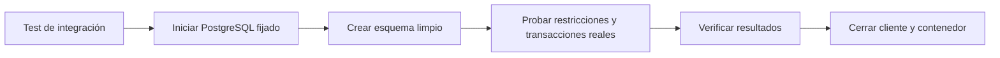
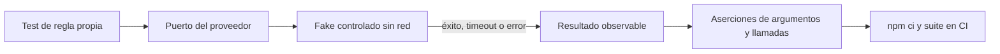
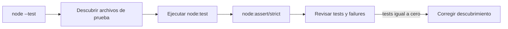
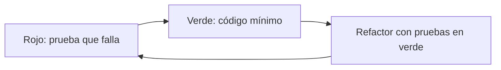

# Módulo 7: Testing e integración continua

## Aprende construyendo

### Tema 1: Vitest y Supertest — pruebas de integración HTTP reales · Intermedio · 50 min

**Prerrequisito:** Node LTS, npm, JavaScript con módulos ES y conceptos básicos de HTTP.

**Al terminar podrás:** escribir y ejecutar pruebas que comprueben el estado y el cuerpo de respuestas HTTP de una aplicación Express, incluida una validación fallida, sin mantener un servidor escuchando en un puerto.

#### Aprende

**Por qué importa:** una prueba de una función aislada no detecta necesariamente errores de routing, serialización JSON o middleware. Una prueba de integración HTTP ejercita esas piezas juntas y comprueba el contrato que recibirá un cliente.

Supertest recibe la instancia de Express y ejecuta la petición contra ella. Para estas pruebas no hace falta llamar a `app.listen()` ni dejar un servidor permanente: `await request(app).get("/health")` permite comprobar la aplicación sin administrar un puerto abierto durante la suite. Vitest aporta el runner y las aserciones; Supertest aporta el cliente HTTP de prueba.

El contrato observable incluye el código de estado, el cuerpo y, cuando sea relevante, las cabeceras. Conviene probar tanto el camino feliz como los errores esperados: una suite que solo comprueba respuestas `200` puede dejar sin cubrir validaciones y regresiones de manejo de errores. Cada prueba debe controlar sus datos y no depender del orden de ejecución.

**Analogía:** probar funciones por separado es revisar los engranajes de un reloj; usar Supertest es dar cuerda al reloj ensamblado y comprobar la hora, sin abrir la relojería al público.

**Conceptos clave:** integración HTTP, aplicación Express sin `listen` permanente, contrato observable, estado, cuerpo JSON, camino feliz y error esperado.

#### Practica

Empieza en una carpeta vacía. Este proyecto no utiliza archivos de otros temas ni ejemplos del repositorio.

```bash
mkdir practica-vitest-http
cd practica-vitest-http
mkdir src test
```

Crea manualmente `package.json`:

```json
{
  "name": "practica-vitest-http",
  "version": "1.0.0",
  "private": true,
  "type": "module",
  "scripts": {
    "test": "vitest run"
  }
}
```

Instala las dependencias y conserva el `package-lock.json` generado:

```bash
npm install express
npm install --save-dev vitest supertest
```

Crea `src/app.js`. La aplicación se exporta sin llamar a `listen`:

```js
import express from "express";

export const app = express();
app.use(express.json());

app.get("/health", (_req, res) => {
  res.status(200).json({ status: "ok" });
});

app.post("/tareas", (req, res) => {
  const { titulo } = req.body;
  if (typeof titulo !== "string" || titulo.trim() === "") {
    return res.status(400).json({ error: "titulo es obligatorio" });
  }
  return res.status(201).json({ id: 1, titulo: titulo.trim() });
});
```

Crea `test/app.test.js`:

```js
import request from "supertest";
import { describe, expect, it } from "vitest";
import { app } from "../src/app.js";

describe("contrato HTTP", () => {
  it("GET /health devuelve 200 y el cuerpo esperado", async () => {
    const response = await request(app).get("/health");

    expect(response.status).toBe(200);
    expect(response.body).toEqual({ status: "ok" });
  });

  it("POST /tareas rechaza un título vacío", async () => {
    const response = await request(app)
      .post("/tareas")
      .send({ titulo: "  " });

    expect(response.status).toBe(400);
    expect(response.body).toEqual({ error: "titulo es obligatorio" });
  });
});
```

Ejecuta:

```bash
npm test
```

**Resultado esperado:** Vitest informa dos pruebas aprobadas y ninguna fallida. No necesitas iniciar `node src/app.js` ni reservar un puerto.

**Fallo deliberado y corrección:** en `src/app.js`, cambia temporalmente `{ status: "ok" }` por `{ status: "ready" }` y ejecuta `npm test`. Observa la diferencia entre el cuerpo esperado y el recibido. Después restaura `ok` y repite el comando hasta volver a verde; así compruebas que la aserción detecta una regresión real.

##### Práctica guiada

Añade a `test/app.test.js` una prueba para el alta válida. Debe enviar `{ "titulo": " Preparar pedido " }`, esperar `201` y comprobar exactamente `{ id: 1, titulo: "Preparar pedido" }`. La pista es verificar también que `express.json()` y el recorte del texto forman parte del contrato.

##### Ejercicio independiente

En este mismo proyecto, añade una ruta `GET /tareas/:id` que devuelva `404` y `{ "error": "tarea no encontrada" }` para un identificador desconocido. Escribe primero la prueba, implementa después la ruta y explica en una frase qué regresión detecta cada uno de los cuatro casos de la suite.

#### Aplica

**Checklist de salida:**

- [ ] `npm test` ejecuta al menos cuatro pruebas y termina sin fallos.
- [ ] Las pruebas importan `app` y no requieren `app.listen()` ni un servidor permanente.
- [ ] Hay aserciones específicas de estado y cuerpo para una respuesta válida y otra inválida.
- [ ] El fallo deliberado produjo una diferencia legible y desapareció al corregir el código.
- [ ] Ninguna prueba depende del resultado o del orden de otra.

**Errores comunes:** abrir puertos innecesarios; compartir estado mutable; usar aserciones tan amplias que acepten cuerpos incorrectos; olvidar `await`; probar detalles privados en vez del contrato HTTP; probar únicamente el camino feliz.

**Fuentes oficiales:** [Vitest](https://vitest.dev/guide/), [Supertest](https://github.com/ladjs/supertest) y [Express: Hello World](https://expressjs.com/en/starter/hello-world.html).

**Transferencia al proyecto integrador «API operativa de entregas»:** prueba por HTTP el alta, la consulta y la confirmación de una entrega. Aísla los datos por caso y verifica tanto el cuerpo de confirmación como el efecto persistido.

### Tema 2: Testcontainers — bases de datos de prueba reales y efímeras · Intermedio · 55 min

**Prerrequisito:** Node LTS, npm, Docker Desktop o un daemon Docker compatible en ejecución, y SQL básico.

**Al terminar podrás:** ejecutar una prueba de integración que cree una tabla, inserte y consulte datos en PostgreSQL real, con una imagen fijada y cierre del cliente y del contenedor en `afterAll`.

#### Aprende

**Por qué importa:** un mock de base de datos puede aceptar una consulta que el motor real rechaza. PostgreSQL aplica tipos, restricciones, transacciones y códigos de error concretos; probar contra él detecta incompatibilidades que una simulación puede ocultar.

Testcontainers inicia infraestructura real con un ciclo de vida controlado por la suite. Una base efímera evita que una ejecución herede datos de otra y reduce la interferencia entre procesos. La imagen debe fijarse, por ejemplo `postgres:16-alpine`, para que una ejecución futura no cambie de motor por resolver `latest`.

El contenedor se crea en `beforeAll`; la conexión y el contenedor se cierran con `await` en `afterAll`. El cierre condicional permite limpiar incluso cuando el arranque falló antes de asignar todas las variables. Esta técnica está destinada a pruebas que necesitan el motor real: para lógica pura sin persistencia, una función o un doble sencillo suele dar feedback más rápido.

**Analogía:** es montar un laboratorio desechable para un experimento y desmontarlo al terminar, en lugar de compartir siempre un laboratorio cuyo estado desconoces.

**Conceptos clave:** contenedor efímero, imagen fijada, PostgreSQL real, aislamiento, `beforeAll`, `afterAll`, conexión temporal y restricciones del motor.

#### Practica

Empieza en una carpeta vacía y crea un proyecto nuevo, sin reutilizar configuración de otros temas.

```bash
mkdir practica-testcontainers
cd practica-testcontainers
mkdir test
```

Crea `package.json`:

```json
{
  "name": "practica-testcontainers",
  "version": "1.0.0",
  "private": true,
  "type": "module",
  "scripts": {
    "test": "vitest run"
  }
}
```

Instala las dependencias:

```bash
npm install pg
npm install --save-dev vitest @testcontainers/postgresql
```

Comprueba que Docker responde antes de ejecutar las pruebas:

```bash
docker info
```

Crea `test/postgres.test.js`. La espera explícita del cierre y las guardas de `afterAll` son parte del ejemplo, no detalles opcionales:

```js
import { PostgreSqlContainer } from "@testcontainers/postgresql";
import pg from "pg";
import { afterAll, beforeAll, describe, expect, it } from "vitest";

const { Client } = pg;
let container;
let client;

beforeAll(async () => {
  container = await new PostgreSqlContainer("postgres:16-alpine").start();
  client = new Client({ connectionString: container.getConnectionUri() });
  await client.connect();
  await client.query(`
    CREATE TABLE tareas (
      id SERIAL PRIMARY KEY,
      titulo TEXT NOT NULL UNIQUE
    )
  `);
}, 120_000);

afterAll(async () => {
  try {
    if (client) await client.end();
  } finally {
    if (container) await container.stop();
  }
});

describe("PostgreSQL efímero", () => {
  it("inserta y recupera una tarea con SQL real", async () => {
    await client.query("INSERT INTO tareas(titulo) VALUES ($1)", ["Entregar"]);
    const result = await client.query(
      "SELECT titulo FROM tareas WHERE titulo = $1",
      ["Entregar"],
    );

    expect(result.rows).toEqual([{ titulo: "Entregar" }]);
    expect(container.getPort()).toBeGreaterThan(0);
  });
});
```

Ejecuta:

```bash
npm test
```

**Resultado esperado:** se descarga la imagen fijada si no estaba disponible, PostgreSQL inicia, una prueba pasa y el cliente y el contenedor se cierran. La primera descarga puede tardar más que las siguientes ejecuciones.

**Fallo deliberado y corrección:** cambia temporalmente la imagen a `postgres:imagen-inexistente` y ejecuta `npm test`. El arranque fallará al resolver o descargar la imagen; no es un error de la consulta. Restaura exactamente `postgres:16-alpine` y repite la prueba. Las guardas de `afterAll` evitan que una variable sin inicializar provoque un segundo error de limpieza.

##### Práctica guiada

Añade una segunda prueba que inserte `{ titulo: "Recoger" }` y la recupere por `id`. Antes de cada prueba, limpia la tabla con un `beforeEach` que ejecute `TRUNCATE TABLE tareas RESTART IDENTITY`; importa `beforeEach` desde Vitest. Comprueba que el identificador de la primera fila vuelve a ser `1` y que las pruebas no dependen del orden.

##### Ejercicio independiente

Añade una prueba que inserte dos veces el mismo título. La segunda operación debe comprobarse con una aserción de rechazo cuyo error tenga la propiedad PostgreSQL `code: "23505"`. Después de la suite, usa `docker ps` para confirmar que el contenedor de prueba ya no está en ejecución; no detengas contenedores ajenos a este proyecto.

#### Aplica

**Checklist de salida:**

- [ ] La configuración usa `postgres:16-alpine`, no `latest` ni una etiqueta variable.
- [ ] La prueba ejecuta `CREATE TABLE`, `INSERT` y `SELECT` contra PostgreSQL real.
- [ ] `afterAll` espera el cierre del cliente y del contenedor y tolera un arranque incompleto.
- [ ] La restricción `UNIQUE` produce una aserción sobre el error `23505`.
- [ ] Dos ejecuciones sucesivas comienzan con datos limpios y no dejan el contenedor activo.

**Errores comunes:** dejar clientes o contenedores vivos; usar `latest`; depender del orden de las pruebas; compartir volúmenes o bases persistentes; guardar credenciales en el repositorio; usar contenedores para lógica que no toca infraestructura.



**Cuándo usar Testcontainers:** elige una base real efímera cuando la conducta depende del dialecto, restricciones, transacciones o migraciones. Para una regla de dominio pura, no arranques PostgreSQL: prueba la regla aislada. Un contenedor local tampoco comprueba por sí solo la base administrada de producción, sus extensiones ni su configuración de red.

**Fuentes oficiales:** [Testcontainers para Node](https://node.testcontainers.org/), [imagen oficial de PostgreSQL](https://hub.docker.com/_/postgres) y [API de Vitest](https://vitest.dev/api/).

**Transferencia al proyecto integrador «API operativa de entregas»:** ejecuta las migraciones y las consultas de entregas contra un PostgreSQL efímero en CI. Aísla cada corrida y verifica restricciones y transacciones que un mock no reproduce con fidelidad.

### Tema 3: Mocks de servicios externos y CI · Intermedio · 50 min

**Prerrequisito:** Node LTS, npm, promesas, Git básico y una cuenta donde puedas consultar GitHub Actions.

**Al terminar podrás:** probar el uso del contrato de un proveedor sin red, incluir respuestas de éxito y fallo, y definir un workflow de GitHub Actions que instale con `npm ci` y ejecute la suite.

#### Aprende

**Por qué importa:** una API de mapas, correo o pagos puede ser lenta, costosa o no estar disponible en CI. Una prueba del código propio no debe generar cargos ni depender de la conectividad de ese día.

Un mock es un doble controlado: define la respuesta de la dependencia y permite verificar los argumentos con los que fue llamada. No demuestra que el proveedor real funcione. El doble debe respetar el contrato documentado y devolver datos posibles; las pruebas de contrato o integración con el proveedor son una capa distinta.

En CI, `npm ci` instala exactamente el árbol descrito por el lockfile y `npm test` ejecuta la verificación. Un proyecto con pruebas de base real puede iniciar Testcontainers dentro de esa suite. Guardar un workflow en el disco o validar su YAML localmente **no publica el workflow ni demuestra que se haya ejecutado en GitHub**: solo después de enviarlo a un repositorio remoto y abrir la ejecución en Actions puedes comprobar el resultado de CI.

**Analogía:** el mock es un simulador de vuelo para entrenar decisiones controladas; CI es la revisión repetible antes de autorizar el vuelo. Ninguno sustituye por sí solo una comprobación del sistema externo real cuando esa comprobación sea necesaria.

**Conceptos clave:** `vi.fn`, contrato externo, determinismo, error y timeout simulados, `npm ci`, lockfile, GitHub Actions y evidencia de ejecución remota.

#### Practica

Crea un proyecto nuevo desde una carpeta vacía:

```bash
mkdir practica-mocks-ci
cd practica-mocks-ci
mkdir -p src test .github/workflows
```

Crea `package.json`:

```json
{
  "name": "practica-mocks-ci",
  "version": "1.0.0",
  "private": true,
  "type": "module",
  "scripts": {
    "test": "vitest run"
  }
}
```

Instala Vitest para generar también el lockfile:

```bash
npm install --save-dev vitest
```

Crea `src/rutas.js`:

```js
export async function calcularRuta(cliente, origen, destino) {
  const respuesta = await cliente.route(origen, destino);
  if (!respuesta.ok) {
    throw new Error("Proveedor de rutas no disponible");
  }
  return respuesta.distanceKm;
}
```

Crea `test/rutas.test.js`:

```js
import { describe, expect, it, vi } from "vitest";
import { calcularRuta } from "../src/rutas.js";

describe("calcularRuta", () => {
  it("usa el contrato del proveedor y devuelve la distancia", async () => {
    const cliente = {
      route: vi.fn().mockResolvedValue({ ok: true, distanceKm: 4.2 }),
    };

    await expect(calcularRuta(cliente, "A", "B")).resolves.toBe(4.2);
    expect(cliente.route).toHaveBeenCalledWith("A", "B");
    expect(cliente.route).toHaveBeenCalledTimes(1);
  });

  it("propaga un timeout sin inventar una distancia", async () => {
    const cliente = {
      route: vi.fn().mockRejectedValue(new Error("timeout")),
    };

    await expect(calcularRuta(cliente, "A", "B")).rejects.toThrow("timeout");
  });
});
```

Ejecuta `npm test`. **Resultado esperado:** dos pruebas aprobadas, sin acceso a red ni secretos del proveedor.

**Fallo deliberado y corrección:** sustituye temporalmente el primer valor simulado por `{ ok: false, distanceKm: 4.2 }`. La primera prueba debe fallar porque el código propio rechaza la respuesta, no porque la red falle. Restaura `ok: true` y vuelve a ejecutar la suite. Si en cambio quisieras probar la rama de proveedor no disponible, conserva `ok: false` y cambia la expectativa a `rejects.toThrow("Proveedor de rutas no disponible")`; no ocultes el error devolviendo una distancia cero.

Crea `.github/workflows/ci.yml`:

```yaml
name: CI

on:
  push:
  pull_request:

jobs:
  test:
    runs-on: ubuntu-latest
    steps:
      - uses: actions/checkout@v4
      - uses: actions/setup-node@v4
        with:
          node-version: 22
          cache: npm
      - run: npm ci
      - run: npm test
```

El archivo local es solo la definición. Para verificar CI, crea o utiliza un repositorio remoto propio, envía esta rama y abre la ejecución en **Actions**. Comprueba allí los registros de `npm ci` y `npm test`; no presentes una lectura local del YAML como una ejecución remota.

##### Práctica guiada

Añade una prueba para `mockResolvedValue({ ok: false })` que espere el mensaje `Proveedor de rutas no disponible`. Después escribe una variante con `mockRejectedValue(new Error("ETIMEDOUT"))` y comprueba que el timeout se propaga. La política de reintento debe probarse aparte: si la implementas, verifica el número de llamadas sin esperar tiempos reales.

##### Ejercicio independiente

Implementa en `src/reintentos.js` una función `conUnReintento(operacion)` que ejecute la operación, repita una única vez si rechaza y devuelva el primer resultado válido. Añade pruebas para éxito al primer intento, éxito al segundo y doble fallo. Documenta por qué esta suite no necesita secretos y qué aspecto del proveedor real queda fuera de su alcance.

#### Aplica

**Checklist de salida:**

- [ ] Ninguna prueba unitaria accede a la red ni necesita credenciales externas.
- [ ] Se verifican tanto los argumentos como el número de llamadas al mock.
- [ ] Las ramas de éxito, respuesta no válida, timeout y reintento tienen expectativas explícitas.
- [ ] `npm ci` dispone de un `package-lock.json` coherente y el workflow ejecuta `npm test`.
- [ ] La evidencia de CI procede de una ejecución visible en GitHub Actions, no de la mera creación local del YAML.

**Errores comunes:** simular la función propia que se quiere probar; inventar respuestas imposibles; no verificar argumentos; llamar a la red en pruebas unitarias; hacer CI dependiente de secretos innecesarios; confundir escribir o ejecutar herramientas locales con publicar y observar un workflow remoto.



**Cuándo usar un mock:** sustituye un proveedor lento, costoso o inaccesible para fijar respuestas y verificar cómo lo usa tu código. No simules la función bajo prueba ni tomes el fake como prueba de que el proveedor real conserva su contrato; para eso necesitas una comprobación separada contra el contrato o un entorno de integración controlado.

**Fuentes oficiales:** [Vitest: mocking](https://vitest.dev/guide/mocking), [GitHub Actions con Node.js](https://docs.github.com/en/actions/automating-builds-and-tests/building-and-testing-nodejs) y [Martin Fowler: Mocks Aren't Stubs](https://martinfowler.com/articles/mocksArentStubs.html).

**Transferencia al proyecto integrador «API operativa de entregas»:** sustituye el notificador externo por un doble o servidor controlado en CI. Prueba timeout y respuesta inválida, y comprueba que el comportamiento propio no dependa de la disponibilidad del tercero.

### Tema 4: Alternativas de testing y debugging · Intermedio · 45 min

**Prerrequisito:** Node LTS, npm, aserciones básicas y Chrome o Chromium para conectar DevTools.

**Al terminar podrás:** clasificar riesgos entre pruebas unitarias, de integración y E2E, y usar `--inspect-brk` con un breakpoint para inspeccionar un fallo que después quedará cubierto por una prueba automatizada.

#### Aprende

**Por qué importa:** cada capa compra confianza a un costo distinto. Una suite compuesta solo por E2E suele ser lenta y difícil de diagnosticar; una compuesta solo por pruebas aisladas puede omitir fallos de composición.

Las pruebas unitarias ejercitan una regla pequeña con feedback rápido. Las de integración comprueban límites reales, como HTTP o SQL. Las E2E recorren un flujo desde la interfaz o cliente hasta los sistemas que intervienen. La pirámide práctica recomienda muchas pruebas pequeñas, menos integraciones y pocas E2E, ajustada al riesgo y no a una cuota rígida.

Vitest y Jest integran runner, aserciones y mocks. Mocha se centra en organizar y ejecutar, y suele combinarse con Chai y Sinon. Elegir una herramienta depende del ecosistema existente y de las necesidades del proyecto, no de moda. Para depurar, `--inspect` o `--inspect-brk` habilita el inspector de Node; Chrome DevTools permite breakpoints, inspección de variables y ejecución paso a paso. El debugger explica un estado puntual, pero no reemplaza una aserción repetible.

**Analogía:** revisa las piezas de una bicicleta por separado, después el conjunto ensamblado y por último un recorrido en carretera. El inspector es el microscopio para examinar una pieza cuando algo no encaja.

**Conceptos clave:** pirámide de pruebas, unitarias, integración, E2E, Jest, Mocha/Chai/Sinon, Vitest, `--inspect-brk`, Chrome DevTools y reproducción mínima.

#### Practica

Crea otro proyecto desde una carpeta vacía, sin copiar archivos anteriores:

```bash
mkdir practica-debug-testing
cd practica-debug-testing
mkdir src test
```

Crea `package.json`:

```json
{
  "name": "practica-debug-testing",
  "version": "1.0.0",
  "private": true,
  "type": "module",
  "scripts": {
    "test": "vitest run"
  }
}
```

Instala el runner:

```bash
npm install --save-dev vitest
```

Crea `src/sumar.js`:

```js
export function sumar(a, b) {
  return a + b;
}
```

Crea `test/sumar.test.js`:

```js
import { expect, it } from "vitest";
import { sumar } from "../src/sumar.js";

it("suma dos valores", () => {
  expect(sumar(2, 3)).toBe(5);
});
```

Crea `src/debug.js`, un punto de entrada pequeño para observar el mismo comportamiento:

```js
import { sumar } from "./sumar.js";

const a = 2;
const b = 3;
const resultado = sumar(a, b);
debugger;
console.log({ a, b, resultado });
```

Ejecuta primero la prueba:

```bash
npm test
```

Después inicia el proceso pausado antes de ejecutar el código:

```bash
node --inspect-brk src/debug.js
```

En Chrome abre `chrome://inspect`, selecciona **inspect** para ese proceso y continúa hasta el `debugger`. Inspecciona `a`, `b` y `resultado`; cierra el proceso al terminar. **Resultado esperado:** la prueba pasa y, con el inspector, puedes observar `resultado === 5` antes del `console.log`.

**Fallo deliberado y corrección:** cambia temporalmente la expectativa de `5` a `6`. Vitest mostrará el valor esperado y el recibido. Usa el breakpoint si necesitas inspeccionar los operandos, restaura después la expectativa correcta `5` y elimina el archivo `src/debug.js` solo cuando ya no necesites esa reproducción manual; conserva la prueba automatizada.

##### Práctica guiada

Añade una prueba para `sumar(-4, 1)` con resultado `-3`. Reproduce primero la entrada en el inspector si lo necesitas y deja después el caso límite expresado como aserción. No dejes `debugger` en código de producción.

##### Ejercicio independiente

Clasifica estos tres riesgos de una tienda y justifica costo, velocidad y confianza: el cálculo de impuestos, la creación de un pedido mediante HTTP con PostgreSQL y la compra completa desde el navegador. Indica una prueba concreta para cada capa y qué fallo seguiría sin detectar si eliminaras las otras dos.

#### Aplica

**Checklist de salida:**

- [ ] Cada riesgo clasificado tiene una razón de costo y confianza, no solo una etiqueta.
- [ ] Existe al menos una aserción para el caso normal y otra para números negativos.
- [ ] Pudiste pausar Node en un breakpoint e inspeccionar variables desde Chrome DevTools.
- [ ] El fallo deliberado quedó corregido y la suite volvió a verde.
- [ ] La reproducción manual se convirtió en una prueba repetible sin esperas humanas.

**Errores comunes:** usar solo E2E; dejar `debugger` en producción; escribir aserciones frágiles; confundir cobertura con calidad; depurar sin una entrada mínima reproducible; sustituir pruebas por inspección manual.

**Fuentes oficiales:** [Node.js: debugging](https://nodejs.org/en/learn/getting-started/debugging), [Vitest](https://vitest.dev/guide/) y [Martin Fowler: The Practical Test Pyramid](https://martinfowler.com/articles/practical-test-pyramid.html).

**Transferencia al proyecto integrador «API operativa de entregas»:** reproduce un fallo de confirmación con una entrada mínima y un breakpoint. Conserva después una prueba automatizada que detecte la regresión sin inspector ni intervención manual.

### Tema 5: node:test — test runner nativo sin dependencias · Intermedio · 40 min

**Prerrequisito:** Node LTS y JavaScript con módulos ES.

**Al terminar podrás:** ejecutar pruebas con `node:test` y `node:assert/strict`, sin dependencias de testing, y comprobar en el resumen que el número de pruebas descubiertas sea mayor que cero.

#### Aprende

**Por qué importa:** un script pequeño no siempre justifica instalar un framework completo. Node incluye runner, aserciones, mocks y reporteros; usar esas capacidades reduce dependencias cuando son suficientes.

`node:test` expone `test`, `describe` e `it`; `node:assert/strict` ofrece aserciones estrictas. `node --test` descubre archivos según convenciones como `*.test.js`, `test-*.js` y archivos dentro de directorios `test`. Un código de salida exitoso no basta para acreditar cobertura: si el runner descubre cero archivos puede terminar sin error. Hay que leer el resumen y exigir `# tests` mayor que cero, especialmente en CI.

El runner nativo es apropiado para scripts y herramientas pequeñas. Vitest conserva ventajas cuando necesitas su ecosistema, integración con Vite o experiencia de desarrollo. La elección no implica que una alternativa sea universalmente superior.

**Analogía:** para un ajuste pequeño, usa el destornillador que ya viene en la caja; comprueba después que realmente apretaste el tornillo, no solo que la herramienta no mostró una alarma.

**Conceptos clave:** `node:test`, `node:assert/strict`, descubrimiento por convención, resumen `# tests`, cero dependencias de testing y selección de runner.

#### Practica

Empieza en una carpeta vacía y crea todos los archivos manualmente:

```bash
mkdir practica-node-test
cd practica-node-test
mkdir src test
```

Crea `package.json`, sin `dependencies` ni `devDependencies`:

```json
{
  "name": "practica-node-test",
  "version": "1.0.0",
  "private": true,
  "type": "module",
  "scripts": {
    "test": "node --test"
  }
}
```

Crea `src/sumar.js`:

```js
export function sumar(a, b) {
  return a + b;
}
```

Crea `src/sumar.test.js`:

```js
import { test } from "node:test";
import assert from "node:assert/strict";
import { sumar } from "./sumar.js";

test("suma dos valores", () => {
  assert.strictEqual(sumar(2, 3), 5);
});
```

Ejecuta:

```bash
npm test
```

**Resultado esperado:** el resumen TAP incluye `# tests 1`, `# pass 1` y `# fail 0`. El dato decisivo es que se descubrió una prueba; no basta con que el comando termine.

**Fallo deliberado y corrección:** renombra temporalmente el archivo:

```bash
mv src/sumar.test.js src/sumarPrueba.js
npm test
```

Observa `# tests 0` aunque el proceso pueda terminar con código de salida `0`. Después restaura el nombre y verifica de nuevo el recuento:

```bash
mv src/sumarPrueba.js src/sumar.test.js
npm test
```

##### Práctica guiada

Crea `src/restar.js`:

```js
export function restar(a, b) {
  return a - b;
}
```

Crea `test/restar.js`, deliberadamente sin sufijo `.test` porque está dentro de `test/`:

```js
import { test } from "node:test";
import assert from "node:assert/strict";
import { restar } from "../src/restar.js";

test("resta dos valores", () => {
  assert.strictEqual(restar(7, 2), 5);
});
```

Ejecuta `npm test` y comprueba `# tests 2`, `# pass 2` y `# fail 0`. Así verificas que ambos archivos fueron descubiertos.

##### Ejercicio independiente

Sin importar pruebas de otros proyectos, crea `src/esPar.js` y `test/esPar.js` para una función que determine si un entero es par. Incluye casos para `0`, un negativo par y un impar. Ejecuta `node --test --test-reporter=spec` y verifica en su resumen `tests 3` y `pass 3`. Escribe una frase sobre qué ganas al no instalar dependencias y qué comodidad de Vitest podrías perder en una aplicación mayor.

#### Aplica

**Checklist de salida:**

- [ ] `package.json` no declara dependencias de testing.
- [ ] Las aserciones usan `node:assert/strict` y las pruebas `node:test`.
- [ ] `node --test` descubre los archivos por nombre o por ubicación en `test/`.
- [ ] El resumen final confirma un número de pruebas mayor que cero y ningún fallo.
- [ ] El caso renombrado produjo `# tests 0` y se corrigió restaurando la convención.

**Errores comunes:** confiar solo en el código de salida; ignorar el recuento de pruebas; romper las convenciones de descubrimiento; importar desde rutas incorrectas; elegir el runner nativo sin valorar las necesidades reales de mocks, watch o ecosistema.



**Cuándo elegir el runner nativo:** `node:test` reduce dependencias para suites compatibles con sus mocks, hooks y reporteros. Si el proyecto necesita integración directa con Vite, plugins o un flujo de watch específico, compara ese coste con Vitest; no migres solo por el nombre ni confundas compatibilidad del runner con cobertura de la aplicación.

**Fuentes oficiales:** [Node.js: Test runner](https://nodejs.org/api/test.html) y [Node.js: Assert](https://nodejs.org/api/assert.html).

**Transferencia al proyecto integrador «API operativa de entregas»:** prueba una regla pura de envíos con `node:test` y haz que el pipeline falle si el reporte no demuestra que descubrió pruebas. Conserva Vitest donde sus capacidades aporten un beneficio concreto.

### Tema 6: TDD práctico: rojo, verde y refactor con node:test · Intermedio · 60 min

**Prerrequisito:** Node LTS, aserciones básicas y capacidad para ejecutar `node --test`.

**Al terminar podrás:** desarrollar una regla de tarifas mediante ciclos observables rojo → verde → refactor, incluyendo el borde de diez envíos y validaciones de entrada, sin borrar trabajo para reiniciar el ejercicio.

#### Aprende

**Por qué importa:** los errores de límite pueden pasar desapercibidos hasta afectar facturación. Escribir primero el comportamiento obliga a definir el contrato y aporta evidencia de que la prueba detecta su ausencia.

TDD repite tres momentos. En **rojo**, agregas una prueba para el siguiente comportamiento y la ves fallar por la razón esperada. En **verde**, escribes el mínimo código que la satisface sin romper las anteriores. En **refactor**, mejoras nombres o estructura manteniendo la suite verde. Una prueba que nunca falló no ha demostrado que pueda atrapar la regresión.

El caso `enviosMes >= 10` distingue el borde exacto de `> 10`. No hace falta borrar un archivo terminado para practicar: empieza con una función mínima y agrega cada comportamiento en orden. En prototipos descartables o cuando el contrato todavía se explora, puede ser más útil experimentar primero y fijar después las pruebas.

**Analogía:** marca en el suelo dónde irá cada mueble antes de traerlo; si no encaja, lo descubres antes de cargarlo. Una vez colocado, puedes ordenar la habitación sin mover las paredes.

**Conceptos clave:** rojo, verde, refactor, comportamiento incremental, caso límite, prueba previa, `node:test` y red de regresión.



#### Practica

Crea un proyecto nuevo desde una carpeta vacía:

```bash
mkdir practica-tdd-tarifas
cd practica-tdd-tarifas
```

Crea `package.json`:

```json
{
  "name": "practica-tdd-tarifas",
  "version": "1.0.0",
  "private": true,
  "type": "module",
  "scripts": {
    "test": "node --test --test-reporter=spec"
  }
}
```

**Primer rojo.** Crea `tarifa.test.js` con una sola prueba:

```js
import { test } from "node:test";
import assert from "node:assert/strict";
import { tarifa } from "./tarifa.js";

test("cobra la base de la ciudad más 1200 por kilo iniciado", () => {
  assert.equal(tarifa({ ciudad: "Bogotá", kilos: 2.5 }), 5000 + 3 * 1200);
});
```

Crea `tarifa.js` con un punto de partida explícito, no un archivo vacío ambiguo:

```js
export function tarifa() {
  throw new Error("Comportamiento aún no implementado");
}
```

Ejecuta `npm test`. **Rojo esperado:** la prueba falla con `Comportamiento aún no implementado`; el error confirma que llegó a la función que vas a desarrollar.

**Primer verde.** Reemplaza el contenido de `tarifa.js` por el mínimo cálculo que satisface el contrato inicial:

```js
export function tarifa({ ciudad, kilos }) {
  const base = ciudad === "Bogotá" ? 5000 : 7000;
  return base + Math.ceil(kilos) * 1200;
}
```

Ejecuta `npm test`: debe aparecer `pass 1` y `fail 0`.

**Primer refactor.** Con la prueba verde, nombra las reglas sin cambiar el resultado:

```js
const BASE = { Bogotá: 5000, Medellín: 7000 };
const PRECIO_KILO = 1200;

export function tarifa({ ciudad, kilos }) {
  const base = BASE[ciudad];
  return base + Math.ceil(kilos) * PRECIO_KILO;
}
```

Vuelve a ejecutar la suite antes de agregar comportamiento.

**Siguientes ciclos.** Añade una prueba a la vez a `tarifa.test.js`, ejecuta y observa el rojo, implementa el mínimo cambio y refactoriza solo en verde. El orden es: descuento desde diez envíos, kilos no positivos y ciudad sin cobertura. El archivo de pruebas completo queda así:

```js
import { test } from "node:test";
import assert from "node:assert/strict";
import { tarifa } from "./tarifa.js";

test("cobra la base de la ciudad más 1200 por kilo iniciado", () => {
  assert.equal(tarifa({ ciudad: "Bogotá", kilos: 2.5 }), 8600);
});

test("aplica 10 % de descuento desde 10 envíos en el mes", () => {
  assert.equal(tarifa({ ciudad: "Bogotá", kilos: 1, enviosMes: 10 }), 5580);
});

test("rechaza kilos no positivos", () => {
  assert.throws(() => tarifa({ ciudad: "Bogotá", kilos: 0 }), RangeError);
});

test("rechaza ciudades sin cobertura", () => {
  assert.throws(() => tarifa({ ciudad: "Leticia", kilos: 1 }), /Sin cobertura/);
});
```

Después de los ciclos correspondientes, `tarifa.js` debe expresar esta implementación:

```js
const BASE = { Bogotá: 5000, Medellín: 7000 };
const PRECIO_KILO = 1200;
const DESCUENTO_FRECUENTE = 0.1;

export function tarifa({ ciudad, kilos, enviosMes = 0 }) {
  if (!(ciudad in BASE)) throw new Error(`Sin cobertura en ${ciudad}`);
  if (kilos <= 0) throw new RangeError("kilos debe ser positivo");

  const bruto = BASE[ciudad] + Math.ceil(kilos) * PRECIO_KILO;
  const descuento = enviosMes >= 10 ? DESCUENTO_FRECUENTE : 0;
  return Math.round(bruto * (1 - descuento));
}
```

Ejecuta `npm test`. **Resultado esperado:** el resumen muestra `tests 4`, `pass 4` y `fail 0`. Si añadiste las pruebas de una en una, conserva en tus notas el fallo observado antes de cada implementación; no borres el resultado final para simular el proceso.

**Fallo deliberado y corrección:** con las cuatro pruebas verdes, cambia `enviosMes >= 10` por `enviosMes > 10`. La prueba del descuento debe informar `actual: 6200` y `expected: 5580`. Restaura `>= 10` y ejecuta otra vez para cerrar el ciclo en verde.

##### Práctica guiada

Desarrolla con TDD la regla «los envíos de más de 20 kg pagan un recargo fijo de 8000». Escribe primero una prueba con `21` kg y calcula el total esperado a partir de las reglas existentes. Mírala fallar, agrega la condición mínima y, cuando todo pase, extrae `8000` a `RECARGO_PESADO`. Añade después el borde de `20` kg, que no debe pagar recargo.

##### Ejercicio independiente

En archivos nuevos `franja.js` y `franja.test.js` de este mismo proyecto, desarrolla `franjaEntrega(hora)` con TDD. El contrato es `mañana` para `7 <= hora < 12`, `tarde` para `12 <= hora < 19` y `fuera de horario` en el resto. Empieza por `7`, `12` y `19`, agrega un horario nocturno y registra un rojo, un verde y un refactor para cada incremento.

#### Aplica

**Checklist de salida:**

- [ ] Cada comportamiento nuevo tiene evidencia de un fallo anterior a su implementación.
- [ ] El código mínimo hizo pasar la prueba antes de cada refactor.
- [ ] La suite final descubre al menos las cuatro pruebas de tarifa y no tiene fallos.
- [ ] Los bordes `9` y `10` envíos, o `20` y `21` kg en la práctica guiada, distinguen la comparación correcta.
- [ ] El cambio deliberado de `>=` a `>` fue detectado y corregido sin eliminar las pruebas.
- [ ] `franjaEntrega` cubre los tres límites horarios definidos.

**Errores comunes:** escribir primero producción y justificarla después; aceptar un rojo causado por una importación equivocada como prueba del comportamiento; refactorizar con la suite roja; probar solo un lado del límite; borrar el trabajo final para reiniciar TDD; añadir varias reglas sin observar ciclos individuales.

Ejecuta cada ciclo desde la carpeta del proyecto con un comando reproducible:

```bash
npm test
```

**Fuentes oficiales:** [Node.js: Test runner](https://nodejs.org/api/test.html) y [Martin Fowler: Test Driven Development](https://martinfowler.com/bliki/TestDrivenDevelopment.html).

**Transferencia al proyecto integrador «API operativa de entregas»:** desarrolla con TDD la regla de reasignación de entregas fallidas. Define primero los bordes y conserva las pruebas como especificación ejecutable mientras refactorizas.

## Laboratorio práctico: suite independiente para una API de entregas

**Al terminar podrás:** construir desde cero una API pequeña con pruebas HTTP y PostgreSQL real, aislar un notificador externo, ejecutar además pruebas nativas y definir CI con evidencia de descubrimiento.

**Prerrequisito:** Node 22 o una versión LTS compatible, npm, Git y Docker en ejecución. No abras ni copies archivos de los proyectos anteriores.

### Proyecto y configuración

Empieza en una carpeta vacía:

```bash
mkdir laboratorio-entregas-testing
cd laboratorio-entregas-testing
mkdir -p src test scripts herramienta .github/workflows
```

Crea `package.json`:

```json
{
  "name": "laboratorio-entregas-testing",
  "version": "1.0.0",
  "private": true,
  "type": "module",
  "scripts": {
    "test": "vitest run",
    "test:native": "node scripts/verificar-pruebas-nativas.mjs"
  }
}
```

Instala las dependencias y conserva el lockfile:

```bash
npm install express pg
npm install --save-dev vitest supertest @testcontainers/postgresql
```

Crea `vitest.config.js` para que Vitest ejecute únicamente su suite y no intente descubrir el archivo reservado a `node:test`:

```js
import { defineConfig } from "vitest/config";

export default defineConfig({
  test: {
    include: ["test/**/*.test.js"],
  },
});
```

### Aplicación y persistencia

Crea `src/repositorio.js`:

```js
export function crearRepositorio(client) {
  return {
    async crear(destinatario) {
      const result = await client.query(
        "INSERT INTO entregas(destinatario) VALUES ($1) RETURNING id, destinatario, confirmada",
        [destinatario],
      );
      return result.rows[0];
    },

    async obtener(id) {
      const result = await client.query(
        "SELECT id, destinatario, confirmada FROM entregas WHERE id = $1",
        [id],
      );
      return result.rows[0] ?? null;
    },

    async confirmar(id) {
      const result = await client.query(
        "UPDATE entregas SET confirmada = TRUE WHERE id = $1 RETURNING id, destinatario, confirmada",
        [id],
      );
      return result.rows[0] ?? null;
    },
  };
}
```

Crea `src/app.js`. Recibe las dependencias para que las pruebas controlen el notificador y la base:

```js
import express from "express";

export function crearApp({ repositorio, notificar }) {
  const app = express();
  app.use(express.json());

  app.post("/entregas", async (req, res, next) => {
    try {
      const { destinatario } = req.body;
      if (typeof destinatario !== "string" || destinatario.trim() === "") {
        return res.status(400).json({ error: "destinatario es obligatorio" });
      }

      const entrega = await repositorio.crear(destinatario.trim());
      await notificar(entrega);
      return res.status(201).json(entrega);
    } catch (error) {
      return next(error);
    }
  });

  app.get("/entregas/:id", async (req, res, next) => {
    try {
      const entrega = await repositorio.obtener(req.params.id);
      if (!entrega) return res.status(404).json({ error: "entrega no encontrada" });
      return res.status(200).json(entrega);
    } catch (error) {
      return next(error);
    }
  });

  app.patch("/entregas/:id/confirmar", async (req, res, next) => {
    try {
      const entrega = await repositorio.confirmar(req.params.id);
      if (!entrega) return res.status(404).json({ error: "entrega no encontrada" });
      return res.status(200).json(entrega);
    } catch (error) {
      return next(error);
    }
  });

  app.use((error, _req, res, _next) => {
    console.error(error);
    res.status(500).json({ error: "error interno" });
  });

  return app;
}
```

No hay `listen`: Supertest ejercita la aplicación directamente. Crea `src/notificaciones.js` para el contrato externo:

```js
export async function notificarEntrega(cliente, entrega) {
  const respuesta = await cliente.enviar({
    destinatario: entrega.destinatario,
    entregaId: entrega.id,
  });

  if (!respuesta.ok) {
    throw new Error("El notificador rechazó la entrega");
  }
}
```

### Integración HTTP con PostgreSQL efímero

Crea `test/entregas.test.js`:

```js
import { PostgreSqlContainer } from "@testcontainers/postgresql";
import pg from "pg";
import request from "supertest";
import { afterAll, beforeAll, beforeEach, describe, expect, it, vi } from "vitest";
import { crearApp } from "../src/app.js";
import { crearRepositorio } from "../src/repositorio.js";

const { Client } = pg;
let container;
let client;
let app;
let notificar;

beforeAll(async () => {
  container = await new PostgreSqlContainer("postgres:16-alpine").start();
  client = new Client({ connectionString: container.getConnectionUri() });
  await client.connect();
  await client.query(`
    CREATE TABLE entregas (
      id SERIAL PRIMARY KEY,
      destinatario TEXT NOT NULL,
      confirmada BOOLEAN NOT NULL DEFAULT FALSE
    )
  `);

  notificar = vi.fn().mockResolvedValue({ ok: true });
  app = crearApp({ repositorio: crearRepositorio(client), notificar });
}, 120_000);

afterAll(async () => {
  try {
    if (client) await client.end();
  } finally {
    if (container) await container.stop();
  }
});

beforeEach(async () => {
  await client.query("TRUNCATE TABLE entregas RESTART IDENTITY");
  notificar.mockClear();
});

describe("API de entregas", () => {
  it("rechaza un alta sin destinatario", async () => {
    const response = await request(app).post("/entregas").send({});

    expect(response.status).toBe(400);
    expect(response.body).toEqual({ error: "destinatario es obligatorio" });
    expect(notificar).not.toHaveBeenCalled();
  });

  it("crea, consulta y confirma una entrega con efecto persistido", async () => {
    const creada = await request(app)
      .post("/entregas")
      .send({ destinatario: "Ada" });

    expect(creada.status).toBe(201);
    expect(creada.body).toEqual({ id: 1, destinatario: "Ada", confirmada: false });
    expect(notificar).toHaveBeenCalledWith(creada.body);

    const consultada = await request(app).get("/entregas/1");
    expect(consultada.status).toBe(200);
    expect(consultada.body.destinatario).toBe("Ada");

    const confirmada = await request(app).patch("/entregas/1/confirmar");
    expect(confirmada.status).toBe(200);
    expect(confirmada.body.confirmada).toBe(true);

    const persistida = await client.query(
      "SELECT confirmada FROM entregas WHERE id = 1",
    );
    expect(persistida.rows[0].confirmada).toBe(true);
  });
});
```

`crearApp` configura `express.json()` antes de las rutas, por lo que los cuerpos JSON ya están disponibles en los manejadores. Las pruebas no inician un servidor ni comparten el notificador con otros proyectos.

### Prueba del servicio externo sin red

Crea `test/notificaciones.test.js`:

```js
import { describe, expect, it, vi } from "vitest";
import { notificarEntrega } from "../src/notificaciones.js";

const entrega = { id: 7, destinatario: "Ada", confirmada: false };

describe("notificarEntrega", () => {
  it("envía el contrato esperado", async () => {
    const cliente = { enviar: vi.fn().mockResolvedValue({ ok: true }) };

    await notificarEntrega(cliente, entrega);

    expect(cliente.enviar).toHaveBeenCalledWith({
      destinatario: "Ada",
      entregaId: 7,
    });
  });

  it("no convierte un timeout en éxito", async () => {
    const cliente = { enviar: vi.fn().mockRejectedValue(new Error("timeout")) };

    await expect(notificarEntrega(cliente, entrega)).rejects.toThrow("timeout");
  });

  it("rechaza una respuesta no válida del proveedor", async () => {
    const cliente = { enviar: vi.fn().mockResolvedValue({ ok: false }) };

    await expect(notificarEntrega(cliente, entrega)).rejects.toThrow(
      "El notificador rechazó la entrega",
    );
  });
});
```

### Prueba nativa y comprobación de descubrimiento

La herramienta nativa tiene su propio manifiesto y no instala dependencias. Crea `herramienta/package.json`:

```json
{
  "name": "herramienta-nativa-entregas",
  "version": "1.0.0",
  "private": true,
  "type": "module"
}
```

Crea `herramienta/estado.js`:

```js
export function puedeConfirmar(estado) {
  return estado === "pendiente";
}
```

Crea `herramienta/estado.test.js`:

```js
import { test } from "node:test";
import assert from "node:assert/strict";
import { puedeConfirmar } from "./estado.js";

test("una entrega pendiente se puede confirmar", () => {
  assert.equal(puedeConfirmar("pendiente"), true);
});

test("una entrega confirmada no se confirma dos veces", () => {
  assert.equal(puedeConfirmar("confirmada"), false);
});
```

Crea `scripts/verificar-pruebas-nativas.mjs`. Este script conserva el código de salida del runner y además exige un recuento positivo:

```js
import { spawnSync } from "node:child_process";
import { fileURLToPath } from "node:url";

const cwd = fileURLToPath(new URL("../herramienta/", import.meta.url));
const resultado = spawnSync(process.execPath, ["--test"], {
  cwd,
  encoding: "utf8",
});

process.stdout.write(resultado.stdout);
process.stderr.write(resultado.stderr);

if (resultado.status !== 0) {
  process.exit(resultado.status ?? 1);
}

const resumen = resultado.stdout.match(/# tests (\d+)/);
const descubiertas = resumen ? Number(resumen[1]) : 0;
if (descubiertas === 0) {
  console.error("node --test no descubrió pruebas");
  process.exit(1);
}
```

### Ejecución, fallo diagnosticado y CI

Ejecuta por separado:

```bash
npm run test:native
npm test
```

**Resultado esperado:** el comando nativo muestra `# tests 2`, `# pass 2` y `# fail 0`; Vitest muestra cinco pruebas aprobadas entre integración y notificador. PostgreSQL se cierra al terminar. No hay llamadas reales al proveedor.

**Fallo deliberado y corrección:** cambia en la prueba de creación la expectativa `creada.status` de `201` a `200` y ejecuta `npm test`. Supertest mostrará la discrepancia HTTP. Restaura `201` y vuelve a verde. Después renombra temporalmente `herramienta/estado.test.js` a `herramienta/estadoPrueba.js`: `npm run test:native` debe fallar con `node --test no descubrió pruebas`; restaura el nombre y comprueba nuevamente `# tests 2`.

Crea `.github/workflows/ci.yml`:

```yaml
name: CI

on:
  push:
  pull_request:

jobs:
  test:
    runs-on: ubuntu-latest
    steps:
      - uses: actions/checkout@v4
      - uses: actions/setup-node@v4
        with:
          node-version: 22
          cache: npm
      - run: npm ci
      - run: npm run test:native
      - run: npm test
```

El archivo queda listo localmente, pero CI solo está verificado cuando envías el proyecto a un repositorio remoto y la ejecución de **Actions** termina correctamente. Revisa allí que el paso nativo descubra dos pruebas y que el paso Vitest inicie y cierre PostgreSQL.

### Ejercicio independiente y salida

Añade con TDD el endpoint `POST /entregas/:id/cancelar`: debe devolver `200` con una entrega cuyo estado sea `cancelada`, o `404` si no existe. Amplía el esquema y el repositorio sin romper el flujo de confirmación, agrega primero las pruebas y no simules el efecto en memoria: consúltalo después en PostgreSQL.

**Checklist del laboratorio:**

- [ ] Todos los archivos y manifiestos fueron creados dentro de este proyecto independiente.
- [ ] Supertest comprueba validación, creación, consulta y confirmación sin `listen` permanente.
- [ ] PostgreSQL usa una imagen fijada, datos reales y cierre fiable del cliente y contenedor.
- [ ] El notificador externo está aislado y cubre éxito, timeout y rechazo.
- [ ] El script nativo falla si `node --test` descubre cero pruebas.
- [ ] CI ejecuta instalación reproducible y ambas suites; su evidencia se consulta en GitHub Actions.
- [ ] La cancelación independiente persiste su efecto y mantiene verdes los flujos anteriores.

**Errores comunes y soluciones:** usa Testcontainers en vez de una base compartida; espera todos los cierres; aísla servicios externos; cubre errores además del camino feliz; no confundas un YAML local con CI publicado; no aceptes un código de salida `0` como prueba de que el runner nativo descubrió archivos.
