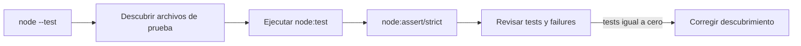
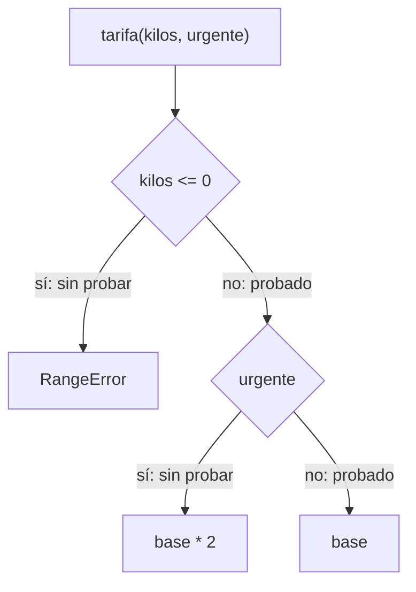
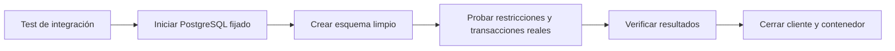
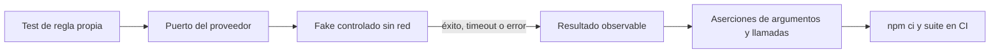

# Módulo 7: Testing e integración continua

## Aprende construyendo


### Tema 1: node:test — test runner nativo sin dependencias · Intermedio · 40 min

<details open>
<summary><strong>Capa 1 — Lectura</strong></summary>

#### ► DE QUÉ TRATA
Este tema te guía por node:test — test runner nativo sin dependencias con foco en comprensión antes de implementación.

#### ► LA IDEA EN UNA FRASE
**Entender node:test — test runner nativo sin dependencias te permite tomar mejores decisiones técnicas.**

#### ► POR QUÉ EXISTE ESTO
Resuelve un problema real de diseño o implementación y evita decisiones a ciegas.

#### ► LA ANALOGÍA
Piensa en node:test — test runner nativo sin dependencias como una herramienta de taller: útil cuando conoces su propósito y sus límites.
**Dónde se rompe la analogía:** en software, los efectos dependen del contexto, la escala y los trade-offs.

#### ► CÓMO FUNCIONA


#### ► LO QUE PUEDE SALIR MAL
| Síntoma | Causa probable | Arreglo |
|---|---|---|
| node:test — test runner nativo sin dependencias se aplica pero el resultado no mejora | Se usó sin medir el problema real | Mide antes y compara contra la alternativa simple |
| Aparece complejidad inesperada | Se adoptó la técnica sin comprender sus trade-offs | Vuelve a la sección de trade-offs y reduce el alcance |
| Falla en un caso límite | Se asumió un contexto que no se cumple | Prueba el caso límite y documenta cuándo NO usarlo |

#### ► TRADE-OFFS
| Opción | Cuándo usarla | Cuándo NO usarla |
|---|---|---|
| Usar node:test — test runner nativo sin dependencias | Cuando el problema coincide con su propósito y el beneficio es observable | Cuando agrega complejidad sin resolver un problema real |
| Alternativa más simple | Cuando el contexto es pequeño, estable o fácil de razonar | Cuando ya demostró no escalar o no cumplir el requisito |
| Postergar la decisión | Cuando falta evidencia del problema | Cuando el costo de esperar es mayor que el costo de probar |

#### ► CUÁNDO NO USAR ESTO
No uses node:test — test runner nativo sin dependencias por defecto. Aplícalo cuando el problema lo justifique y puedas verificar el beneficio; si una alternativa más simple resuelve igual, prefiérela.

#### ► DE VUELTA A LA ANALOGÍA
Volviendo a la analogía: node:test — test runner nativo sin dependencias funciona como el modelo inicial, pero recuerda dónde se rompe: en producción importan la evidencia, la escala y el costo de equivocarte.

#### ► LO QUE DEBES RECORDAR
- node:test — test runner nativo sin dependencias existe para resolver un problema específico.
- Mide antes de adoptar complejidad.
- Conoce el caso donde NO usarlo.
- Verifica con evidencia observable.

#### ► PREGUNTAS PARA PENSAR
1. ¿Qué problema concreto resuelve node:test — test runner nativo sin dependencias en tu contexto?
2. ¿Cómo sabrías que node:test — test runner nativo sin dependencias no está funcionando bien?
3. ¿Qué alternativa más simple considerarías antes de usar node:test — test runner nativo sin dependencias?

</details>

<details>
<summary><strong>Capa 2 — Construcción</strong></summary>

#### Código y verificación
```bash
mkdir practica-node-test
cd practica-node-test
mkdir src test
```

```json
{
  "name": "practica-node-test",
  "version": "1.0.0",
  "private": true,
  "type": "module",
  "scripts": {
    "test": "node --test"
  }
}
```

```js
export function sumar(a, b) {
  return a + b;
}
```

```js
import { test } from "node:test";
import assert from "node:assert/strict";
import { sumar } from "./sumar.js";

test("suma dos valores", () => {
  assert.strictEqual(sumar(2, 3), 5);
});
```

```bash
npm test
```

```bash
mv src/sumar.test.js src/sumarPrueba.js
npm test
```

</details>

### Tema 2: TDD práctico: rojo, verde y refactor con node:test · Avanzado · 45 min

<details open>
<summary><strong>Capa 1 — Lectura</strong></summary>

#### ► DE QUÉ TRATA
Este tema te guía por tdd práctico: rojo, verde y refactor con node:test con foco en comprensión antes de implementación.

#### ► LA IDEA EN UNA FRASE
**Entender tdd práctico: rojo, verde y refactor con node:test te permite tomar mejores decisiones técnicas.**

#### ► POR QUÉ EXISTE ESTO
Resuelve un problema real de diseño o implementación y evita decisiones a ciegas.

#### ► LA ANALOGÍA
Piensa en tdd práctico: rojo, verde y refactor con node:test como una herramienta de taller: útil cuando conoces su propósito y sus límites.
**Dónde se rompe la analogía:** en software, los efectos dependen del contexto, la escala y los trade-offs.

#### ► CÓMO FUNCIONA


#### ► LO QUE PUEDE SALIR MAL
| Síntoma | Causa probable | Arreglo |
|---|---|---|
| TDD práctico: rojo, verde y refactor con node:test se aplica pero el resultado no mejora | Se usó sin medir el problema real | Mide antes y compara contra la alternativa simple |
| Aparece complejidad inesperada | Se adoptó la técnica sin comprender sus trade-offs | Vuelve a la sección de trade-offs y reduce el alcance |
| Falla en un caso límite | Se asumió un contexto que no se cumple | Prueba el caso límite y documenta cuándo NO usarlo |

#### ► TRADE-OFFS
| Opción | Cuándo usarla | Cuándo NO usarla |
|---|---|---|
| Usar TDD práctico: rojo, verde y refactor con node:test | Cuando el problema coincide con su propósito y el beneficio es observable | Cuando agrega complejidad sin resolver un problema real |
| Alternativa más simple | Cuando el contexto es pequeño, estable o fácil de razonar | Cuando ya demostró no escalar o no cumplir el requisito |
| Postergar la decisión | Cuando falta evidencia del problema | Cuando el costo de esperar es mayor que el costo de probar |

#### ► CUÁNDO NO USAR ESTO
No uses tdd práctico: rojo, verde y refactor con node:test por defecto. Aplícalo cuando el problema lo justifique y puedas verificar el beneficio; si una alternativa más simple resuelve igual, prefiérela.

#### ► DE VUELTA A LA ANALOGÍA
Volviendo a la analogía: tdd práctico: rojo, verde y refactor con node:test funciona como el modelo inicial, pero recuerda dónde se rompe: en producción importan la evidencia, la escala y el costo de equivocarte.

#### ► LO QUE DEBES RECORDAR
- TDD práctico: rojo, verde y refactor con node:test existe para resolver un problema específico.
- Mide antes de adoptar complejidad.
- Conoce el caso donde NO usarlo.
- Verifica con evidencia observable.

#### ► PREGUNTAS PARA PENSAR
1. ¿Qué problema concreto resuelve tdd práctico: rojo, verde y refactor con node:test en tu contexto?
2. ¿Cómo sabrías que tdd práctico: rojo, verde y refactor con node:test no está funcionando bien?
3. ¿Qué alternativa más simple considerarías antes de usar tdd práctico: rojo, verde y refactor con node:test?

</details>

<details>
<summary><strong>Capa 2 — Construcción</strong></summary>

#### Código y verificación


```bash
mkdir practica-tdd-tarifas
cd practica-tdd-tarifas
```

```json
{
  "name": "practica-tdd-tarifas",
  "version": "1.0.0",
  "private": true,
  "type": "module",
  "scripts": {
    "test": "node --test --test-reporter=spec"
  }
}
```

```js
import { test } from "node:test";
import assert from "node:assert/strict";
import { tarifa } from "./tarifa.js";

test("cobra la base de la ciudad más 1200 por kilo iniciado", () => {
  assert.equal(tarifa({ ciudad: "Bogotá", kilos: 2.5 }), 5000 + 3 * 1200);
});
```

```js
export function tarifa() {
  throw new Error("Comportamiento aún no implementado");
}
```

```js
export function tarifa({ ciudad, kilos }) {
  const base = ciudad === "Bogotá" ? 5000 : 7000;
  return base + Math.ceil(kilos) * 1200;
}
```

</details>

### Tema 3: Cobertura de pruebas con node:test: líneas, ramas y umbrales · Avanzado · 35 min

<details open>
<summary><strong>Capa 1 — Lectura</strong></summary>

#### ► DE QUÉ TRATA
Este tema te guía por cobertura de pruebas con node:test: líneas, ramas y umbrales con foco en comprensión antes de implementación.

#### ► LA IDEA EN UNA FRASE
**Entender cobertura de pruebas con node:test: líneas, ramas y umbrales te permite tomar mejores decisiones técnicas.**

#### ► POR QUÉ EXISTE ESTO
Resuelve un problema real de diseño o implementación y evita decisiones a ciegas.

#### ► LA ANALOGÍA
Piensa en cobertura de pruebas con node:test: líneas, ramas y umbrales como una herramienta de taller: útil cuando conoces su propósito y sus límites.
**Dónde se rompe la analogía:** en software, los efectos dependen del contexto, la escala y los trade-offs.

#### ► CÓMO FUNCIONA


#### ► LO QUE PUEDE SALIR MAL
| Síntoma | Causa probable | Arreglo |
|---|---|---|
| Cobertura de pruebas con node:test: líneas, ramas y umbrales se aplica pero el resultado no mejora | Se usó sin medir el problema real | Mide antes y compara contra la alternativa simple |
| Aparece complejidad inesperada | Se adoptó la técnica sin comprender sus trade-offs | Vuelve a la sección de trade-offs y reduce el alcance |
| Falla en un caso límite | Se asumió un contexto que no se cumple | Prueba el caso límite y documenta cuándo NO usarlo |

#### ► TRADE-OFFS
| Opción | Cuándo usarla | Cuándo NO usarla |
|---|---|---|
| Usar Cobertura de pruebas con node:test: líneas, ramas y umbrales | Cuando el problema coincide con su propósito y el beneficio es observable | Cuando agrega complejidad sin resolver un problema real |
| Alternativa más simple | Cuando el contexto es pequeño, estable o fácil de razonar | Cuando ya demostró no escalar o no cumplir el requisito |
| Postergar la decisión | Cuando falta evidencia del problema | Cuando el costo de esperar es mayor que el costo de probar |

#### ► CUÁNDO NO USAR ESTO
No uses cobertura de pruebas con node:test: líneas, ramas y umbrales por defecto. Aplícalo cuando el problema lo justifique y puedas verificar el beneficio; si una alternativa más simple resuelve igual, prefiérela.

#### ► DE VUELTA A LA ANALOGÍA
Volviendo a la analogía: cobertura de pruebas con node:test: líneas, ramas y umbrales funciona como el modelo inicial, pero recuerda dónde se rompe: en producción importan la evidencia, la escala y el costo de equivocarte.

#### ► LO QUE DEBES RECORDAR
- Cobertura de pruebas con node:test: líneas, ramas y umbrales existe para resolver un problema específico.
- Mide antes de adoptar complejidad.
- Conoce el caso donde NO usarlo.
- Verifica con evidencia observable.

#### ► PREGUNTAS PARA PENSAR
1. ¿Qué problema concreto resuelve cobertura de pruebas con node:test: líneas, ramas y umbrales en tu contexto?
2. ¿Cómo sabrías que cobertura de pruebas con node:test: líneas, ramas y umbrales no está funcionando bien?
3. ¿Qué alternativa más simple considerarías antes de usar cobertura de pruebas con node:test: líneas, ramas y umbrales?

</details>

<details>
<summary><strong>Capa 2 — Construcción</strong></summary>

#### Código y verificación


```js
export function tarifa(kilos, urgente = false) {
  if (kilos <= 0) throw new RangeError('peso inválido');
  const base = 1000 + kilos * 120;
  if (urgente) return base * 2;
  return base;
}
```

```js
import { test } from 'node:test';
import assert from 'node:assert/strict';
import { tarifa } from './tarifa.mjs';

test('tarifa normal', () => {
  assert.equal(tarifa(2), 1240);
});
```

```bash
cd academia-labs/node/cobertura
node --test --experimental-test-coverage --test-reporter=spec tarifa.test.mjs
```

```text
✔ tarifa normal
ℹ pass 1
ℹ file            | line % | branch % | funcs % | uncovered lines
ℹ tarifa.mjs      | 100.00 |    50.00 |  100.00 |
```

</details>

### Tema 4: Vitest y Supertest — pruebas de integración HTTP reales · Avanzado · 45 min

<details open>
<summary><strong>Capa 1 — Lectura</strong></summary>

#### ► DE QUÉ TRATA
Este tema te guía por vitest y supertest — pruebas de integración http reales con foco en comprensión antes de implementación.

#### ► LA IDEA EN UNA FRASE
**Entender vitest y supertest — pruebas de integración http reales te permite tomar mejores decisiones técnicas.**

#### ► POR QUÉ EXISTE ESTO
Resuelve un problema real de diseño o implementación y evita decisiones a ciegas.

#### ► LA ANALOGÍA
Piensa en vitest y supertest — pruebas de integración http reales como una herramienta de taller: útil cuando conoces su propósito y sus límites.
**Dónde se rompe la analogía:** en software, los efectos dependen del contexto, la escala y los trade-offs.

#### ► CÓMO FUNCIONA
1. Identifica el problema que vitest y supertest — pruebas de integración http reales resuelve.
2. Observa sus componentes y relaciones.
3. Aplica la opción más simple que funcione.
4. Verifica el resultado y los límites.

#### ► LO QUE PUEDE SALIR MAL
| Síntoma | Causa probable | Arreglo |
|---|---|---|
| Vitest y Supertest — pruebas de integración HTTP reales se aplica pero el resultado no mejora | Se usó sin medir el problema real | Mide antes y compara contra la alternativa simple |
| Aparece complejidad inesperada | Se adoptó la técnica sin comprender sus trade-offs | Vuelve a la sección de trade-offs y reduce el alcance |
| Falla en un caso límite | Se asumió un contexto que no se cumple | Prueba el caso límite y documenta cuándo NO usarlo |

#### ► TRADE-OFFS
| Opción | Cuándo usarla | Cuándo NO usarla |
|---|---|---|
| Usar Vitest y Supertest — pruebas de integración HTTP reales | Cuando el problema coincide con su propósito y el beneficio es observable | Cuando agrega complejidad sin resolver un problema real |
| Alternativa más simple | Cuando el contexto es pequeño, estable o fácil de razonar | Cuando ya demostró no escalar o no cumplir el requisito |
| Postergar la decisión | Cuando falta evidencia del problema | Cuando el costo de esperar es mayor que el costo de probar |

#### ► CUÁNDO NO USAR ESTO
No uses vitest y supertest — pruebas de integración http reales por defecto. Aplícalo cuando el problema lo justifique y puedas verificar el beneficio; si una alternativa más simple resuelve igual, prefiérela.

#### ► DE VUELTA A LA ANALOGÍA
Volviendo a la analogía: vitest y supertest — pruebas de integración http reales funciona como el modelo inicial, pero recuerda dónde se rompe: en producción importan la evidencia, la escala y el costo de equivocarte.

#### ► LO QUE DEBES RECORDAR
- Vitest y Supertest — pruebas de integración HTTP reales existe para resolver un problema específico.
- Mide antes de adoptar complejidad.
- Conoce el caso donde NO usarlo.
- Verifica con evidencia observable.

#### ► PREGUNTAS PARA PENSAR
1. ¿Qué problema concreto resuelve vitest y supertest — pruebas de integración http reales en tu contexto?
2. ¿Cómo sabrías que vitest y supertest — pruebas de integración http reales no está funcionando bien?
3. ¿Qué alternativa más simple considerarías antes de usar vitest y supertest — pruebas de integración http reales?

</details>

<details>
<summary><strong>Capa 2 — Construcción</strong></summary>

#### Código y verificación
```bash
mkdir practica-vitest-http
cd practica-vitest-http
mkdir src test
```

```json
{
  "name": "practica-vitest-http",
  "version": "1.0.0",
  "private": true,
  "type": "module",
  "scripts": {
    "test": "vitest run"
  }
}
```

```bash
npm install express
npm install --save-dev vitest supertest
```

```js
import express from "express";

export const app = express();
app.use(express.json());

app.get("/health", (_req, res) => {
  res.status(200).json({ status: "ok" });
});

app.post("/tareas", (req, res) => {
  const { titulo } = req.body;
  if (typeof titulo !== "string" || titulo.trim() === "") {
    return res.status(400).json({ error: "titulo es obligatorio" });
  }
  return res.status(201).json({ id: 1, titulo: titulo.trim() });
});
```

```js
import request from "supertest";
import { describe, expect, it } from "vitest";
import { app } from "../src/app.js";

describe("contrato HTTP", () => {
  it("GET /health devuelve 200 y el cuerpo esperado", async () => {
    const response = await request(app).get("/health");

    expect(response.status).toBe(200);
    expect(response.body).toEqual({ status: "ok" });
  });

  it("POST /tareas rechaza un título vacío", async () => {
    const response = await request(app)
      .post("/tareas")
      .send({ titulo: "  " });

    expect(response.status).toBe(400);
    expect(response.body).toEqual({ error: "titulo es obligatorio" });
  });
});
```

```bash
npm test
```

</details>

### Tema 5: Testcontainers — bases de datos de prueba reales y efímeras · Avanzado · 45 min

<details open>
<summary><strong>Capa 1 — Lectura</strong></summary>

#### ► DE QUÉ TRATA
Este tema te guía por testcontainers — bases de datos de prueba reales y efímeras con foco en comprensión antes de implementación.

#### ► LA IDEA EN UNA FRASE
**Entender testcontainers — bases de datos de prueba reales y efímeras te permite tomar mejores decisiones técnicas.**

#### ► POR QUÉ EXISTE ESTO
Resuelve un problema real de diseño o implementación y evita decisiones a ciegas.

#### ► LA ANALOGÍA
Piensa en testcontainers — bases de datos de prueba reales y efímeras como una herramienta de taller: útil cuando conoces su propósito y sus límites.
**Dónde se rompe la analogía:** en software, los efectos dependen del contexto, la escala y los trade-offs.

#### ► CÓMO FUNCIONA


#### ► LO QUE PUEDE SALIR MAL
| Síntoma | Causa probable | Arreglo |
|---|---|---|
| Testcontainers — bases de datos de prueba reales y efímeras se aplica pero el resultado no mejora | Se usó sin medir el problema real | Mide antes y compara contra la alternativa simple |
| Aparece complejidad inesperada | Se adoptó la técnica sin comprender sus trade-offs | Vuelve a la sección de trade-offs y reduce el alcance |
| Falla en un caso límite | Se asumió un contexto que no se cumple | Prueba el caso límite y documenta cuándo NO usarlo |

#### ► TRADE-OFFS
| Opción | Cuándo usarla | Cuándo NO usarla |
|---|---|---|
| Usar Testcontainers — bases de datos de prueba reales y efímeras | Cuando el problema coincide con su propósito y el beneficio es observable | Cuando agrega complejidad sin resolver un problema real |
| Alternativa más simple | Cuando el contexto es pequeño, estable o fácil de razonar | Cuando ya demostró no escalar o no cumplir el requisito |
| Postergar la decisión | Cuando falta evidencia del problema | Cuando el costo de esperar es mayor que el costo de probar |

#### ► CUÁNDO NO USAR ESTO
No uses testcontainers — bases de datos de prueba reales y efímeras por defecto. Aplícalo cuando el problema lo justifique y puedas verificar el beneficio; si una alternativa más simple resuelve igual, prefiérela.

#### ► DE VUELTA A LA ANALOGÍA
Volviendo a la analogía: testcontainers — bases de datos de prueba reales y efímeras funciona como el modelo inicial, pero recuerda dónde se rompe: en producción importan la evidencia, la escala y el costo de equivocarte.

#### ► LO QUE DEBES RECORDAR
- Testcontainers — bases de datos de prueba reales y efímeras existe para resolver un problema específico.
- Mide antes de adoptar complejidad.
- Conoce el caso donde NO usarlo.
- Verifica con evidencia observable.

#### ► PREGUNTAS PARA PENSAR
1. ¿Qué problema concreto resuelve testcontainers — bases de datos de prueba reales y efímeras en tu contexto?
2. ¿Cómo sabrías que testcontainers — bases de datos de prueba reales y efímeras no está funcionando bien?
3. ¿Qué alternativa más simple considerarías antes de usar testcontainers — bases de datos de prueba reales y efímeras?

</details>

<details>
<summary><strong>Capa 2 — Construcción</strong></summary>

#### Código y verificación
```bash
mkdir practica-testcontainers
cd practica-testcontainers
mkdir test
```

```json
{
  "name": "practica-testcontainers",
  "version": "1.0.0",
  "private": true,
  "type": "module",
  "scripts": {
    "test": "vitest run"
  }
}
```

```bash
npm install pg
npm install --save-dev vitest @testcontainers/postgresql
```

```bash
docker info
```

```js
import { PostgreSqlContainer } from "@testcontainers/postgresql";
import pg from "pg";
import { afterAll, beforeAll, describe, expect, it } from "vitest";

const { Client } = pg;
let container;
let client;

beforeAll(async () => {
  container = await new PostgreSqlContainer("postgres:16-alpine").start();
  client = new Client({ connectionString: container.getConnectionUri() });
  await client.connect();
  await client.query(`
    CREATE TABLE tareas (
      id SERIAL PRIMARY KEY,
      titulo TEXT NOT NULL UNIQUE
    )
  `);
}, 120_000);

afterAll(async () => {
  try {
    if (client) await client.end();
  } finally {
    if (container) await container.stop();
  }
});

describe("PostgreSQL efímero", () => {
  it("inserta y recupera una tarea con SQL real", async () => {
    await client.query("INSERT INTO tareas(titulo) VALUES ($1)", ["Entregar"]);
    const result = await client.query(
      "SELECT titulo FROM tareas WHERE titulo = $1",
      ["Entregar"],
    );

    expect(result.rows).toEqual([{ titulo: "Entregar" }]);
    expect(container.getPort()).toBeGreaterThan(0);
  });
});
```

```bash
npm test
```

</details>

### Tema 6: Mocks de servicios externos y CI · Avanzado · 45 min

<details open>
<summary><strong>Capa 1 — Lectura</strong></summary>

#### ► DE QUÉ TRATA
Este tema te guía por mocks de servicios externos y ci con foco en comprensión antes de implementación.

#### ► LA IDEA EN UNA FRASE
**Entender mocks de servicios externos y ci te permite tomar mejores decisiones técnicas.**

#### ► POR QUÉ EXISTE ESTO
Resuelve un problema real de diseño o implementación y evita decisiones a ciegas.

#### ► LA ANALOGÍA
Piensa en mocks de servicios externos y ci como una herramienta de taller: útil cuando conoces su propósito y sus límites.
**Dónde se rompe la analogía:** en software, los efectos dependen del contexto, la escala y los trade-offs.

#### ► CÓMO FUNCIONA


#### ► LO QUE PUEDE SALIR MAL
| Síntoma | Causa probable | Arreglo |
|---|---|---|
| Mocks de servicios externos y CI se aplica pero el resultado no mejora | Se usó sin medir el problema real | Mide antes y compara contra la alternativa simple |
| Aparece complejidad inesperada | Se adoptó la técnica sin comprender sus trade-offs | Vuelve a la sección de trade-offs y reduce el alcance |
| Falla en un caso límite | Se asumió un contexto que no se cumple | Prueba el caso límite y documenta cuándo NO usarlo |

#### ► TRADE-OFFS
| Opción | Cuándo usarla | Cuándo NO usarla |
|---|---|---|
| Usar Mocks de servicios externos y CI | Cuando el problema coincide con su propósito y el beneficio es observable | Cuando agrega complejidad sin resolver un problema real |
| Alternativa más simple | Cuando el contexto es pequeño, estable o fácil de razonar | Cuando ya demostró no escalar o no cumplir el requisito |
| Postergar la decisión | Cuando falta evidencia del problema | Cuando el costo de esperar es mayor que el costo de probar |

#### ► CUÁNDO NO USAR ESTO
No uses mocks de servicios externos y ci por defecto. Aplícalo cuando el problema lo justifique y puedas verificar el beneficio; si una alternativa más simple resuelve igual, prefiérela.

#### ► DE VUELTA A LA ANALOGÍA
Volviendo a la analogía: mocks de servicios externos y ci funciona como el modelo inicial, pero recuerda dónde se rompe: en producción importan la evidencia, la escala y el costo de equivocarte.

#### ► LO QUE DEBES RECORDAR
- Mocks de servicios externos y CI existe para resolver un problema específico.
- Mide antes de adoptar complejidad.
- Conoce el caso donde NO usarlo.
- Verifica con evidencia observable.

#### ► PREGUNTAS PARA PENSAR
1. ¿Qué problema concreto resuelve mocks de servicios externos y ci en tu contexto?
2. ¿Cómo sabrías que mocks de servicios externos y ci no está funcionando bien?
3. ¿Qué alternativa más simple considerarías antes de usar mocks de servicios externos y ci?

</details>

<details>
<summary><strong>Capa 2 — Construcción</strong></summary>

#### Código y verificación
```bash
mkdir practica-mocks-ci
cd practica-mocks-ci
mkdir -p src test .github/workflows
```

```json
{
  "name": "practica-mocks-ci",
  "version": "1.0.0",
  "private": true,
  "type": "module",
  "scripts": {
    "test": "vitest run"
  }
}
```

```bash
npm install --save-dev vitest
```

```js
export async function calcularRuta(cliente, origen, destino) {
  const respuesta = await cliente.route(origen, destino);
  if (!respuesta.ok) {
    throw new Error("Proveedor de rutas no disponible");
  }
  return respuesta.distanceKm;
}
```

```js
import { describe, expect, it, vi } from "vitest";
import { calcularRuta } from "../src/rutas.js";

describe("calcularRuta", () => {
  it("usa el contrato del proveedor y devuelve la distancia", async () => {
    const cliente = {
      route: vi.fn().mockResolvedValue({ ok: true, distanceKm: 4.2 }),
    };

    await expect(calcularRuta(cliente, "A", "B")).resolves.toBe(4.2);
    expect(cliente.route).toHaveBeenCalledWith("A", "B");
    expect(cliente.route).toHaveBeenCalledTimes(1);
  });

  it("propaga un timeout sin inventar una distancia", async () => {
    const cliente = {
      route: vi.fn().mockRejectedValue(new Error("timeout")),
    };

    await expect(calcularRuta(cliente, "A", "B")).rejects.toThrow("timeout");
  });
});
```

```yaml
name: CI

on:
  push:
  pull_request:

jobs:
  test:
    runs-on: ubuntu-latest
    steps:
      - uses: actions/checkout@v4
      - uses: actions/setup-node@v4
        with:
          node-version: 22
          cache: npm
      - run: npm ci
      - run: npm test
```

</details>

### Tema 7: Alternativas de testing y debugging · Avanzado · 45 min

<details open>
<summary><strong>Capa 1 — Lectura</strong></summary>

#### ► DE QUÉ TRATA
Este tema te guía por alternativas de testing y debugging con foco en comprensión antes de implementación.

#### ► LA IDEA EN UNA FRASE
**Entender alternativas de testing y debugging te permite tomar mejores decisiones técnicas.**

#### ► POR QUÉ EXISTE ESTO
Resuelve un problema real de diseño o implementación y evita decisiones a ciegas.

#### ► LA ANALOGÍA
Piensa en alternativas de testing y debugging como una herramienta de taller: útil cuando conoces su propósito y sus límites.
**Dónde se rompe la analogía:** en software, los efectos dependen del contexto, la escala y los trade-offs.

#### ► CÓMO FUNCIONA
1. Identifica el problema que alternativas de testing y debugging resuelve.
2. Observa sus componentes y relaciones.
3. Aplica la opción más simple que funcione.
4. Verifica el resultado y los límites.

#### ► LO QUE PUEDE SALIR MAL
| Síntoma | Causa probable | Arreglo |
|---|---|---|
| Alternativas de testing y debugging se aplica pero el resultado no mejora | Se usó sin medir el problema real | Mide antes y compara contra la alternativa simple |
| Aparece complejidad inesperada | Se adoptó la técnica sin comprender sus trade-offs | Vuelve a la sección de trade-offs y reduce el alcance |
| Falla en un caso límite | Se asumió un contexto que no se cumple | Prueba el caso límite y documenta cuándo NO usarlo |

#### ► TRADE-OFFS
| Opción | Cuándo usarla | Cuándo NO usarla |
|---|---|---|
| Usar Alternativas de testing y debugging | Cuando el problema coincide con su propósito y el beneficio es observable | Cuando agrega complejidad sin resolver un problema real |
| Alternativa más simple | Cuando el contexto es pequeño, estable o fácil de razonar | Cuando ya demostró no escalar o no cumplir el requisito |
| Postergar la decisión | Cuando falta evidencia del problema | Cuando el costo de esperar es mayor que el costo de probar |

#### ► CUÁNDO NO USAR ESTO
No uses alternativas de testing y debugging por defecto. Aplícalo cuando el problema lo justifique y puedas verificar el beneficio; si una alternativa más simple resuelve igual, prefiérela.

#### ► DE VUELTA A LA ANALOGÍA
Volviendo a la analogía: alternativas de testing y debugging funciona como el modelo inicial, pero recuerda dónde se rompe: en producción importan la evidencia, la escala y el costo de equivocarte.

#### ► LO QUE DEBES RECORDAR
- Alternativas de testing y debugging existe para resolver un problema específico.
- Mide antes de adoptar complejidad.
- Conoce el caso donde NO usarlo.
- Verifica con evidencia observable.

#### ► PREGUNTAS PARA PENSAR
1. ¿Qué problema concreto resuelve alternativas de testing y debugging en tu contexto?
2. ¿Cómo sabrías que alternativas de testing y debugging no está funcionando bien?
3. ¿Qué alternativa más simple considerarías antes de usar alternativas de testing y debugging?

</details>

<details>
<summary><strong>Capa 2 — Construcción</strong></summary>

#### Código y verificación
```bash
mkdir practica-debug-testing
cd practica-debug-testing
mkdir src test
```

```json
{
  "name": "practica-debug-testing",
  "version": "1.0.0",
  "private": true,
  "type": "module",
  "scripts": {
    "test": "vitest run"
  }
}
```

```bash
npm install --save-dev vitest
```

```js
export function sumar(a, b) {
  return a + b;
}
```

```js
import { expect, it } from "vitest";
import { sumar } from "../src/sumar.js";

it("suma dos valores", () => {
  expect(sumar(2, 3)).toBe(5);
});
```

```js
import { sumar } from "./sumar.js";

const a = 2;
const b = 3;
const resultado = sumar(a, b);
debugger;
console.log({ a, b, resultado });
```

</details>

### Proyecto y configuración

<details open>
<summary><strong>Capa 1 — Lectura</strong></summary>

#### ► DE QUÉ TRATA
Este tema te guía por proyecto y configuración con foco en comprensión antes de implementación.

#### ► LA IDEA EN UNA FRASE
**Entender proyecto y configuración te permite tomar mejores decisiones técnicas.**

#### ► POR QUÉ EXISTE ESTO
Resuelve un problema real de diseño o implementación y evita decisiones a ciegas.

#### ► LA ANALOGÍA
Piensa en proyecto y configuración como una herramienta de taller: útil cuando conoces su propósito y sus límites.
**Dónde se rompe la analogía:** en software, los efectos dependen del contexto, la escala y los trade-offs.

#### ► CÓMO FUNCIONA
1. Identifica el problema que proyecto y configuración resuelve.
2. Observa sus componentes y relaciones.
3. Aplica la opción más simple que funcione.
4. Verifica el resultado y los límites.

#### ► LO QUE PUEDE SALIR MAL
| Síntoma | Causa probable | Arreglo |
|---|---|---|
| Proyecto y configuración se aplica pero el resultado no mejora | Se usó sin medir el problema real | Mide antes y compara contra la alternativa simple |
| Aparece complejidad inesperada | Se adoptó la técnica sin comprender sus trade-offs | Vuelve a la sección de trade-offs y reduce el alcance |
| Falla en un caso límite | Se asumió un contexto que no se cumple | Prueba el caso límite y documenta cuándo NO usarlo |

#### ► TRADE-OFFS
| Opción | Cuándo usarla | Cuándo NO usarla |
|---|---|---|
| Usar Proyecto y configuración | Cuando el problema coincide con su propósito y el beneficio es observable | Cuando agrega complejidad sin resolver un problema real |
| Alternativa más simple | Cuando el contexto es pequeño, estable o fácil de razonar | Cuando ya demostró no escalar o no cumplir el requisito |
| Postergar la decisión | Cuando falta evidencia del problema | Cuando el costo de esperar es mayor que el costo de probar |

#### ► CUÁNDO NO USAR ESTO
No uses proyecto y configuración por defecto. Aplícalo cuando el problema lo justifique y puedas verificar el beneficio; si una alternativa más simple resuelve igual, prefiérela.

#### ► DE VUELTA A LA ANALOGÍA
Volviendo a la analogía: proyecto y configuración funciona como el modelo inicial, pero recuerda dónde se rompe: en producción importan la evidencia, la escala y el costo de equivocarte.

#### ► LO QUE DEBES RECORDAR
- Proyecto y configuración existe para resolver un problema específico.
- Mide antes de adoptar complejidad.
- Conoce el caso donde NO usarlo.
- Verifica con evidencia observable.

#### ► PREGUNTAS PARA PENSAR
1. ¿Qué problema concreto resuelve proyecto y configuración en tu contexto?
2. ¿Cómo sabrías que proyecto y configuración no está funcionando bien?
3. ¿Qué alternativa más simple considerarías antes de usar proyecto y configuración?

</details>

<details>
<summary><strong>Capa 2 — Construcción</strong></summary>

#### Código y verificación
```bash
mkdir laboratorio-entregas-testing
cd laboratorio-entregas-testing
mkdir -p src test scripts herramienta .github/workflows
```

```json
{
  "name": "laboratorio-entregas-testing",
  "version": "1.0.0",
  "private": true,
  "type": "module",
  "scripts": {
    "test": "vitest run",
    "test:native": "node scripts/verificar-pruebas-nativas.mjs"
  }
}
```

```bash
npm install express pg
npm install --save-dev vitest supertest @testcontainers/postgresql
```

```js
import { defineConfig } from "vitest/config";

export default defineConfig({
  test: {
    include: ["test/**/*.test.js"],
  },
});
```

</details>

### Aplicación y persistencia

<details open>
<summary><strong>Capa 1 — Lectura</strong></summary>

#### ► DE QUÉ TRATA
Este tema te guía por aplicación y persistencia con foco en comprensión antes de implementación.

#### ► LA IDEA EN UNA FRASE
**Entender aplicación y persistencia te permite tomar mejores decisiones técnicas.**

#### ► POR QUÉ EXISTE ESTO
Resuelve un problema real de diseño o implementación y evita decisiones a ciegas.

#### ► LA ANALOGÍA
Piensa en aplicación y persistencia como una herramienta de taller: útil cuando conoces su propósito y sus límites.
**Dónde se rompe la analogía:** en software, los efectos dependen del contexto, la escala y los trade-offs.

#### ► CÓMO FUNCIONA
1. Identifica el problema que aplicación y persistencia resuelve.
2. Observa sus componentes y relaciones.
3. Aplica la opción más simple que funcione.
4. Verifica el resultado y los límites.

#### ► LO QUE PUEDE SALIR MAL
| Síntoma | Causa probable | Arreglo |
|---|---|---|
| Aplicación y persistencia se aplica pero el resultado no mejora | Se usó sin medir el problema real | Mide antes y compara contra la alternativa simple |
| Aparece complejidad inesperada | Se adoptó la técnica sin comprender sus trade-offs | Vuelve a la sección de trade-offs y reduce el alcance |
| Falla en un caso límite | Se asumió un contexto que no se cumple | Prueba el caso límite y documenta cuándo NO usarlo |

#### ► TRADE-OFFS
| Opción | Cuándo usarla | Cuándo NO usarla |
|---|---|---|
| Usar Aplicación y persistencia | Cuando el problema coincide con su propósito y el beneficio es observable | Cuando agrega complejidad sin resolver un problema real |
| Alternativa más simple | Cuando el contexto es pequeño, estable o fácil de razonar | Cuando ya demostró no escalar o no cumplir el requisito |
| Postergar la decisión | Cuando falta evidencia del problema | Cuando el costo de esperar es mayor que el costo de probar |

#### ► CUÁNDO NO USAR ESTO
No uses aplicación y persistencia por defecto. Aplícalo cuando el problema lo justifique y puedas verificar el beneficio; si una alternativa más simple resuelve igual, prefiérela.

#### ► DE VUELTA A LA ANALOGÍA
Volviendo a la analogía: aplicación y persistencia funciona como el modelo inicial, pero recuerda dónde se rompe: en producción importan la evidencia, la escala y el costo de equivocarte.

#### ► LO QUE DEBES RECORDAR
- Aplicación y persistencia existe para resolver un problema específico.
- Mide antes de adoptar complejidad.
- Conoce el caso donde NO usarlo.
- Verifica con evidencia observable.

#### ► PREGUNTAS PARA PENSAR
1. ¿Qué problema concreto resuelve aplicación y persistencia en tu contexto?
2. ¿Cómo sabrías que aplicación y persistencia no está funcionando bien?
3. ¿Qué alternativa más simple considerarías antes de usar aplicación y persistencia?

</details>

<details>
<summary><strong>Capa 2 — Construcción</strong></summary>

#### Código y verificación
```js
export function crearRepositorio(client) {
  return {
    async crear(destinatario) {
      const result = await client.query(
        "INSERT INTO entregas(destinatario) VALUES ($1) RETURNING id, destinatario, confirmada",
        [destinatario],
      );
      return result.rows[0];
    },

    async obtener(id) {
      const result = await client.query(
        "SELECT id, destinatario, confirmada FROM entregas WHERE id = $1",
        [id],
      );
      return result.rows[0] ?? null;
    },

    async confirmar(id) {
      const result = await client.query(
        "UPDATE entregas SET confirmada = TRUE WHERE id = $1 RETURNING id, destinatario, confirmada",
        [id],
      );
      return result.rows[0] ?? null;
    },
  };
}
```

```js
import express from "express";

export function crearApp({ repositorio, notificar }) {
  const app = express();
  app.use(express.json());

  app.post("/entregas", async (req, res, next) => {
    try {
      const { destinatario } = req.body;
      if (typeof destinatario !== "string" || destinatario.trim() === "") {
        return res.status(400).json({ error: "destinatario es obligatorio" });
      }

      const entrega = await repositorio.crear(destinatario.trim());
      await notificar(entrega);
      return res.status(201).json(entrega);
    } catch (error) {
      return next(error);
    }
  });

  app.get("/entregas/:id", async (req, res, next) => {
    try {
      const entrega = await repositorio.obtener(req.params.id);
      if (!entrega) return res.status(404).json({ error: "entrega no encontrada" });
      return res.status(200).json(entrega);
    } catch (error) {
      return next(error);
    }
  });

  app.patch("/entregas/:id/confirmar", async (req, res, next) => {
    try {
      const entrega = await repositorio.confirmar(req.params.id);
      if (!entrega) return res.status(404).json({ error: "entrega no encontrada" });
      return res.status(200).json(entrega);
    } catch (error) {
      return next(error);
    }
  });

  app.use((error, _req, res, _next) => {
    console.error(error);
    res.status(500).json({ error: "error interno" });
  });

  return app;
}
```

```js
export async function notificarEntrega(cliente, entrega) {
  const respuesta = await cliente.enviar({
    destinatario: entrega.destinatario,
    entregaId: entrega.id,
  });

  if (!respuesta.ok) {
    throw new Error("El notificador rechazó la entrega");
  }
}
```

</details>

### Integración HTTP con PostgreSQL efímero

<details open>
<summary><strong>Capa 1 — Lectura</strong></summary>

#### ► DE QUÉ TRATA
Este tema te guía por integración http con postgresql efímero con foco en comprensión antes de implementación.

#### ► LA IDEA EN UNA FRASE
**Entender integración http con postgresql efímero te permite tomar mejores decisiones técnicas.**

#### ► POR QUÉ EXISTE ESTO
Resuelve un problema real de diseño o implementación y evita decisiones a ciegas.

#### ► LA ANALOGÍA
Piensa en integración http con postgresql efímero como una herramienta de taller: útil cuando conoces su propósito y sus límites.
**Dónde se rompe la analogía:** en software, los efectos dependen del contexto, la escala y los trade-offs.

#### ► CÓMO FUNCIONA
1. Identifica el problema que integración http con postgresql efímero resuelve.
2. Observa sus componentes y relaciones.
3. Aplica la opción más simple que funcione.
4. Verifica el resultado y los límites.

#### ► LO QUE PUEDE SALIR MAL
| Síntoma | Causa probable | Arreglo |
|---|---|---|
| Integración HTTP con PostgreSQL efímero se aplica pero el resultado no mejora | Se usó sin medir el problema real | Mide antes y compara contra la alternativa simple |
| Aparece complejidad inesperada | Se adoptó la técnica sin comprender sus trade-offs | Vuelve a la sección de trade-offs y reduce el alcance |
| Falla en un caso límite | Se asumió un contexto que no se cumple | Prueba el caso límite y documenta cuándo NO usarlo |

#### ► TRADE-OFFS
| Opción | Cuándo usarla | Cuándo NO usarla |
|---|---|---|
| Usar Integración HTTP con PostgreSQL efímero | Cuando el problema coincide con su propósito y el beneficio es observable | Cuando agrega complejidad sin resolver un problema real |
| Alternativa más simple | Cuando el contexto es pequeño, estable o fácil de razonar | Cuando ya demostró no escalar o no cumplir el requisito |
| Postergar la decisión | Cuando falta evidencia del problema | Cuando el costo de esperar es mayor que el costo de probar |

#### ► CUÁNDO NO USAR ESTO
No uses integración http con postgresql efímero por defecto. Aplícalo cuando el problema lo justifique y puedas verificar el beneficio; si una alternativa más simple resuelve igual, prefiérela.

#### ► DE VUELTA A LA ANALOGÍA
Volviendo a la analogía: integración http con postgresql efímero funciona como el modelo inicial, pero recuerda dónde se rompe: en producción importan la evidencia, la escala y el costo de equivocarte.

#### ► LO QUE DEBES RECORDAR
- Integración HTTP con PostgreSQL efímero existe para resolver un problema específico.
- Mide antes de adoptar complejidad.
- Conoce el caso donde NO usarlo.
- Verifica con evidencia observable.

#### ► PREGUNTAS PARA PENSAR
1. ¿Qué problema concreto resuelve integración http con postgresql efímero en tu contexto?
2. ¿Cómo sabrías que integración http con postgresql efímero no está funcionando bien?
3. ¿Qué alternativa más simple considerarías antes de usar integración http con postgresql efímero?

</details>

<details>
<summary><strong>Capa 2 — Construcción</strong></summary>

#### Código y verificación
```js
import { PostgreSqlContainer } from "@testcontainers/postgresql";
import pg from "pg";
import request from "supertest";
import { afterAll, beforeAll, beforeEach, describe, expect, it, vi } from "vitest";
import { crearApp } from "../src/app.js";
import { crearRepositorio } from "../src/repositorio.js";

const { Client } = pg;
let container;
let client;
let app;
let notificar;

beforeAll(async () => {
  container = await new PostgreSqlContainer("postgres:16-alpine").start();
  client = new Client({ connectionString: container.getConnectionUri() });
  await client.connect();
  await client.query(`
    CREATE TABLE entregas (
      id SERIAL PRIMARY KEY,
      destinatario TEXT NOT NULL,
      confirmada BOOLEAN NOT NULL DEFAULT FALSE
    )
  `);

  notificar = vi.fn().mockResolvedValue({ ok: true });
  app = crearApp({ repositorio: crearRepositorio(client), notificar });
}, 120_000);

afterAll(async () => {
  try {
    if (client) await client.end();
  } finally {
    if (container) await container.stop();
  }
});

beforeEach(async () => {
  await client.query("TRUNCATE TABLE entregas RESTART IDENTITY");
  notificar.mockClear();
});

describe("API de entregas", () => {
  it("rechaza un alta sin destinatario", async () => {
    const response = await request(app).post("/entregas").send({});

    expect(response.status).toBe(400);
    expect(response.body).toEqual({ error: "destinatario es obligatorio" });
    expect(notificar).not.toHaveBeenCalled();
  });

  it("crea, consulta y confirma una entrega con efecto persistido", async () => {
    const creada = await request(app)
      .post("/entregas")
      .send({ destinatario: "Ada" });

    expect(creada.status).toBe(201);
    expect(creada.body).toEqual({ id: 1, destinatario: "Ada", confirmada: false });
    expect(notificar).toHaveBeenCalledWith(creada.body);

    const consultada = await request(app).get("/entregas/1");
    expect(consultada.status).toBe(200);
    expect(consultada.body.destinatario).toBe("Ada");

    const confirmada = await request(app).patch("/entregas/1/confirmar");
    expect(confirmada.status).toBe(200);
    expect(confirmada.body.confirmada).toBe(true);

    const persistida = await client.query(
      "SELECT confirmada FROM entregas WHERE id = 1",
    );
    expect(persistida.rows[0].confirmada).toBe(true);
  });
});
```

</details>

### Prueba del servicio externo sin red

<details open>
<summary><strong>Capa 1 — Lectura</strong></summary>

#### ► DE QUÉ TRATA
Este tema te guía por prueba del servicio externo sin red con foco en comprensión antes de implementación.

#### ► LA IDEA EN UNA FRASE
**Entender prueba del servicio externo sin red te permite tomar mejores decisiones técnicas.**

#### ► POR QUÉ EXISTE ESTO
Resuelve un problema real de diseño o implementación y evita decisiones a ciegas.

#### ► LA ANALOGÍA
Piensa en prueba del servicio externo sin red como una herramienta de taller: útil cuando conoces su propósito y sus límites.
**Dónde se rompe la analogía:** en software, los efectos dependen del contexto, la escala y los trade-offs.

#### ► CÓMO FUNCIONA
1. Identifica el problema que prueba del servicio externo sin red resuelve.
2. Observa sus componentes y relaciones.
3. Aplica la opción más simple que funcione.
4. Verifica el resultado y los límites.

#### ► LO QUE PUEDE SALIR MAL
| Síntoma | Causa probable | Arreglo |
|---|---|---|
| Prueba del servicio externo sin red se aplica pero el resultado no mejora | Se usó sin medir el problema real | Mide antes y compara contra la alternativa simple |
| Aparece complejidad inesperada | Se adoptó la técnica sin comprender sus trade-offs | Vuelve a la sección de trade-offs y reduce el alcance |
| Falla en un caso límite | Se asumió un contexto que no se cumple | Prueba el caso límite y documenta cuándo NO usarlo |

#### ► TRADE-OFFS
| Opción | Cuándo usarla | Cuándo NO usarla |
|---|---|---|
| Usar Prueba del servicio externo sin red | Cuando el problema coincide con su propósito y el beneficio es observable | Cuando agrega complejidad sin resolver un problema real |
| Alternativa más simple | Cuando el contexto es pequeño, estable o fácil de razonar | Cuando ya demostró no escalar o no cumplir el requisito |
| Postergar la decisión | Cuando falta evidencia del problema | Cuando el costo de esperar es mayor que el costo de probar |

#### ► CUÁNDO NO USAR ESTO
No uses prueba del servicio externo sin red por defecto. Aplícalo cuando el problema lo justifique y puedas verificar el beneficio; si una alternativa más simple resuelve igual, prefiérela.

#### ► DE VUELTA A LA ANALOGÍA
Volviendo a la analogía: prueba del servicio externo sin red funciona como el modelo inicial, pero recuerda dónde se rompe: en producción importan la evidencia, la escala y el costo de equivocarte.

#### ► LO QUE DEBES RECORDAR
- Prueba del servicio externo sin red existe para resolver un problema específico.
- Mide antes de adoptar complejidad.
- Conoce el caso donde NO usarlo.
- Verifica con evidencia observable.

#### ► PREGUNTAS PARA PENSAR
1. ¿Qué problema concreto resuelve prueba del servicio externo sin red en tu contexto?
2. ¿Cómo sabrías que prueba del servicio externo sin red no está funcionando bien?
3. ¿Qué alternativa más simple considerarías antes de usar prueba del servicio externo sin red?

</details>

<details>
<summary><strong>Capa 2 — Construcción</strong></summary>

#### Código y verificación
```js
import { describe, expect, it, vi } from "vitest";
import { notificarEntrega } from "../src/notificaciones.js";

const entrega = { id: 7, destinatario: "Ada", confirmada: false };

describe("notificarEntrega", () => {
  it("envía el contrato esperado", async () => {
    const cliente = { enviar: vi.fn().mockResolvedValue({ ok: true }) };

    await notificarEntrega(cliente, entrega);

    expect(cliente.enviar).toHaveBeenCalledWith({
      destinatario: "Ada",
      entregaId: 7,
    });
  });

  it("no convierte un timeout en éxito", async () => {
    const cliente = { enviar: vi.fn().mockRejectedValue(new Error("timeout")) };

    await expect(notificarEntrega(cliente, entrega)).rejects.toThrow("timeout");
  });

  it("rechaza una respuesta no válida del proveedor", async () => {
    const cliente = { enviar: vi.fn().mockResolvedValue({ ok: false }) };

    await expect(notificarEntrega(cliente, entrega)).rejects.toThrow(
      "El notificador rechazó la entrega",
    );
  });
});
```

</details>

### Prueba nativa y comprobación de descubrimiento

<details open>
<summary><strong>Capa 1 — Lectura</strong></summary>

#### ► DE QUÉ TRATA
Este tema te guía por prueba nativa y comprobación de descubrimiento con foco en comprensión antes de implementación.

#### ► LA IDEA EN UNA FRASE
**Entender prueba nativa y comprobación de descubrimiento te permite tomar mejores decisiones técnicas.**

#### ► POR QUÉ EXISTE ESTO
Resuelve un problema real de diseño o implementación y evita decisiones a ciegas.

#### ► LA ANALOGÍA
Piensa en prueba nativa y comprobación de descubrimiento como una herramienta de taller: útil cuando conoces su propósito y sus límites.
**Dónde se rompe la analogía:** en software, los efectos dependen del contexto, la escala y los trade-offs.

#### ► CÓMO FUNCIONA
1. Identifica el problema que prueba nativa y comprobación de descubrimiento resuelve.
2. Observa sus componentes y relaciones.
3. Aplica la opción más simple que funcione.
4. Verifica el resultado y los límites.

#### ► LO QUE PUEDE SALIR MAL
| Síntoma | Causa probable | Arreglo |
|---|---|---|
| Prueba nativa y comprobación de descubrimiento se aplica pero el resultado no mejora | Se usó sin medir el problema real | Mide antes y compara contra la alternativa simple |
| Aparece complejidad inesperada | Se adoptó la técnica sin comprender sus trade-offs | Vuelve a la sección de trade-offs y reduce el alcance |
| Falla en un caso límite | Se asumió un contexto que no se cumple | Prueba el caso límite y documenta cuándo NO usarlo |

#### ► TRADE-OFFS
| Opción | Cuándo usarla | Cuándo NO usarla |
|---|---|---|
| Usar Prueba nativa y comprobación de descubrimiento | Cuando el problema coincide con su propósito y el beneficio es observable | Cuando agrega complejidad sin resolver un problema real |
| Alternativa más simple | Cuando el contexto es pequeño, estable o fácil de razonar | Cuando ya demostró no escalar o no cumplir el requisito |
| Postergar la decisión | Cuando falta evidencia del problema | Cuando el costo de esperar es mayor que el costo de probar |

#### ► CUÁNDO NO USAR ESTO
No uses prueba nativa y comprobación de descubrimiento por defecto. Aplícalo cuando el problema lo justifique y puedas verificar el beneficio; si una alternativa más simple resuelve igual, prefiérela.

#### ► DE VUELTA A LA ANALOGÍA
Volviendo a la analogía: prueba nativa y comprobación de descubrimiento funciona como el modelo inicial, pero recuerda dónde se rompe: en producción importan la evidencia, la escala y el costo de equivocarte.

#### ► LO QUE DEBES RECORDAR
- Prueba nativa y comprobación de descubrimiento existe para resolver un problema específico.
- Mide antes de adoptar complejidad.
- Conoce el caso donde NO usarlo.
- Verifica con evidencia observable.

#### ► PREGUNTAS PARA PENSAR
1. ¿Qué problema concreto resuelve prueba nativa y comprobación de descubrimiento en tu contexto?
2. ¿Cómo sabrías que prueba nativa y comprobación de descubrimiento no está funcionando bien?
3. ¿Qué alternativa más simple considerarías antes de usar prueba nativa y comprobación de descubrimiento?

</details>

<details>
<summary><strong>Capa 2 — Construcción</strong></summary>

#### Código y verificación
```json
{
  "name": "herramienta-nativa-entregas",
  "version": "1.0.0",
  "private": true,
  "type": "module"
}
```

```js
export function puedeConfirmar(estado) {
  return estado === "pendiente";
}
```

```js
import { test } from "node:test";
import assert from "node:assert/strict";
import { puedeConfirmar } from "./estado.js";

test("una entrega pendiente se puede confirmar", () => {
  assert.equal(puedeConfirmar("pendiente"), true);
});

test("una entrega confirmada no se confirma dos veces", () => {
  assert.equal(puedeConfirmar("confirmada"), false);
});
```

```js
import { spawnSync } from "node:child_process";
import { fileURLToPath } from "node:url";

const cwd = fileURLToPath(new URL("../herramienta/", import.meta.url));
const resultado = spawnSync(process.execPath, ["--test"], {
  cwd,
  encoding: "utf8",
});

process.stdout.write(resultado.stdout);
process.stderr.write(resultado.stderr);

if (resultado.status !== 0) {
  process.exit(resultado.status ?? 1);
}

const resumen = resultado.stdout.match(/# tests (\d+)/);
const descubiertas = resumen ? Number(resumen[1]) : 0;
if (descubiertas === 0) {
  console.error("node --test no descubrió pruebas");
  process.exit(1);
}
```

</details>

### Ejecución, fallo diagnosticado y CI

<details open>
<summary><strong>Capa 1 — Lectura</strong></summary>

#### ► DE QUÉ TRATA
Este tema te guía por ejecución, fallo diagnosticado y ci con foco en comprensión antes de implementación.

#### ► LA IDEA EN UNA FRASE
**Entender ejecución, fallo diagnosticado y ci te permite tomar mejores decisiones técnicas.**

#### ► POR QUÉ EXISTE ESTO
Resuelve un problema real de diseño o implementación y evita decisiones a ciegas.

#### ► LA ANALOGÍA
Piensa en ejecución, fallo diagnosticado y ci como una herramienta de taller: útil cuando conoces su propósito y sus límites.
**Dónde se rompe la analogía:** en software, los efectos dependen del contexto, la escala y los trade-offs.

#### ► CÓMO FUNCIONA
1. Identifica el problema que ejecución, fallo diagnosticado y ci resuelve.
2. Observa sus componentes y relaciones.
3. Aplica la opción más simple que funcione.
4. Verifica el resultado y los límites.

#### ► LO QUE PUEDE SALIR MAL
| Síntoma | Causa probable | Arreglo |
|---|---|---|
| Ejecución, fallo diagnosticado y CI se aplica pero el resultado no mejora | Se usó sin medir el problema real | Mide antes y compara contra la alternativa simple |
| Aparece complejidad inesperada | Se adoptó la técnica sin comprender sus trade-offs | Vuelve a la sección de trade-offs y reduce el alcance |
| Falla en un caso límite | Se asumió un contexto que no se cumple | Prueba el caso límite y documenta cuándo NO usarlo |

#### ► TRADE-OFFS
| Opción | Cuándo usarla | Cuándo NO usarla |
|---|---|---|
| Usar Ejecución, fallo diagnosticado y CI | Cuando el problema coincide con su propósito y el beneficio es observable | Cuando agrega complejidad sin resolver un problema real |
| Alternativa más simple | Cuando el contexto es pequeño, estable o fácil de razonar | Cuando ya demostró no escalar o no cumplir el requisito |
| Postergar la decisión | Cuando falta evidencia del problema | Cuando el costo de esperar es mayor que el costo de probar |

#### ► CUÁNDO NO USAR ESTO
No uses ejecución, fallo diagnosticado y ci por defecto. Aplícalo cuando el problema lo justifique y puedas verificar el beneficio; si una alternativa más simple resuelve igual, prefiérela.

#### ► DE VUELTA A LA ANALOGÍA
Volviendo a la analogía: ejecución, fallo diagnosticado y ci funciona como el modelo inicial, pero recuerda dónde se rompe: en producción importan la evidencia, la escala y el costo de equivocarte.

#### ► LO QUE DEBES RECORDAR
- Ejecución, fallo diagnosticado y CI existe para resolver un problema específico.
- Mide antes de adoptar complejidad.
- Conoce el caso donde NO usarlo.
- Verifica con evidencia observable.

#### ► PREGUNTAS PARA PENSAR
1. ¿Qué problema concreto resuelve ejecución, fallo diagnosticado y ci en tu contexto?
2. ¿Cómo sabrías que ejecución, fallo diagnosticado y ci no está funcionando bien?
3. ¿Qué alternativa más simple considerarías antes de usar ejecución, fallo diagnosticado y ci?

</details>

<details>
<summary><strong>Capa 2 — Construcción</strong></summary>

#### Código y verificación
```bash
npm run test:native
npm test
```

```yaml
name: CI

on:
  push:
  pull_request:

jobs:
  test:
    runs-on: ubuntu-latest
    steps:
      - uses: actions/checkout@v4
      - uses: actions/setup-node@v4
        with:
          node-version: 22
          cache: npm
      - run: npm ci
      - run: npm run test:native
      - run: npm test
```

</details>

### Ejercicio independiente y salida

<details open>
<summary><strong>Capa 1 — Lectura</strong></summary>

#### ► DE QUÉ TRATA
Este tema te guía por ejercicio independiente y salida con foco en comprensión antes de implementación.

#### ► LA IDEA EN UNA FRASE
**Entender ejercicio independiente y salida te permite tomar mejores decisiones técnicas.**

#### ► POR QUÉ EXISTE ESTO
Resuelve un problema real de diseño o implementación y evita decisiones a ciegas.

#### ► LA ANALOGÍA
Piensa en ejercicio independiente y salida como una herramienta de taller: útil cuando conoces su propósito y sus límites.
**Dónde se rompe la analogía:** en software, los efectos dependen del contexto, la escala y los trade-offs.

#### ► CÓMO FUNCIONA
1. Identifica el problema que ejercicio independiente y salida resuelve.
2. Observa sus componentes y relaciones.
3. Aplica la opción más simple que funcione.
4. Verifica el resultado y los límites.

#### ► LO QUE PUEDE SALIR MAL
| Síntoma | Causa probable | Arreglo |
|---|---|---|
| Ejercicio independiente y salida se aplica pero el resultado no mejora | Se usó sin medir el problema real | Mide antes y compara contra la alternativa simple |
| Aparece complejidad inesperada | Se adoptó la técnica sin comprender sus trade-offs | Vuelve a la sección de trade-offs y reduce el alcance |
| Falla en un caso límite | Se asumió un contexto que no se cumple | Prueba el caso límite y documenta cuándo NO usarlo |

#### ► TRADE-OFFS
| Opción | Cuándo usarla | Cuándo NO usarla |
|---|---|---|
| Usar Ejercicio independiente y salida | Cuando el problema coincide con su propósito y el beneficio es observable | Cuando agrega complejidad sin resolver un problema real |
| Alternativa más simple | Cuando el contexto es pequeño, estable o fácil de razonar | Cuando ya demostró no escalar o no cumplir el requisito |
| Postergar la decisión | Cuando falta evidencia del problema | Cuando el costo de esperar es mayor que el costo de probar |

#### ► CUÁNDO NO USAR ESTO
No uses ejercicio independiente y salida por defecto. Aplícalo cuando el problema lo justifique y puedas verificar el beneficio; si una alternativa más simple resuelve igual, prefiérela.

#### ► DE VUELTA A LA ANALOGÍA
Volviendo a la analogía: ejercicio independiente y salida funciona como el modelo inicial, pero recuerda dónde se rompe: en producción importan la evidencia, la escala y el costo de equivocarte.

#### ► LO QUE DEBES RECORDAR
- Ejercicio independiente y salida existe para resolver un problema específico.
- Mide antes de adoptar complejidad.
- Conoce el caso donde NO usarlo.
- Verifica con evidencia observable.

#### ► PREGUNTAS PARA PENSAR
1. ¿Qué problema concreto resuelve ejercicio independiente y salida en tu contexto?
2. ¿Cómo sabrías que ejercicio independiente y salida no está funcionando bien?
3. ¿Qué alternativa más simple considerarías antes de usar ejercicio independiente y salida?

</details>

<details>
<summary><strong>Capa 2 — Construcción</strong></summary>

#### Nota de construcción
Este tema es principalmente conceptual en esta versión. La verificación se realiza con las preguntas de comprensión y el criterio de cuándo NO usar ejercicio independiente y salida.

</details>
