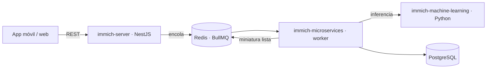

# Módulo 8: Patrones asíncronos avanzados

## Aprende construyendo


### Tema 1: Worker Threads para trabajo CPU-bound · Intermedio · 45 min

<details open>
<summary><strong>Capa 1 — Lectura</strong></summary>

</details>

<details>
<summary><strong>Capa 2 — Construcción</strong></summary>

#### Código y verificación
```bash
mkdir practica-worker
cd practica-worker
mkdir src
```

```json
{
  "name": "practica-worker",
  "private": true,
  "type": "module"
}
```

```js
import { Worker, isMainThread, parentPort, workerData } from "node:worker_threads";

function fibonacci(n) {
  if (!Number.isInteger(n) || n < 0 || n > 40) {
    throw new RangeError("n debe ser un entero entre 0 y 40");
  }
  return n < 2 ? n : fibonacci(n - 1) + fibonacci(n - 2);
}

if (!isMainThread) {
  try {
    parentPort.postMessage({ ok: true, valor: fibonacci(workerData.n) });
  } catch (error) {
    parentPort.postMessage({ ok: false, error: error.message });
  }
} else {
  const worker = new Worker(new URL(import.meta.url), {
    workerData: { n: 35 },
  });
  const latido = setInterval(() => console.log("el hilo principal responde"), 40);

  worker.once("message", async (resultado) => {
    clearInterval(latido);
    console.log(resultado);
    await worker.terminate();
  });
  worker.once("error", async (error) => {
    clearInterval(latido);
    console.error("Worker falló:", error.message);
    await worker.terminate();
  });
}
```

```bash
node src/calcular.js
```

</details>

### Tema 2: Cluster module y balanceo entre procesos · Intermedio · 45 min

<details open>
<summary><strong>Capa 1 — Lectura</strong></summary>

</details>

<details>
<summary><strong>Capa 2 — Construcción</strong></summary>

#### Código y verificación
```bash
mkdir practica-cluster
cd practica-cluster
mkdir src
```

```json
{
  "name": "practica-cluster",
  "private": true,
  "type": "module"
}
```

```js
import cluster from "node:cluster";
import http from "node:http";
import os from "node:os";

const cantidad = Math.min(2, os.availableParallelism());

if (cluster.isPrimary) {
  console.log(`Primario ${process.pid}: iniciará ${cantidad} workers`);
  cluster.on("online", (worker) => {
    console.log(`Worker local listo: PID ${worker.process.pid}`);
  });
  cluster.on("exit", (worker, code, signal) => {
    console.log(`Worker ${worker.process.pid} terminó`, { code, signal });
  });
  for (let i = 0; i < cantidad; i += 1) cluster.fork();
} else {
  let atendidas = 0;
  const server = http.createServer((_req, res) => {
    atendidas += 1;
    res.setHeader("content-type", "application/json");
    res.end(JSON.stringify({ pid: process.pid, atendidas }) + "\n");
  });
  server.listen(3000, "127.0.0.1");
  process.on("SIGTERM", () => server.close(() => process.exit(0)));
}
```

```bash
node src/server.js
```

```bash
for i in {1..8}; do curl -s http://127.0.0.1:3000/; done
```

```bash
kill -TERM PID_IMPRESO_POR_TU_PRIMARIO
```

</details>

### Tema 3: Redis para caché, idempotencia y Pub/Sub · Avanzado · 45 min

<details open>
<summary><strong>Capa 1 — Lectura</strong></summary>

</details>

<details>
<summary><strong>Capa 2 — Construcción</strong></summary>

#### Código y verificación
```bash
mkdir practica-redis
cd practica-redis
mkdir src
docker run --name redis-practica-patrones -p 127.0.0.1:6379:6379 -d redis:7.2.5-alpine
```

```json
{
  "name": "practica-redis",
  "private": true,
  "type": "module",
  "dependencies": {
    "redis": "^4.7.0"
  }
}
```

```bash
npm install
```

```js
import { createClient } from "redis";

const redis = createClient({ url: "redis://127.0.0.1:6379" });
redis.on("error", (error) => console.error("redis_error", error.message));
await redis.connect();

const repository = {
  calls: 0,
  async findById(id) {
    this.calls += 1;
    return { id, tarifa: 12500 };
  },
};

async function findDeliveryCached(id) {
  const key = `delivery:${id}`;
  const cached = await redis.get(key);
  if (cached) return JSON.parse(cached);
  const delivery = await repository.findById(id);
  if (delivery) await redis.set(key, JSON.stringify(delivery), { EX: 30 });
  return delivery;
}

try {
  const primeraLectura = await findDeliveryCached("RF-100");
  const segundaLectura = await findDeliveryCached("RF-100");
  const primeraReserva = await redis.set("orden:RF-100", "procesada", { NX: true, EX: 3600 });
  const segundaReserva = await redis.set("orden:RF-100", "procesada", { NX: true, EX: 3600 });
  console.log({ primeraLectura, segundaLectura, llamadasAlRepositorio: repository.calls });
  console.log({ primeraReserva, segundaReserva });
} finally {
  await redis.quit();
}
```

```bash
node src/app.js
```

```js
import { createClient } from "redis";
import { setTimeout as delay } from "node:timers/promises";

const publisher = createClient({ url: "redis://127.0.0.1:6379" });
const subscriber = publisher.duplicate();
publisher.on("error", (error) => console.error("publisher_error", error.message));
subscriber.on("error", (error) => console.error("subscriber_error", error.message));
await Promise.all([publisher.connect(), subscriber.connect()]);

const recibidos = [];
await subscriber.subscribe("delivery.changed", (message) => recibidos.push(message));
await publisher.publish("delivery.changed", "conectado");
await delay(50);
await subscriber.quit();
const receptoresAusentes = await publisher.publish("delivery.changed", "desconectado");
console.log({ recibidos, receptoresAusentes });
await publisher.quit();
```

</details>

### Tema 4: Colas de trabajo con BullMQ · Avanzado · 45 min

<details open>
<summary><strong>Capa 1 — Lectura</strong></summary>

</details>

<details>
<summary><strong>Capa 2 — Construcción</strong></summary>

#### Código y verificación
```bash
mkdir practica-bullmq
cd practica-bullmq
mkdir src
docker run --name redis-practica-bullmq -p 127.0.0.1:6379:6379 -d redis:7.2.5-alpine
```

```json
{
  "name": "practica-bullmq",
  "private": true,
  "type": "module",
  "dependencies": {
    "bullmq": "^5.0.0"
  }
}
```

```bash
npm install
```

```js
import { Queue, Worker } from "bullmq";

const connection = { host: "127.0.0.1", port: 6379 };
const queue = new Queue("etiquetas", { connection });
const efectosLocales = new Set();

const worker = new Worker(
  "etiquetas",
  async (job) => {
    console.log(`intento=${job.attemptsMade + 1} guia=${job.data.guia}`);
    if (job.attemptsMade === 0) throw new Error("fallo transitorio simulado");
    if (efectosLocales.has(job.data.guia)) return { duplicado: true };
    efectosLocales.add(job.data.guia);
    return { guia: job.data.guia };
  },
  { connection, concurrency: 2 },
);

worker.on("failed", (job, error) => {
  console.log(`falló job=${job?.id}: ${error.message}`);
});
worker.on("error", (error) => console.error("worker_error", error.message));

let timeout;
const completado = new Promise((resolve, reject) => {
  worker.once("completed", (job) => resolve(job.id));
  timeout = setTimeout(() => reject(new Error("tiempo de espera agotado")), 10000);
});

try {
  const opciones = {
    jobId: "etiqueta-RF-100",
    attempts: 3,
    backoff: { type: "exponential", delay: 100 },
  };
  const original = await queue.add("generar", { guia: "RF-100" }, opciones);
  const idCompletado = await completado;
  const duplicado = await queue.add("generar", { guia: "RF-100" }, opciones);
  console.log({ original: original.id, idCompletado, duplicado: duplicado.id });
} finally {
  clearTimeout(timeout);
  await worker.close();
  await queue.close();
}
```

```bash
node src/cola.js
```

```bash
docker rm -f redis-practica-bullmq
```

</details>

#### Caso real: Immich, colas BullMQ en producción

[Immich](https://github.com/immich-app/immich) es un gestor de fotos y videos que se instala en un servidor propio. Su backend es Node.js con NestJS y usa exactamente el patrón de este tema: Redis con BullMQ para las colas de trabajo.

**Cómo lo organiza.** El backend corre en dos contenedores con el mismo código. `immich-server` atiende la API REST y programa tareas; `immich-microservices` solo consume trabajos de Redis y nunca atiende peticiones HTTP. Así, generar miniaturas o transcodificar un video no frena la API.

**Trabajos encadenados.** Algunos trabajos disparan otros: la búsqueda inteligente y el reconocimiento facial se encolan cuando termina la miniatura. Es la misma idea de `job.data` → siguiente cola que construiste aquí, a escala real.

**Servicio aparte para lo pesado.** El reconocimiento de imágenes no corre en Node: vive en `immich-machine-learning`, un servicio Python con FastAPI que ejecuta modelos ONNX. Node encola y orquesta; el trabajo de CPU intensivo va a otro proceso, igual que con Worker Threads en el Tema 1 pero separado por red.



**Explóralo tú.** Clona el repo y busca dónde se declaran las colas y sus trabajos:

```bash
git clone --depth 1 https://github.com/immich-app/immich
cd immich/server
grep -rn "QueueName\." src --include=*.ts | head -20
```

**Ejercicio.** Ubica una cola que dispare otra al terminar y dibuja la cadena completa. ¿Qué pasa con los trabajos pendientes si se reinicia solo `immich-microservices`?

Fuente: [arquitectura de Immich](https://docs.immich.app/developer/architecture).

### Tema 5: PM2, memory leaks y heap snapshots · Avanzado · 45 min

<details open>
<summary><strong>Capa 1 — Lectura</strong></summary>

</details>

<details>
<summary><strong>Capa 2 — Construcción</strong></summary>

#### Código y verificación
```bash
mkdir practica-memoria
cd practica-memoria
mkdir src
```

```json
{
  "name": "practica-memoria",
  "private": true,
  "type": "module",
  "devDependencies": {
    "pm2": "^5.4.3"
  }
}
```

```bash
npm install
```

```js
const retenidos = [];
let solicitud = 0;

setInterval(() => {
  for (let i = 0; i < 100; i += 1) {
    solicitud += 1;
    retenidos.push({ solicitud, payload: "x".repeat(1024) });
  }
  const { rss, heapUsed, external } = process.memoryUsage();
  const mb = (bytes) => Math.round(bytes / 1024 / 1024);
  console.log({ objetos: retenidos.length, rssMB: mb(rss), heapUsedMB: mb(heapUsed), externalMB: mb(external) });
}, 500);
```

```bash
node --inspect=127.0.0.1:9229 src/leak.js
```

```js
module.exports = {
  apps: [{ name: "memoria-academia", script: "src/cache-limitada.js", instances: 1 }],
};
```

</details>

### 1. Crea el proyecto y Redis

<details open>
<summary><strong>Capa 1 — Lectura</strong></summary>

</details>

<details>
<summary><strong>Capa 2 — Construcción</strong></summary>

#### Código y verificación
```bash
mkdir laboratorio-despachos
cd laboratorio-despachos
mkdir src
docker run --name redis-laboratorio-despachos -p 127.0.0.1:6379:6379 -d redis:7.2.5-alpine
```

```json
{
  "name": "laboratorio-despachos",
  "private": true,
  "type": "module",
  "dependencies": {
    "bullmq": "^5.0.0"
  }
}
```

</details>

### 2. Implementa el cálculo CPU-bound

<details open>
<summary><strong>Capa 1 — Lectura</strong></summary>

</details>

<details>
<summary><strong>Capa 2 — Construcción</strong></summary>

#### Código y verificación
```js
import { parentPort, workerData } from "node:worker_threads";

let puntuacion = workerData.semilla;
for (let i = 0; i < 8_000_000; i += 1) {
  puntuacion = (puntuacion * 31 + i) % 1_000_000_007;
}
parentPort.postMessage({ guia: workerData.guia, puntuacion });
```

</details>

### 3. Implementa cluster, límite de Workers y productor

<details open>
<summary><strong>Capa 1 — Lectura</strong></summary>

</details>

<details>
<summary><strong>Capa 2 — Construcción</strong></summary>

#### Código y verificación
```js
import cluster from "node:cluster";
import http from "node:http";
import os from "node:os";
import { Worker } from "node:worker_threads";
import { setTimeout as delay } from "node:timers/promises";
import { Queue } from "bullmq";

const cantidad = Math.min(2, os.availableParallelism());

if (cluster.isPrimary) {
  cluster.on("online", (worker) => console.log(`API PID ${worker.process.pid}`));
  cluster.on("exit", (worker) => console.log(`Terminó API PID ${worker.process.pid}`));
  for (let i = 0; i < cantidad; i += 1) cluster.fork();
} else {
  const cola = new Queue("laboratorio-etiquetas", {
    connection: { host: "127.0.0.1", port: 6379 },
  });
  let activos = 0;
  const esperando = [];

  async function conCupo(tarea) {
    if (activos >= 2) await new Promise((resolve) => esperando.push(resolve));
    activos += 1;
    try {
      return await tarea();
    } finally {
      activos -= 1;
      esperando.shift()?.();
    }
  }

  async function asignar(guia) {
    return conCupo(async () => {
      const worker = new Worker(new URL("./asignacion.js", import.meta.url), {
        workerData: { guia, semilla: 42 },
      });
      try {
        return await new Promise((resolve, reject) => {
          worker.once("message", resolve);
          worker.once("error", reject);
        });
      } finally {
        await worker.terminate();
      }
    });
  }

  function responder(res, status, cuerpo) {
    res.writeHead(status, { "content-type": "application/json" });
    res.end(JSON.stringify(cuerpo) + "\n");
  }

  const server = http.createServer(async (req, res) => {
    const url = new URL(req.url, "http://127.0.0.1");
    const guia = url.searchParams.get("guia") ?? "RF-100";
    try {
      if (url.pathname === "/salud") {
        responder(res, 200, { ok: true, pid: process.pid, workersCpuActivos: activos });
      } else if (url.pathname === "/asignar") {
        responder(res, 200, { ...(await asignar(guia)), pid: process.pid });
      } else if (url.pathname === "/etiqueta") {
        const job = await cola.add("generar", { guia }, {
          jobId: `laboratorio-${guia}`,
          attempts: 3,
          backoff: { type: "exponential", delay: 100 },
        });
        responder(res, 202, { encolado: job.id, pid: process.pid });
      } else if (url.pathname === "/etiqueta-sincrona") {
        await delay(300);
        responder(res, 200, { generada: guia, pid: process.pid });
      } else {
        responder(res, 404, { error: "ruta no encontrada" });
      }
    } catch (error) {
      responder(res, 500, { error: error.message });
    }
  });

  server.listen(3000, "127.0.0.1", () => console.log(`Escuchando PID ${process.pid}`));
  process.on("SIGTERM", async () => {
    await cola.close();
    server.close(() => process.exit(0));
  });
}
```

</details>

### 4. Implementa el consumidor con reintento y cierre

<details open>
<summary><strong>Capa 1 — Lectura</strong></summary>

</details>

<details>
<summary><strong>Capa 2 — Construcción</strong></summary>

#### Código y verificación
```js
import { Worker } from "bullmq";
import { setTimeout as delay } from "node:timers/promises";

const efectosLocales = new Set();
const worker = new Worker(
  "laboratorio-etiquetas",
  async (job) => {
    if (job.attemptsMade === 0) throw new Error("fallo deliberado del primer intento");
    if (efectosLocales.has(job.data.guia)) return { duplicado: true };
    await delay(300);
    efectosLocales.add(job.data.guia);
    return { etiqueta: job.data.guia };
  },
  { connection: { host: "127.0.0.1", port: 6379 }, concurrency: 2 },
);

worker.on("failed", (job, error) => console.log(`Falló ${job?.id}: ${error.message}`));
worker.on("completed", (job) => console.log(`Completado ${job.id}`));
worker.on("error", (error) => console.error(error.message));

async function cerrar() {
  await worker.close();
  process.exit(0);
}
process.on("SIGINT", cerrar);
process.on("SIGTERM", cerrar);
```

</details>

### 5. Ejecuta y observa

<details open>
<summary><strong>Capa 1 — Lectura</strong></summary>

</details>

<details>
<summary><strong>Capa 2 — Construcción</strong></summary>

#### Código y verificación
```bash
node src/api.js
```

```bash
node src/trabajador-etiquetas.js
```

```bash
curl -s http://127.0.0.1:3000/salud &
curl -s 'http://127.0.0.1:3000/asignar?guia=RF-200' &
wait
```

```bash
time curl -s 'http://127.0.0.1:3000/etiqueta-sincrona?guia=RF-201'
time curl -s 'http://127.0.0.1:3000/etiqueta?guia=RF-202'
```

</details>

### 6. Verificación y cierre

<details open>
<summary><strong>Capa 1 — Lectura</strong></summary>

</details>

<details>
<summary><strong>Capa 2 — Construcción</strong></summary>

#### Código y verificación
```bash
docker rm -f redis-laboratorio-despachos
```

</details>
