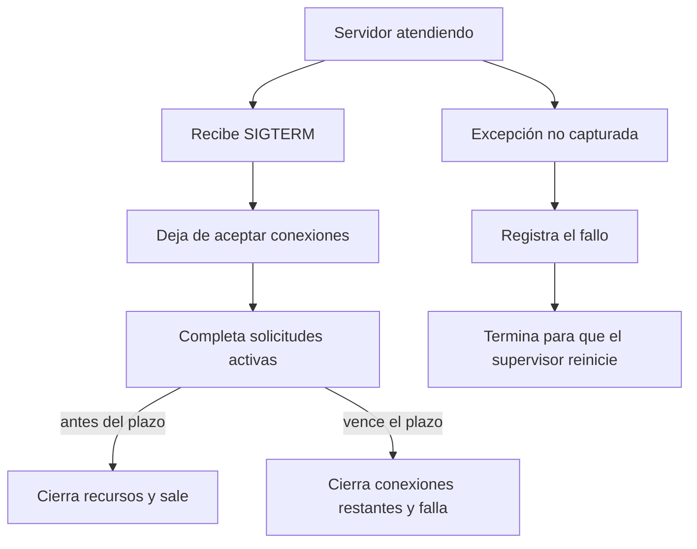

# Módulo 9: Observabilidad y manejo de errores en producción

## Aprende construyendo

### Tema 1: Logging estructurado · Intermedio · 45 min

**Prerrequisito:** Node.js LTS, terminal y nociones básicas de JavaScript. No necesitas archivos de otros temas.

**Al terminar podrás:** emitir eventos JSON filtrables por nivel y comprobar que credenciales y campos no autorizados no llegan a la salida.

#### Aprende

**Por qué importa:** durante un incidente, una frase libre como «falló la entrega» no permite consultar de forma fiable por solicitud, ruta o código de error. Una línea JSON con campos estables sí puede indexarse y correlacionarse en sistemas como CloudWatch, Datadog o Grafana Loki.

Un evento útil separa el mensaje estable de sus datos: nivel, instante, mensaje y atributos permitidos. Bibliotecas como Pino están optimizadas para producir este formato; aquí construirás un logger pequeño con Node para hacer visible el mecanismo. El nivel mínimo evita emitir detalle de desarrollo en producción sin cambiar el formato de los eventos.

La protección de secretos debe basarse en una **allowlist** o en un esquema igualmente restrictivo: solo se copian campos conocidos y seguros. Borrar únicamente `password` y `authorization` no es una garantía, porque una credencial puede llamarse `sessionToken`, `apiKey` o aparecer dentro de otro objeto. Tampoco concatenes datos no confiables en el mensaje.

**Analogía:** un log estructurado es un formulario con casillas aprobadas, no una hoja en blanco. La allowlist es la lista de casillas que pueden copiarse; si un dato llega en un papel aparte, no entra «por si acaso». La analogía tiene un límite: en software también hay que definir niveles, serialización y destino de salida.

**Conceptos clave:** JSON por línea, campos estables, niveles, filtrado con `LOG_LEVEL`, serialización de errores y redacción por allowlist.

#### Practica

Crea un proyecto nuevo. Tanto `package.json` como el código se escriben manualmente; no copies archivos de otro ejemplo.

```bash
mkdir ejemplo-logging
cd ejemplo-logging
mkdir src
```

Crea `package.json`:

```json
{
  "name": "ejemplo-logging",
  "private": true,
  "type": "module",
  "scripts": {
    "start": "node src/logger.js"
  }
}
```

Crea `src/logger.js`:

```js
const niveles = { debug: 10, info: 20, warn: 30, error: 40 };
const nivelMinimo = niveles[process.env.LOG_LEVEL ?? "info"] ?? niveles.info;
const camposPermitidos = [
  "requestId",
  "route",
  "statusCode",
  "durationMs",
  "errorCode",
  "errorName",
];

function log(level, message, fields = {}) {
  if (niveles[level] < nivelMinimo) return;

  const seguros = Object.fromEntries(
    camposPermitidos
      .filter((campo) => Object.hasOwn(fields, campo))
      .map((campo) => [campo, fields[campo]]),
  );

  const evento = {
    timestamp: new Date().toISOString(),
    level,
    message,
    ...seguros,
  };
  process.stdout.write(`${JSON.stringify(evento)}\n`);
}

log("debug", "detalle de desarrollo", { route: "/health" });
log("info", "servidor iniciado", { route: "/health", statusCode: 200 });
log("error", "consulta fallida", {
  requestId: "req-1",
  errorCode: "DB_TIMEOUT",
  errorName: "TimeoutError",
  authorization: "Bearer secreto",
  sessionToken: "otro-secreto",
});
```

Ejecuta desde `ejemplo-logging`:

```bash
npm start
```

**Salida esperada:** dos líneas JSON, una `info` y otra `error`; no aparece la línea `debug`. En la segunda línea están `requestId`, `errorCode` y `errorName`, pero no `authorization` ni `sessionToken`. El valor de `timestamp` cambiará en cada ejecución.

Prueba también:

```bash
LOG_LEVEL=error npm start
```

**Salida esperada:** solamente el evento `error`.

**Fallo deliberado y corrección:** sustituye temporalmente `...seguros` por `...fields` y ejecuta `npm start`. Las dos credenciales quedan visibles: el diagnóstico es que se serializó la entrada completa. Restaura `...seguros`, repite el comando y verifica que vuelven a desaparecer. La corrección es conservar la allowlist, no añadir dos `delete` más.

#### Aplica

**Práctica guiada:** añade un evento `warn` con `durationMs: 1250` y un error capturado del que copies únicamente `error.name` y un código propio a los campos permitidos. Predice qué eventos verás con `LOG_LEVEL=warn`; después ejecuta ese comando y compara. No serialices el objeto `Error` completo: sus propiedades útiles no siempre son enumerables y su contenido puede incluir datos sensibles.

**Práctica independiente:** registra una operación `confirmar_entrega` con tres eventos (`inicio`, `resultado` y `error`) usando mensajes estables. Debe poder ejecutarse con `LOG_LEVEL=info` y `LOG_LEVEL=error`, filtrar correctamente y descartar los campos no declarados `apiKey`, `direccion` y `payload`. Entrega la salida de ambos niveles y explica qué campo consultarías para encontrar el error.

**Checklist de salida:**

- [ ] Cada evento ocupa una línea y puede analizarse como JSON.
- [ ] `LOG_LEVEL=error` suprime los eventos `debug`, `info` y `warn`.
- [ ] Una entrada con `authorization`, `sessionToken` y `apiKey` no revela ninguno de esos valores.
- [ ] Los errores conservan un nombre y un código permitidos sin volcar todo el objeto.
- [ ] Los mensajes son estables y los valores variables viven en campos acotados.

**Errores comunes:** concatenar strings; confiar en una denylist de dos claves; registrar cuerpos completos; usar niveles inconsistentes; emitir un evento por cada chunk; incluir datos personales sin necesidad.

**Fuentes oficiales:** [Node console](https://nodejs.org/api/console.html) y [OWASP Logging](https://cheatsheetseries.owasp.org/cheatsheets/Logging_Cheat_Sheet.html).

**Transferencia al proyecto integrador «API operativa de entregas»:** registra resultado, duración y correlación de una confirmación con una allowlist compartida. La evidencia debe permitir localizar la causa sin incluir tokens, direcciones ni el cuerpo completo.

### Tema 2: Correlation ID por request · Intermedio · 45 min

**Prerrequisito:** Node.js LTS, HTTP básico, `curl` y el tema anterior como conocimiento conceptual; este ejercicio vuelve a empezar en una carpeta vacía.

**Al terminar podrás:** propagar un `requestId` validado por eventos asíncronos y por la cabecera de respuesta, sin tratarlo como autenticación.

#### Aprende

**Por qué importa:** miles de solicitudes concurrentes entrelazan sus logs. Un correlation ID permite reunir los eventos de una operación concreta en API, base de datos y llamadas internas, en lugar de adivinar qué líneas pertenecen juntas.

Al entrar una petición, el servidor acepta `x-request-id` solo si cumple un formato y una longitud acotados; en otro caso genera un UUID. El identificador se adjunta al contexto de logging y a la respuesta. En una arquitectura con Express, un middleware y un logger hijo cumplen esta función; con `node:http` puede hacerse explícitamente alrededor del handler.

El valor externo es una **etiqueta de correlación no confiable**, no una credencial. No autoriza operaciones, no sustituye sesiones o tokens y no debe aceptarse con controles, espacios arbitrarios o miles de caracteres. Si dos clientes reutilizan el mismo valor, sus eventos quedarán mezclados; por eso tampoco se afirma que un ID externo garantice unicidad.

**Analogía:** es el número de seguimiento de un paquete que se repite en almacén, transporte y entrega. Sirve para encontrar el recorrido, pero presentar ese número no demuestra que seas el dueño del paquete.

**Conceptos clave:** `crypto.randomUUID`, validación de entrada, propagación asíncrona, cabecera `x-request-id`, contexto por solicitud y W3C Trace Context para interoperabilidad de trazas.

#### Practica

Crea un proyecto independiente:

```bash
mkdir ejemplo-correlation-id
cd ejemplo-correlation-id
mkdir src
```

Crea manualmente `package.json`:

```json
{
  "name": "ejemplo-correlation-id",
  "private": true,
  "type": "module",
  "scripts": {
    "start": "node src/server.js"
  }
}
```

Crea `src/server.js`:

```js
import http from "node:http";
import { randomUUID } from "node:crypto";

const formatoRequestId = /^[A-Za-z0-9._:-]{1,64}$/;

function requestIdValido(valor) {
  return typeof valor === "string" && formatoRequestId.test(valor);
}

const espera = (ms) => new Promise((resolve) => setTimeout(resolve, ms));

const server = http.createServer(async (req, res) => {
  const externo = req.headers["x-request-id"];
  const requestId = requestIdValido(externo) ? externo : randomUUID();
  const log = (event) => {
    process.stdout.write(`${JSON.stringify({ event, requestId })}\n`);
  };

  res.setHeader("content-type", "application/json");
  res.setHeader("x-request-id", requestId);

  try {
    log("request.started");
    await espera(25);
    log("lookup.completed");
    res.end(JSON.stringify({ ok: true, requestId }));
  } catch {
    res.statusCode = 500;
    log("request.failed");
    res.end(JSON.stringify({ ok: false }));
  } finally {
    log("request.finished");
  }
});

server.listen(3000, () => {
  console.log("http://127.0.0.1:3000");
});
```

En una terminal ejecuta `npm start`. En otra, sin cambiar de proyecto en la primera:

```bash
curl -i -H 'x-request-id: demo-1' http://127.0.0.1:3000/entregas/RF-1
```

**Salida esperada:** la respuesta incluye `x-request-id: demo-1` y el cuerpo contiene el mismo valor. El servidor muestra `request.started`, `lookup.completed` y `request.finished` con `requestId` igual a `demo-1`.

Envía una entrada fuera de límite:

```bash
curl -s -H "x-request-id: $(node -e 'process.stdout.write("A".repeat(5000))')" http://127.0.0.1:3000/entregas/RF-1
```

**Salida esperada:** el cuerpo contiene un UUID nuevo, no las 5000 letras. El servidor nunca refleja esa entrada en una cabecera o log.

**Fallo deliberado y corrección:** cambia temporalmente la asignación por `const requestId = typeof externo === "string" ? externo : randomUUID();` y repite ambos `curl`. El identificador arbitrario se acepta. Restaura la llamada a `requestIdValido` y verifica de nuevo el rechazo silencioso mediante un UUID; validar antes de registrar o responder es la corrección.

#### Aplica

**Práctica guiada:** extrae los tres logs a una función `registrar(contexto, evento)` que reciba `{ requestId }`. Pasa ese contexto a una función asíncrona `buscarEntrega` y añade un evento `repository.completed`. Comprueba que los cuatro eventos comparten ID sin usar una variable global mutable.

**Práctica independiente:** realiza dos solicitudes concurrentes, una con `cliente-a:1` y otra sin cabecera. Añade una espera distinta a cada una y entrega los seis eventos. Demuestra que el primer ID solo aparece en su solicitud y que la segunda recibe un UUID; añade una prueba con `id con espacios` que también debe generar un UUID. Explica por qué ninguno de esos valores puede conceder acceso a una entrega.

**Checklist de salida:**

- [ ] Una solicitud válida devuelve el mismo `x-request-id` que aparece en todos sus logs.
- [ ] Un ID vacío, con controles, con espacios o de más de 64 caracteres se sustituye por un UUID.
- [ ] Dos solicitudes concurrentes no comparten estado mediante una variable global.
- [ ] Los eventos posteriores a un `await` conservan el ID correcto.
- [ ] La autorización se decide con credenciales reales, nunca con `requestId`.

**Errores comunes:** reutilizar un ID global; aceptar cualquier texto; registrar PII; perder el contexto en callbacks; confundir correlación con autenticación; suponer que un ID externo siempre es único.

**Fuentes oficiales:** [Express middleware](https://expressjs.com/en/guide/using-middleware.html), [`crypto.randomUUID`](https://nodejs.org/api/crypto.html#cryptorandomuuidoptions) y [W3C Trace Context](https://www.w3.org/TR/trace-context/).

**Transferencia al proyecto integrador «API operativa de entregas»:** propaga el ID validado desde la confirmación hasta repositorio y notificaciones. Devuélvelo al cliente para soporte, pero conserva la autorización basada en la identidad autenticada.

### Tema 3: Excepciones no capturadas y graceful shutdown · Avanzado · 60 min

**Prerrequisito:** Node.js LTS moderno, procesos, señales de terminal y HTTP básico. El servidor se crea desde cero y no depende de ejemplos anteriores.

**Al terminar podrás:** detener el proceso tras un fallo fatal y completar o interrumpir por plazo las solicitudes activas al recibir `SIGTERM`, cerrando también los recursos.

#### Aprende

**Por qué importa:** un despliegue debe retirar una instancia sin cortar arbitrariamente solicitudes en curso. En cambio, después de una excepción no capturada, el proceso puede tener estado inconsistente y no debe seguir atendiendo como si nada hubiera ocurrido.

En Node.js moderno, una promesa rechazada sin manejar se comporta por defecto como una excepción no capturada y puede terminar el proceso; no es correcto describir `unhandledRejection` como un evento que «solo muestra una advertencia». Registrar un manejador cambia esa red de seguridad, por lo que el manejador debe registrar y terminar con código distinto de cero, no mantener el servicio vivo. La solución primaria sigue siendo manejar los errores en su origen.

Con `SIGTERM`, el servidor deja de aceptar conexiones nuevas, espera las activas y cierra recursos como temporizadores, pools o clientes. El cierre necesita un **plazo máximo**: pasado ese tiempo se fuerzan las conexiones restantes y el proceso sale con fallo. Un supervisor puede reemplazar la instancia; el manejador de señales no sustituye al supervisor.

**Analogía:** el apagado ordenado es cerrar una tienda: dejas de admitir clientes nuevos, atiendes a quienes están dentro y cierras caja antes de apagar. Una excepción no capturada es una alarma estructural: evacuar es más prudente que seguir vendiendo. La analogía no elimina la necesidad de un plazo técnico.

**Conceptos clave:** `uncaughtException`, `unhandledRejection`, `SIGTERM`, `SIGINT`, `server.close`, conexiones activas, cierre de recursos y deadline.

#### Practica

Crea otro proyecto vacío:

```bash
mkdir ejemplo-shutdown
cd ejemplo-shutdown
mkdir src
```

Crea `package.json`:

```json
{
  "name": "ejemplo-shutdown",
  "private": true,
  "type": "module",
  "scripts": {
    "start": "node src/server.js"
  }
}
```

Crea `src/server.js`:

```js
import http from "node:http";

const server = http.createServer((req, res) => {
  if (req.url === "/boom") {
    setTimeout(() => {
      throw new Error("fallo deliberado");
    }, 20);
    res.end("fallo programado\n");
    return;
  }

  setTimeout(() => res.end("ok\n"), 1500);
});

// Representa un recurso que mantiene handles abiertos, como un pool.
const recurso = setInterval(() => {}, 60_000);
let cerrando = false;

function cerrarRecursos() {
  clearInterval(recurso);
  console.log(JSON.stringify({ event: "resources.closed" }));
}

function apagar(signal) {
  if (cerrando) return;
  cerrando = true;
  console.log(JSON.stringify({ event: "shutdown.started", signal }));

  const plazo = setTimeout(() => {
    console.error(JSON.stringify({ event: "shutdown.deadline" }));
    server.closeAllConnections();
    process.exitCode = 1;
  }, 5000);
  plazo.unref();

  server.close((error) => {
    clearTimeout(plazo);
    cerrarRecursos();
    if (error) {
      console.error(JSON.stringify({ event: "shutdown.failed" }));
      process.exitCode = 1;
    } else {
      console.log(JSON.stringify({ event: "shutdown.completed" }));
    }
  });
  server.closeIdleConnections();
}

function fatal(tipo, error) {
  console.error(JSON.stringify({
    level: "fatal",
    event: tipo,
    name: error instanceof Error ? error.name : "Error",
    message: error instanceof Error ? error.message : String(error),
  }));
  process.exit(1);
}

process.on("uncaughtException", (error) => fatal("uncaughtException", error));
process.on("unhandledRejection", (error) => fatal("unhandledRejection", error));
process.once("SIGTERM", () => apagar("SIGTERM"));
process.once("SIGINT", () => apagar("SIGINT"));

server.listen(3000, () => {
  console.log(JSON.stringify({ event: "server.started", pid: process.pid }));
});
```

Ejecuta `npm start` y anota el `pid` mostrado por **ese proceso local**. En otra terminal inicia una solicitud lenta:

```bash
curl http://127.0.0.1:3000/lenta
```

Mientras espera, envía la señal únicamente al PID anotado, sustituyendo el número de ejemplo:

```bash
kill -TERM 12345
```

No uses `pkill`, `killall` ni un PID sin identificar. **Salida esperada:** `curl` recibe `ok`; el servidor registra `shutdown.started`, `resources.closed` y `shutdown.completed`, y termina. Si una conexión no terminara, el plazo de cinco segundos la cerraría y dejaría código de salida distinto de cero.

**Fallo deliberado y corrección:** primero ejecuta `npm start` y llama a `http://127.0.0.1:3000/boom`; el manejador registra `uncaughtException` y termina con código 1. Después reemplaza temporalmente `process.exit(1)` por otro log y repite: el proceso continúa en un estado no confiable. Restaura `process.exit(1)` y confirma de nuevo la terminación; no conviertas el manejador fatal en un mecanismo para seguir sirviendo.

#### Aplica

**Práctica guiada:** añade un contador `solicitudesActivas` que aumente al entrar y disminuya en `finally`. Regístralo al iniciar y completar el apagado. Después crea una ruta `/rechazo` que produzca una promesa rechazada sin `catch`; verifica por separado que el manejador termina el proceso y corrige la ruta con `try/catch` para ese error recuperable.

**Práctica independiente:** añade una segunda respuesta que nunca termine y comprueba, en dos ejecuciones separadas, que `/lenta` finaliza antes del plazo mientras la conexión bloqueada se corta al llegar el deadline. Documenta los eventos y códigos de salida. Envía `SIGTERM` solo al PID local recién impreso y añade al cierre un recurso simulado con un método `close()` para demostrar que se invoca una sola vez.

**Checklist de salida:**

- [ ] `uncaughtException` registra el fallo y termina; el servidor no continúa atendiendo.
- [ ] `unhandledRejection` no se describe como una simple advertencia en Node moderno y su manejador termina el proceso.
- [ ] `SIGTERM` deja de aceptar conexiones y permite terminar una respuesta lenta dentro del plazo.
- [ ] El deadline cierra conexiones restantes y produce salida con fallo.
- [ ] Los recursos se cierran una sola vez y el PID utilizado en la prueba está identificado.

**Errores comunes:** llamar `process.exit(0)` inmediatamente ante `SIGTERM`; ignorar conexiones; continuar tras una excepción fatal; no cerrar pools o temporizadores; no tener timeout; probar señales contra procesos no identificados.



**Cuándo drenar:** usa apagado gradual para una terminación solicitada, como un reemplazo de despliegue; da un plazo finito y deja que el supervisor gestione el proceso siguiente. Una excepción no capturada es distinta: no continúes atendiendo con estado potencialmente inconsistente. Si el servicio no controla el ciclo del proceso, implementa esta política en su supervisor en vez de instalar manejadores globales que oculten fallos.

**Fuentes oficiales:** [Node process signals](https://nodejs.org/api/process.html#signal-events), [`server.close`](https://nodejs.org/api/net.html#serverclosecallback) y [12-factor disposability](https://12factor.net/disposability).

**Transferencia al proyecto integrador «API operativa de entregas»:** incorpora apagado con plazo a API y consumidores, cierra base de datos y colas, y deja que el supervisor reinicie únicamente los procesos que terminaron por un fallo fatal.

### Tema 4: REST, GraphQL y gRPC · Intermedio · 55 min

**Prerrequisito:** Node.js LTS, JSON, HTTP y lectura básica de contratos. Crearás artefactos nuevos, no un servidor reutilizado.

**Al terminar podrás:** representar una misma consulta en REST, GraphQL y Protocol Buffers, validar una consulta GraphQL real y justificar la elección sin confundir un endpoint de eco con GraphQL.

#### Aprende

**Por qué importa:** el contrato determina qué puede pedir un cliente, cómo se versiona y qué errores puede observar. Elegir por moda puede añadir un servidor flexible cuando bastaba un recurso REST, o exigir tooling binario a un consumidor que no lo necesita.

REST organiza recursos y aprovecha métodos, estados y caché HTTP, aunque una vista puede recibir campos de más o necesitar varias llamadas. GraphQL define un esquema y permite seleccionar campos; necesita validación, límites de complejidad, autorización por campo y una estrategia de caché. gRPC define servicios y mensajes en `.proto`, usa Protocol Buffers y HTTP/2, y facilita clientes tipados para comunicación interna; un navegador normalmente requiere una capa como gRPC-Web.

Una ruta `/graphql` que devuelve `req.body.query` **no es GraphQL**: no analiza una operación, no la valida contra un esquema ni ejecuta resolvers. En esta práctica no fingiremos ese endpoint. REST y gRPC quedan expresados como contratos, mientras GraphQL se valida con la biblioteca oficial de referencia para JavaScript; no se afirma que exista un servidor o un cliente generado.

**Analogía:** REST ofrece platos definidos, GraphQL permite elegir ingredientes de una carta tipada y gRPC usa un pedido interno compacto y estricto. La analogía termina en los detalles: cada opción real necesita errores, versionado, seguridad y tooling.

**Conceptos clave:** recursos y semántica HTTP, esquema GraphQL, selección de campos, sobreconsulta y subconsulta, RPC, Protocol Buffers, generación de cliente y compatibilidad de contratos.

#### Practica

Crea un proyecto desde una carpeta vacía:

```bash
mkdir ejemplo-contratos-api
cd ejemplo-contratos-api
mkdir src contracts
```

Crea `package.json`:

```json
{
  "name": "ejemplo-contratos-api",
  "private": true,
  "type": "module",
  "scripts": {
    "check": "node src/check-contracts.js"
  }
}
```

Instala la dependencia de validación:

```bash
npm install graphql
```

Crea `contracts/paquete.rest.http`:

```http
GET /paquetes/RF-1 HTTP/1.1
Host: localhost:3000
Accept: application/json

# 200: { "id": "RF-1", "estado": "en-ruta" }
# 404: { "error": "PAQUETE_NO_ENCONTRADO" }
```

Crea `contracts/paquete.graphql`:

```graphql
type Paquete {
  id: ID!
  estado: String!
}

type Query {
  paquete(id: ID!): Paquete
}
```

Crea `contracts/consulta.graphql`:

```graphql
query ConsultarPaquete($id: ID!) {
  paquete(id: $id) {
    id
    estado
  }
}
```

Crea `contracts/paquete.proto`:

```proto
syntax = "proto3";
package entregas.v1;

service Paquetes {
  rpc ObtenerPaquete(ObtenerPaqueteRequest) returns (Paquete);
}

message ObtenerPaqueteRequest {
  string id = 1;
}

message Paquete {
  string id = 1;
  string estado = 2;
}
```

Crea `contracts/decision.md`:

```markdown
| Contrato | Consumidor principal | Decisión y límite |
|---|---|---|
| REST | Cliente público HTTP | Recurso cacheable; no selecciona campos. |
| GraphQL | Pantallas con necesidades distintas | Selección tipada; exige límites y autorización. |
| gRPC | Servicio interno | Contrato eficiente y tipado; requiere tooling compatible. |

Los tres contratos comparten las reglas de dominio y autorización. Este ejercicio
valida la consulta GraphQL y revisa artefactos REST/gRPC; no levanta servidores.
```

Crea `src/check-contracts.js`:

```js
import { readFile } from "node:fs/promises";
import { buildSchema, parse, validate } from "graphql";

const leer = (nombre) => readFile(
  new URL(`../contracts/${nombre}`, import.meta.url),
  "utf8",
);

const [rest, sdl, consulta, proto] = await Promise.all([
  leer("paquete.rest.http"),
  leer("paquete.graphql"),
  leer("consulta.graphql"),
  leer("paquete.proto"),
]);

if (!rest.includes("GET /paquetes/RF-1")) {
  throw new Error("El contrato REST no contiene la operación esperada");
}
if (!proto.includes("rpc ObtenerPaquete")) {
  throw new Error("El contrato gRPC no contiene el RPC esperado");
}

const errores = validate(buildSchema(sdl), parse(consulta));
if (errores.length > 0) {
  throw new Error(errores.map((error) => error.message).join("\n"));
}

console.log("REST: operación documentada; servidor no ejecutado");
console.log("GraphQL: consulta válida contra el esquema");
console.log("gRPC: RPC presente; compilación y servidor no ejecutados");
```

Ejecuta:

```bash
npm run check
```

**Salida esperada:**

```text
REST: operación documentada; servidor no ejecutado
GraphQL: consulta válida contra el esquema
gRPC: RPC presente; compilación y servidor no ejecutados
```

**Fallo deliberado y corrección:** añade `direccion` dentro de la selección de `paquete` en `contracts/consulta.graphql` y ejecuta `npm run check`. GraphQL informa `Cannot query field "direccion" on type "Paquete"`. Corrige retirando ese campo si no forma parte del contrato, o añadiendo explícitamente `direccion: String` al tipo si el producto sí debe exponerlo. Repite la validación; no soluciones el error devolviendo la consulta como eco.

#### Aplica

**Práctica guiada:** incorpora `ultimaUbicacion` a los tres contratos. En REST amplía el ejemplo de respuesta, en GraphQL añade el campo al esquema y a la selección, y en gRPC agrega un campo `string` con número `3`. Ejecuta la comprobación y explica qué cambios requieren actualizar clientes.

**Práctica independiente:** diseña `ConfirmarEntrega` como `POST /entregas/{id}/confirmacion`, una mutación GraphQL y un RPC gRPC. Define una entrada con `confirmadoPor`, una salida con estado y errores equivalentes para no encontrado y falta de permiso. Extiende el script para validar la nueva mutación y documenta qué estilo elegirías para una app móvil pública y cuál para un consumidor interno. No dupliques las reglas de autorización en los tres transportes.

**Checklist de salida:**

- [ ] La consulta GraphQL se analiza y valida contra un esquema real.
- [ ] Un campo ausente del esquema produce un error de validación comprensible.
- [ ] REST documenta método, ruta, respuesta y estado de error.
- [ ] El `.proto` declara servicio, método, mensajes y campos numerados.
- [ ] La decisión compara consumidores, caché, selección de campos y tooling sin llamar implementación a un contrato o endpoint de eco.

**Errores comunes:** llamar GraphQL a un echo JSON; usar GraphQL sin límites; confundir gRPC con seguridad; diseñar REST solo como acciones; ignorar compatibilidad; no documentar errores equivalentes.

**Fuentes oficiales:** [HTTP semantics](https://httpwg.org/specs/), [GraphQL specification](https://spec.graphql.org/) y [gRPC](https://grpc.io/docs/what-is-grpc/).

**Transferencia al proyecto integrador «API operativa de entregas»:** expón la consulta de guía con el contrato elegido y conserva errores y autorización equivalentes. Justifica la elección por los clientes reales, no por la cantidad de endpoints.

### Tema 5: Métricas Prometheus y trazas distribuidas con OpenTelemetry · Avanzado · 75 min

**Prerrequisito:** Node.js LTS, Express básico, HTTP, métricas y promesas. El proyecto incluye sus propias dependencias y no importa archivos de otros temas.

**Al terminar podrás:** exponer métricas con etiquetas acotadas y producir spans locales con OpenTelemetry, cargando la instrumentación antes de Express y cerrando cada span en `finally`.

#### Aprende

**Por qué importa:** los logs explican eventos, las métricas muestran tendencias y las trazas conectan operaciones de una solicitud. Una API puede seguir respondiendo mientras su latencia empeora; las tres señales ayudan a localizar dónde y cuándo ocurre.

Un contador solo aumenta; un histograma distribuye duraciones en buckets y permite estimar percentiles. Las etiquetas crean series: `route="/paquetes/:id"` es una plantilla acotada, mientras `route="/paquetes/RF-1"`, una URL cruda, un `userId` o un número de guía generan cardinalidad innecesaria y pueden filtrar datos.

Un span representa una operación y debe terminar incluso si hay un error. La instrumentación de OpenTelemetry debe cargarse **antes** de importar Express o los drivers que interceptará. Además, crear spans no implica observarlos fuera del proceso: hace falta un exportador. Este ejercicio configura `ConsoleSpanExporter` para evidencia local; no declara que exista un backend remoto ni trazas exportadas por OTLP.

**Analogía:** las métricas son el tablero del vehículo, los logs la bitácora y una traza la ruta GPS de un viaje. Una etiqueta por matrícula convertiría el tablero en miles de diales; por eso las métricas agregan y los logs o trazas restringidas estudian casos individuales.

**Conceptos clave:** contador, histograma, RED (tasa, errores y duración), cardinalidad, route template, contexto, span, `finally`, inicialización temprana y exportador.

#### Practica

Crea un proyecto nuevo:

```bash
mkdir ejemplo-observabilidad
cd ejemplo-observabilidad
mkdir src
```

Crea `package.json`:

```json
{
  "name": "ejemplo-observabilidad",
  "private": true,
  "type": "module",
  "scripts": {
    "start": "node src/server.js"
  }
}
```

Instala las dependencias:

```bash
npm install express prom-client @opentelemetry/api @opentelemetry/sdk-node @opentelemetry/sdk-trace-node @opentelemetry/auto-instrumentations-node
```

Crea `src/telemetry.js`:

```js
import { NodeSDK } from "@opentelemetry/sdk-node";
import { getNodeAutoInstrumentations } from "@opentelemetry/auto-instrumentations-node";
import {
  ConsoleSpanExporter,
  SimpleSpanProcessor,
} from "@opentelemetry/sdk-trace-node";

const sdk = new NodeSDK({
  spanProcessor: new SimpleSpanProcessor(new ConsoleSpanExporter()),
  instrumentations: [getNodeAutoInstrumentations()],
});

await sdk.start();

export { sdk };
```

Crea `src/app.js`:

```js
import express from "express";
import client from "prom-client";
import { SpanStatusCode, trace } from "@opentelemetry/api";

client.collectDefaultMetrics();

const requests = new client.Counter({
  name: "http_requests_total",
  help: "Requests",
  labelNames: ["route"],
});

const requestDuration = new client.Histogram({
  name: "app_http_request_duration_seconds",
  help: "Duración de solicitudes HTTP",
  labelNames: ["method", "route", "status_code"],
  buckets: [0.05, 0.1, 0.25, 0.5, 1, 2],
});

const app = express();

app.use((req, res, next) => {
  const stop = requestDuration.startTimer();
  res.on("finish", () => {
    const route = req.route?.path ?? "unmatched";
    requests.inc({ route });
    stop({
      method: req.method,
      route,
      status_code: String(res.statusCode),
    });
  });
  next();
});

app.get("/health", (_req, res) => {
  res.json({ ok: true });
});

app.get("/paquetes/:id", (req, res) => {
  const span = trace.getTracer("api-entregas").startSpan("paquetes.consultar");
  try {
    span.setAttribute("http.route", "/paquetes/:id");
    span.setAttribute("http.response.status_code", 200);
    res.json({ id: req.params.id, estado: "en-ruta" });
  } catch (error) {
    span.recordException(error);
    span.setStatus({ code: SpanStatusCode.ERROR });
    res.status(500).json({ error: "CONSULTA_FALLIDA" });
  } finally {
    span.end();
  }
});

app.get("/fallo", (_req, res) => {
  res.status(500).json({ error: "FALLO_DELIBERADO" });
});

app.get("/metrics", async (_req, res) => {
  res.type(client.register.contentType);
  res.end(await client.register.metrics());
});

export default app;
```

Crea `src/server.js`. Los `import` dinámicos y su orden son deliberados:

```js
const { sdk } = await import("./telemetry.js");
const { default: app } = await import("./app.js");

const server = app.listen(3000, () => {
  console.log("http://127.0.0.1:3000");
});

process.once("SIGTERM", () => {
  server.close(async () => {
    try {
      await sdk.shutdown();
    } catch (error) {
      console.error("No se pudo cerrar OpenTelemetry", error);
      process.exitCode = 1;
    }
  });
});
```

Ejecuta `npm start` y, desde otra terminal:

```bash
curl -s http://127.0.0.1:3000/health
curl -s http://127.0.0.1:3000/paquetes/RF-1
curl -s http://127.0.0.1:3000/fallo
curl -s http://127.0.0.1:3000/metrics
```

**Salida esperada:** aparece `http_requests_total{route="/health"} 1`, series del histograma con `route="/paquetes/:id"` y `status_code="200"`, y una serie separada para `/fallo` con estado 500. Ninguna etiqueta contiene `RF-1`. El exportador de consola imprime al menos el span manual `paquetes.consultar`; esto demuestra exportación a consola, no entrega a un collector o backend remoto.

**Fallo deliberado y corrección:** cambia temporalmente `const route = req.route?.path ?? "unmatched";` por `const route = req.path;`. Llama a `/paquetes/RF-1` y `/paquetes/RF-2`, y revisa `/metrics`: aparecen dos rutas crudas. Restaura la plantilla y reinicia el proceso para limpiar las series del registro; al repetir, ambos IDs se agregan en `/paquetes/:id`. La corrección es etiquetar con una plantilla o categoría acotada, nunca con el ID o la URL cruda.

#### Aplica

**Práctica guiada:** ejecuta de nuevo `/health` y `/fallo`, y localiza en el histograma las series separadas por `status_code`. Añade un segundo span manual alrededor de una operación simulada de repositorio, con atributos acotados, `recordException` en el error y `span.end()` en `finally`. Para comprobar el orden de carga, cambia temporalmente `server.js` para importar `app.js` antes de `telemetry.js`, explica por qué la autoinstrumentación puede perder Express y restaura el orden correcto.

**Práctica independiente:** define un objetivo SLO para `POST /deliveries/:id/confirm`, una alerta basada en errores y latencia, y un panel con tasa, errores y percentil 95. Justifica los umbrales con una prueba de carga pequeña. Configura después un exportador apropiado para tu entorno antes de afirmar que las trazas llegan a un backend; documenta endpoint, autenticación y muestreo sin registrar credenciales. Conserva los buckets `[0.05, 0.1, 0.25, 0.5, 1, 2]` de esta demostración.

**Checklist de salida:**

- [ ] `telemetry.js` se carga y arranca antes de importar `app.js` y Express.
- [ ] Cada span manual se cierra en `finally`, también al fallar.
- [ ] `/metrics` contiene rutas plantilla o `unmatched`, nunca IDs ni URLs crudas.
- [ ] Éxitos y respuestas 500 quedan separados por `status_code`.
- [ ] El histograma conserva sus buckets y distingue duración de cantidad de solicitudes.
- [ ] La evidencia de consola no se presenta como exportación remota; un backend exige configurar y comprobar su exportador.

**Errores comunes:** etiquetas de cardinalidad infinita; medir solo promedios; importar telemetría después de la app; crear spans sin cerrarlos; no propagar contexto; afirmar que hay trazas remotas sin exportador; exponer `/metrics` sin control de acceso; alertar por cada error individual en lugar de usar ventanas y presupuesto de error.

**Fuentes oficiales:** [prom-client](https://github.com/siimon/prom-client), [Prometheus data model](https://prometheus.io/docs/concepts/data_model/) y [OpenTelemetry Node](https://opentelemetry.io/docs/languages/js/).

**Transferencia al proyecto integrador «API operativa de entregas»:** instrumenta confirmaciones con conteos y duración, propaga contexto al consumidor y correlaciona por fuera de las etiquetas. Una carga de prueba debe producir métricas agregadas y spans cerrados sin una serie por guía.

## Laboratorio práctico independiente: API local de entregas observable

**Objetivo:** construir desde cero una API local que consulte entregas en memoria y reúna logging seguro, correlation ID, contratos, métricas, spans y apagado ordenado. No uses ni copies archivos de los cinco proyectos anteriores.

**Prerrequisito:** haber comprendido los conceptos del módulo y disponer de Node.js LTS y `curl`.

Crea la estructura vacía:

```bash
mkdir laboratorio-api-operativa
cd laboratorio-api-operativa
mkdir src contracts
```

Crea manualmente `package.json` con `"type": "module"`, un script `start` para `node src/server.js` y un script `check` para validar los contratos. Instala las dependencias que declares para Express, Prometheus, GraphQL y OpenTelemetry. No uses un generador de proyecto.

Implementa estos archivos con el contenido y comportamiento especificados:

1. **`src/logger.js`**: exporta un logger JSON con niveles y allowlist explícita para `requestId`, `route`, `statusCode`, `durationMs`, `errorCode` y `errorName`. Los mensajes deben ser constantes. Ningún campo fuera de la lista puede aparecer en la salida.
2. **`src/telemetry.js`**: inicia OpenTelemetry con `ConsoleSpanExporter` y exporta el SDK para cerrarlo. Debe cargarse antes que cualquier módulo que importe Express.
3. **`src/app.js`**: crea una `Map` con `RF-1` en estado `en-ruta`. Expone `GET /health`, `GET /entregas/:id`, `GET /metrics` y `GET /lenta`. Valida `x-request-id` con `[A-Za-z0-9._:-]` y longitud 1–64, o genera UUID. Registra inicio, consulta y fin con el mismo ID. Devuelve 404 para una guía ausente y responde `/lenta` después de 1500 ms.
4. **Métricas en `src/app.js`**: define `http_requests_total` y `app_http_request_duration_seconds` con los buckets `[0.05, 0.1, 0.25, 0.5, 1, 2]`. Usa método, plantilla `/entregas/:id` y estado como dimensiones acotadas; las rutas sin coincidencia se agrupan como `unmatched`.
5. **Trazas en `src/app.js`**: envuelve la consulta en un span `entregas.consultar`, registra excepciones y ciérralo en `finally`. Configura únicamente exportación local a consola y anota en la entrega que no hay backend remoto.
6. **`src/server.js`**: importa primero telemetría y después la app, imprime el PID al arrancar y cierra servidor, recursos y SDK ante `SIGTERM`. Usa un deadline de 5000 ms; no continúas sirviendo tras `uncaughtException` o `unhandledRejection`.
7. **`contracts/entrega.graphql` y `contracts/consulta.graphql`**: declara `Entrega` y una consulta por ID. **`contracts/entrega.proto`**: declara el RPC equivalente. **`src/check-contracts.js`**: valida la operación GraphQL contra el esquema y comprueba la presencia del RPC, sin afirmar que levantaste servidores GraphQL o gRPC.
8. **`contracts/decision.md`**: justifica qué contrato usaría el cliente principal y cómo se comparten autorización y errores entre transportes.

Ejecuta tu propio proyecto y reúne esta evidencia:

```bash
npm run check
npm start
```

Desde otra terminal, adapta los comandos a tus rutas y conserva las respuestas:

```bash
curl -i -H 'x-request-id: lab-entrega-1' http://127.0.0.1:3000/entregas/RF-1
curl -s http://127.0.0.1:3000/metrics
curl http://127.0.0.1:3000/lenta
```

Mientras `/lenta` está pendiente, envía `kill -TERM` solo al PID local impreso por tu servidor. **Resultado requerido:** la respuesta lenta termina dentro del plazo, los recursos se cierran y no queda un proceso escuchando.

**Fallo deliberado y diagnóstico:** añade a una llamada de log `sessionToken: "no-debe-salir"` y solicita además un `x-request-id` de 5000 caracteres. El token debe ausentarse y el ID debe sustituirse por un UUID. Después añade temporalmente un campo GraphQL inexistente: `npm run check` debe fallar con el nombre del campo. Corrige el contrato o la consulta y repite la validación.

**Entrega y criterios de aceptación:** incluye los archivos creados, salida de `npm run check`, tres logs correlacionados, una muestra de `/metrics`, un span de consola y los eventos de cierre. Se acepta solo si no aparecen secretos ni IDs en etiquetas, los spans se cierran, el ID externo está acotado, el apagado tiene plazo y las afirmaciones sobre contratos y exportadores coinciden con lo realmente configurado.
