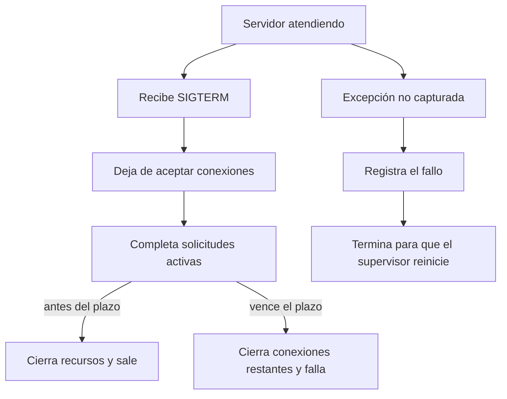
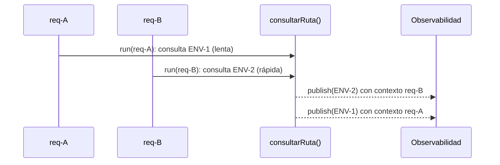

# Módulo 9: Observabilidad y manejo de errores en producción

## Aprende construyendo


### Tema 1: Logging estructurado · Intermedio · 45 min

<details open>
<summary><strong>Capa 1 — Lectura</strong></summary>

#### ► DE QUÉ TRATA
Este tema te guía por logging estructurado con foco en comprensión antes de implementación.

#### ► LA IDEA EN UNA FRASE
**Entender logging estructurado te permite tomar mejores decisiones técnicas.**

#### ► POR QUÉ EXISTE ESTO
Resuelve un problema real de diseño o implementación y evita decisiones a ciegas.

#### ► LA ANALOGÍA
Piensa en logging estructurado como una herramienta de taller: útil cuando conoces su propósito y sus límites.
**Dónde se rompe la analogía:** en software, los efectos dependen del contexto, la escala y los trade-offs.

#### ► CÓMO FUNCIONA
1. Identifica el problema que logging estructurado resuelve.
2. Observa sus componentes y relaciones.
3. Aplica la opción más simple que funcione.
4. Verifica el resultado y los límites.

#### ► LO QUE PUEDE SALIR MAL
| Síntoma | Causa probable | Arreglo |
|---|---|---|
| Logging estructurado se aplica pero el resultado no mejora | Se usó sin medir el problema real | Mide antes y compara contra la alternativa simple |
| Aparece complejidad inesperada | Se adoptó la técnica sin comprender sus trade-offs | Vuelve a la sección de trade-offs y reduce el alcance |
| Falla en un caso límite | Se asumió un contexto que no se cumple | Prueba el caso límite y documenta cuándo NO usarlo |

#### ► TRADE-OFFS
| Opción | Cuándo usarla | Cuándo NO usarla |
|---|---|---|
| Usar Logging estructurado | Cuando el problema coincide con su propósito y el beneficio es observable | Cuando agrega complejidad sin resolver un problema real |
| Alternativa más simple | Cuando el contexto es pequeño, estable o fácil de razonar | Cuando ya demostró no escalar o no cumplir el requisito |
| Postergar la decisión | Cuando falta evidencia del problema | Cuando el costo de esperar es mayor que el costo de probar |

#### ► CUÁNDO NO USAR ESTO
No uses logging estructurado por defecto. Aplícalo cuando el problema lo justifique y puedas verificar el beneficio; si una alternativa más simple resuelve igual, prefiérela.

#### ► DE VUELTA A LA ANALOGÍA
Volviendo a la analogía: logging estructurado funciona como el modelo inicial, pero recuerda dónde se rompe: en producción importan la evidencia, la escala y el costo de equivocarte.

#### ► LO QUE DEBES RECORDAR
- Logging estructurado existe para resolver un problema específico.
- Mide antes de adoptar complejidad.
- Conoce el caso donde NO usarlo.
- Verifica con evidencia observable.

#### ► PREGUNTAS PARA PENSAR
1. ¿Qué problema concreto resuelve logging estructurado en tu contexto?
2. ¿Cómo sabrías que logging estructurado no está funcionando bien?
3. ¿Qué alternativa más simple considerarías antes de usar logging estructurado?

</details>

<details>
<summary><strong>Capa 2 — Construcción</strong></summary>

#### Código y verificación
```bash
mkdir ejemplo-logging
cd ejemplo-logging
mkdir src
```

```json
{
  "name": "ejemplo-logging",
  "private": true,
  "type": "module",
  "scripts": {
    "start": "node src/logger.js"
  }
}
```

```js
const niveles = { debug: 10, info: 20, warn: 30, error: 40 };
const nivelMinimo = niveles[process.env.LOG_LEVEL ?? "info"] ?? niveles.info;
const camposPermitidos = [
  "requestId",
  "route",
  "statusCode",
  "durationMs",
  "errorCode",
  "errorName",
];

function log(level, message, fields = {}) {
  if (niveles[level] < nivelMinimo) return;

  const seguros = Object.fromEntries(
    camposPermitidos
      .filter((campo) => Object.hasOwn(fields, campo))
      .map((campo) => [campo, fields[campo]]),
  );

  const evento = {
    timestamp: new Date().toISOString(),
    level,
    message,
    ...seguros,
  };
  process.stdout.write(`${JSON.stringify(evento)}\n`);
}

log("debug", "detalle de desarrollo", { route: "/health" });
log("info", "servidor iniciado", { route: "/health", statusCode: 200 });
log("error", "consulta fallida", {
  requestId: "req-1",
  errorCode: "DB_TIMEOUT",
  errorName: "TimeoutError",
  authorization: "Bearer secreto",
  sessionToken: "otro-secreto",
});
```

```bash
npm start
```

```bash
LOG_LEVEL=error npm start
```

</details>

### Tema 2: Correlation ID por request · Intermedio · 45 min

<details open>
<summary><strong>Capa 1 — Lectura</strong></summary>

#### ► DE QUÉ TRATA
Este tema te guía por correlation id por request con foco en comprensión antes de implementación.

#### ► LA IDEA EN UNA FRASE
**Entender correlation id por request te permite tomar mejores decisiones técnicas.**

#### ► POR QUÉ EXISTE ESTO
Resuelve un problema real de diseño o implementación y evita decisiones a ciegas.

#### ► LA ANALOGÍA
Piensa en correlation id por request como una herramienta de taller: útil cuando conoces su propósito y sus límites.
**Dónde se rompe la analogía:** en software, los efectos dependen del contexto, la escala y los trade-offs.

#### ► CÓMO FUNCIONA
1. Identifica el problema que correlation id por request resuelve.
2. Observa sus componentes y relaciones.
3. Aplica la opción más simple que funcione.
4. Verifica el resultado y los límites.

#### ► LO QUE PUEDE SALIR MAL
| Síntoma | Causa probable | Arreglo |
|---|---|---|
| Correlation ID por request se aplica pero el resultado no mejora | Se usó sin medir el problema real | Mide antes y compara contra la alternativa simple |
| Aparece complejidad inesperada | Se adoptó la técnica sin comprender sus trade-offs | Vuelve a la sección de trade-offs y reduce el alcance |
| Falla en un caso límite | Se asumió un contexto que no se cumple | Prueba el caso límite y documenta cuándo NO usarlo |

#### ► TRADE-OFFS
| Opción | Cuándo usarla | Cuándo NO usarla |
|---|---|---|
| Usar Correlation ID por request | Cuando el problema coincide con su propósito y el beneficio es observable | Cuando agrega complejidad sin resolver un problema real |
| Alternativa más simple | Cuando el contexto es pequeño, estable o fácil de razonar | Cuando ya demostró no escalar o no cumplir el requisito |
| Postergar la decisión | Cuando falta evidencia del problema | Cuando el costo de esperar es mayor que el costo de probar |

#### ► CUÁNDO NO USAR ESTO
No uses correlation id por request por defecto. Aplícalo cuando el problema lo justifique y puedas verificar el beneficio; si una alternativa más simple resuelve igual, prefiérela.

#### ► DE VUELTA A LA ANALOGÍA
Volviendo a la analogía: correlation id por request funciona como el modelo inicial, pero recuerda dónde se rompe: en producción importan la evidencia, la escala y el costo de equivocarte.

#### ► LO QUE DEBES RECORDAR
- Correlation ID por request existe para resolver un problema específico.
- Mide antes de adoptar complejidad.
- Conoce el caso donde NO usarlo.
- Verifica con evidencia observable.

#### ► PREGUNTAS PARA PENSAR
1. ¿Qué problema concreto resuelve correlation id por request en tu contexto?
2. ¿Cómo sabrías que correlation id por request no está funcionando bien?
3. ¿Qué alternativa más simple considerarías antes de usar correlation id por request?

</details>

<details>
<summary><strong>Capa 2 — Construcción</strong></summary>

#### Código y verificación
```bash
mkdir ejemplo-correlation-id
cd ejemplo-correlation-id
mkdir src
```

```json
{
  "name": "ejemplo-correlation-id",
  "private": true,
  "type": "module",
  "scripts": {
    "start": "node src/server.js"
  }
}
```

```js
import http from "node:http";
import { randomUUID } from "node:crypto";

const formatoRequestId = /^[A-Za-z0-9._:-]{1,64}$/;

function requestIdValido(valor) {
  return typeof valor === "string" && formatoRequestId.test(valor);
}

const espera = (ms) => new Promise((resolve) => setTimeout(resolve, ms));

const server = http.createServer(async (req, res) => {
  const externo = req.headers["x-request-id"];
  const requestId = requestIdValido(externo) ? externo : randomUUID();
  const log = (event) => {
    process.stdout.write(`${JSON.stringify({ event, requestId })}\n`);
  };

  res.setHeader("content-type", "application/json");
  res.setHeader("x-request-id", requestId);

  try {
    log("request.started");
    await espera(25);
    log("lookup.completed");
    res.end(JSON.stringify({ ok: true, requestId }));
  } catch {
    res.statusCode = 500;
    log("request.failed");
    res.end(JSON.stringify({ ok: false }));
  } finally {
    log("request.finished");
  }
});

server.listen(3000, () => {
  console.log("http://127.0.0.1:3000");
});
```

```bash
curl -i -H 'x-request-id: demo-1' http://127.0.0.1:3000/entregas/RF-1
```

```bash
curl -s -H "x-request-id: $(node -e 'process.stdout.write("A".repeat(5000))')" http://127.0.0.1:3000/entregas/RF-1
```

</details>

### Tema 3: REST, GraphQL y gRPC · Avanzado · 45 min

<details open>
<summary><strong>Capa 1 — Lectura</strong></summary>

#### ► DE QUÉ TRATA
Este tema te guía por rest, graphql y grpc con foco en comprensión antes de implementación.

#### ► LA IDEA EN UNA FRASE
**Entender rest, graphql y grpc te permite tomar mejores decisiones técnicas.**

#### ► POR QUÉ EXISTE ESTO
Resuelve un problema real de diseño o implementación y evita decisiones a ciegas.

#### ► LA ANALOGÍA
Piensa en rest, graphql y grpc como una herramienta de taller: útil cuando conoces su propósito y sus límites.
**Dónde se rompe la analogía:** en software, los efectos dependen del contexto, la escala y los trade-offs.

#### ► CÓMO FUNCIONA
1. Identifica el problema que rest, graphql y grpc resuelve.
2. Observa sus componentes y relaciones.
3. Aplica la opción más simple que funcione.
4. Verifica el resultado y los límites.

#### ► LO QUE PUEDE SALIR MAL
| Síntoma | Causa probable | Arreglo |
|---|---|---|
| REST, GraphQL y gRPC se aplica pero el resultado no mejora | Se usó sin medir el problema real | Mide antes y compara contra la alternativa simple |
| Aparece complejidad inesperada | Se adoptó la técnica sin comprender sus trade-offs | Vuelve a la sección de trade-offs y reduce el alcance |
| Falla en un caso límite | Se asumió un contexto que no se cumple | Prueba el caso límite y documenta cuándo NO usarlo |

#### ► TRADE-OFFS
| Opción | Cuándo usarla | Cuándo NO usarla |
|---|---|---|
| Usar REST, GraphQL y gRPC | Cuando el problema coincide con su propósito y el beneficio es observable | Cuando agrega complejidad sin resolver un problema real |
| Alternativa más simple | Cuando el contexto es pequeño, estable o fácil de razonar | Cuando ya demostró no escalar o no cumplir el requisito |
| Postergar la decisión | Cuando falta evidencia del problema | Cuando el costo de esperar es mayor que el costo de probar |

#### ► CUÁNDO NO USAR ESTO
No uses rest, graphql y grpc por defecto. Aplícalo cuando el problema lo justifique y puedas verificar el beneficio; si una alternativa más simple resuelve igual, prefiérela.

#### ► DE VUELTA A LA ANALOGÍA
Volviendo a la analogía: rest, graphql y grpc funciona como el modelo inicial, pero recuerda dónde se rompe: en producción importan la evidencia, la escala y el costo de equivocarte.

#### ► LO QUE DEBES RECORDAR
- REST, GraphQL y gRPC existe para resolver un problema específico.
- Mide antes de adoptar complejidad.
- Conoce el caso donde NO usarlo.
- Verifica con evidencia observable.

#### ► PREGUNTAS PARA PENSAR
1. ¿Qué problema concreto resuelve rest, graphql y grpc en tu contexto?
2. ¿Cómo sabrías que rest, graphql y grpc no está funcionando bien?
3. ¿Qué alternativa más simple considerarías antes de usar rest, graphql y grpc?

</details>

<details>
<summary><strong>Capa 2 — Construcción</strong></summary>

#### Código y verificación
```bash
mkdir ejemplo-contratos-api
cd ejemplo-contratos-api
mkdir src contracts
```

```json
{
  "name": "ejemplo-contratos-api",
  "private": true,
  "type": "module",
  "scripts": {
    "check": "node src/check-contracts.js"
  }
}
```

```bash
npm install graphql
```

```http
GET /paquetes/RF-1 HTTP/1.1
Host: localhost:3000
Accept: application/json

# 200: { "id": "RF-1", "estado": "en-ruta" }
# 404: { "error": "PAQUETE_NO_ENCONTRADO" }
```

```graphql
type Paquete {
  id: ID!
  estado: String!
}

type Query {
  paquete(id: ID!): Paquete
}
```

```graphql
query ConsultarPaquete($id: ID!) {
  paquete(id: $id) {
    id
    estado
  }
}
```

</details>

### Tema 4: Excepciones no capturadas y graceful shutdown · Avanzado · 45 min

<details open>
<summary><strong>Capa 1 — Lectura</strong></summary>

#### ► DE QUÉ TRATA
Este tema te guía por excepciones no capturadas y graceful shutdown con foco en comprensión antes de implementación.

#### ► LA IDEA EN UNA FRASE
**Entender excepciones no capturadas y graceful shutdown te permite tomar mejores decisiones técnicas.**

#### ► POR QUÉ EXISTE ESTO
Resuelve un problema real de diseño o implementación y evita decisiones a ciegas.

#### ► LA ANALOGÍA
Piensa en excepciones no capturadas y graceful shutdown como una herramienta de taller: útil cuando conoces su propósito y sus límites.
**Dónde se rompe la analogía:** en software, los efectos dependen del contexto, la escala y los trade-offs.

#### ► CÓMO FUNCIONA


#### ► LO QUE PUEDE SALIR MAL
| Síntoma | Causa probable | Arreglo |
|---|---|---|
| Excepciones no capturadas y graceful shutdown se aplica pero el resultado no mejora | Se usó sin medir el problema real | Mide antes y compara contra la alternativa simple |
| Aparece complejidad inesperada | Se adoptó la técnica sin comprender sus trade-offs | Vuelve a la sección de trade-offs y reduce el alcance |
| Falla en un caso límite | Se asumió un contexto que no se cumple | Prueba el caso límite y documenta cuándo NO usarlo |

#### ► TRADE-OFFS
| Opción | Cuándo usarla | Cuándo NO usarla |
|---|---|---|
| Usar Excepciones no capturadas y graceful shutdown | Cuando el problema coincide con su propósito y el beneficio es observable | Cuando agrega complejidad sin resolver un problema real |
| Alternativa más simple | Cuando el contexto es pequeño, estable o fácil de razonar | Cuando ya demostró no escalar o no cumplir el requisito |
| Postergar la decisión | Cuando falta evidencia del problema | Cuando el costo de esperar es mayor que el costo de probar |

#### ► CUÁNDO NO USAR ESTO
No uses excepciones no capturadas y graceful shutdown por defecto. Aplícalo cuando el problema lo justifique y puedas verificar el beneficio; si una alternativa más simple resuelve igual, prefiérela.

#### ► DE VUELTA A LA ANALOGÍA
Volviendo a la analogía: excepciones no capturadas y graceful shutdown funciona como el modelo inicial, pero recuerda dónde se rompe: en producción importan la evidencia, la escala y el costo de equivocarte.

#### ► LO QUE DEBES RECORDAR
- Excepciones no capturadas y graceful shutdown existe para resolver un problema específico.
- Mide antes de adoptar complejidad.
- Conoce el caso donde NO usarlo.
- Verifica con evidencia observable.

#### ► PREGUNTAS PARA PENSAR
1. ¿Qué problema concreto resuelve excepciones no capturadas y graceful shutdown en tu contexto?
2. ¿Cómo sabrías que excepciones no capturadas y graceful shutdown no está funcionando bien?
3. ¿Qué alternativa más simple considerarías antes de usar excepciones no capturadas y graceful shutdown?

</details>

<details>
<summary><strong>Capa 2 — Construcción</strong></summary>

#### Código y verificación
```bash
mkdir ejemplo-shutdown
cd ejemplo-shutdown
mkdir src
```

```json
{
  "name": "ejemplo-shutdown",
  "private": true,
  "type": "module",
  "scripts": {
    "start": "node src/server.js"
  }
}
```

```js
import http from "node:http";

const server = http.createServer((req, res) => {
  if (req.url === "/boom") {
    setTimeout(() => {
      throw new Error("fallo deliberado");
    }, 20);
    res.end("fallo programado\n");
    return;
  }

  setTimeout(() => res.end("ok\n"), 1500);
});

// Representa un recurso que mantiene handles abiertos, como un pool.
const recurso = setInterval(() => {}, 60_000);
let cerrando = false;

function cerrarRecursos() {
  clearInterval(recurso);
  console.log(JSON.stringify({ event: "resources.closed" }));
}

function apagar(signal) {
  if (cerrando) return;
  cerrando = true;
  console.log(JSON.stringify({ event: "shutdown.started", signal }));

  const plazo = setTimeout(() => {
    console.error(JSON.stringify({ event: "shutdown.deadline" }));
    server.closeAllConnections();
    process.exitCode = 1;
  }, 5000);
  plazo.unref();

  server.close((error) => {
    clearTimeout(plazo);
    cerrarRecursos();
    if (error) {
      console.error(JSON.stringify({ event: "shutdown.failed" }));
      process.exitCode = 1;
    } else {
      console.log(JSON.stringify({ event: "shutdown.completed" }));
    }
  });
  server.closeIdleConnections();
}

function fatal(tipo, error) {
  console.error(JSON.stringify({
    level: "fatal",
    event: tipo,
    name: error instanceof Error ? error.name : "Error",
    message: error instanceof Error ? error.message : String(error),
  }));
  process.exit(1);
}

process.on("uncaughtException", (error) => fatal("uncaughtException", error));
process.on("unhandledRejection", (error) => fatal("unhandledRejection", error));
process.once("SIGTERM", () => apagar("SIGTERM"));
process.once("SIGINT", () => apagar("SIGINT"));

server.listen(3000, () => {
  console.log(JSON.stringify({ event: "server.started", pid: process.pid }));
});
```

```bash
curl http://127.0.0.1:3000/lenta
```

```bash
kill -TERM 12345
```


</details>

### Tema 5: Contexto por petición con AsyncLocalStorage y eventos con diagnostics_channel · Avanzado · 45 min

<details open>
<summary><strong>Capa 1 — Lectura</strong></summary>

#### ► DE QUÉ TRATA
Este tema te guía por contexto por petición con asynclocalstorage y eventos con diagnostics_channel con foco en comprensión antes de implementación.

#### ► LA IDEA EN UNA FRASE
**Entender contexto por petición con asynclocalstorage y eventos con diagnostics_channel te permite tomar mejores decisiones técnicas.**

#### ► POR QUÉ EXISTE ESTO
Resuelve un problema real de diseño o implementación y evita decisiones a ciegas.

#### ► LA ANALOGÍA
Piensa en contexto por petición con asynclocalstorage y eventos con diagnostics_channel como una herramienta de taller: útil cuando conoces su propósito y sus límites.
**Dónde se rompe la analogía:** en software, los efectos dependen del contexto, la escala y los trade-offs.

#### ► CÓMO FUNCIONA


#### ► LO QUE PUEDE SALIR MAL
| Síntoma | Causa probable | Arreglo |
|---|---|---|
| Contexto por petición con AsyncLocalStorage y eventos con diagnostics_channel se aplica pero el resultado no mejora | Se usó sin medir el problema real | Mide antes y compara contra la alternativa simple |
| Aparece complejidad inesperada | Se adoptó la técnica sin comprender sus trade-offs | Vuelve a la sección de trade-offs y reduce el alcance |
| Falla en un caso límite | Se asumió un contexto que no se cumple | Prueba el caso límite y documenta cuándo NO usarlo |

#### ► TRADE-OFFS
| Opción | Cuándo usarla | Cuándo NO usarla |
|---|---|---|
| Usar Contexto por petición con AsyncLocalStorage y eventos con diagnostics_channel | Cuando el problema coincide con su propósito y el beneficio es observable | Cuando agrega complejidad sin resolver un problema real |
| Alternativa más simple | Cuando el contexto es pequeño, estable o fácil de razonar | Cuando ya demostró no escalar o no cumplir el requisito |
| Postergar la decisión | Cuando falta evidencia del problema | Cuando el costo de esperar es mayor que el costo de probar |

#### ► CUÁNDO NO USAR ESTO
No uses contexto por petición con asynclocalstorage y eventos con diagnostics_channel por defecto. Aplícalo cuando el problema lo justifique y puedas verificar el beneficio; si una alternativa más simple resuelve igual, prefiérela.

#### ► DE VUELTA A LA ANALOGÍA
Volviendo a la analogía: contexto por petición con asynclocalstorage y eventos con diagnostics_channel funciona como el modelo inicial, pero recuerda dónde se rompe: en producción importan la evidencia, la escala y el costo de equivocarte.

#### ► LO QUE DEBES RECORDAR
- Contexto por petición con AsyncLocalStorage y eventos con diagnostics_channel existe para resolver un problema específico.
- Mide antes de adoptar complejidad.
- Conoce el caso donde NO usarlo.
- Verifica con evidencia observable.

#### ► PREGUNTAS PARA PENSAR
1. ¿Qué problema concreto resuelve contexto por petición con asynclocalstorage y eventos con diagnostics_channel en tu contexto?
2. ¿Cómo sabrías que contexto por petición con asynclocalstorage y eventos con diagnostics_channel no está funcionando bien?
3. ¿Qué alternativa más simple considerarías antes de usar contexto por petición con asynclocalstorage y eventos con diagnostics_channel?

</details>

<details>
<summary><strong>Capa 2 — Construcción</strong></summary>

#### Código y verificación


```js
import { AsyncLocalStorage } from 'node:async_hooks';
import diagnostics_channel from 'node:diagnostics_channel';

const contexto = new AsyncLocalStorage();
const canalConsultas = diagnostics_channel.channel('rutaflow:consulta');

// Logger: no recibe el id por parámetro; lo lee del contexto actual.
function log(mensaje) {
  const id = contexto.getStore()?.requestId ?? 'sin-contexto';
  console.log(`[${id}] ${mensaje}`);
}

// Capa de datos: publica un evento de diagnóstico sin saber quién escucha.
async function consultarRuta(codigo, demoraMs) {
  await new Promise((listo) => setTimeout(listo, demoraMs));
  if (canalConsultas.hasSubscribers) canalConsultas.publish({ codigo, demoraMs });
  return `ruta de ${codigo}`;
}

// Observabilidad: se suscribe desde afuera y hereda el contexto de la petición.
diagnostics_channel.subscribe('rutaflow:consulta', ({ codigo }) => log(`métrica: consulta de ${codigo}`));

// Cada "petición" corre dentro de su propio contexto.
function atender(codigo, requestId, demoraMs) {
  return contexto.run({ requestId }, async () => {
    log(`inicio ${codigo}`);
    const ruta = await consultarRuta(codigo, demoraMs);
    log(`fin: ${ruta}`);
  });
}

await Promise.all([atender('ENV-1', 'req-A', 40), atender('ENV-2', 'req-B', 5)]);
log('fuera de cualquier petición');
```

```bash
cd academia-labs/node/contexto
node contexto.mjs
```

```text
[req-A] inicio ENV-1
[req-B] inicio ENV-2
[req-B] métrica: consulta de ENV-2
[req-B] fin: ruta de ENV-2
[req-A] métrica: consulta de ENV-1
[req-A] fin: ruta de ENV-1
[sin-contexto] fuera de cualquier petición
```

</details>

### Tema 6: Métricas Prometheus y trazas distribuidas con OpenTelemetry · Avanzado · 45 min

<details open>
<summary><strong>Capa 1 — Lectura</strong></summary>

#### ► DE QUÉ TRATA
Este tema te guía por métricas prometheus y trazas distribuidas con opentelemetry con foco en comprensión antes de implementación.

#### ► LA IDEA EN UNA FRASE
**Entender métricas prometheus y trazas distribuidas con opentelemetry te permite tomar mejores decisiones técnicas.**

#### ► POR QUÉ EXISTE ESTO
Resuelve un problema real de diseño o implementación y evita decisiones a ciegas.

#### ► LA ANALOGÍA
Piensa en métricas prometheus y trazas distribuidas con opentelemetry como una herramienta de taller: útil cuando conoces su propósito y sus límites.
**Dónde se rompe la analogía:** en software, los efectos dependen del contexto, la escala y los trade-offs.

#### ► CÓMO FUNCIONA
1. Identifica el problema que métricas prometheus y trazas distribuidas con opentelemetry resuelve.
2. Observa sus componentes y relaciones.
3. Aplica la opción más simple que funcione.
4. Verifica el resultado y los límites.

#### ► LO QUE PUEDE SALIR MAL
| Síntoma | Causa probable | Arreglo |
|---|---|---|
| Métricas Prometheus y trazas distribuidas con OpenTelemetry se aplica pero el resultado no mejora | Se usó sin medir el problema real | Mide antes y compara contra la alternativa simple |
| Aparece complejidad inesperada | Se adoptó la técnica sin comprender sus trade-offs | Vuelve a la sección de trade-offs y reduce el alcance |
| Falla en un caso límite | Se asumió un contexto que no se cumple | Prueba el caso límite y documenta cuándo NO usarlo |

#### ► TRADE-OFFS
| Opción | Cuándo usarla | Cuándo NO usarla |
|---|---|---|
| Usar Métricas Prometheus y trazas distribuidas con OpenTelemetry | Cuando el problema coincide con su propósito y el beneficio es observable | Cuando agrega complejidad sin resolver un problema real |
| Alternativa más simple | Cuando el contexto es pequeño, estable o fácil de razonar | Cuando ya demostró no escalar o no cumplir el requisito |
| Postergar la decisión | Cuando falta evidencia del problema | Cuando el costo de esperar es mayor que el costo de probar |

#### ► CUÁNDO NO USAR ESTO
No uses métricas prometheus y trazas distribuidas con opentelemetry por defecto. Aplícalo cuando el problema lo justifique y puedas verificar el beneficio; si una alternativa más simple resuelve igual, prefiérela.

#### ► DE VUELTA A LA ANALOGÍA
Volviendo a la analogía: métricas prometheus y trazas distribuidas con opentelemetry funciona como el modelo inicial, pero recuerda dónde se rompe: en producción importan la evidencia, la escala y el costo de equivocarte.

#### ► LO QUE DEBES RECORDAR
- Métricas Prometheus y trazas distribuidas con OpenTelemetry existe para resolver un problema específico.
- Mide antes de adoptar complejidad.
- Conoce el caso donde NO usarlo.
- Verifica con evidencia observable.

#### ► PREGUNTAS PARA PENSAR
1. ¿Qué problema concreto resuelve métricas prometheus y trazas distribuidas con opentelemetry en tu contexto?
2. ¿Cómo sabrías que métricas prometheus y trazas distribuidas con opentelemetry no está funcionando bien?
3. ¿Qué alternativa más simple considerarías antes de usar métricas prometheus y trazas distribuidas con opentelemetry?

</details>

<details>
<summary><strong>Capa 2 — Construcción</strong></summary>

#### Código y verificación
```bash
mkdir ejemplo-observabilidad
cd ejemplo-observabilidad
mkdir src
```

```json
{
  "name": "ejemplo-observabilidad",
  "private": true,
  "type": "module",
  "scripts": {
    "start": "node src/server.js"
  }
}
```

```bash
npm install express prom-client @opentelemetry/api @opentelemetry/sdk-node @opentelemetry/sdk-trace-node @opentelemetry/auto-instrumentations-node
```

```js
import { NodeSDK } from "@opentelemetry/sdk-node";
import { getNodeAutoInstrumentations } from "@opentelemetry/auto-instrumentations-node";
import {
  ConsoleSpanExporter,
  SimpleSpanProcessor,
} from "@opentelemetry/sdk-trace-node";

const sdk = new NodeSDK({
  spanProcessor: new SimpleSpanProcessor(new ConsoleSpanExporter()),
  instrumentations: [getNodeAutoInstrumentations()],
});

await sdk.start();

export { sdk };
```

```js
import express from "express";
import client from "prom-client";
import { SpanStatusCode, trace } from "@opentelemetry/api";

client.collectDefaultMetrics();

const requests = new client.Counter({
  name: "http_requests_total",
  help: "Requests",
  labelNames: ["route"],
});

const requestDuration = new client.Histogram({
  name: "app_http_request_duration_seconds",
  help: "Duración de solicitudes HTTP",
  labelNames: ["method", "route", "status_code"],
  buckets: [0.05, 0.1, 0.25, 0.5, 1, 2],
});

const app = express();

app.use((req, res, next) => {
  const stop = requestDuration.startTimer();
  res.on("finish", () => {
    const route = req.route?.path ?? "unmatched";
    requests.inc({ route });
    stop({
      method: req.method,
      route,
      status_code: String(res.statusCode),
    });
  });
  next();
});

app.get("/health", (_req, res) => {
  res.json({ ok: true });
});

app.get("/paquetes/:id", (req, res) => {
  const span = trace.getTracer("api-entregas").startSpan("paquetes.consultar");
  try {
    span.setAttribute("http.route", "/paquetes/:id");
    span.setAttribute("http.response.status_code", 200);
    res.json({ id: req.params.id, estado: "en-ruta" });
  } catch (error) {
    span.recordException(error);
    span.setStatus({ code: SpanStatusCode.ERROR });
    res.status(500).json({ error: "CONSULTA_FALLIDA" });
  } finally {
    span.end();
  }
});

app.get("/fallo", (_req, res) => {
  res.status(500).json({ error: "FALLO_DELIBERADO" });
});

app.get("/metrics", async (_req, res) => {
  res.type(client.register.contentType);
  res.end(await client.register.metrics());
});

export default app;
```

```js
const { sdk } = await import("./telemetry.js");
const { default: app } = await import("./app.js");

const server = app.listen(3000, () => {
  console.log("http://127.0.0.1:3000");
});

process.once("SIGTERM", () => {
  server.close(async () => {
    try {
      await sdk.shutdown();
    } catch (error) {
      console.error("No se pudo cerrar OpenTelemetry", error);
      process.exitCode = 1;
    }
  });
});
```

</details>
