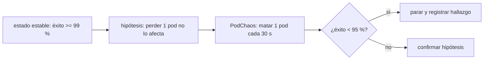

# Módulo 0: Observabilidad con Prometheus y Grafana

> **Requisitos de este curso:** [Docker](/curso/docker). Lo que esos cursos enseñan aquí se usa sin volver a explicarlo; si algo no te suena, vuelve a su capítulo antes de seguir.


## Aprende construyendo


### Tema 1: Modelo de métricas de Prometheus — counter, gauge, histogram · Avanzado · 20 min

<details open>
<summary><strong>Capa 1 — Lectura</strong></summary>

#### ► DE QUÉ TRATA
Al finalizar podrás instrumentar una aplicación con counters, gauges e histograms, eligiendo el tipo correcto según si un valor solo crece, sube y baja, o se distribuye en rangos.

</details>

<details>
<summary><strong>Capa 2 — Construcción</strong></summary>

#### Código y verificación
```
┌── Counter (http_requests_total) ──┐  ┌── Gauge (conexiones_activas) ──┐  ┌── Histogram (latencia) ──┐
│ solo sube, nunca baja                │  │ sube y baja libremente             │  │ buckets: ≤100ms:850  │
│ (salvo reinicio del proceso)          │  │                                      │  │ ≤500ms:980 ≤1s:995     │
└─────────────────────────┘  └─────────────────────────┘  └───────────────────┘
```

```bash
mkdir -p academia-devops/src/modulo9/metricas && cd academia-devops/src/modulo9/metricas
```

Crea el archivo `package.json`:

```json
{"name":"metricas-demo","dependencies":{"prom-client":"15.1.0"}}
```

Crea el archivo `app.js`:

```js
const http = require('node:http');
const client = require('prom-client');
const peticionesTotal = new client.Counter({ name: 'http_requests_total', help: 'total de peticiones', labelNames: ['status'] });
const conexionesActivas = new client.Gauge({ name: 'conexiones_activas', help: 'conexiones activas ahora' });
const latencia = new client.Histogram({ name: 'latencia_segundos', help: 'latencia de peticiones', buckets: [0.1, 0.5, 1] });

http.createServer(async (req, res) => {
  if (req.url === '/metrics') { res.end(await client.register.metrics()); return; }
  conexionesActivas.inc();
  const fin = latencia.startTimer();
  peticionesTotal.inc({ status: '200' });
  setTimeout(() => { fin(); conexionesActivas.dec(); res.end('ok'); }, Math.random() * 300);
}).listen(3000);
```

```bash
docker run -d --name metricas-app -p 3010:3000 -v "$(pwd)":/app -w /app node:22-alpine sh -c "npm install --silent && node app.js"
```

```bash
sleep 8
for i in $(seq 10); do curl -s http://localhost:3010/ >/dev/null & done; wait
curl -s http://localhost:3010/metrics | grep -E "^http_requests_total|^conexiones_activas|^latencia_segundos_bucket"
```

</details>

### Tema 2: PromQL esencial · Avanzado · 20 min

<details open>
<summary><strong>Capa 1 — Lectura</strong></summary>

#### ► DE QUÉ TRATA
Al finalizar podrás escribir consultas PromQL con rate(), agregación y filtrado por etiquetas para convertir contadores acumulados en tasas interpretables.

</details>

<details>
<summary><strong>Capa 2 — Construcción</strong></summary>

#### Código y verificación
```
http_requests_total (counter, acumulado, poco interpretable directamente)
   ▼
rate(...[5m])  ──▶  peticiones por segundo (interpretable directamente)
   ▼
sum(rate(...{status="500"}[5m])) / sum(rate(...[5m]))  ──▶  tasa de error (ej. 0.02 = 2%)
```

```bash
mkdir -p academia-devops/src/modulo9/promql && cd academia-devops/src/modulo9/promql
```

Crea el archivo `prometheus.yml`:

```yaml
global: { scrape_interval: 5s }
scrape_configs:
  - job_name: 'metricas-app'
    static_configs:
      - targets: ['host.docker.internal:3010']
```

```bash
docker run -d --name prometheus-demo -p 9090:9090 -v "$(pwd)/prometheus.yml:/etc/prometheus/prometheus.yml:ro" \
  --add-host=host.docker.internal:host-gateway prom/prometheus
sleep 5
curl -s 'http://localhost:9090/api/v1/query?query=up' | grep -o '"value":\[[^]]*\]'
```

```bash
for i in $(seq 30); do curl -s http://localhost:3010/ >/dev/null & done; wait
sleep 10
curl -sS -G 'http://localhost:9090/api/v1/query' --data-urlencode 'query=rate(http_requests_total[1m])' | jq .
```

</details>

### Tema 3: Dashboards en Grafana · Avanzado · 20 min

<details open>
<summary><strong>Capa 1 — Lectura</strong></summary>

#### ► DE QUÉ TRATA
Al finalizar podrás conectar Grafana a Prometheus como fuente de datos y construir un panel que visualiza una consulta PromQL en tiempo real.

</details>

<details>
<summary><strong>Capa 2 — Construcción</strong></summary>

#### Código y verificación
```
┌── Dashboard "Estado del servicio" ──────────────┐
│ Panel: tasa de peticiones/segundo (líneas)          │
│ Panel: tasa de error actual (valor, rojo si > 5%)     │
│ Panel: latencia p95 (líneas)                            │
└─────────────────────────────────────┘
```

```bash
mkdir -p academia-devops/src/modulo9/grafana/provisioning/datasources
cd academia-devops/src/modulo9/grafana
```

Crea el archivo `provisioning/datasources/prometheus.yml`:

```yaml
apiVersion: 1
datasources:
  - name: Prometheus
    type: prometheus
    access: proxy
    url: http://host.docker.internal:9090
    isDefault: true
```

```bash
docker run -d --name grafana-demo -p 3300:3000 \
  --add-host=host.docker.internal:host-gateway \
  -v "$(pwd)/provisioning:/etc/grafana/provisioning" \
  -e GF_AUTH_ANONYMOUS_ENABLED=true -e GF_AUTH_ANONYMOUS_ORG_ROLE=Admin \
  grafana/grafana
sleep 6
curl -s -u admin:admin http://localhost:3300/api/datasources | jq . | grep -A2 '"name": "Prometheus"'
```

Crea el archivo `dashboard.json`:

```json
{"dashboard":{"title":"Estado del servicio","panels":[{"type":"timeseries","title":"Peticiones por segundo","targets":[{"expr":"rate(http_requests_total[1m])"}],"gridPos":{"h":8,"w":12,"x":0,"y":0}}]},"overwrite":true}
```

```bash
curl -s -u admin:admin -X POST -H "Content-Type: application/json" -d @dashboard.json http://localhost:3300/api/dashboards/db | jq .
```

</details>

### Tema 4: Alertmanager y reglas de alerta · Avanzado · 20 min

<details open>
<summary><strong>Capa 1 — Lectura</strong></summary>

#### ► DE QUÉ TRATA
Al finalizar podrás definir una regla de alerta con una condición sostenida en el tiempo (for), evitando que fluctuaciones momentáneas disparen notificaciones innecesarias.

</details>

<details>
<summary><strong>Capa 2 — Construcción</strong></summary>

#### Código y verificación
```
Prometheus evalúa continuamente: expr > umbral, sostenido durante "for"
   ¿condición cumplida durante todo el periodo "for"?
     Sí ──▶ envía alerta disparada a Alertmanager
              agrupa, silencia si aplica, enruta al canal/persona correcta
```

```bash
mkdir -p academia-devops/src/modulo9/alertas && cd academia-devops/src/modulo9/alertas
docker network inspect bridge >/dev/null 2>&1 || true
```

Crea el archivo `reglas.yml`:

```yaml
groups:
  - name: alertas-demo
    rules:
      - alert: TasaDeErrorAlta
        expr: sum(rate(http_requests_total{status="500"}[1m])) / sum(rate(http_requests_total[1m])) > 0.05
        for: 30s
        labels: { severity: critical }
        annotations: { summary: "tasa de error por encima del 5% sostenida" }
```

Crea el archivo `prometheus.yml`:

```yaml
global: { scrape_interval: 5s, evaluation_interval: 5s }
rule_files: ["reglas.yml"]
scrape_configs:
  - job_name: 'metricas-app'
    static_configs: [{ targets: ['host.docker.internal:3010'] }]
```

```bash
docker run -d --name prometheus-alertas -p 9091:9090 \
  -v "$(pwd)/prometheus.yml:/etc/prometheus/prometheus.yml:ro" \
  -v "$(pwd)/reglas.yml:/etc/prometheus/reglas.yml:ro" \
  --add-host=host.docker.internal:host-gateway prom/prometheus
sleep 5
curl -s http://localhost:9091/api/v1/rules | jq . | grep -E "name|state"
```

```bash
sleep 35
curl -s http://localhost:9091/api/v1/alerts | jq . | grep -E "alertname|state" | head -6
```

</details>

### Tema 5: SLI, SLO, SLA · Avanzado · 20 min

<details open>
<summary><strong>Capa 1 — Lectura</strong></summary>

#### ► DE QUÉ TRATA
Al finalizar podrás definir un SLI medible, fijar un SLO interno más estricto que cualquier SLA externo, y calcular el presupuesto de error resultante.

</details>

<details>
<summary><strong>Capa 2 — Construcción</strong></summary>

#### Código y verificación
```
┌── SLI (medido):     99.4% de peticiones bajo 200ms este mes ──┐
│ SLO (objetivo):   99.5% de peticiones bajo 200ms  ← meta interna │
│ SLA (compromiso): 99% de peticiones bajo 200ms    ← promesa externa │
│ Presupuesto de error del SLO: 0.5% puede "fallar" sin romper la meta │
└──────────────────────────────────────────┘
```

```bash
mkdir -p academia-devops/src/modulo9/slo && cd academia-devops/src/modulo9/slo
docker run --rm --add-host=host.docker.internal:host-gateway curlimages/curl sh -c 'for i in $(seq 5); do curl -sS http://host.docker.internal:3010/ >/dev/null; done'
for i in $(seq 40); do curl -s http://localhost:3010/ >/dev/null & done; wait
sleep 5
curl -sS -G 'http://localhost:9090/api/v1/query' \
  --data-urlencode 'query=sum(rate(latencia_segundos_bucket{le="0.5"}[5m]))/sum(rate(latencia_segundos_count[5m]))' \
  | jq . | grep -A1 '"value"'
```

Crea el archivo `slo.md`:

```markdown
# SLO de latencia — API demo
SLI: proporción de peticiones que responden en menos de 500ms (medido con PromQL).
SLO: 95% de peticiones bajo 500ms, medido sobre ventana móvil de 30 días.
SLA (si aplicara externamente): 90% bajo 500ms, con crédito de servicio si se incumple.
Presupuesto de error del SLO: 5% del tiempo puede exceder 500ms sin romper la meta interna.
```

```bash
cat slo.md
```

</details>

### Tema 6: OpenTelemetry como estándar de instrumentación · Avanzado · 20 min

<details open>
<summary><strong>Capa 1 — Lectura</strong></summary>

#### ► DE QUÉ TRATA
Al finalizar podrás instrumentar código una única vez con la API de OpenTelemetry, exportando hacia Prometheus sin acoplar la instrumentación a ese backend específico.

</details>

<details>
<summary><strong>Capa 2 — Construcción</strong></summary>

#### Código y verificación
```
Código de la aplicación
   │  instrumentado UNA VEZ con la API de OpenTelemetry
   ▼
OpenTelemetry Collector
   ├──▶ exporta métricas a Prometheus
   └──▶ (cambiar de backend no requiere reinstrumentar el código)
```

```bash
mkdir -p academia-devops/src/modulo9/otel && cd academia-devops/src/modulo9/otel
```

Crea el archivo `package.json`:

```json
{"name":"otel-demo","dependencies":{
  "@opentelemetry/api":"1.9.0",
  "@opentelemetry/sdk-metrics":"1.25.0",
  "@opentelemetry/exporter-prometheus":"0.52.0"
}}
```

Crea el archivo `app.js`:

```js
const http = require('node:http');
const { MeterProvider } = require('@opentelemetry/sdk-metrics');
const { PrometheusExporter } = require('@opentelemetry/exporter-prometheus');

const exporter = new PrometheusExporter({ port: 9464 }, () => {
  console.log('exportador Prometheus de OpenTelemetry escuchando en :9464/metrics');
});
const meterProvider = new MeterProvider({ readers: [exporter] });
const meter = meterProvider.getMeter('mi-api');
const contador = meter.createCounter('otel_http_requests_total', { description: 'peticiones vía OpenTelemetry' });

http.createServer((req, res) => {
  contador.add(1, { status: '200' }); // instrumentado con la API neutral de OpenTelemetry, no directamente contra Prometheus
  res.end('ok desde app instrumentada con OpenTelemetry');
}).listen(3001);
```

```bash
docker run -d --name otel-app -p 3011:3001 -p 9465:9464 -v "$(pwd)":/app -w /app node:22-alpine sh -c "npm install --silent && node app.js"
sleep 8
curl -s http://localhost:3011/ >/dev/null
curl -s http://localhost:9465/metrics | grep otel_http_requests_total
```

</details>

### Tema 7: Métricas DORA — Lead Time, Deployment Frequency, MTTR, Change Failure Rate · Avanzado · 20 min

<details open>
<summary><strong>Capa 1 — Lectura</strong></summary>

#### ► DE QUÉ TRATA
Al finalizar podrás calcular las cuatro métricas DORA de un proyecto real a partir de su historial de Git y sus incidentes registrados.

</details>

<details>
<summary><strong>Capa 2 — Construcción</strong></summary>

#### Código y verificación
```
┌── Las cuatro métricas DORA ──────────────────────┐
│ Lead Time for Changes  (commit ──▶ producción)          │
│ Deployment Frequency   (¿cuántas veces al día/semana?)    │
│ MTTR                   (incidente ──▶ servicio restaurado) │
│ Change Failure Rate    (% de cambios que requieren fix)     │
└─────────────────────────────────────────┘
```

```bash
mkdir -p academia-devops/src/modulo9/dora && cd academia-devops/src/modulo9/dora
docker run --rm -u "$(id -u):$(id -g)" -v "$(pwd)":/repo -w /repo --entrypoint sh alpine/git -c '
  git init -q && git config user.email demo@academia.dev && git config user.name demo
  echo v1 > app.txt && git add . && git commit -qm "feature: agrega validacion" --date="2026-01-01T10:00:00"
  GIT_COMMITTER_DATE="2026-01-01T14:00:00" git tag -a v1.0 -m "deploy" -m "" 2>/dev/null || git tag v1.0
  echo v2 > app.txt && git add . && git commit -qm "feature: agrega reintentos" --date="2026-01-02T09:00:00"
  GIT_COMMITTER_DATE="2026-01-03T09:00:00" git tag v1.1
  git log --format="%H %ad %s" --date=iso'
```

El commit de la función es del 2026-01-02 a las 09:00 y el tag `v1.1`, que marca su despliegue, del 2026-01-03 a
las 09:00. **Lead Time: 24 horas.** Con más commits, la métrica es la mediana de esas diferencias en la ventana
que mides.

</details>

### Tema 8: Chaos engineering: experimentos controlados para comprobar que el sistema resiste fallos · Avanzado · 20 min

<details open>
<summary><strong>Capa 1 — Lectura</strong></summary>

#### ► DE QUÉ TRATA
Usa el clúster local con la API de RutaFlow desplegada con 3 réplicas, un Service y Prometheus. Instala Chaos Mesh con Helm o usa kubectl delete pod en un bucle para la versión sin herramientas.

#### ► CÓMO FUNCIONA


</details>

<details>
<summary><strong>Capa 2 — Construcción</strong></summary>

#### Código y verificación

```yaml
apiVersion: chaos-mesh.org/v1alpha1
kind: PodChaos
metadata:
  name: matar-pod-api
  namespace: staging
spec:
  action: pod-kill
  mode: one              # un solo pod por vez: radio de impacto pequeño
  selector:
    namespaces: [staging]
    labelSelectors: { app: api }
  duration: "5m"
```

```markdown
# Experimento: perder un pod de la API
- Estado estable: tasa de éxito >= 99 % (PromQL: sum(rate(http_requests_total{code!~"5.."}[1m])) / sum(rate(http_requests_total[1m])))
- Hipótesis: con 3 réplicas, matar 1 pod no baja el éxito de 99 %.
- Alcance: namespace staging, 1 pod por vez, 5 minutos.
- Parada: si el éxito baja de 95 % durante 1 minuto, kubectl delete podchaos matar-pod-api.
- Resultado: (completar con los datos)
```

```bash
helm repo add chaos-mesh https://charts.chaos-mesh.org
helm install chaos-mesh chaos-mesh/chaos-mesh -n chaos-mesh --create-namespace
hey -z 6m -c 10 http://api.staging.local/health &   # carga constante durante el experimento
kubectl apply -f academia-labs/devops/caos/pod-kill.yaml
kubectl get pods -n staging -w
```

```text
kubectl get pods -w muestra pods de la API pasando a Terminating y nuevos pods en ContainerCreating y Running.
Con readiness probe correcta: la tasa de éxito en Grafana se mantiene por encima de 99 % y hey reporta solo algunos errores aislados.
Sin readiness probe: hey reporta ráfagas de errores 502/503 y la tasa baja por debajo de 95 %: la hipótesis falla.
```

</details>
