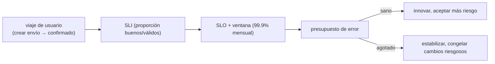
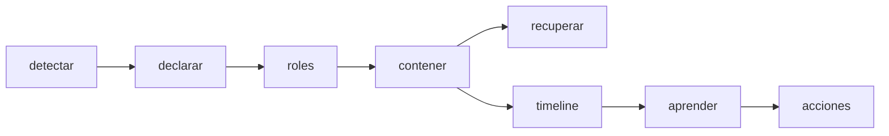
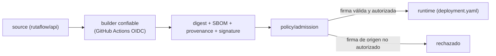
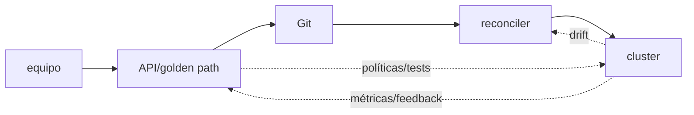

# Módulo 2: SRE y plataforma — confiabilidad, incidentes y supply chain

Automatizar despliegues es el comienzo, no el final. Un sistema profesional define qué significa estar sano, limita el riesgo de cambio, conserva procedencia de artefactos y aprende de incidentes. Este módulo conecta DevOps, SRE, seguridad de cadena de suministro y platform engineering mediante evidencia operativa.


## Aprende construyendo


### Tema 1: Confiabilidad es una expectativa cuantificada · Avanzado · 45 min

<details open>
<summary><strong>Capa 1 — Lectura</strong></summary>

#### ► DE QUÉ TRATA
Al finalizar vas a definir un SLI/SLO para el viaje "crear un envío y verlo confirmado" en la API de RutaFlow, y a calcular cuánto presupuesto de error queda disponible en la ventana actual. Prerrequisitos: Módulo 9 completo.

#### ► CÓMO FUNCIONA


</details>

<details>
<summary><strong>Capa 2 — Construcción</strong></summary>

#### Código y verificación
```promql
sum(rate(http_requests_total{route="/envios",code=~"2.."}[5m]))
/
sum(rate(http_requests_total{route="/envios"}[5m]))
```


```bash
mkdir -p ejemplo-slo && cd ejemplo-slo
```

Crea `sli.sh`. `awk` hace las cuentas con decimales:

```bash
#!/usr/bin/env bash
# sli.sh — SLI, presupuesto de error y cuánto se ha consumido
validos=1000000
buenos=999450
slo=0.999
awk -v v="$validos" -v b="$buenos" -v slo="$slo" 'BEGIN {
  presupuesto = v * (1 - slo); consumido = v - b
  printf "SLI: %.4f%%\n", b / v * 100
  printf "Presupuesto: %.0f eventos\n", presupuesto
  if (consumido > presupuesto) { print "presupuesto de error agotado: congelar cambios riesgosos"; exit 1 }
  printf "Consumido: %.0f (%.1f%% del presupuesto)\n", consumido, consumido / presupuesto * 100
}'
```

```bash
chmod +x sli.sh
./sli.sh
```

```text
SLI: 99.9450%
Presupuesto: 1000 eventos
Consumido: 550 (55.0% del presupuesto)
```

</details>

### Tema 2: Una alerta debe conducir a una acción · Avanzado · 45 min

<details open>
<summary><strong>Capa 1 — Lectura</strong></summary>

#### ► DE QUÉ TRATA
Al finalizar vas a configurar una alerta de "fast burn" sobre el presupuesto de error de /envios, con labels y annotations correctamente separados, y un runbook vinculado. Prerrequisitos: Tema 1 de este módulo.

#### ► CÓMO FUNCIONA


</details>

<details>
<summary><strong>Capa 2 — Construcción</strong></summary>

#### Código y verificación
```yaml
- alert: FastErrorBudgetBurn
  expr: job:slo_errors_per_request:ratio_rate5m > (14.4 * 0.001)
  for: 2m
  labels: { severity: page }
  annotations:
    summary: "La API consume rápidamente su presupuesto de error"
    runbook: "https://runbooks.example/tasks-api/high-burn"
```


```bash
mkdir ejemplo && cd ejemplo
```

```yaml
groups:
  - name: rutaflow-slo
    rules:
      - alert: FastErrorBudgetBurnEnvios
        expr: job:slo_errors_per_request:ratio_rate5m{route="/envios"} > (14.4 * 0.001)
        for: 2m
        labels:
          severity: page
          service: rutaflow-api
        annotations:
          summary: "La API de envíos consume rápidamente su presupuesto de error"
          runbook: "https://runbooks.rutaflow.app/envios-api/high-burn"
```

Crea `verificar_alerta.sh`. `yq` (en un contenedor, sin instalarlo) convierte el YAML a JSON y `jq` revisa cada regla:

```bash
#!/usr/bin/env bash
# verificar_alerta.sh — cada alerta tiene expr, for, severity y runbook, sin labels de alta cardinalidad
set -uo pipefail
doc=$(docker run --rm -v "$PWD":/workdir mikefarah/yq -o=json alerta.yaml)
salida=$(jq -r '
  [.groups[].rules[]] as $reglas
  | "alertas: \($reglas | length)",
    "labels: \([$reglas[].labels // {} | keys[]] | unique | join(", "))",
    "annotations: \([$reglas[].annotations // {} | keys[]] | unique | join(", "))",
    ($reglas[] as $r | ($r.alert // "?") as $n
      | (["alert", "expr", "for"][] | select($r[.] == null) | "fallo: \($n): falta \(.)"),
        (($r.labels // {} | keys) - ["severity", "service", "team"]
          | select(length > 0) | "fallo: \($n): labels de alta cardinalidad \(.)"),
        (select($r.labels.severity == null) | "fallo: \($n): falta labels.severity"),
        (select(($r.annotations.runbook // "") == "") | "fallo: \($n): falta annotations.runbook"),
        (select(($r.expr // "") | contains("ratio_rate5m") | not) | "fallo: \($n): la expresión no mide consumo de presupuesto"))
' <<<"$doc")
echo "$salida"
! grep -q '^fallo:' <<<"$salida"
```

```bash
chmod +x verificar_alerta.sh
./verificar_alerta.sh
```

```text
alertas: 1
labels: service, severity
annotations: runbook, summary
```

Agrega a `labels` un `user_id: "42"` y vuelve a ejecutar: `fallo: FastErrorBudgetBurnEnvios: labels de alta cardinalidad ["user_id"]`.

</details>

### Tema 3: Construir una imagen no demuestra de dónde proviene · Avanzado · 45 min

<details open>
<summary><strong>Capa 1 — Lectura</strong></summary>

#### ► DE QUÉ TRATA
Al finalizar vas a generar el SBOM de la imagen de RutaFlow y a firmarla con cosign, verificando que solo se acepte una imagen firmada por el pipeline de CI real. Prerrequisitos: Tema 2 de este módulo.

#### ► CÓMO FUNCIONA


</details>

<details>
<summary><strong>Capa 2 — Construcción</strong></summary>

#### Código y verificación
```bash
syft packages registry.example/tasks@sha256:ABC -o cyclonedx-json > sbom.json
cosign verify \
  --certificate-identity-regexp='github.com/example/tasks/' \
  --certificate-oidc-issuer='https://token.actions.githubusercontent.com' \
  registry.example/tasks@sha256:ABC
```


```bash
mkdir ejemplo && cd ejemplo
```

```yaml
apiVersion: policy.sigstore.dev/v1beta1
kind: ClusterImagePolicy
metadata:
  name: rutaflow-api
spec:
  images:
    - glob: "registry.rutaflow.app/api:*"
  authorities:
    - keyless:
        url: https://fulcio.sigstore.dev
        identities:
          - issuer: https://token.actions.githubusercontent.com
            subject: https://github.com/rutaflow/api/.github/workflows/release.yml@refs/heads/main
```

Crea `verificar_politica.sh`:

```bash
#!/usr/bin/env bash
# verificar_politica.sh — la política limita imágenes y exige identidad keyless del builder autorizado
set -uo pipefail
doc=$(docker run --rm -v "$PWD":/workdir mikefarah/yq -o=json politica.yaml)
salida=$(jq -r '
  (.spec.images // []) as $imagenes
  | [.spec.authorities[]?.keyless.identities[]?] as $ids
  | "imágenes limitadas: \($imagenes | length)",
    "identidades verificadas: \($ids | length)",
    ($ids[] | "issuer: \(.issuer)", "subject: \(.subject // "<sin restricción>")"),
    (select($imagenes | length == 0) | "fallo: la política no limita ninguna imagen"),
    ($ids[] | select(.issuer != "https://token.actions.githubusercontent.com")
      | "fallo: emisor OIDC no es el builder autorizado"),
    ($ids[] | select((.subject // "") | contains("/rutaflow/api/") | not)
      | "fallo: sin subject que limite el repositorio firmante"),
    (select($ids | length == 0) | "fallo: no exige identidad keyless")
' <<<"$doc")
echo "$salida"
! grep -q '^fallo:' <<<"$salida"
```

```bash
chmod +x verificar_politica.sh
./verificar_politica.sh
```

```text
imágenes limitadas: 1
identidades verificadas: 1
issuer: https://token.actions.githubusercontent.com
subject: https://github.com/rutaflow/api/.github/workflows/release.yml@refs/heads/main
```

Borra la línea `subject:` y vuelve a ejecutar: la política aceptaría firmas de cualquier repositorio y el script
termina con `fallo: sin subject que limite el repositorio firmante`.

</details>

### Tema 4: Una plataforma interna es un producto con límites · Avanzado · 45 min

<details open>
<summary><strong>Capa 1 — Lectura</strong></summary>

#### ► DE QUÉ TRATA
Al finalizar vas a escribir una política Rego que rechace en el clúster de RutaFlow cualquier Pod que corra como root, y a medir el tiempo hasta el primer deploy exitoso de un desarrollador nuevo usando el golden path. Prerrequisitos: Tema 3 de este módulo.

#### ► CÓMO FUNCIONA


</details>

<details>
<summary><strong>Capa 2 — Construcción</strong></summary>

#### Código y verificación

```bash
mkdir -p ejemplo-politica && cd ejemplo-politica
```

```rego
package kubernetes.admission

deny[msg] {
  input.kind.kind == "Pod"
  c := input.spec.containers[_]
  not c.securityContext.runAsNonRoot
  msg := sprintf("%s debe ejecutar como non-root", [c.name])
}
```

```yaml
apiVersion: v1
kind: Pod
metadata:
  name: pod-root
spec:
  containers:
    - name: app
      image: nginx:1.30
```

```bash
opa eval -d policy.rego -i pod-root.yaml 'data.kubernetes.admission.deny'
kubectl apply --dry-run=client -f pod-root.yaml
```

```yaml
apiVersion: v1
kind: Pod
metadata:
  name: rutaflow-delivery-api
spec:
  containers:
    - name: app
      image: registry.rutaflow.app/api:1.0.0
      securityContext:
        runAsNonRoot: true
```

</details>

### Kubernetes 1.36, OpenTelemetry 1.59 y herramientas con ciclo propio

<details open>
<summary><strong>Capa 1 — Lectura</strong></summary>

</details>

<details>
<summary><strong>Capa 2 — Construcción</strong></summary>

#### Nota de construcción
Este tema es principalmente conceptual en esta versión. La verificación se realiza con las preguntas de comprensión y el criterio de cuándo NO usar kubernetes 1.36, opentelemetry 1.59 y herramientas con ciclo propio.

</details>

### Método de estudio y proyecto de ampliación

<details open>
<summary><strong>Capa 1 — Lectura</strong></summary>

</details>

<details>
<summary><strong>Capa 2 — Construcción</strong></summary>

#### Nota de construcción
Este tema es principalmente conceptual en esta versión. La verificación se realiza con las preguntas de comprensión y el criterio de cuándo NO usar método de estudio y proyecto de ampliación.

</details>
