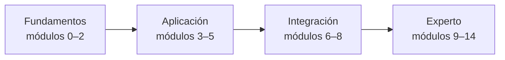
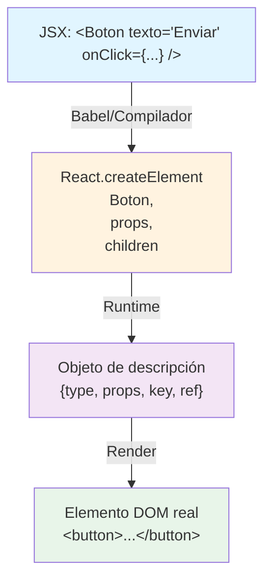
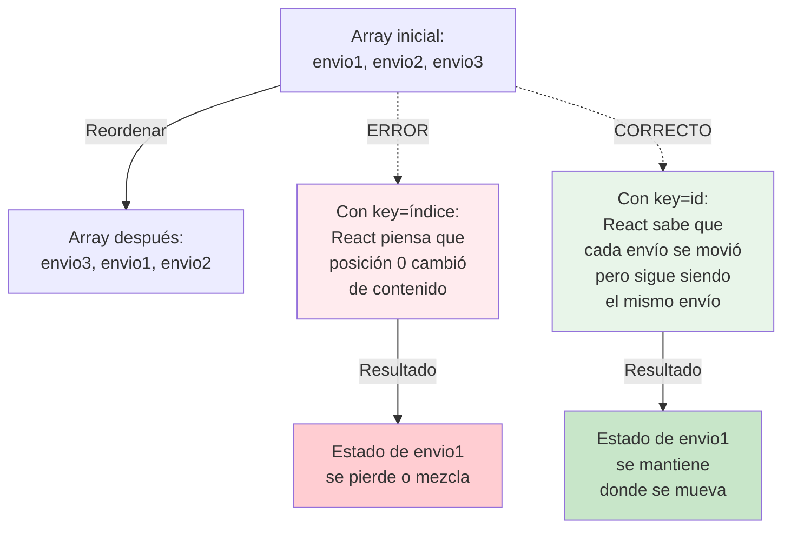
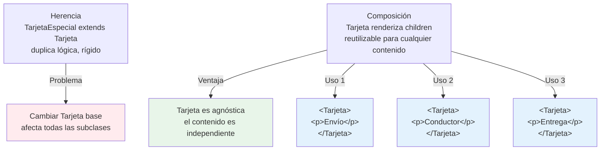
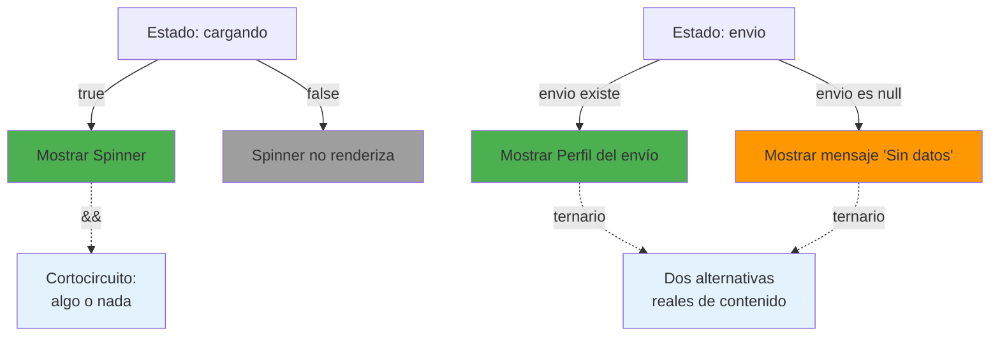

# Módulo 0: JSX, componentes y props


## Antes de comenzar: instala el entorno

React se estudia en el navegador, pero sus herramientas se ejecutan con Node.js. Instala **Node.js LTS**, **Git**, **Visual Studio Code** y un navegador moderno (Chrome, Edge o Firefox). No necesitas instalar React globalmente.

| Sistema | Instalación recomendada | Verificación |
|---|---|---|
| Windows | Instaladores oficiales de Node.js, Git y VS Code | `node -v`, `npm -v`, `git --version` en PowerShell |
| macOS | `brew install node git` después de instalar Homebrew | Los mismos tres comandos en Terminal |
| Ubuntu/Debian | Git con `apt`; Node LTS con `nvm` o NodeSource; VS Code desde su sitio oficial | Los mismos comandos en la terminal de VS Code |


### Crea tu primera aplicación

<details open>
<summary><strong>Capa 1 — Lectura</strong></summary>

#### ► DE QUÉ TRATA
Este tema te guía por crea tu primera aplicación con foco en comprensión antes de implementación.

#### ► LA IDEA EN UNA FRASE
**Entender crea tu primera aplicación te permite tomar mejores decisiones técnicas.**

#### ► POR QUÉ EXISTE ESTO
Resuelve un problema real de diseño o implementación y evita decisiones a ciegas.

#### ► LA ANALOGÍA
Piensa en crea tu primera aplicación como una herramienta de taller: útil cuando conoces su propósito y sus límites.
**Dónde se rompe la analogía:** en software, los efectos dependen del contexto, la escala y los trade-offs.

#### ► CÓMO FUNCIONA
1. Identifica el problema que crea tu primera aplicación resuelve.
2. Observa sus componentes y relaciones.
3. Aplica la opción más simple que funcione.
4. Verifica el resultado y los límites.

#### ► LO QUE PUEDE SALIR MAL
| Síntoma | Causa probable | Arreglo |
|---|---|---|
| Crea tu primera aplicación se aplica pero el resultado no mejora | Se usó sin medir el problema real | Mide antes y compara contra la alternativa simple |
| Aparece complejidad inesperada | Se adoptó la técnica sin comprender sus trade-offs | Vuelve a la sección de trade-offs y reduce el alcance |
| Falla en un caso límite | Se asumió un contexto que no se cumple | Prueba el caso límite y documenta cuándo NO usarlo |

#### ► TRADE-OFFS
| Opción | Cuándo usarla | Cuándo NO usarla |
|---|---|---|
| Usar Crea tu primera aplicación | Cuando el problema coincide con su propósito y el beneficio es observable | Cuando agrega complejidad sin resolver un problema real |
| Alternativa más simple | Cuando el contexto es pequeño, estable o fácil de razonar | Cuando ya demostró no escalar o no cumplir el requisito |
| Postergar la decisión | Cuando falta evidencia del problema | Cuando el costo de esperar es mayor que el costo de probar |

#### ► CUÁNDO NO USAR ESTO
No uses crea tu primera aplicación por defecto. Aplícalo cuando el problema lo justifique y puedas verificar el beneficio; si una alternativa más simple resuelve igual, prefiérela.

#### ► DE VUELTA A LA ANALOGÍA
Volviendo a la analogía: crea tu primera aplicación funciona como el modelo inicial, pero recuerda dónde se rompe: en producción importan la evidencia, la escala y el costo de equivocarte.

#### ► LO QUE DEBES RECORDAR
- Crea tu primera aplicación existe para resolver un problema específico.
- Mide antes de adoptar complejidad.
- Conoce el caso donde NO usarlo.
- Verifica con evidencia observable.

#### ► PREGUNTAS PARA PENSAR
1. ¿Qué problema concreto resuelve crea tu primera aplicación en tu contexto?
2. ¿Cómo sabrías que crea tu primera aplicación no está funcionando bien?
3. ¿Qué alternativa más simple considerarías antes de usar crea tu primera aplicación?

</details>

<details>
<summary><strong>Capa 2 — Construcción</strong></summary>

#### Código y verificación
```bash
npm create vite@latest mi-react -- --template react
cd mi-react
npm install
npm run dev
```

</details>

### Prepara las pruebas (una sola vez)

<details open>
<summary><strong>Capa 1 — Lectura</strong></summary>

#### ► DE QUÉ TRATA
Este tema te guía por prepara las pruebas (una sola vez) con foco en comprensión antes de implementación.

#### ► LA IDEA EN UNA FRASE
**Entender prepara las pruebas (una sola vez) te permite tomar mejores decisiones técnicas.**

#### ► POR QUÉ EXISTE ESTO
Resuelve un problema real de diseño o implementación y evita decisiones a ciegas.

#### ► LA ANALOGÍA
Piensa en prepara las pruebas (una sola vez) como una herramienta de taller: útil cuando conoces su propósito y sus límites.
**Dónde se rompe la analogía:** en software, los efectos dependen del contexto, la escala y los trade-offs.

#### ► CÓMO FUNCIONA


#### ► LO QUE PUEDE SALIR MAL
| Síntoma | Causa probable | Arreglo |
|---|---|---|
| Prepara las pruebas (una sola vez) se aplica pero el resultado no mejora | Se usó sin medir el problema real | Mide antes y compara contra la alternativa simple |
| Aparece complejidad inesperada | Se adoptó la técnica sin comprender sus trade-offs | Vuelve a la sección de trade-offs y reduce el alcance |
| Falla en un caso límite | Se asumió un contexto que no se cumple | Prueba el caso límite y documenta cuándo NO usarlo |

#### ► TRADE-OFFS
| Opción | Cuándo usarla | Cuándo NO usarla |
|---|---|---|
| Usar Prepara las pruebas (una sola vez) | Cuando el problema coincide con su propósito y el beneficio es observable | Cuando agrega complejidad sin resolver un problema real |
| Alternativa más simple | Cuando el contexto es pequeño, estable o fácil de razonar | Cuando ya demostró no escalar o no cumplir el requisito |
| Postergar la decisión | Cuando falta evidencia del problema | Cuando el costo de esperar es mayor que el costo de probar |

#### ► CUÁNDO NO USAR ESTO
No uses prepara las pruebas (una sola vez) por defecto. Aplícalo cuando el problema lo justifique y puedas verificar el beneficio; si una alternativa más simple resuelve igual, prefiérela.

#### ► DE VUELTA A LA ANALOGÍA
Volviendo a la analogía: prepara las pruebas (una sola vez) funciona como el modelo inicial, pero recuerda dónde se rompe: en producción importan la evidencia, la escala y el costo de equivocarte.

#### ► LO QUE DEBES RECORDAR
- Prepara las pruebas (una sola vez) existe para resolver un problema específico.
- Mide antes de adoptar complejidad.
- Conoce el caso donde NO usarlo.
- Verifica con evidencia observable.

#### ► PREGUNTAS PARA PENSAR
1. ¿Qué problema concreto resuelve prepara las pruebas (una sola vez) en tu contexto?
2. ¿Cómo sabrías que prepara las pruebas (una sola vez) no está funcionando bien?
3. ¿Qué alternativa más simple considerarías antes de usar prepara las pruebas (una sola vez)?

</details>

<details>
<summary><strong>Capa 2 — Construcción</strong></summary>

#### Código y verificación
```bash
npm install -D vitest @testing-library/react @testing-library/jest-dom @testing-library/user-event jsdom
npm pkg set scripts.test="vitest run"
```

```js
import react from '@vitejs/plugin-react'
import { defineConfig } from 'vite'

// https://vite.dev/config/
export default defineConfig({
  plugins: [react()],
  test: {
    environment: 'jsdom',
    setupFiles: './src/setupTests.js',
  },
})
```

```js
import '@testing-library/jest-dom/vitest'
import { cleanup } from '@testing-library/react'
import { afterEach } from 'vitest'

// Desmonta lo renderizado por cada prueba para que no se mezclen.
afterEach(cleanup)
```


</details>

### Tema 1: JSX es azúcar sintáctica sobre createElement · Básico · 40 min

<details open>
<summary><strong>Capa 1 — Lectura</strong></summary>

#### ► DE QUÉ TRATA
Al finalizar podrás crear un componente React desde cero. Prerrequisitos: Node.js LTS, npm y un editor. Verifica node --version y npm --version.

#### ► LA IDEA EN UNA FRASE
**Al finalizar podrás crear un componente React desde cero.**

#### ► POR QUÉ EXISTE ESTO
Resuelve un problema real de diseño o implementación y evita decisiones a ciegas.

#### ► LA ANALOGÍA
Piensa en jsx es azúcar sintáctica sobre createelement como una herramienta de taller: útil cuando conoces su propósito y sus límites.
**Dónde se rompe la analogía:** en software, los efectos dependen del contexto, la escala y los trade-offs.

#### ► CÓMO FUNCIONA


#### ► LO QUE PUEDE SALIR MAL
| Síntoma | Causa probable | Arreglo |
|---|---|---|
| JSX es azúcar sintáctica sobre createElement se aplica pero el resultado no mejora | Se usó sin medir el problema real | Mide antes y compara contra la alternativa simple |
| Aparece complejidad inesperada | Se adoptó la técnica sin comprender sus trade-offs | Vuelve a la sección de trade-offs y reduce el alcance |
| Falla en un caso límite | Se asumió un contexto que no se cumple | Prueba el caso límite y documenta cuándo NO usarlo |

#### ► TRADE-OFFS
| Opción | Cuándo usarla | Cuándo NO usarla |
|---|---|---|
| Usar JSX es azúcar sintáctica sobre createElement | Cuando el problema coincide con su propósito y el beneficio es observable | Cuando agrega complejidad sin resolver un problema real |
| Alternativa más simple | Cuando el contexto es pequeño, estable o fácil de razonar | Cuando ya demostró no escalar o no cumplir el requisito |
| Postergar la decisión | Cuando falta evidencia del problema | Cuando el costo de esperar es mayor que el costo de probar |

#### ► CUÁNDO NO USAR ESTO
No uses jsx es azúcar sintáctica sobre createelement por defecto. Aplícalo cuando el problema lo justifique y puedas verificar el beneficio; si una alternativa más simple resuelve igual, prefiérela.

#### ► DE VUELTA A LA ANALOGÍA
Volviendo a la analogía: jsx es azúcar sintáctica sobre createelement funciona como el modelo inicial, pero recuerda dónde se rompe: en producción importan la evidencia, la escala y el costo de equivocarte.

#### ► LO QUE DEBES RECORDAR
- JSX es azúcar sintáctica sobre createElement existe para resolver un problema específico.
- Mide antes de adoptar complejidad.
- Conoce el caso donde NO usarlo.
- Verifica con evidencia observable.

#### ► PREGUNTAS PARA PENSAR
1. ¿Qué problema concreto resuelve jsx es azúcar sintáctica sobre createelement en tu contexto?
2. ¿Cómo sabrías que jsx es azúcar sintáctica sobre createelement no está funcionando bien?
3. ¿Qué alternativa más simple considerarías antes de usar jsx es azúcar sintáctica sobre createelement?

</details>

<details>
<summary><strong>Capa 2 — Construcción</strong></summary>

#### Código y verificación


```jsx
function Boton({ texto, onClick }) {
  return <button onClick={onClick}>{texto}</button>;
}
// Se transforma en:
// React.createElement('button', { onClick }, texto)
```

```jsx
export default function DeliveryCard({ guia, direccion }) {
  return (
    <article className="delivery-card">
      <h2>Guía {guia}</h2>
      <p>{direccion}</p>
    </article>
  )
}
```

```jsx
import DeliveryCard from './components/DeliveryCard.jsx'

const envios = [
  { id: 'RF-4471', direccion: 'Calle 10 # 5-20' },
  { id: 'RF-4472', direccion: 'Carrera 7 # 45-10' },
]

export default function App() {
  return (
    <main>
      <h1>Envíos de hoy</h1>
      {envios.map((envio) => (
        <DeliveryCard key={envio.id} guia={envio.id} direccion={envio.direccion} />
      ))}
    </main>
  )
}
```

```jsx
import { render, screen } from '@testing-library/react'
import { describe, expect, it } from 'vitest'
import DeliveryCard from './DeliveryCard.jsx'

describe('DeliveryCard', () => {
  it('muestra la guía y la dirección recibidas por props', () => {
    render(<DeliveryCard guia="RF-4471" direccion="Calle 10 # 5-20" />)
    expect(screen.getByRole('heading', { name: 'Guía RF-4471' })).toBeInTheDocument()
    expect(screen.getByText('Calle 10 # 5-20')).toBeInTheDocument()
  })
})
```

```bash
npm test
npm run dev
```

</details>

### Tema 2: Listas con key estable · Básico · 45 min

<details open>
<summary><strong>Capa 1 — Lectura</strong></summary>

#### ► DE QUÉ TRATA
Al finalizar vas a renderizar una lista de envíos (EnvioCard) con .map(), usando el id de cada envío como key en vez de su posición en el array. Prerrequisitos: Tema 1 de este módulo.

#### ► LA IDEA EN UNA FRASE
**Al finalizar vas a renderizar una lista de envíos (EnvioCard) con .map(), usando el id de cada envío como key en vez de su posición en el array.**

#### ► POR QUÉ EXISTE ESTO
Resuelve un problema real de diseño o implementación y evita decisiones a ciegas.

#### ► LA ANALOGÍA
Piensa en listas con key estable como una herramienta de taller: útil cuando conoces su propósito y sus límites.
**Dónde se rompe la analogía:** en software, los efectos dependen del contexto, la escala y los trade-offs.

#### ► CÓMO FUNCIONA


#### ► LO QUE PUEDE SALIR MAL
| Síntoma | Causa probable | Arreglo |
|---|---|---|
| Listas con key estable se aplica pero el resultado no mejora | Se usó sin medir el problema real | Mide antes y compara contra la alternativa simple |
| Aparece complejidad inesperada | Se adoptó la técnica sin comprender sus trade-offs | Vuelve a la sección de trade-offs y reduce el alcance |
| Falla en un caso límite | Se asumió un contexto que no se cumple | Prueba el caso límite y documenta cuándo NO usarlo |

#### ► TRADE-OFFS
| Opción | Cuándo usarla | Cuándo NO usarla |
|---|---|---|
| Usar Listas con key estable | Cuando el problema coincide con su propósito y el beneficio es observable | Cuando agrega complejidad sin resolver un problema real |
| Alternativa más simple | Cuando el contexto es pequeño, estable o fácil de razonar | Cuando ya demostró no escalar o no cumplir el requisito |
| Postergar la decisión | Cuando falta evidencia del problema | Cuando el costo de esperar es mayor que el costo de probar |

#### ► CUÁNDO NO USAR ESTO
No uses listas con key estable por defecto. Aplícalo cuando el problema lo justifique y puedas verificar el beneficio; si una alternativa más simple resuelve igual, prefiérela.

#### ► DE VUELTA A LA ANALOGÍA
Volviendo a la analogía: listas con key estable funciona como el modelo inicial, pero recuerda dónde se rompe: en producción importan la evidencia, la escala y el costo de equivocarte.

#### ► LO QUE DEBES RECORDAR
- Listas con key estable existe para resolver un problema específico.
- Mide antes de adoptar complejidad.
- Conoce el caso donde NO usarlo.
- Verifica con evidencia observable.

#### ► PREGUNTAS PARA PENSAR
1. ¿Qué problema concreto resuelve listas con key estable en tu contexto?
2. ¿Cómo sabrías que listas con key estable no está funcionando bien?
3. ¿Qué alternativa más simple considerarías antes de usar listas con key estable?

</details>

<details>
<summary><strong>Capa 2 — Construcción</strong></summary>

#### Código y verificación


```jsx
{tareas.map(tarea => <li key={tarea.id}>{tarea.titulo}</li>)}
// key={tarea.id}: estable sin importar el orden
// key={indice}: riesgoso si la lista se reordena o filtra
```

```jsx
import { useState } from 'react';

const enviosIniciales = [
  { id: 'RF-4471', direccion: 'Calle 10 # 5-20' },
  { id: 'RF-4472', direccion: 'Carrera 7 # 45-10' },
  { id: 'RF-4473', direccion: 'Avenida 68 # 13-50' },
];

function EnvioCard({ envio }) {
  return (
    <li>
      {envio.id} — {envio.direccion}{' '}
      <input aria-label={`Nota de ${envio.id}`} placeholder="Nota del operador" />
    </li>
  );
}

function ListaEnvios({ envios }) {
  return (
    <ul>
      {envios.map(envio => <EnvioCard key={envio.id} envio={envio} />)}
    </ul>
  );
}

export default function App() {
  // useState se estudia en el módulo 1; aquí solo guarda el orden de la lista.
  const [envios, setEnvios] = useState(enviosIniciales);
  const moverUltimoAlPrincipio = () => setEnvios([envios.at(-1), ...envios.slice(0, -1)]);

  return (
    <main>
      <button onClick={moverUltimoAlPrincipio}>Mover el último al principio</button>
      <ListaEnvios envios={envios} />
    </main>
  );
}
```

```bash
npm run dev
```

</details>

### Tema 3: Composición sobre herencia, y Fragments · Básico · 45 min

<details open>
<summary><strong>Capa 1 — Lectura</strong></summary>

#### ► DE QUÉ TRATA
Al finalizar vas a construir un componente Tarjeta genérico que use children, y a envolver su contenido en un Fragment en vez de un <div> extra sin propósito. Prerrequisitos: Tema 2 de este módulo.

#### ► LA IDEA EN UNA FRASE
**Al finalizar vas a construir un componente Tarjeta genérico que use children, y a envolver su contenido en un Fragment en vez de un <div> extra sin propósito.**

#### ► POR QUÉ EXISTE ESTO
Resuelve un problema real de diseño o implementación y evita decisiones a ciegas.

#### ► LA ANALOGÍA
Piensa en composición sobre herencia, y fragments como una herramienta de taller: útil cuando conoces su propósito y sus límites.
**Dónde se rompe la analogía:** en software, los efectos dependen del contexto, la escala y los trade-offs.

#### ► CÓMO FUNCIONA


#### ► LO QUE PUEDE SALIR MAL
| Síntoma | Causa probable | Arreglo |
|---|---|---|
| Composición sobre herencia, y Fragments se aplica pero el resultado no mejora | Se usó sin medir el problema real | Mide antes y compara contra la alternativa simple |
| Aparece complejidad inesperada | Se adoptó la técnica sin comprender sus trade-offs | Vuelve a la sección de trade-offs y reduce el alcance |
| Falla en un caso límite | Se asumió un contexto que no se cumple | Prueba el caso límite y documenta cuándo NO usarlo |

#### ► TRADE-OFFS
| Opción | Cuándo usarla | Cuándo NO usarla |
|---|---|---|
| Usar Composición sobre herencia, y Fragments | Cuando el problema coincide con su propósito y el beneficio es observable | Cuando agrega complejidad sin resolver un problema real |
| Alternativa más simple | Cuando el contexto es pequeño, estable o fácil de razonar | Cuando ya demostró no escalar o no cumplir el requisito |
| Postergar la decisión | Cuando falta evidencia del problema | Cuando el costo de esperar es mayor que el costo de probar |

#### ► CUÁNDO NO USAR ESTO
No uses composición sobre herencia, y fragments por defecto. Aplícalo cuando el problema lo justifique y puedas verificar el beneficio; si una alternativa más simple resuelve igual, prefiérela.

#### ► DE VUELTA A LA ANALOGÍA
Volviendo a la analogía: composición sobre herencia, y fragments funciona como el modelo inicial, pero recuerda dónde se rompe: en producción importan la evidencia, la escala y el costo de equivocarte.

#### ► LO QUE DEBES RECORDAR
- Composición sobre herencia, y Fragments existe para resolver un problema específico.
- Mide antes de adoptar complejidad.
- Conoce el caso donde NO usarlo.
- Verifica con evidencia observable.

#### ► PREGUNTAS PARA PENSAR
1. ¿Qué problema concreto resuelve composición sobre herencia, y fragments en tu contexto?
2. ¿Cómo sabrías que composición sobre herencia, y fragments no está funcionando bien?
3. ¿Qué alternativa más simple considerarías antes de usar composición sobre herencia, y fragments?

</details>

<details>
<summary><strong>Capa 2 — Construcción</strong></summary>

#### Código y verificación


```jsx
function Tarjeta({ children }) {
  return <div className="tarjeta">{children}</div>;
}

<Tarjeta><Avatar /><Nombre texto="Ana" /></Tarjeta>
// Composición: Tarjeta no sabe qué contenido recibirá, solo lo envuelve
```

```jsx
function Tarjeta({ children }) {
  return <div className="tarjeta">{children}</div>;
}

function EnvioCard({ envio }) {
  return (
    <Tarjeta>
      <>
        <p>{envio.guia}</p>
        <p>{envio.direccion}</p>
      </>
    </Tarjeta>
  );
}

export default function App() {
  return <EnvioCard envio={{ guia: 'RF-4471', direccion: 'Calle 10 # 5-20' }} />;
}
```

```bash
npm run dev
```

</details>

### Tema 4: Renderizado condicional y estilos · Básico · 45 min

<details open>
<summary><strong>Capa 1 — Lectura</strong></summary>

#### ► DE QUÉ TRATA
Al finalizar vas a mostrar un Spinner mientras EnvioCard carga, y a elegir entre && y el operador ternario según si existe una sola alternativa o dos. Prerrequisitos: Tema 3 de este módulo.

#### ► LA IDEA EN UNA FRASE
**Al finalizar vas a mostrar un Spinner mientras EnvioCard carga, y a elegir entre && y el operador ternario según si existe una sola alternativa o dos.**

#### ► POR QUÉ EXISTE ESTO
Resuelve un problema real de diseño o implementación y evita decisiones a ciegas.

#### ► LA ANALOGÍA
Piensa en renderizado condicional y estilos como una herramienta de taller: útil cuando conoces su propósito y sus límites.
**Dónde se rompe la analogía:** en software, los efectos dependen del contexto, la escala y los trade-offs.

#### ► CÓMO FUNCIONA


#### ► LO QUE PUEDE SALIR MAL
| Síntoma | Causa probable | Arreglo |
|---|---|---|
| Renderizado condicional y estilos se aplica pero el resultado no mejora | Se usó sin medir el problema real | Mide antes y compara contra la alternativa simple |
| Aparece complejidad inesperada | Se adoptó la técnica sin comprender sus trade-offs | Vuelve a la sección de trade-offs y reduce el alcance |
| Falla en un caso límite | Se asumió un contexto que no se cumple | Prueba el caso límite y documenta cuándo NO usarlo |

#### ► TRADE-OFFS
| Opción | Cuándo usarla | Cuándo NO usarla |
|---|---|---|
| Usar Renderizado condicional y estilos | Cuando el problema coincide con su propósito y el beneficio es observable | Cuando agrega complejidad sin resolver un problema real |
| Alternativa más simple | Cuando el contexto es pequeño, estable o fácil de razonar | Cuando ya demostró no escalar o no cumplir el requisito |
| Postergar la decisión | Cuando falta evidencia del problema | Cuando el costo de esperar es mayor que el costo de probar |

#### ► CUÁNDO NO USAR ESTO
No uses renderizado condicional y estilos por defecto. Aplícalo cuando el problema lo justifique y puedas verificar el beneficio; si una alternativa más simple resuelve igual, prefiérela.

#### ► DE VUELTA A LA ANALOGÍA
Volviendo a la analogía: renderizado condicional y estilos funciona como el modelo inicial, pero recuerda dónde se rompe: en producción importan la evidencia, la escala y el costo de equivocarte.

#### ► LO QUE DEBES RECORDAR
- Renderizado condicional y estilos existe para resolver un problema específico.
- Mide antes de adoptar complejidad.
- Conoce el caso donde NO usarlo.
- Verifica con evidencia observable.

#### ► PREGUNTAS PARA PENSAR
1. ¿Qué problema concreto resuelve renderizado condicional y estilos en tu contexto?
2. ¿Cómo sabrías que renderizado condicional y estilos no está funcionando bien?
3. ¿Qué alternativa más simple considerarías antes de usar renderizado condicional y estilos?

</details>

<details>
<summary><strong>Capa 2 — Construcción</strong></summary>

#### Código y verificación


```jsx
function Spinner() {
  return <p role="status">Cargando envío…</p>;
}

function EnvioCard({ envio, cargando }) {
  return (
    <div className="tarjeta">
      {cargando && <Spinner />}
      {envio ? <p>{envio.direccion}</p> : <p>Sin datos todavía</p>}
    </div>
  );
}

export default function App() {
  return (
    <>
      <EnvioCard envio={null} cargando={true} />
      <EnvioCard envio={{ id: 1, direccion: 'Calle Principal 123' }} cargando={false} />
    </>
  );
}
```

```bash
npm run dev
```

</details>
