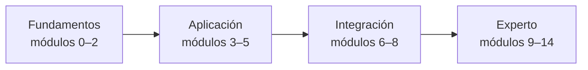
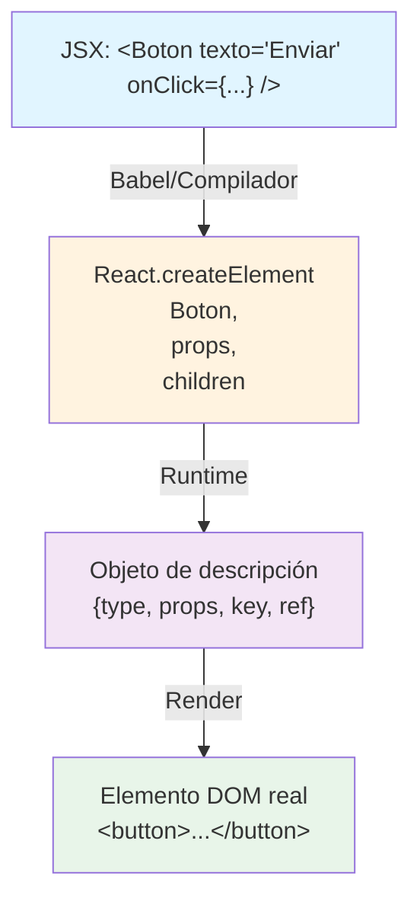
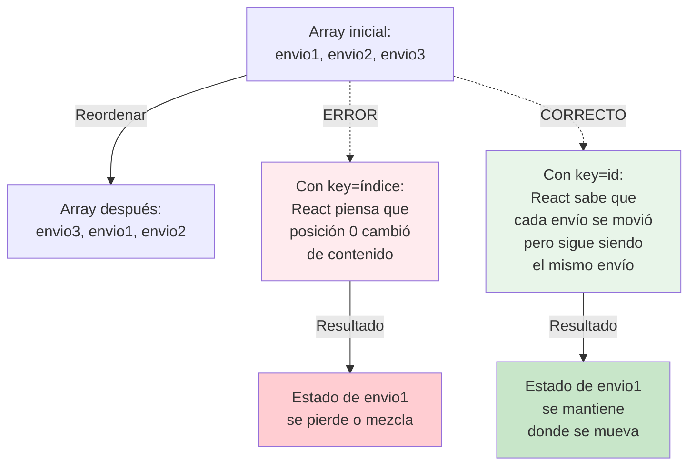
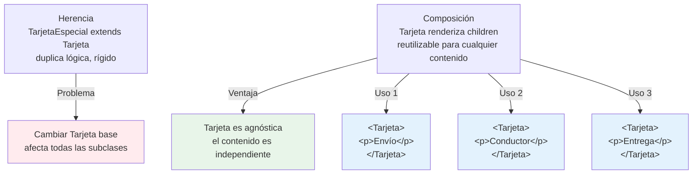
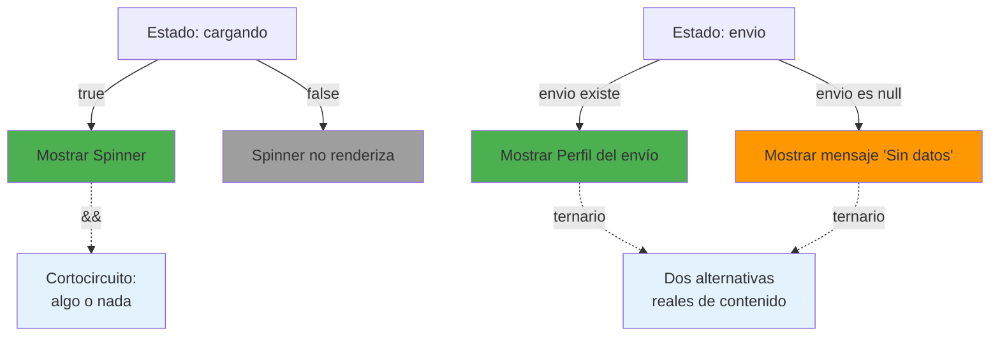

# Módulo 0: JSX, componentes y props


## Antes de comenzar: instala el entorno

React se estudia en el navegador, pero sus herramientas se ejecutan con Node.js. Instala **Node.js LTS**, **Git**, **Visual Studio Code** y un navegador moderno (Chrome, Edge o Firefox). No necesitas instalar React globalmente.

| Sistema | Instalación recomendada | Verificación |
|---|---|---|
| Windows | Instaladores oficiales de Node.js, Git y VS Code | `node -v`, `npm -v`, `git --version` en PowerShell |
| macOS | `brew install node git` después de instalar Homebrew | Los mismos tres comandos en Terminal |
| Ubuntu/Debian | Git con `apt`; Node LTS con `nvm` o NodeSource; VS Code desde su sitio oficial | Los mismos comandos en la terminal de VS Code |


### Crea tu primera aplicación

<details open>
<summary><strong>Capa 1 — Lectura</strong></summary>

</details>

<details>
<summary><strong>Capa 2 — Construcción</strong></summary>

#### Código y verificación
```bash
npm create vite@latest mi-react -- --template react
cd mi-react
npm install
npm run dev
```

</details>

### Prepara las pruebas (una sola vez)

<details open>
<summary><strong>Capa 1 — Lectura</strong></summary>

#### ► CÓMO FUNCIONA


</details>

<details>
<summary><strong>Capa 2 — Construcción</strong></summary>

#### Código y verificación
```bash
npm install -D vitest @testing-library/react @testing-library/jest-dom @testing-library/user-event jsdom
npm pkg set scripts.test="vitest run"
```

```js
import react from '@vitejs/plugin-react'
import { defineConfig } from 'vite'

// https://vite.dev/config/
export default defineConfig({
  plugins: [react()],
  test: {
    environment: 'jsdom',
    setupFiles: './src/setupTests.js',
  },
})
```

```js
import '@testing-library/jest-dom/vitest'
import { cleanup } from '@testing-library/react'
import { afterEach } from 'vitest'

// Desmonta lo renderizado por cada prueba para que no se mezclen.
afterEach(cleanup)
```


</details>

### Tema 1: JSX es azúcar sintáctica sobre createElement · Básico · 40 min

<details open>
<summary><strong>Capa 1 — Lectura</strong></summary>

#### ► DE QUÉ TRATA
Al finalizar podrás crear un componente React desde cero. Prerrequisitos: Node.js LTS, npm y un editor. Verifica node --version y npm --version.

#### ► CÓMO FUNCIONA


</details>

<details>
<summary><strong>Capa 2 — Construcción</strong></summary>

#### Código y verificación


```jsx
function Boton({ texto, onClick }) {
  return <button onClick={onClick}>{texto}</button>;
}
// Se transforma en:
// React.createElement('button', { onClick }, texto)
```

```jsx
export default function DeliveryCard({ guia, direccion }) {
  return (
    <article className="delivery-card">
      <h2>Guía {guia}</h2>
      <p>{direccion}</p>
    </article>
  )
}
```

```jsx
import DeliveryCard from './components/DeliveryCard.jsx'

const envios = [
  { id: 'RF-4471', direccion: 'Calle 10 # 5-20' },
  { id: 'RF-4472', direccion: 'Carrera 7 # 45-10' },
]

export default function App() {
  return (
    <main>
      <h1>Envíos de hoy</h1>
      {envios.map((envio) => (
        <DeliveryCard key={envio.id} guia={envio.id} direccion={envio.direccion} />
      ))}
    </main>
  )
}
```

```jsx
import { render, screen } from '@testing-library/react'
import { describe, expect, it } from 'vitest'
import DeliveryCard from './DeliveryCard.jsx'

describe('DeliveryCard', () => {
  it('muestra la guía y la dirección recibidas por props', () => {
    render(<DeliveryCard guia="RF-4471" direccion="Calle 10 # 5-20" />)
    expect(screen.getByRole('heading', { name: 'Guía RF-4471' })).toBeInTheDocument()
    expect(screen.getByText('Calle 10 # 5-20')).toBeInTheDocument()
  })
})
```

```bash
npm test
npm run dev
```

</details>

### Tema 2: Listas con key estable · Básico · 45 min

<details open>
<summary><strong>Capa 1 — Lectura</strong></summary>

#### ► DE QUÉ TRATA
Al finalizar vas a renderizar una lista de envíos (EnvioCard) con .map(), usando el id de cada envío como key en vez de su posición en el array. Prerrequisitos: Tema 1 de este módulo.

#### ► CÓMO FUNCIONA


</details>

<details>
<summary><strong>Capa 2 — Construcción</strong></summary>

#### Código y verificación


```jsx
{tareas.map(tarea => <li key={tarea.id}>{tarea.titulo}</li>)}
// key={tarea.id}: estable sin importar el orden
// key={indice}: riesgoso si la lista se reordena o filtra
```

```jsx
import { useState } from 'react';

const enviosIniciales = [
  { id: 'RF-4471', direccion: 'Calle 10 # 5-20' },
  { id: 'RF-4472', direccion: 'Carrera 7 # 45-10' },
  { id: 'RF-4473', direccion: 'Avenida 68 # 13-50' },
];

function EnvioCard({ envio }) {
  return (
    <li>
      {envio.id} — {envio.direccion}{' '}
      <input aria-label={`Nota de ${envio.id}`} placeholder="Nota del operador" />
    </li>
  );
}

function ListaEnvios({ envios }) {
  return (
    <ul>
      {envios.map(envio => <EnvioCard key={envio.id} envio={envio} />)}
    </ul>
  );
}

export default function App() {
  // useState se estudia en el módulo 1; aquí solo guarda el orden de la lista.
  const [envios, setEnvios] = useState(enviosIniciales);
  const moverUltimoAlPrincipio = () => setEnvios([envios.at(-1), ...envios.slice(0, -1)]);

  return (
    <main>
      <button onClick={moverUltimoAlPrincipio}>Mover el último al principio</button>
      <ListaEnvios envios={envios} />
    </main>
  );
}
```

```bash
npm run dev
```

</details>

### Tema 3: Composición sobre herencia, y Fragments · Básico · 45 min

<details open>
<summary><strong>Capa 1 — Lectura</strong></summary>

#### ► DE QUÉ TRATA
Al finalizar vas a construir un componente Tarjeta genérico que use children, y a envolver su contenido en un Fragment en vez de un <div> extra sin propósito. Prerrequisitos: Tema 2 de este módulo.

#### ► CÓMO FUNCIONA


</details>

<details>
<summary><strong>Capa 2 — Construcción</strong></summary>

#### Código y verificación


```jsx
function Tarjeta({ children }) {
  return <div className="tarjeta">{children}</div>;
}

<Tarjeta><Avatar /><Nombre texto="Ana" /></Tarjeta>
// Composición: Tarjeta no sabe qué contenido recibirá, solo lo envuelve
```

```jsx
function Tarjeta({ children }) {
  return <div className="tarjeta">{children}</div>;
}

function EnvioCard({ envio }) {
  return (
    <Tarjeta>
      <>
        <p>{envio.guia}</p>
        <p>{envio.direccion}</p>
      </>
    </Tarjeta>
  );
}

export default function App() {
  return <EnvioCard envio={{ guia: 'RF-4471', direccion: 'Calle 10 # 5-20' }} />;
}
```

```bash
npm run dev
```

</details>

### Tema 4: Renderizado condicional y estilos · Básico · 45 min

<details open>
<summary><strong>Capa 1 — Lectura</strong></summary>

#### ► DE QUÉ TRATA
Al finalizar vas a mostrar un Spinner mientras EnvioCard carga, y a elegir entre && y el operador ternario según si existe una sola alternativa o dos. Prerrequisitos: Tema 3 de este módulo.

#### ► CÓMO FUNCIONA


</details>

<details>
<summary><strong>Capa 2 — Construcción</strong></summary>

#### Código y verificación


```jsx
function Spinner() {
  return <p role="status">Cargando envío…</p>;
}

function EnvioCard({ envio, cargando }) {
  return (
    <div className="tarjeta">
      {cargando && <Spinner />}
      {envio ? <p>{envio.direccion}</p> : <p>Sin datos todavía</p>}
    </div>
  );
}

export default function App() {
  return (
    <>
      <EnvioCard envio={null} cargando={true} />
      <EnvioCard envio={{ id: 1, direccion: 'Calle Principal 123' }} cargando={false} />
    </>
  );
}
```

```bash
npm run dev
```

</details>
