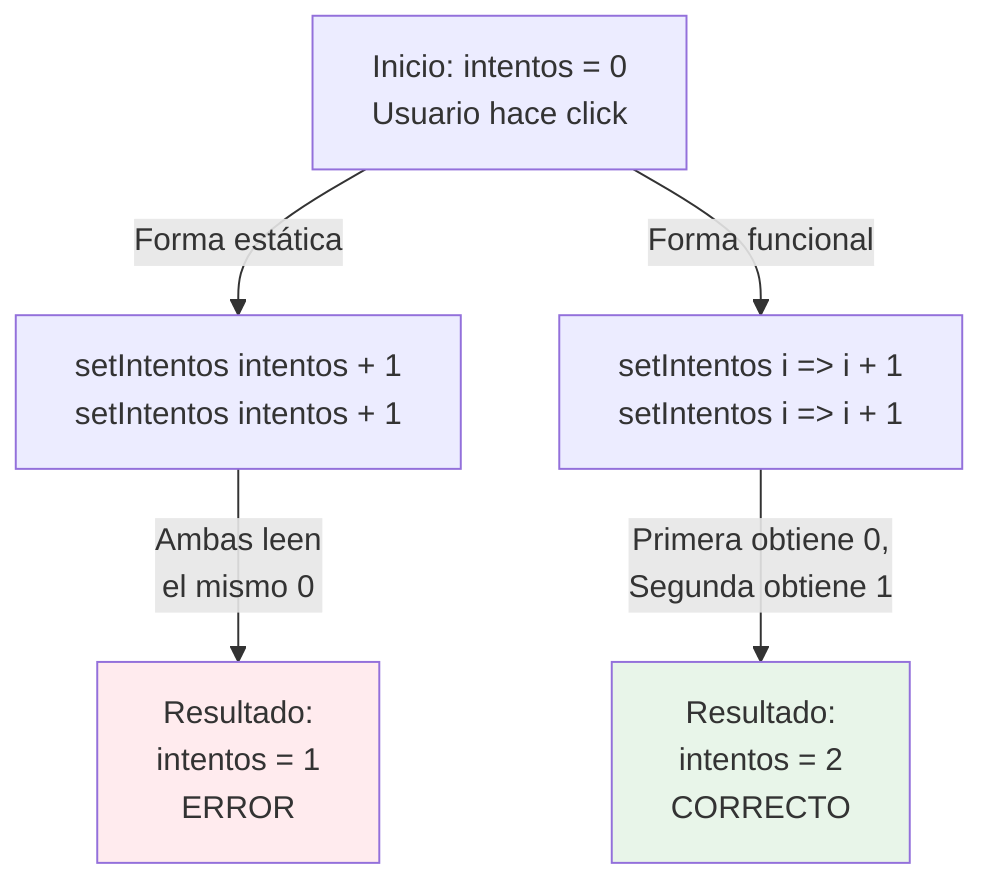
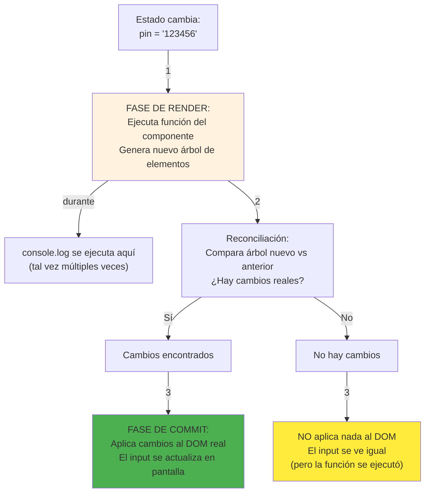
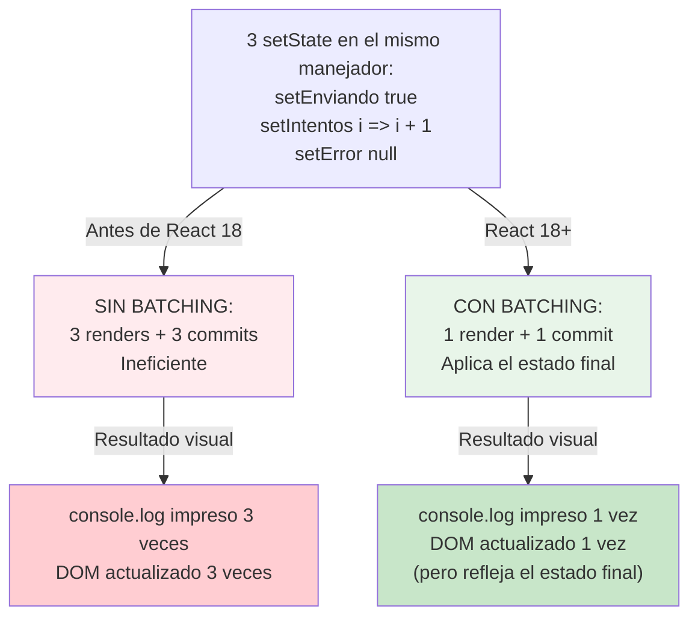
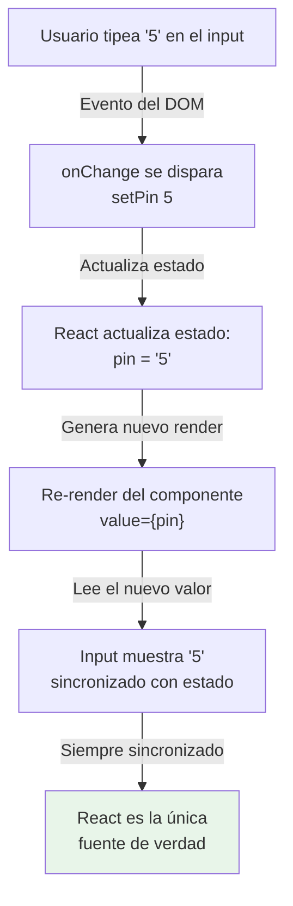
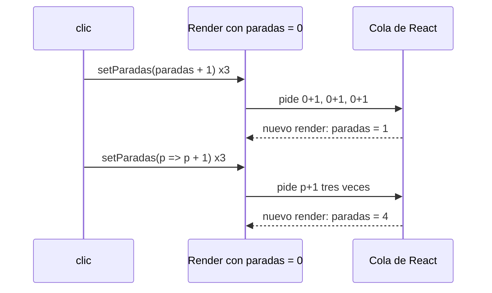

# Módulo 1: Estado local y el ciclo de render


## Aprende construyendo

**Servidor del módulo:** cada ejemplo se sirve con `npm run dev` dentro del proyecto `mi-react` del módulo 0; abre `http://localhost:5173` para ver el resultado y ejecuta `npm test` para las pruebas (Vitest, configurado una sola vez en «Prepara las pruebas» del módulo 0). Si el puerto cambia, usa el que imprima la terminal.


### Tema 1: useState y actualizaciones funcionales · Básico · 45 min

<details open>
<summary><strong>Capa 1 — Lectura</strong></summary>

#### ► DE QUÉ TRATA
Al finalizar vas a construir un contador de "intentos de confirmación" en FormularioConfirmacion que se incremente correctamente cuando un mismo manejador lo actualiza dos veces. Prerrequisitos: Módulo 0 completo.

#### ► CÓMO FUNCIONA


</details>

<details>
<summary><strong>Capa 2 — Construcción</strong></summary>

#### Objetivo observable
Al finalizar vas a construir un contador de "intentos de confirmación" en `FormularioConfirmacion` que se incremente correctamente cuando un mismo manejador lo actualiza dos veces. Prerrequisitos: Módulo 0 completo.

</details>

### Tema 2: Render frente a commit · Intermedio · 40 min

<details open>
<summary><strong>Capa 1 — Lectura</strong></summary>

#### ► DE QUÉ TRATA
Al finalizar vas a demostrar con un console.log dentro de FormularioConfirmacion que ejecutar la función del componente (render) no siempre produce un cambio visible en el DOM (commit). Prerrequisitos: Tema 1 de este módulo.

#### ► CÓMO FUNCIONA


#### ► REGLA PRÁCTICA
El render puede ejecutarse (y tu `console.log` puede correr, incluso varias veces) sin que haya ningún cambio visible en el DOM: el commit solo ocurre si la reconciliación encuentra una diferencia real entre el árbol nuevo y el anterior.

</details>

<details>
<summary><strong>Capa 2 — Construcción</strong></summary>

#### Objetivo observable
Al finalizar vas a demostrar con un `console.log` dentro de `FormularioConfirmacion` que ejecutar la función del componente (render) no siempre produce un cambio visible en el DOM (commit). Prerrequisitos: Tema 1 de este módulo.

</details>

### Tema 3: Batching de actualizaciones · Intermedio · 40 min

<details open>
<summary><strong>Capa 1 — Lectura</strong></summary>

#### ► DE QUÉ TRATA
Al finalizar vas a confirmar con un console.log que tres llamadas a setState dentro del mismo manejador de FormularioConfirmacion producen un único render, no tres. Prerrequisitos: Tema 2 de este módulo.

#### ► CÓMO FUNCIONA


</details>

<details>
<summary><strong>Capa 2 — Construcción</strong></summary>

#### Objetivo observable
Al finalizar vas a confirmar con un `console.log` que tres llamadas a `setState` dentro del mismo manejador de `FormularioConfirmacion` producen un único render, no tres. Prerrequisitos: Tema 2 de este módulo.

</details>

### Tema 4: Componentes controlados · Intermedio · 40 min

<details open>
<summary><strong>Capa 1 — Lectura</strong></summary>

#### ► DE QUÉ TRATA
Al finalizar vas a convertir el campo de PIN de FormularioConfirmacion en un componente controlado, con value y onChange gobernados completamente por useState. Prerrequisitos: Tema 1 de este módulo.

#### ► CÓMO FUNCIONA


</details>

<details>
<summary><strong>Capa 2 — Construcción</strong></summary>

#### Objetivo observable
Al finalizar vas a convertir el campo de PIN de `FormularioConfirmacion` en un componente controlado, con `value` y `onChange` gobernados completamente por `useState`. Prerrequisitos: Tema 1 de este módulo.

</details>

### Tema 5: Componentes puros y el estado como instantánea · Intermedio · 40 min

<details open>
<summary><strong>Capa 1 — Lectura</strong></summary>

#### ► DE QUÉ TRATA
Crea un proyecto con npm create vite@latest academia-react -- --template react y entra a la carpeta. Trabajarás en src/Contador.jsx. Deja activo <StrictMode> en src/main.jsx (Vite lo trae así).

#### ► CÓMO FUNCIONA


</details>

<details>
<summary><strong>Capa 2 — Construcción</strong></summary>

#### Código y verificación

```jsx
import { useState } from 'react';

const registro = []; // variable de fuera del componente

export default function Contador() {
  const [paradas, setParadas] = useState(0);
  // registro.push(paradas); // ❌ impuro: cambia algo externo durante el render

  function sumarMal() {
    setParadas(paradas + 1);
    setParadas(paradas + 1);
    setParadas(paradas + 1);
    console.log('dentro del evento, paradas sigue siendo', paradas);
  }

  function sumarBien() {
    setParadas((p) => p + 1);
    setParadas((p) => p + 1);
    setParadas((p) => p + 1);
  }

  return (
    <section>
      <p>Paradas: {paradas}</p>
      <button onClick={sumarMal}>Sumar 3 (mal)</button>
      <button onClick={sumarBien}>Sumar 3 (bien)</button>
      <button onClick={() => registro.push(paradas)}>Registrar</button> {/* ✅ en un evento sí */}
    </section>
  );
}
```

```bash
cd academia-react
npm install
npm run dev
# usa <Contador /> en src/App.jsx y abre http://localhost:5173
```

```text
Clic en «Sumar 3 (mal)» desde 0: la pantalla muestra «Paradas: 1» y la consola imprime «dentro del evento, paradas sigue siendo 0».
Clic en «Sumar 3 (bien)» después: la pantalla muestra «Paradas: 4».
```

</details>

### Tema 6: Compartir estado: levantar el estado al padre común · Intermedio · 40 min

<details open>
<summary><strong>Capa 1 — Lectura</strong></summary>

</details>

<details>
<summary><strong>Capa 2 — Construcción</strong></summary>

#### Código y verificación
```jsx
import { useState } from 'react';

const ENVIOS = [
  { id: 'RF-4471', zona: 'norte' },
  { id: 'RF-4472', zona: 'norte' },
  { id: 'RF-5101', zona: 'sur' },
];

function FiltroZona() {
  const [zona, setZona] = useState('todas'); // privado: nadie más puede leerlo
  return (
    <label>
      Zona{' '}
      <select value={zona} onChange={(evento) => setZona(evento.target.value)}>
        <option value="todas">Todas</option>
        <option value="norte">Norte</option>
        <option value="sur">Sur</option>
      </select>
    </label>
  );
}

function ListaEnvios({ envios }) {
  return (
    <ul>
      {envios.map((envio) => (
        <li key={envio.id}>{envio.id}</li>
      ))}
    </ul>
  );
}

export default function PanelEnvios() {
  return (
    <section>
      <FiltroZona />
      <ListaEnvios envios={ENVIOS} />
    </section>
  );
}
```

```jsx
import { useState } from 'react';

const ENVIOS = [
  { id: 'RF-4471', zona: 'norte' },
  { id: 'RF-4472', zona: 'norte' },
  { id: 'RF-5101', zona: 'sur' },
];

function FiltroZona({ zona, onCambiarZona }) {
  return (
    <label>
      Zona{' '}
      <select value={zona} onChange={(evento) => onCambiarZona(evento.target.value)}>
        <option value="todas">Todas</option>
        <option value="norte">Norte</option>
        <option value="sur">Sur</option>
      </select>
    </label>
  );
}

function Resumen({ zona, total }) {
  const donde = zona === 'todas' ? 'todas las zonas' : `zona ${zona}`;
  return <p>Visibles: {total} · {donde}</p>;
}

function ListaEnvios({ envios }) {
  return (
    <ul>
      {envios.map((envio) => (
        <li key={envio.id}>{envio.id}</li>
      ))}
    </ul>
  );
}

export default function PanelEnvios() {
  const [zona, setZona] = useState('todas'); // vive en el padre común de los tres hijos
  const visibles = zona === 'todas' ? ENVIOS : ENVIOS.filter((envio) => envio.zona === zona); // se calcula, no se guarda
  return (
    <section>
      <FiltroZona zona={zona} onCambiarZona={setZona} />
      <Resumen zona={zona} total={visibles.length} />
      <ListaEnvios envios={visibles} />
    </section>
  );
}
```

```jsx
import { render, screen } from '@testing-library/react';
import userEvent from '@testing-library/user-event';
import { expect, it } from 'vitest';
import PanelEnvios from './PanelEnvios.jsx';

it('cambiar la zona en FiltroZona actualiza la lista y el resumen', async () => {
  render(<PanelEnvios />);
  expect(screen.getAllByRole('listitem')).toHaveLength(3);
  expect(screen.getByText('Visibles: 3 · todas las zonas')).toBeInTheDocument();

  await userEvent.selectOptions(screen.getByLabelText('Zona'), 'norte');

  expect(screen.getAllByRole('listitem')).toHaveLength(2);
  expect(screen.getByText('Visibles: 2 · zona norte')).toBeInTheDocument();
});
```

```bash
npm test
```

```jsx
function Resumen({ zona, total }) {
  const [zonaCopia] = useState(zona); // ❌ copia: solo lee la prop en el primer render
  const donde = zonaCopia === 'todas' ? 'todas las zonas' : `zona ${zonaCopia}`;
  return <p>Visibles: {total} · {donde}</p>;
}
```

```jsx
it('dos paneles no comparten la zona', async () => {
  render(<><PanelEnvios /><PanelEnvios /></>);
  const [primero] = screen.getAllByLabelText('Zona');
  await userEvent.selectOptions(primero, 'sur');
  expect(screen.getByText('Visibles: 1 · zona sur')).toBeInTheDocument();
  expect(screen.getByText('Visibles: 3 · todas las zonas')).toBeInTheDocument();
});
```

</details>
