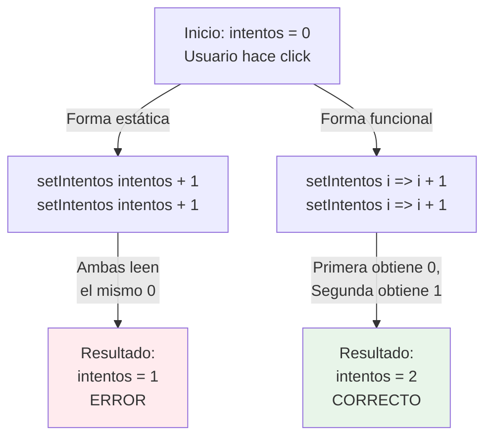
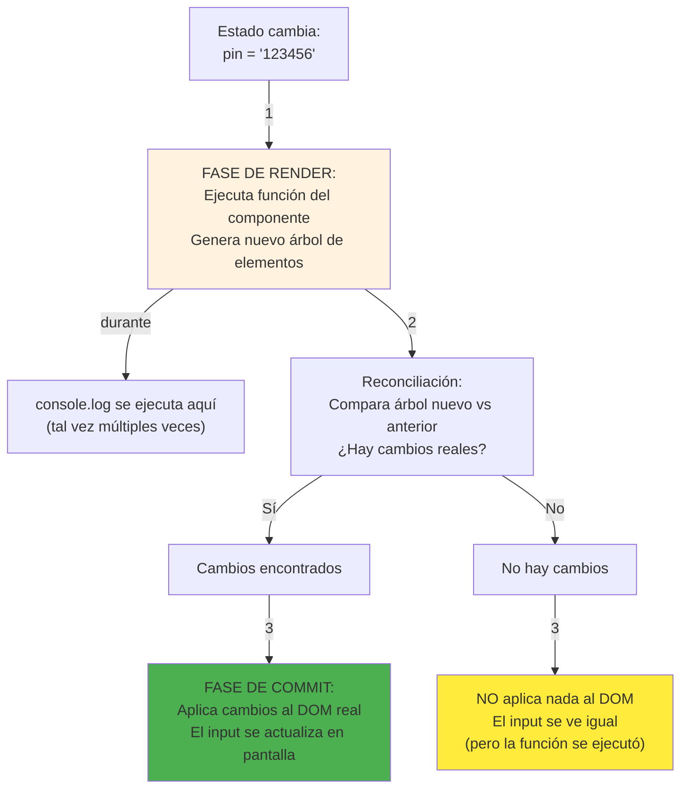
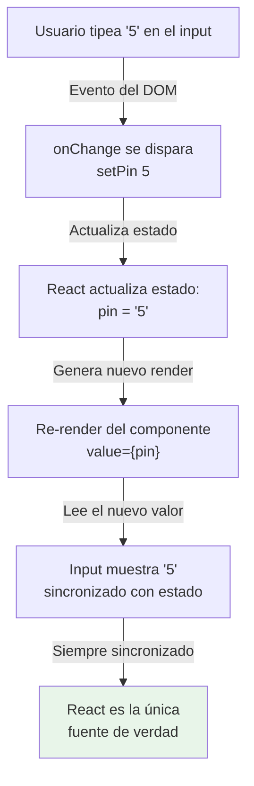
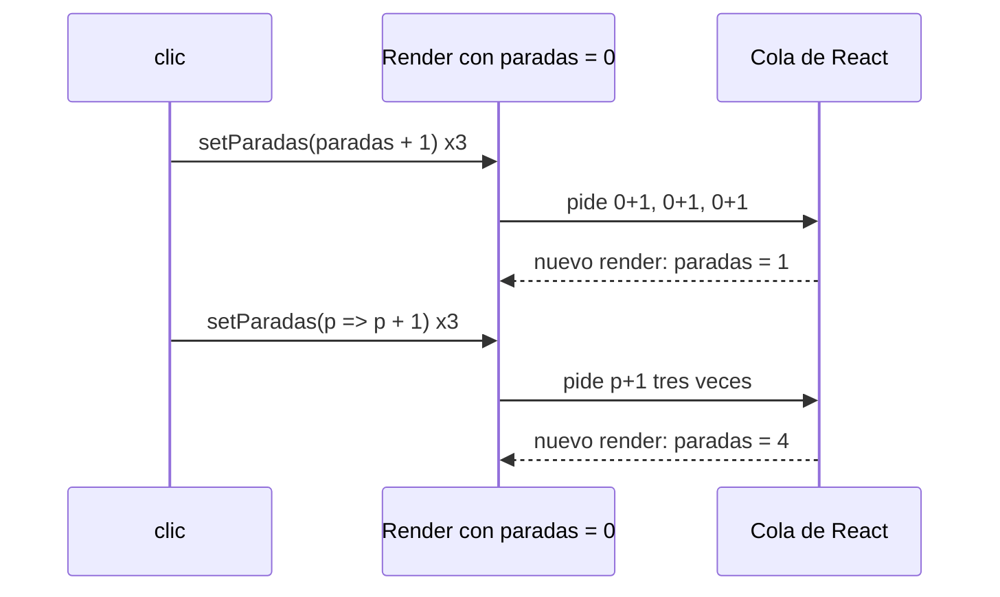

# Módulo 1: Estado local y el ciclo de render


## Aprende construyendo

**Servidor del módulo:** cada ejemplo se sirve con `npm run dev` dentro del proyecto `mi-react` del módulo 0; abre `http://localhost:5173` para ver el resultado y ejecuta `npm test` para las pruebas (Vitest, configurado una sola vez en «Prepara las pruebas» del módulo 0). Si el puerto cambia, usa el que imprima la terminal.

### Tema 1: useState y actualizaciones funcionales

#### Paso 1 · Objetivo y preparación
Al finalizar vas a construir un contador de "intentos de confirmación" en `FormularioConfirmacion` que se incremente correctamente cuando un mismo manejador lo actualiza dos veces. Prerrequisitos: Módulo 0 completo.

#### Paso 2 · Contexto y caso real
Con mala señal, el manejador de "Confirmar entrega" registra el intento del conductor y, en el mismo click, un reintento automático: son dos actualizaciones del contador dentro de un único evento. Si ambas se calculan a partir del valor capturado, una se pierde. (Un doble click no tiene ese problema: son dos eventos distintos y React procesa cada click por separado, así que cada uno cuenta.) En RutaFlow (Módulo 12), el formulario de confirmación debe registrar correctamente cada intento, también cuando un mismo manejador actualiza el contador más de una vez.

#### Paso 3 · Teoría, modelo mental y analogía
Cada render ejecuta la función del componente desde cero, y cada variable de `useState` leída dentro de un manejador queda "congelada" en el closure de esa ejecución; la forma funcional del setter (`setIntentos(i => i + 1)`) lee siempre el valor más reciente, no el capturado.

**Diagrama: Valor capturado vs forma funcional**



**Conceptos clave:** valor capturado por closure, forma funcional del setter.

#### Por qué los Hooks dependen del orden de llamada

`useState` no es una palabra reservada de JavaScript ni una anotación: es una función de React que consulta el **dispatcher** activo durante el render. React asocia cada llamada con una posición estable dentro de la secuencia de Hooks del componente; en renderizados posteriores, esa misma posición permite recuperar la celda de estado correcta. Esta es la razón mecánica de las Reglas de Hooks, no una preferencia de estilo.

No llames Hooks dentro de `if`, ciclos, callbacks o después de un retorno condicional. Si una condición cambia el orden, la segunda llamada de un render puede ocupar la posición que pertenecía a otro estado en el render anterior. Los Hooks deben estar en el nivel superior de un componente o de un Hook personalizado; el prefijo `use` permite además que el linter reconozca y verifique ese contrato.

```jsx
// Incorrecto: la posición de la llamada cambia según `habilitado`
if (habilitado) {
  const [filtro, setFiltro] = useState('');
}

// Correcto: el Hook conserva su posición; la condición afecta al uso del valor
const [filtro, setFiltro] = useState('');
const filtroActivo = habilitado ? filtro : '';
```

Cada vez que un componente se renderiza, la función del componente se ejecuta de nuevo desde el principio, y cada variable declarada dentro de ella (incluyendo el valor devuelto por `useState`) es una nueva variable local de esa ejecución específica, capturada en el closure de los manejadores de eventos definidos en esa misma ejecución (el concepto de closure, estudiado en profundidad en el Módulo 2 del track de JavaScript, aplicado aquí directamente al modelo de componentes de React): esto explica por qué llamar `setCount(count + 1)` dos veces seguidas dentro del mismo manejador de evento no duplica el incremento, dado que ambas llamadas leen el mismo valor de `count` capturado en esa ejecución específica del componente, sin que la primera llamada a `setCount` actualice sincrónicamente el valor de `count` que la segunda llamada leería.

La forma funcional del setter (`setCount(c => c + 1)`) resuelve este problema: en vez de calcular el nuevo valor a partir de la variable capturada en el closure, se le pasa una función que React invoca con el valor de estado más actualizado disponible en el momento en que efectivamente aplica esa actualización, garantizando que actualizaciones sucesivas dentro de un mismo manejador de evento efectivamente se acumulen correctamente unas sobre otras, en vez de sobreescribirse mutuamente basándose en el mismo valor obsoleto capturado.

Esta distinción importa especialmente en cualquier escenario donde múltiples actualizaciones del mismo estado ocurren antes de que el componente vuelva a renderizarse (por ejemplo, dentro de un mismo manejador de evento, o dentro de una función asíncrona que actualiza el mismo estado en distintos momentos), siendo la forma funcional la opción segura por defecto cuando el nuevo valor depende del valor anterior, en vez de asumir que la variable local capturada refleja siempre el estado más reciente.

**Analogía:** usar el valor capturado directamente es como escribir tres notas separadas basadas en la misma fotografía de un marcador que tomaste al principio del día, sin darte cuenta de que el marcador ya cambió después de la primera nota; usar la forma funcional es como pedirle a alguien que consulte el marcador actual real justo antes de escribir cada nota, garantizando que cada una parte del valor efectivamente más reciente.

**¿Por qué es importante?** La forma funcional del setter evita el bug clásico de actualizaciones de estado que se sobreescriben mutuamente al depender de un valor capturado obsoleto en el closure de la ejecución de render en curso.

**Código del ejemplo:**

```jsx
const [count, setCount] = useState(0);

// PELIGROSO: ambas llamadas leen el mismo `count` capturado
setCount(count + 1);
setCount(count + 1); // count sigue siendo el valor original aquí

// SEGURO: la forma funcional siempre recibe el valor más reciente
setCount(c => c + 1);
setCount(c => c + 1); // ahora sí suma 2
```


#### Paso 4 · Demostración guiada desde cero
```jsx
import { useState } from 'react';

function FormularioConfirmacion() {
  const [intentos, setIntentos] = useState(0);
  function confirmarDosVeces() {
    setIntentos(intentos + 1);
    setIntentos(intentos + 1); // ambas leen el mismo `intentos` capturado
  }
  return <button onClick={confirmarDosVeces}>Intentos: {intentos}</button>;
}

export default function App() {
  return <FormularioConfirmacion />;
}
```

**Ejecuta el ejemplo** en tu proyecto `mi-react` (lo creaste y preparaste para pruebas al inicio del módulo 0): reemplaza todo el contenido de `src/App.jsx` por el bloque anterior y arráncalo:

```bash
npm run dev
```

Resultado esperado: tras un click en el botón, `intentos` pasa de 0 a 1, no a 2 — ambas llamadas a `setIntentos` dentro de `confirmarDosVeces` leyeron el mismo valor `0` capturado en esa ejecución del render, así que la segunda llamada sobrescribe a la primera con el mismo resultado. Si haces doble click, el contador sube de 1 en 1 por cada click: cada click es un evento separado. Ejecuta `npm test` para confirmar que las pruebas anteriores siguen en verde.

**Demo con React DevTools:**
1. Abre tu aplicación con el componente anterior
2. En DevTools → pestaña Components, inspecciona `<FormularioConfirmacion />`
3. En el panel lateral, mira el estado: `intentos: 0`
4. Haz click en el botón una vez
5. Mira cómo `intentos` cambió a `1` en el panel de DevTools (no a 2)
6. Ahora edita el código del manejador para usar la forma funcional: `setIntentos(i => i + 1)` en ambas líneas
7. Recarga el componente en DevTools (o rehazlo completamente)
8. Haz click nuevamente: ahora `intentos` salta a `2` en el panel de DevTools
9. Resultado esperado: ver en tiempo real cómo la forma funcional acumula correctamente los cambios de estado.

#### Paso 5 · Práctica guiada
Pista: deja el código del Paso 4 y espera que `intentos` llegue a 2 "porque llamé a `setIntentos` dos veces" — ese es el fallo deliberado: el contador queda en 1, no en 2, porque ambas llamadas leyeron el mismo `intentos` capturado antes de que ninguna de las dos se aplicara.

#### Paso 6 · Práctica independiente
Corrige `confirmarDosVeces` usando la forma funcional (`setIntentos(i => i + 1)`) en ambas llamadas, y confirma que ahora un solo click sí lleva el contador de 0 a 2, porque cada llamada recibe el valor más reciente en el momento en que React efectivamente la aplica. Lleva la forma funcional al contador de intentos del proyecto integrador RutaFlow y verifica que dos actualizaciones en el mismo manejador no se pierdan.

#### Paso 7 · Cierre
Entregá el contador con el bug de los Pasos 4-5, y la corrección con forma funcional del Paso 6; explicá por qué dos llamadas a `setIntentos(intentos + 1)` en el mismo manejador no se acumulan, mientras que dos llamadas a `setIntentos(i => i + 1)` sí lo hacen. Siguiente paso: estudia la diferencia entre render y commit. Errores comunes: depender del valor capturado cuando el nuevo estado depende del anterior, mutar un objeto de estado directamente en vez de crear uno nuevo, y leer el estado inmediatamente después de llamar al setter esperando el valor ya actualizado. Fuentes oficiales: https://react.dev/learn/state-a-components-memory y https://react.dev/learn/queueing-a-series-of-state-updates.
**Implicación práctica:** Depender del valor de estado capturado en el closure, en vez de la forma funcional, pierde actualizaciones cuando el nuevo valor depende del valor anterior dentro del mismo manejador.

### Tema 2: Render frente a commit

#### Paso 1 · Objetivo y preparación
Al finalizar vas a demostrar con un `console.log` dentro de `FormularioConfirmacion` que ejecutar la función del componente (render) no siempre produce un cambio visible en el DOM (commit). Prerrequisitos: Tema 1 de este módulo.

#### Paso 2 · Contexto y caso real
Nadie confirmó todavía si actualizar el estado con el mismo valor que ya tenía (por ejemplo, "re-confirmar" el mismo PIN sin cambiarlo) realmente vuelve a tocar el DOM, o si React se da cuenta de que no hay nada nuevo que mostrar.

#### Paso 3 · Teoría, modelo mental y analogía
React separa render (ejecutar la función del componente y calcular un nuevo árbol de elementos) de commit (comparar ese árbol con el anterior y aplicar solo los cambios mínimos al DOM real) — un arquitecto dibujando planos no es lo mismo que el equipo de construcción moviendo ladrillos.

**Diagrama: Render vs Commit**



**Conceptos clave:** fase de render (cálculo), fase de commit (aplicación al DOM real).

React separa internamente el trabajo de actualizar la interfaz en dos fases distintas: la fase de render, durante la cual React ejecuta la función del componente (y de todos sus componentes hijos afectados) para calcular una descripción de qué debería verse en pantalla (una nueva versión del árbol de elementos producido por JSX/`createElement`, Módulo 0), sin todavía tocar el DOM real del navegador; y la fase de commit, durante la cual React compara esa nueva descripción con la anterior (un proceso llamado reconciliation) y aplica al DOM real únicamente los cambios mínimos necesarios para reflejar las diferencias encontradas.

Esta separación explica por qué ejecutar la función de un componente (la fase de render) no necesariamente implica que algo cambie visualmente en pantalla: si el árbol de elementos resultante de esa ejecución es idéntico al anterior, React no necesita aplicar ningún cambio real al DOM durante la fase de commit, aunque la función del componente sí se haya ejecutado completamente de nuevo. Comprender esta separación es fundamental para entender por qué código con efectos secundarios directos dentro del cuerpo de la función componente (fuera de un `useEffect`, Módulo 2) es problemático: ese código se ejecutaría en cada fase de render, potencialmente múltiples veces antes de que cualquier commit real ocurra, en vez de ejecutarse una única vez cuando el cambio efectivamente se aplica.

**Analogía:** la fase de render es como un arquitecto dibujando planos actualizados de un edificio basándose en los requisitos más recientes, sin todavía haber movido un solo ladrillo real; la fase de commit es como el equipo de construcción aplicando físicamente solo los cambios necesarios entre los planos anteriores y los nuevos, sin reconstruir el edificio completo desde cero cada vez.

**¿Por qué es importante?** Entender que renderizar (ejecutar la función del componente) no equivale automáticamente a un cambio visual real explica por qué los efectos secundarios deben vivir dentro de `useEffect` y no directamente en el cuerpo de la función componente.

**Diagrama:**

```
Render:  ejecuta la función componente → calcula el nuevo árbol de elementos
Commit:  compara con el árbol anterior → aplica solo los cambios mínimos al DOM real
(Render puede ocurrir sin que el commit produzca ningún cambio visual)
```


#### Paso 4 · Demostración guiada desde cero
```jsx
import { useState } from 'react';

function FormularioConfirmacion() {
  const [pin, setPin] = useState('837201');
  const [revisiones, setRevisiones] = useState(0); // existe en el estado, pero no se muestra
  console.log('render de FormularioConfirmacion', { revisiones });
  return (
    <>
      <input aria-label="PIN" value={pin} onChange={e => setPin(e.target.value)} />
      <button onClick={() => setRevisiones(r => r + 1)}>Revisar</button>
      <button onClick={() => setPin('837201')}>Reaplicar el mismo PIN</button>
    </>
  );
}

export default function App() {
  return <FormularioConfirmacion />;
}
```

**Ejecuta el ejemplo** en tu proyecto `mi-react` (lo creaste y preparaste para pruebas al inicio del módulo 0): reemplaza todo el contenido de `src/App.jsx` por el bloque anterior, abre la consola del navegador y arráncalo:

```bash
npm run dev
```

Resultado esperado: cada click en «Revisar» cambia `revisiones`, así que React vuelve a ejecutar la función (el `console.log` se imprime de nuevo; en desarrollo, `StrictMode` lo imprime dos veces por render), pero nada cambia en pantalla: el árbol resultante es idéntico y el commit no tiene nada que aplicar al DOM. En cambio, «Reaplicar el mismo PIN» llama a `setPin('837201')` con el valor que `pin` ya tiene: React lo compara con `Object.is` y descarta la actualización; como mucho ejecuta la función una vez antes de descartarla, y en los clicks siguientes ni siquiera la ejecuta ([react.dev — useState](https://react.dev/reference/react/useState#setstate)). Ejecuta `npm test` para confirmar que las pruebas anteriores siguen en verde.

#### Paso 5 · Práctica guiada
Pista: afirma que "si el `console.log` se imprime de nuevo, significa que algo cambió visualmente" sin comprobar el caso contrario — ese es el fallo deliberado: «Revisar» reimprime el `console.log` sin ningún cambio visual real; la frecuencia del log no te dice nada por sí sola sobre si hubo un commit visible.

#### Paso 6 · Práctica independiente
Corrige tu conclusión del Paso 5 agregando una segunda prueba: actualiza `pin` a un valor distinto y confirma explícitamente (mirando el input renderizado) que esta vez sí hubo un cambio visual, a diferencia de «Revisar» en el Paso 4. En el proyecto integrador RutaFlow, registra qué actualización de estado produce un commit visible y cuál solo cambia una referencia.

#### Paso 7 · Cierre
Entrega la prueba del Paso 4 (render sin cambio visual), la aclaración del Paso 5, y la comparación del Paso 6; explica por qué "la función del componente se ejecutó" no es lo mismo que "algo cambió en pantalla", y por qué esa distinción importa para decidir dónde vive un efecto secundario. Siguiente paso: estudia batching de actualizaciones. Errores comunes: asumir que cada render produce un cambio visual, poner efectos secundarios directamente en el cuerpo del componente en vez de `useEffect`, y confundir la frecuencia de ejecución de un `console.log` con la frecuencia de cambios reales en el DOM. Fuentes oficiales: https://react.dev/learn/render-and-commit y https://react.dev/reference/react/useState.
**Implicación práctica:** Entender que renderizar no equivale automáticamente a un cambio visual real explica por qué los efectos secundarios deben vivir dentro de `useEffect`, no directamente en el cuerpo del componente.

### Tema 3: Batching de actualizaciones

#### Paso 1 · Objetivo y preparación
Al finalizar vas a confirmar con un `console.log` que tres llamadas a `setState` dentro del mismo manejador de `FormularioConfirmacion` producen un único render, no tres. Prerrequisitos: Tema 2 de este módulo.

#### Paso 2 · Contexto y caso real
Al confirmar una entrega en RutaFlow (Módulo 12), el formulario actualiza tres estados a la vez (`enviando`, `intentos`, `error`) — nadie confirmó todavía si eso dispara tres renders separados o uno solo combinado. En una aplicación de rastreo de envíos, eso es crítico para el rendimiento.

#### Paso 3 · Teoría, modelo mental y analogía
React agrupa (batchea) múltiples actualizaciones de estado ocurridas dentro del mismo manejador de evento en un único ciclo de render y commit — un cajero que espera a que termines de pedir los tres artículos antes de calcular el total una sola vez.

**Diagrama: Batching de actualizaciones**


**Conceptos clave:** agrupación de múltiples `setState`, un único re-render.

Cuando múltiples llamadas a funciones de actualización de estado ocurren dentro del mismo manejador de evento (`setA(1); setB(2); setC(3);` dentro de una misma función `manejarClick`), React no vuelve a renderizar el componente inmediatamente después de cada llamada individual, sino que agrupa (batchea) todas esas actualizaciones y ejecuta un único ciclo de render y commit que refleja el efecto combinado de las tres, en vez de tres ciclos separados de render y commit, uno por cada llamada individual a una función de actualización de estado.

Este comportamiento es una optimización de rendimiento deliberada: sin batching, cada llamada individual a `setState` dispararía su propio ciclo completo de render y commit, un desperdicio considerable de trabajo cuando en la práctica el componente solo necesita reflejar el estado final combinado de las tres actualizaciones, no cada estado intermedio parcial entre ellas. Este comportamiento se puede verificar empíricamente colocando un `console.log` dentro del cuerpo del componente (que se ejecuta una vez por cada render): tras las tres llamadas a `setState`, ese `console.log` se ejecuta una única vez adicional, no tres veces, confirmando que las tres actualizaciones efectivamente se agruparon en un único render.

**Analogía:** el batching es como un cajero que espera a que termines de pedir los tres artículos completos antes de calcular el total una única vez, en vez de recalcular y anunciar un nuevo total parcial después de cada artículo individual que mencionas.

**Código del ejemplo:**

```jsx
function manejarClick() {
  setA(1);
  setB(2);
  setC(3);
  // React agrupa (batchea) estas tres actualizaciones en un único re-render, no en tres
}
```


**Límites y decisión de uso:** El batching agrupa trabajo, pero no convierte el estado leído en un valor actualizado inmediatamente. Si una actualización depende de la anterior, usa su forma funcional y comprueba la secuencia, como explica [React sobre actualizaciones de estado](https://react.dev/learn/queueing-a-series-of-state-updates).

**¿Por qué es importante?** El batching evita ciclos de render y commit redundantes cuando múltiples actualizaciones de estado ocurren en el mismo manejador, aplicando únicamente el estado final combinado en un único ciclo.

#### Paso 4 · Demostración guiada desde cero
```jsx
import { useState } from 'react';

function FormularioConfirmacion() {
  const [enviando, setEnviando] = useState(false);
  const [intentos, setIntentos] = useState(0);
  const [error, setError] = useState('sin señal');
  console.log('render');

  function confirmar() {
    setEnviando(true);
    setIntentos(i => i + 1);
    setError(null);
  }

  return (
    <>
      <button onClick={confirmar}>Confirmar entrega</button>
      <p>Enviando: {String(enviando)} · Intentos: {intentos} · Error: {error ?? 'ninguno'}</p>
    </>
  );
}

export default function App() {
  return <FormularioConfirmacion />;
}
```

**Ejecuta el ejemplo** en tu proyecto `mi-react` (lo creaste y preparaste para pruebas al inicio del módulo 0): reemplaza todo el contenido de `src/App.jsx` por el bloque anterior, abre la consola del navegador y arráncalo:

```bash
npm run dev
```

Resultado esperado: después de un click que dispara `confirmar()`, el `console.log('render')` se imprime una única vez adicional (dos en desarrollo, porque `StrictMode` duplica cada render), no tres — las tres llamadas a setters se agrupan en un único ciclo de render y commit que refleja el efecto combinado de las tres. Ejecuta `npm test` para confirmar que las pruebas anteriores siguen en verde.

#### Paso 5 · Práctica guiada
Pista: envuelve cada `setState` dentro de su propio `setTimeout(() => ..., 0)` por separado — ese es el fallo deliberado: sacar las actualizaciones del manejador síncrono original rompe el batching automático en ese contexto, y ahora el `console.log` se imprime varias veces en vez de una sola.

#### Paso 6 · Práctica independiente
Corrige el Paso 5 quitando los `setTimeout` innecesarios, y agrega una cuarta actualización de estado (`setUltimoIntento(new Date())`) al mismo manejador — confirma que sigue siendo un único render adicional, no cuatro. Aplica el batching al manejador de confirmación del proyecto integrador RutaFlow y cuenta los renders adicionales con el Profiler.

#### Paso 7 · Cierre
Entrega la prueba de un solo render del Paso 4, la ruptura del batching provocada en el Paso 5, y la cuarta actualización del Paso 6; explica por qué agrupar múltiples actualizaciones en un único render es una optimización deliberada, no un detalle incidental. Siguiente paso: estudia componentes controlados. Errores comunes: asumir que cada llamada a un setter dispara su propio render inmediato, sacar actualizaciones de estado fuera de manejadores de evento sin saber que eso puede afectar el batching, y depender del orden de ejecución de los `console.log` para razonar sobre el estado en vez de sobre el valor final. Fuentes oficiales: https://react.dev/learn/queueing-a-series-of-state-updates y https://react.dev/reference/react/useState.

### Tema 4: Componentes controlados

#### Paso 1 · Objetivo y preparación
Al finalizar vas a convertir el campo de PIN de `FormularioConfirmacion` en un componente controlado, con `value` y `onChange` gobernados completamente por `useState`. Prerrequisitos: Tema 3 de este módulo.

#### Paso 2 · Contexto y caso real
Si el input de PIN no está controlado, React no tiene ninguna forma de validar o transformar lo que el conductor escribe en tiempo real (por ejemplo, rechazar letras y aceptar solo dígitos) antes de que llegue al envío del formulario.

#### Paso 3 · Teoría, modelo mental y analogía
Un componente controlado tiene su valor gobernado completamente por el estado de React (`value` + `onChange`), no por el estado interno que el elemento del DOM mantendría por su cuenta — un teleprompter cuyo texto siempre viene de un guion central, no una pizarra libre.

**Diagrama: Componentes controlados**



**¿Por qué es importante?** Los componentes controlados hacen del estado de React la única fuente de verdad del valor de un input, permitiendo validación y transformación centralizada en cada cambio.

#### Paso 4 · Demostración guiada desde cero
```jsx
import { useState } from 'react';

function CampoPin() {
  const [pin, setPin] = useState('');
  return (
    <label>
      PIN de entrega{' '}
      <input
        value={pin}
        onChange={e => setPin(e.target.value.replace(/\D/g, ''))}
        maxLength={6}
      />
    </label>
  );
}

export default function App() {
  return <CampoPin />;
}
```

**Ejecuta el ejemplo** en tu proyecto `mi-react` (lo creaste y preparaste para pruebas al inicio del módulo 0): reemplaza todo el contenido de `src/App.jsx` por el bloque anterior y arráncalo:

```bash
npm run dev
```

Resultado esperado: escribir letras en el campo de PIN no las muestra en absoluto (`.replace(/\D/g, '')` las descarta antes de llegar a `setPin`), y el input nunca puede mostrar más de 6 caracteres — el valor mostrado en pantalla es siempre exactamente lo que React decidió que `pin` debía ser, nunca lo que el usuario tecleó directamente sin pasar por esa validación.

Para probarlo, mueve `CampoPin` a `src/CampoPin.jsx` (con `import { useState } from 'react';` y `export default function CampoPin()`), impórtalo en `src/App.jsx` con `import CampoPin from './CampoPin.jsx';` y crea `src/CampoPin.test.jsx`:

```jsx
import { render, screen } from '@testing-library/react'
import userEvent from '@testing-library/user-event'
import { describe, expect, it } from 'vitest'
import CampoPin from './CampoPin.jsx'

describe('CampoPin', () => {
  it('descarta letras y limita el PIN a 6 dígitos', async () => {
    const usuario = userEvent.setup()
    render(<CampoPin />)
    const campo = screen.getByLabelText(/PIN de entrega/)
    await usuario.type(campo, 'a1b2c3d4e5f6g7')
    expect(campo).toHaveValue('123456')
  })
})
```

Ejecuta `npm test` y confirma que la prueba de `CampoPin` pasa.

#### Paso 5 · Práctica guiada
Pista: quita el atributo `value` del input, dejando solo `onChange` ("para que sea más simple") — ese es el fallo deliberado: el input pasa a ser no controlado (React ya no gobierna su valor), y la transformación de `onChange` deja de reflejarse visualmente en el campo, porque el DOM ahora mantiene su propio valor interno sin que React lo sincronice de vuelta.

#### Paso 6 · Práctica independiente
Corrige el Paso 5 restaurando `value={pin}`, y agrega un segundo input controlado para la guía del envío, con su propia validación (sin espacios) — confirma que ambos campos están sincronizados con su estado de React respectivo. Lleva el input controlado al formulario de entrega del proyecto integrador RutaFlow y mide cuántos renders provoca cada tecla.

#### Paso 7 · Cierre
Entrega el input de PIN controlado del Paso 4, la pérdida de sincronización del Paso 5, y el segundo campo del Paso 6; explica por qué quitar `value` (dejando solo `onChange`) convierte un input controlado en no controlado, y qué se pierde exactamente al hacerlo. Siguiente paso: estudia efectos con `useEffect`. Errores comunes: dejar `onChange` sin `value` (input no controlado accidental), mezclar un input controlado con manipulación directa del DOM vía referencia, y no considerar el costo de un re-render por tecla en formularios extremadamente grandes. Fuentes oficiales: https://react.dev/reference/react-dom/components/input y https://react.dev/learn/sharing-state-between-components.

* Cuándo: usar componentes controlados para validación y transformación en tiempo real; no conviene en formularios con miles de campos donde el costo de re-render por tecla se vuelve relevante (usa React Hook Form en ese caso).

### Tema 5: Componentes puros y el estado como instantánea · Básico · 40 min

**Prerrequisito:** tema «useState y actualizaciones funcionales» de este módulo.

**Al finalizar podrás:** escribir componentes puros que devuelven el mismo JSX para las mismas entradas, y predecir qué valor del estado ve cada evento sabiendo que el estado es una instantánea de cada render.

**¿Por qué es importante?** Casi todos los errores «raros» de React vienen de dos ideas mal entendidas: componentes que cambian cosas mientras se renderizan y la creencia de que `setState` cambia la variable al instante. Con estas dos ideas claras, el comportamiento deja de parecer mágico.

#### Paso 1 · Objetivo y preparación

Crea un proyecto con `npm create vite@latest academia-react -- --template react` y entra a la carpeta. Trabajarás en `src/Contador.jsx`. Deja activo `<StrictMode>` en `src/main.jsx` (Vite lo trae así).

#### Paso 2 · Contexto y caso real

En el panel de RutaFlow, un botón «Sumar 3 paradas» llamaba tres veces `setParadas(paradas + 1)` y solo sumaba una. En otra pantalla, un componente agregaba elementos a una lista global durante el render, y en desarrollo los envíos aparecían duplicados.

#### Paso 3 · Teoría, modelo mental y analogía

**Conceptos clave:** función pura, render, efecto secundario, `StrictMode`, instantánea (*snapshot*) del estado, función de actualización.

**Pureza.** Un componente es una función: recibe props y estado y devuelve JSX. Debe ser **pura**: con las mismas entradas, el mismo resultado, y sin cambiar nada que existía antes de llamarla (variables externas, el DOM, el servidor). Los cambios van en manejadores de eventos o en efectos. En desarrollo, `StrictMode` renderiza dos veces cada componente para que notes si no es puro.

**Instantánea.** Cada render tiene su propia copia del estado. Dentro de un render, `paradas` es una constante: `setParadas` no la cambia, sino que **pide un render nuevo** con otro valor. Por eso tres llamadas a `setParadas(paradas + 1)` piden tres veces «0 + 1».

Para encadenar actualizaciones usa la **función de actualización**: `setParadas(p => p + 1)`. React la llama con el valor más reciente de la cola.

**Analogía:** cada render es una foto: puedes pedir que tomen otra foto distinta, pero la que tienes en la mano no cambia. La analogía falla en que React puede tomar la foto nueva un poco después, cuando termina de atender el evento.

**Límite de uso:** la pureza aplica al render, no a todo el componente: los manejadores de eventos y los efectos sí pueden cambiar cosas. No desactives `StrictMode` para «arreglar» duplicados: oculta el error en vez de corregirlo.



#### Paso 4 · Demostración guiada desde cero

Archivo `academia-react/src/Contador.jsx`:

```jsx
import { useState } from 'react';

const registro = []; // variable de fuera del componente

export default function Contador() {
  const [paradas, setParadas] = useState(0);
  // registro.push(paradas); // ❌ impuro: cambia algo externo durante el render

  function sumarMal() {
    setParadas(paradas + 1);
    setParadas(paradas + 1);
    setParadas(paradas + 1);
    console.log('dentro del evento, paradas sigue siendo', paradas);
  }

  function sumarBien() {
    setParadas((p) => p + 1);
    setParadas((p) => p + 1);
    setParadas((p) => p + 1);
  }

  return (
    <section>
      <p>Paradas: {paradas}</p>
      <button onClick={sumarMal}>Sumar 3 (mal)</button>
      <button onClick={sumarBien}>Sumar 3 (bien)</button>
      <button onClick={() => registro.push(paradas)}>Registrar</button> {/* ✅ en un evento sí */}
    </section>
  );
}
```

Ejecútalo:

```bash
cd academia-react
npm install
npm run dev
# usa <Contador /> en src/App.jsx y abre http://localhost:5173
```

**Explicación por bloques:** `sumarMal` llama tres veces a `setParadas` con el mismo valor de la instantánea, así que pide tres veces el mismo número; el `console.log` confirma que `paradas` no cambió dentro del evento. `sumarBien` pasa funciones: React las aplica en orden sobre el valor más reciente. El `registro.push` está comentado dentro del render porque lo volvería impuro; dentro del botón «Registrar» es correcto, porque un evento sí puede cambiar cosas.

**Resultado esperado:**

```text
Clic en «Sumar 3 (mal)» desde 0: la pantalla muestra «Paradas: 1» y la consola imprime «dentro del evento, paradas sigue siendo 0».
Clic en «Sumar 3 (bien)» después: la pantalla muestra «Paradas: 4».
```

**Fallo deliberado:** descomenta `registro.push(paradas)` dentro del render y agrega `console.log(registro.length)` debajo. **Error esperado:** en desarrollo el número crece de a dos por cada render. **Diagnóstico:** `StrictMode` renderiza dos veces para revelar que el componente cambia algo externo. Saca el `push` del render y llévalo a un evento o a un efecto.

#### Paso 5 · Práctica guiada

1. **Reproducción:** predice el número tras «Sumar 3 (mal)» y compruébalo.
2. **Variación:** mezcla en un evento `setParadas(paradas + 5)` y luego `setParadas(p => p + 1)`; predice el resultado (6 desde 0).
3. **Diagnóstico:** reproduce el fallo deliberado y explica por qué el número sube de a dos.
4. **Integración:** agrega un `setTimeout(() => alert(paradas), 3000)` en un botón, cambia el número antes de que salte la alerta y explica qué valor muestra.
5. **Diseño:** revisa un componente tuyo y marca cada línea que cambia algo externo durante el render.

**Pista:** dentro de un evento, lee `paradas` como una constante: su valor es el del render en el que se creó el evento.

#### Paso 6 · Práctica independiente

Crea `ListaParadas`, con un estado de array, y botones «Agregar» y «Quitar la primera». Usa solo copias (`[...lista, nueva]`, `lista.slice(1)`), nunca `push` ni `splice` sobre el estado, y explica por qué.

#### Paso 7 · Cierre

- [ ] Defines un componente puro con tus palabras.
- [ ] Explicas por qué «Sumar 3 (mal)» suma uno.
- [ ] Reprodujiste el doble render de `StrictMode`.
- [ ] Usas funciones de actualización cuando encadenas cambios.

Si fallas dos o más, vuelve al Paso 3. **Errores comunes:** mutar arrays u objetos del estado, leer el estado «nuevo» justo después de `setState` y desactivar `StrictMode` para esconder impurezas. **Siguiente paso:** el tema «Render frente a commit» explica cuándo React pinta en pantalla la instantánea nueva.

**Transferencia al proyecto integrador «RutaFlow»:** en el panel de RutaFlow, revisa los contadores de paradas y entregas y cambia cada actualización encadenada a funciones de actualización.

**Fuente oficial:** [React — Keeping components pure](https://react.dev/learn/keeping-components-pure) y [React — State as a snapshot](https://react.dev/learn/state-as-a-snapshot).

## Laboratorio práctico

**Objetivo del laboratorio:** construir un formulario controlado con validación en tiempo real, demostrando actualizaciones funcionales y batching.

**Requisitos previos:** Módulo 0 completado.

| Paso | Acción | Código | Explicación |
|---|---|---|---|
| 1 | Crear un contador y demostrar el bug de `count + 1` repetido | Ver Tema 1 | Compara con la forma funcional |
| 2 | Construir un input controlado | Ver Tema 4 | `value` + `onChange` |
| 3 | Agregar 3 `setState` en un mismo manejador | Ver Tema 3 | Verifica con `console.log` que hay un único render |
| 4 | Implementar un formulario de 3 campos controlados | Ver Tema 4 | Con validación en cada tecla |
| 5 | Explicar render vs commit con un ejemplo propio | Ver Tema 2 | Un caso donde el render no cambia el DOM |

**Verificación:** el laboratorio se considera exitoso si el contador con la forma funcional acumula correctamente múltiples incrementos en un mismo manejador, y si el formulario valida y refleja el estado en tiempo real en cada tecla.

**Errores comunes y soluciones**

- **Depender del valor capturado en vez de la forma funcional cuando el nuevo estado depende del anterior.** Usa siempre `setEstado(valorAnterior => nuevoValor)` en esos casos.
- **Confundir la ejecución del render con un cambio visual garantizado.** Recuerda que React puede ejecutar la función del componente sin producir ningún cambio real en el DOM.
- **Mezclar un input controlado con actualización directa del DOM.** No mezcles `value` controlado con manipulación directa del elemento vía referencia.

---
