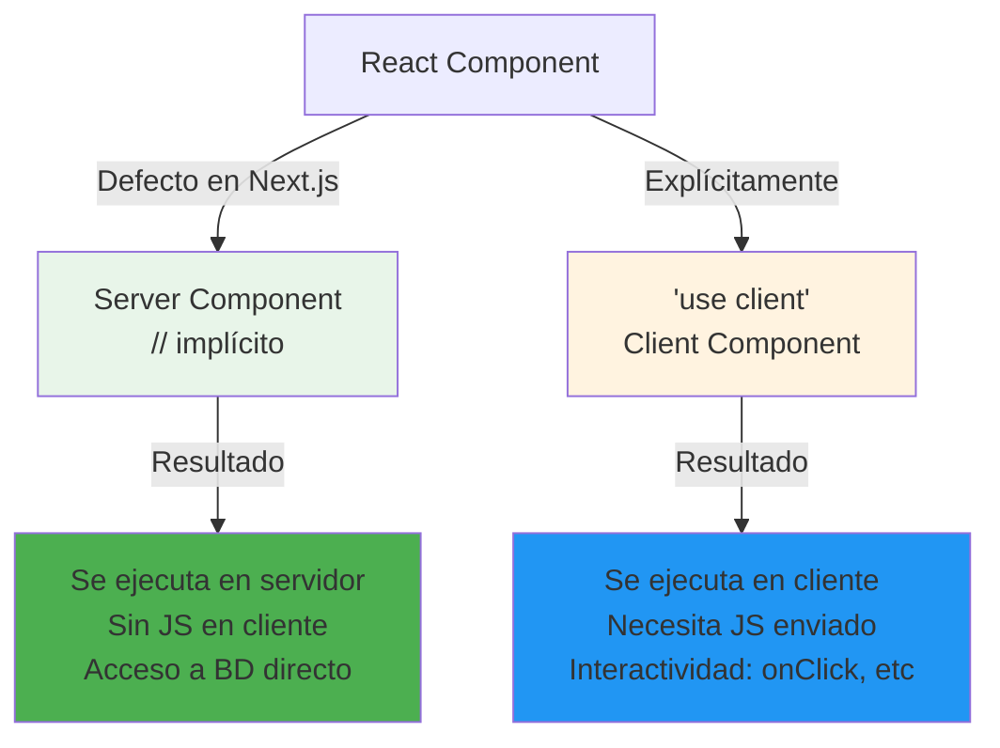
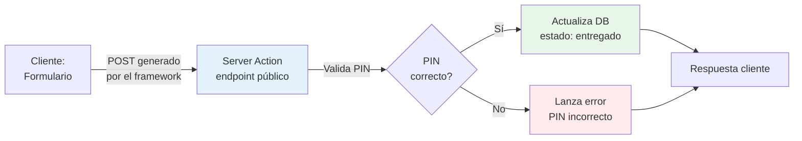

# Módulo 10: Server Components y Next.js


## Aprende construyendo

**Servidor del módulo:** todo este módulo trabaja en el proyecto Next.js `app` que creas en el Tema 1 (Server Components, `"use client"`, streaming y Server Actions necesitan un framework con soporte de React Server Components; un proyecto Vite sin esa integración no los ejecuta). Arráncalo con `npm run dev` y abre `http://localhost:3000`; la comprobación se hace en el navegador y con `npm run build`.

### Tema 1: Server Components por defecto

#### Paso 1 · Objetivo y preparación
Al finalizar podrás evaluar React Server Components desde cero. Prerrequisitos: Node.js LTS, npm y editor. Verifica node --version y npm --version.

#### Paso 2 · Contexto y caso real
En un caso real, una página de seguimiento debe enviar poco JavaScript, mostrar datos rápido y reservar interactividad para controles que realmente la necesitan.

#### Paso 3 · Teoría, modelo mental y analogía
Un Server Component se ejecuta en servidor y no añade código interactivo al cliente; use client marca una frontera; Suspense permite streaming; Server Actions ejecutan mutaciones en servidor con validación. La analogía es un restaurante: cocina lo estático antes de servir y envía solo la estación que requiere interacción.

**Diagrama: Server Components vs Client Components**



**Conceptos clave:** ejecución exclusiva en servidor, acceso directo a recursos del backend, sin JavaScript enviado al cliente.

Esta frontera Server/Client Component es la decisión de arquitectura que tomarás para cada pantalla del proyecto integrador (SPA con datos reales, Módulo 12) si lo migras a Next.js: qué partes solo muestran datos (Server) y cuáles necesitan interactividad real del usuario (Client).

**Cuándo no usarlo:** Server Components requieren un framework con soporte de servidor (Next.js) y un entorno de despliegue que lo ejecute; para una SPA puramente estática servida como archivos (el enfoque de los módulos anteriores de este track), esta frontera no aplica — toda la app se ejecuta en el cliente.

```tsx
async function PaginaTareas() {
  const tareas = await db.tarea.findMany();
  return <ListaTareas tareas={tareas} />;
}
```

Este Server Component (sin la directiva `"use client"`) se ejecuta exclusivamente en el servidor: puede acceder directamente a una base de datos, al sistema de archivos, o a cualquier recurso disponible únicamente en el entorno del servidor, sin necesidad de exponer un endpoint API intermedio para obtener esos datos, dado que el propio componente ya se ejecuta en ese entorno con acceso directo.

La consecuencia más significativa de esto es que un Server Component nunca envía su propio código JavaScript al navegador del cliente: únicamente el HTML resultante de su renderizado (y los datos serializados necesarios para hidratar cualquier Client Component anidado dentro de él, Tema 2) llegan al navegador, reduciendo directamente el tamaño del bundle de JavaScript que el cliente necesita descargar y ejecutar, un beneficio de rendimiento particularmente significativo para componentes que dependen de librerías pesadas del lado del servidor (un parser de markdown complejo, una librería de manipulación de imágenes) que de otro modo tendrían que incluirse completas en el bundle del cliente aunque solo se usen para producir el HTML final, nunca para volver a ejecutarse en el navegador.

**Analogía:** un Server Component es como un chef que prepara un plato completo en la cocina del restaurante y solo envía el plato terminado a la mesa, sin enviar también las ollas, el equipo de cocina, ni la receta completa junto con el plato; el cliente recibe únicamente el resultado final, sin el aparato completo que fue necesario para producirlo.

**¿Por qué es importante?** Un Server Component reduce el bundle de JavaScript del cliente al no enviar su propio código de ejecución, y permite acceso directo a recursos del servidor sin necesidad de un endpoint API intermedio.

**Código del ejemplo:**

```jsx
// app/tareas/page.tsx — Server Component (sin "use client")
async function PaginaTareas() {
  const tareas = await db.tarea.findMany(); // acceso directo a datos, corre solo en el servidor
  return <ListaTareas tareas={tareas} />;
}
```

#### Paso 4 · Demostración guiada desde cero
Parte de una carpeta vacía:
```bash
mkdir ejemplo-react-m10
cd ejemplo-react-m10
npx create-next-app@latest app --ts --eslint --app --src-dir --no-tailwind --use-npm
cd app
npm run dev
```

`npx` es el comando que ejecuta un paquete sin instalarlo globalmente (`create-next-app`, el andamiador oficial de Next.js). `--ts` es la bandera que usa TypeScript; `--eslint` activa el linter; `--app` usa el App Router; `--src-dir` mueve el código a una carpeta `src/`; `--no-tailwind` es la bandera que omite Tailwind CSS; `--use-npm` es la bandera que fija npm como gestor de paquetes en vez de preguntar.
Abre `http://localhost:3000`: la página inicial (`src/app/page.tsx`) ya es un Server Component, porque no declara `"use client"`. En los temas 2 a 4 escribirás, con el código completo, una página de servidor (`src/app/envios/[id]/page.tsx`) y su botón de cliente (`BotonConfirmarEntrega.tsx`); aquí basta con que expliques la frontera con la página generada.

#### Paso 5 · Práctica guiada
Pista: importa deliberadamente un hook en un componente servidor para provocar un fallo deliberado de compilación; lee el mensaje y mueve la frontera correcta. Resultado esperado: build estable.

#### Paso 6 · Práctica independiente
Añade Suspense, una Server Action con validación, estado pending y una medición del JavaScript enviado al cliente.

#### Paso 7 · Cierre
Guarda build, capturas y métricas; como siguiente paso estudia despliegue. Errores comunes: enviar secretos al cliente, usar hooks en servidor, mutar sin autorización y asumir que streaming arregla consultas lentas. Fuentes oficiales: https://nextjs.org/docs/app y https://react.dev/reference/rsc/server-components.
**Implicación práctica:** Separar servidor y cliente mejora rendimiento, seguridad y claridad de responsabilidades.

### Tema 2: use client para interactividad

#### Paso 1 · Objetivo y preparación
Al finalizar vas a marcar `BotonConfirmarEntrega` con `"use client"` porque usa `useState`, mientras `PaginaEnvio` (su padre) permanece como Server Component. Prerrequisitos: Tema 1 de este módulo.

#### Paso 2 · Contexto y caso real
`PaginaEnvio` solo muestra datos del envío obtenidos directamente de la base de datos; no necesita ningún hook interactivo. El botón de confirmar entrega dentro de esa misma página sí necesita `useState` para mostrar "Confirmando..." mientras procesa.

#### Paso 3 · Teoría, modelo mental y analogía
Cualquier componente con hooks de estado o manejadores de eventos debe marcarse con `"use client"`; ese límite se establece lo más profundo posible en el árbol, no envolviendo páginas completas.
**Conceptos clave:** hooks de estado solo en Client Components, límite explícito entre servidor y cliente.

Cualquier componente que necesite interactividad basada en hooks de estado (`useState`, `useEffect`, manejadores de eventos como `onClick`) debe marcarse explícitamente con la directiva `"use client"` al inicio del archivo, indicando a Next.js que ese componente (y todo lo que importe transitivamente desde ese punto) debe compilarse también para ejecutarse en el navegador, no únicamente en el servidor:

```tsx
"use client";
function BotonLike() {
  const [likes, setLikes] = useState(0);
  return <button onClick={() => setLikes(l => l + 1)}>{likes} likes</button>;
}
```

Esto es necesario dado que `useState` y los manejadores de eventos interactivos requieren un entorno de ejecución en el navegador donde el JavaScript del componente efectivamente corre después de la carga inicial, algo que un Server Component, por definición, no ofrece.

Esta directiva establece un límite explícito y deliberado en el árbol de componentes: todo lo que está por encima de ese límite (los componentes padre que no la declaran) puede seguir siendo Server Components ejecutándose únicamente en el servidor, mientras que el subárbol marcado con `"use client"` (y cualquier componente que ese subárbol importe) se convierte en Client Components, compilados también para el navegador; diseñar cuidadosamente dónde colocar ese límite (idealmente lo más profundo posible en el árbol, marcando solo los componentes que genuinamente necesitan interactividad, no envolviendo prematuramente componentes enteros de página completos) maximiza la proporción de código que permanece exclusivamente en el servidor.

**Analogía:** `"use client"` es como marcar explícitamente una habitación de la casa donde sí se permite instalar y encender aparatos eléctricos interactivos, mientras que el resto de la casa (por defecto) simplemente exhibe objetos ya terminados sin necesidad de electricidad ni interacción activa dentro de esa habitación específica.

**¿Por qué es importante?** `"use client"` es obligatorio para cualquier componente que use hooks de estado o manejadores de eventos interactivos; colocar ese límite lo más profundo posible en el árbol maximiza la cantidad de código que permanece exclusivamente en el servidor.


#### Paso 4 · Demostración guiada desde cero
Crea los datos simulados del servidor en `src/lib/db.ts` (los usarán los temas 2 a 4):

```ts
// «Base de datos» simulada en memoria. Solo se importa desde código de servidor.
type Envio = { id: string; destinatario: string; estado: string; pin: string };

const envios = new Map<string, Envio>([
  ['RF-4471', { id: 'RF-4471', destinatario: 'Ana Pérez', estado: 'en ruta', pin: '837201' }],
]);

const esperar = (ms: number) => new Promise((resolve) => setTimeout(resolve, ms));

export async function obtenerEnvio(id: string) {
  return envios.get(id) ?? null;
}

export async function obtenerHistorial(id: string) {
  await esperar(3000); // consulta lenta a propósito
  return [`${id}: salió de bodega`, `${id}: en ruta por Calle 80`];
}

export async function marcarEntregado(id: string) {
  const envio = envios.get(id);
  if (envio) envio.estado = 'entregado';
}
```

Crea el componente de cliente en `src/app/envios/[id]/BotonConfirmarEntrega.tsx`:

```tsx
'use client';

import { useState } from 'react';

export default function BotonConfirmarEntrega() {
  const [confirmando, setConfirmando] = useState(false);
  return (
    <button type="submit" onClick={() => setConfirmando(true)}>
      {confirmando ? 'Confirmando...' : 'Confirmar entrega'}
    </button>
  );
}
```

Y la página, un Server Component, en `src/app/envios/[id]/page.tsx`:

```tsx
import { Suspense } from 'react';
import { notFound } from 'next/navigation';
import { obtenerEnvio } from '@/lib/db';
import BotonConfirmarEntrega from './BotonConfirmarEntrega';

// Server Component: sin "use client", consulta los datos directamente en el servidor.
async function DetalleEnvio({ params }: { params: Promise<{ id: string }> }) {
  const { id } = await params;
  const envio = await obtenerEnvio(id);
  if (!envio) notFound();
  return (
    <>
      <h1>Envío {envio.id}</h1>
      <p>Destinatario: {envio.destinatario} · Estado: {envio.estado}</p>
      <BotonConfirmarEntrega />
    </>
  );
}

export default function PaginaEnvio({ params }: { params: Promise<{ id: string }> }) {
  // Next.js 16 (Cache Components) exige leer `params` dentro de un Suspense.
  return (
    <main>
      <Suspense fallback={<p>Cargando envío…</p>}>
        <DetalleEnvio params={params} />
      </Suspense>
    </main>
  );
}
```

**Ejecuta el ejemplo** en el proyecto Next.js `app` del Tema 1 (no en `mi-react`: Vite no ejecuta Server Components ni Server Actions):

```bash
npm run dev
```

Abre `http://localhost:3000/envios/RF-4471`.

Resultado esperado: `PaginaEnvio` (sin `"use client"`) sigue siendo un Server Component que accede directamente a la base de datos; solo `BotonConfirmarEntrega` se compila también para el navegador — el resto de la página no agrega ningún JavaScript adicional al bundle del cliente. Ejecuta `npm run build` para comprobar que compila.

#### Paso 5 · Práctica guiada
Pista: agrega `"use client"` directamente en `page.tsx` "para que todo funcione sin pensar en la frontera" — ese es el fallo deliberado: ahora toda la página (incluyendo la consulta a la base de datos) se convierte en Client Component, perdiendo el acceso directo a la base de datos y obligando a reemplazar esa consulta por un endpoint API adicional que antes no era necesario.

#### Paso 6 · Práctica independiente
Corrige el Paso 5 devolviendo `"use client"` únicamente a `BotonConfirmarEntrega`, y mide (con las herramientas de build de Next.js) cuánto JavaScript de cliente se agrega marcando solo el botón, comparado con haber marcado la página completa. Marca como cliente solo el componente interactivo del proyecto integrador RutaFlow y comprueba qué parte sigue renderizándose en el servidor.

#### Paso 7 · Cierre
Entrega la frontera correctamente ubicada del Paso 4, el error provocado al marcar la página completa en el Paso 5, y la medición comparativa del Paso 6; explica por qué colocar `"use client"` lo más profundo posible en el árbol maximiza la proporción de código que permanece exclusivamente en el servidor. Siguiente paso: estudia streaming con Suspense. Errores comunes: marcar una página completa como cliente cuando solo un botón necesita interactividad, olvidar `"use client"` en un componente que sí usa hooks, e importar transitivamente un módulo cliente-only desde un Server Component. Fuentes oficiales: https://react.dev/reference/rsc/use-client y https://nextjs.org/docs/app/building-your-application/rendering/client-components.
**Implicación práctica:** `"use client"` es obligatorio para cualquier componente que use hooks de estado o manejadores de eventos interactivos; colocar ese límite lo más profundo posible maximiza el código que permanece exclusivamente en el servidor.

### Tema 3: Streaming con Suspense en el servidor

#### Paso 1 · Objetivo y preparación
Al finalizar vas a envolver la sección de "historial de ubicaciones" de `PaginaEnvio` (una consulta lenta) en `Suspense`, para que el resto de la página se muestre sin esperarla. Prerrequisitos: Tema 2 de este módulo.

#### Paso 2 · Contexto y caso real
La consulta que reconstruye el historial completo de ubicaciones de un envío (decenas de puntos GPS) tarda varios segundos — sin streaming, toda `PaginaEnvio` espera a que esa consulta lenta termine antes de mostrar absolutamente nada, aunque otros datos ya estén listos.

#### Paso 3 · Teoría, modelo mental y analogía
El streaming con `Suspense` del lado del servidor envía el HTML de las partes ya listas sin esperar a la sección más lenta — servir primero los platos que ya están listos, en vez de hacer esperar a todos hasta que el más lento esté terminado.

**¿Por qué es importante?** El streaming con Suspense evita que una sección particularmente lenta retrase la percepción de toda la página, mostrando de inmediato el contenido que ya está listo.
**Conceptos clave:** enviar el HTML disponible primero, no bloquear toda la página por una sección lenta.

El streaming del lado del servidor permite que Next.js envíe al navegador el HTML de las partes de una página que ya están listas, sin esperar a que absolutamente todas las secciones de esa página (incluyendo alguna sección particularmente lenta, como una consulta a una base de datos que tarda varios segundos) completen su renderizado: `<Suspense fallback={<Spinner />}><SeccionLenta /></Suspense>` permite que el resto de la página se envíe y se muestre inmediatamente, mientras `SeccionLenta` continúa renderizándose en el servidor, enviándose y reemplazando el `fallback` correspondiente en cuanto efectivamente completa, sin bloquear el resto de la página mientras tanto.

Este mismo `Suspense` que en el Módulo 9, Tema 5 se usaba para mostrar un `fallback` mientras un chunk de JavaScript se descargaba en el cliente, aquí se aplica del lado del servidor para el mismo propósito conceptual: permitir que partes de la interfaz que sí están listas se muestren de inmediato, sin esperar a la parte más lenta, evitando que una única sección costosa de calcular retrase la percepción de toda la página como lenta para el usuario.

**Analogía:** el streaming con Suspense es como servir primero los platos de una comida que ya están listos en la mesa, en vez de hacer esperar a todos los comensales hasta que el plato más lento de preparar esté terminado antes de servir absolutamente nada.

**Implicación práctica:** El streaming con Suspense evita que una sección particularmente lenta de una página retrase la percepción de toda la página, mostrando de inmediato el contenido que ya está listo.

**Código del ejemplo:**

```jsx
<Suspense fallback={<Spinner />}>
  <SeccionLenta /> {/* el resto de la página se muestra mientras esto carga */}
</Suspense>
```

#### Paso 4 · Demostración guiada desde cero
En `src/app/envios/[id]/page.tsx`, importa también `obtenerHistorial` desde `@/lib/db`, agrega este componente encima de `DetalleEnvio`:

```tsx
async function HistorialUbicaciones({ envioId }: { envioId: string }) {
  const historial = await obtenerHistorial(envioId); // tarda 3 segundos
  return <ul>{historial.map((punto) => <li key={punto}>{punto}</li>)}</ul>;
}
```

y, dentro de `DetalleEnvio`, después de `<BotonConfirmarEntrega />`, envuélvelo en su propio `Suspense`:

```tsx
<Suspense fallback={<p>Cargando historial…</p>}>
  <HistorialUbicaciones envioId={envio.id} /> {/* consulta lenta */}
</Suspense>
```

**Ejecuta el ejemplo** en el proyecto Next.js `app` del Tema 1 (no en `mi-react`: Vite no ejecuta Server Components ni Server Actions):

```bash
npm run dev
```

Abre `http://localhost:3000/envios/RF-4471`.

Resultado esperado: los datos básicos (guía, destinatario, estado) aparecen de inmediato; «Cargando historial…» se reemplaza por el historial real unos 3 segundos después, sin que el resto de la página haya esperado ese tiempo. Ejecuta `npm run build`: la ruta `/envios/[id]` aparece como «Partial Prerender».

#### Paso 5 · Práctica guiada
Pista: quita el `<Suspense>` que envuelve a `HistorialUbicaciones` — ese es el fallo deliberado: ahora todo `DetalleEnvio` (incluidos los datos básicos, que estaban listos al instante) espera los mismos varios segundos que tarda la consulta lenta del historial, antes de mostrar absolutamente cualquier cosa en pantalla.

#### Paso 6 · Práctica independiente
Corrige el Paso 5 restaurando el `Suspense`, y agrega un segundo `Suspense` independiente alrededor de una sección de "envíos relacionados" (otra consulta lenta distinta), confirmando que ambas secciones lentas se completan y aparecen de forma independiente entre sí. Envuelve la lista de envíos del proyecto integrador RutaFlow en Suspense y observa el orden en que llegan los fragmentos.

Mide la llegada de los fragmentos sin depender de lo que pinta el navegador: con `npm run build && npm start`, ejecuta `curl --no-buffer http://localhost:3000/envios/RF-4471` y comprueba que el texto «Cargando historial…» aparece en la salida **antes** que el historial. Un proxy o una conexión lenta pueden agrupar fragmentos; lo que cuenta es el orden del contenido, no solo el tiempo hasta el primer byte. Por último, cubre el caso vacío: si una consulta devuelve una lista sin elementos, no accedas a `lista[0]` para pasar el id a la sección lenta; devuelve antes un mensaje «Sin envíos».

#### Paso 7 · Cierre
Entrega el streaming con una sección lenta del Paso 4, el bloqueo total provocado en el Paso 5, y las dos secciones independientes del Paso 6; explica por qué envolver cada sección lenta en su propio `Suspense` (en vez de uno solo envolviendo toda la página) permite que cada una aparezca en cuanto esté lista, independientemente de las demás. Siguiente paso: estudia Server Actions para procesar formularios sin un endpoint API separado. Errores comunes: no envolver ninguna sección lenta en Suspense, envolver toda la página en un único Suspense perdiendo el beneficio de mostrar lo que ya está listo, y asumir que Suspense acelera la consulta lenta en sí (solo cambia cuándo se muestra, no cuánto tarda). Fuentes oficiales: https://react.dev/reference/react/Suspense y https://nextjs.org/docs/app/building-your-application/routing/loading-ui-and-streaming.

### Tema 4: Server Actions

#### Paso 1 · Objetivo y preparación
Al finalizar vas a implementar `confirmarEntregaAction` como Server Action, invocada directamente desde un `<form>` sin que escribas una ruta API propia, y a tratarla como lo que es: un endpoint POST público que Next.js crea por ti. Prerrequisitos: Tema 3 de este módulo.

#### Paso 2 · Contexto y caso real
Confirmar una entrega hoy exigiría definir una ruta API separada, un manejador de submit del cliente que prevenga el comportamiento por defecto, serialice el PIN y la guía, y haga un `fetch` manual hacia esa ruta — mucho código repetitivo para una operación simple.

#### Paso 3 · Teoría, modelo mental y analogía
Una Server Action es una función marcada con `"use server"` invocable directamente desde un `<form action={...}>`, sin que escribas una ruta API — entregar el formulario directamente a quien lo procesa, sin pasar por una oficina de recepción separada. Ojo: el framework sí crea un endpoint POST que cualquiera puede invocar con los argumentos que quiera ([react.dev — 'use server'](https://react.dev/reference/rsc/use-server): «Arguments to Server Functions are fully client-controlled»), así que la validación y la autorización van dentro de la función. Necesita un framework con soporte de React Server Components (aquí Next.js): en un proyecto Vite sin esa integración, `"use server"` no hace nada y la función termina en el JavaScript del navegador (si haces `npm run build` en `mi-react` con una función así, su código aparece en `dist/assets/index-*.js`).

**Diagrama:**



* Cuándo: usar Server Actions para formularios simples donde la lógica es directa; no conviene si la validación es muy compleja (mantén un endpoint API explícito) o si necesitas más control sobre headers y serialización.

**¿Por qué es importante?** Las Server Actions eliminan la necesidad de escribir un endpoint API separado (el framework lo genera), pero siguen necesitando las mismas validaciones de autorización que cualquier otro código de servidor.

#### Paso 4 · Demostración guiada desde cero
Crea `src/app/envios/[id]/actions.ts`; la autorización (el PIN) se comprueba desde la primera versión:

```ts
'use server';

import { revalidatePath } from 'next/cache';
import { marcarEntregado, obtenerEnvio } from '@/lib/db';

// Una Server Action es un endpoint POST público: cualquiera puede llamarla
// con los argumentos que quiera, así que valida y autoriza aquí dentro.
export async function confirmarEntregaAction(formData: FormData) {
  const guia = String(formData.get('guia') ?? '');
  const pin = String(formData.get('pin') ?? '');
  const envioReal = await obtenerEnvio(guia);
  if (!envioReal) throw new Error('Envío inexistente');
  if (envioReal.pin !== pin) throw new Error('PIN incorrecto');
  await marcarEntregado(guia);
  revalidatePath(`/envios/${guia}`);
}
```

En `page.tsx`, importa `import { confirmarEntregaAction } from './actions';` y envuelve el botón en un formulario dentro de `DetalleEnvio`. El archivo completo queda así:

```tsx
import { Suspense } from 'react';
import { notFound } from 'next/navigation';
import { obtenerEnvio, obtenerHistorial } from '@/lib/db';
import { confirmarEntregaAction } from './actions';
import BotonConfirmarEntrega from './BotonConfirmarEntrega';

async function HistorialUbicaciones({ envioId }: { envioId: string }) {
  const historial = await obtenerHistorial(envioId); // tarda 3 segundos
  return <ul>{historial.map((punto) => <li key={punto}>{punto}</li>)}</ul>;
}

// Server Component: sin "use client", consulta los datos directamente en el servidor.
async function DetalleEnvio({ params }: { params: Promise<{ id: string }> }) {
  const { id } = await params;
  const envio = await obtenerEnvio(id);
  if (!envio) notFound();

  return (
    <>
      <h1>Envío {envio.id}</h1>
      <p>Destinatario: {envio.destinatario} · Estado: {envio.estado}</p>
      <form action={confirmarEntregaAction}>
        <input type="hidden" name="guia" value={envio.id} />
        <label>PIN <input name="pin" inputMode="numeric" /></label>
        <BotonConfirmarEntrega />
      </form>
      <Suspense fallback={<p>Cargando historial…</p>}>
        <HistorialUbicaciones envioId={envio.id} />
      </Suspense>
    </>
  );
}

export default function PaginaEnvio({ params }: { params: Promise<{ id: string }> }) {
  // Next.js 16 (Cache Components) exige leer `params` dentro de un Suspense.
  return (
    <main>
      <Suspense fallback={<p>Cargando envío…</p>}>
        <DetalleEnvio params={params} />
      </Suspense>
    </main>
  );
}
```

**Ejecuta el ejemplo** en el proyecto Next.js `app` del Tema 1 (no en `mi-react`: Vite no ejecuta Server Components ni Server Actions):

```bash
npm run dev
```

Abre `http://localhost:3000/envios/RF-4471`. El PIN de prueba es `837201`.

Resultado esperado: con el PIN `837201`, enviar el formulario ejecuta `confirmarEntregaAction` en el servidor y la página muestra «Estado: entregado», sin que hayas escrito una ruta API ni un `fetch` en el cliente; con otro PIN, la acción lanza «PIN incorrecto» y Next.js muestra su pantalla de error. Ejecuta `npm run build` y busca `837201` en `.next/static`: no aparece, porque `db.ts` y la acción solo existen en el servidor.

#### Paso 5 · Práctica guiada
Pista: dentro de `confirmarEntregaAction`, comenta la línea `if (envioReal.pin !== pin) ...` — ese es el fallo deliberado: cualquiera que envíe el formulario con cualquier PIN (incluso uno incorrecto) confirma igual la entrega, porque la Server Action nunca valida la autorización, solo ejecuta la actualización ciegamente.

#### Paso 6 · Práctica independiente
Corrige el Paso 5 restaurando la verificación del PIN, y reemplaza el `throw` por un mensaje de error en pantalla con `useActionState` (módulo 3, Tema 4), confirmando que un PIN incorrecto rechaza la confirmación en el servidor. Mueve la confirmación de entrega del proyecto integrador RutaFlow a una Server Action y valida el formulario también en el servidor.

#### Paso 7 · Cierre
Entrega la Server Action funcionando del Paso 4, la confirmación sin validar PIN provocada en el Paso 5, y el mensaje de error del Paso 6; explica por qué una Server Action, al ocultar el endpoint que el framework genera, puede hacer más fácil olvidar que esa función sigue necesitando las mismas validaciones de autorización que cualquier otro código de servidor. Siguiente paso: cierra el módulo integrando Server Components, Suspense y Server Actions en una página completa de seguimiento. Errores comunes: omitir validación de autorización dentro de una Server Action asumiendo que "ya no hay API expuesta", no manejar el estado pending del formulario mientras la acción procesa, y ejecutar lógica sensible a secretos sin confirmar que la Server Action nunca se ejecuta en el cliente. Fuentes oficiales: https://react.dev/reference/rsc/server-functions y https://nextjs.org/docs/app/building-your-application/data-fetching/forms-and-mutations.

## Laboratorio práctico

**Objetivo del laboratorio:** construir una aplicación Next.js con App Router, Server Components y una Server Action.

**Requisitos previos:** Módulos 0-9 completados.

| Paso | Acción | Código | Explicación |
|---|---|---|---|
| 1 | Crear un proyecto Next.js con App Router | `npx create-next-app` | Observa Server Components por defecto |
| 2 | Marcar un componente interactivo con `"use client"` | Ver Tema 2 | Explica por qué lo necesita |
| 3 | Implementar streaming con Suspense | Ver Tema 3 | De una sección lenta simulada |
| 4 | Implementar una Server Action | Ver Tema 4 | Sin escribir una ruta API; valida y autoriza dentro de la acción |

**Verificación:** el laboratorio se considera exitoso si el resto de la página se muestra antes que la sección lenta envuelta en Suspense, y si la Server Action procesa el formulario correctamente sin ninguna ruta API adicional definida.

**Errores comunes y soluciones**

- **Marcar toda una página como `"use client"` innecesariamente.** Marca solo el componente específico que necesita interactividad, lo más profundo posible en el árbol.
- **Intentar usar `useState` en un Server Component.** Los hooks de estado requieren `"use client"`.
- **Envolver la sección lenta sin `Suspense`.** Sin `Suspense`, toda la página espera a que la sección lenta complete antes de mostrarse.

---
