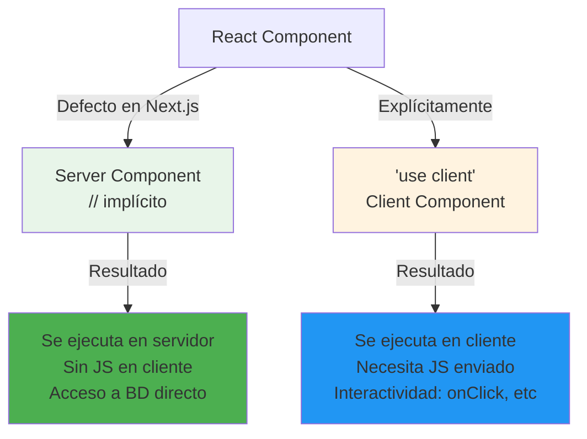
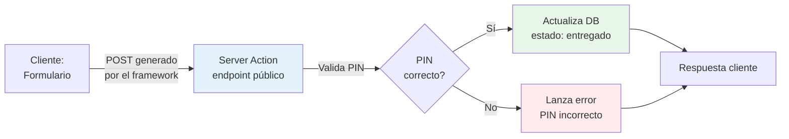

# Módulo 10: Server Components y Next.js


## Aprende construyendo

**Servidor del módulo:** todo este módulo trabaja en el proyecto Next.js `app` que creas en el Tema 1 (Server Components, `"use client"`, streaming y Server Actions necesitan un framework con soporte de React Server Components; un proyecto Vite sin esa integración no los ejecuta). Arráncalo con `npm run dev` y abre `http://localhost:3000`; la comprobación se hace en el navegador y con `npm run build`.


### Tema 1: Server Components por defecto · Avanzado · 45 min

<details open>
<summary><strong>Capa 1 — Lectura</strong></summary>

#### ► DE QUÉ TRATA
Al finalizar podrás evaluar React Server Components desde cero. Prerrequisitos: Node.js LTS, npm y editor. Verifica node --version y npm --version.

#### ► CÓMO FUNCIONA


</details>

<details>
<summary><strong>Capa 2 — Construcción</strong></summary>

#### Código y verificación

```tsx
async function PaginaTareas() {
  const tareas = await db.tarea.findMany();
  return <ListaTareas tareas={tareas} />;
}
```

```jsx
// app/tareas/page.tsx — Server Component (sin "use client")
async function PaginaTareas() {
  const tareas = await db.tarea.findMany(); // acceso directo a datos, corre solo en el servidor
  return <ListaTareas tareas={tareas} />;
}
```

```bash
mkdir ejemplo-react-m10
cd ejemplo-react-m10
npx create-next-app@latest app --ts --eslint --app --src-dir --no-tailwind --use-npm
cd app
npm run dev
```

</details>

### Tema 2: use client para interactividad · Avanzado · 45 min

<details open>
<summary><strong>Capa 1 — Lectura</strong></summary>

#### ► DE QUÉ TRATA
Al finalizar vas a marcar BotonConfirmarEntrega con "use client" porque usa useState, mientras PaginaEnvio (su padre) permanece como Server Component. Prerrequisitos: Tema 1 de este módulo.

</details>

<details>
<summary><strong>Capa 2 — Construcción</strong></summary>

#### Objetivo observable
Al finalizar vas a marcar `BotonConfirmarEntrega` con `"use client"` porque usa `useState`, mientras `PaginaEnvio` (su padre) permanece como Server Component. Prerrequisitos: Tema 1 de este módulo.

</details>

### Tema 3: Streaming con Suspense en el servidor · Avanzado · 40 min

<details open>
<summary><strong>Capa 1 — Lectura</strong></summary>

#### ► DE QUÉ TRATA
Al finalizar vas a envolver la sección de "historial de ubicaciones" de PaginaEnvio (una consulta lenta) en Suspense, para que el resto de la página se muestre sin esperarla. Prerrequisitos: Tema 2 de este módulo.

</details>

<details>
<summary><strong>Capa 2 — Construcción</strong></summary>

#### Código y verificación
```jsx
<Suspense fallback={<Spinner />}>
  <SeccionLenta /> {/* el resto de la página se muestra mientras esto carga */}
</Suspense>
```

```tsx
async function HistorialUbicaciones({ envioId }: { envioId: string }) {
  const historial = await obtenerHistorial(envioId); // tarda 3 segundos
  return <ul>{historial.map((punto) => <li key={punto}>{punto}</li>)}</ul>;
}
```

```tsx
<Suspense fallback={<p>Cargando historial…</p>}>
  <HistorialUbicaciones envioId={envio.id} /> {/* consulta lenta */}
</Suspense>
```

```bash
npm run dev
```

</details>

### Tema 4: Server Actions · Avanzado · 45 min

<details open>
<summary><strong>Capa 1 — Lectura</strong></summary>

#### ► DE QUÉ TRATA
Al finalizar vas a implementar confirmarEntregaAction como Server Action, invocada directamente desde un <form> sin que escribas una ruta API propia, y a tratarla como lo que es: un endpoint POST público que Next.js crea por ti. Prerrequisitos: Tema 3 de este módulo.

#### ► CÓMO FUNCIONA


</details>

<details>
<summary><strong>Capa 2 — Construcción</strong></summary>

#### Objetivo observable
Al finalizar vas a implementar `confirmarEntregaAction` como Server Action, invocada directamente desde un `<form>` sin que escribas una ruta API propia, y a tratarla como lo que es: un endpoint POST público que Next.js crea por ti. Prerrequisitos: Tema 3 de este módulo.

</details>
