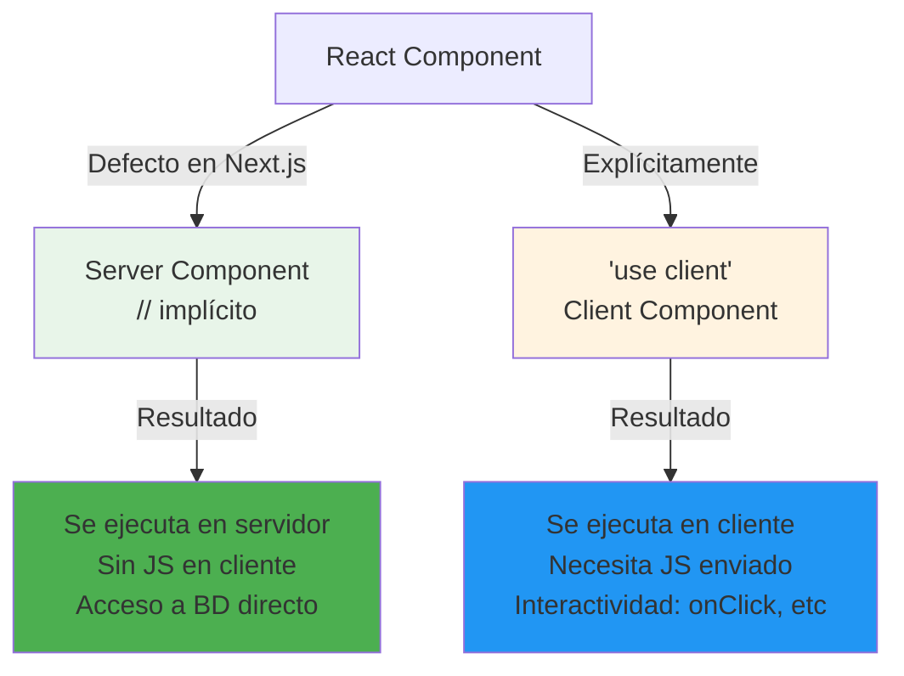
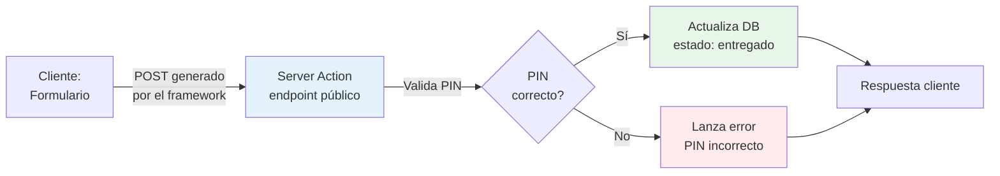

# Módulo 10: Server Components y Next.js


## Aprende construyendo

**Servidor del módulo:** todo este módulo trabaja en el proyecto Next.js `app` que creas en el Tema 1 (Server Components, `"use client"`, streaming y Server Actions necesitan un framework con soporte de React Server Components; un proyecto Vite sin esa integración no los ejecuta). Arráncalo con `npm run dev` y abre `http://localhost:3000`; la comprobación se hace en el navegador y con `npm run build`.


### Tema 1: Server Components por defecto · Avanzado · 45 min

<details open>
<summary><strong>Capa 1 — Lectura</strong></summary>

#### ► DE QUÉ TRATA
Al finalizar podrás evaluar React Server Components desde cero. Prerrequisitos: Node.js LTS, npm y editor. Verifica node --version y npm --version.

#### ► LA IDEA EN UNA FRASE
**Al finalizar podrás evaluar React Server Components desde cero.**

#### ► POR QUÉ EXISTE ESTO
Resuelve un problema real de diseño o implementación y evita decisiones a ciegas.

#### ► LA ANALOGÍA
Piensa en server components por defecto como una herramienta de taller: útil cuando conoces su propósito y sus límites.
**Dónde se rompe la analogía:** en software, los efectos dependen del contexto, la escala y los trade-offs.

#### ► CÓMO FUNCIONA


#### ► LO QUE PUEDE SALIR MAL
| Síntoma | Causa probable | Arreglo |
|---|---|---|
| Server Components por defecto se aplica pero el resultado no mejora | Se usó sin medir el problema real | Mide antes y compara contra la alternativa simple |
| Aparece complejidad inesperada | Se adoptó la técnica sin comprender sus trade-offs | Vuelve a la sección de trade-offs y reduce el alcance |
| Falla en un caso límite | Se asumió un contexto que no se cumple | Prueba el caso límite y documenta cuándo NO usarlo |

#### ► TRADE-OFFS
| Opción | Cuándo usarla | Cuándo NO usarla |
|---|---|---|
| Usar Server Components por defecto | Cuando el problema coincide con su propósito y el beneficio es observable | Cuando agrega complejidad sin resolver un problema real |
| Alternativa más simple | Cuando el contexto es pequeño, estable o fácil de razonar | Cuando ya demostró no escalar o no cumplir el requisito |
| Postergar la decisión | Cuando falta evidencia del problema | Cuando el costo de esperar es mayor que el costo de probar |

#### ► CUÁNDO NO USAR ESTO
No uses server components por defecto por defecto. Aplícalo cuando el problema lo justifique y puedas verificar el beneficio; si una alternativa más simple resuelve igual, prefiérela.

#### ► DE VUELTA A LA ANALOGÍA
Volviendo a la analogía: server components por defecto funciona como el modelo inicial, pero recuerda dónde se rompe: en producción importan la evidencia, la escala y el costo de equivocarte.

#### ► LO QUE DEBES RECORDAR
- Server Components por defecto existe para resolver un problema específico.
- Mide antes de adoptar complejidad.
- Conoce el caso donde NO usarlo.
- Verifica con evidencia observable.

#### ► PREGUNTAS PARA PENSAR
1. ¿Qué problema concreto resuelve server components por defecto en tu contexto?
2. ¿Cómo sabrías que server components por defecto no está funcionando bien?
3. ¿Qué alternativa más simple considerarías antes de usar server components por defecto?

</details>

<details>
<summary><strong>Capa 2 — Construcción</strong></summary>

#### Código y verificación


```tsx
async function PaginaTareas() {
  const tareas = await db.tarea.findMany();
  return <ListaTareas tareas={tareas} />;
}
```

```jsx
// app/tareas/page.tsx — Server Component (sin "use client")
async function PaginaTareas() {
  const tareas = await db.tarea.findMany(); // acceso directo a datos, corre solo en el servidor
  return <ListaTareas tareas={tareas} />;
}
```

```bash
mkdir ejemplo-react-m10
cd ejemplo-react-m10
npx create-next-app@latest app --ts --eslint --app --src-dir --no-tailwind --use-npm
cd app
npm run dev
```

</details>

### Tema 2: use client para interactividad · Avanzado · 45 min

<details open>
<summary><strong>Capa 1 — Lectura</strong></summary>

#### ► DE QUÉ TRATA
Al finalizar vas a marcar BotonConfirmarEntrega con "use client" porque usa useState, mientras PaginaEnvio (su padre) permanece como Server Component. Prerrequisitos: Tema 1 de este módulo.

#### ► LA IDEA EN UNA FRASE
**Al finalizar vas a marcar BotonConfirmarEntrega con "use client" porque usa useState, mientras PaginaEnvio (su padre) permanece como Server Component.**

#### ► POR QUÉ EXISTE ESTO
Resuelve un problema real de diseño o implementación y evita decisiones a ciegas.

#### ► LA ANALOGÍA
Piensa en use client para interactividad como una herramienta de taller: útil cuando conoces su propósito y sus límites.
**Dónde se rompe la analogía:** en software, los efectos dependen del contexto, la escala y los trade-offs.

#### ► CÓMO FUNCIONA
1. Identifica el problema que use client para interactividad resuelve.
2. Observa sus componentes y relaciones.
3. Aplica la opción más simple que funcione.
4. Verifica el resultado y los límites.

#### ► LO QUE PUEDE SALIR MAL
| Síntoma | Causa probable | Arreglo |
|---|---|---|
| use client para interactividad se aplica pero el resultado no mejora | Se usó sin medir el problema real | Mide antes y compara contra la alternativa simple |
| Aparece complejidad inesperada | Se adoptó la técnica sin comprender sus trade-offs | Vuelve a la sección de trade-offs y reduce el alcance |
| Falla en un caso límite | Se asumió un contexto que no se cumple | Prueba el caso límite y documenta cuándo NO usarlo |

#### ► TRADE-OFFS
| Opción | Cuándo usarla | Cuándo NO usarla |
|---|---|---|
| Usar use client para interactividad | Cuando el problema coincide con su propósito y el beneficio es observable | Cuando agrega complejidad sin resolver un problema real |
| Alternativa más simple | Cuando el contexto es pequeño, estable o fácil de razonar | Cuando ya demostró no escalar o no cumplir el requisito |
| Postergar la decisión | Cuando falta evidencia del problema | Cuando el costo de esperar es mayor que el costo de probar |

#### ► CUÁNDO NO USAR ESTO
No uses use client para interactividad por defecto. Aplícalo cuando el problema lo justifique y puedas verificar el beneficio; si una alternativa más simple resuelve igual, prefiérela.

#### ► DE VUELTA A LA ANALOGÍA
Volviendo a la analogía: use client para interactividad funciona como el modelo inicial, pero recuerda dónde se rompe: en producción importan la evidencia, la escala y el costo de equivocarte.

#### ► LO QUE DEBES RECORDAR
- use client para interactividad existe para resolver un problema específico.
- Mide antes de adoptar complejidad.
- Conoce el caso donde NO usarlo.
- Verifica con evidencia observable.

#### ► PREGUNTAS PARA PENSAR
1. ¿Qué problema concreto resuelve use client para interactividad en tu contexto?
2. ¿Cómo sabrías que use client para interactividad no está funcionando bien?
3. ¿Qué alternativa más simple considerarías antes de usar use client para interactividad?

</details>

<details>
<summary><strong>Capa 2 — Construcción</strong></summary>

#### Objetivo observable
Al finalizar vas a marcar `BotonConfirmarEntrega` con `"use client"` porque usa `useState`, mientras `PaginaEnvio` (su padre) permanece como Server Component. Prerrequisitos: Tema 1 de este módulo.

</details>

### Tema 3: Streaming con Suspense en el servidor · Avanzado · 40 min

<details open>
<summary><strong>Capa 1 — Lectura</strong></summary>

#### ► DE QUÉ TRATA
Al finalizar vas a envolver la sección de "historial de ubicaciones" de PaginaEnvio (una consulta lenta) en Suspense, para que el resto de la página se muestre sin esperarla. Prerrequisitos: Tema 2 de este módulo.

#### ► LA IDEA EN UNA FRASE
**Al finalizar vas a envolver la sección de "historial de ubicaciones" de PaginaEnvio (una consulta lenta) en Suspense, para que el resto de la página se muestre sin esperarla.**

#### ► POR QUÉ EXISTE ESTO
Resuelve un problema real de diseño o implementación y evita decisiones a ciegas.

#### ► LA ANALOGÍA
Piensa en streaming con suspense en el servidor como una herramienta de taller: útil cuando conoces su propósito y sus límites.
**Dónde se rompe la analogía:** en software, los efectos dependen del contexto, la escala y los trade-offs.

#### ► CÓMO FUNCIONA
1. Identifica el problema que streaming con suspense en el servidor resuelve.
2. Observa sus componentes y relaciones.
3. Aplica la opción más simple que funcione.
4. Verifica el resultado y los límites.

#### ► LO QUE PUEDE SALIR MAL
| Síntoma | Causa probable | Arreglo |
|---|---|---|
| Streaming con Suspense en el servidor se aplica pero el resultado no mejora | Se usó sin medir el problema real | Mide antes y compara contra la alternativa simple |
| Aparece complejidad inesperada | Se adoptó la técnica sin comprender sus trade-offs | Vuelve a la sección de trade-offs y reduce el alcance |
| Falla en un caso límite | Se asumió un contexto que no se cumple | Prueba el caso límite y documenta cuándo NO usarlo |

#### ► TRADE-OFFS
| Opción | Cuándo usarla | Cuándo NO usarla |
|---|---|---|
| Usar Streaming con Suspense en el servidor | Cuando el problema coincide con su propósito y el beneficio es observable | Cuando agrega complejidad sin resolver un problema real |
| Alternativa más simple | Cuando el contexto es pequeño, estable o fácil de razonar | Cuando ya demostró no escalar o no cumplir el requisito |
| Postergar la decisión | Cuando falta evidencia del problema | Cuando el costo de esperar es mayor que el costo de probar |

#### ► CUÁNDO NO USAR ESTO
No uses streaming con suspense en el servidor por defecto. Aplícalo cuando el problema lo justifique y puedas verificar el beneficio; si una alternativa más simple resuelve igual, prefiérela.

#### ► DE VUELTA A LA ANALOGÍA
Volviendo a la analogía: streaming con suspense en el servidor funciona como el modelo inicial, pero recuerda dónde se rompe: en producción importan la evidencia, la escala y el costo de equivocarte.

#### ► LO QUE DEBES RECORDAR
- Streaming con Suspense en el servidor existe para resolver un problema específico.
- Mide antes de adoptar complejidad.
- Conoce el caso donde NO usarlo.
- Verifica con evidencia observable.

#### ► PREGUNTAS PARA PENSAR
1. ¿Qué problema concreto resuelve streaming con suspense en el servidor en tu contexto?
2. ¿Cómo sabrías que streaming con suspense en el servidor no está funcionando bien?
3. ¿Qué alternativa más simple considerarías antes de usar streaming con suspense en el servidor?

</details>

<details>
<summary><strong>Capa 2 — Construcción</strong></summary>

#### Código y verificación
```jsx
<Suspense fallback={<Spinner />}>
  <SeccionLenta /> {/* el resto de la página se muestra mientras esto carga */}
</Suspense>
```

```tsx
async function HistorialUbicaciones({ envioId }: { envioId: string }) {
  const historial = await obtenerHistorial(envioId); // tarda 3 segundos
  return <ul>{historial.map((punto) => <li key={punto}>{punto}</li>)}</ul>;
}
```

```tsx
<Suspense fallback={<p>Cargando historial…</p>}>
  <HistorialUbicaciones envioId={envio.id} /> {/* consulta lenta */}
</Suspense>
```

```bash
npm run dev
```

</details>

### Tema 4: Server Actions · Avanzado · 45 min

<details open>
<summary><strong>Capa 1 — Lectura</strong></summary>

#### ► DE QUÉ TRATA
Al finalizar vas a implementar confirmarEntregaAction como Server Action, invocada directamente desde un <form> sin que escribas una ruta API propia, y a tratarla como lo que es: un endpoint POST público que Next.js crea por ti. Prerrequisitos: Tema 3 de este módulo.

#### ► LA IDEA EN UNA FRASE
**Al finalizar vas a implementar confirmarEntregaAction como Server Action, invocada directamente desde un <form> sin que escribas una ruta API propia, y a tratarla como lo que es: un endpoint POST público que Next.js crea por ti.**

#### ► POR QUÉ EXISTE ESTO
Resuelve un problema real de diseño o implementación y evita decisiones a ciegas.

#### ► LA ANALOGÍA
Piensa en server actions como una herramienta de taller: útil cuando conoces su propósito y sus límites.
**Dónde se rompe la analogía:** en software, los efectos dependen del contexto, la escala y los trade-offs.

#### ► CÓMO FUNCIONA


#### ► LO QUE PUEDE SALIR MAL
| Síntoma | Causa probable | Arreglo |
|---|---|---|
| Server Actions se aplica pero el resultado no mejora | Se usó sin medir el problema real | Mide antes y compara contra la alternativa simple |
| Aparece complejidad inesperada | Se adoptó la técnica sin comprender sus trade-offs | Vuelve a la sección de trade-offs y reduce el alcance |
| Falla en un caso límite | Se asumió un contexto que no se cumple | Prueba el caso límite y documenta cuándo NO usarlo |

#### ► TRADE-OFFS
| Opción | Cuándo usarla | Cuándo NO usarla |
|---|---|---|
| Usar Server Actions | Cuando el problema coincide con su propósito y el beneficio es observable | Cuando agrega complejidad sin resolver un problema real |
| Alternativa más simple | Cuando el contexto es pequeño, estable o fácil de razonar | Cuando ya demostró no escalar o no cumplir el requisito |
| Postergar la decisión | Cuando falta evidencia del problema | Cuando el costo de esperar es mayor que el costo de probar |

#### ► CUÁNDO NO USAR ESTO
No uses server actions por defecto. Aplícalo cuando el problema lo justifique y puedas verificar el beneficio; si una alternativa más simple resuelve igual, prefiérela.

#### ► DE VUELTA A LA ANALOGÍA
Volviendo a la analogía: server actions funciona como el modelo inicial, pero recuerda dónde se rompe: en producción importan la evidencia, la escala y el costo de equivocarte.

#### ► LO QUE DEBES RECORDAR
- Server Actions existe para resolver un problema específico.
- Mide antes de adoptar complejidad.
- Conoce el caso donde NO usarlo.
- Verifica con evidencia observable.

#### ► PREGUNTAS PARA PENSAR
1. ¿Qué problema concreto resuelve server actions en tu contexto?
2. ¿Cómo sabrías que server actions no está funcionando bien?
3. ¿Qué alternativa más simple considerarías antes de usar server actions?

</details>

<details>
<summary><strong>Capa 2 — Construcción</strong></summary>

#### Objetivo observable
Al finalizar vas a implementar `confirmarEntregaAction` como Server Action, invocada directamente desde un `<form>` sin que escribas una ruta API propia, y a tratarla como lo que es: un endpoint POST público que Next.js crea por ti. Prerrequisitos: Tema 3 de este módulo.

</details>
