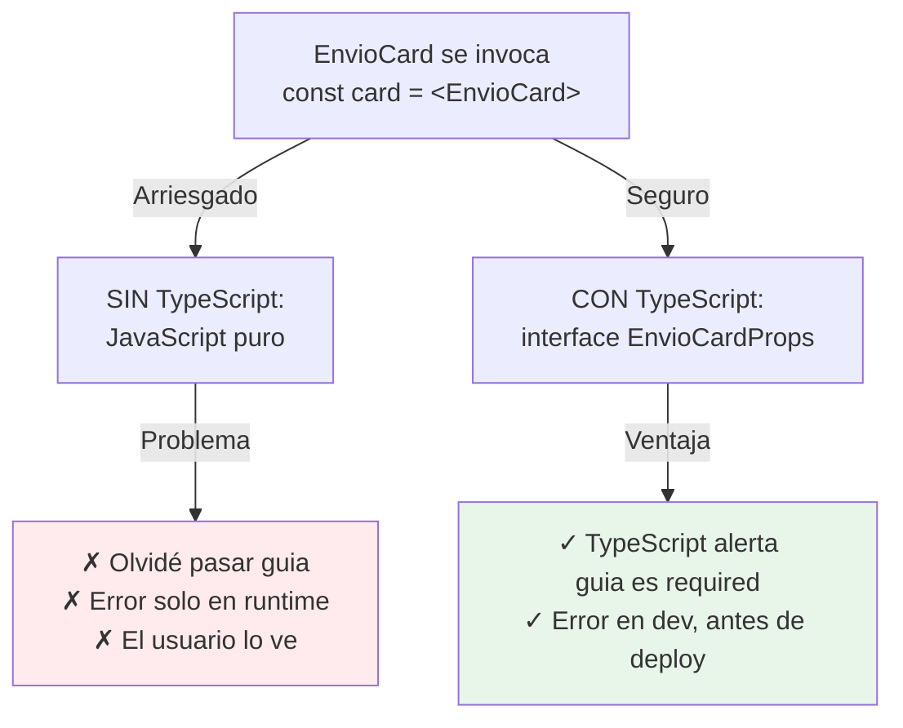
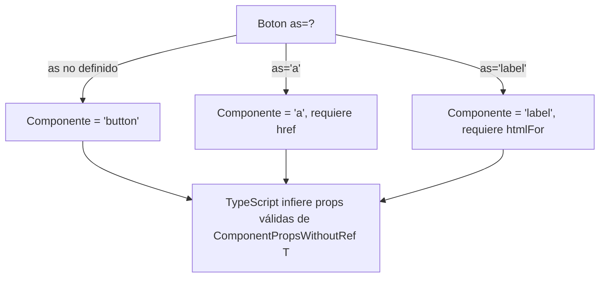

# Módulo 11: TypeScript con React


## Aprende construyendo

**Servidor del módulo:** este módulo necesita un proyecto con TypeScript, porque las comprobaciones son errores de tipos. Créalo una vez, junto a `mi-react`:

```bash
npm create vite@latest mi-react-ts -- --template react-ts
cd mi-react-ts
npm install
```

Cada ejemplo reemplaza `src/App.tsx`. `npm run dev` lo sirve en `http://localhost:5173` (sin revisar tipos); `npm run build` ejecuta `tsc -b` y **es la prueba de este módulo**: falla si hay un error de tipos.


### Tema 1: Tipado de props y children · Intermedio · 40 min

<details open>
<summary><strong>Capa 1 — Lectura</strong></summary>

#### ► DE QUÉ TRATA
Al finalizar vas a tipar las props de EnvioCard con una interface, incluyendo children: React.ReactNode para aceptar contenido adicional opcional dentro de la tarjeta. Prerrequisitos: Módulo 0 completo.

#### ► LA IDEA EN UNA FRASE
**Al finalizar vas a tipar las props de EnvioCard con una interface, incluyendo children: React.ReactNode para aceptar contenido adicional opcional dentro de la tarjeta.**

#### ► POR QUÉ EXISTE ESTO
Resuelve un problema real de diseño o implementación y evita decisiones a ciegas.

#### ► LA ANALOGÍA
Piensa en tipado de props y children como una herramienta de taller: útil cuando conoces su propósito y sus límites.
**Dónde se rompe la analogía:** en software, los efectos dependen del contexto, la escala y los trade-offs.

#### ► CÓMO FUNCIONA


#### ► LO QUE PUEDE SALIR MAL
| Síntoma | Causa probable | Arreglo |
|---|---|---|
| Tipado de props y children se aplica pero el resultado no mejora | Se usó sin medir el problema real | Mide antes y compara contra la alternativa simple |
| Aparece complejidad inesperada | Se adoptó la técnica sin comprender sus trade-offs | Vuelve a la sección de trade-offs y reduce el alcance |
| Falla en un caso límite | Se asumió un contexto que no se cumple | Prueba el caso límite y documenta cuándo NO usarlo |

#### ► TRADE-OFFS
| Opción | Cuándo usarla | Cuándo NO usarla |
|---|---|---|
| Usar Tipado de props y children | Cuando el problema coincide con su propósito y el beneficio es observable | Cuando agrega complejidad sin resolver un problema real |
| Alternativa más simple | Cuando el contexto es pequeño, estable o fácil de razonar | Cuando ya demostró no escalar o no cumplir el requisito |
| Postergar la decisión | Cuando falta evidencia del problema | Cuando el costo de esperar es mayor que el costo de probar |

#### ► CUÁNDO NO USAR ESTO
No uses tipado de props y children por defecto. Aplícalo cuando el problema lo justifique y puedas verificar el beneficio; si una alternativa más simple resuelve igual, prefiérela.

#### ► DE VUELTA A LA ANALOGÍA
Volviendo a la analogía: tipado de props y children funciona como el modelo inicial, pero recuerda dónde se rompe: en producción importan la evidencia, la escala y el costo de equivocarte.

#### ► LO QUE DEBES RECORDAR
- Tipado de props y children existe para resolver un problema específico.
- Mide antes de adoptar complejidad.
- Conoce el caso donde NO usarlo.
- Verifica con evidencia observable.

#### ► PREGUNTAS PARA PENSAR
1. ¿Qué problema concreto resuelve tipado de props y children en tu contexto?
2. ¿Cómo sabrías que tipado de props y children no está funcionando bien?
3. ¿Qué alternativa más simple considerarías antes de usar tipado de props y children?

</details>

<details>
<summary><strong>Capa 2 — Construcción</strong></summary>

#### Código y verificación


```typescript
interface TarjetaProps {
  titulo: string;
  children: React.ReactNode;
  onSeleccionar?: () => void;
}
```

```tsx
interface TarjetaProps {
  titulo: string;
  children: React.ReactNode;
  onSeleccionar?: () => void; // opcional
}

function Tarjeta({ titulo, children, onSeleccionar }: TarjetaProps) {
  return <div onClick={onSeleccionar}><h2>{titulo}</h2>{children}</div>;
}
```

```tsx
interface EnvioCardProps {
  guia: string;
  direccion: string;
  children?: React.ReactNode;
}

function EnvioCard({ guia, direccion, children }: EnvioCardProps) {
  return <div><h3>{guia}</h3><p>{direccion}</p>{children}</div>;
}

export default function App() {
  return (
    <EnvioCard guia="RF-4471" direccion="Calle 10 # 5-20">
      <p>Entrega antes de las 18:00</p>
    </EnvioCard>
  );
}
```

```bash
npm run build
npm run dev
```

</details>

### Tema 2: Hooks genéricos · Avanzado · 45 min

<details open>
<summary><strong>Capa 1 — Lectura</strong></summary>

#### ► DE QUÉ TRATA
Al finalizar vas a escribir useLocalStorage<T> genérico y usarlo tanto para persistir el filtro de zona (string) como las columnas visibles de una tabla (un array), sin duplicar la implementación. Prerrequisitos: Tema 1 de este módulo.

#### ► LA IDEA EN UNA FRASE
**Al finalizar vas a escribir useLocalStorage<T> genérico y usarlo tanto para persistir el filtro de zona (string) como las columnas visibles de una tabla (un array), sin duplicar la implementación.**

#### ► POR QUÉ EXISTE ESTO
Resuelve un problema real de diseño o implementación y evita decisiones a ciegas.

#### ► LA ANALOGÍA
Piensa en hooks genéricos como una herramienta de taller: útil cuando conoces su propósito y sus límites.
**Dónde se rompe la analogía:** en software, los efectos dependen del contexto, la escala y los trade-offs.

#### ► CÓMO FUNCIONA
1. Identifica el problema que hooks genéricos resuelve.
2. Observa sus componentes y relaciones.
3. Aplica la opción más simple que funcione.
4. Verifica el resultado y los límites.

#### ► LO QUE PUEDE SALIR MAL
| Síntoma | Causa probable | Arreglo |
|---|---|---|
| Hooks genéricos se aplica pero el resultado no mejora | Se usó sin medir el problema real | Mide antes y compara contra la alternativa simple |
| Aparece complejidad inesperada | Se adoptó la técnica sin comprender sus trade-offs | Vuelve a la sección de trade-offs y reduce el alcance |
| Falla en un caso límite | Se asumió un contexto que no se cumple | Prueba el caso límite y documenta cuándo NO usarlo |

#### ► TRADE-OFFS
| Opción | Cuándo usarla | Cuándo NO usarla |
|---|---|---|
| Usar Hooks genéricos | Cuando el problema coincide con su propósito y el beneficio es observable | Cuando agrega complejidad sin resolver un problema real |
| Alternativa más simple | Cuando el contexto es pequeño, estable o fácil de razonar | Cuando ya demostró no escalar o no cumplir el requisito |
| Postergar la decisión | Cuando falta evidencia del problema | Cuando el costo de esperar es mayor que el costo de probar |

#### ► CUÁNDO NO USAR ESTO
No uses hooks genéricos por defecto. Aplícalo cuando el problema lo justifique y puedas verificar el beneficio; si una alternativa más simple resuelve igual, prefiérela.

#### ► DE VUELTA A LA ANALOGÍA
Volviendo a la analogía: hooks genéricos funciona como el modelo inicial, pero recuerda dónde se rompe: en producción importan la evidencia, la escala y el costo de equivocarte.

#### ► LO QUE DEBES RECORDAR
- Hooks genéricos existe para resolver un problema específico.
- Mide antes de adoptar complejidad.
- Conoce el caso donde NO usarlo.
- Verifica con evidencia observable.

#### ► PREGUNTAS PARA PENSAR
1. ¿Qué problema concreto resuelve hooks genéricos en tu contexto?
2. ¿Cómo sabrías que hooks genéricos no está funcionando bien?
3. ¿Qué alternativa más simple considerarías antes de usar hooks genéricos?

</details>

<details>
<summary><strong>Capa 2 — Construcción</strong></summary>

#### Código y verificación
```tsx
function useLocalStorage<T>(clave: string, valorInicial: T) {
  const [valor, setValor] = useState<T>(() => {
    const guardado = localStorage.getItem(clave);
    return guardado ? JSON.parse(guardado) : valorInicial;
  });
  useEffect(() => localStorage.setItem(clave, JSON.stringify(valor)), [clave, valor]);
  return [valor, setValor] as const;
}

// Dentro de un componente (nunca a nivel de módulo):
const [tema, setTema] = useLocalStorage<'claro' | 'oscuro'>('tema', 'claro');
```

```tsx
import { useEffect, useState } from 'react';

function useLocalStorage<T>(clave: string, valorInicial: T) {
  const [valor, setValor] = useState<T>(() => {
    const guardado = localStorage.getItem(clave);
    if (guardado === null) return valorInicial;
    try {
      return JSON.parse(guardado) as T;
    } catch {
      return valorInicial; // JSON corrupto: se descarta en vez de romper el render
    }
  });
  useEffect(() => localStorage.setItem(clave, JSON.stringify(valor)), [clave, valor]);
  return [valor, setValor] as const;
}

export default function App() {
  // Los hooks se llaman dentro de un componente, nunca a nivel de módulo.
  const [zona, setZona] = useLocalStorage<string>('zona', 'todas');
  const [columnas, setColumnas] = useLocalStorage<string[]>('columnas', ['guia', 'estado']);
  return (
    <main>
      <button onClick={() => setZona('norte')}>Zona: {zona}</button>
      <button onClick={() => setColumnas([...columnas, 'direccion'])}>Columnas: {columnas.join(', ')}</button>
    </main>
  );
}
```

```bash
npm run build
npm run dev
```

</details>

### Tema 3: Eventos tipados y componentes polimórficos · Avanzado · 40 min

<details open>
<summary><strong>Capa 1 — Lectura</strong></summary>

#### ► DE QUÉ TRATA
Al finalizar vas a tipar el manejador de cambio del campo de búsqueda de guía con React.ChangeEvent<HTMLInputElement>, y a construir un Boton polimórfico que pueda renderizarse como <button> o como <a>. Prerrequisitos: Tema 2 de este módulo.

#### ► LA IDEA EN UNA FRASE
**Al finalizar vas a tipar el manejador de cambio del campo de búsqueda de guía con React.ChangeEvent<HTMLInputElement>, y a construir un Boton polimórfico que pueda renderizarse como <button> o como <a>.**

#### ► POR QUÉ EXISTE ESTO
Resuelve un problema real de diseño o implementación y evita decisiones a ciegas.

#### ► LA ANALOGÍA
Tipar un evento con el tipo específico del elemento permite que TypeScript sepa qué propiedades existen en `e.target`; un componente polimórfico renderiza distintos elementos según una prop `as`, tipado dinámicamente según cuál se indique.
**Conceptos clave:** `React.ChangeEvent<T>`, componentes que renderizan como elemento configurable.

Tipar el parámetro de un manejador de eventos con el tipo específico correspondiente (`function manejarCambio(e: React.ChangeEvent<HTMLInputElement>) { console.log(e.target.value); }`) permite que TypeScript sepa exactamente qué propiedades existen en `e.target` según el tipo de elemento involucrado (`.value` existe en un `HTMLInputElement`, pero no necesariamente de la misma forma en otros tipos de elementos), detectando en tiempo de compilación el acceso a una propiedad que no existiría realmente en ese tipo específico de evento, en vez de descubrir ese error únicamente en tiempo de ejecución con un valor `undefined` inesperado.

Un componente polimórfico es aquel que puede renderizarse como distintos elementos HTML o componentes subyacentes según una prop `as` (`<Boton as="a" href="/inicio">Ir</Boton>` renderizando un `<a>` en vez de un `<button>`), y tiparlo correctamente (`type BotonProps<T extends React.ElementType> = { as?: T } & React.ComponentPropsWithoutRef<T>`) requiere que TypeScript infiera dinámicamente qué props son válidas según el elemento específico indicado en `as` (aceptando `href` cuando `as="a"`, pero rechazándolo cuando `as` es el valor por defecto `'button'`, dado que un `<button>` no tiene una prop `href` válida), un patrón de tipado avanzado que preserva la seguridad de tipos incluso para componentes deliberadamente flexibles en cuanto a qué elemento final renderizan.

**Analogía:** un componente polimórfico correctamente tipado es como un formulario de pedido que ajusta automáticamente qué campos son válidos y obligatorios según qué producto específico se seleccione, en vez de mostrar siempre el mismo conjunto fijo de campos sin importar qué producto realmente se está pidiendo.

**¿Por qué es importante?** Tipar eventos sintéticos correctamente detecta accesos inválidos a propiedades del evento en tiempo de compilación; tipar componentes polimórficos preserva la seguridad de tipos incluso cuando el elemento final renderizado es configurable dinámicamente.

**Código del ejemplo:**

```tsx
function manejarCambio(e: React.ChangeEvent<HTMLInputElement>) {
  console.log(e.target.value); // TypeScript sabe que .value existe
}

type BotonProps<T extends React.ElementType> = { as?: T } & React.ComponentPropsWithoutRef<T>;
function Boton<T extends React.ElementType = 'button'>({ as, ...props }: BotonProps<T>) {
  const Componente = as || 'button';
  return <Componente {...props} />;
}
```

**Dónde se rompe la analogía:** el modelo simplifica la realidad; en producción influyen escala, fallos, costo y contexto.

#### ► CÓMO FUNCIONA


#### ► LO QUE PUEDE SALIR MAL
| Síntoma | Causa probable | Arreglo |
|---|---|---|
| Eventos tipados y componentes polimórficos se aplica pero el resultado no mejora | Se usó sin medir el problema real | Mide antes y compara contra la alternativa simple |
| Aparece complejidad inesperada | Se adoptó la técnica sin comprender sus trade-offs | Vuelve a la sección de trade-offs y reduce el alcance |
| Falla en un caso límite | Se asumió un contexto que no se cumple | Prueba el caso límite y documenta cuándo NO usarlo |

#### ► TRADE-OFFS
| Opción | Cuándo usarla | Cuándo NO usarla |
|---|---|---|
| Usar Eventos tipados y componentes polimórficos | Cuando el problema coincide con su propósito y el beneficio es observable | Cuando agrega complejidad sin resolver un problema real |
| Alternativa más simple | Cuando el contexto es pequeño, estable o fácil de razonar | Cuando ya demostró no escalar o no cumplir el requisito |
| Postergar la decisión | Cuando falta evidencia del problema | Cuando el costo de esperar es mayor que el costo de probar |

#### ► CUÁNDO NO USAR ESTO
No uses eventos tipados y componentes polimórficos por defecto. Aplícalo cuando el problema lo justifique y puedas verificar el beneficio; si una alternativa más simple resuelve igual, prefiérela.

#### ► DE VUELTA A LA ANALOGÍA
Volviendo a la analogía: eventos tipados y componentes polimórficos funciona como el modelo inicial, pero recuerda dónde se rompe: en producción importan la evidencia, la escala y el costo de equivocarte.

#### ► LO QUE DEBES RECORDAR
- Eventos tipados y componentes polimórficos existe para resolver un problema específico.
- Mide antes de adoptar complejidad.
- Conoce el caso donde NO usarlo.
- Verifica con evidencia observable.

#### ► PREGUNTAS PARA PENSAR
1. ¿Qué problema concreto resuelve eventos tipados y componentes polimórficos en tu contexto?
2. ¿Cómo sabrías que eventos tipados y componentes polimórficos no está funcionando bien?
3. ¿Qué alternativa más simple considerarías antes de usar eventos tipados y componentes polimórficos?

</details>

<details>
<summary><strong>Capa 2 — Construcción</strong></summary>

#### Código y verificación
```tsx
function manejarCambio(e: React.ChangeEvent<HTMLInputElement>) {
  console.log(e.target.value); // TypeScript sabe que .value existe
}

type BotonProps<T extends React.ElementType> = { as?: T } & React.ComponentPropsWithoutRef<T>;
function Boton<T extends React.ElementType = 'button'>({ as, ...props }: BotonProps<T>) {
  const Componente = as || 'button';
  return <Componente {...props} />;
}
```


```bash
npm run build
```

```tsx
function manejarCambioBusqueda(e: React.ChangeEvent<HTMLInputElement>) {
  console.log(e.target.value); // TypeScript sabe que .value existe en HTMLInputElement
}

type BotonProps<T extends React.ElementType> = { as?: T } & React.ComponentPropsWithoutRef<T>;

function Boton<T extends React.ElementType = 'button'>({ as, ...props }: BotonProps<T>) {
  const Componente = as || 'button';
  return <Componente {...props} />;
}

export default function App() {
  return (
    <main>
      <input aria-label="Buscar envío" onChange={manejarCambioBusqueda} />
      <Boton as="a" href="/envios/RF-4471">Ver detalle</Boton>
      <Boton onClick={() => console.log('acción')}>Marcar entregado</Boton>
    </main>
  );
}
```

```bash
npm run build
npm run dev
```

</details>
